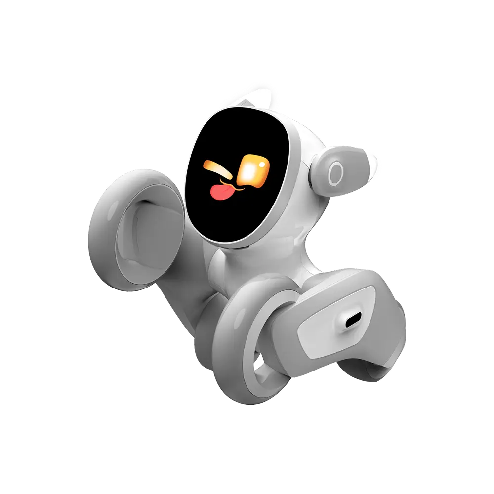
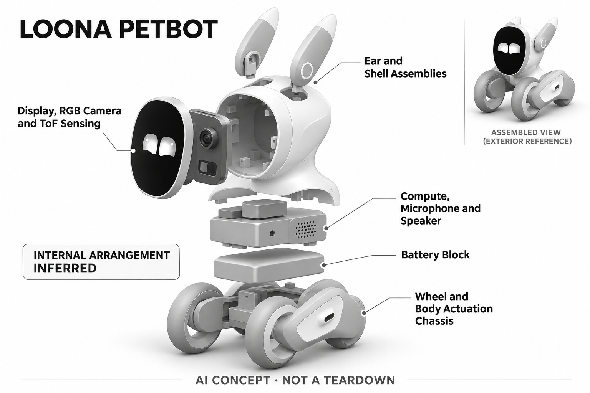

# Loona Petbot Premium

**KEYI Tech** · AI玩具 · 核查 2026-11-06

轮式家庭宠物与GPT对话结合

消费渠道：个人零售。

## 产品图片与结构参考

### 产品图

Loona Petbot Premium 官方动作产品图 · 来源：[KEYI Tech · 官方图片](<https://keyirobot.com/products/petbot>) · [原始图片](<https://cdn.shopify.com/s/files/1/0750/4170/2077/files/gallery-loona-petbot-premium-1-v2.webp?v=1780474015&width=1200>)

### 参考图

Loona Petbot Premium 官方侧前方参考 · 来源：[KEYI Tech · 官方图片](<https://keyirobot.com/products/petbot>) · [原始图片](<https://cdn.shopify.com/s/files/1/0750/4170/2077/files/gallery-loona-petbot-premium-2-v2.webp?v=1780474015&width=1200>)

### AI 生成爆炸示意

**AI 生成 · 非实物拆机。** 内部为概念推断，不能作为元件布局、BOM 或维修依据。[生成提示词](../../content/hardware/prompts/loona-petbot.txt)

> 已目视核对产品外形与AI标识；verified不代表内部布局经实物拆机验证。

> 分析为基于公开资料的案头研究与 AI 辅助判断，未经用户访谈、销量审计或实物拆机。需求、画像、竞争冷门度、审美及商业机会均为研究假设，不是投资结论。

## 销售与购买

- 状态：在售。官方Petbot Premium商品页当前列US$429与Buy Now；新Deskmate不是本条产品，所选套装与地区以结算确认。

- 地区：国际官网（配送地区以结算为准）

- 价格：US$429。核查时Premium页面促销价；充电座、游戏道具及不同版本需按所选SKU确认，优惠可能变化。

- 中国大陆：已确认国际官网在售；本次没有完整核实大陆版本、GPT服务可达性和本地保修，不直接标为国行可用。

- [官方产品 / 商店](<https://keyirobot.com/products/petbot>)

## AI 的实际作用

人脸、声音定位与环境感知结合GPT对话、故事及图像相关互动，运动控制和生成式服务分别承担不同职责。

服务与联网依赖：自主感知与执行由机身处理系统支持；GPT互动依赖联网服务，地区、语言和账户条件应在购买前核对。

## 是否冷门

竞争密集（研究判断）：实体陪伴与GPT问答的组合已有多品牌，需靠可靠互动细分。

## 需求与市场

需求假设：家庭希望机器人能跟随、玩游戏又回答问题，物理移动带来的共同活动可能比单纯聊天更有价值。应测试孩子是否愿意持续主动玩耍，以及家长是否认可占地和充电成本。

### 产品任务与边界 · 研究判断

Loona Petbot Premium 将移动宠物和生成式对话放在同一机身中，任务既包括一起玩，也包括问答和故事。它的潜在价值是把屏幕对话变成共同的实体活动，但用户是否需要两类能力同时存在，不能从功能丰富直接推断。

依据：[Loona Petbot官方商品与规格](<https://keyirobot.com/products/petbot>) · [KEYI Tech官方首页](<https://keyirobot.com/>)

### 需求判断 · 研究判断

轮式移动可以创造追随、寻找和偶遇等互动，却要求地面空间与人工照护。若家庭主要使用静态问答，移动机构的成本和维护可能没有被充分利用；需求分析应观察功能组合是否真正互相增强，而非简单相加。

依据：[Loona Petbot官方商品与规格](<https://keyirobot.com/products/petbot>) · [KEYI Tech官方首页](<https://keyirobot.com/>)

### 需求验证 · 待验证

可记录家庭连续数周内的游戏、问答和无人使用时间，并统计每次移动互动所需的人工救援。比较关闭生成对话与保留对话时的使用差异，确认身体行动是否带来独立价值，而不是只依赖新鲜的回答内容。

依据：[Loona Petbot官方商品与规格](<https://keyirobot.com/products/petbot>) · [KEYI Tech官方首页](<https://keyirobot.com/>)

## 用户画像

用户画像推断：有足够地面活动空间、愿意设置网络并参与互动的家庭更适合。不同年龄儿童对故事、追逐和编程的偏好可能差异很大，不能用一个“儿童AI伙伴”标签代替用户分层。

### 适用行为与条件 · 研究判断

较适合愿意腾出地面空间、参与设置和共同游戏的家庭。购买者可能期待学习或陪伴，实际使用者却偏好追逐和表情，因此画像应按互动任务拆分，不能把所有儿童都归为同一类人工智能伙伴用户。

依据：[Loona Petbot官方商品与规格](<https://keyirobot.com/products/petbot>) · [KEYI Tech官方首页](<https://keyirobot.com/>)

### 人群取舍 · 研究判断

有地毯、杂物或真实宠物的家庭，需要承担不同的移动适配工作；成人玩具爱好者则可能更重视动作性格和技术探索。用户能否接受设备偶尔需要帮助，是决定长期体验的重要条件，不能只看对机器人是否感兴趣。

依据：[Loona Petbot官方商品与规格](<https://keyirobot.com/products/petbot>) · [KEYI Tech官方首页](<https://keyirobot.com/>)

### 画像验证 · 待验证

画像验证应让不同居住环境的家庭自行布置并使用，记录谁清理路线、谁处理回充和谁主动发起游戏。还需询问家长是否愿意继续承担这些工作，以识别孩子活跃但家庭整体负担过高的使用模式。

依据：[Loona Petbot官方商品与规格](<https://keyirobot.com/products/petbot>) · [KEYI Tech官方首页](<https://keyirobot.com/>)

## 竞争与替代

竞争判断：移动宠物与生成式语音玩具两条赛道都在增加产品，属于拥挤交叉市场。仅接入同类大模型难形成壁垒，稳定导航、动作性格和持续可玩的内容才有可能提高留存。

### 比较对象与差异 · 研究判断

Loona 同时面对桌面陪伴机器人、语音毛绒和遥控玩具，差异在于感知、移动及生成服务的组合。比较时应围绕共同游戏的完成度，不应仅看接入哪家模型，因为相似云端回答并不能复制物理交互体验。

依据：[Loona Petbot官方商品与规格](<https://keyirobot.com/products/petbot>) · [KEYI Tech官方首页](<https://keyirobot.com/>)

### 竞争判断 · 研究判断

多功能容易在演示中形成吸引力，却增加每条体验链路的维护负担。潜在壁垒在可靠动作、明确角色和持续可玩的活动，而不是堆叠描述、故事和问答；如果移动经常失败，其他智能功能很难完全补偿角色可信度。

依据：[Loona Petbot官方商品与规格](<https://keyirobot.com/products/petbot>) · [KEYI Tech官方首页](<https://keyirobot.com/>)

### 竞争验证 · 待验证

竞争验证可让用户完成相同的家庭游戏任务，与不移动的语音角色和普通遥控玩具比较。记录主动重玩、共同参与及人工干预，而非只比较一次回答质量；再给出长期服务条件，观察选择是否发生变化。

依据：[Loona Petbot官方商品与规格](<https://keyirobot.com/products/petbot>) · [KEYI Tech官方首页](<https://keyirobot.com/>)

## 供应链

供应链推断：多电机、轮胎、摄像头、ToF和电池需要兼顾噪声、耐摔与散热；官方披露功能模组但未披露制造工厂。充电接点和地面适应性应纳入量产测试，而不只是跑通样机。

### 功能模块拆分 · 研究判断

官方披露 RGB 摄像头、ToF、麦克风与触碰输入，以及机内计算、轮式驱动、耳部动作、屏幕和声音反馈。生成式互动另有联网路径，这些构成系统功能层，不意味着已经取得实际电路板布局或完整供应商清单。

依据：[Loona Petbot官方商品与规格](<https://keyirobot.com/products/petbot>) · [KEYI Tech官方首页](<https://keyirobot.com/>)

### 制造与供应约束 · 研究判断

制造约束包括多执行机构噪声、轮胎与地面适配、传感器校准、散热及充电接点一致性。耳朵动作与面部表情要协调，外壳装配偏差也可能影响摄像头视线；量产验收应覆盖整机行为，而不能只让各模块独立通电。

依据：[Loona Petbot官方商品与规格](<https://keyirobot.com/products/petbot>) · [KEYI Tech官方首页](<https://keyirobot.com/>)

### 候选与证据缺口 · 研究判断

华勤可作为紧凑联网计算硬件与整机工程候选，HLH 可支持运动结构及外壳原型。双方公开能力仅覆盖部分模块，未有 Loona 点名合作证据；导航、儿童交互及动作安全仍需品牌自身或专门团队定义和验证。

依据：[Loona Petbot官方商品与规格](<https://keyirobot.com/products/petbot>) · [KEYI Tech官方首页](<https://keyirobot.com/>)

## 技术路径

官网明确视觉、声源定位、环境导航和GPT互动。推断难点是把云端生成回复与实时运动安全隔离，避免网络延迟影响碰撞防护；问答聪明与走得稳是两套需要分别验收的能力。

### 已披露技术边界 · 研究判断

官方把环境感知、声源定位和机内处理与 GPT 对话等联网功能同时展示，两种路径承担不同任务。问答生成需要网络条件，实时运动则需要可控的响应边界，不能把语言模型输出直接视为可靠的底层运动控制。

依据：[Loona Petbot官方商品与规格](<https://keyirobot.com/products/petbot>) · [KEYI Tech官方首页](<https://keyirobot.com/>)

### 系统难点判断 · 研究判断

系统难点是让视觉、声音和动作在同一时间尺度内协作。机器人听到呼叫后即使能回答，也可能朝错方向或被家具困住；用户通常感受的是完整行为，因此技术评价必须从感知输入一直跟踪到实际动作结果。

依据：[Loona Petbot官方商品与规格](<https://keyirobot.com/products/petbot>) · [KEYI Tech官方首页](<https://keyirobot.com/>)

### 技术验证 · 待验证

验证应分别覆盖人物识别、声源定位、避障、回充和联网问答，再测试多人同时讲话及网络中断。尤其要观察生成等待是否影响运动安全和状态提示，不以回答流畅推断导航稳定，也不把导航成功当作内容可靠。

依据：[Loona Petbot官方商品与规格](<https://keyirobot.com/products/petbot>) · [KEYI Tech官方首页](<https://keyirobot.com/>)

## 产品审美

审美判断：轮足、可动耳朵和大屏眼睛让机器人在动作中形成识别度，也强化玩具属性。身体比例和待机姿态会决定其是否能自然留在客厅，而不只是短视频中的表演设备。

### 外观与交互语言 · 研究判断

可动耳朵、轮足和屏幕眼睛让 Loona 的角色在运动中形成辨识度，静态外形只是其中一部分。它偏向活跃玩具的表达，适合共同游戏，但是否能自然留在客厅，还取决于待机姿态、声音和充电时的存在感。

依据：[Loona Petbot官方商品与规格](<https://keyirobot.com/products/petbot>) · [KEYI Tech官方首页](<https://keyirobot.com/>)

### 使用中审美判断 · 研究判断

动作幅度和声响如果过于抢眼，可能打断家庭其他活动；过度安静又可能削弱宠物感。外观与行为设计需要协调用户对活泼和可控的期待，不能单凭短视频里生动的表情推断长期居家审美接受度。

依据：[Loona Petbot官方商品与规格](<https://keyirobot.com/products/petbot>) · [KEYI Tech官方首页](<https://keyirobot.com/>)

### 设计验证 · 待验证

设计验证应覆盖白天共同游戏、安静工作和夜间待机，观察用户何时主动关闭声音或把设备收起。还应检查携带、清洁和放回充电位置的动作，确认可爱造型没有妨碍维护或让用户难以理解设备状态。

依据：[Loona Petbot官方商品与规格](<https://keyirobot.com/products/petbot>) · [KEYI Tech官方首页](<https://keyirobot.com/>)

## 关键风险

风险判断：儿童语音、家庭画面和云端生成内容需要明确权限及家长控制。复杂地毯、楼梯和杂物会考验移动边界；国际版本的模型服务可达性不能从品牌来源直接推断。

### 主要失效与依赖 · 研究判断

主要风险涉及家庭图像和儿童语音、生成内容边界，以及楼梯和杂物环境下的移动限制。国际服务可用性还受账户、语言和地区影响，不能因品牌来源或已能购买机器，就推定所有联网功能在国内同样可用。

依据：[Loona Petbot官方商品与规格](<https://keyirobot.com/products/petbot>) · [KEYI Tech官方首页](<https://keyirobot.com/>)

### 风险传播判断 · 研究判断

当云端服务、硬件动作和家庭环境共同影响体验时，故障原因可能难以理解。若设备不回应，用户需要知道是网络等待、听不清还是运动受阻；缺少明确解释会增加家长维护负担，也容易放大对智能程度的失望。

依据：[Loona Petbot官方商品与规格](<https://keyirobot.com/products/petbot>) · [KEYI Tech官方首页](<https://keyirobot.com/>)

### 风险验证 · 待验证

风险验证应检查权限设置、儿童内容处理和联网失败提示，并在受控场景测试高低差与遮挡。记录故障是否可恢复以及是否需要成人帮助，避免以演示环境中的安全表现承诺所有真实家庭条件下都不会发生意外。

依据：[Loona Petbot官方商品与规格](<https://keyirobot.com/products/petbot>) · [KEYI Tech官方首页](<https://keyirobot.com/>)

## 机会与验证

机会假设：围绕一两种可重复家庭游戏建立可靠的实体交互，比堆叠聊天、画图和巡逻更容易验证。可先量化共同游戏时长、家长干预次数和每周活跃，再决定扩展功能。

### 可能的机会入口 · 研究判断

机会可能在于围绕一两种重复可玩的实体游戏形成可靠闭环，利用移动和角色表达创造手机难以提供的共同活动。新项目不必一开始覆盖全部问答和创作功能，可以先证明身体行动确实提升家庭参与。

依据：[Loona Petbot官方商品与规格](<https://keyirobot.com/products/petbot>) · [KEYI Tech官方首页](<https://keyirobot.com/>)

### 机会成立条件 · 研究判断

机会成立需要同时减少家长干预和维持重玩意愿，只有孩子短期兴奋并不足够。若同一游戏需要不断购买内容或整理房间才能运行，真实成本可能高于替代玩具，必须把这种隐性负担纳入产品定位。

依据：[Loona Petbot官方商品与规格](<https://keyirobot.com/products/petbot>) · [KEYI Tech官方首页](<https://keyirobot.com/>)

### 下一步验证 · 待验证

下一步可选择一个规则明确的追随或寻找游戏，记录每周主动发起、参与人数和失败恢复。待稳定证明长期可玩后再增加生成叙事，检验新内容是否提升共同体验，而不是仅让产品功能列表看起来更完整。

依据：[Loona Petbot官方商品与规格](<https://keyirobot.com/products/petbot>) · [KEYI Tech官方首页](<https://keyirobot.com/>)

## 对应供应链公司

能力候选用于选型研究，不代表本产品实际采用；未公开的供货关系不作推断。

- [huaqin](../supply-chain/huaqin.md) — **能力候选 · 非已采用** / 联网计算与整机电子工程：华勤公开智能硬件研发及制造能力可用于评估 Loona 类紧凑计算、音视频与无线电子系统，但轮式动作和角色算法需另行确认；没有公开证据表明华勤为 Loona 供货，因此仅作工程候选。

- [hlh-prototypes](../supply-chain/hlh-prototypes.md) — **能力候选 · 非已采用** / 轮式结构与交互外壳原型：HLH 的机械原型和低批量制造能力可支持轮式底盘、耳部结构及外壳装配验证，但原型并不等于儿童使用或导航安全通过；未发现其与 Loona 的点名合作，候选范围限定为结构开发。

[浏览供应链目录](../supply-chain.md)

## 功能分层示意

这是功能关系，不是实物拆机、真实空间结构或已核实 BOM。

1. **环境感知**：RGB摄像头、3D ToF、触碰及麦克风阵列。（官方披露）

2. **本体计算**：官方列出AI计算、协处理器和音频处理器。（官方披露）

3. **生成服务**：官网展示GPT对话、描述、故事与创作互动。（官方披露）

4. **动作与反馈**：轮式驱动、身体及耳部电机、LCD与扬声器。（官方披露）

5. **安全边界**：将实时运动与联网生成路径分开理解的功能示意。（分析推断）

## 来源

1. [Loona Petbot官方商品与规格](<https://keyirobot.com/products/petbot>) — 官方Petbot Premium商品页当前列US$429与Buy Now；新Deskmate不是本条产品，所选套装与地区以结算确认。 本轮仅重查销售与标价，技术研究保留各项原始来源。

2. [KEYI Tech官方首页](<https://keyirobot.com/>) — 官网同时列Petbot与Deskmate，本记录仅研究Petbot。

[返回目录](../hardware-market.md) · [网页分析](https://romanagent.github.io/Roman/#hardware/product/loona-petbot)
