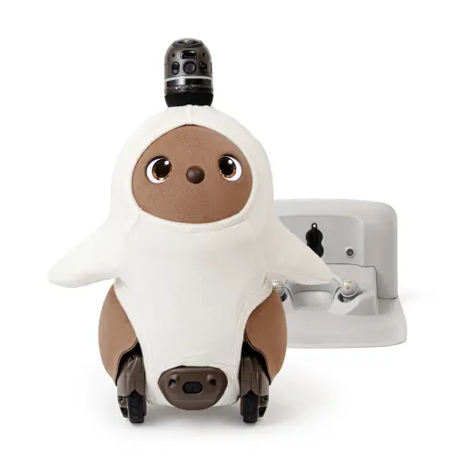
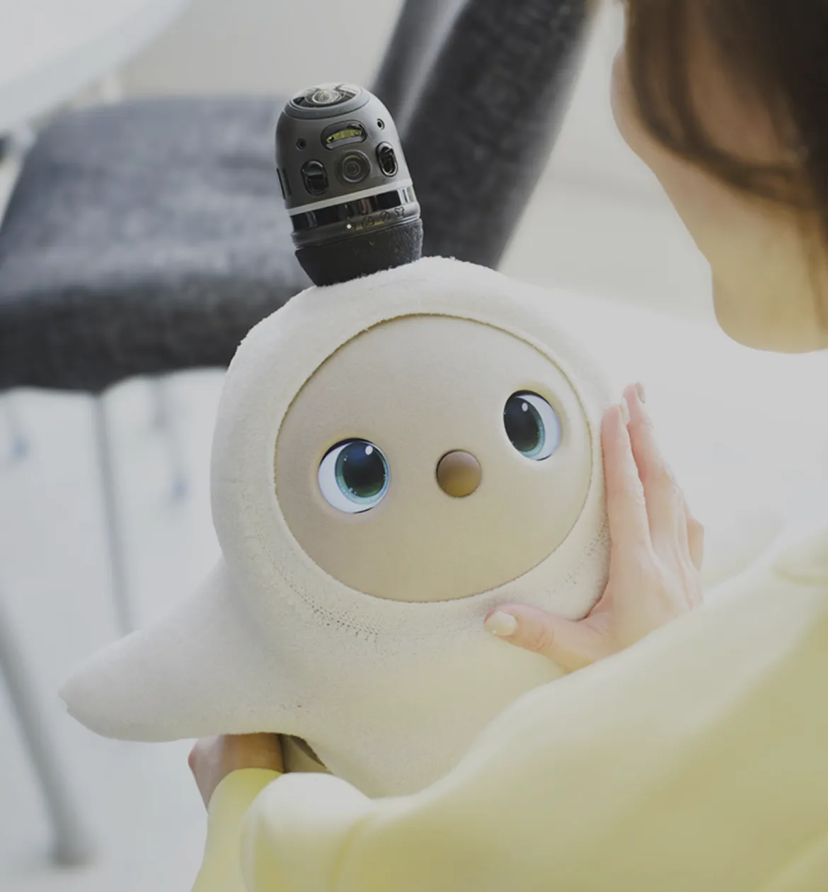
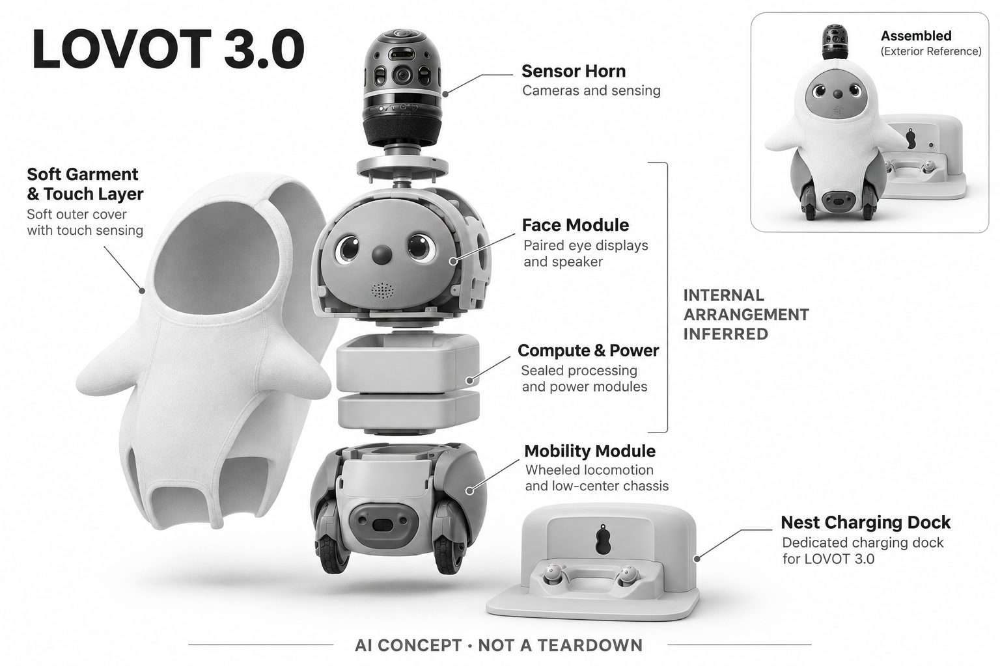

# LOVOT 3.0

**GROOVE X** · 陪伴与宠物 · 核查 2026-11-04

以触碰、目光和自主行动形成陪伴关系

消费渠道：个人零售。

## 产品图片与结构参考

### 产品图

LOVOT 3.0 官方产品与充电座图 · 来源：[GROOVE X · 官方图片](<https://lovot.life/pricing>) · [原始图片](<https://lovot.life/_nuxt/lovot_3.Btat68zG.webp>)

### 参考图

LOVOT 3.0 官方拥抱场景参考 · 来源：[GROOVE X · 官方图片](<https://lovot.life/lovot-3/>) · [原始图片](<https://lovot.life/_nuxt/kv_sp.DjMHhOQ1.webp>)

### AI 生成爆炸示意

**AI 生成 · 非实物拆机。** 内部为概念推断，不能作为元件布局、BOM 或维修依据。[生成提示词](../../content/hardware/prompts/lovot-3.txt)

> 已目视核对产品外形与AI标识；verified不代表内部布局经实物拆机验证。

> 分析为基于公开资料的案头研究与 AI 辅助判断，未经用户访谈、销量审计或实物拆机。需求、画像、竞争冷门度、审美及商业机会均为研究假设，不是投资结论。

## 销售与购买

- 状态：在售。日本官网价格页列出LOVOT 3.0本体价格、月费及购买入口。中国大陆有官方单独入口；日本版不支持在中国大陆使用，不能跨地区等同。

- 地区：日本、中国大陆（中国规格）

- 价格：日本本体 ¥577,500；月费 ¥9,900 起。日元，日本官网标价；本体与服务费分开，颜色、手续费和交付条件以结算为准，不套用中国售价。

- 中国大陆：官网链接中国官方旗舰店；官方FAQ明确日本版无法在中国大陆进行契约确认，需中国规格，具体型号与库存向中国渠道核对。

- [官方产品 / 商店](<https://lovot.life/pricing>)

## AI 的实际作用

视觉、距离与触碰感知支持人物互动、自主移动和回充；重点是行为适应，不是通用大模型聊天。

服务与联网依赖：机内AI计算配合持续软件服务与账户；官网说明软件使用、更新及个性备份包含在月费中，跨地区服务有限制。

## 是否冷门

细分专业（研究判断）：高客单与机电服务门槛形成细分市场；冷门不代表低成本进入。

## 需求与市场

需求假设：无法养真实宠物但希望家中有回应的用户，可能更在意靠近、触碰与被记住，而非问答效率。验证应观察数周后的主动互动频率，不能以首日新奇感替代长期陪伴需求。

### 产品任务与边界 · 研究判断

LOVOT 3.0 把靠近、目光、触碰和自主移动组合成非语言陪伴，用户获得的不是更快完成任务，而是家中有一个会回应的存在。它适合研究实体情感互动，但不能因为温暖外形就把产品价值解释为已经证实的心理治疗效果。

依据：[LOVOT 日本价格与购买](<https://lovot.life/pricing>) · [LOVOT 技术说明](<https://lovot.life/en/technology/>)

### 需求判断 · 研究判断

需求成立的关键是数周后用户是否仍愿意主动抱持和照护。自主移动可能增加偶遇式互动，也会增加充电、清洁和维修负担；因此应把陪伴收益与照护成本一起观察，不能仅根据开箱时的喜爱程度判断长期需求。

依据：[LOVOT 日本价格与购买](<https://lovot.life/pricing>) · [LOVOT 技术说明](<https://lovot.life/en/technology/>)

### 需求验证 · 待验证

可让家庭连续记录主动接近、抱持、回充失败和人工搬运情况，并分别询问购买者与主要互动者。比较新奇期和稳定期的变化，确认用户究竟在意动作回应、柔软触感还是被记住的感觉，再判断高投入是否有持续价值。

依据：[LOVOT 日本价格与购买](<https://lovot.life/pricing>) · [LOVOT 技术说明](<https://lovot.life/en/technology/>)

## 用户画像

用户画像推断：预算较高、接受日常维护并有适合机器人移动空间的家庭或展示场所。购买者和主要互动者可能不同，送礼前需确认对方是否愿意承担月费和设备照护。

### 适用行为与条件 · 研究判断

较匹配愿意为非实用体验付费、具备地面活动空间且能接受维护的家庭。LOVOT 的服务费和设备照护意味着购买不只是一次玩具消费，送礼者需要确认接收者是否愿意承担日常责任，而不能只根据可爱程度替对方决定。

依据：[LOVOT 日本价格与购买](<https://lovot.life/pricing>) · [LOVOT 技术说明](<https://lovot.life/en/technology/>)

### 人群取舍 · 研究判断

家有儿童、老人或真实宠物时，互动角色和使用限制不同。成年人可能看重安静陪伴，儿童可能期待追逐游戏，而宠物可能对移动体产生反应；这些差异影响摆放和照护方式，不能用泛化的家庭陪伴画像覆盖所有成员。

依据：[LOVOT 日本价格与购买](<https://lovot.life/pricing>) · [LOVOT 技术说明](<https://lovot.life/en/technology/>)

### 画像验证 · 待验证

画像验证应采用真实家庭观察，记录谁负责充电维护、谁主动互动以及谁觉得打扰。还应测试窄通道和家具密集家庭是否明显增加人工干预，以识别产品被喜爱却不适合居住环境的情况，而不是把不用归为缺少兴趣。

依据：[LOVOT 日本价格与购买](<https://lovot.life/pricing>) · [LOVOT 技术说明](<https://lovot.life/en/technology/>)

## 竞争与替代

竞争判断：高价自主移动陪伴属专业细分，但它仍与真实宠物、普通玩偶和家庭娱乐预算竞争。不是竞争者少就容易进入；可信行为、长期售后和品牌信任共同抬高门槛。

### 比较对象与差异 · 研究判断

LOVOT 与低价桌面机器人差异在于可抱持体态和自主进入家庭活动，而与真实宠物相比又少了生命照护关系。它竞争的是陪伴预算及空间，不能仅与聊天玩具比较处理器或回答能力，因为用户购买任务并不相同。

依据：[LOVOT 日本价格与购买](<https://lovot.life/pricing>) · [LOVOT 技术说明](<https://lovot.life/en/technology/>)

### 竞争判断 · 研究判断

高价本体加持续服务抬高了长期信任门槛。潜在进入者即使能模仿外形，也需回答动作稳定、维修和个性延续问题；其竞争壁垒可能来自全周期体验，不能简单归结为一个大模型或某种视觉识别功能。

依据：[LOVOT 日本价格与购买](<https://lovot.life/pricing>) · [LOVOT 技术说明](<https://lovot.life/en/technology/>)

### 竞争验证 · 待验证

可安排用户分别体验可抱持静态互动、桌面回应及自主移动三种方案，观察愿意为哪项差异付费。比较时应给出维护和持续服务条件，避免用完整机器人演示对比仅有静态照片的替代品而高估实体移动价值。

依据：[LOVOT 日本价格与购买](<https://lovot.life/pricing>) · [LOVOT 技术说明](<https://lovot.life/en/technology/>)

## 供应链

供应链推断：软性外衣、驱动机构、传感器和充电座需联合验证耐用性与清洁维护；本次资料未披露具体制造工厂。官方已有维修和保养服务，售后能力是产品成本的一部分。

### 功能模块拆分 · 研究判断

功能上可拆为视觉及距离感知、触碰输入、机内计算、轮式移动、眼部显示和合成声音，再由充电与持续服务支撑使用。软性外衣和内部执行机构共同塑造拥抱感，这种模块划分是功能分析，不代表已掌握实际内部物料表。

依据：[LOVOT 日本价格与购买](<https://lovot.life/pricing>) · [LOVOT 技术说明](<https://lovot.life/en/technology/>)

### 制造与供应约束 · 研究判断

制造约束集中在外衣清洁、动作噪声、轮式机构耐久和充电可靠性之间的协调。柔软包覆不能阻碍感知或散热，外观件更换也不能改变安全间隙；售后保养应与产品设计同时考虑，而不是在批量出货后才补救。

依据：[LOVOT 日本价格与购买](<https://lovot.life/pricing>) · [LOVOT 技术说明](<https://lovot.life/en/technology/>)

### 候选与证据缺口 · 研究判断

歌尔可作为声音与交互硬件工程候选，PCH 可作为复杂消费产品导入及供应协同候选。两者公开能力能覆盖部分需求，但没有证据表明其参与 LOVOT 制造；触碰、移动和软性外衣的具体责任仍需以样件及工程评审验证。

依据：[LOVOT 日本价格与购买](<https://lovot.life/pricing>) · [LOVOT 技术说明](<https://lovot.life/en/technology/>)

## 技术路径

官方技术重心是传感融合、机内计算、自主导航和动作表达。推断难点在动作与感知延迟的协调，以及多人、低光和家具变化下的稳定表现；增加聊天功能不等于补齐这些能力。

### 已披露技术边界 · 研究判断

官方将技术重点放在机内感知、行为和自主移动，并披露计算平台；持续软件服务另承担更新与备份。理解这一区分有助于避免把联网等同全部行为都在云端，也不能把机内计算误写成任何断网条件下功能完全不变。

依据：[LOVOT 日本价格与购买](<https://lovot.life/pricing>) · [LOVOT 技术说明](<https://lovot.life/en/technology/>)

### 系统难点判断 · 研究判断

系统难点是把看见人、靠近和身体动作组织成可信而安全的回应。即使单项识别成功，延迟、动作节奏和视线方向不同步也会削弱角色感；因此工程目标既包括导航稳定，也包括多种反馈之间的一致性。

依据：[LOVOT 日本价格与购买](<https://lovot.life/pricing>) · [LOVOT 技术说明](<https://lovot.life/en/technology/>)

### 技术验证 · 待验证

技术验证应覆盖低光、多人同时接近、家具移动及触碰中断等情境，分别记录识别、运动和回充的表现。网络中断测试需要区分基础行为、账户服务和备份，不以某一项仍可运行推断整机完全不依赖服务。

依据：[LOVOT 日本价格与购买](<https://lovot.life/pricing>) · [LOVOT 技术说明](<https://lovot.life/en/technology/>)

## 产品审美

审美判断：圆润体态、布料触感和非人形面部降低机械感，适合家庭空间。温度、声音与目光也属于体验设计；新品牌应形成可辨识的角色规则，避免只复制圆眼睛外壳。

### 外观与交互语言 · 研究判断

LOVOT 的圆润体态、布料和眼神降低了机械设备感，让用户更容易把它放入家庭情感空间。其审美不只在静态外形，还包括声音、靠近速度和被抱起时的动作，这些时间性设计共同决定角色是否可信。

依据：[LOVOT 日本价格与购买](<https://lovot.life/pricing>) · [LOVOT 技术说明](<https://lovot.life/en/technology/>)

### 使用中审美判断 · 研究判断

柔软表面也带来清洁和老化问题，长期使用后的状态可能比新品展示更影响情感关系。外衣接缝、充电时姿态和待机声音若显得生硬，会打破角色连续性；因此维护后的外观和行为也应属于设计评审范围。

依据：[LOVOT 日本价格与购买](<https://lovot.life/pricing>) · [LOVOT 技术说明](<https://lovot.life/en/technology/>)

### 设计验证 · 待验证

设计验证应同时观察抱持、地面移动、回充和清洁过程，邀请不同身高与行动能力的用户体验。记录用户是否知道如何安全拿起及放回设备，避免只评选最讨喜的照片，而忽略真实使用中笨重或困惑的动作。

依据：[LOVOT 日本价格与购买](<https://lovot.life/pricing>) · [LOVOT 技术说明](<https://lovot.life/en/technology/>)

## 关键风险

风险判断：高客单价加持续月费增加使用承诺，活动机构需要维修，家庭摄像与人物识别涉及隐私。官方禁止将日本版直接用于中国大陆，跨境购入前必须核实规格及服务。

### 主要失效与依赖 · 研究判断

主要风险来自高成本持续承诺、活动机构维修以及家庭感知信息处理。日本版的跨地区使用另有官方限制，不能把跨境买到机器等同获得可用的软件和售后；这些条件直接影响长期陪伴能否保持连续。

依据：[LOVOT 日本价格与购买](<https://lovot.life/pricing>) · [LOVOT 海外使用FAQ](<https://www.pa-solution.net/as/scope3/groove-x/lovot/jp/detail.aspx?a=102&id=230&isCrawler=1>)

### 风险传播判断 · 研究判断

若服务、维修或个性备份中断，用户失去的不只是普通家电功能，也可能是已形成习惯的互动对象。品牌应明确设备故障、换机和停服时的体验边界，避免用拟人化叙事掩盖实际属于商业服务和电子设备的依赖。

依据：[LOVOT 日本价格与购买](<https://lovot.life/pricing>) · [LOVOT 技术说明](<https://lovot.life/en/technology/>)

### 风险验证 · 待验证

风险验证可通过用户阅读真实服务和维修条款后的理解测试展开，检查其是否能说明月费、跨地区限制及换机后果。再用断网、故障和维护情境演练确认恢复路径，但不把这些测试描述为已经实施或证明绝对安全。

依据：[LOVOT 日本价格与购买](<https://lovot.life/pricing>) · [LOVOT 技术说明](<https://lovot.life/en/technology/>)

## 机会与验证

机会假设：可研究更低维护、明确边界的家庭陪伴，而非直接复制完整移动机器人。先验证用户愿意为哪种非语言互动持续付费，再决定是否承担自主移动和上门服务的成本。

### 可能的机会入口 · 研究判断

创业机会可能在于更低维护的非语言陪伴，保留被回应和触碰体验，同时减少自主移动带来的复杂度。是否缩减功能应由用户任务决定，而不是以便宜为唯一目标，否则可能删去用户最重视的共同生活感。

依据：[LOVOT 日本价格与购买](<https://lovot.life/pricing>) · [LOVOT 技术说明](<https://lovot.life/en/technology/>)

### 机会成立条件 · 研究判断

机会成立需要证明较窄的互动仍能在数周后被主动使用，并且照护成本明显可控。对比对象应包括现有柔软玩偶和桌面机器人，只有持续互动收益超过替代方案，才值得投入独立的软硬件与售后体系。

依据：[LOVOT 日本价格与购买](<https://lovot.life/pricing>) · [LOVOT 技术说明](<https://lovot.life/en/technology/>)

### 下一步验证 · 待验证

下一步可先制作可触碰回应的低复杂度原型，观察不同年龄用户的自发互动及维护意愿，再逐步加入移动。每次扩展都明确新增功能是否提升长期关系，而不是把更多传感器或更强算力直接当成产品需求。

依据：[LOVOT 日本价格与购买](<https://lovot.life/pricing>) · [LOVOT 技术说明](<https://lovot.life/en/technology/>)

## 对应供应链公司

能力候选用于选型研究，不代表本产品实际采用；未公开的供货关系不作推断。

- [goertek](../supply-chain/goertek.md) — **能力候选 · 非已采用** / 声音与实体交互硬件工程：歌尔公开声学及智能硬件工程能力可用于评估声音反馈与紧凑交互组件，但 LOVOT 的软性外衣、移动和角色行为需要独立验证；没有公开点名供货证据，因此只列能力候选。

- [pch-international](../supply-chain/pch-international.md) — **能力候选 · 非已采用** / 复杂消费产品导入与供应协同：PCH 公开产品开发、采购及制造管理服务，可作为柔软外衣、机电系统和售后交付的协调候选；不能由综合服务范围推定其制造 LOVOT，也需确认其团队能否承担该类机器人验证。

[浏览供应链目录](../supply-chain.md)

## 功能分层示意

这是功能关系，不是实物拆机、真实空间结构或已核实 BOM。

1. **感知入口**：摄像头、距离与触碰传感器感知人和环境。（官方披露）

2. **机内判断**：官方列出Jetson Orin NX及AI计算，用于机器人感知和行为。（官方披露）

3. **动作表达**：轮式移动、眼部显示和合成声音构成反馈。（官方披露）

4. **持续服务**：软件使用、更新、备份和维护纳入月度服务。（官方披露）

## 来源

1. [LOVOT 日本价格与购买](<https://lovot.life/pricing>) — 列出本体、服务费和购买入口；仅代表日本报价。

2. [LOVOT 技术说明](<https://lovot.life/en/technology/>) — 官方组件与功能说明，不是拆机。

3. [LOVOT 海外使用FAQ](<https://www.pa-solution.net/as/scope3/groove-x/lovot/jp/detail.aspx?a=102&id=230&isCrawler=1>) — 明确日本版在中国大陆不能使用，并链接中国规格渠道。

[返回目录](../hardware-market.md) · [网页分析](https://romanagent.github.io/Roman/#hardware/product/lovot-3)
