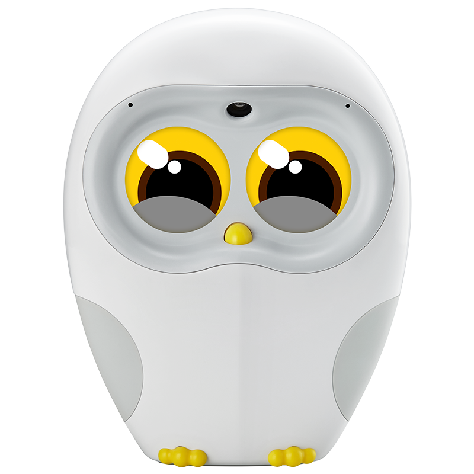
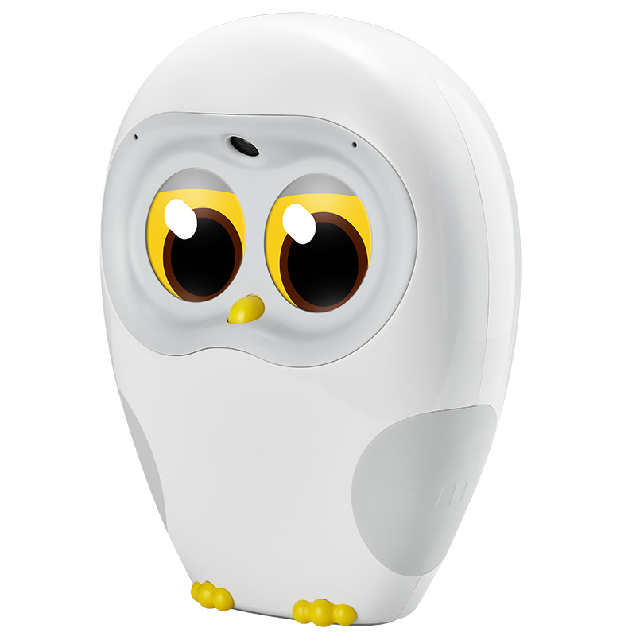
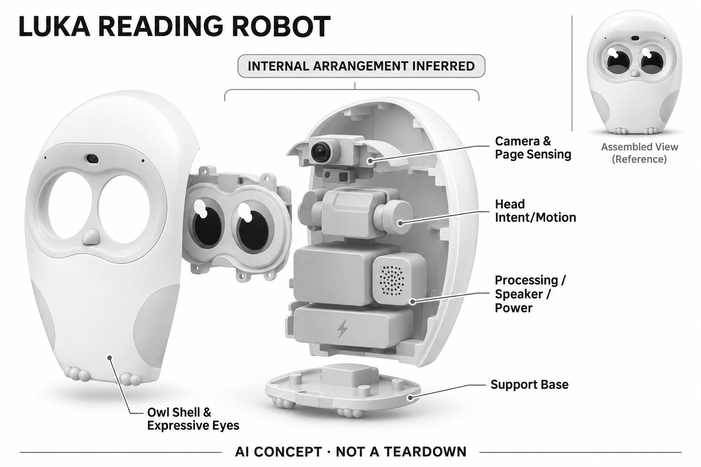

# Luka Kids Reading Robot

**Luka** · 教育与学习 · 核查 2026-11-04

围绕真实绘本进行朗读、提问与互动

消费渠道：个人零售。

## 产品图片与结构参考

### 产品图

Luka Reading Robot 官方正面产品图 · 来源：[Luka · 官方图片](<https://luka.world/products/luka-reading-robot>) · [原始图片](<https://cdn.shopify.com/s/files/1/0642/2426/4277/files/Luka_95978182-d73a-49e8-bd7a-84db710be340.png?v=1776998127&width=3840>)

### 参考图

Luka Reading Robot 官方侧前方参考 · 来源：[Luka · 官方图片](<https://luka.world/products/luka-reading-robot>) · [原始图片](<https://cdn.shopify.com/s/files/1/0642/2426/4277/files/Luka_45_-2_8ba21f77-40b0-4c81-bd00-9919a784af30.png?v=1776998127&width=3840>)

### AI 生成爆炸示意

**AI 生成 · 非实物拆机。** 内部为概念推断，不能作为元件布局、BOM 或维修依据。[生成提示词](../../content/hardware/prompts/luka-reading-robot.txt)

> 已目视核对产品外形与AI标识；verified不代表内部布局经实物拆机验证。

> 分析为基于公开资料的案头研究与 AI 辅助判断，未经用户访谈、销量审计或实物拆机。需求、画像、竞争冷门度、审美及商业机会均为研究假设，不是投资结论。

## 销售与购买

- 状态：在售。官方商品页显示US$219.99、Buy now和Add to cart，页面说明1–3天发货；包含前三个月VIP，后续会员另计。未实际下单验证物流。

- 地区：国际官网（英语、西班牙语、德语、中文版本）

- 价格：US$219.99；VIP试用后另计。官网列3个月VIP，之后月付US$9.99或年付折合US$7.99/月；订阅范围和配送税费以地区结算为准。

- 中国大陆：本次确认的是Luka.world国际版。中文支持已列出，但与中国既有Luka型号、书库、账号和大陆现货的关系未完整核实。

- [官方产品 / 商店](<https://luka.world/products/luka-reading-robot>)

## AI 的实际作用

前额摄像头识别书页、文字与人脸，机内意图模型配合朗读、提问和回应；对话生成的模型供应商未公开。

服务与联网依赖：高级互动依赖VIP权限与配套服务；机内意图能力不代表全部绘本识别和对话都能离线，断网边界需另核。

## 是否冷门

细分专业（研究判断）：纸质绘本伴读任务明确，区别于通用儿童问答；书目与语言适配是门槛。

## 需求与市场

需求假设：家庭希望孩子继续翻纸质书，同时在成人暂时无法陪读时获得朗读与问答支持。应验证书页识别成功率和孩子实际翻读行为，不能以无屏幕外观直接推断阅读习惯改善。

### 产品任务与边界 · 研究判断

Luka Kids Reading Robot 围绕真实纸质绘本提供朗读和提问回应，任务是让孩子继续翻书而获得辅助互动。它与纯音频故事机的差别在于跟随实体阅读，但无屏幕外观不能直接证明阅读习惯或理解能力得到改善。

依据：[Luka官方阅读机器人商店](<https://luka.world/products/luka-reading-robot>) · [Luka 当前官方首页](<https://luka.world/>)

### 需求判断 · 研究判断

家庭可能在成人暂时无法陪读时需要支持，也可能希望同一本书有不同语言的声音。价值取决于孩子是否仍在观察、翻页和提问，而不是被声音吸引后离开书本；需求分析应关注阅读行为，而非播放时长本身。

依据：[Luka官方阅读机器人商店](<https://luka.world/products/luka-reading-robot>) · [Luka 当前官方首页](<https://luka.world/>)

### 需求验证 · 待验证

可选择家庭已有绘本，记录孩子自主拿书、翻页、重复阅读和向成人讨论的行为，并统计识别失败后的放弃。将机器人朗读与成人陪读及音频播放比较，明确它在哪种时刻提供补充，而不是预设能够替代亲子阅读。

依据：[Luka官方阅读机器人商店](<https://luka.world/products/luka-reading-robot>) · [Luka 当前官方首页](<https://luka.world/>)

## 用户画像

用户画像推断：已有绘本、重视亲子阅读和多语言接触的家庭更可能理解价值。不同书本开合角度、插图密度及儿童自主操作能力会改变体验，使用者年龄不宜仅靠营销范围判断。

### 适用行为与条件 · 研究判断

较匹配已有纸质绘本、重视共读且愿意管理联网服务的家庭。孩子能否摆正书页、等待识别和表达问题会影响体验，不能仅按营销年龄范围判断适合；家长也需要理解会员与国际版本的内容边界。

依据：[Luka官方阅读机器人商店](<https://luka.world/products/luka-reading-robot>) · [Luka 当前官方首页](<https://luka.world/>)

### 人群取舍 · 研究判断

不同书本尺寸、插图密度、纸张反光和翻页习惯会形成不同使用条件。喜欢自由快速翻页的孩子与愿意逐页听完的孩子可能反应不同，因此画像应包含阅读方式和家庭书库，而不是笼统称为需要启蒙的儿童。

依据：[Luka官方阅读机器人商店](<https://luka.world/products/luka-reading-robot>) · [Luka 当前官方首页](<https://luka.world/>)

### 画像验证 · 待验证

画像验证应让家庭用自己常读而非展示指定的绘本试用，记录成人帮助摆书和解释错误的次数。再询问家长是否愿意持续付费及维护设备，区分孩子喜欢声音角色与家庭真正需要独立朗读支持这两种动机。

依据：[Luka官方阅读机器人商店](<https://luka.world/products/luka-reading-robot>) · [Luka 当前官方首页](<https://luka.world/>)

## 竞争与替代

竞争判断：绘本机器人面对音频故事机、点读笔与手机识别应用，属于有明确任务的专业细分。差异在于能否跟随实体阅读过程，而不是内容总量或把普通扬声器包装成伙伴。

### 比较对象与差异 · 研究判断

Luka 面对点读笔、音频故事机和手机识别应用，差异在于实体角色与纸页识别的组合。比较应围绕书目覆盖、摆放容错和互动是否跟随当前页，而不是只看内容总量或厂商所称的人工智能种类。

依据：[Luka官方阅读机器人商店](<https://luka.world/products/luka-reading-robot>) · [Luka 当前官方首页](<https://luka.world/>)

### 竞争判断 · 研究判断

若同一家庭已有成熟点读书库，迁移到视觉识别需要证明更自由的书目和更少操作负担。若主要价值来自朗读声音，普通播放器也可能满足需求；角色和问答必须提供可观察的增量，而不能只作为溢价理由。

依据：[Luka官方阅读机器人商店](<https://luka.world/products/luka-reading-robot>) · [Luka 当前官方首页](<https://luka.world/>)

### 竞争验证 · 待验证

竞争验证可用同一组纸质书比较点读、视觉识别和成人朗读，记录准备时间、错误恢复及孩子注意位置。会员条件应同时披露，避免把试用期的完整功能与无订阅替代品直接比较，而忽略长期拥有成本。

依据：[Luka官方阅读机器人商店](<https://luka.world/products/luka-reading-robot>) · [Luka 当前官方首页](<https://luka.world/>)

## 供应链

供应链推断：相机位置、头部运动和灯光提示直接影响纸页识别与摆放容错；官方未披露制造工厂。书库授权、语言本地化及VIP后台同样是交付链的一部分，不只计算硬件成本。

### 功能模块拆分 · 研究判断

功能层包括前额相机读取纸页和人物、意图判断、朗读与提问回应、头部及眼部声音反馈，再由内容权限支撑部分服务。公开资料没有完整工厂或芯片信息，不能把功能示意当成实物拆机或确定全部计算发生位置。

依据：[Luka官方阅读机器人商店](<https://luka.world/products/luka-reading-robot>) · [Luka 当前官方首页](<https://luka.world/>)

### 制造与供应约束 · 研究判断

制造约束是相机视角、头部结构和桌面摆放之间的关系，装配偏差可能影响可见书页范围。交付还涉及语言服务、内容权限和书目适配，硬件量产只是其中一部分；不能只计算扬声器和塑料壳就判断产品成本。

依据：[Luka官方阅读机器人商店](<https://luka.world/products/luka-reading-robot>) · [Luka 当前官方首页](<https://luka.world/>)

### 候选与证据缺口 · 研究判断

华勤可作为摄像、音频与联网终端工程候选，HLH 可支持头部和书页视角相关结构原型。没有证据表明两者为 Luka 供货；书目覆盖、儿童内容和会员后台仍需独立验证，不能由硬件能力推断完整阅读服务可得。

依据：[Luka官方阅读机器人商店](<https://luka.world/products/luka-reading-robot>) · [Luka 当前官方首页](<https://luka.world/>)

## 技术路径

官方说明前额视觉识别、机内意图模型和朗读提问能力。推断需要区分真实OCR、已收录绘本匹配与生成式回答三种路径，实际覆盖范围及错误恢复应通过具体书目逐本测试。

### 已披露技术边界 · 研究判断

官方描述前额视觉、机内意图模型及朗读互动，但应区分文字识别、已有内容匹配和生成回答。当前官网语言数量存在前后不一致，尺寸也有待确认提示，因此本深析不把这些营销参数作为已核实的技术边界。

依据：[Luka官方阅读机器人商店](<https://luka.world/products/luka-reading-robot>) · [Luka 当前官方首页](<https://luka.world/>)

### 系统难点判断 · 研究判断

技术难点是跟上儿童不规则翻页、遮挡和提问，同时知道何时识别失败。流畅朗读不必然说明对应了当前页面，生成回答也可能偏离书本；系统需要清楚区分看不清、未支持和内容回答，而不是持续输出听似合理的声音。

依据：[Luka官方阅读机器人商店](<https://luka.world/products/luka-reading-robot>) · [Luka 当前官方首页](<https://luka.world/>)

### 技术验证 · 待验证

验证应按具体书目、纸张、角度和光线逐本测试，分别记录页面对应、朗读和问答错误。对会员与断网条件也需单独检查，并确认当前语言版本，不能把官网任何书可读的表达当作对所有书本和场景的保证。

依据：[Luka官方阅读机器人商店](<https://luka.world/products/luka-reading-robot>) · [Luka 当前官方首页](<https://luka.world/>)

## 产品审美

审美判断：猫头鹰式读书伙伴与实体书场景一致，弱屏幕表达可减少视觉竞争。头部朝向、眼部灯光与阅读音色共同决定角色感；桌面摆放也应避免遮住书页或干扰亲子视线。

### 外观与交互语言 · 研究判断

猫头鹰式角色与读书场景相符，弱屏幕表达有助于把视觉重点留在纸页上。它的审美价值不只在外观可爱，还在头部朝向、眼部灯光和朗读音色能否支持孩子关注书本，而不是把注意吸引到机器自身。

依据：[Luka官方阅读机器人商店](<https://luka.world/products/luka-reading-robot>) · [Luka 当前官方首页](<https://luka.world/>)

### 使用中审美判断 · 研究判断

桌面占地、相机朝向和孩子的视线可能发生冲突，尤其在亲子共读时设备不应挡住书页或成人交流。角色反馈过多可能打断阅读节奏，过少又让识别状态不明，因此需要围绕翻页任务设计克制而清晰的表达。

依据：[Luka官方阅读机器人商店](<https://luka.world/products/luka-reading-robot>) · [Luka 当前官方首页](<https://luka.world/>)

### 设计验证 · 待验证

设计验证应观察真实翻书、提问和成人加入的全过程，记录设备是否遮挡、需要反复挪动或吸引过多注意。还应比较不同音量和朗读节奏，避免仅由商品场景照或无屏幕口号推断实际阅读体验更自然。

依据：[Luka官方阅读机器人商店](<https://luka.world/products/luka-reading-robot>) · [Luka 当前官方首页](<https://luka.world/>)

## 关键风险

风险判断：官网“任何书可读”是厂商表达，本目录不视为对所有纸张和语言的保证。摄像头可能拍入儿童和家庭环境，VIP到期后的功能边界、国际版与国内书库差异需确认。

### 主要失效与依赖 · 研究判断

风险包括摄像头拍入儿童与家庭环境、生成回答错误以及会员到期后的功能变化。官网资料自身有语言数量和尺寸占位提示，说明购买前应进一步核实版本，不能将页面所有数字和宣传范围都当作稳定规格。

依据：[Luka官方阅读机器人商店](<https://luka.world/products/luka-reading-robot>) · [Luka 当前官方首页](<https://luka.world/>)

### 风险传播判断 · 研究判断

如果识别失败被包装成故事延展，家长可能难以发现内容已偏离书本；如果儿童把流畅回答当作权威，错误会更难纠正。产品应保持成人可介入和错误可理解，而不能以亲子角色或教育定位代替内容验证。

依据：[Luka官方阅读机器人商店](<https://luka.world/products/luka-reading-robot>) · [Luka 当前官方首页](<https://luka.world/>)

### 风险验证 · 待验证

风险验证应检查家长能否区分联网智能阅读与离线预载内容，以及会员变化后仍可使用的范围。再测试不清晰页面和不适当提问的处理，所有结果需绑定版本与书目，不能转述为普遍教育效果或绝对安全。

依据：[Luka官方阅读机器人商店](<https://luka.world/products/luka-reading-robot>) · [Luka 当前官方首页](<https://luka.world/>)

## 机会与验证

市场观察：适合与点读笔、音频故事机并列比较识别方式、纸书覆盖、离线功能和年费。明确版本及会员条件比单列“AI阅读”更有用，也有助于辨别实体阅读与屏幕学习的差异。

### 可能的机会入口 · 研究判断

机会在于围绕实体书建立可靠的辅助阅读入口，优先解决摆放容错、错误恢复和版本透明。新项目可以聚焦明确书目或特定阅读阶段，先证明孩子仍在主动翻读，再考虑开放问答与更多语言。

依据：[Luka官方阅读机器人商店](<https://luka.world/products/luka-reading-robot>) · [Luka 当前官方首页](<https://luka.world/>)

### 机会成立条件 · 研究判断

机会成立需要家长减少重复操作，同时孩子的书本参与不下降。如果设备只是让孩子被动听音频，独立硬件的增量价值可能有限；如果广泛书目承诺导致频繁失败，收窄范围反而可能提高信任和持续使用。

依据：[Luka官方阅读机器人商店](<https://luka.world/products/luka-reading-robot>) · [Luka 当前官方首页](<https://luka.world/>)

### 下一步验证 · 待验证

下一步可用家庭真实书库做分层试用，记录自主翻读、识别失败和成人纠错，再比较会员成本与替代方案。先用可复现的书目测试证明核心阅读流程，再增加角色和内容功能，避免把营销覆盖量当作产品验证。

依据：[Luka官方阅读机器人商店](<https://luka.world/products/luka-reading-robot>) · [Luka 当前官方首页](<https://luka.world/>)

## 对应供应链公司

能力候选用于选型研究，不代表本产品实际采用；未公开的供货关系不作推断。

- [huaqin](../supply-chain/huaqin.md) — **能力候选 · 非已采用** / 视觉朗读终端电子与系统工程：华勤智能终端研发制造范围可支持摄像、音频和联网计算的硬件整合，但纸页识别、书目服务及儿童内容需单独负责；没有 Luka 点名供货证据，当前只列硬件工程能力候选。

- [hlh-prototypes](../supply-chain/hlh-prototypes.md) — **能力候选 · 非已采用** / 阅读视角与头部结构原型：HLH 的机械原型能力可用于比较相机视角、头部朝向和桌面摆放结构，但样件不能证明绘本覆盖或儿童安全；未找到与 Luka 的公开合作，候选仅对应结构与可用性验证。

[浏览供应链目录](../supply-chain.md)

## 功能分层示意

这是功能关系，不是实物拆机、真实空间结构或已核实 BOM。

1. **纸页与人物输入**：前额相机识别图片、文字及人脸。（官方披露）

2. **意图判断**：官方说明机内意图模型用于回应儿童。（官方披露）

3. **内容交互**：朗读、提问、倾听和回应围绕书本展开。（官方披露）

4. **实体表达**：头部朝向、LED眼睛与声音形成反馈。（官方披露）

5. **内容权限**：VIP决定部分高级能力，具体版本权限按官网。（官方披露）

## 来源

1. [Luka官方阅读机器人商店](<https://luka.world/products/luka-reading-robot>) — 列购买入口、1–3天发货、四语及VIP条件；功能按官方说明记录，未实测书目覆盖。

[返回目录](../hardware-market.md) · [网页分析](https://romanagent.github.io/Roman/#hardware/product/luka-reading-robot)
