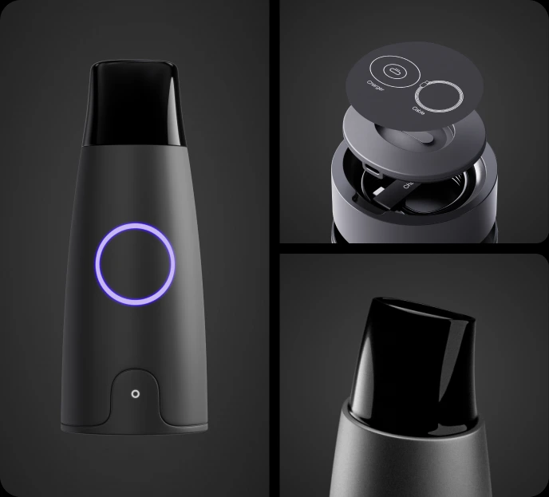
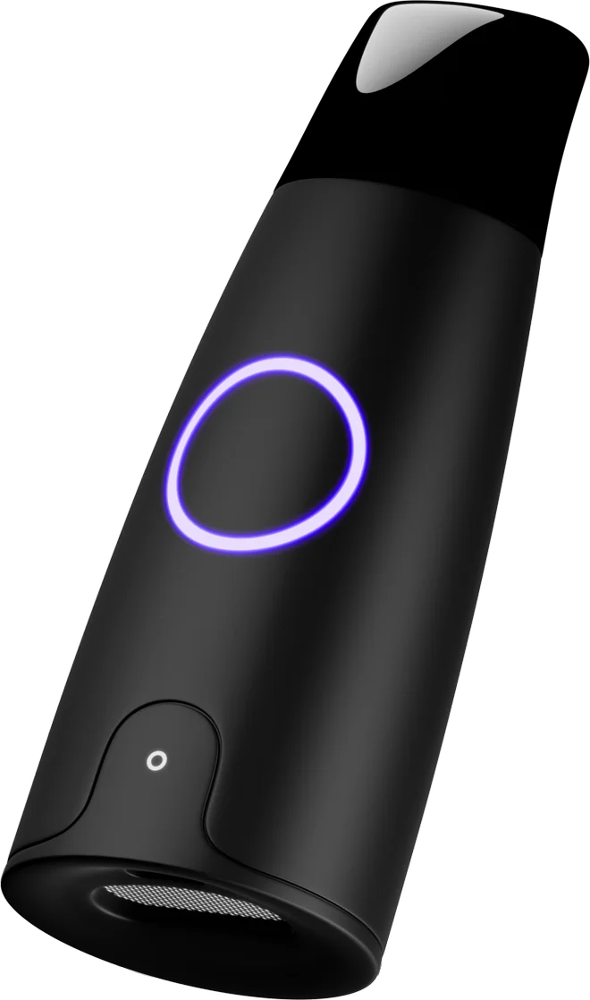
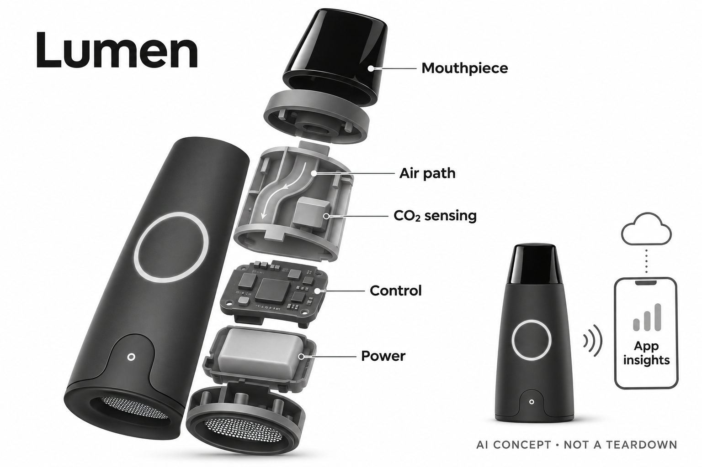

# Lumen Metabolism Tracker

**Lumen / Meta Flow** · 居家健康 · 核查 2026-11-04

呼气测量连接营养记录与代谢趋势解释

消费渠道：个人零售。

## 产品图片与结构参考

### 产品图

Lumen官方产品与局部结构展示；不作为独立拆机证据 · 来源：[Lumen · 官方产品图片](<https://www.lumen.me/shop>) · [原始图片](<https://src.metaflow.co/html-images/shop-black/feature-device.webp>)

### 参考图

Lumen官方另一角度外形参考 · 来源：[Lumen · 官方产品图片](<https://www.lumen.me/>) · [原始图片](<https://src.metaflow.co/html-images/home-black/v3/hero-device.webp>)

### AI 生成爆炸示意

**AI 生成 · 非实物拆机。** 内部为概念推断，不能作为元件布局、BOM 或维修依据。[生成提示词](../../content/hardware/prompts/lumen-metabolism-tracker.txt)

> 已视觉检查：外形匹配、未添加氧气传感或性能医疗宣称；气路与内部板形为概念。

> 两张源图均实际查看，来自当前官网同一外形；未改色或重绘。

> 分析为基于公开资料的案头研究与 AI 辅助判断，未经用户访谈、销量审计或实物拆机。需求、画像、竞争冷门度、审美及商业机会均为研究假设，不是投资结论。

## 销售与购买

- 状态：在售。官方商店显示设备、首年会员套餐US$279与Continue to checkout；这是实物购买入口，非候补名单。

- 地区：所见美元官网及结算支持的配送地区

- 价格：US$279（所见设备+首12个月会员）。核查页续费显示US$149/年；活动和入口价格可能不同，实际地区结算及续费条款优先。

- 中国大陆：配送政策仅允许其结算指定地区，未核实大陆地址、中文服务和官方售后；不把美元价格或全球营销页等同国内正式销售。

- [官方产品 / 商店](<https://www.lumen.me/shop>)

## AI 的实际作用

服务条款明确AI结合呼气测量与生活记录推断趋势并生成个性化解释；当前商店另明确AI食物记录。硬件传感本身不等于语言模型。

服务与联网依赖：设备与手机App、账号和会员服务组成系统；模型执行位置及全部版本未公开，不能声称所有建议在呼气器内离线生成。

## 是否冷门

细分专业（研究判断）：呼气输入区别于常见腕部趋势，但已有营养记录与专业测量替代；本判断无销量和访谈证据。

## 需求与市场

需求假设是已有饮食、运动或睡眠记录的人，希望看到另一种身体信号并了解日常行为之间的关系。增加呼气数据可能帮助提出更具体的问题，也可能让用户过度关注单次分数；价值应来自更容易理解自己的记录，而不是设备让每个饮食决定都变得确定。

### 官方｜呼气测量与应用解释相连 · 官方资料

Lumen把手持呼气传感器与手机应用组合，官方披露二氧化碳、气流及环境输入，服务再结合生活记录解释代谢状态。当前商店明确AI食物记录，条款也说明AI分析与个性化内容；这些是系统功能描述，不能把一口气的估计等同全面测量身体代谢或直接得到所有营养答案。

依据：[Lumen官方商店与会员套餐](<https://www.lumen.me/shop>) · [Lumen服务条款中的AI功能](<https://www.lumen.me/terms-of-use>) · [Lumen官方传感与系统说明](<https://get.lumen.me/>)

### 判断｜补充已有记录中的信息空白 · 研究判断

需求假设是已有饮食、运动或睡眠记录的人，希望看到另一种身体信号并了解日常行为之间的关系。增加呼气数据可能帮助提出更具体的问题，也可能让用户过度关注单次分数；价值应来自更容易理解自己的记录，而不是设备让每个饮食决定都变得确定。

依据：[Lumen服务条款中的AI功能](<https://www.lumen.me/terms-of-use>) · [Lumen官方传感与系统说明](<https://get.lumen.me/>)

### 验证｜从记录负担和理解开始 · 待验证

可观察本人是否能按厂商流程稳定完成测量、保存结果并区分读数与建议，记录重复采集和没有理解的提示。比较原有日志中哪些问题因此更清楚，不以短期体重变化证明产品效果；本目录不提供个人饮食、禁食或训练安排，只提出信息工具的验证方法。

依据：[Lumen官方商店与会员套餐](<https://www.lumen.me/shop>) · [Lumen服务条款中的AI功能](<https://www.lumen.me/terms-of-use>) · [Lumen官方传感与系统说明](<https://get.lumen.me/>)

## 用户画像

更可能适配的使用习惯是愿意维护设备、遵循采集流程，并能接受同一个人的数据也会波动。若用户希望得到无需理解的一条健康指令，流畅的AI解释反而容易制造过高信任；已有健康问题或特殊营养需要的人，也不能仅凭消费设备自行替代适当专业支持。

### 官方｜设备与账号服务共同使用 · 官方资料

官方套餐把设备、应用与会员服务连在一起，个性化解释依赖使用者提供的测量和生活信息。不同服务功能可能随计划、版本与地区变化，不能把条款中列举的全部潜在AI功能视为每个账号已经开放；个人是否适合其测量及建议范围仍需查看对应使用说明。

依据：[Lumen官方商店与会员套餐](<https://www.lumen.me/shop>) · [Lumen服务条款中的AI功能](<https://www.lumen.me/terms-of-use>)

### 判断｜愿意持续测量而非只想要结论 · 研究判断

更可能适配的使用习惯是愿意维护设备、遵循采集流程，并能接受同一个人的数据也会波动。若用户希望得到无需理解的一条健康指令，流畅的AI解释反而容易制造过高信任；已有健康问题或特殊营养需要的人，也不能仅凭消费设备自行替代适当专业支持。

依据：[Lumen服务条款中的AI功能](<https://www.lumen.me/terms-of-use>) · [Lumen官方传感与系统说明](<https://get.lumen.me/>)

### 验证｜拆开采集能力与建议理解 · 待验证

试用可分别记录操作是否顺利、数据是否及时显示，以及用户如何理解同一天不同结果。请本人指出哪些是直接输入、哪些是推断和哪些是生活建议，有助于发现界面是否引发误解；家庭共享或账号切换还需按实际服务规则确认，不能把一台设备随意共用成同一档案。

依据：[Lumen官方商店与会员套餐](<https://www.lumen.me/shop>) · [Lumen服务条款中的AI功能](<https://www.lumen.me/terms-of-use>) · [Lumen官方传感与系统说明](<https://get.lumen.me/>)

## 竞争与替代

普通营养记录应用成本较低但没有呼气输入，专业代谢测量则有不同流程、环境和解释目的。Lumen的差异是个人可重复使用的便携入口与应用反馈，并不自动替代专业检测；对已有多种穿戴设备的人，新增信号是否有意义要看其改变了什么信息任务，而不是增加一个分数。

### 官方｜硬件价格包含限时服务 · 官方资料

所见官网商店显示二百七十九美元设备套餐和首十二个月会员，之后列明年度续费金额，其他营销入口可能有不同活动价。目录按本次所见配置记录，不拼接跨入口最低价；购买时需同时核对后续服务、取消方式和配送，而非将初次支付理解为全部功能永久免费。

依据：[Lumen官方商店与会员套餐](<https://www.lumen.me/shop>)

### 判断｜与日志工具和专业仪器分开比 · 研究判断

普通营养记录应用成本较低但没有呼气输入，专业代谢测量则有不同流程、环境和解释目的。Lumen的差异是个人可重复使用的便携入口与应用反馈，并不自动替代专业检测；对已有多种穿戴设备的人，新增信号是否有意义要看其改变了什么信息任务，而不是增加一个分数。

依据：[Lumen官方商店与会员套餐](<https://www.lumen.me/shop>) · [Lumen服务条款中的AI功能](<https://www.lumen.me/terms-of-use>) · [Lumen官方传感与系统说明](<https://get.lumen.me/>)

### 验证｜计算持续使用的总投入 · 待验证

比较应包含设备、会员、测量时间和维护，再记录使用者是否持续回看趋势与理解反馈。不要用有健康结果的精选案例对照其他工具，也不要把研究或名人推荐当销量证据；本研究没有长期访谈和独立对照，无法从创新形态直接判断性价比或市场需求规模。

依据：[Lumen官方商店与会员套餐](<https://www.lumen.me/shop>) · [Lumen服务条款中的AI功能](<https://www.lumen.me/terms-of-use>)

## 供应链

同类新设计需要处理气体经过通道的时序、残余气体、温湿度变化与传感响应，不能把室内空气质量传感器直接移入呼气器就认为完成测量。硬件、采集动作和算法校准应共同验证；增加气体通道也可能改变阻力与清洁流程，因此器件参数只能是选型起点。

### 官方｜传感类别公开而料号未知 · 官方资料

厂家公开二氧化碳、气流、气压和温度感知类别，足以描述呼气采集链路，但没有为本目录提供完整料号、光路、气路尺寸或装配工厂。品牌“金色传感器”等表述不是供应商名称，也不能据外形推断主控；概念爆炸图仅用于说明功能层，不能当作实际拆机资料。

依据：[Lumen官方传感与系统说明](<https://get.lumen.me/>)

### 判断｜气路和环境补偿共同决定输入 · 研究判断

同类新设计需要处理气体经过通道的时序、残余气体、温湿度变化与传感响应，不能把室内空气质量传感器直接移入呼气器就认为完成测量。硬件、采集动作和算法校准应共同验证；增加气体通道也可能改变阻力与清洁流程，因此器件参数只能是选型起点。

依据：[Lumen官方传感与系统说明](<https://get.lumen.me/>)

### 验证｜候选的成熟度要单列 · 待验证

Sensirion公开了专门呼气交换路线，但当前仍为上市前样品评估，不可作为量产交期承诺，更不证明Lumen采用。连接控制候选也需核对现有系统协议、功耗和软件接口；新设计应先验证原始浓度与气流数据，再讨论应用解释，不能用AI建议掩盖输入质量不足。

依据：[Lumen官方传感与系统说明](<https://get.lumen.me/>)

## 技术路径

应用把饮食、睡眠、运动与呼气变化放在一起，可能帮助发现重复模式，却不能仅凭相关性确定某项行为造成变化。单次输出还可能受采集条件和记录缺失影响；技术评价应关注系统是否明确解释依据、数据缺口和不确定性，而不只看建议是否个性化或语气是否坚定。

### 官方｜AI解释与测量机制分层 · 官方资料

服务条款说明AI可结合呼气信号、生活数据和用户信息形成状态估计、摘要与个性化内容，商店当前确认AI食物记录。测量、营养日志识别与语言解释属于不同任务，具体模型和运行位置未完整披露；目录不把普通传感器称为AI，也不推断设备直接测量未披露的氧气消耗。

依据：[Lumen官方商店与会员套餐](<https://www.lumen.me/shop>) · [Lumen服务条款中的AI功能](<https://www.lumen.me/terms-of-use>) · [Lumen官方传感与系统说明](<https://get.lumen.me/>)

### 判断｜相关模式不是原因证明 · 研究判断

应用把饮食、睡眠、运动与呼气变化放在一起，可能帮助发现重复模式，却不能仅凭相关性确定某项行为造成变化。单次输出还可能受采集条件和记录缺失影响；技术评价应关注系统是否明确解释依据、数据缺口和不确定性，而不只看建议是否个性化或语气是否坚定。

依据：[Lumen服务条款中的AI功能](<https://www.lumen.me/terms-of-use>) · [Lumen官方传感与系统说明](<https://get.lumen.me/>)

### 验证｜保留输入与输出对应关系 · 待验证

可核对每次测量时间、生活日志与最终解释是否对应，并记录用户修改输入后建议如何变化。对AI识别食物或生成摘要的结果，应能回看和纠正，而不把识别输出直接当精确营养事实；本目录未进行模型验证，也不从厂家内部或精选研究推定个人准确率。

依据：[Lumen服务条款中的AI功能](<https://www.lumen.me/terms-of-use>) · [Lumen官方传感与系统说明](<https://get.lumen.me/>)

## 产品审美

设备是否容易拿起、辨认方向、观察状态和放回，会影响用户愿不愿意每天使用。精致的黑色外观并不自动意味着气路容易清洁或状态提示清楚；如果每次需要同时拿手机、寻找充电和重新尝试，便携尺寸带来的便利也可能被完整流程中的摩擦抵消。

### 官方｜手持气路器与应用屏幕分工 · 官方资料

官方图示为黑色手持主体、顶部口部部件、前部环形状态灯与下方按钮，应用承担更丰富的信息显示。原图也包含局部结构展示，但不能据此复原真实电路和传感器布局；这种外形与电子烟等物品可能相似，目录明确其为呼气测量设备，避免误解用途。

依据：[Lumen官方商店与会员套餐](<https://www.lumen.me/shop>) · [Lumen官方传感与系统说明](<https://get.lumen.me/>)

### 判断｜测量姿态与收纳影响习惯 · 研究判断

设备是否容易拿起、辨认方向、观察状态和放回，会影响用户愿不愿意每天使用。精致的黑色外观并不自动意味着气路容易清洁或状态提示清楚；如果每次需要同时拿手机、寻找充电和重新尝试，便携尺寸带来的便利也可能被完整流程中的摩擦抵消。

依据：[Lumen官方商店与会员套餐](<https://www.lumen.me/shop>) · [Lumen官方传感与系统说明](<https://get.lumen.me/>)

### 验证｜观察一次完整使用周期 · 待验证

可以记录取出、按说明采集、查看应用、维护和收纳的全过程，尤其关注操作被打断时是否知道当前结果有效。还应检查在不同照明和台面条件下状态是否易识别，避免只看产品渲染图；个人手感与便利性需要实际使用反馈，本次没有实机体验证据。

依据：[Lumen官方商店与会员套餐](<https://www.lumen.me/shop>) · [Lumen官方传感与系统说明](<https://get.lumen.me/>)

## 关键风险

呼气数据与自然语言解释容易让人觉得已经掌握身体全部状态，但测量范围与算法推断都有限。用户不应依据单次分数自行处理疾病或改变既有医疗安排，营养建议也不能替代个人需要的专业意见；研究应同时考虑敏感日志、账号访问和分享范围，而不只关注测量新奇感。

### 官方｜服务与配送均有条件 · 官方资料

会员计划和AI服务范围影响购买后的完整体验，配送政策只允许其指定可发货地区，不能据全球网站推断任何地址均支持。中国大陆正式销售、中文服务与售后本次未核实；当前购买入口证明存在实物订单，不证明所有地区拥有同样的数据功能、服务人员和保障条件。

依据：[Lumen官方商店与会员套餐](<https://www.lumen.me/shop>) · [Lumen服务条款中的AI功能](<https://www.lumen.me/terms-of-use>) · [Lumen官方配送政策](<https://www.lumen.me/shipping-policy>)

### 判断｜健康建议可能被过度信任 · 研究判断

呼气数据与自然语言解释容易让人觉得已经掌握身体全部状态，但测量范围与算法推断都有限。用户不应依据单次分数自行处理疾病或改变既有医疗安排，营养建议也不能替代个人需要的专业意见；研究应同时考虑敏感日志、账号访问和分享范围，而不只关注测量新奇感。

依据：[Lumen服务条款中的AI功能](<https://www.lumen.me/terms-of-use>) · [Lumen官方传感与系统说明](<https://get.lumen.me/>)

### 验证｜确认退出与数据控制 · 待验证

验收可核对会员到期或取消后保留哪些功能、历史记录能否查看，以及账户和分享控制是否清楚。试用反馈应记录不理解、重复测量和放弃使用的原因，保留真实数据供适当专业讨论；这些检查用于理解产品边界，不是对个人健康效果或适用性的承诺。

依据：[Lumen官方商店与会员套餐](<https://www.lumen.me/shop>) · [Lumen服务条款中的AI功能](<https://www.lumen.me/terms-of-use>)

## 机会与验证

值得进一步研究的是用户能否通过更一致的记录发现需要讨论的模式，并理解哪些结论仍不确定。若工具只是让人反复追逐更好的分数，数据增加并未形成信息价值；机会应建立在可理解、可纠正的反馈与可持续使用，而不是把所有生活行为都变成AI指令。

### 官方｜呼气输入形成独立信息任务 · 官方资料

Lumen的系统差异是把个人呼气测量与生活记录连接，提供便携的代谢趋势解释入口。它与手表的活动记录或戒指的被动趋势不同，但会员目标、不同推广套餐和附加指导并不是新硬件；本目录只计这一电子设备，避免以营养、运动和长期健康页面分别扩张数量。

依据：[Lumen官方商店与会员套餐](<https://www.lumen.me/shop>) · [Lumen服务条款中的AI功能](<https://www.lumen.me/terms-of-use>) · [Lumen官方传感与系统说明](<https://get.lumen.me/>)

### 判断｜帮助提出问题可能比给答案重要 · 研究判断

值得进一步研究的是用户能否通过更一致的记录发现需要讨论的模式，并理解哪些结论仍不确定。若工具只是让人反复追逐更好的分数，数据增加并未形成信息价值；机会应建立在可理解、可纠正的反馈与可持续使用，而不是把所有生活行为都变成AI指令。

依据：[Lumen服务条款中的AI功能](<https://www.lumen.me/terms-of-use>) · [Lumen官方传感与系统说明](<https://get.lumen.me/>)

### 验证｜跨越初次购买观察价值 · 待验证

后续可跟踪主动测量、缺测、AI记录纠正、回看历史和继续订阅的具体原因，把信息理解与健康结果分开研究。与原有日志习惯比较时保留完整成本和个人负担，允许出现无明显帮助的结论；当前案头资料没有独立长期实测、访谈或市场规模证据。

依据：[Lumen官方商店与会员套餐](<https://www.lumen.me/shop>) · [Lumen服务条款中的AI功能](<https://www.lumen.me/terms-of-use>) · [Lumen官方传感与系统说明](<https://get.lumen.me/>)

## 对应供应链公司

能力候选用于选型研究，不代表本产品实际采用；未公开的供货关系不作推断。

- [sensirion](../supply-chain/sensirion.md) — **能力候选 · 非已采用** / 同类呼气分析新设计的专门气体感知路线：Sensirion的SBN41公开面向呼气交换与环境补偿，可作为相近便携分析系统的研究候选，但当前仅上市前样品阶段。它同时涉及氧气与二氧化碳，不代表Lumen具有氧气传感或已采用该模块；需验证气路、响应、校准和供货成熟度，不能直接替换现有传感器。

- [nordic-semiconductor](../supply-chain/nordic-semiconductor.md) — **能力候选 · 非已采用** / 同类便携测量器的手机通信与控制候选：Nordic低功耗无线与控制平台可用于研究传感数据到手机应用的连接、状态反馈和休眠流程。Lumen具体主控与协议实现未在所引资料中点名，因此需先确认接口并评估适配；候选不提供呼气校准或营养AI，也不构成现用芯片与可直接换件的证据。

[浏览供应链目录](../supply-chain.md)

## 功能分层示意

这是功能关系，不是实物拆机、真实空间结构或已核实 BOM。

1. **呼气入口**：用户通过手持设备的口部气路完成采集，动作和气路状态影响输入。（官方披露）

2. **传感链路**：官方披露CO₂、气流、气压和温度感知，具体料号及内部布局未知。（官方披露）

3. **采集控制**：控制电路汇集测量并与应用连接；具体无线主控与协议实现未核实。（分析推断）

4. **应用分析**：AI与分析算法结合呼气和生活数据形成趋势解释、记录及建议。（官方披露）

5. **用户复核**：结果为健康信息辅助；建议、估计与原始测量需区分。（分析推断）

## 来源

1. [Lumen官方商店与会员套餐](<https://www.lumen.me/shop>) — 本轮已打开：US$279设备套餐、首12个月、US$149年续费、Continue to checkout及AI food logging；不采用其他营销入口混合价格。

2. [Lumen服务条款中的AI功能](<https://www.lumen.me/terms-of-use>) — 本轮已打开，2026-03-02版本第6节明确AI与分析算法；列举功能有may边界，不当作所有账号完整交付清单。

3. [Lumen官方传感与系统说明](<https://get.lumen.me/>) — 本轮已打开：明确CO₂、气流、气压、温度感知和App配合；减重与疾病宣传不作为独立效果。

4. [Lumen官方配送政策](<https://www.lumen.me/shipping-policy>) — 本轮web及公开HTML已读，仅结算指定地区可配送，未获得大陆正式渠道证据。

[返回目录](../hardware-market.md) · [网页分析](https://romanagent.github.io/Roman/#hardware/product/lumen-metabolism-tracker)
