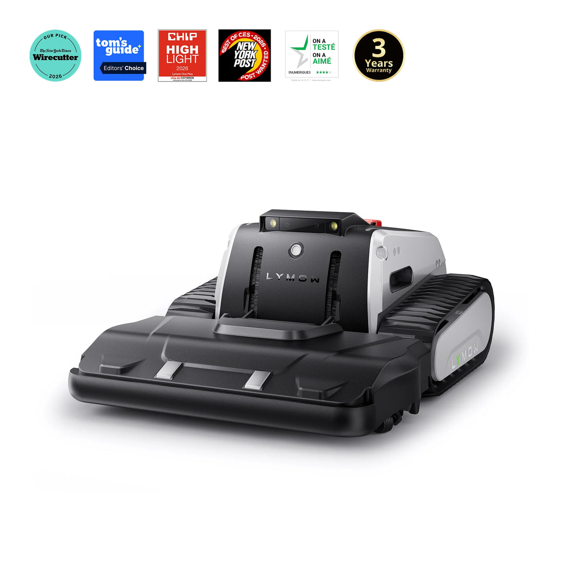
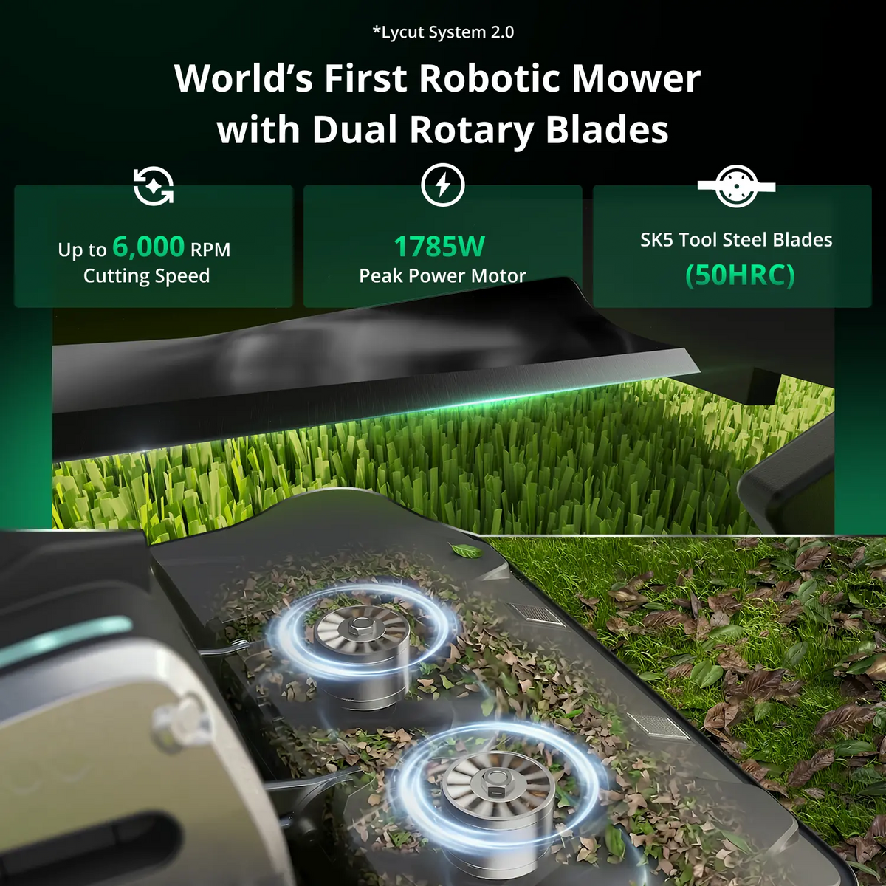
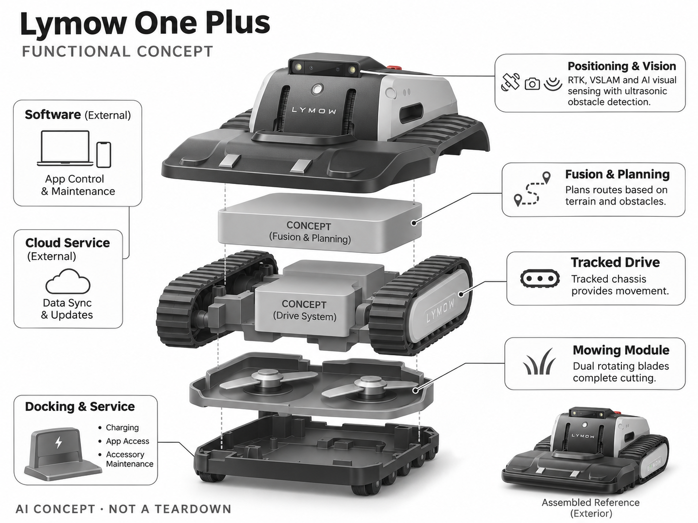

# Lymow One Plus

**Lymow** · 庭院与自然 · 核查 2026-11-04

面向坡地和复杂私家庭院的履带割草机器人

消费渠道：个人零售。

## 产品图片与结构参考

### 产品图

Lymow One Plus 官方产品图 · 来源：[Lymow · 官方图片](<https://www.lymow.com/products/lymow-one-plus-robotic-lawn-mower>) · [原始图片](<https://cdn.shopify.com/s/files/1/0684/7715/7611/files/PDP-IMAGE1-NA_ee5ef9e9-04aa-4db7-8543-17e68ca9de94.webp?v=1791861752&width=1200>)

### 参考图

Lymow One Plus 官方外观、使用场景或功能参考图 · 来源：[Lymow · 官方图片](<https://www.lymow.com/products/lymow-one-plus-robotic-lawn-mower>) · [原始图片](<https://cdn.shopify.com/s/files/1/0684/7715/7611/files/One_plus_2.png?v=1777449488&width=1200>)

### AI 生成爆炸示意

**AI 生成 · 非实物拆机。** 内部为概念推断，不能作为元件布局、BOM 或维修依据。[生成提示词](../../content/hardware/prompts/lymow-one-plus.txt)

> 保留官方图原始内容与出处；画面中的宣传参数不视为本轮独立实测。

> 分析为基于公开资料的案头研究与 AI 辅助判断，未经用户访谈、销量审计或实物拆机。需求、画像、竞争冷门度、审美及商业机会均为研究假设，不是投资结论。

## 销售与购买

- 状态：在售。官方商店显示One Plus 10A版本、Add to cart及美国/加拿大1—3工作日发货；5A和配件组合不重复计数。

- 地区：美国、加拿大

- 价格：US$2,599（所选10A版本）。核查时官方页面参考，价格保留原币种；套装、配件、订阅、税运及地区条件分别确认，不把容量版本重复计数。

- 中国大陆：本轮核实海外官方销售；中国大陆同型号现货、售后与云服务未确认。庭院条件、物种范围或定位服务也需按地区验证。

- [官方产品 / 商店](<https://www.lymow.com/products/lymow-one-plus-robotic-lawn-mower>)

## AI 的实际作用

RTK与VSLAM结合AI视觉和超声障碍感知，驱动履带式家用割草平台；履带和刀片动作本身不是AI。

服务与联网依赖：定位环境、App与连接服务决定远程体验；不同地区频段、配件和固件支持需确认，不预设国内同名可用。

## 是否冷门

细分专业（研究判断）：复杂私家庭院属于高门槛细分消费任务，设备昂贵且维护要求高，少见并不意味着容易进入。

## 需求与市场

需求假设：较大、坡度明显或草较密的家庭庭院，需要更稳定通过和切割能力。应比较人工补割、草坪损伤和救援次数，履带能爬坡不代表每块湿草地都适用，也不代表能完全取消人工维护。

## 用户画像

画像推断：有较大私家庭院、能承担设备重量和维护的房主，通常已在园艺服务或骑乘设备上投入。普通小院用户可能不需要其体量，购买理由应来自真实地形而非机器人新鲜感。

## 竞争与替代

竞争判断：与Yarbo、四驱轮式机器人、骑乘式割草机和园艺服务竞争。履带提供不同通过策略，但也带来复杂维护；需要以整季任务结果比较，而不是把更强机械规格直接等同更高价值。

## 供应链

供应链分析：履带、张紧结构、刀盘、电机、定位与视觉模块都要求户外耐久。实际代工及BOM未披露；草屑泥沙、履带更换、刀片配套与运输维修的成本，是新团队容易低估的部分。

## 技术路径

官方说明RTK、VSLAM和AI视觉避障。技术判断：定位置信与视觉遮挡需要融合处理，湿滑、窄通道和动物移动应实测；实验室坡度和覆盖数据不能替代用户庭院的成功率。

## 产品审美

审美判断：履带与宽体结构强调工具可靠性，适合园艺场景但不够轻巧。搬运、冲洗位置、刀片访问和基站摆放会影响日常体验，工业设计应把维护动作纳入，而不是只强调机械力量感。

## 关键风险

风险判断：高重量与刀盘意味着更严格的安全操作要求，孩子和宠物活动区域需管理。新旧型号配件未必兼容，云端与定位服务也可能变化；购买前应核对当地售后和冬季保养。

## 机会与验证

机会假设：先围绕某类坡地、草种或维护服务建立验证，量化设备代替了多少人工工作。若用户主要痛点是安装与维修，提供可靠服务可能比增加传感器或推出更大平台更有效。

## 功能分层示意

这是功能关系，不是实物拆机、真实空间结构或已核实 BOM。

1. **定位视觉**：RTK、VSLAM与AI视觉感知。（官方披露）

2. **融合规划**：根据地形和障碍规划路线。（分析推断）

3. **履带驱动**：履带底盘提供移动。（官方披露）

4. **割草模块**：双旋转刀片完成切割。（官方披露）

5. **停靠服务**：充电、App与配件维护。（官方披露）

## 来源

1. [Lymow One Plus 官方商品页](<https://www.lymow.com/products/lymow-one-plus-robotic-lawn-mower>) — 已实际打开并核查购买与交付入口；未实际下单。

2. [Lymow 官方产品与使用场景](<https://www.lymow.com/?lv=true>) — 已实际打开的官方能力、服务或维护说明；不代表独立实测。

[返回目录](../hardware-market.md) · [网页分析](https://romanagent.github.io/Roman/#hardware/product/lymow-one-plus)
