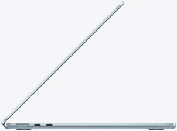
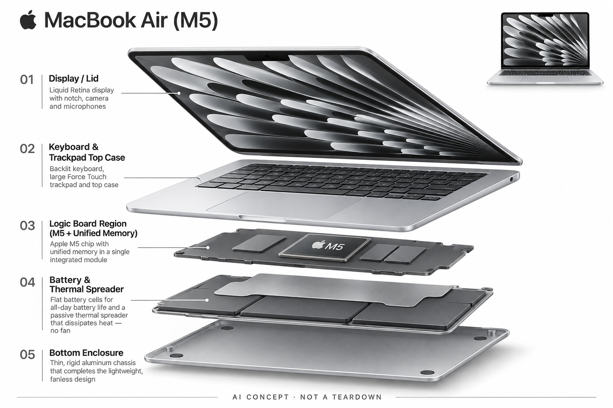

# MacBook Air M5（13 / 15 英寸）

**Apple** · 手机与 AI PC · 核查 2026-11-04

通用电脑上的端侧 AI 能力，是独立 AI 硬件的重要替代方案。

消费渠道：个人零售。

## 产品图片与结构参考

### 产品图

MacBook Air M5 官方13与15英寸产品图 · 来源：[Apple](<https://www.apple.com/macbook-air/>) · [原始图片](<https://www.apple.com/v/macbook-air/z/images/overview/hero/hero_static__c9sislzzicq6_large.png>)

### 参考图

官方侧视结构与接口参考图 · 来源：[Apple](<https://www.apple.com/macbook-air/>) · [原始图片](<https://www.apple.com/v/macbook-air/z/images/overview/design/color/design_side_skyblue__dtyt9gw4nfiq_large.jpg>)

### AI 生成爆炸示意

**AI 生成 · 非实物拆机。** 内部为概念推断，不能作为元件布局、BOM 或维修依据。[生成提示词](../../content/hardware/prompts/macbook-air-m5.txt)

> 分析为基于公开资料的案头研究与 AI 辅助判断，未经用户访谈、销量审计或实物拆机。需求、画像、竞争冷门度、审美及商业机会均为研究假设，不是投资结论。

## 销售与购买

- 状态：在售。Apple 美国官网有购买入口，中国大陆官方商店列出 M5 型号与可选配置。不同内存、尺寸和交付地区需单独选择。

- 地区：美国、中国大陆、其他 Apple 销售地区

- 价格：美国官网 US$1,299 起。为美国13英寸基础配置参考；15英寸、内存与存储升级另计。中国大陆价格不由美元换算，按中国官方商店报价。

- 中国大陆：中国大陆 Apple 官方商店可选择 M5 MacBook Air。硬件可购不等于所有 Apple Intelligence / Siri AI 功能在当地均可用；需逐项核对软件版本、语言、账户和地区。

- [官方产品 / 商店](<https://www.apple.com/macbook-air/>)

## AI 的实际作用

官方介绍 M5 GPU、Neural Engine、统一内存及 Apple Intelligence，用于本地 AI 工作流和系统集成功能。具体应用也可能调用云模型。

服务与联网依赖：离线可用性取决于应用、模型及系统功能。云服务、地区功能限制与第三方订阅需分别确认；不能把硬件性能当成所有AI服务权益。

## 是否冷门

竞争密集（研究判断）：通用AI电脑有成熟渠道和强替代品，硬件形态与品牌生态竞争激烈；本目录将其作为独立AI硬件的参照。

## 需求与市场

需求假设：大量用户首先需要可靠的通用电脑，AI 是既有工作流的能力增量。因此它也是独立AI设备的强替代品：新硬件必须说明为何不能用现有电脑完成同一任务。

### 官方｜通用电脑中的 AI 能力 · 官方资料

本型号以 M5、统一内存和系统软件支持本地及应用中的人工智能工作流，同时仍是一台通用电脑。需求首先可能是可靠的文档、创作和移动工作，人工智能是这些流程的增量；硬件可运行相关任务不等于所有系统功能、云模型或第三方订阅都已包含，也不能把不同地区体验视为相同。

依据：[MacBook Air 官方产品与购买入口](<https://www.apple.com/macbook-air/>)

### 判断｜先看原有工作流 · 研究判断

用户可能用现有电脑完成搜索、转写、图像和写作，升级设备需要证明瓶颈确实来自硬件而非软件或流程。它也是独立人工智能终端的重要替代，需要比较为什么额外设备有必要；价值应以实际任务与携带成本判断，不能因为芯片强调人工智能就推定每位用户都该更新电脑。

依据：[MacBook Air 官方产品与购买入口](<https://www.apple.com/macbook-air/>)

### 验证｜真实任务基线 · 待验证

可在用户常用文档、媒体和模型任务上记录完成时间、等待、错误修正和电量，再与现有电脑对照。需要区分本地与云端任务，网络服务变快不能全部归给新芯片；当前目录没有性能实测，不能将厂商倍率、峰值或演示结果直接转化为用户每天节省的时间。

依据：[MacBook Air 官方产品与购买入口](<https://www.apple.com/macbook-air/>)

## 用户画像

画像推断：学生、移动办公者、轻量创作者与使用本地模型的技术用户。不同内存配置适合的模型规模不同，是否为了AI而升级设备需依据实际任务频率判断。

### 判断｜移动工作与轻量创作人群 · 研究判断

需要携带电脑、经常处理文档和内容的人可能更匹配，但具体软件、外设与持续负载会改变选择。学生或创作者只是访谈线索，不能代表统一需求；若主要任务由轻量网页服务完成，硬件升级可能有限，若长期本地计算则需要更仔细评估资源和热条件。

依据：[MacBook Air 官方产品与购买入口](<https://www.apple.com/macbook-air/>)

### 判断｜本地模型实验用户 · 研究判断

希望在自己的电脑处理模型的人需要理解内存、存储和软件适配，而不只是看到神经网络相关硬件。不同模型、上下文与并发应用会改变资源需求，不能按参数量给出统一适用保证；画像应包括实际任务频率与维护能力，避免把尝鲜动机等同长期需要更高配置。

依据：[MacBook Air 官方产品与购买入口](<https://www.apple.com/macbook-air/>)

### 验证｜地区与应用可用性 · 待验证

首次评估应核对目标应用、系统版本、语言和账户地区，确认所需功能在哪里运行以及是否可用。中国大陆官方硬件购买不能代替系统人工智能服务确认，第三方应用也有独立条件；当前目录不把兼容列表或购买入口当作所有工作流都顺利迁移的保证。

依据：[MacBook Air 官方产品与购买入口](<https://www.apple.com/macbook-air/>) · [Apple 中国大陆 MacBook Air 商店](<https://www.apple.com.cn/shop/buy-mac/macbook-air>)

## 竞争与替代

市场判断：AI PC 已是多品牌参与的成熟竞争场，不能因加入新模型功能就称冷门赛道。竞争同时来自 Windows AI PC、旧款电脑与云工具，换机理由受性能、续航和生态共同影响。

### 判断｜通用平台对专用设备的替代 · 研究判断

笔记、录音整理和视觉工具可以在电脑中完成，专用硬件需要证明输入位置、操作或环境带来额外收益。MacBook Air 的优势与限制应放在整套任务中比较，而不是只按芯片或人工智能功能数量；需要随时佩戴或户外即时输入的任务，也不能由电脑天然替代。

依据：[MacBook Air 官方产品与购买入口](<https://www.apple.com/macbook-air/>)

### 判断｜同类电脑与更高负载平台 · 研究判断

其他电脑和更偏持续负载的机型可能提供不同资源与散热，比较需要固定软件、模型和任务时间。无风扇便携设计是一种取舍，不能只用短时峰值排名，也不能把同页其他机型参数混入 Air；用户是否需要升级，应由实际瓶颈和可接受携带成本决定。

依据：[MacBook Air 官方产品与购买入口](<https://www.apple.com/macbook-air/>)

### 验证｜尺寸与配置同口径 · 待验证

比较应保持尺寸、内存、存储和地区一致，不把升级配置或折抵优惠当作基础售价。美元价格不能直接换算成国行到手价，云服务和第三方订阅也应单独核算；当前没有用户任务或价格弹性研究，目录不由品牌、起价或硬件规格推断统一性价比结论。

依据：[MacBook Air 官方产品与购买入口](<https://www.apple.com/macbook-air/>) · [Apple 美国 Mac 商店](<https://www.apple.com/shop/buy-mac>) · [Apple 中国大陆 MacBook Air 商店](<https://www.apple.com.cn/shop/buy-mac/macbook-air>)

## 供应链

公开资料确认 Apple 芯片和统一内存架构，完整供应链与单机成本未在本轮核查。分析侧重芯片封装、内存、屏幕、机身加工与全球售后，不能把供应商行业传闻写成该SKU的确定配套。

### 官方｜自研核心与外围模块 · 官方资料

官方明确 M5 和统一内存等平台信息，本轮页面也披露麦克风阵列与扬声器系统，但完整供应商和工厂没有公开到单机物料层。Apple 品牌不能证明所有外围器件自制，行业传闻也不能作为该配置证据；目录区分已披露核心架构与尚未知的音频、显示和制造关系。

依据：[MacBook Air 官方产品与购买入口](<https://www.apple.com/macbook-air/>)

### 判断｜集成设计限制替换 · 研究判断

主处理器、内存、系统和机身紧密结合，不能把通用芯片候选理解为用户可以在现有电脑中替换升级。供应链研究应从新设计的功能模块比较出发，并核对接口、热与软件支持；当前没有成本、良率和具体工厂资料，不按售价或集团制造能力补出确定物料关系。

依据：[MacBook Air 官方产品与购买入口](<https://www.apple.com/macbook-air/>)

### 判断｜声音外围的候选范围 · 研究判断

英飞凌可作为麦克风输入候选，德州仪器可作为扬声器放大与保护候选，均未被本型号点名采用。它们只对应同类新设计的声音模块，需要重新验证声学、电源和驱动，不提供 M5 或统一内存；这样可以讨论真实功能匹配，同时避免把封闭整机误写成可直接换芯片的方案。

依据：[MacBook Air 官方产品与购买入口](<https://www.apple.com/macbook-air/>)

## 技术路径

官方披露 M5 的神经网络相关加速和无风扇设计。对AI任务的分析应考察可用内存、持续负载和软件适配；峰值性能或厂家“快几倍”描述需要对应测试条件，不视为本轮实测。

### 官方｜本地、系统与云端分层 · 官方资料

M5 的计算单元、统一内存和系统人工智能支持构成硬件与软件基础，具体应用仍可能调用远端模型。可离线完成什么取决于应用、模型和版本，不能把神经网络硬件存在当作所有服务离线或免费；目录保持芯片能力、系统功能权限和第三方服务权益的区别。

依据：[MacBook Air 官方产品与购买入口](<https://www.apple.com/macbook-air/>)

### 判断｜内存与持续负载的重要性 · 研究判断

模型权重、上下文、图像输入和其他应用会共同占用资源，峰值算力不能单独决定体验。无风扇设计下还应观察持续任务的温升与保持性能，而不是只测一次短请求；技术分析需要完整负载和软件适配，不能用厂家某项倍率替代用户自己的模型与工作流结果。

依据：[MacBook Air 官方产品与购买入口](<https://www.apple.com/macbook-air/>)

### 验证｜可复现的本地任务 · 待验证

测试应固定模型、输入、应用版本和电源状态，记录首次加载、持续运行、内存峰值与并发影响，再与云端路径分开比较。不能把服务网络变化当作本机提升，也不能只选择最短任务；当前目录没有实测，不对具体模型规模、响应或长时间性能作保证。

依据：[MacBook Air 官方产品与购买入口](<https://www.apple.com/macbook-air/>)

## 产品审美

设计观察：薄型铝合金笔记本延续成熟的工作工具外观，既有认知成本低。无风扇有利安静场景，但长时间高负载的设计取舍应通过实际任务验证，而非由外观推断性能。

### 判断｜便携外形与实际工作 · 研究判断

轻薄机身与不同屏幕尺寸可能适合移动使用，但携带、键盘、显示空间和外接设备需要一起考虑。审美应回到用户真实工作地点与姿势，不能只看产品渲染或机身颜色；无风扇和简洁外形也不自动证明所有负载舒适，长期触感和工作效率仍需实际体验。

依据：[MacBook Air 官方产品与购买入口](<https://www.apple.com/macbook-air/>)

### 判断｜系统交互的熟悉与迁移 · 研究判断

键盘、触控板和多窗口承接复杂任务，人工智能入口应嵌入已有流程而不是增加频繁切换。设计评价应观察用户是否容易看到来源、确认修改和回退，不能只看回答自然；已有其他系统习惯的人还需要迁移应用与文件，品牌生态熟悉度不能代替完整任务验证。

依据：[MacBook Air 官方产品与购买入口](<https://www.apple.com/macbook-air/>)

### 验证｜真实移动与桌面组合 · 待验证

试用应包含携带、长文编辑、音视频与外接设备，记录充电、发热、显示空间和输入负担。不同尺寸与配置要分开观察，不能由一台样机推断全部选择；产品图片和标称电池时间只能初筛，长时间使用中的便利与限制需要真实工作负载和个人反馈。

依据：[MacBook Air 官方产品与购买入口](<https://www.apple.com/macbook-air/>)

## 关键风险

主要风险是把跨地区AI能力一概视作可用，以及低估内存需求、模型下载和云订阅成本。硬件购买、系统AI权限和第三方服务订阅是三件不同的事。

### 判断｜硬件可购与 AI 权限不同 · 研究判断

国行可购买不意味着所有 Apple Intelligence 或语音智能在当地都可用，语言、账户、系统和服务条件需要逐项核对。第三方应用又可能有独立订阅与网络要求，不能把电脑起价理解为全部人工智能权益；目录不将海外功能演示直接搬到中国使用场景。

依据：[MacBook Air 官方产品与购买入口](<https://www.apple.com/macbook-air/>) · [Apple 中国大陆 MacBook Air 商店](<https://www.apple.com.cn/shop/buy-mac/macbook-air>)

### 判断｜资源与数据路径误判 · 研究判断

用户可能低估模型下载、内存占用和长期维护，也可能误以为本地应用就绝不联网。实际数据流应按具体工具确认，系统安全能力不能替代应用权限和内容检查；重要生成结果仍需复核，当前目录不以芯片品牌、统一内存或本地推理标签作为绝对可靠与隐私保证。

依据：[MacBook Air 官方产品与购买入口](<https://www.apple.com/macbook-air/>)

### 验证｜任务执行与结果复核 · 待验证

应检查模型输出、文件修改或跨应用操作能否回查并撤销，区分建议已生成与任务真正完成。对于重要内容，用户需要核实来源和最终文件，不能只看助手确认语句；验证目标是减少总工作量并保持控制，而不是让更强硬件掩盖应用、权限或生成错误。

依据：[MacBook Air 官方产品与购买入口](<https://www.apple.com/macbook-air/>)

## 机会与验证

值得研究的是AI究竟改善了哪些高频工作步骤。应比较使用现有电脑加软件与购买新设备的任务完成时间和质量，避免把AI营销标签等同于可归因的换机需求。

### 判断｜通用电脑的增量价值 · 研究判断

本型号的购买理由应来自原有工作流中的真实瓶颈被改善，人工智能只是其中一部分。若大多数任务仍是轻量云服务，独立硬件加速可能并非主要收益；场景分组应围绕通用本地工作与模型任务，不因尺寸、内存或颜色重复计算独立需求，也不把新芯片自动当作新场景。

依据：[MacBook Air 官方产品与购买入口](<https://www.apple.com/macbook-air/>)

### 判断｜专用设备必须解释额外理由 · 研究判断

作为通用平台，它提醒目录中的独立人工智能硬件需要说明为什么现有电脑或手机不够方便。比较应关注采集位置、使用环境和操作成本，而不是只比模型能力；MacBook Air 本身也有携带和生态限制，研究应同时保留其替代作用与无法覆盖的即时随身任务。

依据：[MacBook Air 官方产品与购买入口](<https://www.apple.com/macbook-air/>)

### 验证｜升级前后的完整成本 · 待验证

后续可用实际任务跟踪完成时间、错误修正、能耗和软件维护，并核算内存存储配置及云订阅。不同地区服务与设备组合应分别记录，不能以促销或短时基准代表长期；当前目录是案头研究，不以官方倍率、品牌或硬件可购宣称所有用户都能获得同样 AI 收益。

依据：[MacBook Air 官方产品与购买入口](<https://www.apple.com/macbook-air/>) · [Apple 美国 Mac 商店](<https://www.apple.com/shop/buy-mac>) · [Apple 中国大陆 MacBook Air 商店](<https://www.apple.com.cn/shop/buy-mac/macbook-air>)

## 对应供应链公司

能力候选用于选型研究，不代表本产品实际采用；未公开的供货关系不作推断。

- [infineon](../supply-chain/infineon.md) — **能力候选 · 非已采用** / 笔记本麦克风阵列的输入候选：Apple 官方披露 MacBook Air 的麦克风阵列，英飞凌 MEMS 麦克风可作为同类新设计输入候选。需重新验证声孔、阵列、回声、接口与系统调校，当前没有供货点名；这不是现有封闭整机可直接替换的零件，也不提供 M5、系统助手或模型服务。

- [texas-instruments](../supply-chain/texas-instruments.md) — **能力候选 · 非已采用** / 扬声器数字放大与保护的外围候选：官方产品具有扬声器系统，TI 的笔记本音频放大与保护路线可作为同类新设计候选。需核对供电、数字接口、扬声器阻抗和驱动调校，当前未确认采用；不按芯片最大功率推算 Air 输出，也不把这一外围候选误写成 M5 或统一内存供应方。

[浏览供应链目录](../supply-chain.md)

## 功能分层示意

这是功能关系，不是实物拆机、真实空间结构或已核实 BOM。

1. **应用与系统**：Apple Intelligence 及第三方AI应用承载用户任务。（官方披露）

2. **输入与显示**：键盘、触控板、麦克风、摄像头和屏幕构成通用交互。（官方披露）

3. **芯片与统一内存**：M5 与统一内存支持计算及模型运行。（官方披露）

4. **机身与被动散热**：官方说明无风扇薄型设计。（官方披露）

5. **云端与服务**：部分模型或系统功能依赖网络、账户及地区支持。（分析推断）

## 来源

1. [MacBook Air 官方产品与购买入口](<https://www.apple.com/macbook-air/>) — 核查页面为M5，区分13和15英寸。

2. [Apple 美国 Mac 商店](<https://www.apple.com/shop/buy-mac>) — 美国区域 MacBook Air 起价为1299美元。

3. [Apple 中国大陆 MacBook Air 商店](<https://www.apple.com.cn/shop/buy-mac/macbook-air>) — 展示中国大陆M5配置购买入口；AI功能可用性须另行核查。

[返回目录](../hardware-market.md) · [网页分析](https://romanagent.github.io/Roman/#hardware/product/macbook-air-m5)
