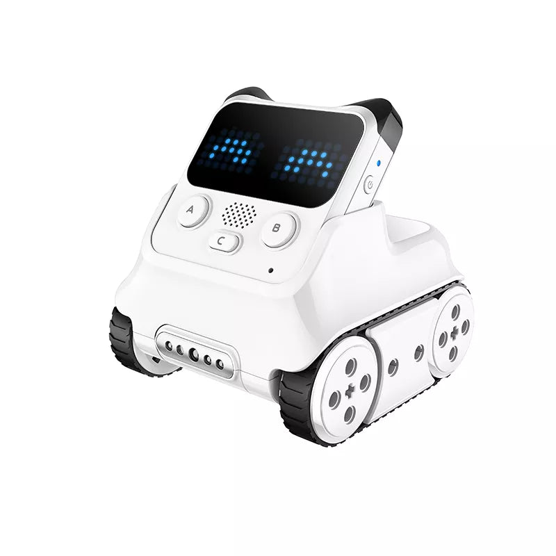
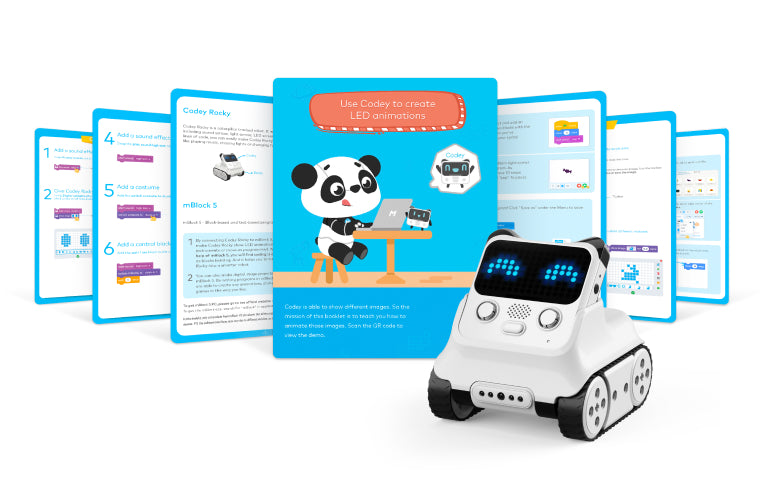
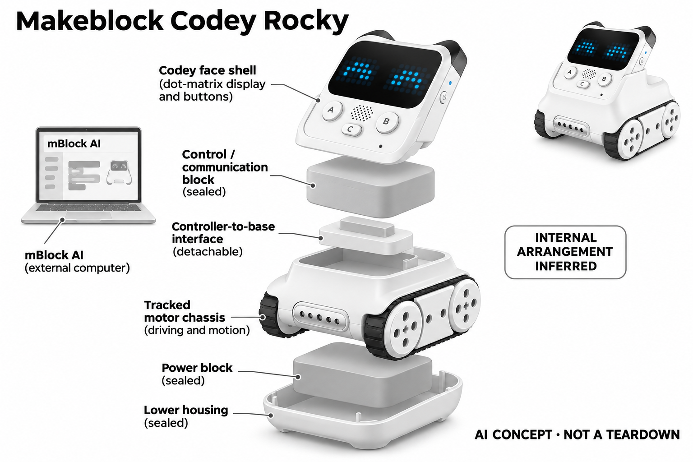

# Makeblock Codey Rocky

**Makeblock** · 教育与学习 · 核查 2026-11-04

以表情与履带动作承载AI编程项目

消费渠道：个人零售。

## 产品图片与结构参考

### 产品图

Makeblock Codey Rocky · 官方产品图 · 来源：[Makeblock · 官方图片](<https://www.makeblock.com/products/buy-codey-rocky>) · [原始图片](<https://cdn.shopify.com/s/files/1/0070/5901/3716/files/SKU-CodeyRocky.webp?v=1766999230>)

### 参考图

Makeblock Codey Rocky · 官方参考图 · 来源：[Makeblock · 官方图片](<https://www.makeblock.com/products/buy-codey-rocky>) · [原始图片](<https://cdn.shopify.com/s/files/1/0070/5901/3716/files/PC-codey_rocky.jpg?v=1711105285>)

### AI 生成爆炸示意

**AI 生成 · 非实物拆机。** 内部为概念推断，不能作为元件布局、BOM 或维修依据。[生成提示词](../../content/hardware/prompts/makeblock-codey-rocky.txt)

> 已目视核对外形、标签与非拆机声明；不代表内部结构经实测验证。

> 分析为基于公开资料的案头研究与 AI 辅助判断，未经用户访谈、销量审计或实物拆机。需求、画像、竞争冷门度、审美及商业机会均为研究假设，不是投资结论。

## 销售与购买

- 状态：在售。官方单台商品页列购买入口与两工作日发货说明，直送美国本土；蓝牙适配器组合不另计型号。

- 地区：美国本土官方直送

- 价格：官网 US$139.99。核查日页面快照；运费、税费、会员和配送区域按官方结算确认，不视为中国到手价。

- 中国大陆：本轮核实所列区域官方商店；未确认中国大陆官方现货、账户及完整服务，不把境外可购等同大陆可用。

- [官方产品 / 商店](<https://www.makeblock.com/products/buy-codey-rocky>)

## AI 的实际作用

配合mBlock可进行人脸识别等AI学习项目并驱动实体机器人；普通巡线、颜色检测与遥控不作为AI依据。官方FAQ明确本体没有独立语音识别模块。

服务与联网依赖：AI项目依赖mBlock、兼容电脑及相应外部输入或扩展；语音控制须按官方要求搭配模块，不把可编程小车写成内置通用对话机器人。

## 是否冷门

新兴竞争（研究判断）：轻量入门机器人而非自由对话玩具形成具体使用场景；本轮没有销量与市场份额证据。

## 需求与市场

需求假设：初学者希望把简单识别结果变成表情和行走动作，获得比屏幕积木更直观的反馈。应确认家庭实际完成的是AI识别项目，而非长期只使用遥控和巡线功能后仍称为AI学习。

## 用户画像

画像推断：偏好较少机械组装、愿意与成人一起使用图形编程软件的低龄学习者较匹配。主控与底盘分离方便探索，也可能需要解释不同模块作用，不能假定可爱外观意味着无需引导。

## 竞争与替代

竞争判断：同价位编程玩具、积木和移动应用很多，轻量角色外观与模块化底盘形成差异。若用户只使用遥控，普通玩具可能足够，因此需要区分编程需求、陪伴期待和礼物新鲜感。

## 供应链

供应链推断：履带底盘、主控连接和点阵显示需承受反复拆装与桌面跌落，触点和传动部件也会磨损。官方未披露完整工厂和物料表；固件工具、适配器和备件可用性影响交付体验。

## 技术路径

官方将AI能力放在mBlock学习生态中，同时明确本体无语音识别模块。技术判断必须标清外部摄像与软件依赖，不把颜色传感或固定避障逻辑描述成通用视觉，也不声称可直接自由聊天。

## 产品审美

审美判断：白色圆角主控、点阵表情与黑色履带让它像一个小角色，降低工具的陌生感。表情可读性、拆装阻力和地面运行声音需要实际体验，图片中的友好感不代表所有孩子都感兴趣。

## 关键风险

风险判断：AI课程与基础玩法的硬件条件不同，购买者容易误以为识别能力全部内置。电脑兼容、固件更新和小零件管理需要成人参与，不能将厂商能力描述直接转写成孩子独立学习保证。

## 机会与验证

市场观察：后续可记录家庭从遥控转向编程和识别项目的比例，询问在哪一步停止使用及需要何种帮助。把软件配置和成人陪同时间纳入总成本，判断实体角色是否真正支持持续探索。

## 功能分层示意

这是功能关系，不是实物拆机、真实空间结构或已核实 BOM。

1. **角色主控**：点阵显示和传感输入构成Codey。（官方披露）

2. **学习软件**：mBlock及外部输入承载AI项目。（官方披露）

3. **程序映射**：识别结果触发表情或动作。（官方披露）

4. **履带执行**：Rocky底盘执行运动控制。（官方披露）

## 来源

1. [Codey Rocky官方单机商品](<https://www.makeblock.com/products/buy-codey-rocky>) — 已实际打开官方页面；功能说明不等于独立性能测量。

2. [Makeblock官方AI项目说明](<https://www.makeblock.com/blogs/for-educators/ai-projects>) — 已实际打开官方页面；功能说明不等于独立性能测量。

3. [Makeblock家庭项目与识别能力](<https://www.makeblock.com/blogs/for-family/10-engaging-stem-activities-for-kids-in-2023>) — 已实际打开官方页面；功能说明不等于独立性能测量。

4. [Codey Rocky官方能力边界FAQ](<https://support.makeblock.com/hc/en-us/articles/1500004266501-FAQs-on-Codey-Rocky>) — 已实际打开官方页面；功能说明不等于独立性能测量。

[返回目录](../hardware-market.md) · [网页分析](https://romanagent.github.io/Roman/#hardware/product/makeblock-codey-rocky)
