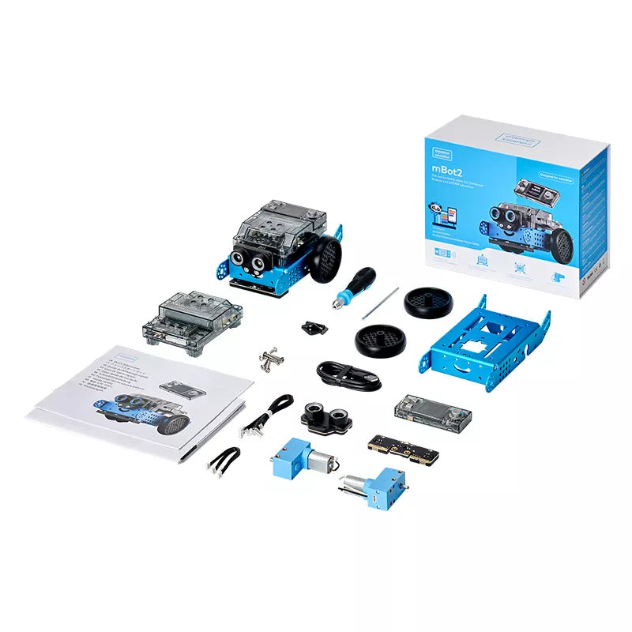
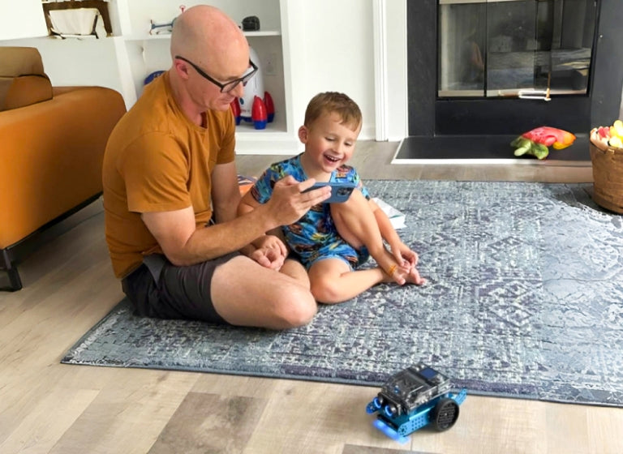
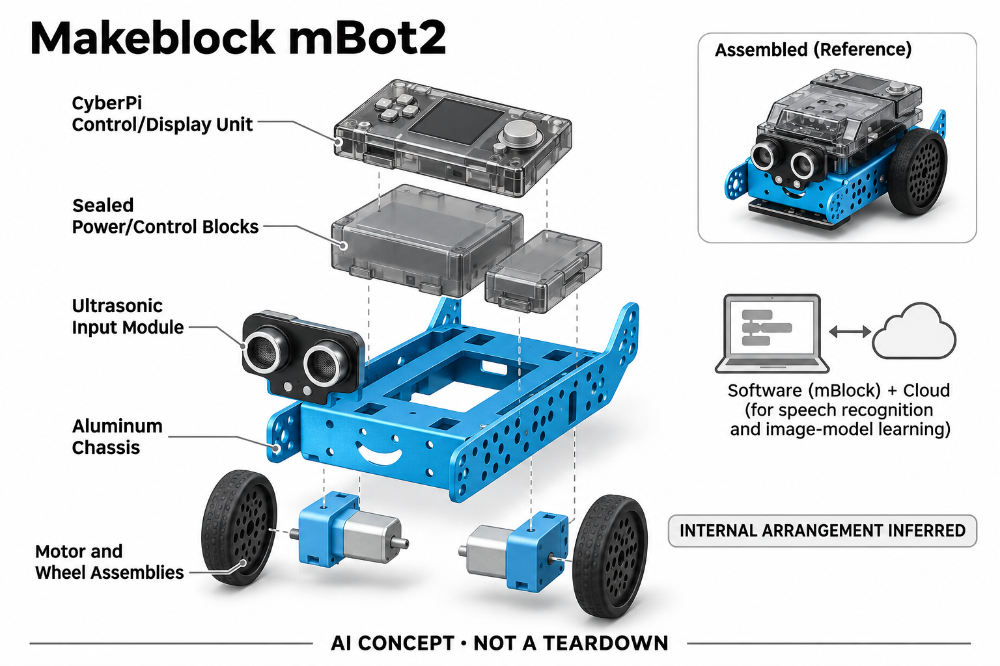

# Makeblock mBot2

**Makeblock** · AI玩具 · 核查 2026-11-04

让语音识别结果驱动可编程机器人

消费渠道：个人零售。

## 产品图片与结构参考

### 产品图

Makeblock mBot2 · 官方产品图 · 来源：[Makeblock · 官方图片](<https://www.makeblock.com/products/buy-mbot2>) · [原始图片](<https://cdn.shopify.com/s/files/1/0070/5901/3716/files/P1010132_mBot2.webp?v=1766999460>)

### 参考图

Makeblock mBot2 · 官方参考图 · 来源：[Makeblock · 官方图片](<https://www.makeblock.com/products/buy-mbot2>) · [原始图片](<https://cdn.shopify.com/s/files/1/0070/5901/3716/files/Step2__Play.jpg?v=1731391578&width=2048>)

### AI 生成爆炸示意

**AI 生成 · 非实物拆机。** 内部为概念推断，不能作为元件布局、BOM 或维修依据。[生成提示词](../../content/hardware/prompts/makeblock-mbot2.txt)

> 已目视核对外形、标签与非拆机声明；不代表内部结构经实测验证。

> 分析为基于公开资料的案头研究与 AI 辅助判断，未经用户访谈、销量审计或实物拆机。需求、画像、竞争冷门度、审美及商业机会均为研究假设，不是投资结论。

## 销售与购买

- 状态：在售。官方单机器人页有购买入口并说明两工作日发货、当前直送美国本土；本条不是学校六台组合，mBot Neo旧名称与同款扩展套装不重复计数。

- 地区：美国本土官方直送

- 价格：单机器人官网 US$149.99。核查日页面快照；运费、税费、会员和配送区域按官方结算确认，不视为中国到手价。

- 中国大陆：本轮核实所列区域官方商店；未确认中国大陆官方现货、账户及完整服务，不把境外可购等同大陆可用。

- [官方产品 / 商店](<https://www.makeblock.com/products/buy-mbot2>)

## AI 的实际作用

官方课程使用内置麦克风进行语音识别，将较重识别计算交给云服务；也可配合mBlock与电脑摄像头训练图像分类后驱动机器人。巡线避障不单独算AI。

服务与联网依赖：需要兼容电脑或移动应用和学习配置；语音识别需网络，视觉课程通常使用外部摄像头或另购AI Camera，基础套装不默认含视觉模块。

## 是否冷门

新兴竞争（研究判断）：学习软件与实体动作形成反馈形成具体使用场景；本轮没有销量与市场份额证据。

## 需求与市场

需求假设：家庭学习者希望通过看得见的动作理解语音识别和分类结果，而不仅在屏幕上拖动积木。应观察孩子是否理解数据、判断与行动之间的关系，不能只用机器人完成任务来代表学习。

### 产品任务与边界 · 研究判断

mBot2 让学习者把语音或图像识别结果映射为实体动作，核心任务是理解输入、判断和执行之间的关系。机器人成功行走只是学习活动的结果之一，不能据此证明孩子理解了机器学习，也不能把普通巡线直接计为 AI 学习。

依据：[mBot2官方单机购买页](<https://www.makeblock.com/products/buy-mbot2>) · [mBot2官方课后课程指南](<https://res-us.makeblock.com/doc/course/mBot2/After-school%20program%20guide%20for%20mBot2.pdf>)

### 需求判断 · 研究判断

实体反馈可能让抽象分类更容易讨论，但搭建、连接和调试也会占用学习时间。家庭是否需要这套硬件，取决于动作反馈能否增加探索和解释，而不是仅让屏幕程序变得热闹；成人协助成本应同时纳入需求判断。

依据：[mBot2官方单机购买页](<https://www.makeblock.com/products/buy-mbot2>) · [mBot2官方课后课程指南](<https://res-us.makeblock.com/doc/course/mBot2/After-school%20program%20guide%20for%20mBot2.pdf>)

### 需求验证 · 待验证

可要求学习者解释识别错误为何导致错误动作，再更换背景或语句观察其是否愿意调整输入。记录自主修改、求助及重试，而不只打勾任务完成，才能判断实体机器人是否帮助理解模型边界和程序逻辑。

依据：[mBot2官方单机购买页](<https://www.makeblock.com/products/buy-mbot2>) · [mBot2官方课后课程指南](<https://res-us.makeblock.com/doc/course/mBot2/After-school%20program%20guide%20for%20mBot2.pdf>)

## 用户画像

画像推断：愿意陪同搭建、设置软件并共同完成项目的亲子家庭较匹配。它需要学习活动和稳定桌面空间，若购买者只希望开箱自动陪玩，则编程配置和故障排查可能成为持续使用门槛。

### 适用行为与条件 · 研究判断

较匹配愿意共同搭建、设置软件并开展连续项目的亲子家庭，以及有耐心排查连接问题的个人学习者。若购买者期待开箱自动陪玩，编程和外部终端依赖会形成明显落差，需要在购买前明确它是学习工具。

依据：[mBot2官方单机购买页](<https://www.makeblock.com/products/buy-mbot2>) · [mBot2官方课后课程指南](<https://res-us.makeblock.com/doc/course/mBot2/After-school%20program%20guide%20for%20mBot2.pdf>)

### 人群取舍 · 研究判断

具备稳定电脑、桌面空间和成人支持的家庭更容易完成完整课程，移动设备为主的家庭则需先核对兼容。孩子对机械组装和代码的兴趣可能不同，应分别观察，不能以喜欢机器人外形推定愿意长期编程。

依据：[mBot2官方单机购买页](<https://www.makeblock.com/products/buy-mbot2>) · [mBot2官方课后课程指南](<https://res-us.makeblock.com/doc/course/mBot2/After-school%20program%20guide%20for%20mBot2.pdf>)

### 画像验证 · 待验证

画像验证应让家庭从安装软件开始独立完成一个项目，记录在哪一步停下及需要什么帮助。随后观察没有成人提示时是否再次启动，区分硬件搭建吸引力、课程理解困难和终端配置门槛，避免笼统归为孩子没兴趣。

依据：[mBot2官方单机购买页](<https://www.makeblock.com/products/buy-mbot2>) · [mBot2官方课后课程指南](<https://res-us.makeblock.com/doc/course/mBot2/After-school%20program%20guide%20for%20mBot2.pdf>)

## 竞争与替代

竞争判断：编程机器人、积木套件和免费浏览器机器学习课程都有替代，实体反馈是主要区别。课程数量多不等于家庭能持续使用，家长投入、语言支持和项目难度梯度可能更影响选择。

### 比较对象与差异 · 研究判断

mBot2 面对编程积木、轮式机器人及免费浏览器机器学习课程，实体动作是主要区别。比较重点应是同一学习目标所需时间、可解释性和扩展成本，而不是套件传感器数量或课程总数，因为家庭未必能用到全部资源。

依据：[mBot2官方单机购买页](<https://www.makeblock.com/products/buy-mbot2>) · [mBot2官方课后课程指南](<https://res-us.makeblock.com/doc/course/mBot2/After-school%20program%20guide%20for%20mBot2.pdf>)

### 竞争判断 · 研究判断

金属结构和模块化接口提供可见的工程感，但也增加零件管理和接线步骤。它与少组装的 Codey Rocky 形成不同入门路径，不能简单按功能多寡排序；竞争优势取决于用户是否愿意把机械过程也作为学习的一部分。

依据：[mBot2官方单机购买页](<https://www.makeblock.com/products/buy-mbot2>) · [mBot2官方课后课程指南](<https://res-us.makeblock.com/doc/course/mBot2/After-school%20program%20guide%20for%20mBot2.pdf>)

### 竞争验证 · 待验证

可用相同图像分类任务比较屏幕动画与 mBot2 实体执行，观察学习者是否更能解释未知样本失败。还需记录组装和配置时间，把课程之外的支持负担纳入比较，避免只展示最顺畅的一次课堂演示。

依据：[mBot2官方单机购买页](<https://www.makeblock.com/products/buy-mbot2>) · [mBot2官方课后课程指南](<https://res-us.makeblock.com/doc/course/mBot2/After-school%20program%20guide%20for%20mBot2.pdf>)

## 供应链

供应链推断：金属构件、电机、传感器和可拆线缆让产品可扩展，也增加零件遗失与接错的可能。官方未披露完整工厂和物料成本；课程维护、备件和不同套装清晰标识都是交付环节。

### 功能模块拆分 · 研究判断

功能层包括金属底盘、电机和传感模块，麦克风或外部摄像输入，mBlock 与云端识别，以及程序到动作的映射。基础套装不应被画成默认自带视觉模块，外部计算和另购扩展需要在系统图及采购清单中明确。

依据：[mBot2官方单机购买页](<https://www.makeblock.com/products/buy-mbot2>) · [mBot2官方课后课程指南](<https://res-us.makeblock.com/doc/course/mBot2/After-school%20program%20guide%20for%20mBot2.pdf>)

### 制造与供应约束 · 研究判断

制造约束是可拆线缆、连接器、电机和结构孔位在反复搭建后仍可可靠使用。交付还包括备件、软件工具和不同套装标识，若课程要求的配件不清，用户可能购买本体后才发现无法完成计划项目，增加售后负担。

依据：[mBot2官方单机购买页](<https://www.makeblock.com/products/buy-mbot2>) · [mBot2官方课后课程指南](<https://res-us.makeblock.com/doc/course/mBot2/After-school%20program%20guide%20for%20mBot2.pdf>)

### 候选与证据缺口 · 研究判断

Seeed 可作为可编程硬件工程与制造候选，SIIX 可支持控制板及电子组装评估。两者没有 mBot2 点名制造证据；教材、mBlock 生态和扩展兼容不能从电路制造能力推定，需要另外明确学习软件与内容责任。

依据：[mBot2官方单机购买页](<https://www.makeblock.com/products/buy-mbot2>) · [mBot2官方课后课程指南](<https://res-us.makeblock.com/doc/course/mBot2/After-school%20program%20guide%20for%20mBot2.pdf>)

## 技术路径

官方课程明确语音识别可交给云服务，机器学习项目可结合电脑摄像头。技术判断应区分外部推理与本机控制，不能把全部感知都画在机器人上，也不能将固定阈值避障当成机器学习。

### 已披露技术边界 · 研究判断

官方课程明确语音识别可交给云服务，图像分类可利用电脑摄像头和学习软件，本机负责相应控制与动作。固定阈值避障和巡线是控制逻辑，不应仅因机器人可以自主运行就被称为机器学习或通用视觉理解。

依据：[mBot2官方单机购买页](<https://www.makeblock.com/products/buy-mbot2>) · [mBot2官方课后课程指南](<https://res-us.makeblock.com/doc/course/mBot2/After-school%20program%20guide%20for%20mBot2.pdf>)

### 系统难点判断 · 研究判断

技术难点不仅是识别准确，还包括学习者能否看见数据、预测和动作之间的因果关系。外部模型失败、连接中断和控制程序错误可能呈现相同的不动现象，需要让调试信息区分这些层次，避免儿童只能反复重启。

依据：[mBot2官方单机购买页](<https://www.makeblock.com/products/buy-mbot2>) · [mBot2官方课后课程指南](<https://res-us.makeblock.com/doc/course/mBot2/After-school%20program%20guide%20for%20mBot2.pdf>)

### 技术验证 · 待验证

验证应分别测试训练外样本、云语音断网、终端连接和电机执行，并要求学习者定位失败环节。还需核对基础订单与 AI Camera 等扩展的区别，不能用装有额外配件的展示方案代表所有购买者开箱即得的能力。

依据：[mBot2官方单机购买页](<https://www.makeblock.com/products/buy-mbot2>) · [mBot2官方课后课程指南](<https://res-us.makeblock.com/doc/course/mBot2/After-school%20program%20guide%20for%20mBot2.pdf>)

## 产品审美

审美判断：外露金属框架和模块接口突出可搭建工具属性，双眼式超声波部件增加亲和感。线缆整理、锐边处理与孩子拿取方式影响真实体验，整洁样机照片不能反映组装后的状态。

### 外观与交互语言 · 研究判断

外露金属框架、模块接口和双眼式超声波部件使 mBot2 同时具备工具感与亲和感。它的审美来自可观察的结构和自建成果，而非隐藏机械部分；线缆和装配状态因此也是体验的一部分，不能只看整洁样机照片。

依据：[mBot2官方单机购买页](<https://www.makeblock.com/products/buy-mbot2>) · [mBot2官方课后课程指南](<https://res-us.makeblock.com/doc/course/mBot2/After-school%20program%20guide%20for%20mBot2.pdf>)

### 使用中审美判断 · 研究判断

对初学者，接口可辨识和拿取舒适比复杂装饰更重要，搭建成功后的整洁感也可能影响继续探索。结构过度开放会增加零件散落和接线混乱，过度封闭又削弱学习价值，设计需要在可见性与操作负担之间取舍。

依据：[mBot2官方单机购买页](<https://www.makeblock.com/products/buy-mbot2>) · [mBot2官方课后课程指南](<https://res-us.makeblock.com/doc/course/mBot2/After-school%20program%20guide%20for%20mBot2.pdf>)

### 设计验证 · 待验证

设计验证应观察真实搭建、搬运和收纳，记录孩子如何辨认模块、整理线缆及恢复上次项目。还应检查成人是否需要反复解释接口方向，避免把工程风格当作天然易学，或用外观友好掩盖实际操作困难。

依据：[mBot2官方单机购买页](<https://www.makeblock.com/products/buy-mbot2>) · [mBot2官方课后课程指南](<https://res-us.makeblock.com/doc/course/mBot2/After-school%20program%20guide%20for%20mBot2.pdf>)

## 关键风险

风险判断：小零件、运动机构和电池需要按年龄与说明使用，网络和账户变化可能影响语音课程。AI Camera等扩展件并非基础订单标配，购买时应按具体项目核对，不保证教育成果。

### 主要失效与依赖 · 研究判断

风险包括小零件和运动机构的使用条件、网络及账户变化对课程的影响，以及扩展件被误认为标配。教育效果需要独立验证，厂商课程和能力描述只能证明可开展某些活动，不能保证孩子自主学习或获得特定成绩。

依据：[mBot2官方单机购买页](<https://www.makeblock.com/products/buy-mbot2>) · [mBot2官方课后课程指南](<https://res-us.makeblock.com/doc/course/mBot2/After-school%20program%20guide%20for%20mBot2.pdf>)

### 风险传播判断 · 研究判断

若家庭把大量时间花在连接和配置而非探索，产品可能被当作一次性项目后闲置。软件与硬件生命周期不同也会产生兼容风险，尤其在更换电脑或系统后，原有课程可能需要重新设置，因此长期支持比开箱功能更重要。

依据：[mBot2官方单机购买页](<https://www.makeblock.com/products/buy-mbot2>) · [mBot2官方课后课程指南](<https://res-us.makeblock.com/doc/course/mBot2/After-school%20program%20guide%20for%20mBot2.pdf>)

### 风险验证 · 待验证

风险验证应从全新账户和不同兼容终端重新完成课程，记录成人帮助和失败恢复步骤。还需检查配件清单与项目要求是否一致，区分学习难度与环境故障，不把演示成功率当作所有家庭的实际可用性。

依据：[mBot2官方单机购买页](<https://www.makeblock.com/products/buy-mbot2>) · [mBot2官方课后课程指南](<https://res-us.makeblock.com/doc/course/mBot2/After-school%20program%20guide%20for%20mBot2.pdf>)

## 机会与验证

市场观察：可以通过四周家庭项目记录评估持续价值，包括独立完成步骤、求助频率和失败后的重试意愿。把家长时间计入成本，区分可玩的机器人和真正帮助理解AI流程的学习工具。

### 可能的机会入口 · 研究判断

机会在于把识别错误和调试过程设计成可理解的学习活动，让实体动作服务概念理解。新项目可以优先提供少量完整、低配置摩擦的任务，而不是增加更多传感器，帮助家庭从遥控逐步走向数据与模型探索。

依据：[mBot2官方单机购买页](<https://www.makeblock.com/products/buy-mbot2>) · [mBot2官方课后课程指南](<https://res-us.makeblock.com/doc/course/mBot2/After-school%20program%20guide%20for%20mBot2.pdf>)

### 机会成立条件 · 研究判断

机会成立需要孩子在失败后愿意重试并能解释修改原因，同时家长支持时间可接受。如果实体机器人只增加娱乐而未改善理解，免费屏幕课程可能更合适；商业价值应建立在明确学习增量和持续使用上。

依据：[mBot2官方单机购买页](<https://www.makeblock.com/products/buy-mbot2>) · [mBot2官方课后课程指南](<https://res-us.makeblock.com/doc/course/mBot2/After-school%20program%20guide%20for%20mBot2.pdf>)

### 下一步验证 · 待验证

下一步可用四周家庭项目记录比较独立步骤、解释能力和重试意愿，再优化最常中断的配置环节。待基础项目形成可重复体验后扩展视觉配件，避免把硬件扩展速度当成课程质量或家庭需求增长的证明。

依据：[mBot2官方单机购买页](<https://www.makeblock.com/products/buy-mbot2>) · [mBot2官方课后课程指南](<https://res-us.makeblock.com/doc/course/mBot2/After-school%20program%20guide%20for%20mBot2.pdf>)

## 对应供应链公司

能力候选用于选型研究，不代表本产品实际采用；未公开的供货关系不作推断。

- [seeed-studio](../supply-chain/seeed-studio.md) — **能力候选 · 非已采用** / 可编程控制硬件与小批导入：Seeed 的硬件工程及制造服务可支持类似 mBot2 的可编程控制系统和接口验证，但课程、mBlock 兼容与学习效果需另行负责；没有点名制造证据，本条仅作为工程能力候选。

- [siix](../supply-chain/siix.md) — **能力候选 · 非已采用** / 可拆装控制板与电子制造：SIIX 的电子组装能力可用于评估控制板、连接器及功能测试，但反复搭建耐久和教育软件不由普通 PCBA 服务自动覆盖；未发现 mBot2 实际供货披露，保持候选而非代工认定。

[浏览供应链目录](../supply-chain.md)

## 功能分层示意

这是功能关系，不是实物拆机、真实空间结构或已核实 BOM。

1. **实体套件**：金属底盘、电机和传感模块构成机器人。（官方披露）

2. **学习输入**：麦克风或外部摄像头收集学习输入。（官方披露）

3. **识别学习**：mBlock与云语音或外部模型处理。（官方披露）

4. **动作反馈**：程序将识别结果映射到电机和显示。（官方披露）

## 来源

1. [mBot2官方单机购买页](<https://www.makeblock.com/products/buy-mbot2>) — 已实际打开官方页面；功能说明不等于独立性能测量。 2026-11-06复核：海外网页正文仍可读取；部分地区请求会转至xTool中国首页，不能据此推断原产品停售。两款官方商品页仅承诺美国本土配送。

2. [mBot2官方课后课程指南](<https://res-us.makeblock.com/doc/course/mBot2/After-school%20program%20guide%20for%20mBot2.pdf>) — 已打开官方PDF，课程明确云语音识别及电脑摄像头机器学习。 2026-11-06复核：海外网页正文仍可读取；部分地区请求会转至xTool中国首页，不能据此推断原产品停售。两款官方商品页仅承诺美国本土配送。

3. [mBot2官方能力与扩展区分](<https://www.makeblock.com/pages/mbot2-coding-robot>) — 已实际打开官方页面；功能说明不等于独立性能测量。 2026-11-06复核：海外网页正文仍可读取；部分地区请求会转至xTool中国首页，不能据此推断原产品停售。两款官方商品页仅承诺美国本土配送。

[返回目录](../hardware-market.md) · [网页分析](https://romanagent.github.io/Roman/#hardware/product/makeblock-mbot2)
