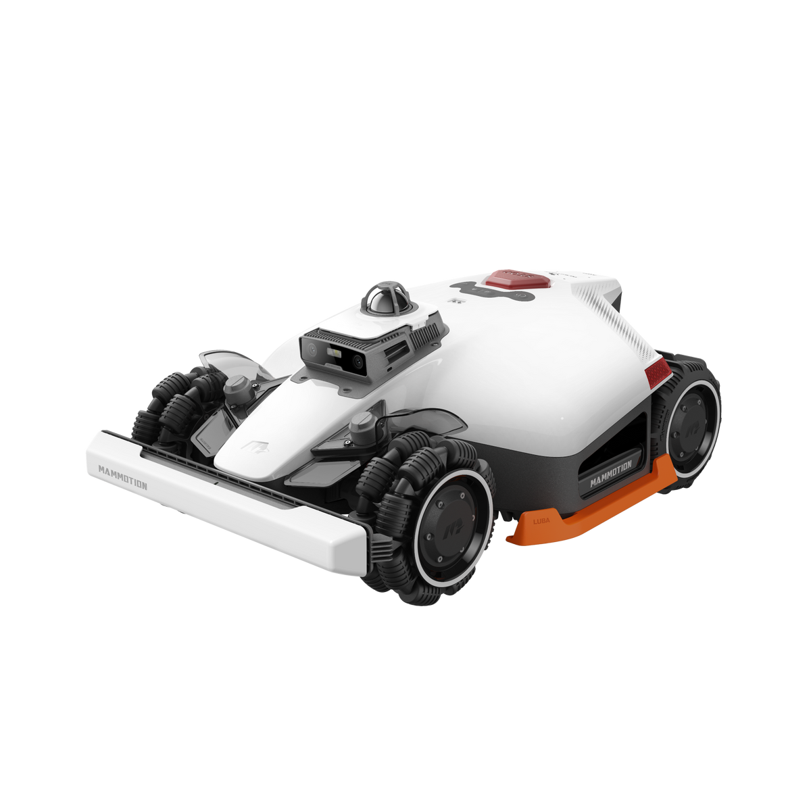
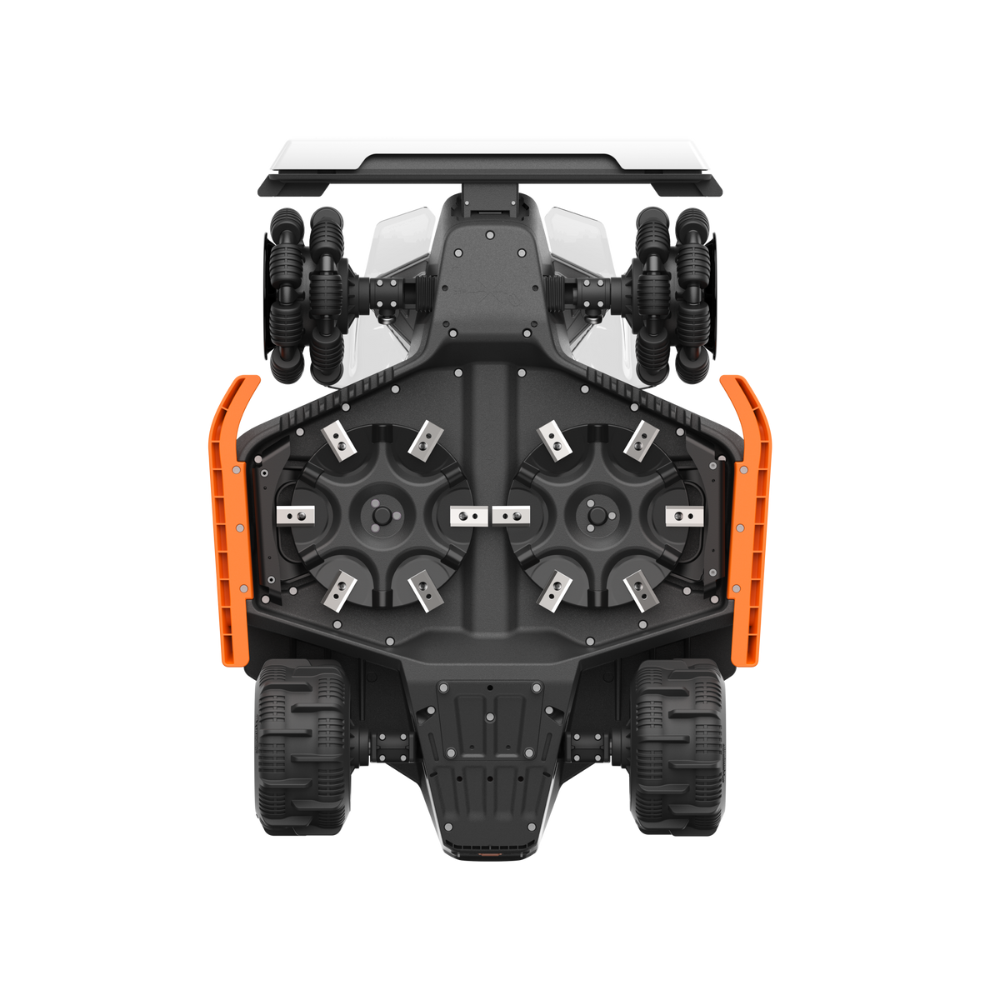
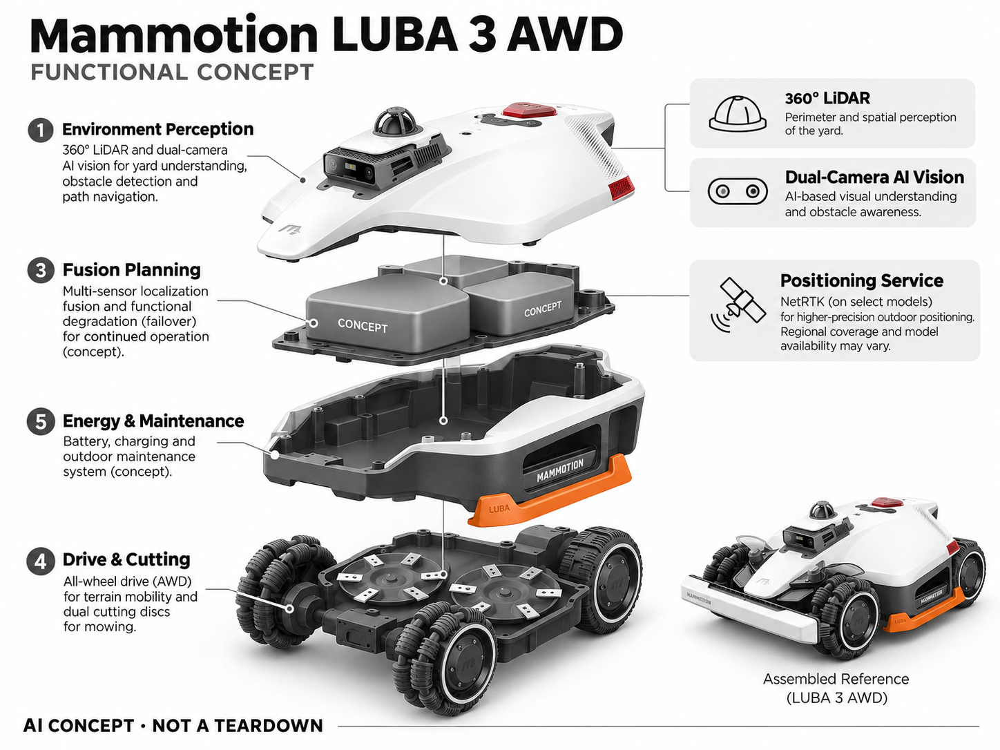

# Mammotion LUBA 3 AWD

**Mammotion** · 庭院与自然 · 核查 2026-11-04

结合激光、视觉和定位服务的复杂地形割草平台

## 产品图片与结构参考

### 产品图

官方商品图：LUBA 3 AWD 主机斜视 · 来源：[Mammotion · 官方图片](<https://us.mammotion.com/products/luba-3-awd-robot-lawn-mower>) · [原始图片](<https://cdn.shopify.com/s/files/1/0744/3310/2122/files/LUBA_3_right_side_view.png?v=1790136395&width=1200>)

### 参考图

官方底部视图：双刀盘、轮组与机身底盘，非爆炸图 · 来源：[Mammotion · 官方图片](<https://us.mammotion.com/products/luba-3-awd-robot-lawn-mower>) · [原始图片](<https://cdn.shopify.com/s/files/1/0744/3310/2122/files/LUBA_3_bottom_view.png?v=1790136395&width=1200>)

### AI 生成爆炸示意

**AI 生成 · 非实物拆机。** 内部为概念推断，不能作为元件布局、BOM 或维修依据。[生成提示词](../../content/hardware/prompts/mammotion-luba-3-awd.txt)

> 依据官方外观参考与公开功能生成；未披露的内部布局只作概念模块，不构成BOM或真实结构证据。

> 图片版权归原权利人；用于产品研究并保留出处。未改变图片色彩或内容。

> 分析为基于公开资料的案头研究与 AI 辅助判断，未经用户访谈、销量审计或实物拆机。需求、画像、竞争冷门度、审美及商业机会均为研究假设，不是投资结论。

## 销售与购买

- 状态：待复核。官方页面存在规格选择、Add to Cart 和 Out of Stock / Notify me 混合状态，不同型号与高度版本库存不一致。本轮未完成具体收货地区和 SKU 的现货确认，暂列待复核而非预售。

- 地区：美国（库存待复核）

- 价格：按具体型号与地区官方结账页确认。页面不同选项同时显示促销和售罄，避免将某一选项价格当作全系列可成交报价。

- 中国大陆：未核实中国大陆对应型号的官方零售和 NetRTK 服务覆盖；不能从中国品牌身份推断本地可购买或可用。

- [官方产品 / 商店](<https://us.mammotion.com/products/luba-3-awd-robot-lawn-mower>)

## AI 的实际作用

将 360° LiDAR、双摄 AI 视觉与定位方案组合，用于庭院理解、障碍感知和路径导航；具体组合随型号变化。

服务与联网依赖：定位和部分远程能力依赖地区服务及网络；1500 与更大型号的定位配置不能直接等同。

## 是否冷门

细分专业（研究判断）：复杂地形草坪是地域性专业场景，竞争门槛高；本条未使用市场份额或销量判断。

## 需求与市场

需求假设：大面积、坡度明显或多区庭院的房主需要减少割草与搬运设备的劳动。价值在复杂条件下持续完成任务，应以完整一季的接管次数、漏割和草坪损伤验证，不看单次演示。

## 用户画像

画像假设：维护较大私家庭院的房主、别墅管理者及少量专业园艺人员。其预算通常与庭院维护成本比较；平坦小草坪用户可能无法利用多传感器和四驱带来的溢价。

## 竞争与替代

竞争判断：复杂地形机器人属于较专业市场，但 Navimow、Husqvarna 等替代选择意味着并不空白。新团队的门槛更多是户外可靠性、服务网络与地形适配，模型名称本身难形成优势。

## 供应链

供应链推断：全轮驱动、户外激光模组、双摄标定、大容量电池和刀盘防护增加系统集成难度。具体芯片、工厂及成本未披露；量产需重点验证密封、泥沙、振动和维修件可得性。

## 技术路径

官方披露多传感器导航，但不同容量型号配置并不完全一致。技术判断：需要融合定位置信度并设计失效降级；低光、树冠、湿地与窄通道的可靠性应实测，不能把传感器数量当作成功率。

## 产品审美

审美判断：外露大轮和宽机身传达专业工具感，适合庭院场景，却可能增加重量感和收纳压力。停靠、清洗、搬运把手与非工作季摆放方式同样需要纳入工业设计评估。

## 关键风险

风险判断：购买状态尚未按 SKU 核清；定位服务期限、后续联网成本和区域限制需确认。刀盘、坡地滑移和动物识别都需要安全边界，不能以 AI 避障替代物理防护及用户监督。

## 机会与验证

可验证机会：针对树荫多、窄连接道或特殊草种建立地形适配数据库和服务。先证明某类复杂庭院的稳定完成率，再考虑做专用小型平台，避免一开始承担全地形整机的复杂度。

## 功能分层示意

这是功能关系，不是实物拆机、真实空间结构或已核实 BOM。

1. **环境感知**：360° LiDAR 与双摄 AI 视觉，具体配置按型号。（官方披露）

2. **定位服务**：部分型号组合 NetRTK；地区覆盖与机型需核对。（官方披露）

3. **融合规划**：多传感器定位融合及失效降级为功能推断，不是固件拆解。（分析推断）

4. **驱动切割**：全轮驱动和刀盘执行割草。（官方披露）

5. **能源维护**：电池、充电与室外维护系统。（官方披露）

## 来源

1. [Mammotion LUBA 3 美国官方商店](<https://us.mammotion.com/products/luba-3-awd-robot-lawn-mower>) — 已打开；不同规格出现购物入口与缺货信息，故谨慎列待复核。

[返回目录](../hardware-market.md) · [网页分析](https://romanagent.github.io/Roman/#hardware/product/mammotion-luba-3-awd)
