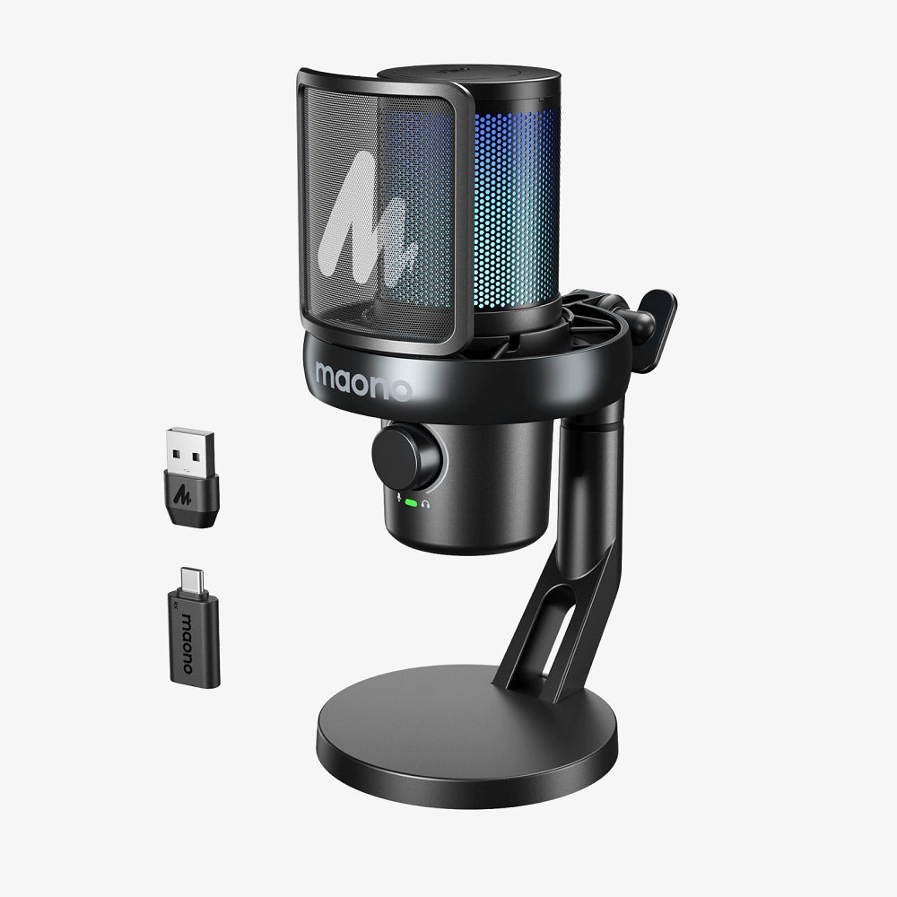
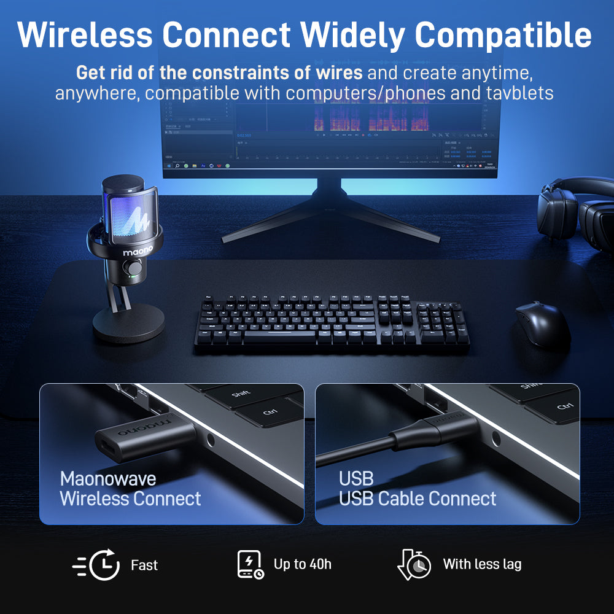
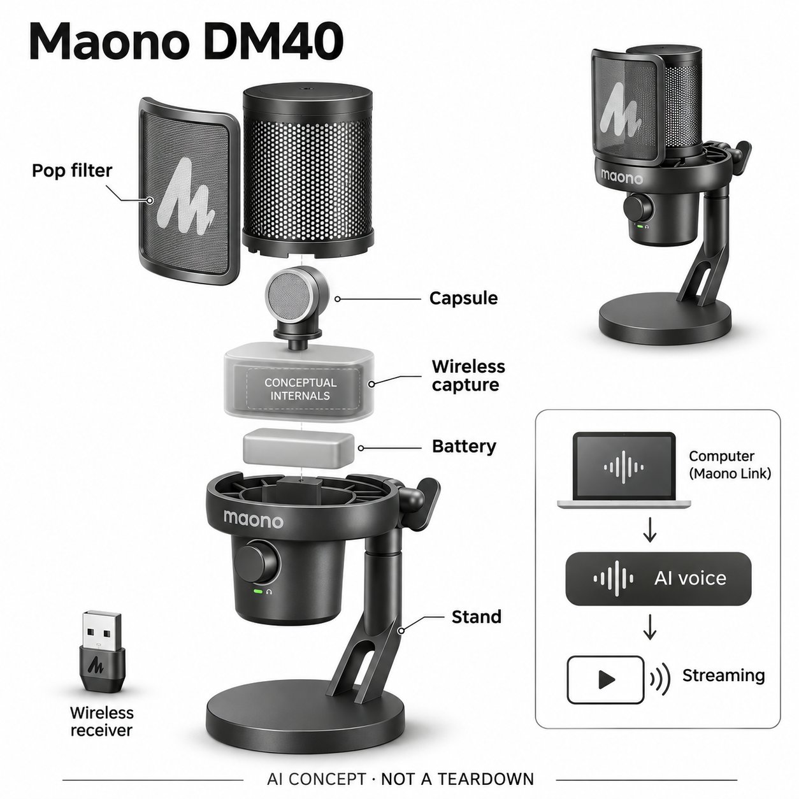

# Maono DM40

**Maono 闪克** · 录音与记忆 · 核查 2026-11-04

通过电脑AI变音工作流输出角色化声音的实体麦克风

消费渠道：个人零售。

## 产品图片与结构参考

### 产品图

Maono DM40 官方产品图 · 来源：[Maono 闪克 · 官方资料](<https://www.maono.com/products/dm40-pro-usb-wireless-microphone?variant=42045450158145>) · [原始图片](<https://cdn.shopify.com/s/files/1/0025/5934/4686/files/DM40_Wireless_microphone.webp?v=1766813776>)

### 参考图

Maono DM40 官方外观与使用参考图 · 来源：[Maono 闪克 · 官方资料](<https://www.maono.com/products/dm40-pro-usb-wireless-microphone?variant=42045450158145>) · [原始图片](<https://cdn.shopify.com/s/files/1/0025/5934/4686/files/DM40_Wireless_microphone_2.jpg?v=1766813776>)

### AI 生成爆炸示意

**AI 生成 · 非实物拆机。** 内部为概念推断，不能作为元件布局、BOM 或维修依据。[生成提示词](../../content/hardware/prompts/maono-dm40.txt)

> 以已目视核对的官方图片独立生成，未知内部为功能概念，不代表真实PCB、拆机或已采用供应商。

> 保留官方图片原貌；图片中的宣传数字和效果不作为本站实测。

> 分析为基于公开资料的案头研究与 AI 辅助判断，未经用户访谈、销量审计或实物拆机。需求、画像、竞争冷门度、审美及商业机会均为研究假设，不是投资结论。

## 销售与购买

- 状态：在售。核查日官方商店DM40黑色桌面款变体available=true、US$53.99且有Add to cart/Buy It Now。URL虽含pro，但已按商品选项确认标准DM40；不将Pro或白色再计一款。

- 地区：美国、欧盟

- 价格：美国/欧盟官方商店标准黑色款US$53.99。核查日促销价；Pro角色数量与价格不同。AI角色免费试用政策可能变化，不写成永久无限权益。

- 中国大陆：品牌有明确中文DM40使用和AI变音支持文档；本轮未打开验证大陆具体官方销售SKU及库存，国内价格、角色权益和海外版区别另核。

- [官方产品 / 商店](<https://www.maono.com/products/dm40-pro-usb-wireless-microphone?variant=42045450158145>)

## AI 的实际作用

Maono Link提供AI声音转换，将采集的人声变换成预设角色声音并输出虚拟麦克风；另有软件AI降噪。普通EQ、混响和硬件无线连接不单独当作AI。

服务与联网依赖：AI变音依赖电脑CPU、Maono Link、驱动和登录，不是麦克风离线自带模型。手机或主机能接收原始音频不等于可运行同一AI功能；官方列Windows及部分macOS支持。

## 是否冷门

竞争密集（研究判断）：桌面麦克风与变音软件竞争成熟，具体路由整合和稳定性是差异；AI角色数量不是需求规模证据。

## 需求与市场

案头需求是在游戏交流、配音或直播中实时改变声音风格，同时保留实体麦克风的采音和操作。AI转换与普通升降音调不同，但实际价值仍取决于延迟、自然度和是否符合创作者的内容用途。

### 事实：任务边界 · 官方资料

DM40系列官方手册将AI声音转换放在Maono Link中，通过虚拟麦克风把改变后的声音送给游戏或直播软件；硬件承担真实采音和控制。它解决的是边说话边输出角色化声音的创作任务，普通混响、均衡与无线连接本身不作为新增AI能力。

依据：[Maono DM40标准黑色官方商店](<https://www.maono.com/products/dm40-pro-usb-wireless-microphone?variant=42045450158145>) · [DM40系列官方电脑使用指南](<https://update.maono.com/Html/DM40/use/DM40_user_manual.html>)

### 判断：真实需求 · 研究判断

需求假设在于个人创作者希望快速切换声音表达而不录完再做后期，或在互动内容中使用稳定的角色风格。可是声音转换是否有用取决于内容而非功能新奇，若用户的核心任务是录制可信原声或多人访谈，额外变音可能只是偶尔玩一下。

依据：[Maono DM40标准黑色官方商店](<https://www.maono.com/products/dm40-pro-usb-wireless-microphone?variant=42045450158145>) · [DM40系列官方电脑使用指南](<https://update.maono.com/Html/DM40/use/DM40_user_manual.html>)

### 验证：任务完成 · 待验证

调研可让参与者先选择一段自己会制作的游戏交流或配音内容，再完成采音、转换和输出，记录听感、延迟与返工。访谈问这个效果会在哪些真实节目中使用、是否愿意为了它修改工作流，以及不用变音时是否仍愿意保留这支麦克风。

依据：[Maono DM40标准黑色官方商店](<https://www.maono.com/products/dm40-pro-usb-wireless-microphone?variant=42045450158145>) · [DM40系列官方电脑使用指南](<https://update.maono.com/Html/DM40/use/DM40_user_manual.html>)

## 用户画像

适合已有电脑、愿意配置音频输入且有明确角色表达需求的个人创作者。仅想录清楚原声的人未必需要变音功能；手机直播用户也不能因硬件可连接手机而默认电脑AI工作流通用。

### 事实：使用条件 · 官方资料

官方商品页提供标准DM40与Pro选项，桌面指南要求电脑CPU、Maono Link及相关驱动配合，使用AI角色还涉及账户。手机或游戏主机能够接入麦克风原始音频，不能自动证明它们也能运行同一套电脑AI声音转换，这是使用者筛选的重要前提。

依据：[Maono DM40标准黑色官方商店](<https://www.maono.com/products/dm40-pro-usb-wireless-microphone?variant=42045450158145>) · [DM40系列官方电脑使用指南](<https://update.maono.com/Html/DM40/use/DM40_user_manual.html>) · [DM40中文官方使用帮助](<https://faq.maono.cn/docs/DM40-DM40Pro-shi-yong-bang-zhu>)

### 判断：人群筛选 · 研究判断

潜在用户可以是已有电脑和直播软件的初学创作者、需要角色表达的游戏玩家或偶尔做配音的人。对只用手机开播、不愿管理驱动或需要无电脑工作的用户，它可能不匹配；不能把硬件插上就能录音的便利扩写为AI功能也同样即插即用。

依据：[Maono DM40标准黑色官方商店](<https://www.maono.com/products/dm40-pro-usb-wireless-microphone?variant=42045450158145>) · [DM40系列官方电脑使用指南](<https://update.maono.com/Html/DM40/use/DM40_user_manual.html>) · [DM40中文官方使用帮助](<https://faq.maono.cn/docs/DM40-DM40Pro-shi-yong-bang-zhu>)

### 验证：参与者差异 · 待验证

招募应记录电脑系统、已有音频设备和熟悉的直播软件，让参与者独立选择输入设备并试听。访谈包括是否理解原声与虚拟麦克风的区别、何时会关闭返听，以及遇到驱动问题会自行排查还是直接放弃，避免只测试熟悉音频路由的人。

依据：[Maono DM40标准黑色官方商店](<https://www.maono.com/products/dm40-pro-usb-wireless-microphone?variant=42045450158145>) · [DM40系列官方电脑使用指南](<https://update.maono.com/Html/DM40/use/DM40_user_manual.html>) · [DM40中文官方使用帮助](<https://faq.maono.cn/docs/DM40-DM40Pro-shi-yong-bang-zhu>)

## 竞争与替代

替代包括普通USB麦克风加独立变音软件、声卡效果和后期配音。DM40把部分操作整合，但仍依赖电脑；目录只留标准款，角色数量更多的Pro和颜色变化不当成独立需求。

### 事实：方案范围 · 官方资料

普通USB麦克风配独立变音软件、声卡效果和录后配音都能解决声音表达的部分需求，DM40并不是唯一可获得角色音色的途径。标准版和Pro在角色权益等方面不同，但属于同一硬件任务路线，本轮只保留标准黑色桌面款，不按声音数量或颜色扩张目录。

依据：[Maono DM40标准黑色官方商店](<https://www.maono.com/products/dm40-pro-usb-wireless-microphone?variant=42045450158145>) · [DM40系列官方电脑使用指南](<https://update.maono.com/Html/DM40/use/DM40_user_manual.html>)

### 判断：替代关系 · 研究判断

它的整合价值假设是让麦克风硬件操作与Maono Link配置更容易衔接，而不是完全替代电脑软件。独立变音软件可能支持更多麦克风，传统声卡可能操作更直接；比较时应包含设备和软件的整体设置成本、持续费用及用户已有装备。

依据：[Maono DM40标准黑色官方商店](<https://www.maono.com/products/dm40-pro-usb-wireless-microphone?variant=42045450158145>) · [DM40系列官方电脑使用指南](<https://update.maono.com/Html/DM40/use/DM40_user_manual.html>)

### 验证：比较方法 · 待验证

可以让参与者用自己的常用软件分别接入DM40原声、DM40虚拟输出和已有麦克风方案，记录完成同段内容所需步骤和错误。盲听转换后的自然度之外，还应询问哪一种更容易恢复到正常录音，不能只以预设音色数量作为价值指标。

依据：[Maono DM40标准黑色官方商店](<https://www.maono.com/products/dm40-pro-usb-wireless-microphone?variant=42045450158145>) · [DM40系列官方电脑使用指南](<https://update.maono.com/Html/DM40/use/DM40_user_manual.html>)

## 供应链

实物包含电容采音、网罩、防喷罩、无线与USB、电池和桌面支架；AI服务另在软件侧。代工厂及具体声学芯片未披露，候选供应商要分别验证声学装配与驱动兼容，不能把算法功能归给麦克风单体。

### 事实：功能组成 · 官方资料

真实产品包含电容采音结构、网罩和防喷片、无线及USB连接、电池、硬件旋钮与桌面支架；AI处理在电脑软件链中出现。品牌没有在本轮材料中公开具体声学胶囊、控制芯片或代工厂，因此不能把AI功能归因于一个猜测的机内神经网络芯片。

依据：[Maono DM40标准黑色官方商店](<https://www.maono.com/products/dm40-pro-usb-wireless-microphone?variant=42045450158145>) · [DM40系列官方电脑使用指南](<https://update.maono.com/Html/DM40/use/DM40_user_manual.html>)

### 判断：交付约束 · 研究判断

工程交付需要采音信号与软件驱动共同稳定：声学噪声、无线链路、操作系统音频路由和返听都会影响最终体验。即使麦克风声学表现合格，虚拟设备选错或电脑负载过高仍可能使AI输出失败，责任边界不能只停留在出厂硬件测试。

依据：[Maono DM40标准黑色官方商店](<https://www.maono.com/products/dm40-pro-usb-wireless-microphone?variant=42045450158145>) · [DM40系列官方电脑使用指南](<https://update.maono.com/Html/DM40/use/DM40_user_manual.html>)

### 验证：选型缺口 · 待验证

Merry可作为娱乐音频与麦克风声学工程候选，欣旺达可作为小型消费电池候选。前者还需核对电容采音结构和本机装配，后者需匹配充放电与空间；这两条是能力筛选，不代表已供货，也不包含未公开驱动或声音模型的归属判断。

依据：[Maono DM40标准黑色官方商店](<https://www.maono.com/products/dm40-pro-usb-wireless-microphone?variant=42045450158145>) · [DM40系列官方电脑使用指南](<https://update.maono.com/Html/DM40/use/DM40_user_manual.html>)

## 技术路径

官方手册要求开启AI Voice后选用虚拟Maono AI Microphone，并说明CPU性能与驱动会影响效果。模型结构和推理部署细节未公开，本条仅确认软件变音机制，不声称机内神经网络或零延迟。

### 事实：AI机制 · 官方资料

官方操作步骤要求开启AI Voice Changer并在系统及目标软件选择Maono AI Microphone，指南还提示CPU性能会影响转换表现。该证据支持电脑侧声音转换工作流，而没有证明麦克风单体可离线完成同一任务；普通降噪档位和EQ另作音频处理功能。

依据：[DM40系列官方电脑使用指南](<https://update.maono.com/Html/DM40/use/DM40_user_manual.html>) · [DM40中文官方使用帮助](<https://faq.maono.cn/docs/DM40-DM40Pro-shi-yong-bang-zhu>)

### 判断：系统边界 · 研究判断

实时转换需要在保持语速、情绪与角色音色之间取舍，端到端延迟不仅来自模型，也可能来自采音、无线与监听链。公开资料未披露模型结构、训练来源和各电脑配置下的独立测试，因此不能使用零延迟、完美保留情感或通用兼容等结论。

依据：[DM40系列官方电脑使用指南](<https://update.maono.com/Html/DM40/use/DM40_user_manual.html>) · [DM40中文官方使用帮助](<https://faq.maono.cn/docs/DM40-DM40Pro-shi-yong-bang-zhu>)

### 验证：算法与体验 · 待验证

可录制不同语速、低声、笑声和停顿，同时保存原声与转换声，测量用户能感知的对话延迟和不自然片段。还应在正常直播负载下测试，而不是只空载试听；记录CPU不足或驱动缺失时的提示，判断用户是否知道该从哪一步修复。

依据：[DM40系列官方电脑使用指南](<https://update.maono.com/Html/DM40/use/DM40_user_manual.html>) · [DM40中文官方使用帮助](<https://faq.maono.cn/docs/DM40-DM40Pro-shi-yong-bang-zhu>)

## 产品审美

圆筒网罩、前置防喷片与桌面支架延续直播麦克风语言，RGB灯可表达设备状态也可能抢镜。使用审美应看占桌面积、旋钮触达与镜头内构图，不能把灯效当作采音质量证据。

### 事实：外观与交互 · 官方资料

官方图片显示圆筒网罩、前方防喷片、环形支撑、前置旋钮与圆底座，另有小型无线接收器；灯光覆盖网罩区域，具有明确桌面直播设备形象。此次使用标准DM40图片，概念图将电脑AI链画在机外，没有为机身添加显示屏、扬声器或AI芯片。

依据：[Maono DM40标准黑色官方商店](<https://www.maono.com/products/dm40-pro-usb-wireless-microphone?variant=42045450158145>) · [DM40系列官方电脑使用指南](<https://update.maono.com/Html/DM40/use/DM40_user_manual.html>)

### 判断：使用中的形态 · 研究判断

外观吸引力可能来自灯光和可见旋钮，但实际桌面体验还包括遮挡显示器、键盘活动范围和支架调节。无线传输减少一部分线缆，不等于监听、充电和电脑完全无线；是否适合镜头画面也取决于创作者是否希望麦克风成为场景中的视觉重点。

依据：[Maono DM40标准黑色官方商店](<https://www.maono.com/products/dm40-pro-usb-wireless-microphone?variant=42045450158145>) · [DM40系列官方电脑使用指南](<https://update.maono.com/Html/DM40/use/DM40_user_manual.html>)

### 验证：日常接受度 · 待验证

观察参与者坐在常用桌位时调整高度、距离、增益与静音，记录是否碰到防喷片或需要腾出额外空间。访谈可问灯光是否帮助判断状态、开摄像头时愿不愿让设备入镜，以及将麦克风移开后是否容易恢复原来的采音位置。

依据：[Maono DM40标准黑色官方商店](<https://www.maono.com/products/dm40-pro-usb-wireless-microphone?variant=42045450158145>) · [DM40系列官方电脑使用指南](<https://update.maono.com/Html/DM40/use/DM40_user_manual.html>)

## 关键风险

主要风险是音频路由选错、AI返听延迟或驱动不兼容，以及试用角色政策变化。变音不应被宣传为可靠匿名保护；制作角色内容时也需确认允许使用的声音素材，而不默认所有效果可商业化。

### 事实：已知限制 · 官方资料

官方文档说明AI角色有试用与可能调整的政策，且标准DM40和Pro的角色数量口径在不同页面并不完全一致，所以本条没有承诺固定数量永久免费。AI运行还依赖账户、驱动和电脑；硬件兼容手机并不能解除这些已核实的使用限制。

依据：[Maono DM40标准黑色官方商店](<https://www.maono.com/products/dm40-pro-usb-wireless-microphone?variant=42045450158145>) · [DM40系列官方电脑使用指南](<https://update.maono.com/Html/DM40/use/DM40_user_manual.html>) · [DM40中文官方使用帮助](<https://faq.maono.cn/docs/DM40-DM40Pro-shi-yong-bang-zhu>)

### 判断：失效影响 · 研究判断

内容风险在于把角色声音转换当作可靠匿名保护，或未经确认就将某种角色音色用于商业内容。技术风险则是选错输入、重复监听形成回声或电脑性能不够；它们不说明产品必然有故障，但都可能让初学者以为硬件损坏或无声。

依据：[Maono DM40标准黑色官方商店](<https://www.maono.com/products/dm40-pro-usb-wireless-microphone?variant=42045450158145>) · [DM40系列官方电脑使用指南](<https://update.maono.com/Html/DM40/use/DM40_user_manual.html>) · [DM40中文官方使用帮助](<https://faq.maono.cn/docs/DM40-DM40Pro-shi-yong-bang-zhu>)

### 验证：风险处理 · 待验证

试用需要让参与者能随时切回原声，检查目标软件真正收到哪一路输入，并在正常任务负载下记录稳定性。购买前分别核对AI功能的平台、角色使用政策和账户要求；如果核心需求是无电脑变音，应明确此工作流的依赖而不勉强匹配。

依据：[Maono DM40标准黑色官方商店](<https://www.maono.com/products/dm40-pro-usb-wireless-microphone?variant=42045450158145>) · [DM40系列官方电脑使用指南](<https://update.maono.com/Html/DM40/use/DM40_user_manual.html>) · [DM40中文官方使用帮助](<https://faq.maono.cn/docs/DM40-DM40Pro-shi-yong-bang-zhu>)

## 机会与验证

机会假设是让初学创作者更容易完成从采音到直播输入的设置。可记录首次成功变音所需步骤、返听困扰和每周实际启用次数，并比较普通麦克风加软件方案，避免把好玩的演示等同于长期需求。

### 判断：可尝试切口 · 研究判断

可以尝试的切口是把声音转换的准备步骤做得可见，让用户知道原声、监听和对外输出分别发生在哪里。若最常见障碍是路由选择或电脑性能提示，改进引导与诊断可能比继续增加角色更有价值；这一判断需要从真实新用户失败记录中验证。

依据：[Maono DM40标准黑色官方商店](<https://www.maono.com/products/dm40-pro-usb-wireless-microphone?variant=42045450158145>) · [DM40系列官方电脑使用指南](<https://update.maono.com/Html/DM40/use/DM40_user_manual.html>)

### 判断：商业边界 · 研究判断

商业边界在于许多人只偶尔体验变音，硬件采音质量和稳定连接仍决定长期保留。将试用角色转为付费可能影响使用意愿，但本轮没有付费用户、续费或退货数据，不能由低价促销推断市场扩大，也不能以直播行业规模替代该具体功能需求。

依据：[Maono DM40标准黑色官方商店](<https://www.maono.com/products/dm40-pro-usb-wireless-microphone?variant=42045450158145>) · [DM40系列官方电脑使用指南](<https://update.maono.com/Html/DM40/use/DM40_user_manual.html>)

### 验证：下一步调研 · 待验证

下一步可做连续两周的小样本试用，记录每次是否启用AI、实际用于什么内容、为何关闭，以及遇到问题后有没有重试。把首次好玩和后续创作价值分开访谈，并与普通麦克风加软件方案对比，不用模型评分预测这个组合的成功率。

依据：[Maono DM40标准黑色官方商店](<https://www.maono.com/products/dm40-pro-usb-wireless-microphone?variant=42045450158145>) · [DM40系列官方电脑使用指南](<https://update.maono.com/Html/DM40/use/DM40_user_manual.html>)

## 对应供应链公司

能力候选用于选型研究，不代表本产品实际采用；未公开的供货关系不作推断。

- [merry-electronics](../supply-chain/merry-electronics.md) — **能力候选 · 非已采用** / 桌面麦克风声学工程候选：Merry公开娱乐音频、麦克风及声学工程能力，可作为DM40类似采音结构的设计与验证候选。具体电容胶囊、网罩、防喷和电路接口仍须匹配，公开资料未显示Merry为DM40供货，也不能将电脑AI变音算法算作其已提供能力。

- [sunwoda](../supply-chain/sunwoda.md) — **能力候选 · 非已采用** / 无线桌面麦克风电池候选：DM40需要电池支撑无线采音并与USB供电共存，欣旺达公开消费电子电池和电源工程业务，可作为此类供电模块候选。空间、保护、充电管理和声学噪声影响仍待整机验证，没有品牌点名证据，不能声称已采用或估计本机电芯成本。

[浏览供应链目录](../supply-chain.md)

## 功能分层示意

这是功能关系，不是实物拆机、真实空间结构或已核实 BOM。

1. **采音结构**：电容麦克风、网罩与防喷罩采集人声。（官方披露）

2. **传输与供电**：USB及无线接收器、电池和硬件控制完成录音链。（官方披露）

3. **电脑AI处理**：Maono Link执行角色声音转换与相关软件处理，依赖CPU和驱动。（官方披露）

4. **虚拟音频输出**：Maono AI Microphone作为直播或游戏软件的输入。（官方披露）

5. **结构边界**：内部板件与声学供应商未披露，示意不声称真实拆机或机内AI芯片。（分析推断）

## 来源

1. [Maono DM40标准黑色官方商店](<https://www.maono.com/products/dm40-pro-usb-wireless-microphone?variant=42045450158145>) — 实际打开并核公开商品数据，标准DM40现售53.99美元，官方限定美国/欧盟。

2. [DM40系列官方电脑使用指南](<https://update.maono.com/Html/DM40/use/DM40_user_manual.html>) — 实际打开；AI变音CPU要求、虚拟音频设备、角色试用和驱动依赖。

3. [DM40中文官方使用帮助](<https://faq.maono.cn/docs/DM40-DM40Pro-shi-yong-bang-zhu>) — 实际打开；中文版本软件账户、AI变音和监听流程，不用它证明国内现货。

[返回目录](../hardware-market.md) · [网页分析](https://romanagent.github.io/Roman/#hardware/product/maono-dm40)
