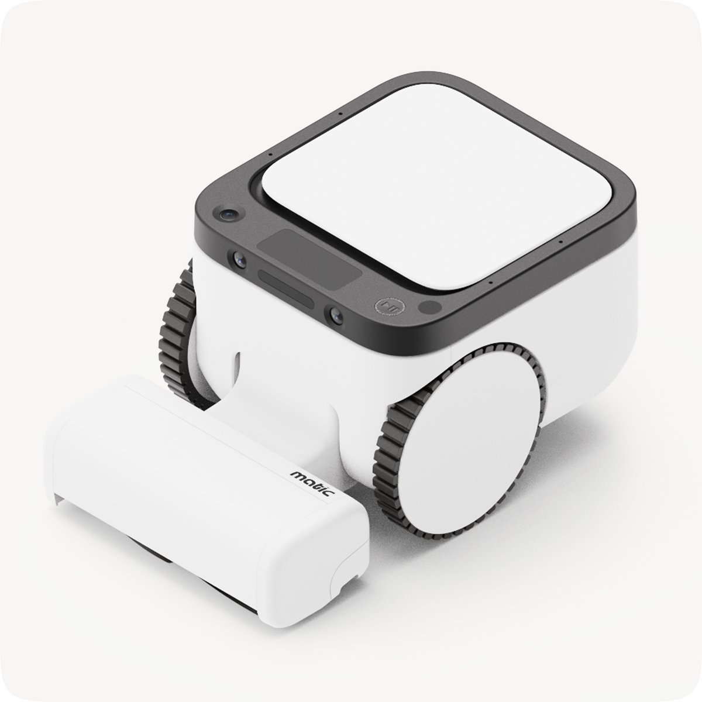
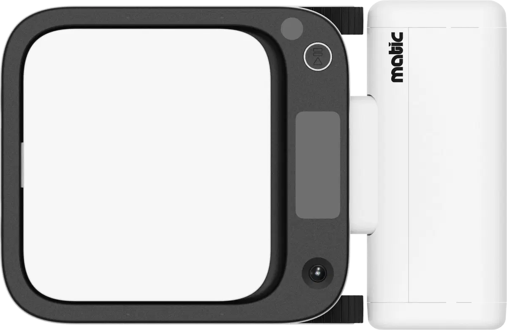
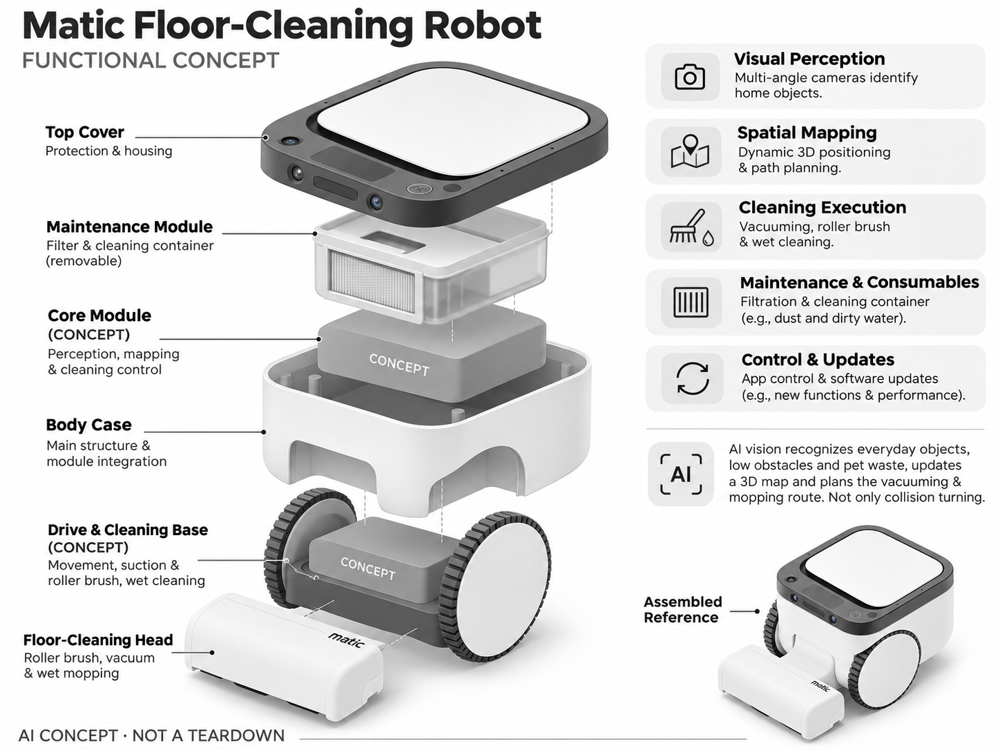

# Matic Floor-Cleaning Robot

**Matic** · 清洁机器人 · 核查 2026-11-04

用立体视觉理解家居环境的非圆盘清洁机器人

消费渠道：个人零售。

## 产品图片与结构参考

### 产品图

Matic Floor-Cleaning Robot 官方产品图 · 来源：[Matic · 官方图片](<https://maticrobots.com/product>) · [原始图片](<https://cdn.shopify.com/s/files/1/0670/1934/2024/files/Matic_Product_Image.png?v=1776278433&width=1200>)

### 参考图

Matic Floor-Cleaning Robot 官方外观、结构或使用参考 · 来源：[Matic · 官方图片](<https://maticrobots.com/product>) · [原始图片](<https://maticrobots.com/_next/image?q=75&url=%2F_next%2Fstatic%2Fmedia%2Fsupport-matic-topdown.0c5d67b8.webp&w=1200>)

### AI 生成爆炸示意

**AI 生成 · 非实物拆机。** 内部为概念推断，不能作为元件布局、BOM 或维修依据。[生成提示词](../../content/hardware/prompts/matic-floor-robot.txt)

> 依据官方外观参考与公开功能生成；未披露的内部布局只作概念模块，不构成BOM或真实结构证据。

> 保留官方图片原始内容和出处；画面宣传参数不是本轮独立实测。

> 分析为基于公开资料的案头研究与 AI 辅助判断，未经用户访谈、销量审计或实物拆机。需求、画像、竞争冷门度、审美及商业机会均为研究假设，不是投资结论。

## 销售与购买

- 状态：在售。官网当前配置页显示Buy Matic、US$1,495起和Ships in 2 weeks；本条以Matic基础型号为准，Serene降噪版本不另外重复计数。

- 地区：美国本土官方渠道

- 价格：US$1,495起。核查时官方地区参考价，保留原币种；订阅、税运、附件及优惠以结账为准，预订定金不等于整机价格。

- 中国大陆：本轮核实所列海外官方渠道；中国大陆同型号现货、保修及服务可用性未确认。进口前需核对供电、网络、配件和地区条款。

- [官方产品 / 商店](<https://maticrobots.com/product>)

## AI 的实际作用

视觉模型识别日常物体、低矮障碍和宠物污物并更新三维地图，规划吸尘拖地路线；视觉识别不是仅靠碰撞转向。

服务与联网依赖：清洁和地图处理强调设备侧设计，App用于控制和更新；语音手势Matic Cues须按所选配置确认，不自动归为基础机标配。

## 是否冷门

新兴竞争（研究判断）：清洁机器人整体拥挤，非圆盘视觉路线相对少见；美国交付和维护能力需要与成熟品牌比较。

## 需求与市场

需求假设：家庭希望减少扫地机被杂物卡住、宠物污物扩散和反复整理地面的工作。应测量实际接管、漏清及耗材处理时间，非圆盘形态和三维地图本身不能证明比成熟清洁机更省事。

## 用户画像

画像推断：有宠物、混合地面并愿意为不同清洁结构支付较高首付的美国家庭，可能对传统圆盘机不满意。家具底部高度和房间门槛会限制适用性，不能从大轮子推定任意家居都能通过。

## 竞争与替代

竞争判断：与Roborock、Dreame和Narwal等成熟系统竞争，视觉感知与非圆盘结构形成差异。成熟竞品的耗材和售后网络也有价值，应比较清洁全流程，不把新外形直接当成更强自主能力。

## 供应链

供应链分析：多相机、轮驱、清洁头、水路和过滤耗材组成系统；官方说明在美国设计、测试、组装和支持，但详细供应商与BOM未知。量产一致性、耗材与维修运输仍是重要交付工作。

## 技术路径

官方披露用视觉识别物体并通过图像构建动态三维地图，宠物污物模型使用数据训练。技术判断：低照、透明物和地毯边缘需要验证，地图精度宣传不能替代端到端清洁与避障实测。

## 产品审美

审美判断：竖向主体与大轮突破传统圆盘家电轮廓，可读性强但更显眼。用户每天看到的停靠状态、脏污容器取出和家具下可达性应纳入设计评价，外形新颖不自动意味着家居融合更好。

## 关键风险

风险判断：当前官方销售与保修重点在美国，转运海外可能失去完整保障。视觉避障仍可能漏检，耗材和清洁头需要维护；不同配置及后续功能不能都算作基础机已交付能力。

## 机会与验证

机会假设：围绕有宠物家庭的接管与清洁事故建立对照试用，比较真实人工干预分钟。若痛点集中于污物识别，可优先提高保守避让和错误恢复，而不是追求更复杂的拟人交互。

## 功能分层示意

这是功能关系，不是实物拆机、真实空间结构或已核实 BOM。

1. **视觉感知**：多视角相机识别家居对象。（官方披露）

2. **空间地图**：动态三维定位与路径。（官方披露）

3. **清洁执行**：吸尘、滚刷和湿式清洁。（官方披露）

4. **维护耗材**：过滤及清洁容器。（官方披露）

5. **控制更新**：App和软件迭代。（官方披露）

## 来源

1. [Matic Floor-Cleaning Robot 官方购买页](<https://maticrobots.com/product>) — 实际打开核查当前购买或预订入口，未实际下单；价格与交付按具体地区。

2. [Matic 官方视觉感知与导航](<https://maticrobots.com/innovation>) — 实际打开的官方技术与使用资料，宣传效果并非本轮独立实测。

[返回目录](../hardware-market.md) · [网页分析](https://romanagent.github.io/Roman/#hardware/product/matic-floor-robot)
