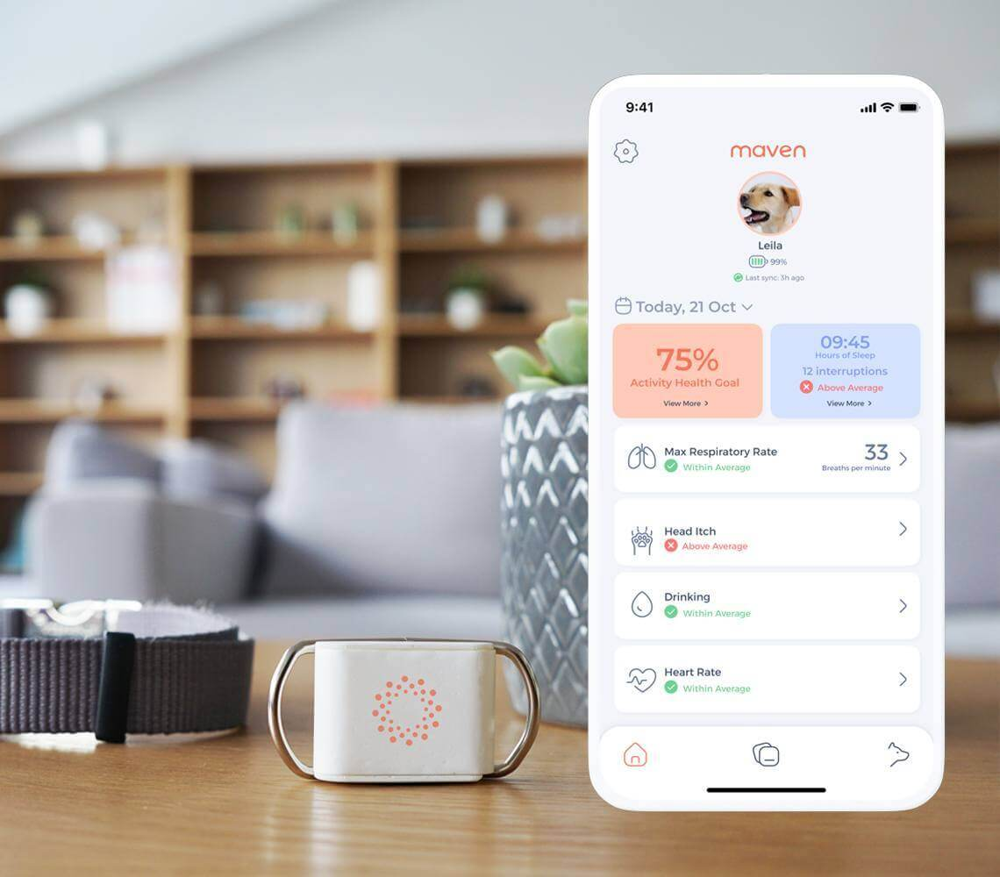
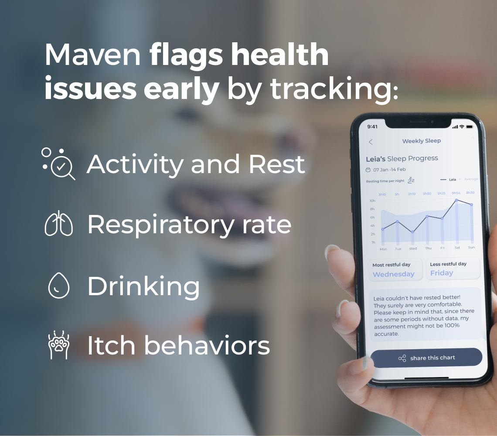
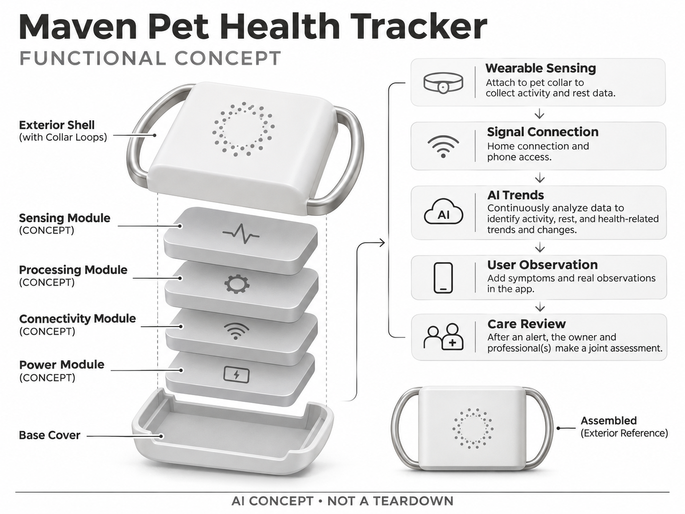

# Maven Pet Health Tracker

**Maven** · 宠物照护 · 核查 2026-11-04

以连续佩戴数据和AI趋势为核心的家庭宠物观察套件

消费渠道：个人零售。

## 产品图片与结构参考

### 产品图

Maven Pet Health Tracker 官方产品外观图 · 来源：[Maven · 官方图片](<https://maven.pet/dog-health-tracker/>) · [原始图片](<https://maven.pet/img/pages/product/carousel/pet-smart-collar/v3/lg/1.jpg>)

### 参考图

Maven Pet Health Tracker 官方场景或功能参考图 · 来源：[Maven · 官方图片](<https://maven.pet/dog-health-tracker/>) · [原始图片](<https://maven.pet/img/pages/product/carousel/pet-smart-collar/v3/lg/2.jpg>)

### AI 生成爆炸示意

**AI 生成 · 非实物拆机。** 内部为概念推断，不能作为元件布局、BOM 或维修依据。[生成提示词](../../content/hardware/prompts/maven-pet-health-tracker.txt)

> 依据官方外观参考与公开功能生成；未披露的内部布局只作概念模块，不构成BOM或真实结构证据。

> 保留官方图原始内容与出处；画面中的营销声明不视为独立验证。

> 分析为基于公开资料的案头研究与 AI 辅助判断，未经用户访谈、销量审计或实物拆机。需求、画像、竞争冷门度、审美及商业机会均为研究假设，不是投资结论。

## 销售与购买

- 状态：在售。官方页面可选择年付/月付及覆盖宠物数，并有Buy now入口和硬件传感器套件说明；不将按月展示值当成硬件买断价。

- 地区：美国官方零售；其他地区须分别确认

- 价格：US$25/月起（订阅方案）。核查日官方页面参考；税运、订阅及优惠条件另计。会员价、服务套餐与硬件买断价不可直接混用。

- 中国大陆：本轮核实国际官方渠道；未核实中国大陆该型号的官方现货、地区服务与保修，不把跨境硬件可送达等同于全部AI功能可用。

- [官方产品 / 商店](<https://maven.pet/dog-health-tracker/>)

## AI 的实际作用

佩戴传感器数据由AI分析活动、休息及健康相关趋势，输出提示；同一传感器可用于猫狗，不把猫版页面另计产品。

服务与联网依赖：需要配套传感器、家庭连接设备、App和会员服务；无GPS定位能力不能被当作防丢追踪器，具体配置按官网套件核对。

## 是否冷门

细分专业（研究判断）：家庭宠物照护是细分消费任务，需求取决于宠物习惯、主人投入与长期服务；已有替代产品，冷门不等于低竞争或高利润。

## 需求与市场

需求假设：主人希望发现长期行为变化，却无法全天观察宠物。需要测试传感器是否持续佩戴、提示是否帮助沟通以及误报负担，不能从网站健康故事推导实际诊断能力或普遍疗效。

## 用户画像

画像推断：照护老年宠物、关心慢性变化并愿意长期订阅的家庭。传感器附在既有项圈上，用户需接受充电和记录维护；只想防丢或偶尔看活动的人可能并不适合这类健康观察服务。

## 竞争与替代

竞争判断：Maven与PetPace、普通活动项圈和人工观察竞争，服务解释与连续使用是核心。较低月费展示可能掩盖长期费用，应比较完整周期成本及数据是否能帮助解决具体问题。

## 供应链

供应链分析：可穿戴传感器、电池、固定夹和家庭连接部件形成系统，真实供应商及工厂未公开。量产应关注防水、啃咬、佩戴稳定与电池衰减，云算法和客户支持同样属于交付成本。

## 技术路径

官方说明AI持续分析传感数据。技术判断：运动、睡姿和接触条件会影响信号，应把原始趋势、算法估计与提醒区分展示；模型需要处理个体基线变化，不应把单次波动直接解释为疾病。

## 产品审美

审美判断：小型附着式传感器便于复用既有项圈，避免让宠物承担过大的新物件。夹具易装但不易脱落、充电接触点清洁以及宠物睡卧时是否硌到，比品牌色或屏幕装饰更重要。

## 关键风险

风险判断：家庭连接、订阅及佩戴依从会造成记录缺口，健康告警也可能误报。产品定位是辅助观察，异常仍应咨询兽医；用户不能把健康趋势设备当成GPS定位或紧急救助保证。

## 机会与验证

机会假设：先验证主人愿为哪一种可行动趋势持续付费，并研究兽医如何阅读简短记录。若设备只增加难解释的曲线，留存可能较弱；更好的数据摘要与沟通流程可能比更多传感器有效。

## 功能分层示意

这是功能关系，不是实物拆机、真实空间结构或已核实 BOM。

1. **佩戴传感**：附在宠物项圈上的硬件传感器。（官方披露）

2. **信号传递**：家庭连接与手机接入。（官方披露）

3. **AI趋势**：连续数据分析和个体变化提示。（官方披露）

4. **用户观察**：App中补充症状与实际观察。（官方披露）

5. **照护复核**：告警后由主人与专业人员判断。（分析推断）

## 来源

1. [Maven Pet Health Tracker 官方商店](<https://maven.pet/dog-health-tracker/>) — 已实际打开；核查购物入口、产品形态与AI声明，未完成支付或收货。

2. [Maven 官方工作方式](<https://maven.pet/how-it-works/>) — 已实际打开的官方技术或服务说明；厂商声明不视为独立性能或疗效验证。

[返回目录](../hardware-market.md) · [网页分析](https://romanagent.github.io/Roman/#hardware/product/maven-pet-health-tracker)
