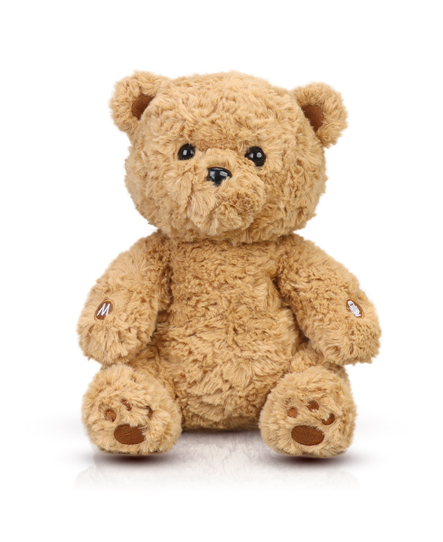
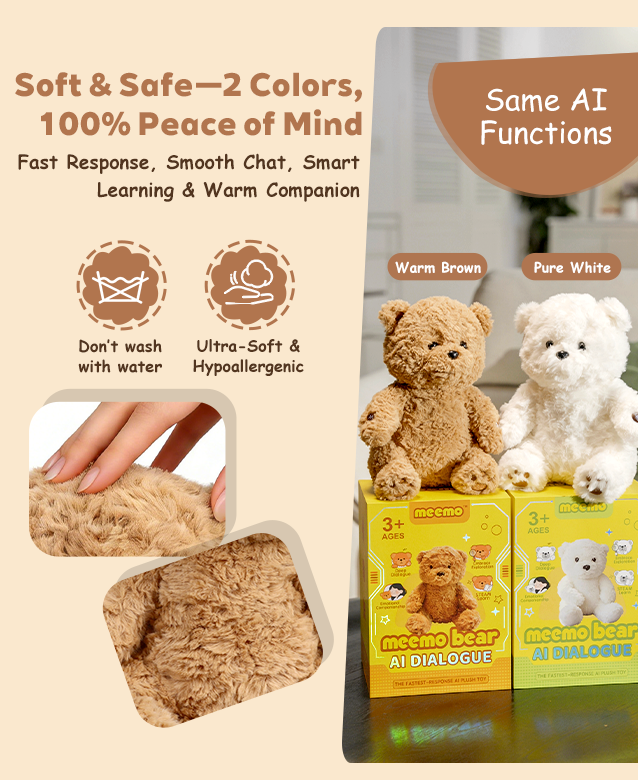
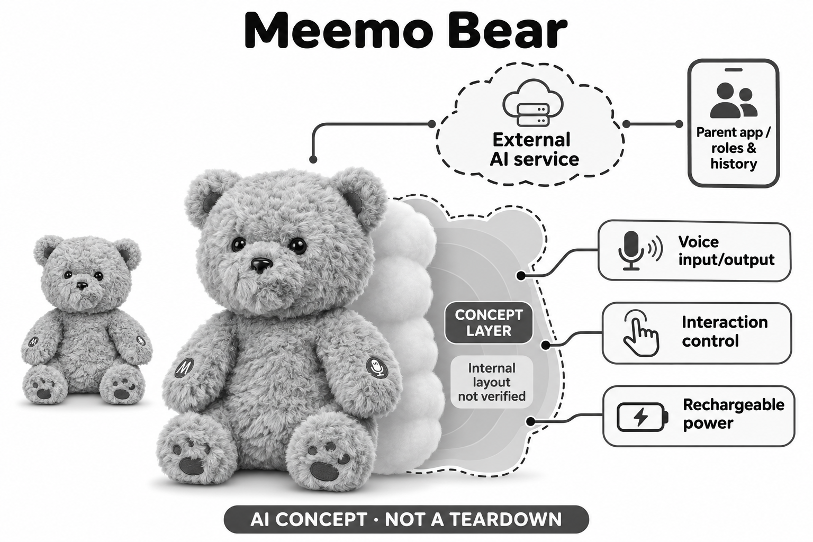

# Meemo Bear

**Meemo** · AI玩具 · 核查 2026-11-06

支持角色选择与家长历史管理的对话泰迪熊

消费渠道：个人零售。

## 产品图片与结构参考

### 产品图

官方棕色Meemo Bear外观 · 来源：[产品品牌官网](<https://www.aimeemo.com/products/meemo-bear-1>) · [原始图片](<https://img-va.myshopline.com/image/store/1766111890996/-1.jpg?h=780&w=638>)

### 参考图

官方颜色、材质与维护参考；安全和效果用语为厂商宣传 · 来源：[产品品牌官网](<https://www.aimeemo.com/products/meemo-bear-1>) · [原始图片](<https://img-va.myshopline.com/image/store/1766111890996/--1.png?h=780&w=638>)

### AI 生成爆炸示意

**AI 生成 · 非实物拆机。** 内部为概念推断，不能作为元件布局、BOM 或维修依据。[生成提示词](../../content/hardware/prompts/meemo-bear.txt)

> 内置ImageGen按本产品官方参考独立生成；未知内部为概念层，不是BOM或维修依据。

> 图片保留官方原貌；效果、安全与性能宣传不代表本目录独立验证。

> 分析为基于公开资料的案头研究与 AI 辅助判断，未经用户访谈、销量审计或实物拆机。需求、画像、竞争冷门度、审美及商业机会均为研究假设，不是投资结论。

## 销售与购买

- 状态：在售。官方商品页显示US$99.99、数量与Add to cart，配送政策说明美国订单处理和发货；只收电子熊一次，棕白颜色不重复。未实际下单。

- 地区：美国

- 价格：US$99.99。官方商品所见单只价，称正常使用无月订阅；美国标准配送免费，税费按地址计算，长期服务与额外功能条件仍需按当前规则确认。

- 中国大陆：公开配送页仅明确美国订单，未核实大陆直邮、正式渠道与应用服务；宣传支持中文不等于中国大陆销售或联网服务已可用。

- [官方产品 / 商店](<https://www.aimeemo.com/products/meemo-bear-1>)

## AI 的实际作用

官方明确由语言模型生成实时语音回复，并支持多语言、角色切换和自建角色；列举多个模型提供方但未披露每次请求的具体模型与路由，不能认定所有模型同时运行。

服务与联网依赖：需要Meemo应用设置和连接AI服务，隐私政策明确模型与云基础设施提供方参与处理；不是完全离线玩偶，具体无线模块和本地推理能力未披露。

## 是否冷门

新兴竞争（研究判断）：传统泰迪外形结合角色生成与历史管理，属于儿童对话毛绒的共同市场；无销量或性能对照证据，不能称最快或市场空白。

## 需求与市场

家庭可能希望孩子能够选择不同语气和主题，把熟悉的泰迪作为故事游戏伙伴。价值要看角色差异是否带来新的玩法，而不是配置选项越多越好；如果家长频繁切换设置才能保持兴趣，便利性和持续使用收益都需要重新评估。

### 事实｜实时语言模型进入传统泰迪形态 · 官方资料

Meemo将即时语音问答、角色切换和自建角色放进泰迪熊，官方教程分别介绍这些操作。它与只播放固定故事的毛绒存在机制差异，但当前页面并未给出每个角色实际使用的模型版本；列出多个模型品牌不等于每次对话同时由所有模型处理。

依据：[Meemo Bear官方商品](<https://www.aimeemo.com/products/meemo-bear-1>) · [Meemo官方设置指南](<https://www.aimeemo.com/pages/how-to-use-meemo-bear>)

### 判断｜需求可能来自孩子自选游戏角色 · 研究判断

家庭可能希望孩子能够选择不同语气和主题，把熟悉的泰迪作为故事游戏伙伴。价值要看角色差异是否带来新的玩法，而不是配置选项越多越好；如果家长频繁切换设置才能保持兴趣，便利性和持续使用收益都需要重新评估。

依据：[Meemo Bear官方商品](<https://www.aimeemo.com/products/meemo-bear-1>) · [Meemo官方设置指南](<https://www.aimeemo.com/pages/how-to-use-meemo-bear>)

### 验证｜观察角色变化是否带来实质参与 · 待验证

可以记录孩子选择角色后是否主动延续故事、提出问题或与家人共同玩耍，再比较固定故事和普通玩偶。角色数量不是学习证据，厂商最快响应的广告也不能替代真实等待记录；本目录没有儿童试验、访谈或销量资料，需求仅为可检验假设。

依据：[Meemo Bear官方商品](<https://www.aimeemo.com/products/meemo-bear-1>) · [Meemo官方设置指南](<https://www.aimeemo.com/pages/how-to-use-meemo-bear>)

## 用户画像

语音玩偶更依赖孩子能否轮流说话、等待并修正误解，家长则需要管理角色和记录。家庭是否愿意做这些工作，比单纯喜欢泰迪外形更能解释持续采用；年龄标签不能保证每位儿童都能独立使用，也不能据此推荐为语言训练或情绪治疗工具。

### 事实｜家长负责账户与儿童功能授权 · 官方资料

官方政策要求家长建立和管理儿童账户，并在启用AI对话前完成相应注册与许可流程。可选资料包括昵称、年龄和语言，政策不要求儿童提交真实姓名；目录只记录这种交付安排，不替供应方证明所有账户控制在每个地区均已合规实施。

依据：[Meemo玩具与应用隐私政策](<https://www.aimeemo.com/pages/privacy-policy>)

### 判断｜适配性取决于表达与管理习惯 · 研究判断

语音玩偶更依赖孩子能否轮流说话、等待并修正误解，家长则需要管理角色和记录。家庭是否愿意做这些工作，比单纯喜欢泰迪外形更能解释持续采用；年龄标签不能保证每位儿童都能独立使用，也不能据此推荐为语言训练或情绪治疗工具。

依据：[Meemo Bear官方商品](<https://www.aimeemo.com/products/meemo-bear-1>) · [Meemo官方设置指南](<https://www.aimeemo.com/pages/how-to-use-meemo-bear>)

### 验证｜检查不同家庭角色的操作路径 · 待验证

试用应分别看孩子是否知道如何开始与停止聊天、家长能否找到历史和记忆控制，以及共用设备时是否混淆身份。可采用虚构角色和公开话题完成验证，避免为展示个性化收集私密故事；本轮没有登录应用或处理任何儿童个人资料。

依据：[Meemo Bear官方商品](<https://www.aimeemo.com/products/meemo-bear-1>) · [Meemo玩具与应用隐私政策](<https://www.aimeemo.com/pages/privacy-policy>)

## 竞争与替代

泰迪熊容易被家庭理解，但同类产品可采用接近的语音模块和模型服务。差异更可能来自角色内容、使用稳定性、家长控制与售后，而非外壳本身；也要与不联网的故事熊比较，因为有限内容的可预测性可能对某些家庭更重要。

### 事实｜颜色共享同一套AI功能 · 官方资料

官方参考图明确棕色和白色版本具有相同AI功能，目录只建立一个Meemo Bear条目。产品宣传角色和语言选择，但这些软件选项也不是独立硬件型号；比较应围绕当前电子熊和服务组合，而不是按颜色、角色或每个被列举的模型放大产品数量。

依据：[Meemo Bear官方商品](<https://www.aimeemo.com/products/meemo-bear-1>)

### 判断｜熟悉外形不一定形成技术壁垒 · 研究判断

泰迪熊容易被家庭理解，但同类产品可采用接近的语音模块和模型服务。差异更可能来自角色内容、使用稳定性、家长控制与售后，而非外壳本身；也要与不联网的故事熊比较，因为有限内容的可预测性可能对某些家庭更重要。

依据：[Meemo Bear官方商品](<https://www.aimeemo.com/products/meemo-bear-1>) · [Meemo官方设置指南](<https://www.aimeemo.com/pages/how-to-use-meemo-bear>)

### 验证｜把配置与维护也纳入替代比较 · 待验证

比较同样的故事或问答任务时，应记录角色设置、等待、重复提问和家长介入，而非只比较售价或模型名称。无月费会影响购买判断，却不能证明长期总成本最低；本研究没有独立服务成本和家庭留存证据，不对市场份额或盈利作推测。

依据：[Meemo Bear官方商品](<https://www.aimeemo.com/products/meemo-bear-1>) · [Meemo官方设置指南](<https://www.aimeemo.com/pages/how-to-use-meemo-bear>)

## 供应链

双按进入连续聊天后，玩具需要区分孩子讲话、自己的播放和周围噪声，毛绒遮挡又会改变采音条件。供应研究应把声学、状态指示和电源管理一起考虑；选择一个性能较高的麦克风或模型服务，并不能自动解决整机长时间互动中的问题。

### 事实｜外部操作可见但内部器件未公开 · 官方资料

官方图片可以看到手臂按键标识和坐姿毛绒，商品说明涉及可充电电子模块。具体麦克风、无线器件、电池料号和装配工厂未披露，美国公司联系地址也不能证明生产地；本目录不会把外部标识或广告图推成原机电路和空间布局。

依据：[Meemo Bear官方商品](<https://www.aimeemo.com/products/meemo-bear-1>)

### 判断｜连续聊天增加声学与电源约束 · 研究判断

双按进入连续聊天后，玩具需要区分孩子讲话、自己的播放和周围噪声，毛绒遮挡又会改变采音条件。供应研究应把声学、状态指示和电源管理一起考虑；选择一个性能较高的麦克风或模型服务，并不能自动解决整机长时间互动中的问题。

依据：[Meemo Bear官方商品](<https://www.aimeemo.com/products/meemo-bear-1>) · [Meemo玩具与应用隐私政策](<https://www.aimeemo.com/pages/privacy-policy>)

### 验证｜以实际包覆条件测试候选器件 · 待验证

同类设计可以从采音和联网控制器件建立候选，但必须在外皮、填充和播放音量接近成品时验证。候选公司资料仅证明某类能力，不证明Meemo已经采用，也不提供角色运营与儿童内容审核；实际工厂、物料清单和供应关系仍未核实。

依据：[Meemo Bear官方商品](<https://www.aimeemo.com/products/meemo-bear-1>) · [Meemo官方设置指南](<https://www.aimeemo.com/pages/how-to-use-meemo-bear>)

## 技术路径

不同角色的语气和主题可能来自配置，并不必然意味着换了底层模型。对产品研究而言，应观察孩子能否理解角色变化、回复是否保持边界和上下文是否连续，而不是只数模型品牌；一个角色表现自然，也不能证明它理解了孩子的真实意图或情绪。

### 事实｜历史与记忆由应用服务管理 · 官方资料

隐私政策说明语音、识别结果和上下文可用于生成回复，启用时保存历史及记忆，并允许家长管理相应资料。模型和云基础设施提供方可能参与处理，因此不能因实体熊在手边就认为对话全部留在机内；具体服务商路由和本地计算边界没有完整公开。

依据：[Meemo玩具与应用隐私政策](<https://www.aimeemo.com/pages/privacy-policy>)

### 判断｜角色与模型是两个独立层次 · 研究判断

不同角色的语气和主题可能来自配置，并不必然意味着换了底层模型。对产品研究而言，应观察孩子能否理解角色变化、回复是否保持边界和上下文是否连续，而不是只数模型品牌；一个角色表现自然，也不能证明它理解了孩子的真实意图或情绪。

依据：[Meemo Bear官方商品](<https://www.aimeemo.com/products/meemo-bear-1>) · [Meemo官方设置指南](<https://www.aimeemo.com/pages/how-to-use-meemo-bear>)

### 验证｜测试模式切换与历史修正 · 待验证

可比较单按与连续模式的启停、插话和误触情况，再用非敏感故事测试删除历史与记忆后的行为。需要关注错误信息是否被不断沿用，以及网络恢复是否造成重复回复；本研究只核了官方文档，没有测量响应速度或验证跨模型质量。

依据：[Meemo Bear官方商品](<https://www.aimeemo.com/products/meemo-bear-1>) · [Meemo玩具与应用隐私政策](<https://www.aimeemo.com/pages/privacy-policy>)

## 产品审美

传统熊形态容易让孩子把它当普通毛绒，但隐藏电子功能后，按压位置和收音状态必须仍然容易理解。抱着时误触连续聊天或听不出结束提示，都可能影响体验；审美评价应同时考虑触摸、维护和状态表达，而不只看照片中的毛发质感。

### 事实｜毛绒外皮不能接触水洗 · 官方资料

官方产品参考图展示棕白两色、毛绒纹理和手臂操作标识，同时提示不要用水清洗。图片中的柔软、低敏及百分之百安心等文字属于厂商宣传，不能替代材料试验；图像档案保留其来源，分析不将这些绝对措辞当作已验证性能。

依据：[Meemo Bear官方商品](<https://www.aimeemo.com/products/meemo-bear-1>)

### 判断｜按键可辨识度比造型复杂更关键 · 研究判断

传统熊形态容易让孩子把它当普通毛绒，但隐藏电子功能后，按压位置和收音状态必须仍然容易理解。抱着时误触连续聊天或听不出结束提示，都可能影响体验；审美评价应同时考虑触摸、维护和状态表达，而不只看照片中的毛发质感。

依据：[Meemo Bear官方商品](<https://www.aimeemo.com/products/meemo-bear-1>)

### 验证｜在拥抱与收纳场景观察误操作 · 待验证

可检查孩子坐着、抱着和移动时是否容易碰到操作区，以及家长能否按说明清洁和充电。观察收音开启后是否有足够提示，并确认停止过程明确；这些需要真实家庭环境验证，不能由商品图推断抗跌、耐拉扯或完全适合随身携带。

依据：[Meemo Bear官方商品](<https://www.aimeemo.com/products/meemo-bear-1>) · [Meemo官方设置指南](<https://www.aimeemo.com/pages/how-to-use-meemo-bear>)

## 关键风险

角色可配置有助于游戏，也意味着家长需要理解设置如何影响回复和边界。孩子可能把玩具说的话当真，持续聊天还会引入家庭信息；产品需要支持纠错、停止和成人介入，不能以毛绒的亲切感或模型品牌代替可靠的资料与内容控制。

### 事实｜政策承认AI仍可能出错 · 官方资料

Meemo说明使用内容过滤和监控，并明确任何AI系统都不能保证每次回复准确或合适。历史和记忆可能保留到账号用户删除，语音处理资料另有必要留存边界；这些不同资料类型不能统一写成从不保存，也不能因不卖广告数据就忽略服务提供方处理。

依据：[Meemo玩具与应用隐私政策](<https://www.aimeemo.com/pages/privacy-policy>)

### 判断｜自建角色会改变内容管理负担 · 研究判断

角色可配置有助于游戏，也意味着家长需要理解设置如何影响回复和边界。孩子可能把玩具说的话当真，持续聊天还会引入家庭信息；产品需要支持纠错、停止和成人介入，不能以毛绒的亲切感或模型品牌代替可靠的资料与内容控制。

依据：[Meemo官方设置指南](<https://www.aimeemo.com/pages/how-to-use-meemo-bear>) · [Meemo玩具与应用隐私政策](<https://www.aimeemo.com/pages/privacy-policy>)

### 验证｜分别检查记录记忆与账号退出 · 待验证

后续评估应核对删除单条对话、清空记忆和关闭账号是否影响不同层的数据，并检查家长撤回许可后的功能。由于公开政策可能随版本变化，采用时应保存当期说明；本目录没有安全审计和法律评估，不将品牌的认证及合规宣称作为普遍保证。

依据：[Meemo玩具与应用隐私政策](<https://www.aimeemo.com/pages/privacy-policy>)

## 机会与验证

值得研究的是孩子在几周后是否仍想把新想法带给玩具，以及家长是否能轻松维持合适设置。若角色只是换声音而任务体验没有变化，差异可能较弱；创业机会应来自明确的共玩需求和可靠维护，而不是不断增加可选模型名称。

### 事实｜无月订阅与美国配送是当前口径 · 官方资料

商品页称没有月订阅费用，配送政策明确美国标准订单的处理和寄送方式。它支持当前美国消费购买研究，但不能证明大陆正式渠道或未来所有功能一直免费；不把海外页面可打开和中文回复能力等同于中国家庭已能顺利获得全部服务。

依据：[Meemo Bear官方商品](<https://www.aimeemo.com/products/meemo-bear-1>) · [Meemo官方配送政策](<https://www.aimeemo.com/pages/shipping-policy>)

### 判断｜可持续价值来自角色与服务一致性 · 研究判断

值得研究的是孩子在几周后是否仍想把新想法带给玩具，以及家长是否能轻松维持合适设置。若角色只是换声音而任务体验没有变化，差异可能较弱；创业机会应来自明确的共玩需求和可靠维护，而不是不断增加可选模型名称。

依据：[Meemo Bear官方商品](<https://www.aimeemo.com/products/meemo-bear-1>) · [Meemo官方设置指南](<https://www.aimeemo.com/pages/how-to-use-meemo-bear>)

### 验证｜记录停用原因与家长维护时间 · 待验证

家庭研究可以同时记录主动游戏、识别失败、内容纠正及家长设置耗时，了解继续或放弃的具体原因。无月费、较低初始价格和广告中的快速响应都不应预设结论；目前分析来自公开资料，没有独立学习效果、用户留存或市场规模证据。

依据：[Meemo Bear官方商品](<https://www.aimeemo.com/products/meemo-bear-1>) · [Meemo玩具与应用隐私政策](<https://www.aimeemo.com/pages/privacy-policy>)

## 对应供应链公司

能力候选用于选型研究，不代表本产品实际采用；未公开的供货关系不作推断。

- [infineon](../supply-chain/infineon.md) — **能力候选 · 非已采用** / 同类泰迪玩具麦克风输入候选：Infineon的MEMS麦克风可用于同类泰迪的声音输入研究，需要针对长毛遮挡、手臂按键操作和连续聊天中自身播音的回声做整机验证。它不提供Meemo角色库或家长历史管理功能，当前未见品牌点名采用资料，候选关联不能解释为已确认零件或供应工厂。

- [espressif](../supply-chain/espressif.md) — **能力候选 · 非已采用** / 同类云对话玩具的联网控制候选：Espressif无线平台可作为类似云对话玩具连接、状态控制与休眠管理的研发候选，但Meemo现有主控和具体无线实现未完整披露。必须结合应用配网、网络恢复和电源方案验证，不能从通用Wi-Fi能力推导所有语言模型本地可运行，也没有其实际供货关系证据。

[浏览供应链目录](../supply-chain.md)

## 功能分层示意

这是功能关系，不是实物拆机、真实空间结构或已核实 BOM。

1. **实体角色**：坐姿泰迪毛绒与手臂操作标识，棕白两色共享功能。（官方披露）

2. **语音与按键**：单按进入对话，双按连续聊天，声音输入后播放回复；器件型号未知。（官方披露）

3. **联网控制与电源**：应用负责连接设置，内置可充电电子模块；具体协议与主控未完整公开。（官方披露）

4. **外部模型服务**：模型及云基础设施处理对话，支持不同角色和语言；实际供应组合与版本未知。（官方披露）

5. **家长与历史**：家长账户管理授权、历史和可选记忆，数据删除规则依应用与政策。（官方披露）

## 来源

1. [Meemo Bear官方商品](<https://www.aimeemo.com/products/meemo-bear-1>) — 已打开99.99美元、加购、多模型、操作模式及无月订阅说明；不采用最快响应与教育效果宣传为验证结论。

2. [Meemo官方设置指南](<https://www.aimeemo.com/pages/how-to-use-meemo-bear>) — 已打开应用连接、户外连接、角色切换与自建角色的官方教程目录，未安装或登录。

3. [Meemo官方配送政策](<https://www.aimeemo.com/pages/shipping-policy>) — 已打开美国订单处理与配送说明；未以美国公司地址推断工厂位置。

4. [Meemo玩具与应用隐私政策](<https://www.aimeemo.com/pages/privacy-policy>) — 已打开2026-07-13政策，涉及语音、历史、记忆、云提供方与家长授权；不将法律或安全宣称作为独立审计。

[返回目录](../hardware-market.md) · [网页分析](https://romanagent.github.io/Roman/#hardware/product/meemo-bear)
