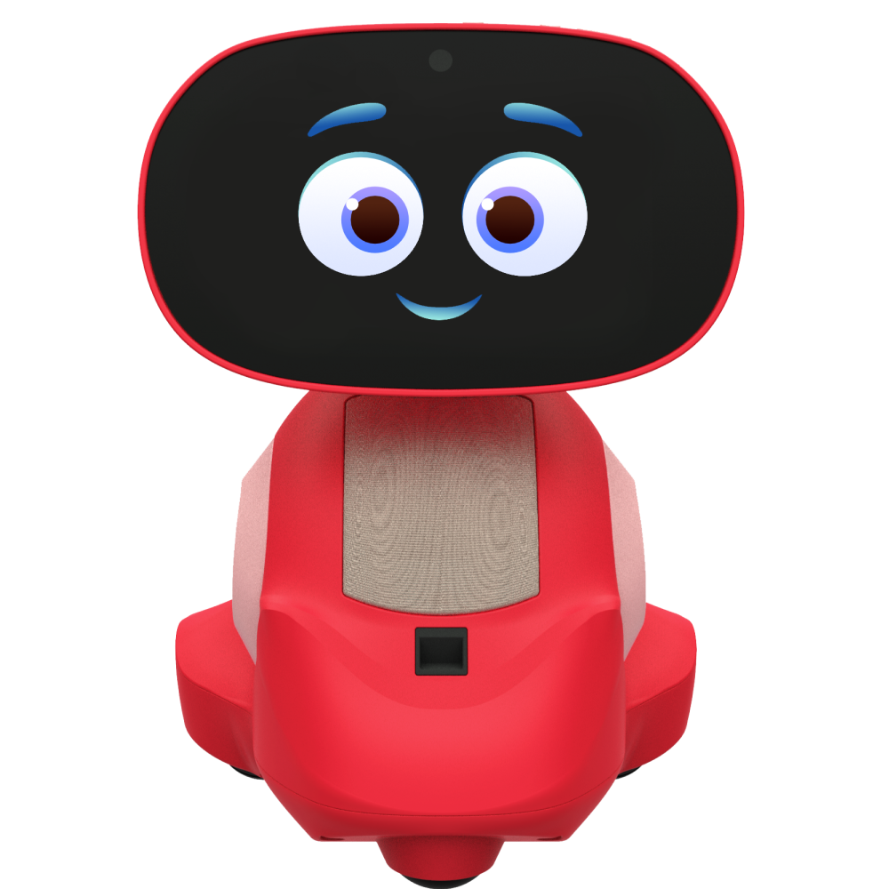
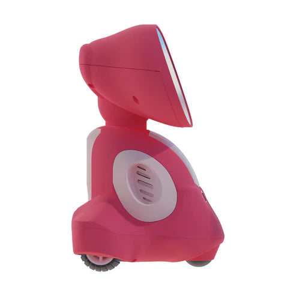
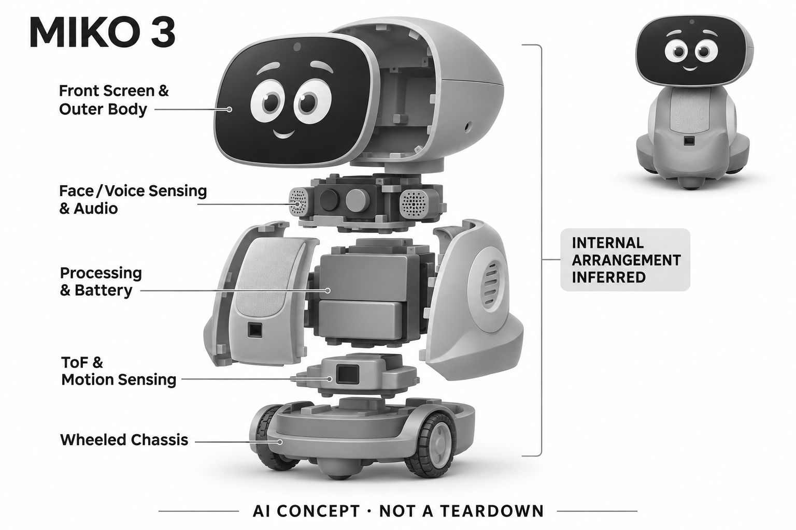

# Miko 3

**Miko** · AI玩具 · 核查 2026-11-06

语音互动、学习内容与家长应用结合的儿童机器人

消费渠道：个人零售。

## 产品图片与结构参考

### 产品图

Miko 3 红色官方正面产品图 · 来源：[Miko · 官方图片](<https://miko.ai/products/miko-3>) · [原始图片](<https://cdn.shopify.com/s/files/1/0685/0383/0762/files/miko-red_1_88c13e0f-d894-4ab1-a7a9-d85d83f6ddad.png?v=1763631213>)

### 参考图

Miko 3 红色官方侧面参考 · 来源：[Miko · 官方图片](<https://miko.ai/products/miko-3>) · [原始图片](<https://cdn.shopify.com/s/files/1/0685/0383/0762/files/Copy_of_M3-red-side_direct.webp?v=1763631213>)

### AI 生成爆炸示意

**AI 生成 · 非实物拆机。** 内部为概念推断，不能作为元件布局、BOM 或维修依据。[生成提示词](../../content/hardware/prompts/miko-3.txt)

> 已目视核对产品外形与AI标识；verified不代表内部布局经实物拆机验证。

> 分析为基于公开资料的案头研究与 AI 辅助判断，未经用户访谈、销量审计或实物拆机。需求、画像、竞争冷门度、审美及商业机会均为研究假设，不是投资结论。

## 销售与购买

- 状态：在售。2026-11-06实时浏览器核验官网红色款可点击Add To Cart；抓取文本同时含Sold out模板，不再据该模板单独判断缺货。未进行实际付款或配送资格确认。

- 地区：美国官网

- 价格：官网美元界面 US$199。2026-11-06实际页面红色款促销价，划线US$299；地区、活动和运税依结算，不能从港币/美元地区选择推断中国大陆配送。

- 中国大陆：官网列普通话为支持语言之一，但语言支持不等于中国大陆销售及云服务可达性；本次未核实大陆官方购买和售后。

- [官方产品 / 商店](<https://miko.ai/products/miko-3>)

## AI 的实际作用

官网列人脸和语音识别、知识对话、学习伙伴及Story Maker，结合感知与AI内容互动；底层模型及生成范围未完整公开。

服务与联网依赖：需要安全Wi-Fi与手机应用设置；部分学习、故事和娱乐内容受Miko Max会员权限限制。

## 是否冷门

竞争密集（研究判断）：教育内容、儿童对话和玩具三方竞争重叠；家长信任是关键门槛。

## 需求与市场

需求假设：部分家庭希望孩子以对话和游戏接触知识，同时获得可管理的屏幕使用方式。需分别衡量孩子是否主动使用、家长管理是否方便，不能把互动次数直接解释为学习效果。

### 产品任务与边界 · 研究判断

Miko 3 将人物和语音识别、知识对话、学习内容和故事互动组合成儿童角色，任务是让学习与游戏更容易开始。需求判断应分别关注孩子主动使用与家长管理便利，不能把互动次数或屏幕停留时长直接解释为学习进步。

依据：[Miko 3官方商品与FAQ](<https://miko.ai/products/miko-3>) · [Miko 官方 AI Conversation 设置](<https://help.miko.ai/hc/en-us/articles/35570785128605-What-is-AI-Conversation-on-Miko-3>)

### 需求判断 · 研究判断

实体移动和表情可能提升兴趣，但也可能只是让原有屏幕内容换一个载体。真正增量需要体现为孩子愿意提问、解释或探索，同时家长能控制使用方式；如果主要在被动观看，独立机器人相对平板的价值就需要重新评估。

依据：[Miko 3官方商品与FAQ](<https://miko.ai/products/miko-3>) · [Miko 官方 AI Conversation 设置](<https://help.miko.ai/hc/en-us/articles/35570785128605-What-is-AI-Conversation-on-Miko-3>)

### 需求验证 · 待验证

可记录一段时间内对话、故事、游戏和视频的实际比例，并观察家长是否频繁调整权限。将主动表达和内容消费分开，再用相同任务与已有家庭设备比较，避免将设备吸引注意的能力直接当作教育效果证据。

依据：[Miko 3官方商品与FAQ](<https://miko.ai/products/miko-3>) · [Miko 官方 AI Conversation 设置](<https://help.miko.ai/hc/en-us/articles/35570785128605-What-is-AI-Conversation-on-Miko-3>)

## 用户画像

用户画像推断：愿意参与设置和内容选择、能接受持续会员费用的家庭较适合。家长是购买和控制者，儿童是使用者；语言、年龄、阅读水平和设备共有方式会造成不同体验。

### 适用行为与条件 · 研究判断

较匹配愿意参与设置、内容选择及会员管理的家庭，儿童是使用者而家长是购买和控制者。年龄、语言和阅读水平会影响互动方式，设备共有也可能造成个性与权限冲突，不能用一个儿童伙伴标签概括所有家庭。

依据：[Miko 3官方商品与FAQ](<https://miko.ai/products/miko-3>) · [Miko 官方 AI Conversation 设置](<https://help.miko.ai/hc/en-us/articles/35570785128605-What-is-AI-Conversation-on-Miko-3>)

### 人群取舍 · 研究判断

家长可能希望减少手机使用，孩子却更喜欢屏幕游戏；两者目标不一致会影响长期接受。画像应包含家庭已有设备、日常规则和成人参与程度，而不是仅根据孩子喜欢机器人或家长重视教育来推断购买合理性。

依据：[Miko 3官方商品与FAQ](<https://miko.ai/products/miko-3>) · [Miko 官方 AI Conversation 设置](<https://help.miko.ai/hc/en-us/articles/35570785128605-What-is-AI-Conversation-on-Miko-3>)

### 画像验证 · 待验证

画像验证应让家长和儿童分别描述想完成的活动，再观察真实使用是否符合双方期待。记录共享设备、不同语言和会员限制产生的摩擦，识别哪些家庭需要角色互动，哪些其实更需要内容筛选和时间管理工具。

依据：[Miko 3官方商品与FAQ](<https://miko.ai/products/miko-3>) · [Miko 官方 AI Conversation 设置](<https://help.miko.ai/hc/en-us/articles/35570785128605-What-is-AI-Conversation-on-Miko-3>)

## 竞争与替代

竞争判断：儿童机器人同时面对平板教育软件、智能音箱和实体玩具，属于拥挤市场。版权内容和家长工具可形成差异，但单靠“会聊天”无法证明其比现有家庭设备更值得保留。

### 比较对象与差异 · 研究判断

Miko 3 面对教育平板、智能音箱和实体玩具，版权内容、家长控制及移动角色共同构成差异。比较不能只问哪款更会聊天，而要看家庭是否需要新增独立屏幕和运动体，以及现有设备是否已能完成主要任务。

依据：[Miko 3官方商品与FAQ](<https://miko.ai/products/miko-3>) · [Miko 官方 AI Conversation 设置](<https://help.miko.ai/hc/en-us/articles/35570785128605-What-is-AI-Conversation-on-Miko-3>)

### 竞争判断 · 研究判断

儿童机器人市场的竞争同时发生在内容、硬件和服务层，接入类似模型容易趋同。持续价值可能来自可靠的年龄适配和低负担管理，若会员限制让关键体验断裂，丰富内容也可能无法形成稳定的使用习惯。

依据：[Miko 3官方商品与FAQ](<https://miko.ai/products/miko-3>) · [Miko 官方 AI Conversation 设置](<https://help.miko.ai/hc/en-us/articles/35570785128605-What-is-AI-Conversation-on-Miko-3>)

### 竞争验证 · 待验证

竞争验证可选取相同故事和知识任务，与家庭已有平板或音箱比较主动参与和家长介入。明确免费与 Max 权限后再询问选择，避免用试用期完整体验对比其他设备的基础功能，从而低估长期拥有成本。

依据：[Miko 3官方商品与FAQ](<https://miko.ai/products/miko-3>) · [Miko 官方 AI Conversation 设置](<https://help.miko.ai/hc/en-us/articles/35570785128605-What-is-AI-Conversation-on-Miko-3>)

## 供应链

供应链推断：机身移动、屏幕、麦克风与扬声器需要耐用且便于清洁，内容授权也构成持续成本。官方列传感与外壳信息但未披露制造工厂；地区内容权限应与硬件SKU联动管理。

### 功能模块拆分 · 研究判断

功能层包括摄像和麦克风、距离与里程感知、移动及屏幕声音反馈，再连接学习内容、家长应用和会员服务。公开资料披露功能模组但没有完整制造工厂，不能凭机身形态推定实际芯片、代工方或模型部署位置。

依据：[Miko 3官方商品与FAQ](<https://miko.ai/products/miko-3>) · [Miko 官方 AI Conversation 设置](<https://help.miko.ai/hc/en-us/articles/35570785128605-What-is-AI-Conversation-on-Miko-3>)

### 制造与供应约束 · 研究判断

制造约束是移动、显示和音频系统要耐受儿童日常使用并便于清洁，同时保持收音和散热。内容授权和地区权益需要与硬件版本一致，若销售渠道、账户和功能权限脱节，售后问题可能并非硬件故障却同样影响交付。

依据：[Miko 3官方商品与FAQ](<https://miko.ai/products/miko-3>) · [Miko 官方 AI Conversation 设置](<https://help.miko.ai/hc/en-us/articles/35570785128605-What-is-AI-Conversation-on-Miko-3>)

### 候选与证据缺口 · 研究判断

华勤可作为音视频联网终端和整机工程候选，歌尔可作为语音与交互硬件整合候选。两者并无 Miko 3 点名合作证据；儿童内容、家长权限和运动安全需单独定义，不能从综合制造能力推定完整教育机器人方案。

依据：[Miko 3官方商品与FAQ](<https://miko.ai/products/miko-3>) · [Miko 官方 AI Conversation 设置](<https://help.miko.ai/hc/en-us/articles/35570785128605-What-is-AI-Conversation-on-Miko-3>)

## 技术路径

官方披露人脸语音识别、距离和里程感知，以及学习内容和故事功能。推断关键是儿童发音识别、年龄适配与内容边界；需要独立核查回答正确率，不能由深度学习标签推导教育质量。

### 已披露技术边界 · 研究判断

官方商品说明人脸语音识别、环境感知及学习故事能力，本轮帮助页另确认家长可开关 AI 会话并限制部分话题。这个控制入口说明会话可管理，但不等于所有内容已独立验证安全，也不能推断底层模型或端云分工。

依据：[Miko 3官方商品与FAQ](<https://miko.ai/products/miko-3>) · [Miko 官方 AI Conversation 设置](<https://help.miko.ai/hc/en-us/articles/35570785128605-What-is-AI-Conversation-on-Miko-3>)

### 系统难点判断 · 研究判断

系统难点是儿童发音、内容年龄适配和多种反馈协调。设备可以听懂一句话却给出不适当难度的回答，或者在移动中影响收音；技术评价应跟踪完整互动链，而不是只验证唤醒成功或屏幕能够显示故事。

依据：[Miko 3官方商品与FAQ](<https://miko.ai/products/miko-3>) · [Miko 官方 AI Conversation 设置](<https://help.miko.ai/hc/en-us/articles/35570785128605-What-is-AI-Conversation-on-Miko-3>)

### 技术验证 · 待验证

验证应测试不同发音、多人环境和受限制话题，并分别记录识别错误、内容错误和权限执行。还要检查会话关闭后其他活动是否清楚可用，不能把安全开关存在当成所有家庭设置和版本条件下都无误的证明。

依据：[Miko 3官方商品与FAQ](<https://miko.ai/products/miko-3>) · [Miko 官方 AI Conversation 设置](<https://help.miko.ai/hc/en-us/articles/35570785128605-What-is-AI-Conversation-on-Miko-3>)

## 产品审美

审美判断：明亮机身、屏幕表情和可移动形态强调玩伴感，比成人电子设备更有角色属性。屏幕和动作容易吸引注意，但家庭接受度取决于音量、待机状态及是否显得过度刺激。

### 外观与交互语言 · 研究判断

明亮机身、屏幕表情和移动形态强调玩伴感，帮助它区别于成人电子设备。审美同时承担吸引儿童与让家长愿意留在家庭空间的任务，不能只看颜色是否活泼，声音和待机动作同样决定长期接受度。

依据：[Miko 3官方商品与FAQ](<https://miko.ai/products/miko-3>) · [Miko 官方 AI Conversation 设置](<https://help.miko.ai/hc/en-us/articles/35570785128605-What-is-AI-Conversation-on-Miko-3>)

### 使用中审美判断 · 研究判断

屏幕与动作可能增加参与，也可能造成持续刺激或打扰。角色设计需要让学习、娱乐和休息状态可辨认，避免所有活动都用同样兴奋的表达；用户是否主动调低声音或收起设备，是审美适配的重要行为证据。

依据：[Miko 3官方商品与FAQ](<https://miko.ai/products/miko-3>) · [Miko 官方 AI Conversation 设置](<https://help.miko.ai/hc/en-us/articles/35570785128605-What-is-AI-Conversation-on-Miko-3>)

### 设计验证 · 待验证

设计验证应观察孩子自主选择内容、家长暂停及设备休息时的状态，记录是否发生争夺或困惑。还应在真实房间评估声音和屏幕亮度，避免用宣传中的积极表情推断所有年龄都觉得舒适或愿意持续共处。

依据：[Miko 3官方商品与FAQ](<https://miko.ai/products/miko-3>) · [Miko 官方 AI Conversation 设置](<https://help.miko.ai/hc/en-us/articles/35570785128605-What-is-AI-Conversation-on-Miko-3>)

## 关键风险

风险判断：官方页面库存文本相互冲突，购买前须确认颜色及交付；儿童音视频处理和会员续费亦需清楚说明。官网宣传的学习进步不在本研究中当作已独立验证的效果证据。

### 主要失效与依赖 · 研究判断

主要风险包括儿童音视频处理、生成回答边界和会员续费，原商品页库存文案也存在冲突，因此购买状态仍应保守核实。厂商对学习进步及安全的表述不在本研究中当作独立效果证据，控制功能也不是绝对保障。

依据：[Miko 3官方商品与FAQ](<https://miko.ai/products/miko-3>) · [Miko 官方 AI Conversation 设置](<https://help.miko.ai/hc/en-us/articles/35570785128605-What-is-AI-Conversation-on-Miko-3>)

### 风险传播判断 · 研究判断

如果家长把机器人视为自动可靠的教育者，可能减少对内容和使用方式的关注。另一方面，权限过于复杂又会增加管理负担；产品需要让成人清楚理解可控制什么、限制后还剩什么，以及何时应直接参与孩子的问题。

依据：[Miko 3官方商品与FAQ](<https://miko.ai/products/miko-3>) · [Miko 官方 AI Conversation 设置](<https://help.miko.ai/hc/en-us/articles/35570785128605-What-is-AI-Conversation-on-Miko-3>)

### 风险验证 · 待验证

风险验证应演练 AI 会话开关、话题限制、网络中断和会员变化，记录家长是否能正确理解结果。库存和地区权益需在实际渠道确认，不能由网页同时出现加购按钮就推断所有版本可即时交付或完整使用。

依据：[Miko 3官方商品与FAQ](<https://miko.ai/products/miko-3>) · [Miko 官方 AI Conversation 设置](<https://help.miko.ai/hc/en-us/articles/35570785128605-What-is-AI-Conversation-on-Miko-3>)

## 机会与验证

市场观察：应把它与同价教育平板、智能音箱按内容权限、家长控制、语言和实体互动比较。目录记录的主要价值在于呈现完整拥有成本，而不是从单一AI标签判断哪款更先进。

### 可能的机会入口 · 研究判断

机会在于把儿童角色互动与家长管理做成同一套清晰体验，而不是只增加内容数量。新项目可聚焦一种主动表达或共同游戏任务，先证明相对家庭已有屏幕的增量，再决定是否承担移动硬件与订阅内容的复杂度。

依据：[Miko 3官方商品与FAQ](<https://miko.ai/products/miko-3>) · [Miko 官方 AI Conversation 设置](<https://help.miko.ai/hc/en-us/articles/35570785128605-What-is-AI-Conversation-on-Miko-3>)

### 机会成立条件 · 研究判断

机会成立需要孩子的主动参与增加且成人管理负担可控，不能只有观看时长增长。若核心价值是内容授权，硬件应服务于内容；若核心价值是实体互动，就需证明动作与角色让任务发生了不同，而不是仅换一个屏幕外壳。

依据：[Miko 3官方商品与FAQ](<https://miko.ai/products/miko-3>) · [Miko 官方 AI Conversation 设置](<https://help.miko.ai/hc/en-us/articles/35570785128605-What-is-AI-Conversation-on-Miko-3>)

### 下一步验证 · 待验证

下一步可用明确权限和少量内容开展家庭试用，记录主动提问、家长介入及会员到期意愿。把这些结果与平板或音箱比较后再扩展功能，避免用 AI 标签、厂商成长故事或总互动次数替代真实需求验证。

依据：[Miko 3官方商品与FAQ](<https://miko.ai/products/miko-3>) · [Miko 官方 AI Conversation 设置](<https://help.miko.ai/hc/en-us/articles/35570785128605-What-is-AI-Conversation-on-Miko-3>)

## 对应供应链公司

能力候选用于选型研究，不代表本产品实际采用；未公开的供货关系不作推断。

- [huaqin](../supply-chain/huaqin.md) — **能力候选 · 非已采用** / 儿童音视频终端与整机电子工程：华勤的终端研发制造能力可对应 Miko 类屏幕、摄像、无线和计算硬件，但儿童内容、家长权限及移动安全必须单独负责；没有 Miko 3 点名合作证据，当前仅为工程能力候选。

- [goertek](../supply-chain/goertek.md) — **能力候选 · 非已采用** / 儿童语音交互与声学系统：歌尔的声学和智能硬件能力可支持收音、发声及紧凑机身协同，但儿童发音识别和内容安全不能由声学器件能力保证；未发现 Miko 3 供货披露，因此不认定其实际制造关系。

[浏览供应链目录](../supply-chain.md)

## 功能分层示意

这是功能关系，不是实物拆机、真实空间结构或已核实 BOM。

1. **儿童输入**：摄像与双麦克风支持人物、声音相关互动。（官方披露）

2. **环境感知**：官方列ToF距离和里程传感信息。（官方披露）

3. **学习交互**：识别、知识对话与故事功能连接学习内容。（官方披露）

4. **家长与会员**：Parent App管理使用，Miko Max决定部分内容权限。（官方披露）

## 来源

1. [Miko 3官方商品与FAQ](<https://miko.ai/products/miko-3>) — 2026-11-06实时浏览器核验官网红色款可点击Add To Cart；抓取文本同时含Sold out模板，不再据该模板单独判断缺货。未进行实际付款或配送资格确认。

[返回目录](../hardware-market.md) · [网页分析](https://romanagent.github.io/Roman/#hardware/product/miko-3)
