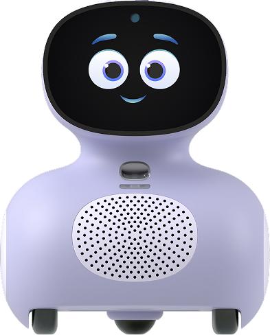
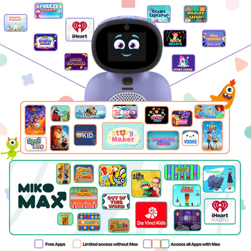
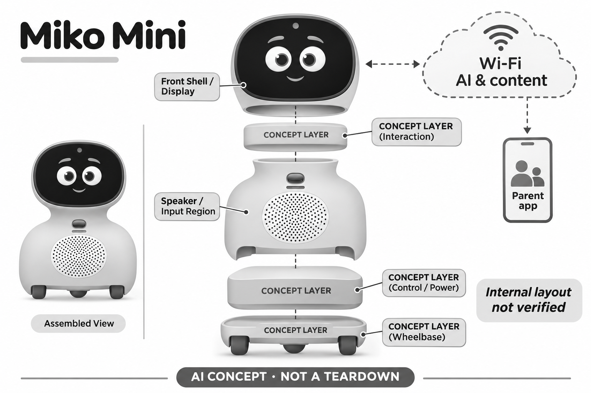

# Miko Mini

**Miko** · AI玩具 · 核查 2026-11-06

以语音为主、带表情显示和移动底盘的儿童学习机器人

消费渠道：个人零售。

## 产品图片与结构参考

### 产品图

官方紫色Mini正面外观 · 来源：[产品品牌官网](<https://miko.ai/products/miko-mini>) · [原始图片](<https://miko.ai/cdn/shop/files/mini-flatscreen-edit.png?v=1775629258&width=416>)

### 参考图

官方Mini内容与Max权益参考图，权益以当前页面为准 · 来源：[产品品牌官网](<https://miko.ai/products/miko-mini>) · [原始图片](<https://miko.ai/cdn/shop/files/mini_purple_2.jpg?v=1775642070&width=416>)

### AI 生成爆炸示意

**AI 生成 · 非实物拆机。** 内部为概念推断，不能作为元件布局、BOM 或维修依据。[生成提示词](../../content/hardware/prompts/miko-mini.txt)

> 内部为未核实布局的功能概念，不作具体芯片、传动或维修结构依据。

> 图片保留官方原貌；效果、安全与性能宣传不代表本目录独立验证。

> 分析为基于公开资料的案头研究与 AI 辅助判断，未经用户访谈、销量审计或实物拆机。需求、画像、竞争冷门度、审美及商业机会均为研究假设，不是投资结论。

## 销售与购买

- 状态：在售。2026-11-06浏览器在官网美元地区页面观察到紫色Mini的US$129和可用Add To Cart/Buy Now；检索缓存仍显示149美元，采用本次实时界面。没有实际付款或核定具体地址配送。

- 地区：美国官网渠道、其他地区以官方结算和服务范围为准

- 价格：US$129（本轮官网美元界面所见）。网页缓存与比较页仍可见US$149，促销以当前结算为准；部分内容及服务需Miko Max，商品页标年付折算起US$8.25/月，不能理解为所有内容终身包含。

- 中国大陆：官网地区选择包含中国与香港，但选择列表不能证明大陆正式零售、服务或完整售后；本轮未验证大陆账号、网络和应用使用。

- [官方产品 / 商店](<https://miko.ai/products/miko-mini>)

## AI 的实际作用

官方Mini FAQ与对比页明确GPT驱动的对话学习、语音交互与表情反馈，商品页另提供Story Maker；课程、歌曲和版权视频不因出现在同一平台就全部由AI生成。

服务与联网依赖：需要家长App、监护人同意设置和稳定Wi-Fi，功能受账号、语言与Miko Max权益影响；未披露全部端云分工，不按离线教育机器人描述。

## 是否冷门

竞争密集（研究判断）：儿童学习机器人已有多种屏幕、语音和内容平台方案；Mini为同需求下较紧凑的实现，非新增独立学习场景，也无销量排名证据。

## 需求与市场

需求假设是孩子愿意通过发问、游戏和身体移动探索知识，家长希望有便于管理的独立设备。价值应看问题有没有得到可理解的解释、游戏能否继续，而非回答数量；如果孩子只把它当播放器，机器人形态的额外成本和维护可能并没有带来明显增量。

### 事实｜学习对话与内容应用共存 · 官方资料

Mini官方资料把GPT对话、知识问答、故事和学习应用结合在轮式机体中，Story Maker是其中一个玩法。内容目录同时包含歌曲、游戏和版权节目，因此不能将整个平台全部称为实时生成；孩子面对的是多种内容机制，而不是一个没有边界的通用模型。

依据：[Miko Mini当前官方商品](<https://miko.ai/products/miko-mini>) · [Miko Mini官方FAQ](<https://miko.ai/pages/miko-mini-faqs>)

### 判断｜需要验证互动是否服务好奇心 · 研究判断

需求假设是孩子愿意通过发问、游戏和身体移动探索知识，家长希望有便于管理的独立设备。价值应看问题有没有得到可理解的解释、游戏能否继续，而非回答数量；如果孩子只把它当播放器，机器人形态的额外成本和维护可能并没有带来明显增量。

依据：[Miko Mini当前官方商品](<https://miko.ai/products/miko-mini>) · [Miko Mini官方FAQ](<https://miko.ai/pages/miko-mini-faqs>)

### 验证｜将提问与固定内容分开观察 · 待验证

家庭试用可记录孩子主动发起的问题、重复使用的内容、识别失败和需要成人帮助的环节，再比较原有故事音箱或平板的流程。不能把所有使用时长都归因于AI，也不以短期兴趣证明学习效果；本研究没有儿童访谈、课堂试验或销售数据。

依据：[Miko Mini当前官方商品](<https://miko.ai/products/miko-mini>) · [Miko Mini官方FAQ](<https://miko.ai/pages/miko-mini-faqs>)

## 用户画像

孩子能否清楚表达、理解等待和调整问题，会影响实际使用；不同口音、年龄和环境也可能带来差异。用户画像应围绕这些操作能力以及家长参与程度，而非只按年龄标签判断适合；紧凑外形和亲切表情并不能保证每个孩子都喜欢与机器交谈。

### 事实｜初始化需要家长与网络参与 · 官方资料

官方设置步骤包括充电、家长应用、监护人同意、设备配对和Wi-Fi连接，随后才能使用相关内容。购买机器人并不意味着孩子开箱即可完全独立操作，家庭需要有能够管理账户与网络的人；目录没有实际注册或提交任何儿童资料。

依据：[Miko Mini官方FAQ](<https://miko.ai/pages/miko-mini-faqs>)

### 判断｜语音优先仍有表达适配门槛 · 研究判断

孩子能否清楚表达、理解等待和调整问题，会影响实际使用；不同口音、年龄和环境也可能带来差异。用户画像应围绕这些操作能力以及家长参与程度，而非只按年龄标签判断适合；紧凑外形和亲切表情并不能保证每个孩子都喜欢与机器交谈。

依据：[Miko Mini官方FAQ](<https://miko.ai/pages/miko-mini-faqs>) · [Miko Mini与Miko 3官方比较](<https://miko.ai/pages/miko-mini-vs-miko-3>)

### 验证｜让家长独立完成常见管理 · 待验证

除首次对话外，应观察家长能否修改使用时间、找到内容权限、识别付费项目并恢复断网状态。多个孩子共同使用时需确认个人资料和历史如何区分；这些是具体适配工作，不应通过让儿童交出更多个人经历来证明个性化效果。

依据：[Miko Mini当前官方商品](<https://miko.ai/products/miko-mini>) · [Miko Mini官方FAQ](<https://miko.ai/pages/miko-mini-faqs>)

## 竞争与替代

替代方案既有其他机器人，也有平板上的教育内容、智能音箱和家长共读。机器人运动和表情可能使互动更有吸引力，却也增加摆放、充电和环境限制；比较应先确定家庭需要什么任务，而不是把更复杂的硬件自动视为更先进的教育方式。

### 事实｜与Miko 3是同需求的不同实现 · 官方资料

官方比较页将Mini描述为更紧凑、语音优先的产品，并与Miko 3较大的触控交互作区分。Mini仍有表情显示，不能把屏幕自由的宣传字眼理解成没有屏幕；本目录把两者放在相同儿童知识互动需求下比较，不因颜色或尺寸另造新场景。

依据：[Miko Mini与Miko 3官方比较](<https://miko.ai/pages/miko-mini-vs-miko-3>)

### 判断｜内容生态和家庭设备是主要替代 · 研究判断

替代方案既有其他机器人，也有平板上的教育内容、智能音箱和家长共读。机器人运动和表情可能使互动更有吸引力，却也增加摆放、充电和环境限制；比较应先确定家庭需要什么任务，而不是把更复杂的硬件自动视为更先进的教育方式。

依据：[Miko Mini当前官方商品](<https://miko.ai/products/miko-mini>) · [Miko Mini与Miko 3官方比较](<https://miko.ai/pages/miko-mini-vs-miko-3>)

### 验证｜比较订阅前后的实际价值 · 待验证

商品页区分非Max与Max内容权益，部分功能只有有限访问。评估应记录家庭真正反复使用的内容和完整费用，检查免费体验结束后是否仍满足期待；不能用内容总数估算有用程度，也不能把促销硬件价格与竞争产品的全服务费用直接比较。

依据：[Miko Mini当前官方商品](<https://miko.ai/products/miko-mini>)

## 供应链

轮子移动、播放音乐和儿童同时讲话会给语音输入增加干扰，机体高度及摆放还会改变距离。类似机器人需要把声学、机械和网络协同设计，而不只看对话模型；若动作好看却使关键指令难以听清，整体体验可能反而变差。

### 事实｜机体功能公开而内部零件未披露 · 官方资料

官方资料涉及麦克风、扬声器、表情显示、摄像头及轮式运动相关传感，足以理解功能层次。具体主控、传动、电池和代工工厂并未完整公开，部分营销模块可能沿用系列素材；目录不据这些模块反推精确数量和BOM，结构图仅作概念分层。

依据：[Miko Mini当前官方商品](<https://miko.ai/products/miko-mini>) · [Miko Mini与Miko 3官方比较](<https://miko.ai/pages/miko-mini-vs-miko-3>)

### 判断｜运动噪声与采音需要共同处理 · 研究判断

轮子移动、播放音乐和儿童同时讲话会给语音输入增加干扰，机体高度及摆放还会改变距离。类似机器人需要把声学、机械和网络协同设计，而不只看对话模型；若动作好看却使关键指令难以听清，整体体验可能反而变差。

依据：[Miko Mini当前官方商品](<https://miko.ai/products/miko-mini>) · [Miko Mini与Miko 3官方比较](<https://miko.ai/pages/miko-mini-vs-miko-3>)

### 验证｜供应能力要落到目标机体测试 · 待验证

可从无线连接和MEMS采音等模块研究候选，再在实际外壳、轮式运动和家庭噪声下验证。芯片供应商公开能力不等于已为Mini供货，也不自动解决儿童识别和内容治理；没有点名资料时，供应关联只作为相近新产品研发的入口。

依据：[Miko Mini当前官方商品](<https://miko.ai/products/miko-mini>) · [Miko Mini官方FAQ](<https://miko.ai/pages/miko-mini-faqs>)

## 技术路径

玩具可能听懂问题并给出流畅回答，却遗漏条件或把复杂知识讲得过度简单。技术评估需要同时观察语音识别、事实内容和儿童可理解性，不能只统计有没有回应；在开放问题和虚构故事之间切换时，也需要让孩子能分清真实信息与想象内容。

### 事实｜联网GPT对话不等于全部端侧计算 · 官方资料

Mini FAQ明确GPT驱动的对话学习，同时设置要求稳定Wi-Fi。官方没有完整公开当前模型版本和每一步端云分工，因此不能把对话能力归到某个机内芯片；表情、移动、固定内容和生成回答也应分别理解，不把所有响应都视为同一个AI机制。

依据：[Miko Mini官方FAQ](<https://miko.ai/pages/miko-mini-faqs>) · [Miko Mini与Miko 3官方比较](<https://miko.ai/pages/miko-mini-vs-miko-3>)

### 判断｜正确接话与正确知识是两种质量 · 研究判断

玩具可能听懂问题并给出流畅回答，却遗漏条件或把复杂知识讲得过度简单。技术评估需要同时观察语音识别、事实内容和儿童可理解性，不能只统计有没有回应；在开放问题和虚构故事之间切换时，也需要让孩子能分清真实信息与想象内容。

依据：[Miko Mini当前官方商品](<https://miko.ai/products/miko-mini>) · [Miko Mini官方FAQ](<https://miko.ai/pages/miko-mini-faqs>)

### 验证｜按当前版本核对有冲突的规格 · 待验证

本轮发现商品页与FAQ及比较页的续航、语言和价格存在不同口径，因此不拼接最大数值形成虚假完整规格。正式评估应固定实际型号、软件版本和账户计划，再测试内容与网络表现；目录保留来源差异，未独立验证续航或对话准确率。

依据：[Miko Mini当前官方商品](<https://miko.ai/products/miko-mini>) · [Miko Mini官方FAQ](<https://miko.ai/pages/miko-mini-faqs>) · [Miko Mini与Miko 3官方比较](<https://miko.ai/pages/miko-mini-vs-miko-3>)

## 产品审美

儿童会把表情和动作理解成情绪，产品应该让收音、思考、失败和休息状态容易区分。可爱表情若掩盖无法联网或没有理解问题，会增加误会；审美评价需要关注交互节奏和状态清晰度，而不是只看屏幕动画是否丰富或机体是否像朋友。

### 事实｜表情屏与轮式身体形成角色感 · 官方资料

当前官方图片展示正面表情显示、身体扬声器开孔、上方输入窗口和底部轮子，外观与普通毛绒明显不同。它通过声音、表情和移动呈现角色，但图片无法证明触感、抗跌或运动安全；概念图不会把没有公开的内部板件与传动细节画成真实拆机。

依据：[Miko Mini当前官方商品](<https://miko.ai/products/miko-mini>)

### 判断｜可移动角色需要清晰状态表达 · 研究判断

儿童会把表情和动作理解成情绪，产品应该让收音、思考、失败和休息状态容易区分。可爱表情若掩盖无法联网或没有理解问题，会增加误会；审美评价需要关注交互节奏和状态清晰度，而不是只看屏幕动画是否丰富或机体是否像朋友。

依据：[Miko Mini当前官方商品](<https://miko.ai/products/miko-mini>) · [Miko Mini与Miko 3官方比较](<https://miko.ai/pages/miko-mini-vs-miko-3>)

### 验证｜在家庭地面与桌面观察使用 · 待验证

后续可检查不同摆放位置下的可见性、声音、轮子行动范围和充电是否容易，并确认成人能及时停止互动。应遵循实际说明书所要求的使用环境，而非用宣传视频推断跨越障碍或随处放置都没问题；本轮没有运行实物或进行机械安全试验。

依据：[Miko Mini当前官方商品](<https://miko.ai/products/miko-mini>) · [Miko Mini官方FAQ](<https://miko.ai/pages/miko-mini-faqs>)

## 关键风险

账户、内容授权和网络服务变化可能影响已购买机器人的功能，硬件仍能开机不代表全部体验继续存在。家庭还需理解数据记录与订阅取消后的边界；厂商提供丰富应用可以增加价值，也会让产品更依赖持续维护和清楚的版本沟通。

### 事实｜家长控制是机制而非效果保证 · 官方资料

官方描述家长时间控制、内容管理及限制外部视频等措施，并使用儿童安全宣传。目录只把这些作为已披露的产品设置，不视为每个回答都正确或所有场景都已通过独立验证；教育与情绪成长的宣传结果也不能直接推广到任意购买家庭。

依据：[Miko Mini当前官方商品](<https://miko.ai/products/miko-mini>) · [Miko Mini官方FAQ](<https://miko.ai/pages/miko-mini-faqs>)

### 判断｜持续服务影响硬件可用寿命 · 研究判断

账户、内容授权和网络服务变化可能影响已购买机器人的功能，硬件仍能开机不代表全部体验继续存在。家庭还需理解数据记录与订阅取消后的边界；厂商提供丰富应用可以增加价值，也会让产品更依赖持续维护和清楚的版本沟通。

依据：[Miko Mini当前官方商品](<https://miko.ai/products/miko-mini>) · [Miko Mini官方FAQ](<https://miko.ai/pages/miko-mini-faqs>)

### 验证｜检查限制撤回与停用后的行为 · 待验证

可以核对关闭某项功能、取消会员或更换家长手机后的实际表现，并查看历史资料如何管理。评估应包含断网和升级失败的恢复流程，避免只看开箱演示；本目录没有做账号或安全测试，也不将网站地区列表当作大陆服务已经适用的证明。

依据：[Miko Mini当前官方商品](<https://miko.ai/products/miko-mini>) · [Miko Mini官方FAQ](<https://miko.ai/pages/miko-mini-faqs>)

## 机会与验证

儿童知识互动的市场空间可能来自反复有用的解释、故事共创和家长容易维护的流程，而不是不断新增应用数量。创业团队可研究某个年龄段或家庭语言场景的具体困难，但必须验证付费与持续使用；单纯缩小机器人外形并不会创造新的核心需求。

### 事实｜当前购买与内容订阅分别提供 · 官方资料

本轮浏览器观察到Mini美元页面可购买，部分学习、娱乐和家长报告权益则按Miko Max区分。它是硬件和持续内容的组合，当前促销也可能因地区变化；目录不把旧比较页价格当现价，亦不把一次购置费写成全部长期使用成本。

依据：[Miko Mini当前官方商品](<https://miko.ai/products/miko-mini>)

### 判断｜机会在清晰任务与低负担管理 · 研究判断

儿童知识互动的市场空间可能来自反复有用的解释、故事共创和家长容易维护的流程，而不是不断新增应用数量。创业团队可研究某个年龄段或家庭语言场景的具体困难，但必须验证付费与持续使用；单纯缩小机器人外形并不会创造新的核心需求。

依据：[Miko Mini当前官方商品](<https://miko.ai/products/miko-mini>) · [Miko Mini官方FAQ](<https://miko.ai/pages/miko-mini-faqs>)

### 验证｜评价继续使用的原因和退出成本 · 待验证

可跟踪新鲜感消退后哪些功能留下、哪些造成挫折，并了解孩子和家长是否愿意再次选择同类设备。将机器人动作、内容质量和服务价格分别评价，允许结果显示现有音箱或共读更合适；当前仅为案头研究，没有用户留存或市场规模证据。

依据：[Miko Mini当前官方商品](<https://miko.ai/products/miko-mini>) · [Miko Mini与Miko 3官方比较](<https://miko.ai/pages/miko-mini-vs-miko-3>)

## 对应供应链公司

能力候选用于选型研究，不代表本产品实际采用；未公开的供货关系不作推断。

- [espressif](../supply-chain/espressif.md) — **能力候选 · 非已采用** / 同类学习机器人Wi-Fi连接与控制候选：Espressif无线平台可用于同类学习机器人配网、连接状态和低功耗控制的研究，但不能据其通用联网能力认定能承担Miko全部视觉或生成式推理。需检验移动状态和家庭网络切换时稳定性；Miko未公开采用该公司的证据，候选关系不代表原机BOM或主控归属。

- [infineon](../supply-chain/infineon.md) — **能力候选 · 非已采用** / 儿童语音输入的MEMS麦克风候选：Infineon公开MEMS麦克风能力可作为同类机器人语音前端选择入口，尤其应检查轮式运动与自身扬声器产生的噪声。麦克风型号、数量和阵列设计仍需整机验证，不能由传感器推导识别或学习效果；未发现Miko Mini点名采用，因此仅列研发能力候选。

[浏览供应链目录](../supply-chain.md)

## 功能分层示意

这是功能关系，不是实物拆机、真实空间结构或已核实 BOM。

1. **语音与视觉输入**：官方披露麦克风和摄像头相关功能，具体器件和识别准确率未独立核实。（官方披露）

2. **表情与声音输出**：面部显示表情并用扬声器回答，显示屏存在，不把语音优先宣传写成完全无屏。（官方披露）

3. **移动机体**：轮式底盘及测距传感支持移动，内部传动与执行器布局未公开。（官方披露）

4. **网络与外部服务**：通过Wi-Fi和账户使用AI对话及内容服务，模型版本及本地计算边界未知。（官方披露）

5. **家长与内容管理**：家长App承担设置、时间控制及学习内容管理，付费权益依计划区别。（官方披露）

## 来源

1. [Miko Mini当前官方商品](<https://miko.ai/products/miko-mini>) — 已打开并用浏览器核实129美元及有效购买入口；页面通用功能模块与续航存在跨页差异，不堆叠成确定规格。

2. [Miko Mini官方FAQ](<https://miko.ai/pages/miko-mini-faqs>) — 已打开GPT驱动、家长同意、Wi-Fi与应用设置，未使用宣传增长百分比或全部安全承诺。

3. [Miko Mini与Miko 3官方比较](<https://miko.ai/pages/miko-mini-vs-miko-3>) — 已打开语音优先与屏幕、移动、对话区别；价格、语言和续航可能保留旧口径，不作为当前统一规格。

[返回目录](../hardware-market.md) · [网页分析](https://romanagent.github.io/Roman/#hardware/product/miko-mini)
