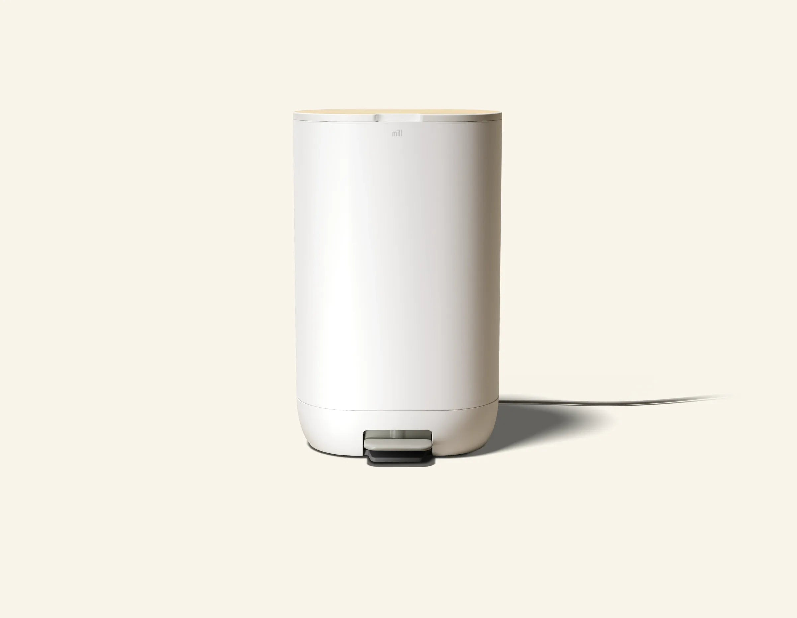
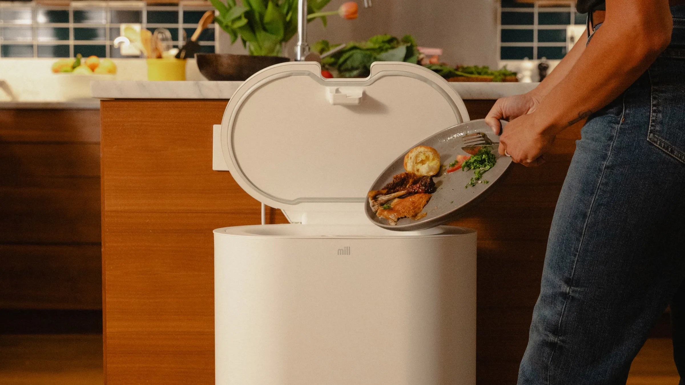
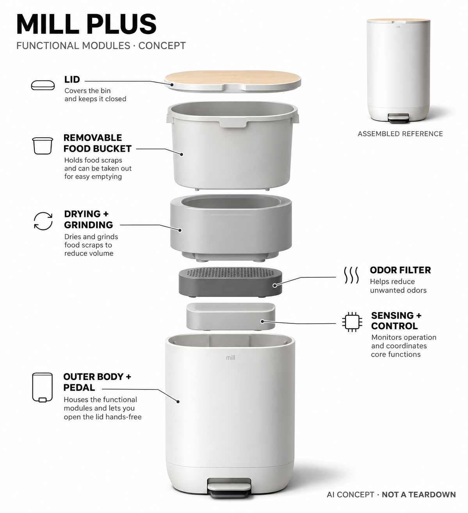

# Mill Food Recycler Plus

**Mill** · 厨房与食物管理 · 核查 2026-11-04

按投入量调整食物残渣干燥与研磨周期

消费渠道：个人零售。

## 产品图片与结构参考

### 产品图

官方Mill Plus整机 · 来源：[Mill · 官方图片](<https://www.mill.com/configure/food-recycler?bin_color=white&product=mill-plus>) · [原始图片](<https://cdn.shopify.com/s/files/1/0994/9406/8500/files/mill_plus_white_3.webp?v=1785519763>)

### 参考图

官方厨余投入场景 · 来源：[Mill · 官方图片](<https://www.mill.com/configure/food-recycler?bin_color=white&product=mill-plus>) · [原始图片](<https://cdn.shopify.com/s/files/1/0994/9406/8500/files/mill_plus_white_1.webp?v=1785519764>)

### AI 生成爆炸示意

**AI 生成 · 非实物拆机。** 内部为概念推断，不能作为元件布局、BOM 或维修依据。[生成提示词](../../content/hardware/prompts/mill-food-recycler-plus.txt)

> 依据已核验官方外形与公开功能生成；未知内部仅为概念功能块，不代表原机电路板、芯片或实际布局。

> 实际查看并核对对应型号，官方原图未改色或语义编辑；营销文字不代表本研究独立验证。

> 分析为基于公开资料的案头研究与 AI 辅助判断，未经用户访谈、销量审计或实物拆机。需求、画像、竞争冷门度、审美及商业机会均为研究假设，不是投资结论。

## 销售与购买

- 状态：在售。当前官方配置页列Mill Plus、US$1,149加购及1–3工作日发货；不将仅商用的Gemini视觉垃圾分类混入家用版。

- 地区：美国

- 价格：US$1,149起。当前Plus白色配置；Essential和不同饰面不另计，旧新闻租赁价格不作为当前方案。

- 中国大陆：已确认美国官方购买；本轮未确认大陆官方配送、回收路径及维修，不把转运或同名商品页当作国内授权。

- [官方产品 / 商店](<https://www.mill.com/configure/food-recycler?bin_color=white&product=mill-plus>)

## AI 的实际作用

官方家用技术说明称结合称重等传感与AI方法，根据加入食物和状态调整干燥研磨运行时间；当前商品页仍说明自适应周期。不是仅定时开关，也不是商用相机识别食物种类。

服务与联网依赖：应用和更新需要连接，基础处理、耗材与后续物料去向需按当前规则；干燥产物不是已经完成的堆肥。

## 是否冷门

细分专业（研究判断）：家庭食物残渣处理是细分流程，AI周期控制提供差异但收益依赖能源、维护与后续去向，不以环保口号推定市场。

## 需求与市场

需求假设：家庭希望减少湿厨余异味、频繁倒垃圾和储存负担，价值需要覆盖处理后产物去向。应记录人工清理、能源和实际回收，不能把干燥减容等同消灭废物，也不能直接宣称一定更环保或省钱。

### 产品任务与边界 · 研究判断

需求假设：家庭希望减少湿厨余异味、频繁倒垃圾和储存负担，价值需要覆盖处理后产物去向。应记录人工清理、能源和实际回收，不能把干燥减容等同消灭废物，也不能直接宣称一定更环保或省钱。

依据：[Mill Plus当前官方配置购买页](<https://www.mill.com/configure/food-recycler?bin_color=white&product=mill-plus>) · [Mill家用世代AI技术公告](<https://www.mill.com/news/introducing-the-next-generation-of-mill>)

### 需求判断 · 研究判断

真正的使用链路从饭后刮盘开始，到干燥产物离家或进入合适处理设施结束。若家庭只把湿垃圾变成另一个仍需丢弃的容器，价值主要是储存体验；不能凭减容比例推导资源循环已经实现，更应区分用户的便利需求与环境动机。

依据：[Mill Plus当前官方配置购买页](<https://www.mill.com/configure/food-recycler?bin_color=white&product=mill-plus>) · [Mill家用世代AI技术公告](<https://www.mill.com/news/introducing-the-next-generation-of-mill>)

### 需求验证 · 待验证

需求验证可让同一家庭分别使用密封桶与设备，记录投料、取桶、过滤更换、清洁以及产物去向的操作。至少跨越多次满桶周期，把电力和滤材也纳入对照，不能仅凭某天闻不到异味或一次漂亮的干燥结果判断长期收益。

依据：[Mill Plus当前官方配置购买页](<https://www.mill.com/configure/food-recycler?bin_color=white&product=mill-plus>) · [Mill家用世代AI技术公告](<https://www.mill.com/news/introducing-the-next-generation-of-mill>)

## 用户画像

画像推断：有厨房放置与电源、经常产生食物残渣并愿处理干燥产物的家庭更匹配。已有堆肥或收运者与只想少闻异味的人不同，耗材和清洁需有人负责，不能只按环保态度或收入推定持续使用。

### 适用行为与条件 · 研究判断

画像推断：有厨房放置与电源、经常产生食物残渣并愿处理干燥产物的家庭更匹配。已有堆肥或收运者与只想少闻异味的人不同，耗材和清洁需有人负责，不能只按环保态度或收入推定持续使用。

依据：[Mill Plus当前官方配置购买页](<https://www.mill.com/configure/food-recycler?bin_color=white&product=mill-plus>) · [Mill家用世代AI技术公告](<https://www.mill.com/news/introducing-the-next-generation-of-mill>)

### 人群取舍 · 研究判断

有固定收运安排的公寓家庭可能只需改善等待期间的气味，而有庭院的人更关心后续利用，两者对同一设备的期待不同。画像还应考虑谁愿意清洗内桶、是否经常出现大块或油腻残渣，以及设备占据地面后是否妨碍厨房动线。

依据：[Mill Plus当前官方配置购买页](<https://www.mill.com/configure/food-recycler?bin_color=white&product=mill-plus>) · [Mill家用世代AI技术公告](<https://www.mill.com/news/introducing-the-next-generation-of-mill>)

### 画像验证 · 待验证

画像验证应分别邀请做饭、收拾和倒垃圾的人完成一周流程，观察责任是否重新转嫁。对不愿维护过滤件或缺少产物出口的家庭，应如实记录不匹配；不能把购买者的环保意愿或一次试用的新鲜感当成全家持续采用的证据。

依据：[Mill Plus当前官方配置购买页](<https://www.mill.com/configure/food-recycler?bin_color=white&product=mill-plus>) · [Mill家用世代AI技术公告](<https://www.mill.com/news/introducing-the-next-generation-of-mill>)

## 竞争与替代

竞争判断：与普通密封厨余桶、脱水研磨机和本地收运竞争，自适应周期和后续服务是差异。Plus与Essential不作为独立创新重复计数，也不借用商用摄像Gemini能力提高家用型号的智能程度。

### 比较对象与差异 · 研究判断

竞争判断：与普通密封厨余桶、脱水研磨机和本地收运竞争，自适应周期和后续服务是差异。Plus与Essential不作为独立创新重复计数，也不借用商用摄像Gemini能力提高家用型号的智能程度。

依据：[Mill Plus当前官方配置购买页](<https://www.mill.com/configure/food-recycler?bin_color=white&product=mill-plus>) · [Mill家用世代AI技术公告](<https://www.mill.com/news/introducing-the-next-generation-of-mill>)

### 竞争判断 · 研究判断

脚踏开启降低双手拿盘时的操作，但不会自动创造新的厨余处理需求。相较台面小型干燥机，本机的桶式融入值得比较；相较普通厨余桶，新增能源、机械维护与售价也是真实代价，算法优化只有改善完整周期才构成增量。

依据：[Mill Plus当前官方配置购买页](<https://www.mill.com/configure/food-recycler?bin_color=white&product=mill-plus>) · [Mill家用世代AI技术公告](<https://www.mill.com/news/introducing-the-next-generation-of-mill>)

### 竞争验证 · 待验证

竞争验证应选相近投料和收运条件，比较准备、运行噪声、空桶频率和清洁，不拿不同家庭的单次结果直接排名。家用版本只使用已披露的传感周期优化证据，不以商用食物识别或机构合作替代当前消费者功能的实际验证。

依据：[Mill Plus当前官方配置购买页](<https://www.mill.com/configure/food-recycler?bin_color=white&product=mill-plus>) · [Mill家用世代AI技术公告](<https://www.mill.com/news/introducing-the-next-generation-of-mill>)

## 供应链

供应链分析：容器、加热、研磨驱动、称重、过滤、排风和控制共同工作，具体工厂及BOM未知。油脂、硬物、粉尘与热循环决定可靠性，滤材和维修也影响交付，不能只关注AI计算而忽略机械负载。

### 功能模块拆分 · 研究判断

功能上可拆为脚踏与盖体、可取出的厨余容器、干燥研磨执行、过滤排风、负载感知及控制。潮湿油污会沿机械接口进入维护流程，热循环又影响密封和材料，因此整机验证需要覆盖长期清洁、过滤堵塞与装回错误，而非只测软件。

依据：[Mill Plus当前官方配置购买页](<https://www.mill.com/configure/food-recycler?bin_color=white&product=mill-plus>) · [Mill家用世代AI技术公告](<https://www.mill.com/news/introducing-the-next-generation-of-mill>)

### 制造与供应约束 · 研究判断

供应链分析：容器、加热、研磨驱动、称重、过滤、排风和控制共同工作，具体工厂及BOM未知。油脂、硬物、粉尘与热循环决定可靠性，滤材和维修也影响交付，不能只关注AI计算而忽略机械负载。

依据：[Mill Plus当前官方配置购买页](<https://www.mill.com/configure/food-recycler?bin_color=white&product=mill-plus>) · [Mill家用世代AI技术公告](<https://www.mill.com/news/introducing-the-next-generation-of-mill>)

### 候选与证据缺口 · 研究判断

新金宝集团可作为家电与机电整合的制造候选，捷普可对应电子控制、测试导入和规模化装配评估，两者均未被本型号点名采用。需进一步确认食品残渣接触、热管理及高负载驱动经验，公开制造能力不能替代本机实际供应关系。

依据：[Mill Plus当前官方配置购买页](<https://www.mill.com/configure/food-recycler?bin_color=white&product=mill-plus>) · [Mill家用世代AI技术公告](<https://www.mill.com/news/introducing-the-next-generation-of-mill>)

## 技术路径

技术判断：官方家用资料明确AI结合传感确定周期，当前商品页说明可适应中途加料。公开未给模型结构和独立精度，应区分周期优化、干燥结果和商用视觉分类，不能凭公司同名技术新闻混用能力。

### 已披露技术边界 · 研究判断

技术判断：官方家用资料明确AI结合传感确定周期，当前商品页说明可适应中途加料。公开未给模型结构和独立精度，应区分周期优化、干燥结果和商用视觉分类，不能凭公司同名技术新闻混用能力。

依据：[Mill Plus当前官方配置购买页](<https://www.mill.com/configure/food-recycler?bin_color=white&product=mill-plus>) · [Mill家用世代AI技术公告](<https://www.mill.com/news/introducing-the-next-generation-of-mill>)

### 系统难点判断 · 研究判断

自适应运行需要区分新加湿料和已干产物，判断何时结束比固定时间更贴近家庭投料。但公开资料未说明训练方法、各传感器贡献及异常识别边界，不能自行补写摄像头或深度模型，也不应把每个温度反馈环节都称为学习算法。

依据：[Mill Plus当前官方配置购买页](<https://www.mill.com/configure/food-recycler?bin_color=white&product=mill-plus>) · [Mill家用世代AI技术公告](<https://www.mill.com/news/introducing-the-next-generation-of-mill>)

### 技术验证 · 待验证

技术验证应固定初始状态，改变湿度、投料时点和组合，记录周期、能耗、结块及人工处理。比较自动判断与简单固定策略，并留意中途开盖后恢复行为；不能通过危险投入物试验，也不以一次提前结束证明所有残渣都能正确处理。

依据：[Mill Plus当前官方配置购买页](<https://www.mill.com/configure/food-recycler?bin_color=white&product=mill-plus>) · [Mill家用世代AI技术公告](<https://www.mill.com/news/introducing-the-next-generation-of-mill>)

## 产品审美

审美判断：脚踏桶与简洁外壳接近厨房用品，但开盖、取桶、排气和清洁决定真实体验。产物处理后的粉尘与滤材更换应纳入设计，不只看新品放在橱柜旁的照片，也不将外观整洁当成长期无异味保证。

### 外观与交互语言 · 研究判断

审美判断：脚踏桶与简洁外壳接近厨房用品，但开盖、取桶、排气和清洁决定真实体验。产物处理后的粉尘与滤材更换应纳入设计，不只看新品放在橱柜旁的照片，也不将外观整洁当成长期无异味保证。

依据：[Mill Plus当前官方配置购买页](<https://www.mill.com/configure/food-recycler?bin_color=white&product=mill-plus>) · [Mill家用世代AI技术公告](<https://www.mill.com/news/introducing-the-next-generation-of-mill>)

### 使用中审美判断 · 研究判断

木色平盖和白色桶身让它更像厨房常用品，脚踏也延续已有动作习惯。真正的审美耐久性取决于盖缘残渣、取桶时散落以及电源线位置，展示时应保留这些使用接口，不能只强调干净外观而省略厨房里必须留出的开盖空间。

依据：[Mill Plus当前官方配置购买页](<https://www.mill.com/configure/food-recycler?bin_color=white&product=mill-plus>) · [Mill家用世代AI技术公告](<https://www.mill.com/news/introducing-the-next-generation-of-mill>)

### 设计验证 · 待验证

可在真实橱柜和餐厨动线旁观察踢踏、刮盘和取桶，记录手部是否接触脏边以及清洁后表面观感。设计评价应包含不同身高和满桶操作，不将柔和配色自动等同易用，也不把外壳无复杂按钮解释为所有状态都容易理解。

依据：[Mill Plus当前官方配置购买页](<https://www.mill.com/configure/food-recycler?bin_color=white&product=mill-plus>) · [Mill家用世代AI技术公告](<https://www.mill.com/news/introducing-the-next-generation-of-mill>)

## 关键风险

风险判断：不适配投入物、堵塞和耗材会影响运行，干燥Food Grounds不是成熟堆肥。后续处理路径因地区而异，联网服务及维修需核对；AI自适应不能保证所有残渣都可投入或完全取消人工清理。

### 主要失效与依赖 · 研究判断

风险判断：不适配投入物、堵塞和耗材会影响运行，干燥Food Grounds不是成熟堆肥。后续处理路径因地区而异，联网服务及维修需核对；AI自适应不能保证所有残渣都可投入或完全取消人工清理。

依据：[Mill Plus当前官方配置购买页](<https://www.mill.com/configure/food-recycler?bin_color=white&product=mill-plus>) · [Mill家用世代AI技术公告](<https://www.mill.com/news/introducing-the-next-generation-of-mill>)

### 风险传播判断 · 研究判断

误把产物当成可立即使用的成熟堆肥，会把后续处理问题留给用户；官方名称并不改变其仍需合适去向。过滤耗材、堵转、断网和维修延迟还可能让厨房暂时失去原有垃圾桶，用户应有普通收集方式作为可理解的回退路径。

依据：[Mill Plus当前官方配置购买页](<https://www.mill.com/configure/food-recycler?bin_color=white&product=mill-plus>) · [Mill家用世代AI技术公告](<https://www.mill.com/news/introducing-the-next-generation-of-mill>)

### 风险验证 · 待验证

风险验证应按说明核查允许材料、清理与维护，不做危险混投测试；同时确认当地接收和跨境售后条件。关注异常提示能否明确指向可安全完成的动作，不以低气味或减容结果推断卫生绝对可靠，更不把算法当作适配所有垃圾的保证。

依据：[Mill Plus当前官方配置购买页](<https://www.mill.com/configure/food-recycler?bin_color=white&product=mill-plus>) · [Mill家用世代AI技术公告](<https://www.mill.com/news/introducing-the-next-generation-of-mill>)

## 机会与验证

机会假设：围绕湿厨余储存、清洁和产物去向验证完整劳动，比较简单密封桶与自动处理。若主要困难在收运而非干燥，服务可能更有效，应先记录一段真实家庭周期，再决定机械与算法复杂度。

### 可能的机会入口 · 研究判断

机会假设：围绕湿厨余储存、清洁和产物去向验证完整劳动，比较简单密封桶与自动处理。若主要困难在收运而非干燥，服务可能更有效，应先记录一段真实家庭周期，再决定机械与算法复杂度。

依据：[Mill Plus当前官方配置购买页](<https://www.mill.com/configure/food-recycler?bin_color=white&product=mill-plus>) · [Mill家用世代AI技术公告](<https://www.mill.com/news/introducing-the-next-generation-of-mill>)

### 机会成立条件 · 研究判断

创业机会可能在产物出口与维护服务的衔接，而非再增加一个干燥算法名称。若目标社区已有可靠收运，产品可聚焦储存体验；若没有去向，先解决回收合作和用户责任，才能判断高复杂度家电是否比更简单的收集服务合适。

依据：[Mill Plus当前官方配置购买页](<https://www.mill.com/configure/food-recycler?bin_color=white&product=mill-plus>) · [Mill家用世代AI技术公告](<https://www.mill.com/news/introducing-the-next-generation-of-mill>)

### 下一步验证 · 待验证

下一步应把设备周转、滤材和产物处理做成连续记录，区分便利、费用和环境三种结果。依据真实中断原因改进流程，避免用出厂数量或一次体积变化估计需求，也不要在尚无完整生命周期证据时给出必然减碳的产品结论。

依据：[Mill Plus当前官方配置购买页](<https://www.mill.com/configure/food-recycler?bin_color=white&product=mill-plus>) · [Mill家用世代AI技术公告](<https://www.mill.com/news/introducing-the-next-generation-of-mill>)

## 对应供应链公司

能力候选用于选型研究，不代表本产品实际采用；未公开的供货关系不作推断。

- [new-kinpo-group](../supply-chain/new-kinpo-group.md) — **能力候选 · 非已采用** / 热处理与研磨家电的整机工程评估：新金宝集团公开消费与家电制造能力可用于评估容器、驱动和电子控制的整机导入，但厨余接触、粉尘、热循环及滤材维护需专项验证；未见Mill Plus点名合作，不能写成实际生产工厂。

- [jabil](../supply-chain/jabil.md) — **能力候选 · 非已采用** / 传感控制及长期可靠性测试导入：捷普的产品工程与电子制造服务可匹配传感、控制和测试导入需求，但高湿油污、负载波动和食品残渣处理属于额外约束；当前没有Mill点名供货证据，只列能力候选而非现用方案。

[浏览供应链目录](../supply-chain.md)

## 功能分层示意

这是功能关系，不是实物拆机、真实空间结构或已核实 BOM。

1. **投入与容器**：家用桶体及可取出的食物处理容器。（官方披露）

2. **感知与周期**：称重等传感结合自适应算法确定运行。（官方披露）

3. **干燥研磨**：加热与搅拌研磨形成干燥Food Grounds。（官方披露）

4. **气味与排气**：过滤和排风构成维护路径。（官方披露）

5. **应用与去向**：记录处理量，后续回收或园艺去向由用户及服务安排。（官方披露）

## 来源

1. [Mill Plus当前官方配置购买页](<https://www.mill.com/configure/food-recycler?bin_color=white&product=mill-plus>) — 已打开，明确Plus加购、发货和传感自适应周期，不沿用历史价格。

2. [Mill家用世代AI技术公告](<https://www.mill.com/news/introducing-the-next-generation-of-mill>) — 已打开，2024家用技术说明明确传感与AI确定运行时间；不是2026商用Gemini视觉。

3. [Mill官方处理与产物说明](<https://www.mill.com/food-recycler>) — 已打开，区分干燥产物与堆肥；减容和气味效果为厂商声明，未独立验证。

[返回目录](../hardware-market.md) · [网页分析](https://romanagent.github.io/Roman/#hardware/product/mill-food-recycler-plus)
