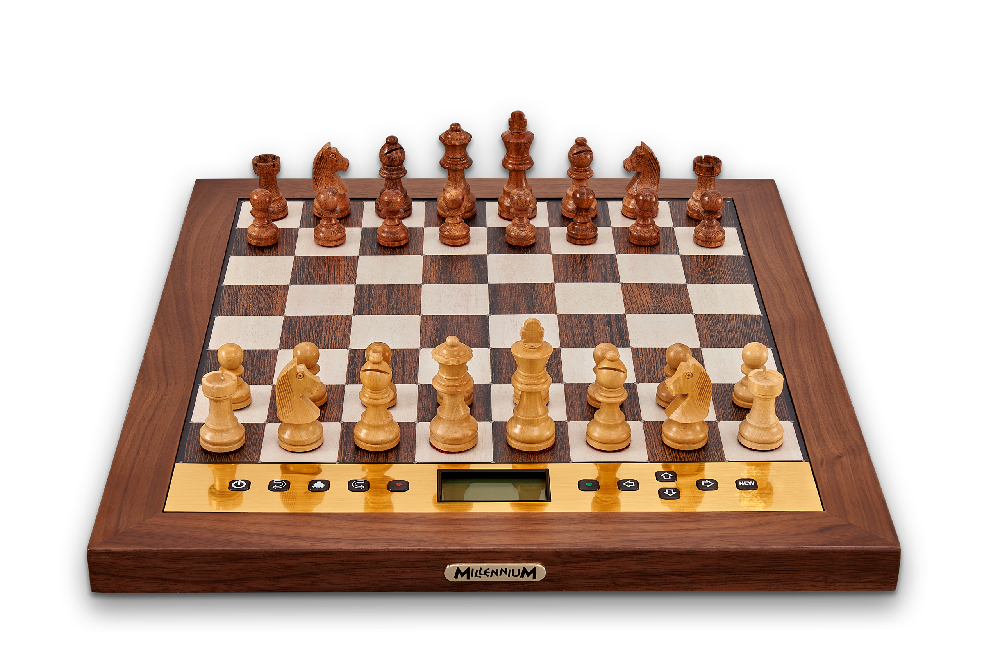
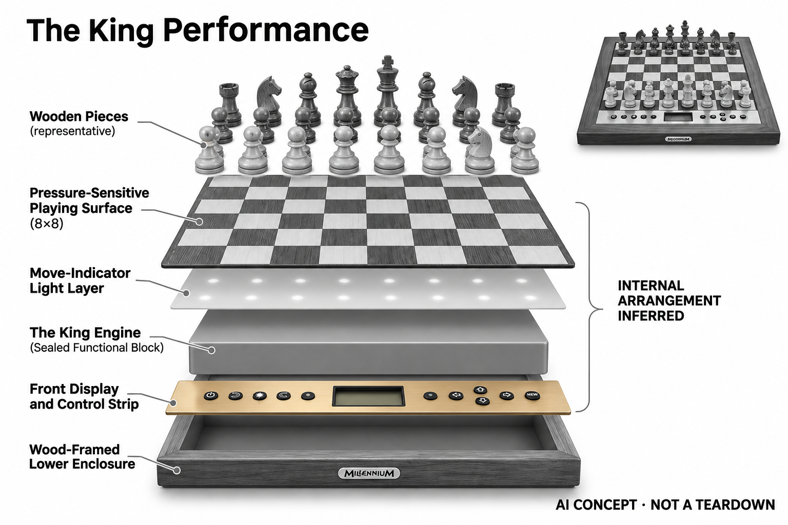

# Millennium The King Performance

**Millennium** · AI玩具 · 核查 2026-11-06

可配置对手风格的独立棋类电脑

消费渠道：个人零售。

## 产品图片与结构参考

### 产品图

Millennium The King Performance · 官方产品图 · 来源：[Millennium · 官方图片](<https://computerchess.com/en/The-King-Performance/M830>) · [原始图片](<https://computerchess.com/media/26/f9/65/1644233549/M830_chess%20board%20with%20pieces.png>)

### 参考图

Millennium The King Performance · 官方参考图 · 来源：[Millennium · 官方图片](<https://computerchess.com/en/The-King-Performance/M830>) · [原始图片](<https://computerchess.com/media/e4/d7/98/1644233650/M830_couple-playing-chess-outside.jpg>)

### AI 生成爆炸示意

**AI 生成 · 非实物拆机。** 内部为概念推断，不能作为元件布局、BOM 或维修依据。[生成提示词](../../content/hardware/prompts/millennium-king-performance.txt)

> 分析为基于公开资料的案头研究与 AI 辅助判断，未经用户访谈、销量审计或实物拆机。需求、画像、竞争冷门度、审美及商业机会均为研究假设，不是投资结论。

## 销售与购买

- 状态：在售。官方商品页当前显示€284.87促销价、可加购和可供货；页面标注价格不含VAT及运费，实体产品的Instant download文案不能当真实物流承诺。

- 地区：欧洲官方商店

- 价格：官网 €284.87（未含VAT）。核查日页面快照；运费、税费、会员和配送区域按官方结算确认，不视为中国到手价。

- 中国大陆：本轮核实所列区域官方商店；未确认中国大陆官方现货、账户及完整服务，不把境外可购等同大陆可用。

- [官方产品 / 商店](<https://computerchess.com/en/The-King-Performance/M830>)

## AI 的实际作用

内置The King棋类引擎，提供自适应难度、可配置对手风格、局面分析和Chess960；属于经典搜索决策AI，而非语言生成模型。

服务与联网依赖：基础人机对弈可独立运行；联网对战需要另购ChessLink模块及应用，便携供电等配件也需单独核对。

## 是否冷门

细分专业（研究判断）：联网能力通过额外模块扩展形成具体使用场景；本轮没有销量与市场份额证据。

## 需求与市场

需求假设：已有棋类兴趣的人希望对手既能调整难度又保持某种下棋风格，并愿意在实体棋盘上研究。应观察是否真正使用风格设置，还是多数时候只需要简单的固定等级对手。

### 需求假设：独立实体对手既能调难度又有棋风 · 研究判断

The King Performance让用户设置对手风格与自适应难度，针对希望在传统棋盘上反复挑战不同思路的人。需求应验证风格设置是否真正使用，而不是选项存在，不能把强引擎或木质外观当作学习与购买价值，也不将AI限定为语言模型。

依据：[The King Performance官方全新商品](<https://computerchess.com/en/The-King-Performance/M830>) · [Millennium官方手册与更新](<https://computerchess.com/en/Downloads/>)

### 价值判断：风格可调增加表达也增加设置 · 研究判断

有经验棋手可能喜欢决定对手特点，休闲用户也可能只想立即开局，复杂设置对两者价值不同。研究应记录用户最后保留哪些模式，不能把专家功能更多当作更好，也不以对手走法看起来有性格推断真实人格或教学理解。

依据：[The King Performance官方全新商品](<https://computerchess.com/en/The-King-Performance/M830>)

### 验证方案：比较固定、自适应与风格设置 · 待验证

让棋迷用同一时间安排尝试几种对手配置，记录设置、开局、中断和再次选择，询问具体哪种变化有意义。不要只测试最高强度或一次Chess960演示，也不以胜负和引擎评价证明学习效果，本轮没有独立用户测试。

依据：[The King Performance官方全新商品](<https://computerchess.com/en/The-King-Performance/M830>) · [Millennium官方手册与更新](<https://computerchess.com/en/Downloads/>)

## 用户画像

画像推断：喜欢木框和实体棋子、在家庭固定空间下棋的爱好者较匹配；专家模式适合愿意阅读说明的人。需要即插即用联网的人应理解额外模块与应用设置，不能按主机照片推断全套功能。

### 画像假设：喜欢传统棋具且愿意读设置说明 · 研究判断

较匹配者有稳定棋类兴趣，偏好木框与实体棋子，愿意在固定桌面研究对手风格和模式。只想随手联网或极简开局的人可能有其他选择，画像应按设置意愿和任务划分，不能把收藏或礼品审美自动等同稳定训练需求。

依据：[The King Performance官方全新商品](<https://computerchess.com/en/The-King-Performance/M830>)

### 使用约束：联网与便携需要额外组合 · 研究判断

基础人机对弈可独立运行，网络对战另需ChessLink和应用，便携电源与收纳也要按配置核对。用户应知道主机照片不等于完整所有功能，研究应把已有配件与未来使用场景考虑进去，不能只以主机价格描述全部拥有成本。

依据：[The King Performance官方全新商品](<https://computerchess.com/en/The-King-Performance/M830>) · [Millennium官方手册与更新](<https://computerchess.com/en/Downloads/>)

### 访谈重点：对手风格为何值得改变 · 待验证

请用户解释一次设置偏好和实际对局感受，说明想研究某类局面、寻找娱乐还是提高挑战，再观察是否持续选择。这个问题能区别复杂配置的价值与菜单探索，不能将可调选项多当作需求强，也不由棋力水平直接推定设置偏好。

依据：[The King Performance官方全新商品](<https://computerchess.com/en/The-King-Performance/M830>)

## 竞争与替代

竞争判断：传统棋类电脑、手机引擎及带屏电子棋盘都能提供强对手，风格可调与独立操作形成细分差异。木质外观可能吸引礼品购买，但不能将收藏审美等同稳定训练需求。

### 替代方案：传统棋机、手机引擎与带屏棋盘 · 研究判断

The King Performance处于成熟棋类电脑与软件竞争中，强对手和分析并不稀缺，木框与风格配置提供具体取舍。比较应看独立开局、设置与实体操作，不能因经典引擎不是新大模型就忽略价值，也不因传统造型认为没有竞争。

依据：[The King Performance官方全新商品](<https://computerchess.com/en/The-King-Performance/M830>) · [Millennium官方手册与更新](<https://computerchess.com/en/Downloads/>)

### 差异判断：可配置对手与简化自适应不同 · 研究判断

相较主要减少等级选择的设备，本款给愿意研究的人更多风格和模式控制，可能增加乐趣也可能增加菜单负担。研究应观察使用者实际采用的子集，不把专家模式当作所有人的必需，也不将Chess960等规则变化自动算作独立硬件需求。

依据：[The King Performance官方全新商品](<https://computerchess.com/en/The-King-Performance/M830>)

### 比较方法：以一周实际对局选择对照 · 待验证

让用户在普通软件、简化独立棋机与本款之间选择，记录开局时间、风格修改、结束与收纳，询问为什么再玩。不要只比较标称棋力或材料观感，也不把一次礼品开箱兴奋当作长期训练，实际重复使用才能解释专用棋具价值。

依据：[The King Performance官方全新商品](<https://computerchess.com/en/The-King-Performance/M830>) · [Millennium官方手册与更新](<https://computerchess.com/en/Downloads/>)

## 供应链

供应链推断：木框、手工棋子与压力感应棋盘的装配一致性影响触感，控制屏和接口也需长期维护。官方未公开完整代工及物料表；全新与检验过的B品价格不同，不能混为同一库存。

### 功能拆分：压力输入与引擎反馈组成棋机 · 研究判断

官方说明压力感应记录操作，The King程序计算和调整，LED、显示与按键提供独立交互，联网由额外模块扩展。压力输入不是完整棋子身份识别，也不能添加自动搬子或摄像头，具体传感电路、工厂和物料表未披露。

依据：[The King Performance官方全新商品](<https://computerchess.com/en/The-King-Performance/M830>) · [Millennium官方手册与更新](<https://computerchess.com/en/Downloads/>)

### 制造判断：传统材料与电子输入需要一致 · 研究判断

木框、棋子与感应棋盘的装配会影响触感，显示和按键又需要支持长局，联网配件增加接口维护。供应评估不能只看木质审美，本轮没有装配、公差和寿命数据，也不从手工棋子或全新售价推算制造成本与实际供应商。

依据：[The King Performance官方全新商品](<https://computerchess.com/en/The-King-Performance/M830>)

### 候选选型：操作显示与感应板制造分层 · 研究判断

Raystar可作为小型信息显示候选，JLCPCB可讨论压力输入和灯光控制板的样机装配，具体感应结构须由项目设计确认。两者不提供The King引擎或木棋具工艺，也没有Millennium点名采用证据，不能写成原机BOM或替换板。

依据：[The King Performance官方全新商品](<https://computerchess.com/en/The-King-Performance/M830>) · [Millennium官方手册与更新](<https://computerchess.com/en/Downloads/>)

## 技术路径

官方披露The King程序、自适应等级和对手风格配置。技术判断要区分经典棋类搜索与机器学习术语，压力传感也不是完整棋子身份识别；棋谱恢复和摆错后的操作值得逐项测试。

### 已披露能力：The King搜索与风格配置 · 官方资料

官方披露内置The King程序、自适应难度、局面分析和Chess960，属于经典棋类决策，不是通用生成式对话。用户风格设置影响对手体验，但不能描述成理解玩家性格，也不把压力传感扩大成能自动识别所有棋子身份的技术。

依据：[The King Performance官方全新商品](<https://computerchess.com/en/The-King-Performance/M830>)

### 技术判断：动作记录正确才有有效局面分析 · 研究判断

压力输入需要用户按支持方式操作，摆错、悔棋和局面编辑都可能需要确认，否则引擎面对的局面与桌面不同。研究应把输入恢复与棋力分开，不只看正常对弈，也不将强引擎对局结果当作用户学习与理解已经提升。

依据：[The King Performance官方全新商品](<https://computerchess.com/en/The-King-Performance/M830>) · [Millennium官方手册与更新](<https://computerchess.com/en/Downloads/>)

### 验证方案：按模式保存设置和棋局 · 待验证

记录用户选择的难度、风格与规则，再测试正常摆局、悔棋、中断与继续，询问是否理解机器变化。网络功能另按ChessLink配置核对，不把独立主机能力扩展到全部在线服务，本轮没有棋力适配、识别或教学效果实测。

依据：[The King Performance官方全新商品](<https://computerchess.com/en/The-King-Performance/M830>) · [Millennium官方手册与更新](<https://computerchess.com/en/Downloads/>)

## 产品审美

审美判断：木框和加重棋子延续传统棋具语言，下方显示和按键让它仍是一台专用电脑。桌面占用、按压幅度和屏幕角度会影响长局体验，细节手感无法由官方静物图完全判断。

### 外形判断：木框与加重棋子延续传统棋具语言 · 研究判断

本款保留传统棋盘的物质感，显示与按键又明确它是专用电脑，用户可能为两种体验共同购买。设计评价应包含桌面、按压与长局观看，不只看静物照片，也不能将收藏审美或礼品吸引力直接视为持续研究需求。

依据：[The King Performance官方全新商品](<https://computerchess.com/en/The-King-Performance/M830>)

### 交互判断：专家设置与日常开局应可区分 · 研究判断

愿意研究的用户需要更多参数，但普通开局不应被全部菜单阻挡，显示与LED要帮助确认当前模式。研究应观察查说明、设置回退和落子反馈，不把按键多当作复杂的充分证据，也不以功能少的替代方案作为默认错误选择。

依据：[The King Performance官方全新商品](<https://computerchess.com/en/The-King-Performance/M830>) · [Millennium官方手册与更新](<https://computerchess.com/en/Downloads/>)

### 体验验证：完整摆棋、设置与收纳 · 待验证

让用户在常用桌面完成一局与风格调整，再暂停恢复和收纳，记录按压、屏幕角度和配件连接的感受。不要只展示机器走出几步棋，真实长局和日常整理能区分传统棋具触感与电子交互是否相互支持。

依据：[The King Performance官方全新商品](<https://computerchess.com/en/The-King-Performance/M830>) · [Millennium官方手册与更新](<https://computerchess.com/en/Downloads/>)

## 关键风险

风险判断：联网模块、便携电源和收纳配件另购会提高总成本，官网交期字段也有模板异常。购买前应确认配送和保修范围，不把引擎标称棋力或风格描述视为实际学习成果保证。

### 解释风险：棋风与棋力不保证学习结果 · 研究判断

可配置风格和高强度对手可能提供挑战，但用户仍需理解走法，赢输和引擎评价不能直接证明学会策略。目录不将经典AI称为情感或人格模型，本轮没有教学与长期使用测试，也不以厂商棋力描述作学习成果保证。

依据：[The King Performance官方全新商品](<https://computerchess.com/en/The-King-Performance/M830>)

### 购买风险：附件、品相和交期要分别确认 · 研究判断

联网模块、便携电源和收纳配件另需核对，全新与检验过的B品不能混为同一库存，原目录还注意交期模板异常。用户应按实际订单与地区确认，不能用主机低价和扩展功能拼成全套承诺，本轮未进行购买。

依据：[The King Performance官方全新商品](<https://computerchess.com/en/The-King-Performance/M830>) · [Millennium官方手册与更新](<https://computerchess.com/en/Downloads/>)

### 验证安排：记录不使用高级设置的原因 · 待验证

试用应保留用户回到固定等级、放弃联网、误解输入或减少对局的情况，区分偏好、操作与服务条件。不要只统计高级功能尝试，也不把简单使用视为失败，产品是否值得取决于真实任务子集而不是菜单被用满。

依据：[The King Performance官方全新商品](<https://computerchess.com/en/The-King-Performance/M830>) · [Millennium官方手册与更新](<https://computerchess.com/en/Downloads/>)

## 机会与验证

市场观察：本款说明消费AI并不只等于大模型，经典决策引擎也能服务明确兴趣。可比较独立开局、风格调整和实体收纳频率，验证专用棋具的价值，而不以模型新旧决定市场判断。

### 研究方向：经典决策AI如何服务明确兴趣 · 研究判断

The King Performance可用于研究实体棋具与可配置对手是否产生持续娱乐和研究价值，机会可能在设置解释与恢复，而非追逐最新模型。应先确认用户为何想改变对手风格，不能因技术经典就忽略需求，也不能因有AI就扩大市场想象。

依据：[The King Performance官方全新商品](<https://computerchess.com/en/The-King-Performance/M830>)

### 执行计划：跟踪模式选择与重复开局 · 待验证

记录数周对局中实际等级、风格、联网和分析使用，访谈一次选择新模式或回到简单设置的决定。将收藏、娱乐与学习分开，不用标称棋力、木质外观或品牌评价代表留存，也不把验证计划写成已经完成的用户研究。

依据：[The King Performance官方全新商品](<https://computerchess.com/en/The-King-Performance/M830>) · [Millennium官方手册与更新](<https://computerchess.com/en/Downloads/>)

### 决策边界：独立自适应棋机按共享任务比较 · 研究判断

本款与Centaur等共享随时获得实体对手的需求，风格控制和传统材料是具体取舍，不能每个引擎计为新市场。当前没有访谈、销量和供应报价，不以模型新旧、功能数量或评分预测创业成功，应看重复对局中的真实使用。

依据：[The King Performance官方全新商品](<https://computerchess.com/en/The-King-Performance/M830>) · [Millennium官方手册与更新](<https://computerchess.com/en/Downloads/>)

## 对应供应链公司

能力候选用于选型研究，不代表本产品实际采用；未公开的供货关系不作推断。

- [raystar](../supply-chain/raystar.md) — **能力候选 · 非已采用** / 独立棋机设置与棋谱显示候选：Raystar公开小型字符、图形和其他显示模组，可作为The King Performance信息屏候选，但实际尺寸、接口、视角和主控需确认，标准模块不构成直接替换。当前没有Millennium点名采用证据，也不提供The King程序或网络服务。

- [jlcpcb](../supply-chain/jlcpcb.md) — **能力候选 · 非已采用** / 压力落子与灯光控制板原型候选：JLCPCB公开PCB及PCBA流程，可用于The King同类压力输入和灯光控制板按设计制造，但具体感应结构、校准和棋谱同步需由项目验证，不提供现成棋机。当前没有原机BOM或实际代工证据，也不将压力输入当完整棋子识别。

[浏览供应链目录](../supply-chain.md)

## 功能分层示意

这是功能关系，不是实物拆机、真实空间结构或已核实 BOM。

1. **压力输入**：棋盘压力感应记录落子操作。（官方披露）

2. **对手引擎**：The King计算走法和自适应难度。（官方披露）

3. **风格配置**：用户设置对手风格与游戏模式。（官方披露）

4. **实体反馈**：LED、显示和按键形成独立交互。（官方披露）

## 来源

1. [The King Performance官方全新商品](<https://computerchess.com/en/The-King-Performance/M830>) — 官方商品页当前显示€284.87促销价、可加购和可供货；页面标注价格不含VAT及运费，实体产品的Instant download文案不能当真实物流承诺。 本轮仅重查销售与标价，技术研究保留各项原始来源。

2. [Millennium官方手册与更新](<https://computerchess.com/en/Downloads/>) — 已实际打开官方页面；功能说明不等于独立性能测量。

[返回目录](../hardware-market.md) · [网页分析](https://romanagent.github.io/Roman/#hardware/product/millennium-king-performance)
