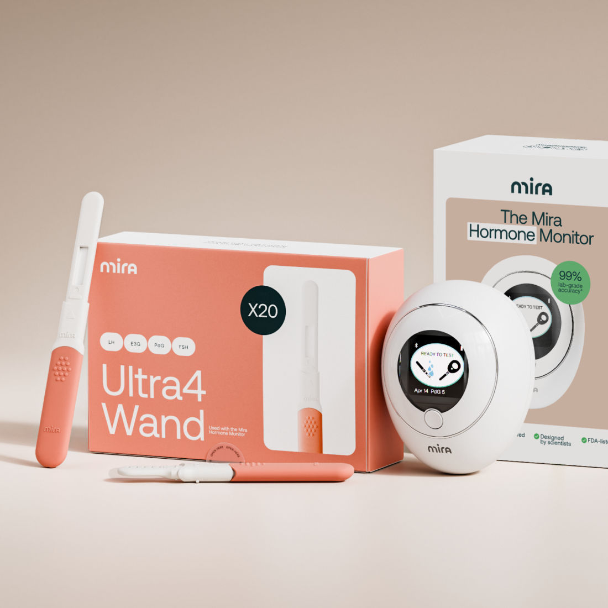
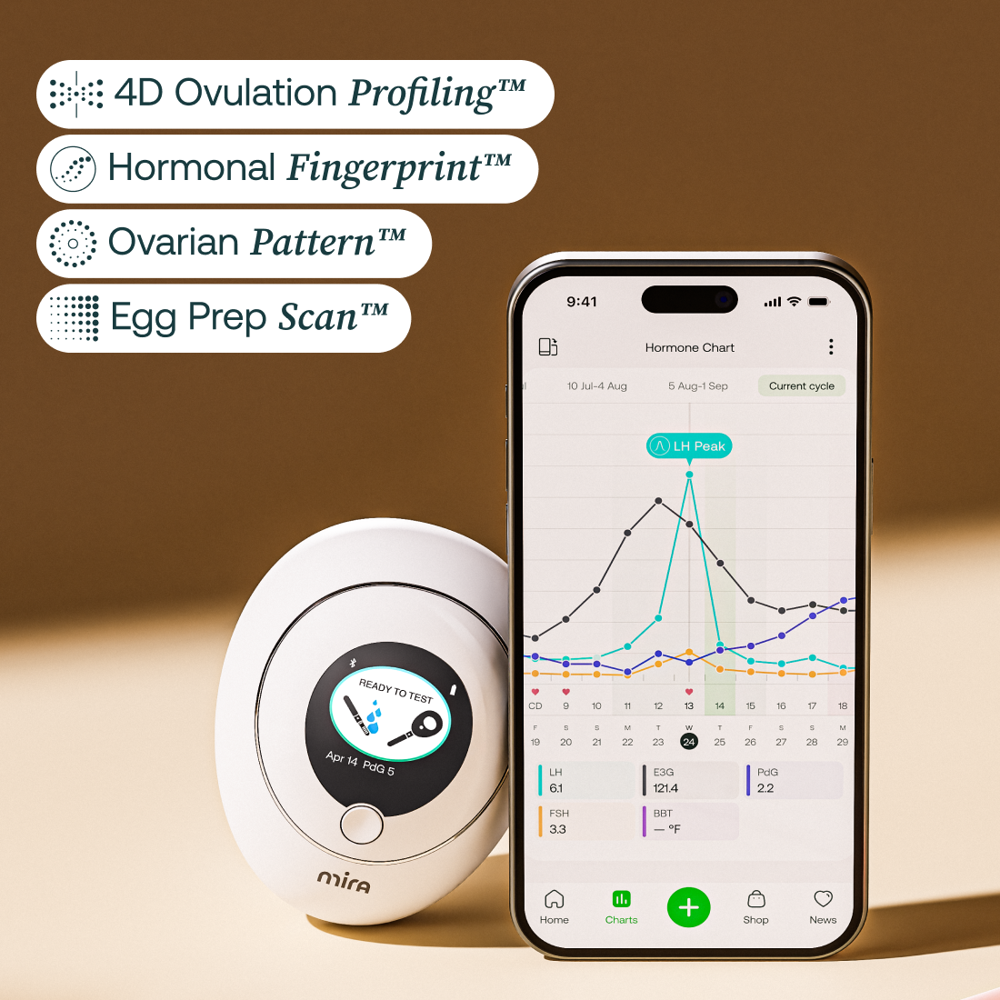
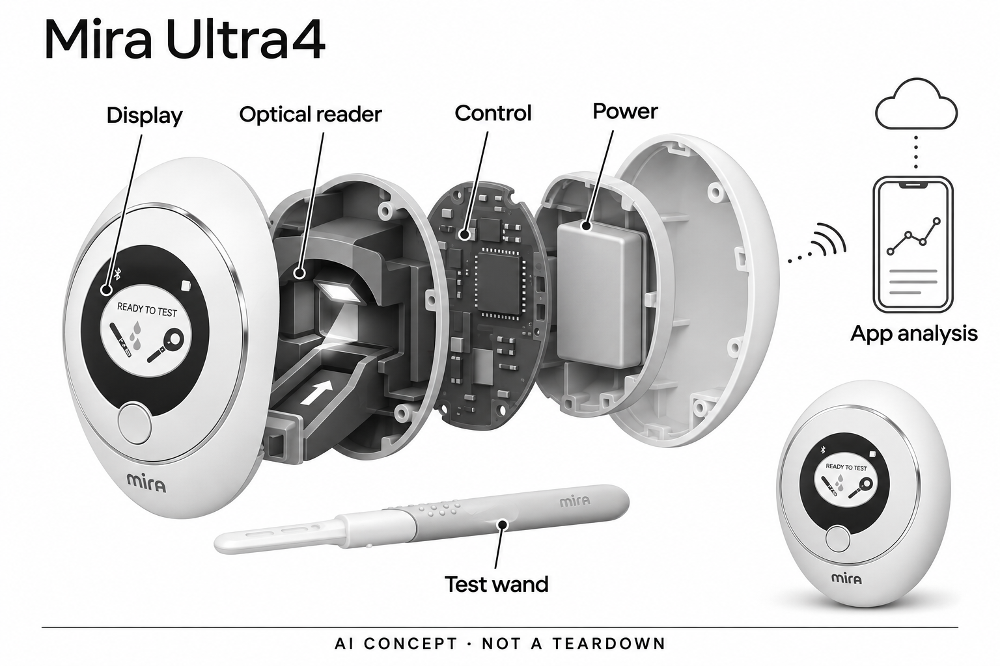

# Mira Hormone Monitor · Ultra4 Kit

**Mira** · 居家健康 · 核查 2026-11-04

电子荧光读取器连接个人激素趋势解释

消费渠道：个人零售。

## 产品图片与结构参考

### 产品图

Mira Ultra4官方套装：电子读取器与一次性测试棒 · 来源：[Mira · 官方产品图片](<https://shop.miracare.com/products/mira-hormone-monitor-ultra4-kit>) · [原始图片](<https://cdn.shopify.com/s/files/1/0755/9620/2277/files/Mira_Ultra4_Kit_At_Home_Hormone_Monitor_with_LH_PDG_E3G_and_FSH.png?v=1755158997&width=1200>)

### 参考图

Mira读取器与官方应用图表示意；界面数字及宣传文字不作为效果证据 · 来源：[Mira · 官方产品图片](<https://shop.miracare.com/products/mira-hormone-monitor-ultra4-kit>) · [原始图片](<https://cdn.shopify.com/s/files/1/0755/9620/2277/files/Ultra4_Carousel_2.png?v=1774941722&width=1200>)

### AI 生成爆炸示意

**AI 生成 · 非实物拆机。** 内部为概念推断，不能作为元件布局、BOM 或维修依据。[生成提示词](../../content/hardware/prompts/mira-ultra4.txt)

> 已视觉检查：灰阶、外形对应、无额外性能与医疗宣称；内部板形、光路和电源布局均为概念。

> 已逐张查看原图；测试棒为被动耗材，计数实体为电子读取器。参考图含官方营销文字，不能替代独立效果证据。

> 分析为基于公开资料的案头研究与 AI 辅助判断，未经用户访谈、销量审计或实物拆机。需求、画像、竞争冷门度、审美及商业机会均为研究假设，不是投资结论。

## 销售与购买

- 状态：在售。官方Ultra4商品页显示20棒套装US$249、数量选择与Add to cart；电子Monitor包含在套装内。只计读取器一次，不把耗材数量或其他测试棒套装重复计数。

- 地区：美国、英国、欧盟、澳大利亚、官网称全球配送，具体地址以结算为准

- 价格：US$249（Monitor + 20支Ultra4，未计促销码）。所见美国商品页参考，耗材持续购买；30支套装和促销不作为另一款设备，税运以地区结算为准。

- 中国大陆：官网列中国仓库并称全球配送，但仓库所在地不等于大陆正式销售或注册；未核实大陆专用渠道、应用与售后范围。

- [官方产品 / 商店](<https://shop.miracare.com/products/mira-hormone-monitor-ultra4-kit>)

## AI 的实际作用

Mira Core明确以个人激素测量与记录学习周期模式，提供预测、趋势解释和报告；AI在配套应用服务，读取器用荧光检测获得输入。

服务与联网依赖：需配套电子Monitor、兼容一次性测试棒与App同步；仅裸机可显示当前结果，长期历史与个性化分析依App，不能假定全部端侧离线。

## 是否冷门

细分专业（研究判断）：家用激素趋势为专业消费任务；冷门判断来自输入与流程差异，非销量或竞争空白证明。

## 需求与市场

需求假设是用户希望了解多个周期中的变化，并在需要时带着有时间顺序的数据与专业人员沟通。更详细的数字可能减少部分记录空白，也可能增加不确定性和反复测试；价值应由是否帮助澄清具体问题衡量，而不能从测量项目更多推导更好的健康结果或受孕效果。

### 官方｜读取测量而非只记日历 · 官方资料

Ultra4套装包含电子Monitor与一次性测试棒，读取四项激素相关指标，再由Mira App中的Mira Core解释个人模式。它增加了家庭测量输入，而不是仅凭日期估算周期；AI分析与荧光读取属于不同环节，不能把测试棒本身当作另一件智能硬件，也不将四指标套装拆成四个产品。

依据：[Mira Ultra4官方商品与配置](<https://shop.miracare.com/products/mira-hormone-monitor-ultra4-kit>) · [Mira App与Mira Core说明](<https://shop.miracare.com/pages/mira-app>)

### 判断｜把零散记录变成可讨论趋势 · 研究判断

需求假设是用户希望了解多个周期中的变化，并在需要时带着有时间顺序的数据与专业人员沟通。更详细的数字可能减少部分记录空白，也可能增加不确定性和反复测试；价值应由是否帮助澄清具体问题衡量，而不能从测量项目更多推导更好的健康结果或受孕效果。

依据：[Mira Ultra4官方商品与配置](<https://shop.miracare.com/products/mira-hormone-monitor-ultra4-kit>) · [Mira App与Mira Core说明](<https://shop.miracare.com/pages/mira-app>)

### 验证｜先观察记录任务能否持续 · 待验证

可以记录取样、读取、同步与回看是否能在日常安排中完成，统计漏测、同步失败和无法解释的提示。比较原有日历记录时缺少什么信息，以及新增数据是否真正用于沟通；不以短期结果或一次预测吻合来证明模型准确，也不据本目录替个人制定检测或生育计划。

依据：[Mira Ultra4官方商品与配置](<https://shop.miracare.com/products/mira-hormone-monitor-ultra4-kit>) · [Mira App与Mira Core说明](<https://shop.miracare.com/pages/mira-app>) · [Mira不使用App时的结果保留边界](<https://help.miracare.com/en-US/can-i-test-without-the-mira-app-845958>)

## 用户画像

适配画像应关注是否愿意持续准备耗材、按说明取样、及时同步并理解趋势存在不确定性。手机熟练并不能保证能正确解释激素曲线，家庭支持也应尊重数据隐私；不同周期背景和个人目标会改变使用价值，本研究没有访谈，不能按年龄或某种症状直接推荐产品。

### 官方｜家庭自测仍有明确边界 · 官方资料

厂家将套装用于激素监测与周期跟踪，明确不用于诊断、筛查卵巢功能或其他医疗状况，亦不作为避孕设备。配套应用允许选择不同跟踪目标，但目标菜单不是医学判断；用户是否需要这些信息和如何解释异常，应与产品可测指标及适当专业评估分开考虑。

依据：[Mira Ultra4官方商品与配置](<https://shop.miracare.com/products/mira-hormone-monitor-ultra4-kit>) · [Mira App与Mira Core说明](<https://shop.miracare.com/pages/mira-app>)

### 判断｜愿意遵循流程的使用者 · 研究判断

适配画像应关注是否愿意持续准备耗材、按说明取样、及时同步并理解趋势存在不确定性。手机熟练并不能保证能正确解释激素曲线，家庭支持也应尊重数据隐私；不同周期背景和个人目标会改变使用价值，本研究没有访谈，不能按年龄或某种症状直接推荐产品。

依据：[Mira Ultra4官方商品与配置](<https://shop.miracare.com/products/mira-hormone-monitor-ultra4-kit>) · [Mira蓝牙配对说明](<https://help.miracare.com/en-US/troubleshooting-bluetooth-pairing-issues-with-mira-hormone-monitor-848147>) · [Mira不使用App时的结果保留边界](<https://help.miracare.com/en-US/can-i-test-without-the-mira-app-845958>)

### 验证｜评估独立操作与信息理解 · 待验证

试用可检查本人能否识别耗材、完成设备连接和找到原始结果，再请其用自己的话说明某条趋势提示意味着什么以及不意味着什么。把操作困难与解释困难分开记录，有助于判断需要教学还是专业支持；不能用顺利完成一次测量代替长期适配与效果判断。

依据：[Mira Ultra4官方商品与配置](<https://shop.miracare.com/products/mira-hormone-monitor-ultra4-kit>) · [Mira App与Mira Core说明](<https://shop.miracare.com/pages/mira-app>) · [Mira蓝牙配对说明](<https://help.miracare.com/en-US/troubleshooting-bluetooth-pairing-issues-with-mira-hormone-monitor-848147>)

## 竞争与替代

日历应用操作较轻但缺少直接测量，普通试纸提供另一种读数流程，专业检测又具有不同目的和支持条件。Mira的差异在电子读取与连续解释的结合，并不自动替代任何专业诊断；竞争比较应先确定用户需要趋势记录还是临床回答，不能用检测指标数量排列优劣。

### 官方｜同一读取器配不同耗材 · 官方资料

官方商品页列出Monitor与二十或三十支Ultra4棒的组合，并说明已有读取器可通过相应软件更新使用兼容耗材。因此本目录只记录一个电子系统，耗材数量、周期目标或套餐更名不增加设备数量；比较价格时还需包括长期补充耗材，而非只取最初套装金额。

依据：[Mira Ultra4官方商品与配置](<https://shop.miracare.com/products/mira-hormone-monitor-ultra4-kit>)

### 判断｜替代方案拥有不同信息密度 · 研究判断

日历应用操作较轻但缺少直接测量，普通试纸提供另一种读数流程，专业检测又具有不同目的和支持条件。Mira的差异在电子读取与连续解释的结合，并不自动替代任何专业诊断；竞争比较应先确定用户需要趋势记录还是临床回答，不能用检测指标数量排列优劣。

依据：[Mira Ultra4官方商品与配置](<https://shop.miracare.com/products/mira-hormone-monitor-ultra4-kit>) · [Mira App与Mira Core说明](<https://shop.miracare.com/pages/mira-app>)

### 验证｜计算完整使用成本 · 待验证

成本比较应包含读取器、每个周期实际消耗、运输补货和应用服务条件，再记录用户是否持续回看或分享报告。不同耗材包不能当作独立创新，促销码也不应掩盖后续费用；本目录没有销售、留存或用户访谈证据，无法据专业细分或价格判断市场空白。

依据：[Mira Ultra4官方商品与配置](<https://shop.miracare.com/products/mira-hormone-monitor-ultra4-kit>) · [Mira App与Mira Core说明](<https://shop.miracare.com/pages/mira-app>)

## 供应链

同类方案的可信输入取决于试剂反应、样本处理与电子光学读取协同，不能只升级控制芯片或增加模型复杂度。供应研究需要把耗材批次、环境条件和读取校准联系起来，光学器件候选也必须匹配波段与反应体系；通用生理光学模块不应直接视为可替换的荧光分析仪。

### 官方｜光学读取与蓝牙已披露 · 官方资料

官方说明Monitor采用荧光检测并通过蓝牙同步应用，外部可见显示与操作入口。具体激发光源、探测器、控制芯片及装配工厂未公开，仓库所在地也不能证明生产地点；目录不从试纸外观或品牌专利名称推断内部光路、传感器供应商和完整物料清单。

依据：[Mira Ultra4官方商品与配置](<https://shop.miracare.com/products/mira-hormone-monitor-ultra4-kit>) · [Mira蓝牙配对说明](<https://help.miracare.com/en-US/troubleshooting-bluetooth-pairing-issues-with-mira-hormone-monitor-848147>)

### 判断｜耗材与读取一致性是共同问题 · 研究判断

同类方案的可信输入取决于试剂反应、样本处理与电子光学读取协同，不能只升级控制芯片或增加模型复杂度。供应研究需要把耗材批次、环境条件和读取校准联系起来，光学器件候选也必须匹配波段与反应体系；通用生理光学模块不应直接视为可替换的荧光分析仪。

依据：[Mira Ultra4官方商品与配置](<https://shop.miracare.com/products/mira-hormone-monitor-ultra4-kit>)

### 验证｜按模块限定候选作用 · 待验证

可从无线控制与光电器件两侧建立新设计候选，但前者不提供激素分析算法，后者也不自动具备相应试剂与校准能力。验证应包含读取重复性、耗材兼容和数据传输完整性，供应商资料只能证明功能方向；没有点名证据，就不将任何公司标为Mira实际采用。

依据：[Mira Ultra4官方商品与配置](<https://shop.miracare.com/products/mira-hormone-monitor-ultra4-kit>) · [Mira蓝牙配对说明](<https://help.miracare.com/en-US/troubleshooting-bluetooth-pairing-issues-with-mira-hormone-monitor-848147>)

## 技术路径

读数来自样本与检测过程，周期阶段和未来变化则是进一步解释，两者具有不同错误来源。界面若把预测与测量混在一起，用户容易将估计当成已发生事实；技术评价应关注缺测、变化和模型不确定性如何呈现，而不只看曲线平滑程度或自然语言是否听起来有把握。

### 官方｜个人学习位于应用服务 · 官方资料

Mira Core被明确描述为基于个人激素数据学习模式，并结合相关日志给出解释、预测和可分享报告。裸机可以测试，但支持说明指出它只显示当前结果，完整历史需要同步；因此不能把手机服务的数据分析和长期保存全部描述为电子读取器内置离线AI。

依据：[Mira App与Mira Core说明](<https://shop.miracare.com/pages/mira-app>) · [Mira不使用App时的结果保留边界](<https://help.miracare.com/en-US/can-i-test-without-the-mira-app-845958>)

### 判断｜预测与直接测量必须分清 · 研究判断

读数来自样本与检测过程，周期阶段和未来变化则是进一步解释，两者具有不同错误来源。界面若把预测与测量混在一起，用户容易将估计当成已发生事实；技术评价应关注缺测、变化和模型不确定性如何呈现，而不只看曲线平滑程度或自然语言是否听起来有把握。

依据：[Mira Ultra4官方商品与配置](<https://shop.miracare.com/products/mira-hormone-monitor-ultra4-kit>) · [Mira App与Mira Core说明](<https://shop.miracare.com/pages/mira-app>)

### 验证｜核对数据到解释的链路 · 待验证

可检查测试时间、同步后的数值和报告是否一致，并记录漏测或补录后解释如何变化。重要的是能够找到原始输入和了解记录缺口，不必通过增加测试次数追求完美曲线；模型细节与个人真实准确率未完整公开，本目录不复述内部实验百分比作为普遍效果。

依据：[Mira App与Mira Core说明](<https://shop.miracare.com/pages/mira-app>) · [Mira蓝牙配对说明](<https://help.miracare.com/en-US/troubleshooting-bluetooth-pairing-issues-with-mira-hormone-monitor-848147>) · [Mira不使用App时的结果保留边界](<https://help.miracare.com/en-US/can-i-test-without-the-mira-app-845958>)

## 产品审美

使用流程涉及样本与一次性耗材，设备摆放、耗材取用和测试后收纳会比表面精致更影响日常体验。圆润小型外壳可能减轻医疗感，也可能让家庭成员不清楚当前状态；审美分析应同时关注隐私、操作辨识和台面空间，而不只将白色外观视为易用或卫生的证明。

### 官方｜小型桌面读取器与手机分工 · 官方资料

官方图示为白色椭圆主体、圆形显示区及实体按钮，测试棒作为独立插入耗材，手机呈现更完整的趋势。外形能够说明它适合固定取放和观察状态，但不能证明每个人都容易看清或操作；图中的曲线、数值和包装准确率属于厂商示意，不是本研究实测。

依据：[Mira Ultra4官方商品与配置](<https://shop.miracare.com/products/mira-hormone-monitor-ultra4-kit>)

### 判断｜清洁取放比装饰更关键 · 研究判断

使用流程涉及样本与一次性耗材，设备摆放、耗材取用和测试后收纳会比表面精致更影响日常体验。圆润小型外壳可能减轻医疗感，也可能让家庭成员不清楚当前状态；审美分析应同时关注隐私、操作辨识和台面空间，而不只将白色外观视为易用或卫生的证明。

依据：[Mira Ultra4官方商品与配置](<https://shop.miracare.com/products/mira-hormone-monitor-ultra4-kit>)

### 验证｜观察实际家庭流程 · 待验证

可以在用户正常准备、读取和同步的环境中观察设备是否稳定、状态是否清楚以及是否需要来回拿手机。再检查耗材和设备能否按说明分开放置与维护，记录家庭共享空间带来的顾虑；舒适、便利和材料触感都应由实际体验确认，不能由产品照片推断。

依据：[Mira Ultra4官方商品与配置](<https://shop.miracare.com/products/mira-hormone-monitor-ultra4-kit>) · [Mira蓝牙配对说明](<https://help.miracare.com/en-US/troubleshooting-bluetooth-pairing-issues-with-mira-hormone-monitor-848147>)

## 关键风险

周期、症状和用药日志属于敏感个人信息，长期记录的价值与账号访问、分享及删除控制直接相关。数字也可能带来反复检查或把相关性理解成原因的风险；AI解释不能据此诊断或决定治疗，本目录关注产品信息流程，不对个人激素状况、生育能力或医疗选择作判断。

### 官方｜监测用途与诊断用途分开 · 官方资料

商品页明确限定监测和周期跟踪用途，部分宣传文字使用更强的健康解释措辞时，应以其用途边界审慎理解。中国仓库及全球配送说明不能证明大陆正式注册销售或完整支持；目前没有核实本地渠道和服务，跨地区购买需要确认实际应用、耗材与售后条件。

依据：[Mira Ultra4官方商品与配置](<https://shop.miracare.com/products/mira-hormone-monitor-ultra4-kit>) · [Mira App与Mira Core说明](<https://shop.miracare.com/pages/mira-app>)

### 判断｜敏感数据与过度解释 · 研究判断

周期、症状和用药日志属于敏感个人信息，长期记录的价值与账号访问、分享及删除控制直接相关。数字也可能带来反复检查或把相关性理解成原因的风险；AI解释不能据此诊断或决定治疗，本目录关注产品信息流程，不对个人激素状况、生育能力或医疗选择作判断。

依据：[Mira App与Mira Core说明](<https://shop.miracare.com/pages/mira-app>) · [Mira不使用App时的结果保留边界](<https://help.miracare.com/en-US/can-i-test-without-the-mira-app-845958>)

### 验证｜检查历史与分享控制 · 待验证

应核对每次同步是否成功、报告包含哪些记录、分享给谁以及停止使用后如何处理账户和历史。遇到无法解释的趋势，可保留原始记录供合适专业人员讨论，而不依赖单条生成解释；这些验证用于理解数据与使用边界，不构成个体检测安排或效果保证。

依据：[Mira App与Mira Core说明](<https://shop.miracare.com/pages/mira-app>) · [Mira蓝牙配对说明](<https://help.miracare.com/en-US/troubleshooting-bluetooth-pairing-issues-with-mira-hormone-monitor-848147>) · [Mira不使用App时的结果保留边界](<https://help.miracare.com/en-US/can-i-test-without-the-mira-app-845958>)

## 机会与验证

值得继续验证的是用户能否用更完整的时间记录表达自己关心的问题，而不是收集更多数字却不理解。若报告帮助专业沟通，它的价值可能在信息准备；若只是增加焦虑和耗材消耗，就需要重新评估使用方式。这个判断允许得到不同结果，不能从AI或荧光技术存在预设收益。

### 官方｜实体测量使服务有特定输入 · 官方资料

Mira系统的独特组合是一次性反应耗材、重复使用的电子读取器与基于个人数据的解释服务。没有测量时应用也可记日志，但核心个性化激素分析依赖实际输入；本目录据此将其归为家庭激素趋势任务，不因备孕和围绝经期页面分别包装就重复计数。

依据：[Mira Ultra4官方商品与配置](<https://shop.miracare.com/products/mira-hormone-monitor-ultra4-kit>) · [Mira App与Mira Core说明](<https://shop.miracare.com/pages/mira-app>)

### 判断｜有意义的是问题更可讨论 · 研究判断

值得继续验证的是用户能否用更完整的时间记录表达自己关心的问题，而不是收集更多数字却不理解。若报告帮助专业沟通，它的价值可能在信息准备；若只是增加焦虑和耗材消耗，就需要重新评估使用方式。这个判断允许得到不同结果，不能从AI或荧光技术存在预设收益。

依据：[Mira Ultra4官方商品与配置](<https://shop.miracare.com/products/mira-hormone-monitor-ultra4-kit>) · [Mira App与Mira Core说明](<https://shop.miracare.com/pages/mira-app>)

### 验证｜用持续记录检验保留价值 · 待验证

后续可记录数个使用周期中漏测、耗材补充、解释困惑和实际分享报告的次数，并询问原有问题是否得到更清楚的描述。将操作、数据质量和沟通价值分别评价，避免用短期健康结果替代产品研究；当前仅为案头分析，没有访谈、独立疗效或市场规模证据。

依据：[Mira Ultra4官方商品与配置](<https://shop.miracare.com/products/mira-hormone-monitor-ultra4-kit>) · [Mira App与Mira Core说明](<https://shop.miracare.com/pages/mira-app>) · [Mira不使用App时的结果保留边界](<https://help.miracare.com/en-US/can-i-test-without-the-mira-app-845958>)

## 对应供应链公司

能力候选用于选型研究，不代表本产品实际采用；未公开的供货关系不作推断。

- [nordic-semiconductor](../supply-chain/nordic-semiconductor.md) — **能力候选 · 非已采用** / 同类读取器的数据同步与控制候选：Nordic低功耗无线平台可用于研究读取器结果同步、状态控制与手机权限恢复流程，具体协议和耗电仍需验证。它不提供荧光测量、耗材校准或周期分析模型；本轮没有Mira点名采用证据，候选只适用于相近新设计，不是原机主控替换结论。

- [ams-osram](../supply-chain/ams-osram.md) — **能力候选 · 非已采用** / 同类光学读取系统的发光与光电接收器件候选：ams OSRAM公开发光与光电接收能力可作为荧光读取器的光学器件研究入口，但穿戴生理测量方案不能直接移植。需重新确认激发和接收波段、滤光、动态范围及试剂校准，现有资料不足以证明具体料号适配；未发现Mira采用关系，亦不把其通用前端当完整分析仪。

[浏览供应链目录](../supply-chain.md)

## 功能分层示意

这是功能关系，不是实物拆机、真实空间结构或已核实 BOM。

1. **样本与耗材**：一次性Ultra4测试棒承载取样及反应，棒本身不是独立电子硬件。（官方披露）

2. **电子光学读取**：Monitor读取荧光信号并显示测量结果；内部光路与料号未公开。（官方披露）

3. **数据连接**：蓝牙把结果传给兼容Mira App，手机权限和同步状态影响历史记录。（官方披露）

4. **模式分析**：Mira Core结合个人激素数据及日志提供模式解释、预测和报告；模型细节未知。（官方披露）

5. **复核与交流**：用户可回看趋势并分享报告，重要健康判断仍需合适专业评估。（分析推断）

## 来源

1. [Mira Ultra4官方商品与配置](<https://shop.miracare.com/products/mira-hormone-monitor-ultra4-kit>) — 本轮已打开：20棒套装US$249、Add to cart、Monitor与四指标棒；性能百分比为内部实验，不作为临床效果。

2. [Mira App与Mira Core说明](<https://shop.miracare.com/pages/mira-app>) — 本轮已打开：明确AI、基于个人测量持续个性化、报告、免费App；不将营销诊断暗示视为已证实能力。

3. [Mira蓝牙配对说明](<https://help.miracare.com/en-US/troubleshooting-bluetooth-pairing-issues-with-mira-hormone-monitor-848147>) — 本轮已打开：蓝牙与应用权限是同步条件。

4. [Mira不使用App时的结果保留边界](<https://help.miracare.com/en-US/can-i-test-without-the-mira-app-845958>) — 本轮已打开：裸机只显示当前结果，历史保存需同步或自行记录；不声称裸机可保存完整周期。

[返回目录](../hardware-market.md) · [网页分析](https://romanagent.github.io/Roman/#hardware/product/mira-ultra4)
