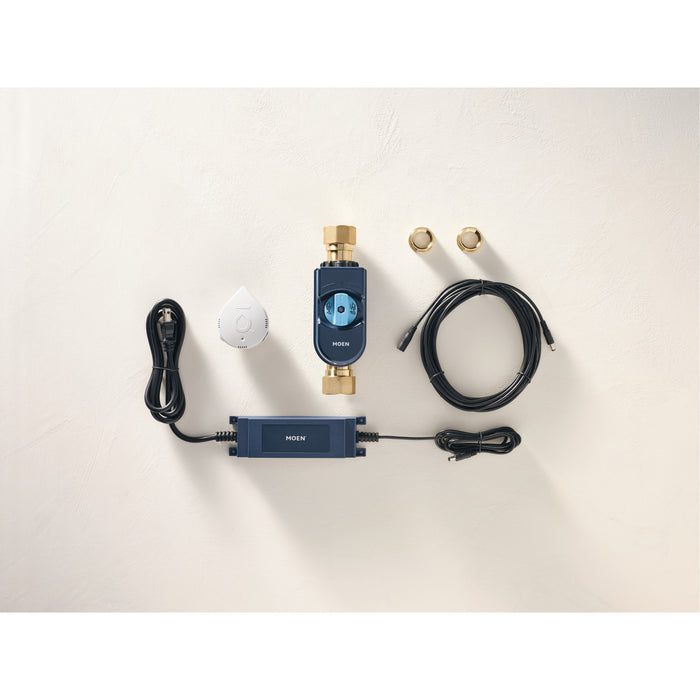
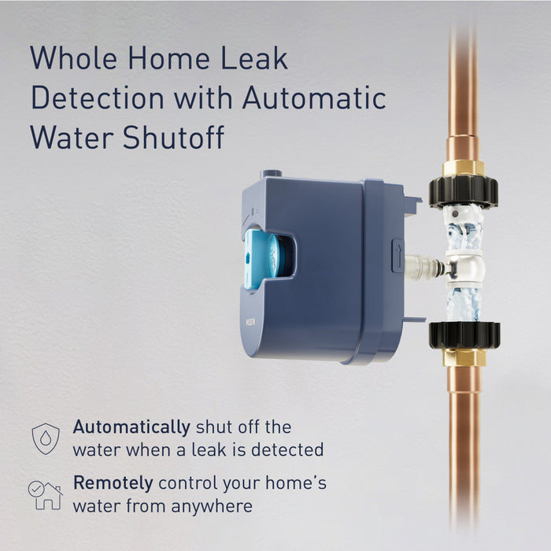
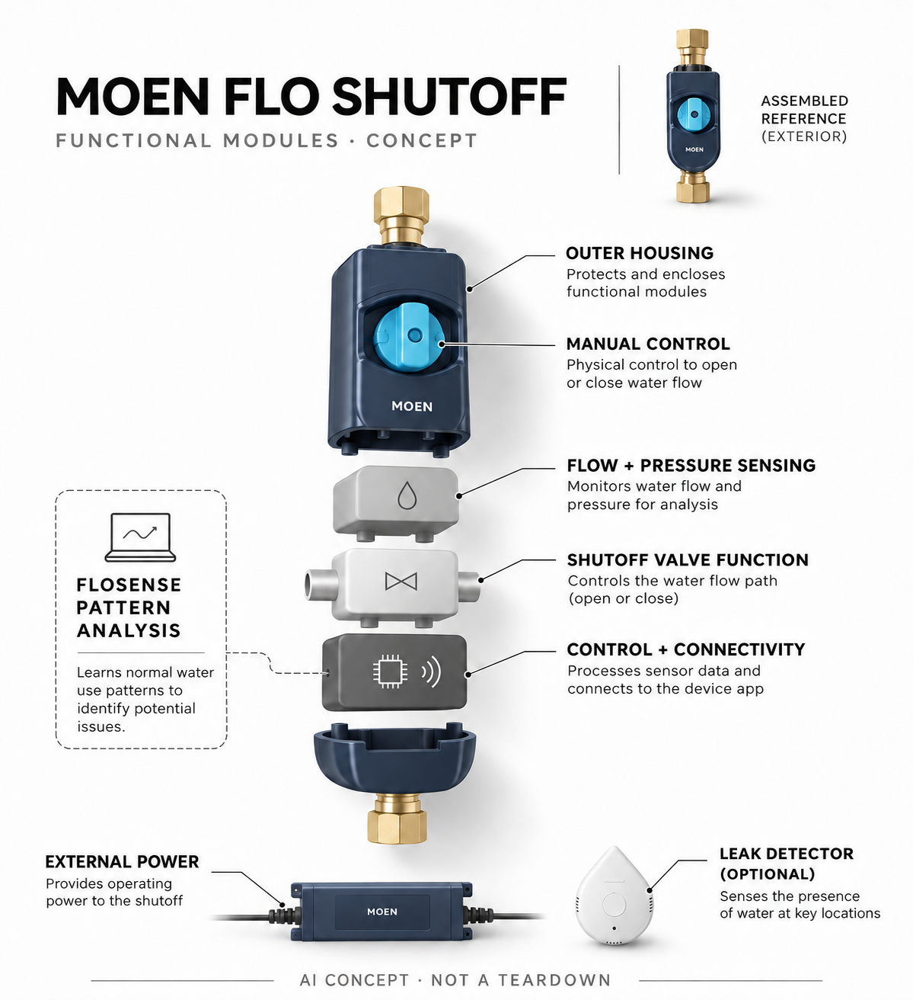

# Moen Flo Smart Water Shutoff（900-006）

**Moen** · 家居安全 · 核查 2026-11-04

学习家庭用水模式后执行自动总阀关闭的管路设备

消费渠道：个人零售。

## 产品图片与结构参考

### 产品图

官方当前阀体与配套组件 · 来源：[Moen · 官方图片](<https://flo.moen.com/products/flo-smart-water-monitor-shutoff-enhanced-bundle>) · [原始图片](<https://flo.moen.com/cdn/shop/files/5d25889bbe06aa6189d277a966f9ffcb4f11a6f2_700x.jpg?v=1776796649>)

### 参考图

官方阀体止水功能示意（非拆机） · 来源：[Moen · 官方图片](<https://flo.moen.com/products/flo-smart-water-monitor-shutoff-enhanced-bundle>) · [原始图片](<https://flo.moen.com/cdn/shop/files/0a354d748891e542cfc67f9f78440a254b5cde3a.jpg?v=1786998397&width=700>)

### AI 生成爆炸示意

**AI 生成 · 非实物拆机。** 内部为概念推断，不能作为元件布局、BOM 或维修依据。[生成提示词](../../content/hardware/prompts/moen-flo-shutoff-900-006.txt)

> 实际查看并核对当前型号；官方原图未改色或语义编辑，宣传文字不作为独立实测。

> 分析为基于公开资料的案头研究与 AI 辅助判断，未经用户访谈、销量审计或实物拆机。需求、画像、竞争冷门度、审美及商业机会均为研究假设，不是投资结论。

## 销售与购买

- 状态：在售。官方商品配置页提供One-Time Purchase US$719.64与ADD TO CART，并明确1英寸900-006阀体；同时存在36个月服务方案，本条按一次购买记录，不将套餐另算型号。

- 地区：美国官网销售

- 价格：当前一次购买选项 US$719.64。页面同时展示US$17.99/月、US$49.99激活及36个月承诺的服务方案；本条不把其当便宜买断价，安装与实际管径配置以结算为准。

- 中国大陆：已核实美国官网配置购买与安装说明，未确认中国大陆管路适配、官方售后和服务覆盖；当地施工需由合适专业人员确认。

- [官方产品 / 商店](<https://flo.moen.com/products/flo-smart-water-monitor-shutoff-enhanced-bundle>)

## AI 的实际作用

FloSense学习家庭用水模式，从流量、压力等信号识别异常并触发自动止水；定时微漏测试与普通水浸报警不全部属于AI。

服务与联网依赖：完整通知和应用需要2.4GHz Wi-Fi；官网说明最新学习结果保存在本地，暂时断网仍可继续核心保护；断电条件另需对应配置。

## 是否冷门

细分专业（研究判断）：家庭水损主动干预是明确场景，区别于普通水浸提醒；施工、管路和误关成本限制普遍部署，不能仅因AI认定蓝海。

## 需求与市场

需求假设：家庭希望在漏水被发现后及时限制水源，尤其是无人时无法手动关阀。自动执行比仅看用量多了一步，但误关也影响日常生活，价值应比较异常发现、处理和恢复，不能直接复述厂家减损比例为每户收益保证。

### 产品任务与边界 · 研究判断

需求假设：家庭希望在漏水被发现后及时限制水源，尤其是无人时无法手动关阀。自动执行比仅看用量多了一步，但误关也影响日常生活，价值应比较异常发现、处理和恢复，不能直接复述厂家减损比例为每户收益保证。

依据：[Moen Flo官方当前购买配置](<https://flo.moen.com/products/flo-smart-water-monitor-shutoff-enhanced-bundle>) · [Moen FloSense官方技术介绍](<https://flo.moen.com/pages/flo-smart-water-monitor>)

### 需求判断 · 研究判断

漏水报警只有在有人能及时处理时才转化为行动，内联阀体把发现与限制水源接起来，这是相较外夹传感器的具体增量。另一方面，正常用水被误判会中断生活，需求应同时考虑误关与恢复成本，不能把所有异常流量都假定为真正漏水。

依据：[Moen Flo官方当前购买配置](<https://flo.moen.com/products/flo-smart-water-monitor-shutoff-enhanced-bundle>) · [Moen FloSense官方技术介绍](<https://flo.moen.com/pages/flo-smart-water-monitor>)

### 需求验证 · 待验证

需求验证可以先记录家庭正常用水与人工处理方式，再在专业安装后核查提醒和确认流程。不得人为制造危险漏水或绕过压力保护，应使用厂商允许的正常测试；本目录不把水损统计或保险权益当成每户都能获得相同收益的证明。

依据：[Moen Flo官方当前购买配置](<https://flo.moen.com/products/flo-smart-water-monitor-shutoff-enhanced-bundle>) · [Moen FloSense官方技术介绍](<https://flo.moen.com/pages/flo-smart-water-monitor>)

## 用户画像

画像推断：有可接入独立总管、允许改管并愿意安排安装维护的自住房用户更匹配。共享管路、租住或缺乏电源网络的家庭条件不同，保险与地区服务也需独立确认，不以住宅价值或对水损担忧简单推定需求。

### 适用行为与条件 · 研究判断

画像推断：有可接入独立总管、允许改管并愿意安排安装维护的自住房用户更匹配。共享管路、租住或缺乏电源网络的家庭条件不同，保险与地区服务也需独立确认，不以住宅价值或对水损担忧简单推定需求。

依据：[Moen Flo官方当前购买配置](<https://flo.moen.com/products/flo-smart-water-monitor-shutoff-enhanced-bundle>) · [Moen FloSense官方技术介绍](<https://flo.moen.com/pages/flo-smart-water-monitor>)

### 人群取舍 · 研究判断

住户是否控制独立冷水总管、能否安排合适安装及附近是否有电源，比房屋价值更直接决定可用性。多户共管或租房审批可能限制部署，画像还应包含实际能处理误关的人，不把长期外出或害怕漏水直接转成适合所有住宅的理由。

依据：[Moen Flo官方当前购买配置](<https://flo.moen.com/products/flo-smart-water-monitor-shutoff-enhanced-bundle>) · [Moen FloSense官方技术介绍](<https://flo.moen.com/pages/flo-smart-water-monitor>)

### 画像验证 · 待验证

画像验证应由合适人员核对管路条件，并让家庭成员理解提醒、人工开闭和断网状态；记录谁会在异常时回应。不能仅凭远程应用界面判断无人家庭可以完全托管，也不把保险宣传中可能的优惠视作所有地区和用户都有的购买动机。

依据：[Moen Flo官方当前购买配置](<https://flo.moen.com/products/flo-smart-water-monitor-shutoff-enhanced-bundle>) · [Moen FloSense官方技术介绍](<https://flo.moen.com/pages/flo-smart-water-monitor>)

## 竞争与替代

竞争判断：与地面漏水探头、外夹用水监测和人工总阀竞争，差异是学习模式后直接止水。普通定时测试不等于AI，也不按不同管径重复收录；应比较误关、安装与恢复，而非只比较应用报警数量。

### 比较对象与差异 · 研究判断

竞争判断：与地面漏水探头、外夹用水监测和人工总阀竞争，差异是学习模式后直接止水。普通定时测试不等于AI，也不按不同管径重复收录；应比较误关、安装与恢复，而非只比较应用报警数量。

依据：[Moen Flo官方当前购买配置](<https://flo.moen.com/products/flo-smart-water-monitor-shutoff-enhanced-bundle>) · [Moen FloSense官方技术介绍](<https://flo.moen.com/pages/flo-smart-water-monitor>)

### 竞争判断 · 研究判断

与地面探头相比，主水管设备可观察整体用水并采取止水，但需要改管；外夹设备安装轻却不能直接截断。不同方案处理的环节不一样，应比较漏水覆盖、误关与恢复，不能把测得更多数据、联网或订阅套餐都当成机器学习优势。

依据：[Moen Flo官方当前购买配置](<https://flo.moen.com/products/flo-smart-water-monitor-shutoff-enhanced-bundle>) · [Moen FloSense官方技术介绍](<https://flo.moen.com/pages/flo-smart-water-monitor>)

### 竞争验证 · 待验证

竞争验证可对照仅提醒与提醒加阀门的处理流程，统一住宅条件，分别记录施工与日常维护。管径和服务套餐是配置而非新需求，900-006不能混用旧绿壳型号的照片或参数；在没有真实对照前不依据厂家赔付或防损比例给出优劣结论。

依据：[Moen Flo官方当前购买配置](<https://flo.moen.com/products/flo-smart-water-monitor-shutoff-enhanced-bundle>) · [Moen FloSense官方技术介绍](<https://flo.moen.com/pages/flo-smart-water-monitor>)

## 供应链

供应链分析：承压阀体、密封、流量压力感知、执行驱动、电源和无线控制共同工作，实际工厂和BOM未披露。管路材料、长期水接触、安装与维修影响可靠性，不能只把它看成消费电子主板或忽略机械失效后果。

### 功能模块拆分 · 研究判断

承压连接、阀门密封、流量压力信号、执行驱动、本地控制与外接电源形成完整链路，家庭应用属于外围管理。任何结构原型都不能替代承压和长期水接触验证；公开功能图未披露实际内部气密水密布局，因此供应分析不假造阀芯或芯片型号。

依据：[Moen Flo官方当前购买配置](<https://flo.moen.com/products/flo-smart-water-monitor-shutoff-enhanced-bundle>) · [Moen FloSense官方技术介绍](<https://flo.moen.com/pages/flo-smart-water-monitor>)

### 制造与供应约束 · 研究判断

供应链分析：承压阀体、密封、流量压力感知、执行驱动、电源和无线控制共同工作，实际工厂和BOM未披露。管路材料、长期水接触、安装与维修影响可靠性，不能只把它看成消费电子主板或忽略机械失效后果。

依据：[Moen Flo官方当前购买配置](<https://flo.moen.com/products/flo-smart-water-monitor-shutoff-enhanced-bundle>) · [Moen FloSense官方技术介绍](<https://flo.moen.com/pages/flo-smart-water-monitor>)

### 候选与证据缺口 · 研究判断

SIIX可作为控制电子与整机装配候选，Protolabs可支持外壳和接口原型，两者均无Moen型号点名采用证据。承压阀体、密封和饮用水接触材料需要专门评估，通用电子制造或快速加工不能直接证明完整水路合格，更不能替代专业安装。

依据：[Moen Flo官方当前购买配置](<https://flo.moen.com/products/flo-smart-water-monitor-shutoff-enhanced-bundle>) · [Moen FloSense官方技术介绍](<https://flo.moen.com/pages/flo-smart-water-monitor>)

## 技术路径

技术判断：官网明确FloSense使用AI理解用水模式，并在断网时保留本地学习结果。异常分类与阀门控制需要可理解的回退，公开未提供模型细节；微漏测试、规则报警和学习推断应区分，不能把所有自动动作统一称作AI。

### 已披露技术边界 · 研究判断

技术判断：官网明确FloSense使用AI理解用水模式，并在断网时保留本地学习结果。异常分类与阀门控制需要可理解的回退，公开未提供模型细节；微漏测试、规则报警和学习推断应区分，不能把所有自动动作统一称作AI。

依据：[Moen Flo官方当前购买配置](<https://flo.moen.com/products/flo-smart-water-monitor-shutoff-enhanced-bundle>) · [Moen FloSense官方技术介绍](<https://flo.moen.com/pages/flo-smart-water-monitor>)

### 系统难点判断 · 研究判断

FloSense学习正常模式后识别偏离，关键是能区分持续异常与正常长时间用水，并把控制原因解释给人。微漏测试和规则通知与学习推断应分别记录；官网说明断网保留最近学习结果，但这不等于断电或所有云端通知也完全不受影响。

依据：[Moen Flo官方当前购买配置](<https://flo.moen.com/products/flo-smart-water-monitor-shutoff-enhanced-bundle>) · [Moen FloSense官方技术介绍](<https://flo.moen.com/pages/flo-smart-water-monitor>)

### 技术验证 · 待验证

技术验证应观察真实生活变化后的学习与误判，检查异常提示是否可撤回、最近本地模型如何恢复联网。按照说明由合适人员执行正常功能检查，不做危险破管或电气测试；不能把开阀状态、应用在线或一次正确报警解释为所有漏水都会被识别。

依据：[Moen Flo官方当前购买配置](<https://flo.moen.com/products/flo-smart-water-monitor-shutoff-enhanced-bundle>) · [Moen FloSense官方技术介绍](<https://flo.moen.com/pages/flo-smart-water-monitor>)

## 产品审美

审美判断：实用管路外壳通常位于设备区，重点是阀门状态、手动操作和维护可达性。整洁安装与线缆走向比装饰性更重要，产品图不应掩盖改管空间、接头和电源要求，也不能因为藏在地下室就省略可见状态。

### 外观与交互语言 · 研究判断

审美判断：实用管路外壳通常位于设备区，重点是阀门状态、手动操作和维护可达性。整洁安装与线缆走向比装饰性更重要，产品图不应掩盖改管空间、接头和电源要求，也不能因为藏在地下室就省略可见状态。

依据：[Moen Flo官方当前购买配置](<https://flo.moen.com/products/flo-smart-water-monitor-shutoff-enhanced-bundle>) · [Moen FloSense官方技术介绍](<https://flo.moen.com/pages/flo-smart-water-monitor>)

### 使用中审美判断 · 研究判断

蓝色壳体与明显手动操作区适合设备间工具定位，可见状态比装饰效果重要。安装后接头、走线和维护空间决定日常可达性，不能用透明水流营销示意推定内部结构，也不应把管路设备藏得难以检查而牺牲人工应急操作。

依据：[Moen Flo官方当前购买配置](<https://flo.moen.com/products/flo-smart-water-monitor-shutoff-enhanced-bundle>) · [Moen FloSense官方技术介绍](<https://flo.moen.com/pages/flo-smart-water-monitor>)

### 设计验证 · 待验证

设计验证应在实际安装位置观察用户能否辨认阀门状态、找到手动操作和读懂应用原因，并检查电源走线是否清楚。评价包含家人轮换使用与日常检查，不能因为设备很少被看见就忽略反馈，也不把无声工作当作始终正常运行的证据。

依据：[Moen Flo官方当前购买配置](<https://flo.moen.com/products/flo-smart-water-monitor-shutoff-enhanced-bundle>) · [Moen FloSense官方技术介绍](<https://flo.moen.com/pages/flo-smart-water-monitor>)

## 关键风险

风险判断：误关、水压或安装不适配、断电和服务中断会改变体验，自动止水也无法处理外部洪水或屋顶漏雨。用户需要明确人工恢复与专业维护，不能把厂商保险权益或识别能力当作任何情况下不发生水损的保证。

### 主要失效与依赖 · 研究判断

风险判断：误关、水压或安装不适配、断电和服务中断会改变体验，自动止水也无法处理外部洪水或屋顶漏雨。用户需要明确人工恢复与专业维护，不能把厂商保险权益或识别能力当作任何情况下不发生水损的保证。

依据：[Moen Flo官方当前购买配置](<https://flo.moen.com/products/flo-smart-water-monitor-shutoff-enhanced-bundle>) · [Moen FloSense官方技术介绍](<https://flo.moen.com/pages/flo-smart-water-monitor>) · [Moen官方标准安装说明](<https://www.moen.com/pages/learn-about-moen-flo-standard-installation>)

### 风险传播判断 · 研究判断

错误关闭可能影响正常供水，漏检和机械卡滞则可能让提醒无法转化为动作，风险涉及学习与执行两层。外部洪水、屋顶渗漏等也不在总阀可解决范围，用户需要认识边界；软件功能和保险服务均不能取代现场管路状况与专业维修。

依据：[Moen Flo官方当前购买配置](<https://flo.moen.com/products/flo-smart-water-monitor-shutoff-enhanced-bundle>) · [Moen FloSense官方技术介绍](<https://flo.moen.com/pages/flo-smart-water-monitor>) · [Moen官方标准安装说明](<https://www.moen.com/pages/learn-about-moen-flo-standard-installation>)

### 风险验证 · 待验证

风险验证应明确断网、断电、误关和服务取消后的实际能力，并核查安装限制及人工恢复方式。对于消防或不适用管路不提供自行改装指导，遵循官方与专业人员要求；大陆未核实的购买、施工及服务条件应保留不确定，不由美区可售推定。

依据：[Moen Flo官方当前购买配置](<https://flo.moen.com/products/flo-smart-water-monitor-shutoff-enhanced-bundle>) · [Moen FloSense官方技术介绍](<https://flo.moen.com/pages/flo-smart-water-monitor>) · [Moen官方标准安装说明](<https://www.moen.com/pages/learn-about-moen-flo-standard-installation>)

## 机会与验证

机会假设：可以围绕高可解释性的异常确认和快速恢复验证，先比较仅报警与报警加止水的增量。若用户无法改管，其他轻量方案更适合；应从真实安装和误关成本判断方向，不以全部住宅数量或保险宣传推导市场规模。

### 可能的机会入口 · 研究判断

机会假设：可以围绕高可解释性的异常确认和快速恢复验证，先比较仅报警与报警加止水的增量。若用户无法改管，其他轻量方案更适合；应从真实安装和误关成本判断方向，不以全部住宅数量或保险宣传推导市场规模。

依据：[Moen Flo官方当前购买配置](<https://flo.moen.com/products/flo-smart-water-monitor-shutoff-enhanced-bundle>) · [Moen FloSense官方技术介绍](<https://flo.moen.com/pages/flo-smart-water-monitor>)

### 机会成立条件 · 研究判断

机会可集中在异常确认、清楚解释和低负担恢复，使自动止水成为可靠家庭流程。若安装成本或误关负担很高，仅增加模型复杂度未必有用；创业者应先研究真实住宅条件及人工接管，再决定传感、阀体和服务的组合。

依据：[Moen Flo官方当前购买配置](<https://flo.moen.com/products/flo-smart-water-monitor-shutoff-enhanced-bundle>) · [Moen FloSense官方技术介绍](<https://flo.moen.com/pages/flo-smart-water-monitor>)

### 下一步验证 · 待验证

下一步可跟踪专业安装后的正常使用、通知处理和人工恢复，比较仅报警的替代方式。将硬件费用、可选服务和承诺期分开计算，不以潜在水损金额或住宅数量估算所有家庭都会购买，也不把产品目录分析写成已做过实际管路试验。

依据：[Moen Flo官方当前购买配置](<https://flo.moen.com/products/flo-smart-water-monitor-shutoff-enhanced-bundle>) · [Moen FloSense官方技术介绍](<https://flo.moen.com/pages/flo-smart-water-monitor>)

## 对应供应链公司

能力候选用于选型研究，不代表本产品实际采用；未公开的供货关系不作推断。

- [siix](../supply-chain/siix.md) — **能力候选 · 非已采用** / 阀门控制电子与装配导入评估：SIIX公开电子制造和整机装配服务可对应感知控制、连接与测试导入，但承压阀体、饮用水材料和机械可靠性需专项确认；没有Moen900-006点名供货证据，不能推定其实际工厂。

- [protolabs](../supply-chain/protolabs.md) — **能力候选 · 非已采用** / 壳体与连接接口的原型评估：Protolabs公开加工和模具能力可支持外壳、接口与装配可达性原型，但水路承压、密封及材料接触要求不由通用加工自动保证；未见Moen该型号实际采用，仅作为结构工程候选。

[浏览供应链目录](../supply-chain.md)

## 功能分层示意

这是功能关系，不是实物拆机、真实空间结构或已核实 BOM。

1. **管路连接与阀体**：安装于住宅冷水总管内，具备实际关闭能力。（官方披露）

2. **流量压力感知**：采集管路状态用于模式与异常判断。（官方披露）

3. **止水执行**：将判断转换为阀体开闭，内部驱动未完整披露。（官方披露）

4. **本地控制与联网**：保存近期学习结果，连接应用通知。（官方披露）

5. **电源与安装服务**：需要附近电源及专业管路安装，附加探头非AI核心。（官方披露）

## 来源

1. [Moen Flo官方当前购买配置](<https://flo.moen.com/products/flo-smart-water-monitor-shutoff-enhanced-bundle>) — 实际打开一次购买、服务套餐和900-006管径说明，区分购买与36个月服务承诺。

2. [Moen FloSense官方技术介绍](<https://flo.moen.com/pages/flo-smart-water-monitor>) — 实际打开FloSense AI学习与自动止水，宣传减损百分比不作独立实测。

3. [Moen官方标准安装说明](<https://www.moen.com/pages/learn-about-moen-flo-standard-installation>) — 已打开，住宅冷水总管、电源、无线及专业安装条件。

[返回目录](../hardware-market.md) · [网页分析](https://romanagent.github.io/Roman/#hardware/product/moen-flo-shutoff-900-006)
