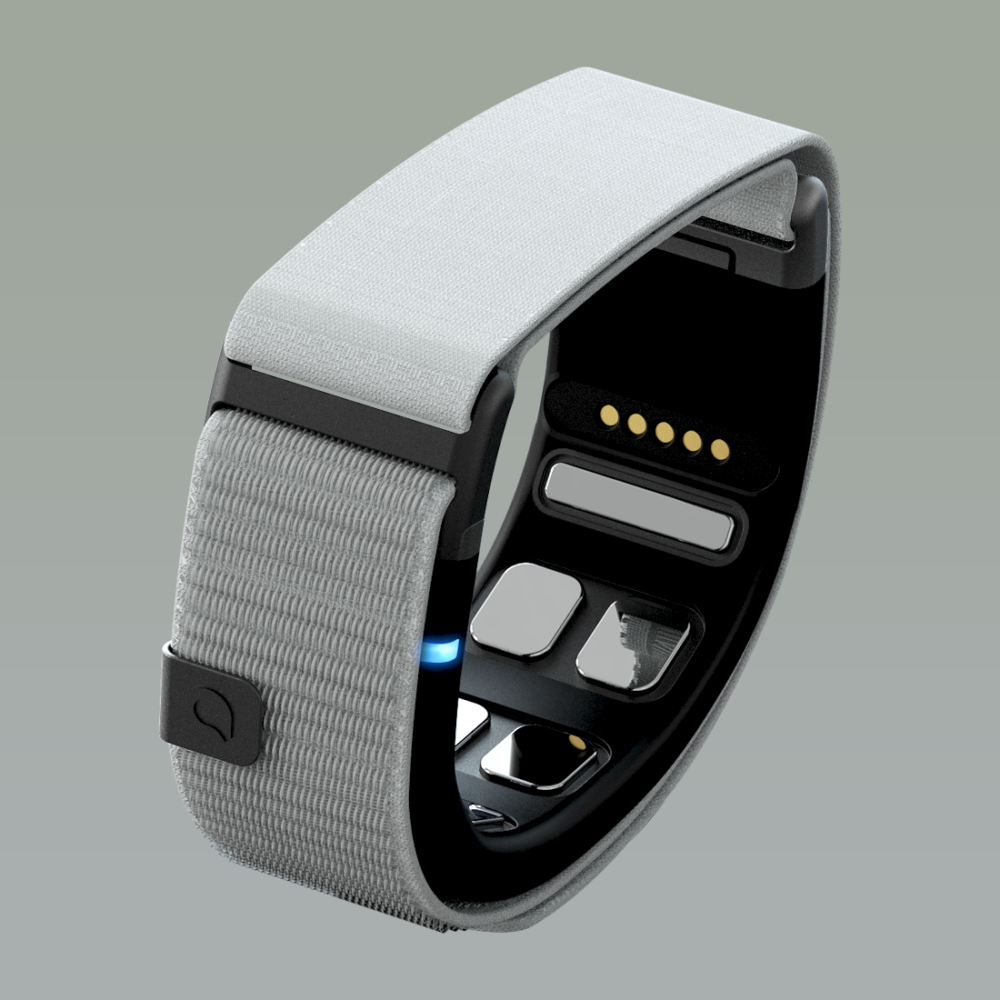
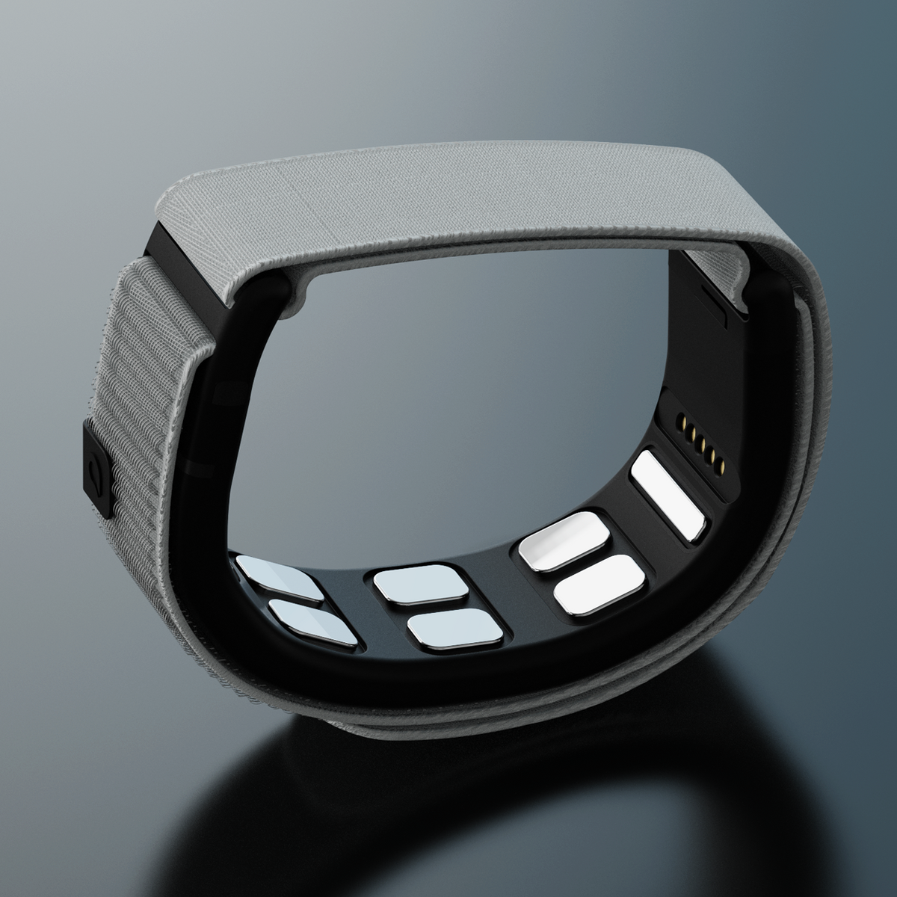
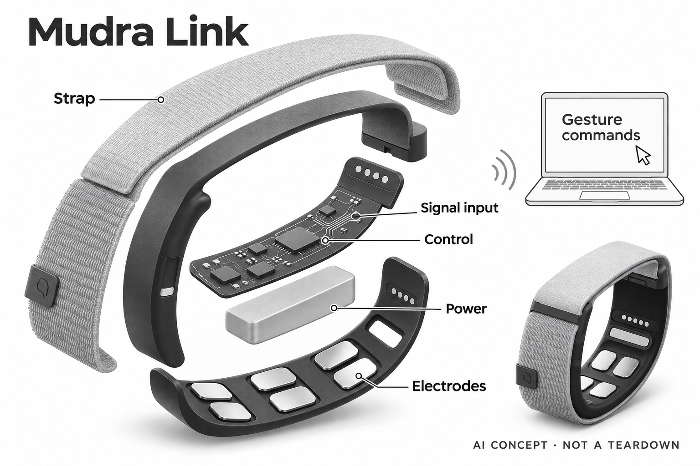

# Mudra Link

**Mudra / Wearable Devices** · 健康与穿戴 · 核查 2026-11-04

腕部肌电识别把手势转成鼠标与键盘指令

消费渠道：个人零售。

## 产品图片与结构参考

### 产品图

Mudra Link官方内侧传感与织物腕带产品图 · 来源：[Mudra · 官方产品图片](<https://mudra-band.com/products/mudra-link>) · [原始图片](<https://cdn.shopify.com/s/files/1/0781/7950/0332/files/link_01_02B.png?v=1725545131&width=1200>)

### 参考图

Mudra Link官方另一角度，显示内侧接触区域 · 来源：[Mudra · 官方产品图片](<https://mudra-band.com/products/mudra-link>) · [原始图片](<https://cdn.shopify.com/s/files/1/0781/7950/0332/files/link04_87cb0fb9-b772-4124-9a3d-c1d8cc28af6b.png?v=1725543501&width=1200>)

### AI 生成爆炸示意

**AI 生成 · 非实物拆机。** 内部为概念推断，不能作为元件布局、BOM 或维修依据。[生成提示词](../../content/hardware/prompts/mudra-link.txt)

> 已视觉核对灰阶外形与接触区，无读取思想或性能参数；内部板形与电源为概念模块。

> 两张源图已实际查看，均为独立Link腕带；未将Apple Watch Band型号混入。

> 分析为基于公开资料的案头研究与 AI 辅助判断，未经用户访谈、销量审计或实物拆机。需求、画像、竞争冷门度、审美及商业机会均为研究假设，不是投资结论。

## 销售与购买

- 状态：在售。具体官方商品页显示US$499与Add to cart；公开Shopify产品数据available=true。页面现说明Link属于Mudra Studio Evaluation kit，仍列独立实体腕带、线缆和使用说明及发货时间。

- 地区：美国、官网列出的国际配送地区

- 价格：US$499（所见Mudra Link商品页）。当前页面将硬件归入Studio Evaluation kit；软件/开发权限以具体计划为准，不把评价套件当普通Apple Watch表带。

- 中国大陆：官方国家选择含China且列国际配送；按跨境购买记录，未核实大陆本地零售、税费、中文支持或保修执行。

- [官方产品 / 商店](<https://mudra-band.com/products/mudra-link>)

## AI 的实际作用

官方明确嵌入式AI对腕部表面肌电信号模式分类，转换为预设手势指令，通过BLE发送鼠标/键盘输入。

服务与联网依赖：初始配置需Windows或macOS应用，之后按HID兼容性连接目标设备；并非读取思想，也不保证所有设备或手部活动条件同样适配。

## 是否冷门

细分专业（研究判断）：面向愿意设置映射与练习的个人进阶用户，生物电输入有别于普通腕表；无销量和访谈证明。

## 需求与市场

需求假设是用户在手离开鼠标、使用大屏或需要少量快捷动作时，希望以轻微手势执行指令。它的价值更可能先出现在明确的几项操作，而不是完整替代所有键盘鼠标工作；如果必须持续记忆映射、校准或处理误触，免接触的形式可能并未减少实际负担。

### 官方｜腕部信号成为计算机输入 · 官方资料

Mudra Link通过腕部表面肌电采集和嵌入式AI分类，将识别出的手势转成蓝牙鼠标或键盘命令。它是一件带传感与计算的实体腕带，既不是普通表带，也不只是手机软件；信号来自肌肉活动在皮肤表面的表现，不能把厂商脑机接口措辞理解为读取思想或直接测量脑内意图。

依据：[Mudra Link官方商品与兼容条件](<https://mudra-band.com/products/mudra-link>) · [Mudra官方肌电与AI分类流程](<https://mudra-band.com/pages/howitworks>)

### 判断｜远离桌面时保持短指令入口 · 研究判断

需求假设是用户在手离开鼠标、使用大屏或需要少量快捷动作时，希望以轻微手势执行指令。它的价值更可能先出现在明确的几项操作，而不是完整替代所有键盘鼠标工作；如果必须持续记忆映射、校准或处理误触，免接触的形式可能并未减少实际负担。

依据：[Mudra Link官方商品与兼容条件](<https://mudra-band.com/products/mudra-link>) · [Mudra Link官方功能与手势映射](<https://mudra-band.com/pages/mudra-link-main>)

### 验证｜从少量可恢复动作开始 · 待验证

可选择翻页、选择与撤销等低后果任务，记录正确识别、漏识别、误触和恢复所需动作，再与原输入方式比较。测试不应把重要提交或不可撤销操作直接绑定为初学手势；这种方法检验实际控制流程，不把短视频中顺畅的动作演示当作普遍可用性证据。

依据：[Mudra Link官方商品与兼容条件](<https://mudra-band.com/products/mudra-link>) · [Mudra Link官方功能与手势映射](<https://mudra-band.com/pages/mudra-link-main>)

## 用户画像

用户是否能稳定完成预设动作、是否愿意练习，以及原任务需要多少文字和精确指向，会共同影响收益。没有摄像头不代表无需个人适配，腕带位置与日常手部活动也可能改变信号；本目录不能据无障碍宣传就假定某种运动障碍的人必然可用，应由本人实际体验决定。

### 官方｜初始设置需要桌面应用 · 官方资料

官方商品页说明初始设置使用Windows或macOS应用，完成后可向支持HID输入的目标设备发送命令，应用用于进一步自定义。兼容不是任意蓝牙设备都能接受所有命令，当前商品还归入Studio评估套件；因此更适合能理解配置和调试要求的个人进阶用户评估。

依据：[Mudra Link官方商品与兼容条件](<https://mudra-band.com/products/mudra-link>)

### 判断｜动作能力与任务习惯都影响适配 · 研究判断

用户是否能稳定完成预设动作、是否愿意练习，以及原任务需要多少文字和精确指向，会共同影响收益。没有摄像头不代表无需个人适配，腕带位置与日常手部活动也可能改变信号；本目录不能据无障碍宣传就假定某种运动障碍的人必然可用，应由本人实际体验决定。

依据：[Mudra Link官方商品与兼容条件](<https://mudra-band.com/products/mudra-link>) · [Mudra官方肌电与AI分类流程](<https://mudra-band.com/pages/howitworks>)

### 验证｜观察学习和日常非目标动作 · 待验证

试用应包含有意操作与拿杯子、调整衣袖等日常动作，记录哪些活动被误认为命令。分别比较首次学习和熟悉后的表现，并确认本人能退出控制或恢复原输入方式；家庭协助或开发人员帮助可降低设置负担，但不能把他人完成的配置演示当作独立使用能力。

依据：[Mudra Link官方商品与兼容条件](<https://mudra-band.com/products/mudra-link>) · [Mudra官方肌电与AI分类流程](<https://mudra-band.com/pages/howitworks>) · [Mudra Link官方功能与手势映射](<https://mudra-band.com/pages/mudra-link-main>)

## 竞争与替代

传统鼠标无需身体信号识别但通常依赖接触表面，摄像头手势可以不穿戴却受视野和拍摄环境影响。Mudra的差异是腕部生物电入口，仍需要戴取和动作学习；比较应看目标任务的输入步骤、误触和疲劳，不能仅因技术更特殊就推定更快、更无障碍或更私密。

### 官方｜评估套件与实体交付可核查 · 官方资料

商品页列出实体Link、充电线与说明，并显示当前价格、购买按钮和配送时间，公开产品数据也标为可售。页面同时说明它已属于Studio评估套件，目录据此保留进阶用户定位；软件平台或其他产品的候补申请不能替代这一具体硬件的购买证据，也不能被混成同一交付承诺。

依据：[Mudra Link官方商品与兼容条件](<https://mudra-band.com/products/mudra-link>)

### 判断｜与鼠标和视觉手势比较输入代价 · 研究判断

传统鼠标无需身体信号识别但通常依赖接触表面，摄像头手势可以不穿戴却受视野和拍摄环境影响。Mudra的差异是腕部生物电入口，仍需要戴取和动作学习；比较应看目标任务的输入步骤、误触和疲劳，不能仅因技术更特殊就推定更快、更无障碍或更私密。

依据：[Mudra Link官方商品与兼容条件](<https://mudra-band.com/products/mudra-link>) · [Mudra官方肌电与AI分类流程](<https://mudra-band.com/pages/howitworks>)

### 验证｜保持相同任务复杂度 · 待验证

可以用同一组页面、菜单和指针目标比较现有方式与腕带，记录完成时间和错误恢复，而不是只比较单个点击延迟。把设备、设置时间、软件权限和长期支持计入成本；没有独立用户、销售或留存资料，目录不据评估套件价格推断市场空白或广泛替代潜力。

依据：[Mudra Link官方商品与兼容条件](<https://mudra-band.com/products/mudra-link>) · [Mudra Link官方功能与手势映射](<https://mudra-band.com/pages/mudra-link-main>)

## 供应链

同类新设计需要把电极接触、信号放大、滤波、佩戴稳定和模型训练一起考虑，不能只用更多训练数据弥补所有机械变化。腕部运动产生的信号与脑电、心电并不相同，通用生物电前端也需核对幅度、带宽和功耗；候选器件不会自动提供品牌手势库与映射软件。

### 官方｜表面肌电与惯性模块已披露 · 官方资料

官方列出SNC传感、惯性测量、嵌入式处理与无线连接，外部可见接触区域和充电触点。当前资料未点名模拟前端、主控、惯性器件或装配工厂，专利传感名称也不能对应到某家供应商；概念层次图只解释输入到命令的链路，不是实际板形和物料表。

依据：[Mudra Link官方商品与兼容条件](<https://mudra-band.com/products/mudra-link>) · [Mudra官方肌电与AI分类流程](<https://mudra-band.com/pages/howitworks>)

### 判断｜接触与模拟输入共同限制识别 · 研究判断

同类新设计需要把电极接触、信号放大、滤波、佩戴稳定和模型训练一起考虑，不能只用更多训练数据弥补所有机械变化。腕部运动产生的信号与脑电、心电并不相同，通用生物电前端也需核对幅度、带宽和功耗；候选器件不会自动提供品牌手势库与映射软件。

依据：[Mudra官方肌电与AI分类流程](<https://mudra-band.com/pages/howitworks>)

### 验证｜先看原始信号再评估分类 · 待验证

研发验证可先记录正确佩戴与位置变化时的原始输入和质量，再观察分类及最终命令是否一致。供应候选分别对应生物电采集与低功耗连接，但都不是现用证据；只有完成结构、算法和目标设备的联合测试，才有依据判断某个新架构是否适合真实个人操作。

依据：[Mudra Link官方商品与兼容条件](<https://mudra-band.com/products/mudra-link>) · [Mudra官方肌电与AI分类流程](<https://mudra-band.com/pages/howitworks>)

## 技术路径

系统可能正确识别一个动作，却在当前应用里触发用户不想要的命令，因此错误不仅来自传感模型。映射、焦点窗口和目标软件状态共同决定最终结果；技术评价需要把动作分类准确率与任务成功率分开，也要让用户知道现在控制的是哪个设备和哪个操作模式。

### 官方｜嵌入式AI分类后再传输 · 官方资料

官方流程明确包含信号放大、滤波、模数转换与嵌入式AI识别，分类结果再经BLE发送。这个过程属于感知与命令输入，不是生成式对话；预设手势映射可以自定义操作目标，但不能据此推断用户可以任意训练任何动作、无需校准或获得开放的完整模型权限。

依据：[Mudra官方肌电与AI分类流程](<https://mudra-band.com/pages/howitworks>)

### 判断｜识别正确仍可能映射错误 · 研究判断

系统可能正确识别一个动作，却在当前应用里触发用户不想要的命令，因此错误不仅来自传感模型。映射、焦点窗口和目标软件状态共同决定最终结果；技术评价需要把动作分类准确率与任务成功率分开，也要让用户知道现在控制的是哪个设备和哪个操作模式。

依据：[Mudra Link官方商品与兼容条件](<https://mudra-band.com/products/mudra-link>) · [Mudra Link官方功能与手势映射](<https://mudra-band.com/pages/mudra-link-main>)

### 验证｜设备切换与恢复同样重要 · 待验证

可测试连接不同兼容终端、切换指针与方向模式、暂时断连及恢复原输入，记录是否出现重复或遗漏命令。保持可撤销的测试任务，并确认用户能够快速停止输入；厂商低延迟和自然交互措辞不替代这些检查，本目录也不编造分类准确率或耗电实测。

依据：[Mudra Link官方商品与兼容条件](<https://mudra-band.com/products/mudra-link>) · [Mudra Link官方功能与手势映射](<https://mudra-band.com/pages/mudra-link-main>)

## 产品审美

腕带需要保持接触，又不能让用户为了识别而过度限制手部活动。织物和外观可以提高接受度，但佩戴松紧、衣袖摩擦与出汗后的感受更直接影响持续使用；审美评价应观察用户是否愿意在真实工作中戴着它，而不只看没有屏幕的简洁造型。

### 官方｜织物腕带包围内侧接触区 · 官方资料

真实官方图显示灰色可调织物带、深色弧形支撑和内侧金属接触区域，没有手表屏幕。小型指示与按键承担状态和操作，整体形态围绕皮肤接触设计；图片只能确认外观和位置，不能证明所有腕围、皮肤状态或长时间活动中都舒适且信号稳定。

依据：[Mudra Link官方商品与兼容条件](<https://mudra-band.com/products/mudra-link>)

### 判断｜稳定贴合与自由活动有取舍 · 研究判断

腕带需要保持接触，又不能让用户为了识别而过度限制手部活动。织物和外观可以提高接受度，但佩戴松紧、衣袖摩擦与出汗后的感受更直接影响持续使用；审美评价应观察用户是否愿意在真实工作中戴着它，而不只看没有屏幕的简洁造型。

依据：[Mudra Link官方商品与兼容条件](<https://mudra-band.com/products/mudra-link>) · [Mudra官方肌电与AI分类流程](<https://mudra-band.com/pages/howitworks>)

### 验证｜把穿戴维护加入任务测试 · 待验证

可以在正常衣着和不同坐姿下观察戴取、重新定位、操作按键及连接充电，记录这些动作是否中断工作。检查本人能否区分前后与正确接触位置，避免每次依赖他人调整；宣传图不能替代皮肤接触、织物维护和长期耐用性的实机反馈，本轮没有这类测试。

依据：[Mudra Link官方商品与兼容条件](<https://mudra-band.com/products/mudra-link>)

## 关键风险

腕部日常动作很多，如果指令绑定了高后果操作，偶发误识别可能产生超出输入便利的损失。用户还可能因脑机接口措辞产生不必要的思想读取担忧；产品说明应清楚限定表面肌电和动作分类，同时保留暂停、撤销与原有输入方式，不把系统当成总能理解意图的代理。

### 官方｜兼容与软件条件需要具体核对 · 官方资料

商品页给出HID兼容、初始桌面应用和配送说明，官方国家列表含中国，但并未证明大陆本地零售或中文支持。跨境购买还需确认税费、保修和平台权限，不能把所有蓝牙设备都视为等价目标；硬件可下单与某个应用命令一定可执行，是不同层面的证据。

依据：[Mudra Link官方商品与兼容条件](<https://mudra-band.com/products/mudra-link>)

### 判断｜误触发可能比漏识别更麻烦 · 研究判断

腕部日常动作很多，如果指令绑定了高后果操作，偶发误识别可能产生超出输入便利的损失。用户还可能因脑机接口措辞产生不必要的思想读取担忧；产品说明应清楚限定表面肌电和动作分类，同时保留暂停、撤销与原有输入方式，不把系统当成总能理解意图的代理。

依据：[Mudra Link官方商品与兼容条件](<https://mudra-band.com/products/mudra-link>) · [Mudra官方肌电与AI分类流程](<https://mudra-band.com/pages/howitworks>) · [Mudra Link官方功能与手势映射](<https://mudra-band.com/pages/mudra-link-main>)

### 验证｜设置应有明确退出方式 · 待验证

在正式使用前可确认暂停、解除映射和恢复默认输入的流程，先用低后果任务检验日常误触。购买时还应核对软件更新、数据处理与支持安排，记录未能控制的终端和不适合的动作；这些验证针对工具可靠性，不构成对某类身体能力或医学用途的适配保证。

依据：[Mudra Link官方商品与兼容条件](<https://mudra-band.com/products/mudra-link>) · [Mudra Link官方功能与手势映射](<https://mudra-band.com/pages/mudra-link-main>)

## 机会与验证

值得研究的是几项高频、短而明确的动作能否通过腕带更方便完成，例如离开桌面后的翻页和选择。若把所有文字输入、精细编辑和复杂快捷键都纳入承诺，会掩盖真正适用的范围；具体任务中的少量收益也有价值，但必须同时计算佩戴和误触恢复成本。

### 官方｜新输入方式仍需明确任务 · 官方资料

Mudra Link把表面肌电分类接到常见鼠标键盘协议，用户可以为预设手势安排不同命令。其独特性在输入信号与控制方式，不在腕带外形或颜色；同品牌表带版本若只是服务相同手势任务，也不应自动作为新的需求数量，本目录先收这一明确可购的独立腕带。

依据：[Mudra Link官方商品与兼容条件](<https://mudra-band.com/products/mudra-link>) · [Mudra官方肌电与AI分类流程](<https://mudra-band.com/pages/howitworks>) · [Mudra Link官方功能与手势映射](<https://mudra-band.com/pages/mudra-link-main>)

### 判断｜局部替代比全面替代更可验证 · 研究判断

值得研究的是几项高频、短而明确的动作能否通过腕带更方便完成，例如离开桌面后的翻页和选择。若把所有文字输入、精细编辑和复杂快捷键都纳入承诺，会掩盖真正适用的范围；具体任务中的少量收益也有价值，但必须同时计算佩戴和误触恢复成本。

依据：[Mudra Link官方商品与兼容条件](<https://mudra-band.com/products/mudra-link>) · [Mudra Link官方功能与手势映射](<https://mudra-band.com/pages/mudra-link-main>)

### 验证｜追踪实际保留的手势 · 待验证

后续可记录用户数周后仍在使用哪些映射、删除了哪些动作以及何时回到鼠标键盘，再比较学习和维护时间。保留不适用场景，有助于理解产品真实边界；当前缺少独立访谈与长期数据，不能根据预设手势数量、AI术语或开发者演示推定广泛需求已经成立。

依据：[Mudra Link官方商品与兼容条件](<https://mudra-band.com/products/mudra-link>) · [Mudra Link官方功能与手势映射](<https://mudra-band.com/pages/mudra-link-main>)

## 对应供应链公司

能力候选用于选型研究，不代表本产品实际采用；未公开的供货关系不作推断。

- [texas-instruments](../supply-chain/texas-instruments.md) — **能力候选 · 非已采用** / 同类腕部生物电输入的模拟前端研究候选：TI的ADS1299公开生物电低噪声采集、增益和同步转换能力，可作为腕部信号研究候选，但需要针对肌电幅度、带宽、电极接触和低功耗重新验证。它不包含Mudra的手势模型或专利传感实现，也没有点名采用证据；不能从脑电用途直接推定成品腕带适配。

- [nordic-semiconductor](../supply-chain/nordic-semiconductor.md) — **能力候选 · 非已采用** / 同类手势腕带的BLE与控制平台候选：Nordic低功耗无线平台与Mudra公开的BLE指令传输功能相关，可用于比较连接、状态控制和休眠流程。实际HID协议、延迟、模型运行资源与佩戴耗电仍需验证；没有Mudra点名采用证据，候选不等于原机主控或能够直接获得其手势识别软件。

[浏览供应链目录](../supply-chain.md)

## 功能分层示意

这是功能关系，不是实物拆机、真实空间结构或已核实 BOM。

1. **皮肤接触输入**：SNC传感接收腕部表面肌电，另有惯性测量；不是脑内电极。（官方披露）

2. **信号前端**：放大、滤波及模数转换为手势分类提供数据，具体器件未知。（官方披露）

3. **端侧手势识别**：嵌入式处理器用已训练AI模式识别手势，模型及数据集细节未公开。（官方披露）

4. **指令映射与连接**：用户设置动作到命令，通过BLE/HID控制兼容设备。（官方披露）

5. **确认与纠正**：用户通过目标应用结果确认动作，误触发与恢复需在真实任务中验证。（分析推断）

## 来源

1. [Mudra Link官方商品与兼容条件](<https://mudra-band.com/products/mudra-link>) — 本轮已打开US$499、Add to cart、评估套件说明、Windows/macOS初始设置、HID与配送；公开product.js available=true。

2. [Mudra官方肌电与AI分类流程](<https://mudra-band.com/pages/howitworks>) — 本轮已打开：表面EMG、放大滤波ADC、嵌入式AI手势分类和BLE；不采用读取思想式营销比喻。

3. [Mudra Link官方功能与手势映射](<https://mudra-band.com/pages/mudra-link-main>) — 本轮已打开：预设手势映射、指针与方向模式、实体控制；功能存在不代表独立效率实测。

[返回目录](../hardware-market.md) · [网页分析](https://romanagent.github.io/Roman/#hardware/product/mudra-link)
