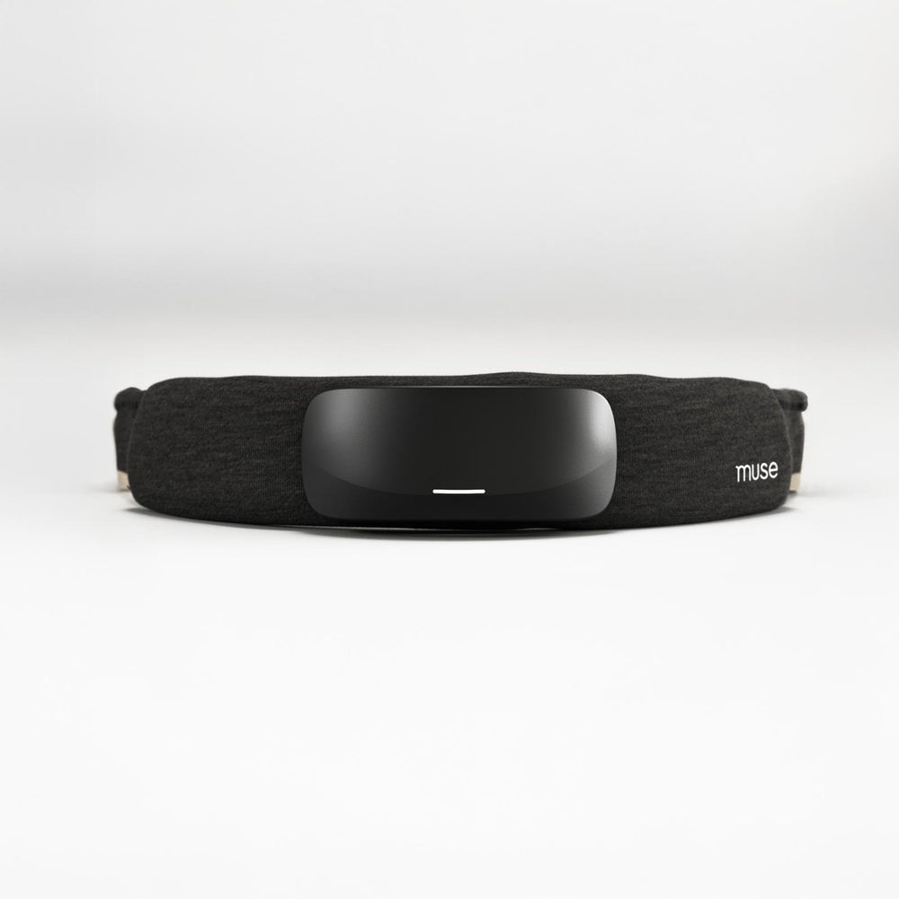
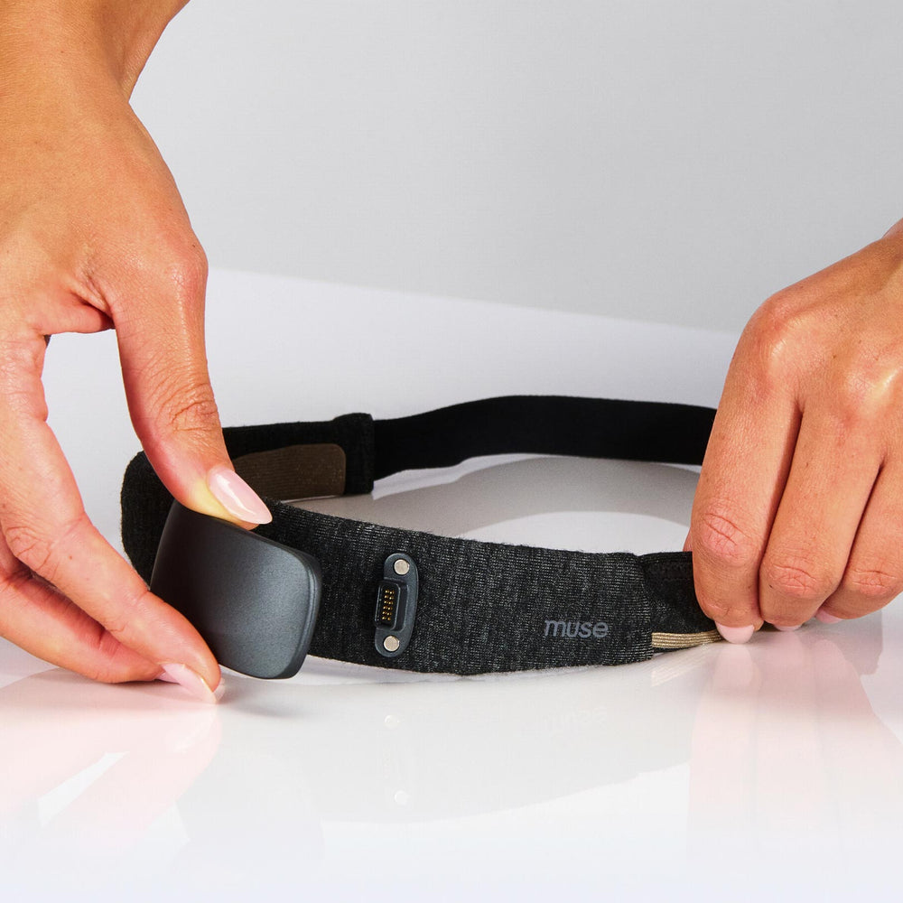
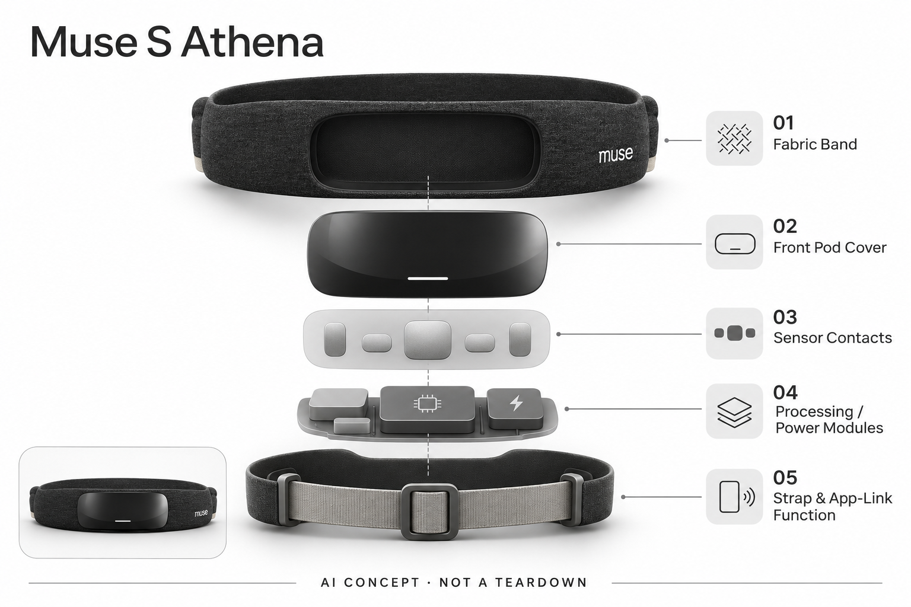

# Muse S Athena

**Muse / InteraXon** · 睡眠与放松 · 核查 2026-11-04

脑电与多传感头带，加上订阅中的AI教练解释层。

消费渠道：个人零售。

## 产品图片与结构参考

### 产品图

Muse S Athena 官方产品图 · 来源：[Muse / InteraXon](<https://choosemuse.com/products/muse-s-athena>) · [原始图片](<https://choosemuse.com/cdn/shop/files/01_Athena-ProductImage-9.jpg?v=1742256253&width=1000>)

### 参考图

Muse S Athena 官方外观 / 使用参考图 · 来源：[Muse / InteraXon](<https://choosemuse.com/products/muse-s-athena>) · [原始图片](<https://choosemuse.com/cdn/shop/files/03_Athena-ProductImage.jpg?v=1742256253&width=1000>)

### AI 生成爆炸示意

**AI 生成 · 非实物拆机。** 内部为概念推断，不能作为元件布局、BOM 或维修依据。[生成提示词](../../content/hardware/prompts/muse-s-athena.txt)

> 分析为基于公开资料的案头研究与 AI 辅助判断，未经用户访谈、销量审计或实物拆机。需求、画像、竞争冷门度、审美及商业机会均为研究假设，不是投资结论。

## 销售与购买

- 状态：在售。美国官方商品页面提供Headband Only与会员组合入口，实看页面存在Add to Cart。不同套餐价格及Premium权益分开记录。

- 地区：美国官网、其他官方地区店另查

- 价格：US$474.99（所选美国页面方案）。为所标地区和配置的核查参考；活动、税费、物流及可选服务以实际结算为准，不进行汇率换算或保证最低价。

- 中国大陆：本轮核查海外官方消费渠道，未验证中国大陆结算、型号、保修与全部AI服务可用性；不因品牌来源或支持中文推定国内可购。

- [官方产品 / 商店](<https://choosemuse.com/products/muse-s-athena>)

## AI 的实际作用

硬件采集EEG等信号提供生物反馈，Premium中的Enso AI Coach把数据转成解释和计划。AI教练属于应用服务层，并非仅靠头带即可获得全部功能。

服务与联网依赖：基础记录与部分反馈随硬件提供，Enso等Premium功能另有订阅条件；要核对手机、账户、地区和方案。

## 是否冷门

细分专业（研究判断）：个人生物反馈是较窄的消费任务；已有设备和课程替代，AI解释需要证明持续价值。

## 需求与市场

需求假设：已经练习冥想或关注自我状态的人，希望得到更具体的反馈和解释，而不是只看一串分数。AI教练是否让数据更容易行动化需要验证，不能把传感器数量视为用户价值的直接替代。

### 需求假设：练习者想理解状态而不只看分数 · 研究判断

Muse S Athena将生物反馈与Enso解释服务结合，针对已有冥想或自我观察习惯、希望把数据转为可理解练习的人。需求应具体到用户看不懂什么、希望怎样行动，不能仅凭喜欢脑科学推断付费，也不把更多传感器当作更充分的个人理解。

依据：[Muse S Athena 官方商品页](<https://choosemuse.com/products/muse-s-athena>) · [Muse Premium 与 Enso](<https://choosemuse.com/pages/premium-subscription>)

### 价值判断：反馈和语言解释是两层体验 · 研究判断

基础信号反馈可以独立影响练习，Enso又把数据组织成解释与计划，用户可能只需要其中一层。研究应记录解释是否改变实际安排，而不是回答是否流畅，不能将AI教练称谓理解为专业治疗者，也不从设备评分推断心理或脑健康状态。

依据：[Muse Premium 与 Enso](<https://choosemuse.com/pages/premium-subscription>)

### 验证方案：观察原有练习如何使用信息 · 待验证

让已有练习习惯的人在日常安排中使用头带，记录佩戴、反馈、查看统计及阅读Enso建议，再与原有音频或课程比较。关注理解和操作负担，不以一次平静感或设备分数证明效果，也不要求用户改变必要的专业支持来验证产品。

依据：[Muse S Athena 官方商品页](<https://choosemuse.com/products/muse-s-athena>) · [Muse Premium 与 Enso](<https://choosemuse.com/pages/premium-subscription>)

## 用户画像

画像推断：有持续练习意愿、接受头带和App组合的成年人，以及对消费级脑科学工具感兴趣的人。初次尝试者和长期练习者的期望不同，后者可能更关注可复现反馈和数据可读性。

### 画像假设：愿意持续练习和管理接触的人 · 研究判断

较匹配者有重复练习意愿，接受头带与应用组合，并愿意检查接触、清洁和充电。初次尝试者可能更重视引导，熟练者更关注反馈是否有用，画像应包含具体使用习惯，不能把所有想放松的人都归为相同需求与预算。

依据：[Muse S Athena 官方商品页](<https://choosemuse.com/products/muse-s-athena>)

### 使用约束：数据兴趣不等于佩戴接受度 · 研究判断

用户可能对脑电统计有兴趣，却不愿为了短时练习调整头发和接触位置，躺卧使用也有不同触感。研究应观察实际准备与闲置原因，而不是用静态外观判断舒适；手机兼容、账户和Premium条件同样会影响这套设备能否持续使用。

依据：[Muse S Athena 官方商品页](<https://choosemuse.com/products/muse-s-athena>) · [Muse Premium 与 Enso](<https://choosemuse.com/pages/premium-subscription>)

### 访谈重点：哪一条解释值得再次打开 · 待验证

请用户指出Enso或统计中一条真正理解并采用的信息，说明它与原有课程或常识有何不同，再问哪些建议被忽略。这样能区分新奇、记录和行动需求，不能把对AI聊天的兴趣当作长期教练服务价值，也不以回答长度评价帮助程度。

依据：[Muse Premium 与 Enso](<https://choosemuse.com/pages/premium-subscription>)

## 竞争与替代

竞争判断：它面对EEG头带、腕表记录、冥想课程和普通音频App。优势假设是将生物反馈与解释整合，但订阅服务是否比现有工具更有用需要任务对照，而不是只比较厂商演示。

### 替代方案：冥想课程、普通音频与其他头带 · 研究判断

Athena面对冥想应用、腕部记录和其他生物反馈硬件，不同方案提供的输入与体验不相同。比较应围绕具体练习目标，不能仅以EEG和多传感数量排序，也不将简单音频视为没有价值，额外接触与服务费用需要真实增量支撑。

依据：[Muse S Athena 官方商品页](<https://choosemuse.com/products/muse-s-athena>) · [Muse Premium 与 Enso](<https://choosemuse.com/pages/premium-subscription>)

### 差异判断：Enso服务不等于头带本体能力 · 研究判断

AI解释位于Premium应用层，硬件提供输入与部分反馈，不能将订阅功能全部写成开箱离线可用。研究应比较有无解释层时用户如何使用数据，避免把基础反馈的收益都归给生成式服务，也不将会员开通视为长期愿意续费。

依据：[Muse Premium 与 Enso](<https://choosemuse.com/pages/premium-subscription>)

### 比较方法：固定同一练习和复盘问题 · 待验证

让用户用原有课程与Athena完成相近练习，记录准备、反馈理解和后续计划，再单独比较Enso解释是否有用。不要使用设备自有分数给其他方案排名，也不将短期主观状态变化归因给头带或AI，应重点看用户能否说清实际帮助。

依据：[Muse S Athena 官方商品页](<https://choosemuse.com/products/muse-s-athena>) · [Muse Premium 与 Enso](<https://choosemuse.com/pages/premium-subscription>)

## 供应链

官方披露EEG、心率与相关光学感知类别，具体部件供应商和校准流程未完整披露。分析重点是接触一致性、皮肤材料、织物清洁、充电及软件维护，完整成本仍需要实物或报价证据。

### 功能拆分：感知、反馈和Enso解释分离 · 研究判断

官方披露EEG及相关光学感知类别，信号转为反馈与统计，Enso再提供解释和计划，头带织物与供电支撑佩戴。具体传感器、芯片、校准与工厂未完整披露，不能把应用模型画进头带内部，也不能将派生指标视为直接测得事实。

依据：[Muse S Athena 官方商品页](<https://choosemuse.com/products/muse-s-athena>) · [Muse Premium 与 Enso](<https://choosemuse.com/pages/premium-subscription>)

### 制造判断：接触与清洁决定输入可重复性 · 研究判断

头围、头发、皮肤和动作可能影响接触，织物清洁与模块固定又影响长期使用，光学输入还需要合适结构。供应评估应看完整佩戴流程，不只看电子规格，本轮没有接触稳定、材料耐久或实际生产数据，不能推算成本和制造良率。

依据：[Muse S Athena 官方商品页](<https://choosemuse.com/products/muse-s-athena>)

### 候选选型：电源与贴肤结构先明确 · 研究判断

Sunwoda可讨论紧凑电源，Protolabs可用于贴肤和固定配件原型，Analog Devices可作为穿戴信号链方向候选。具体EEG与光学输入必须重新确认，不能将已核ECG前端直接称为原机脑电芯片，所有候选均无Muse实际采用证据。

依据：[Muse S Athena 官方商品页](<https://choosemuse.com/products/muse-s-athena>)

## 技术路径

技术应分成信号采集、状态估计、反馈呈现和Enso解释层。后者是订阅服务，不代表所有推断都由设备离线完成；脑龄等派生指标的科学含义不能仅凭界面数字自行扩展。

### 已披露能力：生物反馈与订阅AI教练 · 官方资料

官方将头带信号与反馈、Premium中的Enso解释分开列出，完整体验依赖应用账户和相应服务。这里应区分采集、状态估计和语言建议，不代表所有计算都离线完成，也不能因为解释使用数据就推断具有医学诊断能力。

依据：[Muse S Athena 官方商品页](<https://choosemuse.com/products/muse-s-athena>) · [Muse Premium 与 Enso](<https://choosemuse.com/pages/premium-subscription>)

### 技术判断：派生指标需要解释边界 · 研究判断

用户可能将脑龄或其他状态分数理解为客观身体结论，但派生指标涉及模型与定义，不能只凭界面数字扩展科学含义。研究应观察用户是否理解来源、局限和可行动范围，不把更多小数或趋势图当作更高可信度，也不自行补写未公开算法。

依据：[Muse S Athena 官方商品页](<https://choosemuse.com/products/muse-s-athena>) · [Muse Premium 与 Enso](<https://choosemuse.com/pages/premium-subscription>)

### 验证方案：分开记录输入和建议采用 · 待验证

在支持使用条件中记录接触提示、练习、反馈与Enso解释，询问用户为何接受或拒绝某条建议，保留无法理解的情况。不要用自评分验证自身准确性，也不以一次主观改善说明长期效果，本轮未做临床、算法或生理指标复核。

依据：[Muse S Athena 官方商品页](<https://choosemuse.com/products/muse-s-athena>) · [Muse Premium 与 Enso](<https://choosemuse.com/pages/premium-subscription>)

## 产品审美

设计观察：灰色织物、低矮传感模块和可调头围接近日常可穿戴用品。设备是否影响发型、躺卧和清洁，会决定长期使用接受度；简洁外观不应掩盖传感接触所需的准备步骤。

### 外形判断：织物与低矮模块接近日常用品 · 研究判断

Athena的织物、低轮廓模块与可调头围降低视觉上的实验感，但触感、发型和躺卧仍会影响接受度。照片可以说明外观，不能证明所有人长时舒适，也不能因为电子部分不突出就忽略传感接触与充电所需的准备步骤。

依据：[Muse S Athena 官方商品页](<https://choosemuse.com/products/muse-s-athena>)

### 交互判断：练习时应减少对分数的追逐 · 研究判断

如果用户反复检查数据是否变好，反馈可能改变原本练习方式，界面需要帮助理解而不是只增加比较。研究应观察声音与屏幕何时被使用，不能把实时指标更多视为更好的引导，也不让Enso的流畅解释替代用户自己的体验判断。

依据：[Muse S Athena 官方商品页](<https://choosemuse.com/products/muse-s-athena>) · [Muse Premium 与 Enso](<https://choosemuse.com/pages/premium-subscription>)

### 体验验证：从收纳到结束完整练习 · 待验证

让用户在常用空间戴上、调整、完成练习、查看记录并清洁收纳，记录需要重复操作和主动放弃的环节。分别观察坐姿与支持的躺卧情境，不以白天短时试戴推断夜间适合，也不只让熟练用户评价新用户的准备成本。

依据：[Muse S Athena 官方商品页](<https://choosemuse.com/products/muse-s-athena>)

## 关键风险

关键风险是会员功能与硬件能力混淆，以及把状态评分当成诊断结论。购买时需确认具体套餐、续费与数据获取方式，长期舒适度和个人解释的稳定性尚需独立验证。

### 解释风险：状态评分不应升级为诊断 · 研究判断

头带和AI报告只能按公开消费功能理解，不能把分数、脑龄或建议当作医学判断、治疗计划或个人能力定论。厂商描述未经本目录独立验证，本轮没有临床和实机研究，个人感受与专业评估应区分，不提供疗效或心理状态推断。

依据：[Muse S Athena 官方商品页](<https://choosemuse.com/products/muse-s-athena>) · [Muse Premium 与 Enso](<https://choosemuse.com/pages/premium-subscription>)

### 服务风险：会员权益与数据获取需确认 · 研究判断

基础记录、反馈和Enso存在不同权益，购买者要核对具体套餐、续费及退出后的数据与功能。手机、地区和账户也影响使用，不能将头带可继续佩戴视为全部AI服务永久可用，更不能从当前宣传推断未来计划已经交付。

依据：[Muse S Athena 官方商品页](<https://choosemuse.com/products/muse-s-athena>) · [Muse Premium 与 Enso](<https://choosemuse.com/pages/premium-subscription>)

### 验证安排：纳入不认可解释与闲置情况 · 待验证

研究应记录用户觉得建议重复、不理解分数、接触麻烦或停止佩戴的原因，区分硬件与应用价值。不要只观察满意者或品牌评价，也不将拒绝建议当作用户不配合；这些行为能说明解释层是否值得持续使用，而不是只有新奇吸引力。

依据：[Muse Premium 与 Enso](<https://choosemuse.com/pages/premium-subscription>)

## 机会与验证

适合验证的市场问题是使用者能否根据反馈形成可持续练习。应同时记录主动使用、闲置原因和不认可AI建议的场景，本轮没有把品牌评价或用户星级当作可靠的留存统计。

### 研究方向：把反馈变成可理解的练习选择 · 研究判断

Athena对应的机会是让用户知道数据与自己练习有什么关系，潜在改进可能在解释来源、限制和具体回看。应先确认用户在哪一步困惑，再增加传感或AI内容，避免把一串评分换成一段长回答就视为解决了问题。

依据：[Muse Premium 与 Enso](<https://choosemuse.com/pages/premium-subscription>)

### 执行计划：跟踪练习与解释层的不同留存 · 待验证

连续记录主动佩戴、查看反馈、阅读Enso和实际改变计划，访谈一次被采用与一次被拒绝的建议。将声音反馈、数据兴趣和语言解释分开，不用总体使用时长代表所有功能价值，也不以短期感受或设备分数证明健康效果。

依据：[Muse S Athena 官方商品页](<https://choosemuse.com/products/muse-s-athena>) · [Muse Premium 与 Enso](<https://choosemuse.com/pages/premium-subscription>)

### 决策边界：消费脑科学需要重复任务证据 · 研究判断

信号与AI解释组成技术路线，但是否值得额外佩戴和会员取决于持续行为与维护成本。当前没有访谈、留存、销量或报价资料，不以品牌星级、传感器数量或模型评分预测市场成功，也不把技术新鲜感当作普遍用户需求。

依据：[Muse S Athena 官方商品页](<https://choosemuse.com/products/muse-s-athena>) · [Muse Premium 与 Enso](<https://choosemuse.com/pages/premium-subscription>)

## 对应供应链公司

能力候选用于选型研究，不代表本产品实际采用；未公开的供货关系不作推断。

- [sunwoda](../supply-chain/sunwoda.md) — **能力候选 · 非已采用** / 生物反馈头带紧凑电源候选：Sunwoda公开消费与穿戴电池业务，可作为Athena电源候选，但贴肤温度、采集噪声、光学输入负载和充电保护需要专项验证，不能只按容量选择。当前无Muse点名采用证据，也不保证通用电芯兼容或达到具体运行时间。

- [protolabs](../supply-chain/protolabs.md) — **能力候选 · 非已采用** / 贴肤与传感固定结构原型候选：Protolabs公开注塑及液态硅胶成型，可用于Athena接触与固定周边原型，但具体皮肤接触、清洁、头发与光学窗口要求必须测试，成型能力不代表医疗或生物相容认证。该关联没有实际供货证据，也不涉及复制原机专有结构。

- [analog-devices](../supply-chain/analog-devices.md) — **能力候选 · 非已采用** / 光学生理输入信号链工程候选：Analog Devices公开穿戴生理信号链和光学采集方案，可作为Athena输入工程方向候选，但本轮已核MAX86176侧重PPG与ECG，不能直接称为EEG前端或Muse原机芯片。具体信号、接口及噪声需另行选型，无实际采用证据。

[浏览供应链目录](../supply-chain.md)

## 功能分层示意

这是功能关系，不是实物拆机、真实空间结构或已核实 BOM。

1. **感知头带**：EEG及官方列出的多传感输入。（官方披露）

2. **状态估计**：信号转为反馈与统计，准确性需独立验证。（官方披露）

3. **声音与界面**：通过App呈现反馈和练习体验。（官方披露）

4. **Enso AI教练**：Premium中的解释与计划层。（官方披露）

5. **织物与供电**：可调头带、接触与充电形成可穿戴系统。（分析推断）

## 来源

1. [Muse S Athena 官方商品页](<https://choosemuse.com/products/muse-s-athena>) — 实看美国地区页面可加购，方案与价格需匹配。

2. [Muse Premium 与 Enso](<https://choosemuse.com/pages/premium-subscription>) — AI教练和基础硬件功能分开列出。

[返回目录](../hardware-market.md) · [网页分析](https://romanagent.github.io/Roman/#hardware/product/muse-s-athena)
