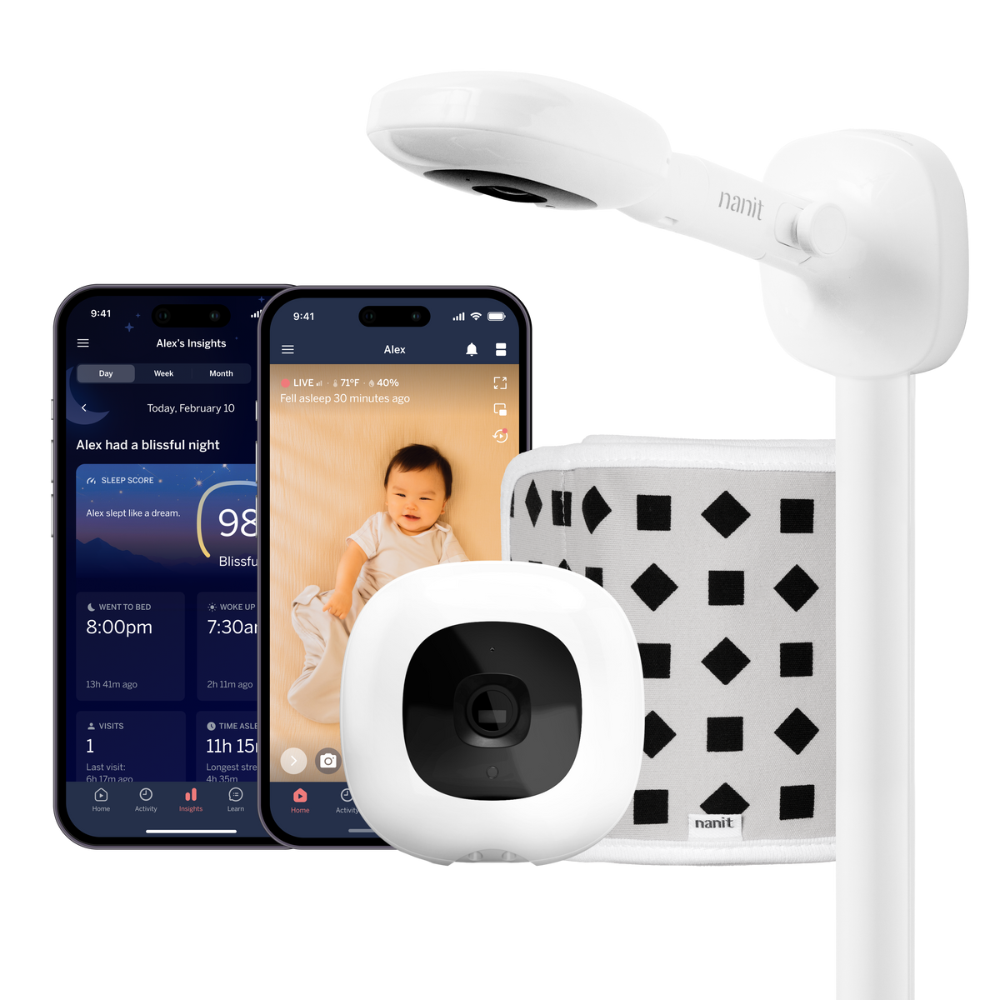
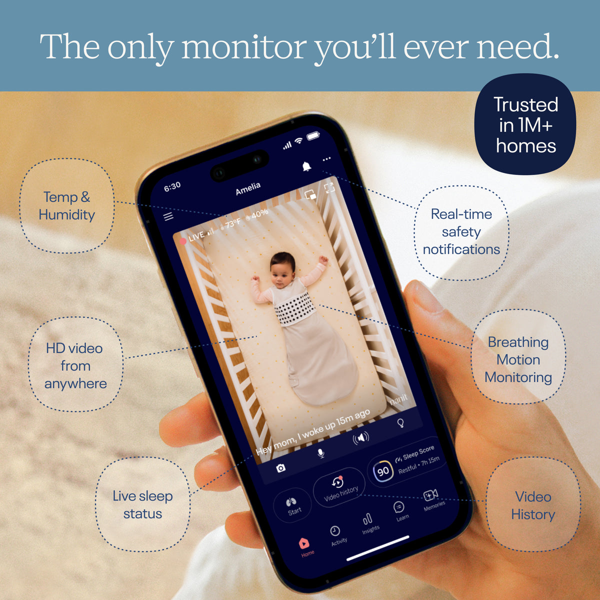
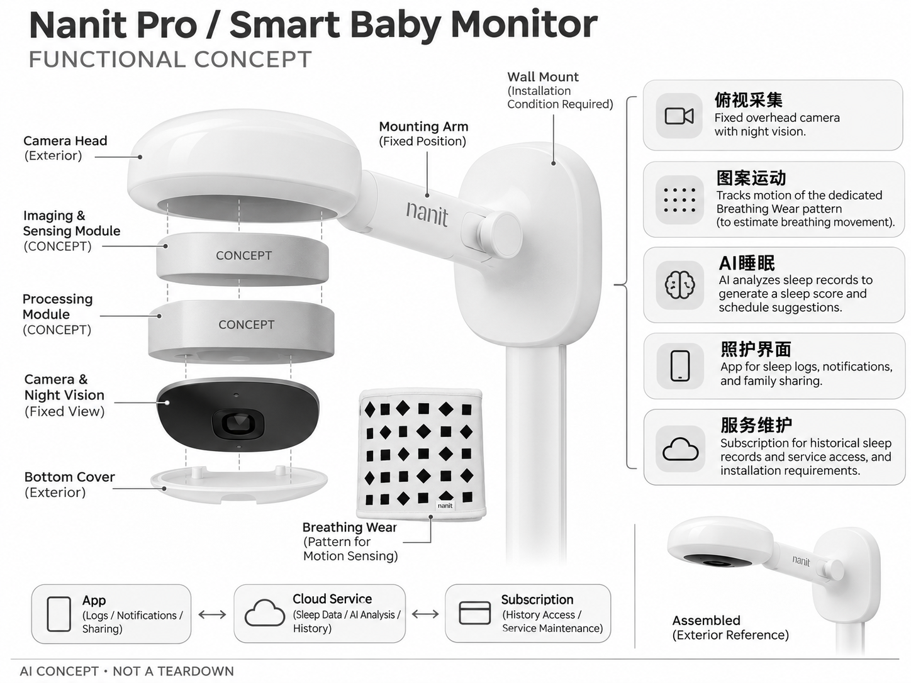

# Nanit Pro / Smart Baby Monitor

**Nanit** · 家庭安防 · 核查 2026-11-04

将俯视婴儿影像转为睡眠和照护记录

消费渠道：个人零售。

## 产品图片与结构参考

### 产品图

Nanit Pro / Smart Baby Monitor 官方产品图 · 来源：[Nanit · 官方图片](<https://www.nanit.com/products/smart-baby-monitor>) · [原始图片](<https://cdn.shopify.com/s/files/1/1354/7173/files/wall_mount_bw.webp?v=1782399004&width=1200>)

### 参考图

Nanit Pro / Smart Baby Monitor 官方外观、结构或使用参考 · 来源：[Nanit · 官方图片](<https://www.nanit.com/products/smart-baby-monitor>) · [原始图片](<https://cdn.shopify.com/s/files/1/1354/7173/files/T1-Camera.jpg?v=1781622125&width=1200>)

### AI 生成爆炸示意

**AI 生成 · 非实物拆机。** 内部为概念推断，不能作为元件布局、BOM 或维修依据。[生成提示词](../../content/hardware/prompts/nanit-pro-baby-monitor.txt)

> 依据官方外观参考与公开功能生成；未披露的内部布局只作概念模块，不构成BOM或真实结构证据。

> 保留官方图片原始内容和出处；画面宣传参数不是本轮独立实测。

> 分析为基于公开资料的案头研究与 AI 辅助判断，未经用户访谈、销量审计或实物拆机。需求、画像、竞争冷门度、审美及商业机会均为研究假设，不是投资结论。

## 销售与购买

- 状态：在售。原Nanit Pro购买链接跳转现名Smart Baby Monitor；官方提供CUSTOMIZE + BUY和Add to Cart配置流程，仅计同一摄像机，不拆分支架、显示器和衣物套装。

- 地区：美国官方商店

- 价格：按美国官网支架与配件配置结账。核查时官方地区参考价，保留原币种；订阅、税运、附件及优惠以结账为准，预订定金不等于整机价格。

- 中国大陆：本轮核实所列海外官方渠道；中国大陆同型号现货、保修及服务可用性未确认。进口前需核对供电、网络、配件和地区条款。

- [官方产品 / 商店](<https://www.nanit.com/products/smart-baby-monitor>)

## AI 的实际作用

AI分析睡眠记录并生成睡眠评分及日程提示；配合专用Breathing Wear图案通过视觉估计呼吸运动，不是相机测血氧。

服务与联网依赖：需要App及网络，部分历史、分析和指导依赖会员；呼吸运动功能需要对应穿戴图案和正确拍摄，非医疗设备。

## 是否冷门

细分专业（研究判断）：婴儿睡眠记录是专业消费细分，已有专用监视器竞争；信任与服务持续性构成重要门槛。

## 需求与市场

需求假设：父母希望知道婴儿什么时候睡着、醒来和需要照顾，而不必手工记每一段时间。应验证自动记录与实际照护日志的一致性，预测下一次小睡并不意味着所有孩子都该遵循同一安排。

### 产品任务与边界 · 研究判断

Nanit Pro 将婴儿床画面转成睡眠日志、评分和提示，任务是减少手工记录并帮助照护者理解作息。其价值应由日志是否准确、是否便于交接来判断，不能把自动评分或下一次小睡提示当作适用于所有孩子的安排。

依据：[Nanit Pro / Smart Baby Monitor 官方购买页](<https://www.nanit.com/products/smart-baby-monitor>) · [Nanit 官方AI睡眠与行为分析](<https://www.nanit.com/pages/all-in-one-parenting-app>)

### 需求判断 · 研究判断

自动记录可能减轻记忆负担，也可能让家长频繁关注数字而增加压力。需求研究应区分需要基本实时查看、需要多人交接和希望分析趋势的家庭，不能把更细报告默认视为更好的照护体验。

依据：[Nanit Pro / Smart Baby Monitor 官方购买页](<https://www.nanit.com/products/smart-baby-monitor>) · [Nanit 官方AI睡眠与行为分析](<https://www.nanit.com/pages/all-in-one-parenting-app>)

### 需求验证 · 待验证

可将自动日志与照护者实际记录对照，观察需要纠正的时间段和交接时真正被使用的信息。记录报告是否减少沟通遗漏，而不是只统计应用打开次数，避免把持续查看或追分误解为产品已经改善家庭生活。

依据：[Nanit Pro / Smart Baby Monitor 官方购买页](<https://www.nanit.com/products/smart-baby-monitor>) · [Nanit 官方AI睡眠与行为分析](<https://www.nanit.com/pages/all-in-one-parenting-app>)

## 用户画像

画像推断：愿意使用固定俯视支架、记录作息且可能共享照护权限的家庭。家庭需求会随婴儿成长改变，短期高频查看未必能支持多年会员，购买者应理解专用衣物与摄像头的配合条件。

### 适用行为与条件 · 研究判断

较匹配愿意安装固定俯视支架、使用应用并可能共享照护权限的家庭。呼吸运动功能需要专用图案穿戴和正确拍摄，购买者需要接受相应流程，不能把相机本体理解为无需条件的生理监测器。

依据：[Nanit Pro / Smart Baby Monitor 官方购买页](<https://www.nanit.com/products/smart-baby-monitor>) · [Nanit 官方AI睡眠与行为分析](<https://www.nanit.com/pages/all-in-one-parenting-app>)

### 人群取舍 · 研究判断

家庭需求会随孩子成长改变，婴儿阶段的高频查看未必支持多年会员。多人轮班可能重视日志交接，单人照护可能只需回看，画像应按实际工作分工和记录习惯划分，而不只以新手父母为统一人群。

依据：[Nanit Pro / Smart Baby Monitor 官方购买页](<https://www.nanit.com/products/smart-baby-monitor>) · [Nanit 官方AI睡眠与行为分析](<https://www.nanit.com/pages/all-in-one-parenting-app>)

### 画像验证 · 待验证

画像验证应观察不同照护者安装、使用专用衣物和阅读日志的过程，记录谁纠错及谁管理服务。再在需求变化时询问续订意愿，识别产品是短期辅助还是长期习惯，避免由早期密集使用推断持续商业价值。

依据：[Nanit Pro / Smart Baby Monitor 官方购买页](<https://www.nanit.com/products/smart-baby-monitor>) · [Nanit 官方AI睡眠与行为分析](<https://www.nanit.com/pages/all-in-one-parenting-app>)

## 竞争与替代

竞争判断：与CuboAi、常规婴儿监视器和手工记录App竞争，自动睡眠日志与图案运动估计是差异。可行动的解释、家庭协作和服务费用比更多评分更重要，不能把健康相关术语当作医疗级优势。

### 比较对象与差异 · 研究判断

Nanit 与 CuboAi、普通婴儿监视器及手工记录应用竞争，自动睡眠日志和图案运动估计是具体差异。比较应围绕可行动的信息和协作负担，不能用健康相关术语把它直接放在医疗级设备的评价框架中。

依据：[Nanit Pro / Smart Baby Monitor 官方购买页](<https://www.nanit.com/products/smart-baby-monitor>) · [Nanit 官方AI睡眠与行为分析](<https://www.nanit.com/pages/all-in-one-parenting-app>)

### 竞争判断 · 研究判断

专用穿戴和固定视角能支持特定功能，也增加操作与附件条件。竞争优势需要让用户觉得这些步骤值得，若报告主要带来压力或难以解释，更多评分可能无法提高留存；费用和随成长变化的用途同样重要。

依据：[Nanit Pro / Smart Baby Monitor 官方购买页](<https://www.nanit.com/products/smart-baby-monitor>) · [Nanit 官方AI睡眠与行为分析](<https://www.nanit.com/pages/all-in-one-parenting-app>)

### 竞争验证 · 待验证

可让家庭比较自动日志与简单手工记录的交接效果，明确相机、衣物和会员的完整条件。记录纠错、遗漏和沟通时间，而不是只比较图表丰富程度，也不把厂商睡眠故事当作独立效果证据。

依据：[Nanit Pro / Smart Baby Monitor 官方购买页](<https://www.nanit.com/products/smart-baby-monitor>) · [Nanit 官方AI睡眠与行为分析](<https://www.nanit.com/pages/all-in-one-parenting-app>)

## 供应链

供应链分析：相机、俯视支架、夜视、电源和专用图案织物组成体验，实际工厂与BOM未知。硬件安装、云视频成本、尺寸适配及耗材供应需要同时考虑，衣物本身没有电子传感器。

### 功能模块拆分 · 研究判断

功能层由俯视相机、夜视和支架供电，专用 Breathing Wear 图案的视觉运动分析，睡眠日志及应用共享构成。衣物本身没有电子传感器，不能画成相机测量血氧，也没有公开资料支持完整工厂和物料清单。

依据：[Nanit 官方AI睡眠与行为分析](<https://www.nanit.com/pages/all-in-one-parenting-app>) · [Nanit 官方呼吸运动技术与限制](<https://www.nanit.com/products/breathing-wear-swaddle>)

### 制造与供应约束 · 研究判断

制造与供应约束包括支架稳定、视角、线材、图案织物尺寸和持续云视频成本。穿戴被遮挡或不在合适位置会影响功能，附件供应与说明同样属于交付，不能只按相机硬件估计完整服务成本。

依据：[Nanit 官方AI睡眠与行为分析](<https://www.nanit.com/pages/all-in-one-parenting-app>) · [Nanit 官方呼吸运动技术与限制](<https://www.nanit.com/products/breathing-wear-swaddle>)

### 候选与证据缺口 · 研究判断

华勤可作为固定视觉终端工程候选，SGS 可作为相机、支架及织物相关测试咨询候选。没有 Nanit 点名合作证据，材料电气测试也不能证明呼吸估计或睡眠建议有效，工程匹配必须保持硬件与算法验证分离。

依据：[Nanit 官方AI睡眠与行为分析](<https://www.nanit.com/pages/all-in-one-parenting-app>) · [Nanit 官方呼吸运动技术与限制](<https://www.nanit.com/products/breathing-wear-swaddle>)

## 技术路径

官方披露AI睡眠评分和视觉呼吸运动跟踪。技术判断：图案遮挡、姿势和拍摄距离会影响估计，不能把运动频率混同血氧或疾病诊断；模型生成作息建议需要承认个体差异和测量缺失。

### 已披露技术边界 · 研究判断

官方说明睡眠分析及配合专用图案的视觉呼吸运动跟踪，并明确非医疗定位。这里观察的是图案运动，不是血氧或疾病诊断；历史与指导还受会员和网络条件影响，技术描述应避免把估计值写成确定生理测量。

依据：[Nanit 官方AI睡眠与行为分析](<https://www.nanit.com/pages/all-in-one-parenting-app>) · [Nanit 官方呼吸运动技术与限制](<https://www.nanit.com/products/breathing-wear-swaddle>)

### 系统难点判断 · 研究判断

遮挡、姿势和拍摄距离会影响运动估计，睡眠日志也可能需要人工纠正。系统难点是清楚表达数据缺失与不确定性，不能让漂亮评分掩盖观测条件变化，也不应把个体差异压缩成每个家庭都应追求的统一目标。

依据：[Nanit 官方AI睡眠与行为分析](<https://www.nanit.com/pages/all-in-one-parenting-app>) · [Nanit 官方呼吸运动技术与限制](<https://www.nanit.com/products/breathing-wear-swaddle>)

### 技术验证 · 待验证

验证应在受控且不制造危险的条件下核对图案可见性、安装和日志差异，并记录缺失时的提示。与实际照护记录比较可用性，不将相机检测结果当作临床评估，也不以某次趋势吻合推断所有家庭都适用。

依据：[Nanit 官方AI睡眠与行为分析](<https://www.nanit.com/pages/all-in-one-parenting-app>) · [Nanit 官方呼吸运动技术与限制](<https://www.nanit.com/products/breathing-wear-swaddle>)

## 产品审美

审美判断：简洁摄像头与细长支架适合固定婴儿床视角，但支架占位和线缆管理影响房间布局。界面应清楚区分实时画面、估计值和历史趋势，避免漂亮图表让推断显得过度精确。

### 外观与交互语言 · 研究判断

简洁相机与细长支架适合固定婴儿床视角，整体设计同时包括线材和房间布局。界面需要区分实时画面、历史记录与算法估计，避免精致曲线和精确数字让用户误以为所有结果具有同等确定性。

依据：[Nanit Pro / Smart Baby Monitor 官方购买页](<https://www.nanit.com/products/smart-baby-monitor>) · [Nanit 官方AI睡眠与行为分析](<https://www.nanit.com/pages/all-in-one-parenting-app>)

### 使用中审美判断 · 研究判断

安装结构若难以调整或妨碍日常照护，会抵消相机外形的简洁。专用图案衣物也是体验的一部分，穿戴、清洗和更换是否自然影响持续使用，设计评价应包含这些步骤，而不是仅看婴儿房中的静态画面。

依据：[Nanit Pro / Smart Baby Monitor 官方购买页](<https://www.nanit.com/products/smart-baby-monitor>) · [Nanit 官方AI睡眠与行为分析](<https://www.nanit.com/pages/all-in-one-parenting-app>)

### 设计验证 · 待验证

设计验证应观察照护者安装、调整视角、穿戴及交接日志的全过程，记录何时感到困惑或被数字催促。还应测试缺失数据和异常状态的呈现，确认用户能够区分没有信息与已经确认正常。

依据：[Nanit Pro / Smart Baby Monitor 官方购买页](<https://www.nanit.com/products/smart-baby-monitor>) · [Nanit 官方AI睡眠与行为分析](<https://www.nanit.com/pages/all-in-one-parenting-app>)

## 关键风险

风险判断：官方明确不是医疗设备，可能出现假阳性或假阴性，不能替代成人照护或专业诊疗。家庭影像隐私、订阅结束后的功能变化、联网故障和衣物使用条件均需要在购买前理解。

### 主要失效与依赖 · 研究判断

主要风险是误报、漏报、联网和会员变化，以及家庭影像和权限管理。官方明确非医疗设备，不能替代成人照护或专业诊疗，呼吸运动估计也不能被转述为预防事故或疾病筛查能力。

依据：[Nanit 官方AI睡眠与行为分析](<https://www.nanit.com/pages/all-in-one-parenting-app>) · [Nanit 官方呼吸运动技术与限制](<https://www.nanit.com/products/breathing-wear-swaddle>)

### 风险传播判断 · 研究判断

评分和预测如果被当作必须遵循的标准，可能让家长忽略具体情境或增加压力。产品应允许纠错并解释数据来源，让报告支持家庭判断而不是替代判断；专用穿戴条件变化也需要清楚反馈，避免持续显示误导性的确定结果。

依据：[Nanit 官方AI睡眠与行为分析](<https://www.nanit.com/pages/all-in-one-parenting-app>) · [Nanit 官方呼吸运动技术与限制](<https://www.nanit.com/products/breathing-wear-swaddle>)

### 风险验证 · 待验证

风险验证应演练网络、会员和图案不可见情境，检查照护者是否知道哪些功能不再可靠。权限和日志纠正也需测试，所有结果应限定在实际配置，不以厂商宣称或单个家庭经验转化为医疗或安全保证。

依据：[Nanit 官方AI睡眠与行为分析](<https://www.nanit.com/pages/all-in-one-parenting-app>) · [Nanit 官方呼吸运动技术与限制](<https://www.nanit.com/products/breathing-wear-swaddle>)

## 机会与验证

机会假设：用真实照护记录验证自动日志能否减少沟通遗漏，并比较是否改善多人交接。若报告主要带来压力，优先提供可纠错日志和简洁摘要，避免把所有家庭引导到持续追分的使用方式。

### 可能的机会入口 · 研究判断

机会在于可纠错的自动日志和清晰交接，让照护者少依赖记忆，同时避免持续追分。新项目可先解决多人记录遗漏或重复操作，再判断是否需要更复杂评分，关注实际协作收益而不是增加健康感强烈的指标。

依据：[Nanit Pro / Smart Baby Monitor 官方购买页](<https://www.nanit.com/products/smart-baby-monitor>) · [Nanit 官方AI睡眠与行为分析](<https://www.nanit.com/pages/all-in-one-parenting-app>)

### 机会成立条件 · 研究判断

机会成立需要报告减少沟通负担并保持可理解，如果家庭只因担心而更频繁查看，活跃并不代表价值。可让用户选择简单摘要和详细分析，观察真实偏好，避免把所有人引导到同一种持续监测方式。

依据：[Nanit Pro / Smart Baby Monitor 官方购买页](<https://www.nanit.com/products/smart-baby-monitor>) · [Nanit 官方AI睡眠与行为分析](<https://www.nanit.com/pages/all-in-one-parenting-app>)

### 下一步验证 · 待验证

下一步可用真实照护日志比较自动记录、可纠错摘要和多人交接的效果，记录节省的操作及新增压力。先验证信息工具价值，再扩大算法建议，并持续区分辅助记录、运动估计与医疗判断的不同证据要求。

依据：[Nanit Pro / Smart Baby Monitor 官方购买页](<https://www.nanit.com/products/smart-baby-monitor>) · [Nanit 官方AI睡眠与行为分析](<https://www.nanit.com/pages/all-in-one-parenting-app>)

## 对应供应链公司

能力候选用于选型研究，不代表本产品实际采用；未公开的供货关系不作推断。

- [huaqin](../supply-chain/huaqin.md) — **能力候选 · 非已采用** / 固定俯视视觉终端与联网工程：华勤的摄像和联网终端能力可支持 Nanit 类硬件导入，但专用图案视觉、睡眠算法和家庭权限需另行验证；没有 Nanit 点名合作证据，不能把工程候选解释为实际制造或健康效果背书。

- [sgs](../supply-chain/sgs.md) — **能力候选 · 非已采用** / 相机、支架及图案织物相关测试：SGS 的材料、电气和机械测试服务可用于评估相机、支架及织物的具体要求，但需确认方法与实验室范围；没有 Nanit 测试合作披露，且这些测试不证明呼吸估计、睡眠建议或医疗效果。

[浏览供应链目录](../supply-chain.md)

## 功能分层示意

这是功能关系，不是实物拆机、真实空间结构或已核实 BOM。

1. **俯视采集**：固定相机与夜视观察。（官方披露）

2. **图案运动**：识别专用Breathing Wear的运动。（官方披露）

3. **AI睡眠**：睡眠记录、评分与时段预测。（官方披露）

4. **照护界面**：App日志、通知与共享。（官方披露）

5. **服务维护**：会员历史和安装条件。（官方披露）

## 来源

1. [Nanit Pro / Smart Baby Monitor 官方购买页](<https://www.nanit.com/products/smart-baby-monitor>) — 实际打开核查当前购买或预订入口，未实际下单；价格与交付按具体地区。

2. [Nanit 官方AI睡眠与行为分析](<https://www.nanit.com/pages/all-in-one-parenting-app>) — 实际打开的官方技术与使用资料，宣传效果并非本轮独立实测。

3. [Nanit 官方呼吸运动技术与限制](<https://www.nanit.com/products/breathing-wear-swaddle>) — 实际打开，说明专用图案与AI视觉配合，明确非医疗设备及误报漏报风险。

[返回目录](../hardware-market.md) · [网页分析](https://romanagent.github.io/Roman/#hardware/product/nanit-pro-baby-monitor)
