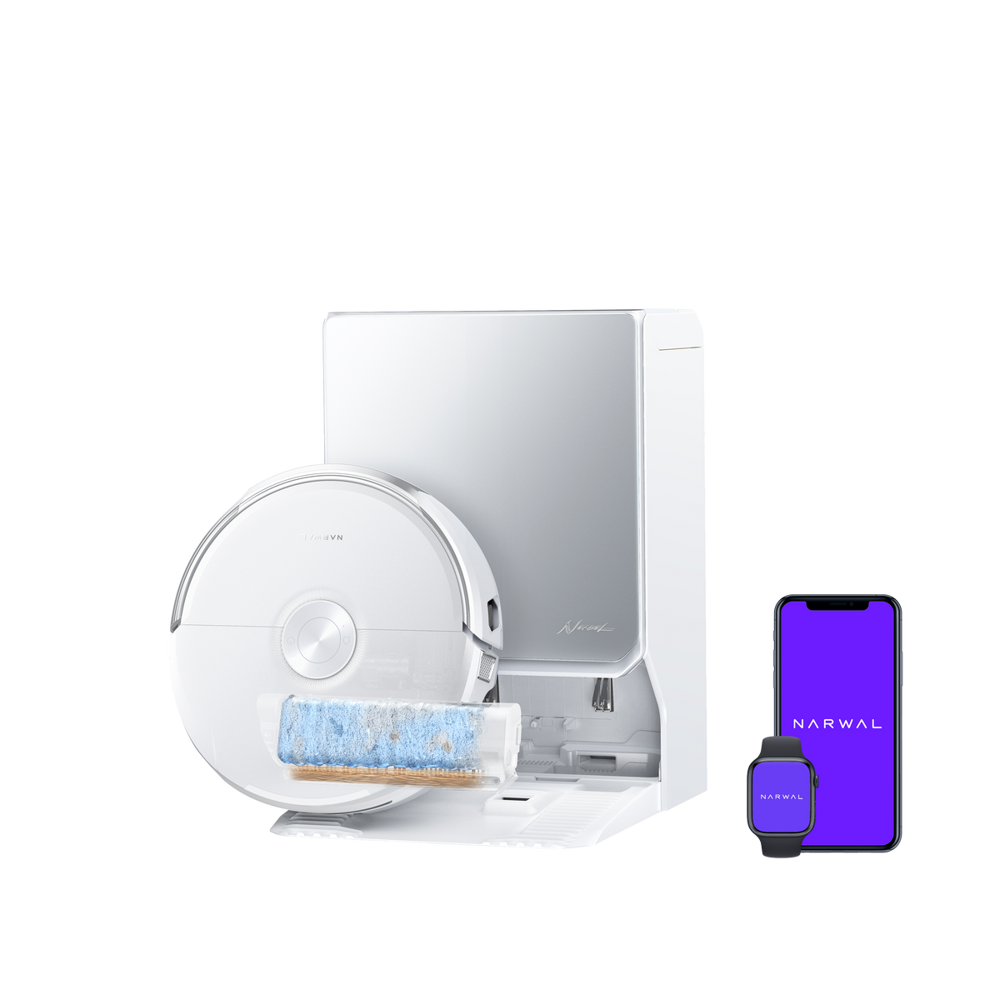
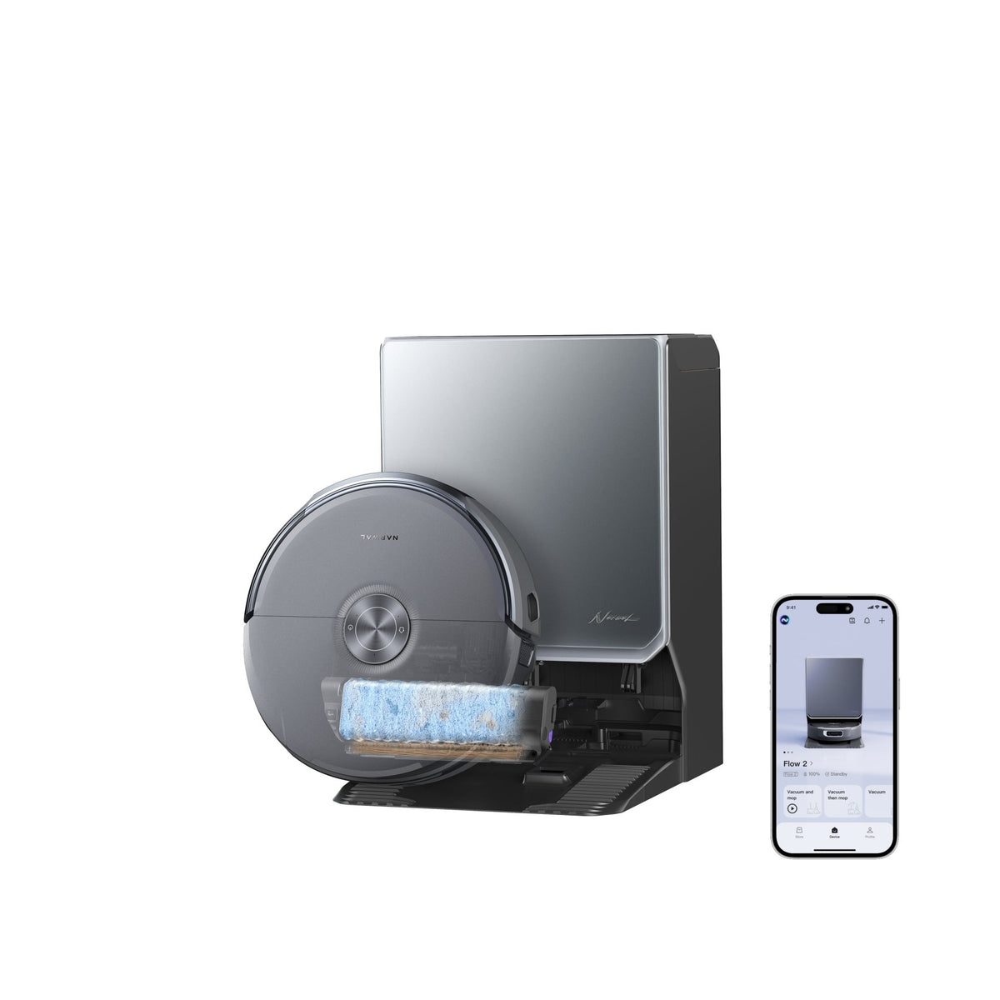
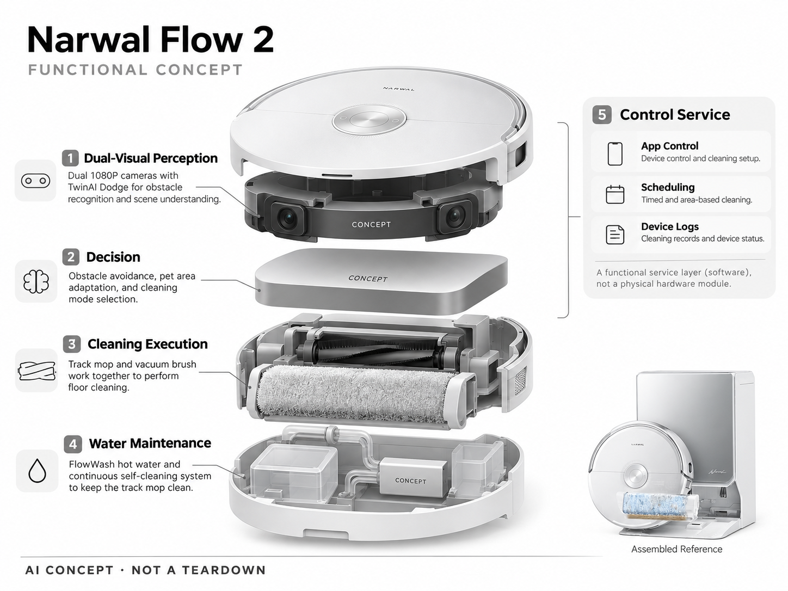

# Narwal Flow 2

**Narwal** · 清洁机器人 · 核查 2026-11-04

以持续自清洁履带拖布和视觉决策处理脏污

消费渠道：个人零售。

## 产品图片与结构参考

### 产品图

官方商品图：Flow 2 白色版与清洁模组展示 · 来源：[Narwal · 官方图片](<https://us.narwal.com/products/flow-2-robot-vacuum-and-mop>) · [原始图片](<https://cdn.shopify.com/s/files/1/0550/6200/3893/files/X30_____03_2.png?v=1784170331&width=1200>)

### 参考图

官方参考图：Flow 2 黑色版、履带拖布与 App 展示 · 来源：[Narwal · 官方图片](<https://us.narwal.com/products/flow-2-robot-vacuum-and-mop>) · [原始图片](<https://cdn.shopify.com/s/files/1/0550/6200/3893/files/X30___App_01.jpg?v=1776109876&width=1200>)

### AI 生成爆炸示意

**AI 生成 · 非实物拆机。** 内部为概念推断，不能作为元件布局、BOM 或维修依据。[生成提示词](../../content/hardware/prompts/narwal-flow-2.txt)

> 依据官方外观参考与公开功能生成；未披露的内部布局只作概念模块，不构成BOM或真实结构证据。

> 图片版权归原权利人；用于产品研究并保留出处。未改变图片色彩或内容。

> 两图分别为官方白色与黑色版本，均为 Flow 2，不将颜色不同当作不同产品。

> 分析为基于公开资料的案头研究与 AI 辅助判断，未经用户访谈、销量审计或实物拆机。需求、画像、竞争冷门度、审美及商业机会均为研究假设，不是投资结论。

## 销售与购买

- 状态：在售。美国官方商店显示 Flow 2 Basic Dock、US$1,299.99、加入购物车与购买入口；本次页面未显示所选整机缺货。

- 地区：美国

- 价格：US$1,299.99。Basic Dock 页面价格快照；上下水和套装价格不同，活动、税费及配送以结账为准。

- 中国大陆：本轮核实的是美国 Flow 2；中国大陆对应型号与官方购买链接尚未逐项核查。

- [官方产品 / 商店](<https://us.narwal.com/products/flow-2-robot-vacuum-and-mop>)

## AI 的实际作用

双视觉感知用于障碍识别、清洁决策及宠物区域适配；履带拖布的自清洁是机械水路能力，不应全部算作 AI。

服务与联网依赖：基础清洁控制在设备端；App 管理和部分场景功能需要联网，端云任务边界未完全公开。

## 是否冷门

竞争密集（研究判断）：扫拖市场成熟；履带自清洁是一种差异化技术路线，不能据此称为冷门赛道。

## 需求与市场

需求假设：厨房油污、脚印和养宠家庭更在意拖完是否干净，而不只是完成一次巡航。应通过同一区域重复清洁、残留与污水维护时间观察收益，避免把热水温度等同最终清洁效果。

## 用户画像

画像假设：以硬地板为主、愿意承担基站占地的家庭，以及经常需要处理脚印和食物残渣的用户。长毛地毯家庭或狭小租房可能并非最合适对象，需要按地面结构细分。

## 竞争与替代

竞争判断：高端扫拖中，拖布形态和自动维护正成为主要差异点。与旋转拖布、滚筒等路线相比，履带方案需要证明清洁覆盖与耐用性，而不是仅凭机械形态新颖取得市场优势。

## 供应链

供应链推断：履带、刮污结构、泵阀、密封件和加热水路构成较高集成难度；视觉模组还涉及标定。具体芯片、代工厂及单机成本未披露，耗材替换周期与可清洗性应单独验证。

## 技术路径

官网披露双摄像头避障、履带拖布与宠物清洁模式。技术判断：视觉分类、脏污判断与路径控制必须协同；大颗粒、湿垃圾和强反光地板是应测试的失效条件，不能只依靠厂商演示。

## 产品审美

审美判断：机身和基站采用家电化整体设计，降低机器人感；但水箱、滤网与湿部件的暴露方式影响实际体验。好看的机身应配合容易清洁、可触达且不易滴漏的维护路径。

## 关键风险

风险判断：水路和加热维护提高了整机复杂度，异味、漏水及履带耗材的长期体验有待实测。AI 宠物模式不能承诺完全避开动物或排泄物，应保留异常告警和人工接管。

## 机会与验证

可验证机会：建立以实际污渍和维护劳动为核心的对照实验，寻找小户型或养宠场景中的局部产品机会。若无法证明明显减少人工擦地，复杂水路未必能支撑用户溢价。

## 功能分层示意

这是功能关系，不是实物拆机、真实空间结构或已核实 BOM。

1. **双目视觉**：官方披露的双 1080P 相机及 TwinAI Dodge 感知。（官方披露）

2. **决策**：避障、宠物区域与清洁模式选择。（官方披露）

3. **清洁执行**：履带拖布与吸尘刷组执行清洁。（官方披露）

4. **水路维护**：FlowWash 热水与持续自清洁系统。（官方披露）

5. **控制服务**：App、调度及设备日志构成功能服务层；此处不代表实际硬件分层。（分析推断）

## 来源

1. [Narwal Flow 2 美国官方商店](<https://us.narwal.com/products/flow-2-robot-vacuum-and-mop>) — 已打开；基础基站版本可购买，双摄与 FlowWash 说明来自厂商。

[返回目录](../hardware-market.md) · [网页分析](https://romanagent.github.io/Roman/#hardware/product/narwal-flow-2)
