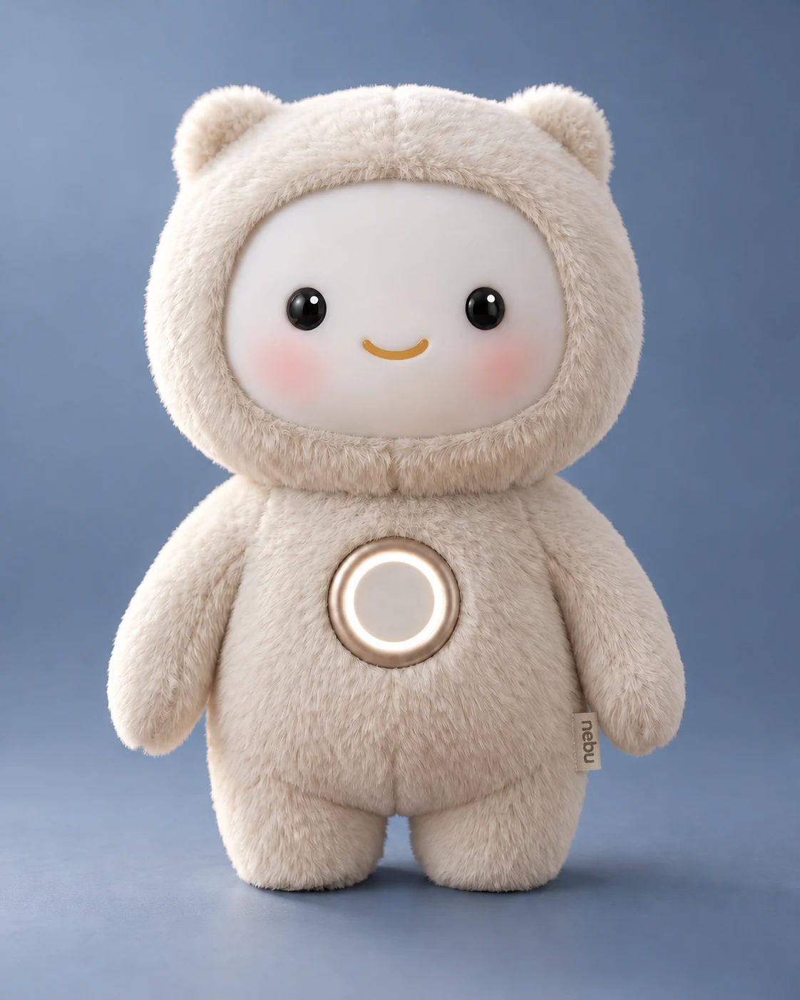
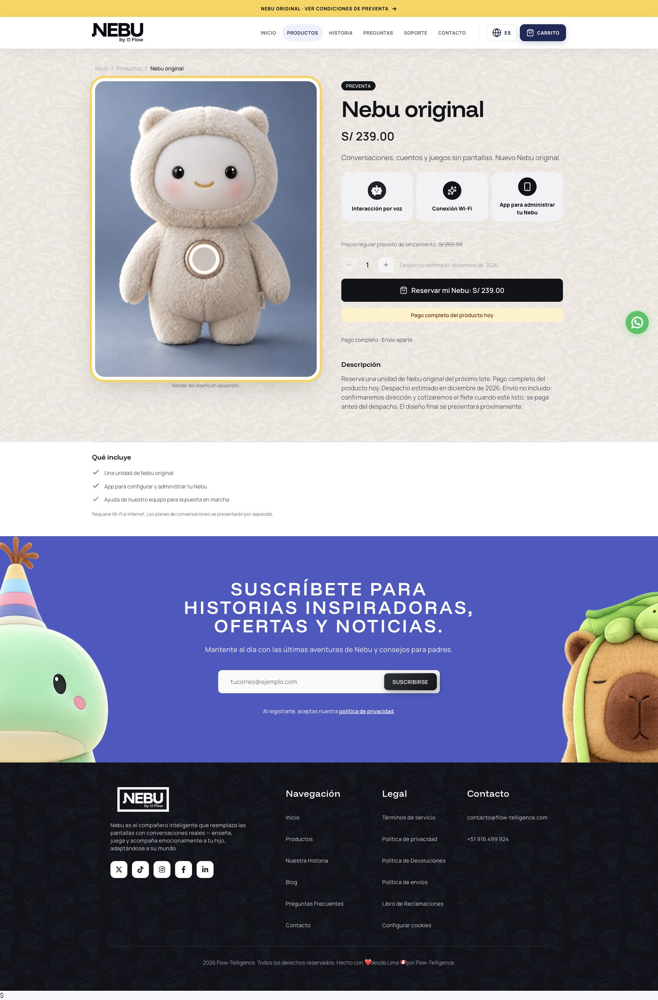
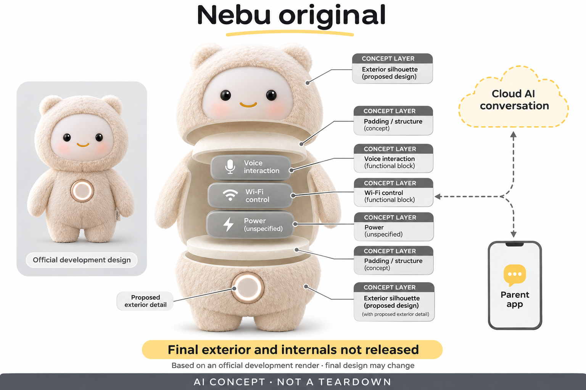

# Nebu original

**Flow-Telligence / Nebu** · AI玩具 · 核查 2026-11-06

秘鲁团队的云对话毛绒全款预售，外观仍处开发阶段

消费渠道：消费预订。

## 产品图片与结构参考

### 产品图

官方开发中外观渲染，最终设计未发布 · 来源：[产品品牌官网](<https://nebu.flow-telligence.com/productos/nebu-original>) · [原始图片](<https://nebu.flow-telligence.com/assets/images/nebu-original-v1.webp>)

### 参考图

官方预售网页截图，非另一实物照片；来源图链接指原网页 · 来源：[产品品牌官网](<https://nebu.flow-telligence.com/productos/nebu-original>) · [原始页面](<https://nebu.flow-telligence.com/productos/nebu-original>)

### AI 生成爆炸示意

**AI 生成 · 非实物拆机。** 内部为概念推断，不能作为元件布局、BOM 或维修依据。[生成提示词](../../content/hardware/prompts/nebu-original.txt)

> 内置ImageGen按本产品官方参考独立生成；未知内部为概念层，不是BOM或维修依据。

> 图片保留官方原貌；效果、安全与性能宣传不代表本目录独立验证。

> 主图是官方开发中外观渲染；参考图是CUA截取的当前官网预售页面，无独立原图URL，sourceImageUrl指原网页，不是第二张实物照片。

> 分析为基于公开资料的案头研究与 AI 辅助判断，未经用户访谈、销量审计或实物拆机。需求、画像、竞争冷门度、审美及商业机会均为研究假设，不是投资结论。

## 销售与购买

- 状态：预售 / 接受延期订单。2026-11-06官网及浏览器明确一只Nebu original，S/239全款今天支付、不是仅登记兴趣；预计2026年12月发出，运费另确认。页面明确当前图片为开发中设计渲染，最终设计稍后发布；未付款或验证量产履约。

- 地区：秘鲁，具体地址及预售运费需确认

- 价格：S/239（秘鲁索尔，全款预售）。当前款运费另报价并在发出前支付，包括利马也需按新款条件；计划常规价S/265非历史成交价。对话套餐将单独公布，不能沿用旧版终身Pro或利马免运宣传。

- 中国大陆：官方配送规则目前仅秘鲁，不提供国际配送；本轮未核实大陆渠道、应用和服务，不把西英双语或网站可访问当作海外正式支持。

- [官方产品 / 商店](<https://nebu.flow-telligence.com/productos/nebu-original>)

## AI 的实际作用

官方说明通过语音识别、生成式模型与合成语音开展问答、故事和个性化互动，家长App可调整设置及查看历史；具体当前款模型、性能与内部器件未完整发布。

服务与联网依赖：需要Wi-Fi及互联网，AI在云服务处理；Nebu original有独立预售与后续对话计划，不承诺旧版终身Pro。最终供电、接口和维护细节仍待发布。

## 是否冷门

新兴竞争（研究判断）：面向秘鲁家庭的云对话毛绒在地区交付上有具体定位，核心任务与其他AI毛绒相同；无销量和独立效果证据，不以地域或造型断言市场空白。

## 需求与市场

秘鲁家庭可能关心西语交流、当地物流和能够联系到的支持团队，这些条件会影响与海外玩具的比较。但地区品牌不自动意味着更懂每个家庭，真正价值还需看对话能否顺利开展和问题是否容易解决；不能以当地缺少知名产品就推定存在大规模付费需求。

### 事实｜新款承诺语音对话与故事共玩 · 官方资料

Nebu original当前页面提供问答、故事和游戏的语音方向，系列FAQ说明通过AI结合儿童偏好进行回应，并用家长应用配置。它的价值主张是即时互动，而不是只播放固定录音；当前款具体模型和量产性能仍未发布，目录不把教育和情绪支持宣传当成效果证据。

依据：[Nebu original当前官方预售页](<https://nebu.flow-telligence.com/productos/nebu-original>) · [Nebu当前FAQ与版本区别](<https://nebu.flow-telligence.com/faq>)

### 判断｜地区交付可能影响家庭采用 · 研究判断

秘鲁家庭可能关心西语交流、当地物流和能够联系到的支持团队，这些条件会影响与海外玩具的比较。但地区品牌不自动意味着更懂每个家庭，真正价值还需看对话能否顺利开展和问题是否容易解决；不能以当地缺少知名产品就推定存在大规模付费需求。

依据：[Nebu当前FAQ与版本区别](<https://nebu.flow-telligence.com/faq>) · [Nebu现有配送地区规则](<https://nebu.flow-telligence.com/shipping>)

### 验证｜先观察量产后的完整使用链 · 待验证

获得实际成品后，应从配网、开启对话、修改设置到重复使用进行记录，再判断故事和问答是否符合预期。旧版本的用户照片和影片可以说明品牌曾有试用活动，不能代替新款验证；本研究没有收货、访谈或独立性能测试，需求仍为研究假设。

依据：[Nebu original当前官方预售页](<https://nebu.flow-telligence.com/productos/nebu-original>) · [Nebu当前首页及新款说明](<https://nebu.flow-telligence.com/?lang=en>)

## 用户画像

孩子体验的是角色声音，成人需要理解预售版本、后续对话计划和管理设置。如果家庭希望一次购买后无需维护，实际服务依赖可能造成落差；画像应看是否愿意处理网络和数据控制，而不只按儿童年龄或喜欢毛绒来判断适合。

### 事实｜家长应用与网络属于必要条件 · 官方资料

当前商品明确需要Wi-Fi和互联网，并包含用于设置和管理的应用及团队启动帮助。它不是无任何外部服务的普通毛绒，系列年龄定位也不能证明每位儿童都能独立使用；成人需要参与账户、网络与资料管理，本轮没有创建家庭档案。

依据：[Nebu original当前官方预售页](<https://nebu.flow-telligence.com/productos/nebu-original>) · [Nebu当前FAQ与版本区别](<https://nebu.flow-telligence.com/faq>)

### 判断｜服务理解能力影响适配性 · 研究判断

孩子体验的是角色声音，成人需要理解预售版本、后续对话计划和管理设置。如果家庭希望一次购买后无需维护，实际服务依赖可能造成落差；画像应看是否愿意处理网络和数据控制，而不只按儿童年龄或喜欢毛绒来判断适合。

依据：[Nebu当前FAQ与版本区别](<https://nebu.flow-telligence.com/faq>)

### 验证｜检查成人能否辨别新旧版本条件 · 待验证

可以让家长说明自己购买的是哪一代、运费和对话服务是否包含，再观察实际设置是否与宣传一致。测试不需要让孩子说出私人生活来证明个性化；如果版本条件仍不清楚，应先取得对应订单资料，不能用一次顺畅对话覆盖交付和服务的不确定性。

依据：[Nebu original当前官方预售页](<https://nebu.flow-telligence.com/productos/nebu-original>) · [Nebu当前FAQ与版本区别](<https://nebu.flow-telligence.com/faq>) · [Nebu现有配送地区规则](<https://nebu.flow-telligence.com/shipping>)

## 竞争与替代

新外观可能更统一，但当前只是开发中渲染，和已有用户可立即拿到的产品具有不同风险。选择不能只比较价格和角色设计，也需要看量产与应用准备程度；同类固定故事机、亲子共玩或成熟云玩具可能在不同家庭条件下更合适。

### 事实｜旧款权益没有自动延续到original · 官方资料

当前FAQ明确旧版按购买时约定享有权益，而original使用独立预售条件，不承诺终身Pro。商品页还说明对话计划将单独介绍，因此旧目录里的永久无月费和利马免运不能拼进新款；目录将新旧条件分开，避免制造不存在的完整优惠组合。

依据：[Nebu original当前官方预售页](<https://nebu.flow-telligence.com/productos/nebu-original>) · [Nebu当前FAQ与版本区别](<https://nebu.flow-telligence.com/faq>)

### 判断｜比较现货与预售时需保留成熟度 · 研究判断

新外观可能更统一，但当前只是开发中渲染，和已有用户可立即拿到的产品具有不同风险。选择不能只比较价格和角色设计，也需要看量产与应用准备程度；同类固定故事机、亲子共玩或成熟云玩具可能在不同家庭条件下更合适。

依据：[Nebu original当前官方预售页](<https://nebu.flow-telligence.com/productos/nebu-original>) · [Nebu当前首页及新款说明](<https://nebu.flow-telligence.com/?lang=en>)

### 验证｜使用完整到手成本进行比较 · 待验证

预算应包括商品全款、发出前运费和尚待说明的对话套餐，不把计划常规价当作已经发生的成交历史。对比同类产品时也要核对地区与服务可用范围；本轮没有实际交易和长期账单，不从二百多索尔的标价推断BOM成本、利润或市场优势。

依据：[Nebu original当前官方预售页](<https://nebu.flow-telligence.com/productos/nebu-original>) · [Nebu当前FAQ与版本区别](<https://nebu.flow-telligence.com/faq>)

## 供应链

圆脸毛绒、腹部环状设计和填充材料需要与声音输入输出、操作和供电共同协调。外观渲染看起来完整，不表示声孔、散热、充电和维护已经定型；同类方案不能只把电子模块装入好看的壳，就省略与实际孩子抱持和家庭环境有关的测试。

### 事实｜当前只公开开发中外观渲染 · 官方资料

官方明确当前original图像是开发中的设计，最终外观稍后发布；旧动物款影像另有标识。目录主图因此注明官方渲染，参考图采用真实官网订购页面截图，不用旧款实拍冒充新款。具体器件、工厂、电池和内部布局仍未公开。

依据：[Nebu original当前官方预售页](<https://nebu.flow-telligence.com/productos/nebu-original>) · [Nebu当前首页及新款说明](<https://nebu.flow-telligence.com/?lang=en>)

### 判断｜量产前的声学结构仍有验证空间 · 研究判断

圆脸毛绒、腹部环状设计和填充材料需要与声音输入输出、操作和供电共同协调。外观渲染看起来完整，不表示声孔、散热、充电和维护已经定型；同类方案不能只把电子模块装入好看的壳，就省略与实际孩子抱持和家庭环境有关的测试。

依据：[Nebu original当前官方预售页](<https://nebu.flow-telligence.com/productos/nebu-original>)

### 验证｜供应候选要等真实设计落地 · 待验证

可提前研究Wi-Fi控制和MEMS采音能力，但必须在最终外壳和电源条件确定后做整机验证。没有品牌点名资料，任何候选都不能写成已采用；概念结构图只解释功能关系，不能成为采购原机零件、确认产地或分析精确生产成本的依据。

依据：[Nebu original当前官方预售页](<https://nebu.flow-telligence.com/productos/nebu-original>) · [Nebu当前FAQ与版本区别](<https://nebu.flow-telligence.com/faq>)

## 技术路径

模型可能根据说过的话推断兴趣，却不等于知道儿童真实经历和情绪。家长报告和提醒如果存在，应允许回到原始对话核对，而不是直接成为评价孩子的依据；技术研究要关注错误和不确定性如何呈现，不能用自然的语气证明理解准确。

### 事实｜AI服务通过联网处理对话 · 官方资料

FAQ明确Nebu需要Wi-Fi，AI由云端处理，并将语音、个性化和家长配置结合。新款没有披露完整模型和硬件方案，因此不能宣称机内运行大模型或断网仍可继续生成；系列旧续航和接口描述也不宜未经确认便全部套用到original。

依据：[Nebu original当前官方预售页](<https://nebu.flow-telligence.com/productos/nebu-original>) · [Nebu当前FAQ与版本区别](<https://nebu.flow-telligence.com/faq>)

### 判断｜云端解释与儿童实际情况需要区分 · 研究判断

模型可能根据说过的话推断兴趣，却不等于知道儿童真实经历和情绪。家长报告和提醒如果存在，应允许回到原始对话核对，而不是直接成为评价孩子的依据；技术研究要关注错误和不确定性如何呈现，不能用自然的语气证明理解准确。

依据：[Nebu当前FAQ与版本区别](<https://nebu.flow-telligence.com/faq>)

### 验证｜核对网络失败与记录管理 · 待验证

量产后可以用虚构故事检查断网、恢复和重复请求，再验证家长看到的文字是否与说过的话对应。删除和个性化也应分别测试；本轮仅查公开资料，没有运行模型、抓取私有数据或验证厂商关于内容适配和安全的宣传。

依据：[Nebu original当前官方预售页](<https://nebu.flow-telligence.com/productos/nebu-original>) · [Nebu当前FAQ与版本区别](<https://nebu.flow-telligence.com/faq>)

## 产品审美

相比过去多动物款，新款有一致的视觉形象，可能帮助品牌形成辨识度。是否更适合抱持、操作和放置仍取决于成品，不能仅凭渲染判断；审美分析应将角色吸引力与清楚的收音、等待和停止状态一起考虑，而不是只评价可爱程度。

### 事实｜渲染外观不能证明眼睛与圆环的硬件 · 官方资料

当前图示是浅色毛绒、圆脸、装饰眼睛和腹部亮环，但公开文字未完整说明每个外观元素的器件或作用。目录不会由亮环推断特定触摸传感器，也不会给眼睛添加摄像头；生成示意将保留官方拟议形态，并强调最终内部和量产外观未确认。

依据：[Nebu original当前官方预售页](<https://nebu.flow-telligence.com/productos/nebu-original>)

### 判断｜统一角色可能改善识别但不保证体验 · 研究判断

相比过去多动物款，新款有一致的视觉形象，可能帮助品牌形成辨识度。是否更适合抱持、操作和放置仍取决于成品，不能仅凭渲染判断；审美分析应将角色吸引力与清楚的收音、等待和停止状态一起考虑，而不是只评价可爱程度。

依据：[Nebu original当前官方预售页](<https://nebu.flow-telligence.com/productos/nebu-original>) · [Nebu当前首页及新款说明](<https://nebu.flow-telligence.com/?lang=en>)

### 验证｜以实物确认维护和控制方式 · 待验证

后续应检查实际按键、状态提示、充电与清洁步骤，观察成人和孩子能否理解。最终设计可能改变，提前生成精确拆装图反而会误导；本研究没有触摸实物或材料测试，不承诺耐洗、抗跌、可维修，也不把渲染光泽视为确定材质。

依据：[Nebu original当前官方预售页](<https://nebu.flow-telligence.com/productos/nebu-original>)

## 关键风险

官网部分旧页面仍展示利马免运和终身Pro，如果没有留意original的新条件，购买者可能误以为自动享有。产品研究需要主动指出这类冲突，同时避免据此猜测经营动机；信息一致性和更新责任会影响信任，也会增加售前售后解释工作。

### 事实｜当前预售与后续服务尚有待确认项 · 官方资料

商品页已明确全款与预计发出月份，但对话计划和最终设计仍待发布，FAQ也限制旧版权益适用范围。目录同时呈现这些已知与未知，不因为存在付款入口就宣布完整体验成熟；当前购买证据仅支持接受预售，不证明未来履约已经完成。

依据：[Nebu original当前官方预售页](<https://nebu.flow-telligence.com/productos/nebu-original>) · [Nebu当前FAQ与版本区别](<https://nebu.flow-telligence.com/faq>)

### 判断｜跨版本宣传容易让家庭误解 · 研究判断

官网部分旧页面仍展示利马免运和终身Pro，如果没有留意original的新条件，购买者可能误以为自动享有。产品研究需要主动指出这类冲突，同时避免据此猜测经营动机；信息一致性和更新责任会影响信任，也会增加售前售后解释工作。

依据：[Nebu当前FAQ与版本区别](<https://nebu.flow-telligence.com/faq>) · [Nebu现有配送地区规则](<https://nebu.flow-telligence.com/shipping>)

### 验证｜保存订单对应的版本与权益 · 待验证

采用前应核对订单所附外观、服务计划、运费和取消条件，量产信息更新后再确认是否仍符合需求。测试以少量非敏感内容进行，不收集儿童困境作为演示；本目录没有法律、安全或数据审计，不对退款执行与服务持续性作保证。

依据：[Nebu original当前官方预售页](<https://nebu.flow-telligence.com/productos/nebu-original>) · [Nebu当前FAQ与版本区别](<https://nebu.flow-telligence.com/faq>)

## 机会与验证

如果新款能把对话、家长管理和当地支持连成可靠流程，可能形成特定家庭的采用理由。差异需要在实际交付和反复使用中证明，地区与角色本身不足以保障需求；创业研究应看能否持续解决家庭任务，而不是只追随AI毛绒的热门外形。

### 事实｜当前地区仍以秘鲁为范围 · 官方资料

官方配送规则明确目前不国际寄送，其他秘鲁地区的具体运费需要确认；original新条件又把运费单独处理，不能直接引用旧利马免费。中国大陆没有已核正式渠道，目录不把网站可打开、语言支持或社交账号当成可交付和可使用的证据。

依据：[Nebu现有配送地区规则](<https://nebu.flow-telligence.com/shipping>)

### 判断｜机会在清晰且可兑现的地区服务 · 研究判断

如果新款能把对话、家长管理和当地支持连成可靠流程，可能形成特定家庭的采用理由。差异需要在实际交付和反复使用中证明，地区与角色本身不足以保障需求；创业研究应看能否持续解决家庭任务，而不是只追随AI毛绒的热门外形。

依据：[Nebu original当前官方预售页](<https://nebu.flow-telligence.com/productos/nebu-original>) · [Nebu当前FAQ与版本区别](<https://nebu.flow-telligence.com/faq>)

### 验证｜交付后再衡量持续使用与服务价值 · 待验证

可以跟踪成品与渲染的差异、首次连接成功率、家长维护工作和服务计划公布后的选择，分别评价硬件与内容。预售全款、开发样品或旧版本照片不能替代这些证据；当前只是案头研究，没有独立销量、留存或成长效果数据，不预测商业成功。

依据：[Nebu original当前官方预售页](<https://nebu.flow-telligence.com/productos/nebu-original>) · [Nebu当前首页及新款说明](<https://nebu.flow-telligence.com/?lang=en>)

## 对应供应链公司

能力候选用于选型研究，不代表本产品实际采用；未公开的供货关系不作推断。

- [espressif](../supply-chain/espressif.md) — **能力候选 · 非已采用** / 同类Wi-Fi对话玩具连接控制候选：Espressif无线平台可供类似Nebu的家庭Wi-Fi和云请求连接研究，但当前original主控与电源未公开，不能据候选确定量产芯片。需要验证配网、弱信号、服务器不可用和软件更新的恢复；它也不提供品牌的云模型、家长应用或秘鲁配送服务，未发现实际采用关系。

- [infineon](../supply-chain/infineon.md) — **能力候选 · 非已采用** / 同类毛绒语音输入器件候选：Infineon MEMS麦克风可作为类似圆脸毛绒语音前端的能力候选，实际声孔、外皮厚度和采音布局需要等量产设计确定后验证。当前只有外观渲染和语音功能说明，没有品牌点名供货证据；不能把器件候选或概念图当作Nebu original已完成的内部设计。

[浏览供应链目录](../supply-chain.md)

## 功能分层示意

这是功能关系，不是实物拆机、真实空间结构或已核实 BOM。

1. **拟议角色外观**：官方当前渲染为浅色圆脸毛绒和腹部圆环，最终量产外观未发布，不据渲染确认材质与内部布局。（官方披露）

2. **语音交互**：通过语音输入输出开展对话；具体开孔、器件数量及操作方式未完整公开。（分析推断）

3. **Wi-Fi与云服务**：官方明确联网，云端识别、生成与播报服务承担对话能力。（官方披露）

4. **家长应用**：应用负责配置与管理，系列FAQ描述历史与使用限制，量产版本需再次核实。（官方披露）

5. **供电与维护**：当前款完整电源、接口与维修方案未确认，仅作为需要进一步验证的概念层。（分析推断）

## 来源

1. [Nebu original当前官方预售页](<https://nebu.flow-telligence.com/productos/nebu-original>) — 已打开并浏览器确认一只全款239索尔、12月预计发出、运费另付与开发中渲染声明；未付款。

2. [Nebu当前FAQ与版本区别](<https://nebu.flow-telligence.com/faq>) — 已打开云AI、语音与家长控制，并明确新original不承诺旧版终身Pro，利马也按新款运费条件确认；旧统一续航未作为新规格采用。

3. [Nebu当前首页及新款说明](<https://nebu.flow-telligence.com/?lang=en>) — 已打开新original全款预售与早期版本结束说明；旧款使用影像明确不是当前款量产照片。

4. [Nebu现有配送地区规则](<https://nebu.flow-telligence.com/shipping>) — 已打开目前只服务秘鲁、不国际寄送；该页旧利马免运与终身Pro不覆盖新款，按当前商品及FAQ的独立条件记录。

[返回目录](../hardware-market.md) · [网页分析](https://romanagent.github.io/Roman/#hardware/product/nebu-original)
