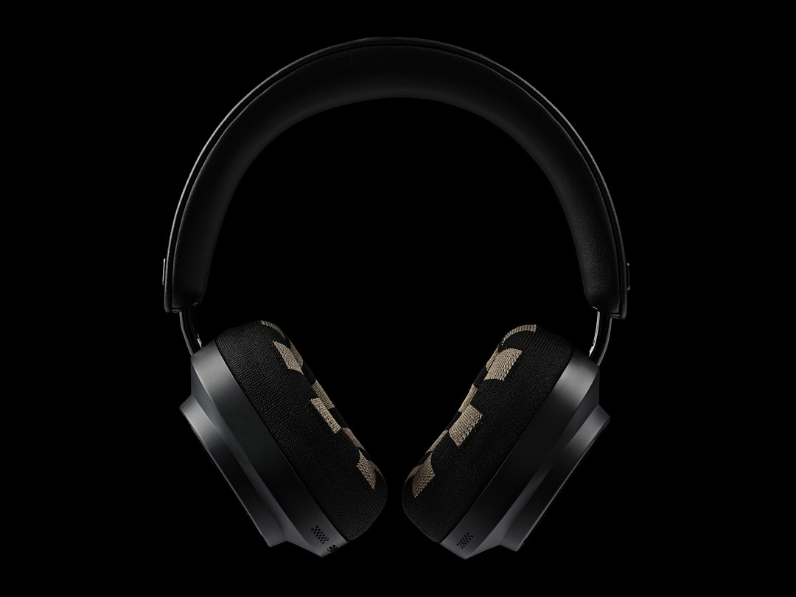
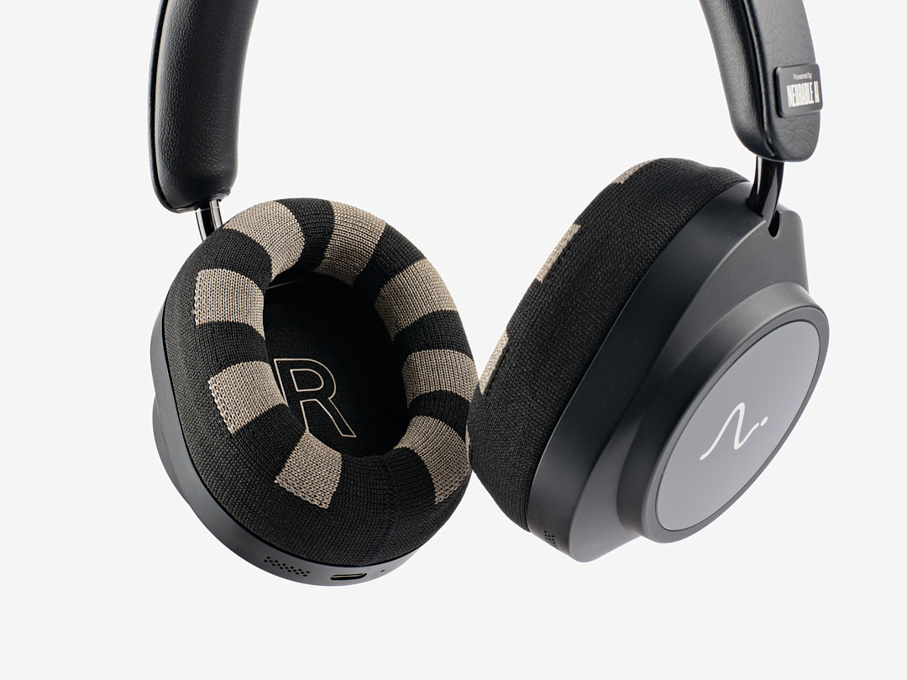
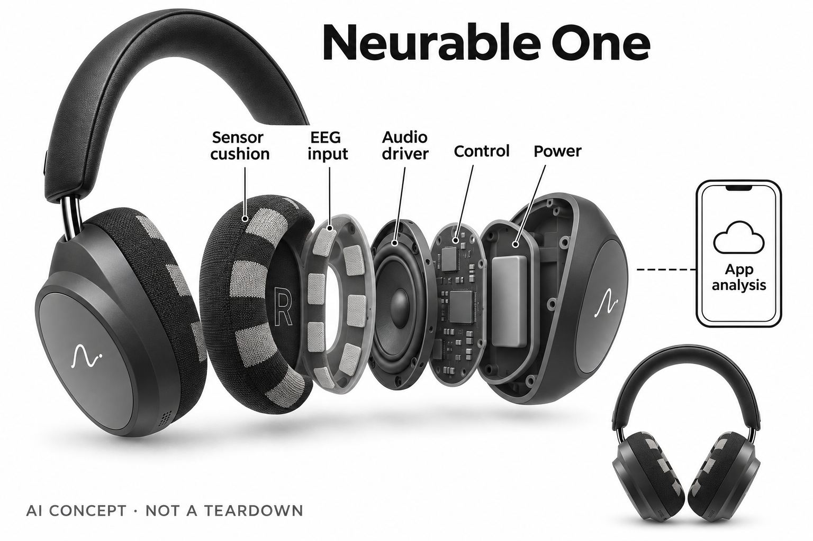

# Neurable One

**Neurable** · 健康与穿戴 · 核查 2026-11-04

耳垫脑电信号形成专注反馈与个人历史

消费渠道：个人零售。

## 产品图片与结构参考

### 产品图

Neurable One官方正面产品图，耳垫显示织物传感区域 · 来源：[Neurable · 官方产品图片](<https://www.neurable.com/products/neurable-one>) · [原始图片](<https://cdn.prod.website-files.com/68236712486104f66d06ca97/6abe0e29f8aceb5f40c0950a_Neurable%20One%20Straight%20On.jpg>)

### 参考图

Neurable One官方耳垫干式EEG传感区域细节 · 来源：[Neurable · 官方产品图片](<https://www.neurable.com/products/neurable-one>) · [原始图片](<https://cdn.prod.website-files.com/68236712486104f66d06ca97/6abe0e2a2ce842efff4ad6fb_Neurable%20One%20Cup%20Sensor%20Detail%20White.jpg>)

### AI 生成爆炸示意

**AI 生成 · 非实物拆机。** 内部为概念推断，不能作为元件布局、BOM 或维修依据。[生成提示词](../../content/hardware/prompts/neurable-one.txt)

> 已核对灰阶外观与织物传感特征，无脑龄数值、读心或医学效果宣称；内部层为概念结构。

> 两张图片已实际查看并对应当前Neurable One页面，未借用已停售MW75型号图。

> 分析为基于公开资料的案头研究与 AI 辅助判断，未经用户访谈、销量审计或实物拆机。需求、画像、竞争冷门度、审美及商业机会均为研究假设，不是投资结论。

## 销售与购买

- 状态：在售。当前官方商店明确Ships now、US only、US$499与Buy now，并列5–8工作日配送；公开商品HTMLavailable=true。已停售MW75 Neuro不作为本款销售证据。

- 地区：美国

- 价格：US$499。所见美国官方商店价格，税费及服务条款以结算为准；不混用MW75或MW75 LT历史标价。

- 中国大陆：当前官方商店明确仅向美国配送；未核实大陆正式渠道与售后，不以跨境转运猜测国内可用性。

- [官方产品 / 商店](<https://www.neurable.com/products/neurable-one>)

## AI 的实际作用

官方发布说明明确AI与信号处理清除日常电噪声，解析耳垫EEG模式形成专注、疲劳相关指标和反馈。ANC不是本款收录AI的依据。

服务与联网依赖：EEG指标依兼容App、账号与服务器处理；官网说明原始记录在服务器处理和保存。可仅作为音频耳机使用，但不等于完整脑电功能离线。

## 是否冷门

细分专业（研究判断）：重点是工作中的脑电反馈，区别于普通音频或睡眠头带；独立需求与商业效果仍需用户研究。

## 需求与市场

需求假设是长时间使用电脑的人希望了解自己何时更容易保持注意，以及休息前后是否存在可观察变化。数据可能帮助形成反思，也可能让人持续追逐分数；价值应来自更可理解的个人工作习惯，而不是把专注指标直接变成产出、能力或自律程度的评价。

### 官方｜工作会话中的脑电反馈 · 官方资料

Neurable One在耳垫中布置干式脑电传感，并用AI和信号处理分析与注意、疲劳相关的模式，应用提供会话反馈和个人历史。它的新增输入是EEG，普通降噪和音频播放不是AI收录依据；这些指标也不读取用户的思想、词句或工作内容，不能等同医学认知评估。

依据：[Neurable One官方功能与数据边界](<https://www.neurable.com/products/neurable-one>) · [Neurable One正式发布与AI机制](<https://www.neurable.com/blog-posts/neurable-one-is-here-the-headphones-ive-wanted-to-build-for-10-years>)

### 判断｜让主观状态有可回看的线索 · 研究判断

需求假设是长时间使用电脑的人希望了解自己何时更容易保持注意，以及休息前后是否存在可观察变化。数据可能帮助形成反思，也可能让人持续追逐分数；价值应来自更可理解的个人工作习惯，而不是把专注指标直接变成产出、能力或自律程度的评价。

依据：[Neurable One官方功能与数据边界](<https://www.neurable.com/products/neurable-one>)

### 验证｜将指标与真实任务分开记录 · 待验证

可在本人常做的阅读、写作和浏览任务中记录设备提示、主观感受与实际完成情况，观察它们是否一致。不要用一个高分证明任务有价值，或因低分给自己下健康结论；本研究没有独立脑电与工作效率对照，只提出评估反馈工具的过程和误差记录方式。

依据：[Neurable One官方功能与数据边界](<https://www.neurable.com/products/neurable-one>) · [Neurable One正式发布与AI机制](<https://www.neurable.com/blog-posts/neurable-one-is-here-the-headphones-ive-wanted-to-build-for-10-years>)

## 用户画像

已经习惯长时间戴耳机、希望观察工作节奏并愿意检查信号质量的人，可能较容易评估其价值。若用户主要进行频繁走动、短时碎片任务或不喜欢耳罩压力，耳机形态可能不适合持续采集；画像应围绕习惯与数据偏好建立，不能按职业或年龄推断认知需要。

### 官方｜耳机习惯与应用条件 · 官方资料

产品可在关闭应用时作为普通耳机使用，但脑电会话、历史与报告涉及兼容手机和账号服务，原始记录在服务器处理和保存。两种用途具有不同条件，不能把音频能播放理解为全部脑电功能离线可用；当前官方商店仅列美国配送，不证明其他地区服务和售后同等开放。

依据：[Neurable One官方商店](<https://checkout.neurable.com/products/neurable-one>) · [Neurable One官方功能与数据边界](<https://www.neurable.com/products/neurable-one>)

### 判断｜愿意接受记录但不被分数支配 · 研究判断

已经习惯长时间戴耳机、希望观察工作节奏并愿意检查信号质量的人，可能较容易评估其价值。若用户主要进行频繁走动、短时碎片任务或不喜欢耳罩压力，耳机形态可能不适合持续采集；画像应围绕习惯与数据偏好建立，不能按职业或年龄推断认知需要。

依据：[Neurable One官方功能与数据边界](<https://www.neurable.com/products/neurable-one>)

### 验证｜观察本人是否理解数据含义 · 待验证

试用可让本人说明当前数值来自哪次会话、为什么有时没有结果，以及收到提示后是否愿意改变活动。把信号接触、操作困难与信息理解分别记录，避免把应用上手快等同指标可信；使用者还应能决定何时关闭反馈或仅听音频，而不必为保持数据连续勉强佩戴。

依据：[Neurable One官方功能与数据边界](<https://www.neurable.com/products/neurable-one>) · [Neurable One正式发布与AI机制](<https://www.neurable.com/blog-posts/neurable-one-is-here-the-headphones-ive-wanted-to-build-for-10-years>)

## 竞争与替代

计时器提供固定休息节奏但不读取身体信号，普通降噪耳机帮助管理声音环境却不给脑电历史。Neurable增加个体信号反馈，同时增加佩戴和数据处理成本；比较应看它是否提供超出简单记录的可用线索，而不能用传感器数量或专利数量推导优于所有工作习惯方法。

### 官方｜新型号替代已停售旧款 · 官方资料

当前官方商店销售Neurable One，发布说明也将其与早期合作产品区分，目录没有沿用MW75 Neuro的过期购买信息。不同代次的耳垫、数据处理和服务说明不能互借，价格按本款所见美国页面记录；同一专注任务也不因旧款改名或硬件更新就重复计为新的独立需求。

依据：[Neurable One官方商店](<https://checkout.neurable.com/products/neurable-one>) · [Neurable One正式发布与AI机制](<https://www.neurable.com/blog-posts/neurable-one-is-here-the-headphones-ive-wanted-to-build-for-10-years>)

### 判断｜与计时器和普通耳机比较 · 研究判断

计时器提供固定休息节奏但不读取身体信号，普通降噪耳机帮助管理声音环境却不给脑电历史。Neurable增加个体信号反馈，同时增加佩戴和数据处理成本；比较应看它是否提供超出简单记录的可用线索，而不能用传感器数量或专利数量推导优于所有工作习惯方法。

依据：[Neurable One官方功能与数据边界](<https://www.neurable.com/products/neurable-one>)

### 验证｜保持任务与反馈条件可比 · 待验证

可以比较使用和不使用会话反馈时的同类活动，记录被打断、主动休息和实际感受，避免把首次体验的新鲜感当长期帮助。成本表应包括设备、手机条件、维护和数据管理；本目录没有销量、用户留存和独立效果研究，不能依据上市宣传认定认知穿戴已形成稳定市场。

依据：[Neurable One官方商店](<https://checkout.neurable.com/products/neurable-one>) · [Neurable One官方功能与数据边界](<https://www.neurable.com/products/neurable-one>)

## 供应链

耳垫必须同时承担声学密封、佩戴舒适和电信号接触，头部动作与位置变化会让这些目标互相影响。增加AI处理不能自动修复所有接触不足，芯片选型也需结合电极结构；同类新设计应从原始信号质量出发，而不是在普通耳机上添加一个分数界面就宣称获得脑电能力。

### 官方｜织物传感与整机边界 · 官方资料

官方确认耳垫内织物电极、音频结构与相关传感类别，并说明本代由Neurable负责设计和推出。这里不能进一步推断实际装配厂、芯片制造商或电极材料供应商，品牌自己设计也不等于全部制造环节自营；概念图中的板形、供电和信号层不是真实拆机资料。

依据：[Neurable One官方功能与数据边界](<https://www.neurable.com/products/neurable-one>) · [Neurable One正式发布与AI机制](<https://www.neurable.com/blog-posts/neurable-one-is-here-the-headphones-ive-wanted-to-build-for-10-years>)

### 判断｜接触结构影响模型输入 · 研究判断

耳垫必须同时承担声学密封、佩戴舒适和电信号接触，头部动作与位置变化会让这些目标互相影响。增加AI处理不能自动修复所有接触不足，芯片选型也需结合电极结构；同类新设计应从原始信号质量出发，而不是在普通耳机上添加一个分数界面就宣称获得脑电能力。

依据：[Neurable One官方功能与数据边界](<https://www.neurable.com/products/neurable-one>) · [Neurable One正式发布与AI机制](<https://www.neurable.com/blog-posts/neurable-one-is-here-the-headphones-ive-wanted-to-build-for-10-years>)

### 验证｜采集与无线链路分别验收 · 待验证

供应候选可分为专门生物电前端与低功耗连接控制，前者需要验证输入噪声和接触状态，后者需要确认数据量、存储及传输过程。二者都不提供Neurable的完整模型，也不代表当前采用；整机还需检验正常音乐、说话和佩戴变化时的信号处理与反馈。

依据：[Neurable One官方功能与数据边界](<https://www.neurable.com/products/neurable-one>) · [Neurable One正式发布与AI机制](<https://www.neurable.com/blog-posts/neurable-one-is-here-the-headphones-ive-wanted-to-build-for-10-years>)

## 技术路径

集中浏览娱乐内容也可能呈现注意集中的信号，因此专注度不是工作质量判断，更不是对人的能力评级。长期指标还可能受接触、任务和日程变化影响，个人趋势应保留这些背景；技术分析需要区分可测电活动、算法估计与用户最终解释，避免把相关标签理解成明确心理事实。

### 官方｜AI清理噪声并解释信号模式 · 官方资料

官方发布文明确AI与信号处理用于清理日常电噪声，并将剩余模式转成个人会话指标。产品页同时说明信号不足时会显示缺失，而不是把它当零分；原始数据在服务器处理的描述意味着不能宣传所有分析都在耳罩本地完成，具体模型结构及个人准确率仍未完整公开。

依据：[Neurable One官方功能与数据边界](<https://www.neurable.com/products/neurable-one>) · [Neurable One正式发布与AI机制](<https://www.neurable.com/blog-posts/neurable-one-is-here-the-headphones-ive-wanted-to-build-for-10-years>)

### 判断｜模型输出不等于任务价值 · 研究判断

集中浏览娱乐内容也可能呈现注意集中的信号，因此专注度不是工作质量判断，更不是对人的能力评级。长期指标还可能受接触、任务和日程变化影响，个人趋势应保留这些背景；技术分析需要区分可测电活动、算法估计与用户最终解释，避免把相关标签理解成明确心理事实。

依据：[Neurable One官方功能与数据边界](<https://www.neurable.com/products/neurable-one>)

### 验证｜缺失与异常都应可解释 · 待验证

试用可记录应用出现空缺时的佩戴和动作，检查重新调整后是否恢复，并比较不同任务中的提示含义。对长期报告应能追溯会话和输入条件，不用单次结果评判健康状态；本目录没有复现厂商研究，不将发布文里的实验或精选用户感受转写成普遍准确率。

依据：[Neurable One官方功能与数据边界](<https://www.neurable.com/products/neurable-one>) · [Neurable One正式发布与AI机制](<https://www.neurable.com/blog-posts/neurable-one-is-here-the-headphones-ive-wanted-to-build-for-10-years>)

## 产品审美

若耳罩让用户经常摘下，持续记录就会出现缺口，外观和舒适因此直接影响数据覆盖，而不只是购买偏好。另一方面，为获得完整分数而强行延长佩戴也不是理想体验；设计应让用户容易选择音频、会话或休息，并理解取下设备只意味着没有数据。

### 官方｜传感图案成为外观特征 · 官方资料

官方图片显示深色头梁、耳罩与带浅深交替织物区域的耳垫，传感结构融入日常音频形态。它没有额外暴露的头皮电极帽，但这不保证对所有头形、眼镜和长时间工作都舒适；最终触感、夹持和维护需要实机反馈，产品照片只能说明外观与接触区域。

依据：[Neurable One官方功能与数据边界](<https://www.neurable.com/products/neurable-one>) · [Neurable One正式发布与AI机制](<https://www.neurable.com/blog-posts/neurable-one-is-here-the-headphones-ive-wanted-to-build-for-10-years>)

### 判断｜长时佩戴决定数据是否有用 · 研究判断

若耳罩让用户经常摘下，持续记录就会出现缺口，外观和舒适因此直接影响数据覆盖，而不只是购买偏好。另一方面，为获得完整分数而强行延长佩戴也不是理想体验；设计应让用户容易选择音频、会话或休息，并理解取下设备只意味着没有数据。

依据：[Neurable One官方功能与数据边界](<https://www.neurable.com/products/neurable-one>)

### 验证｜在日常工作组合中观察 · 待验证

可观察戴眼镜、说话、转头和取下耳机时的操作与信号状态，再检查耳垫清洁和替换规则是否清楚。把音频满意度与脑电信息价值分开记录，避免因喜欢声音而默认指标可靠；本次仅核实官方外观与功能，没有实际长时间佩戴或材料耐久测试。

依据：[Neurable One官方商店](<https://checkout.neurable.com/products/neurable-one>) · [Neurable One官方功能与数据边界](<https://www.neurable.com/products/neurable-one>)

## 关键风险

脑电相关分数容易被误用于评价工作投入、能力或心理状态，但设备并不知道用户在做什么，也没有依据为这些判断提供保证。个人记录的使用应由本人控制，特别是报告分享和账号访问；研究应同时关注解释负担和隐私选择，不把更多连续采集本身当成更好的体验。

### 官方｜非医疗与服务器数据处理边界 · 官方资料

官网明确本款是消费健康信息产品，不用于诊断、治疗或监测疾病，并说明原始记录在服务器处理和保存。账号历史与删除入口构成服务的一部分，不能把数据处理描述成完全本地或天然匿名；官方也明确这些信号不能读取思想，目录保持这一功能边界。

依据：[Neurable One官方功能与数据边界](<https://www.neurable.com/products/neurable-one>) · [Neurable One正式发布与AI机制](<https://www.neurable.com/blog-posts/neurable-one-is-here-the-headphones-ive-wanted-to-build-for-10-years>)

### 判断｜个人指标不应成为外部评价 · 研究判断

脑电相关分数容易被误用于评价工作投入、能力或心理状态，但设备并不知道用户在做什么，也没有依据为这些判断提供保证。个人记录的使用应由本人控制，特别是报告分享和账号访问；研究应同时关注解释负担和隐私选择，不把更多连续采集本身当成更好的体验。

依据：[Neurable One官方功能与数据边界](<https://www.neurable.com/products/neurable-one>)

### 验证｜检查控制权与退出方式 · 待验证

交付前可核对账号、数据删除、导出及支持范围，试用时观察本人能否暂停会话或仅保留音频用途。记录被提示打断、误解指标和停止使用的原因，允许用户认为这些数据不适合自己；验证关注工具使用边界，不对个人认知状态或改善效果作结论。

依据：[Neurable One官方商店](<https://checkout.neurable.com/products/neurable-one>) · [Neurable One官方功能与数据边界](<https://www.neurable.com/products/neurable-one>)

## 机会与验证

值得研究的是设备是否帮助用户理解自己何时需要改变工作节奏，而不是让人追逐不可解释的脑龄或电量标签。一个能说明信号不足、允许拒绝提示的系统可能更容易被持续接受；这种价值需要真实活动验证，不能由AI、脑机接口名称或实验室出身直接推定。

### 官方｜脑电反馈构成主要差异 · 官方资料

Neurable One的目录价值来自工作会话中的脑电输入与反馈，而不是普通降噪耳机升级。不同音频配置与历史型号仍属于相同核心任务，不因指标名称更多就重复扩张场景；本条以当前可购型号展示输入、服务和个人解释之间的关系，并保留未公开的模型与制造细节。

依据：[Neurable One官方功能与数据边界](<https://www.neurable.com/products/neurable-one>) · [Neurable One正式发布与AI机制](<https://www.neurable.com/blog-posts/neurable-one-is-here-the-headphones-ive-wanted-to-build-for-10-years>)

### 判断｜有用反馈应减少困惑 · 研究判断

值得研究的是设备是否帮助用户理解自己何时需要改变工作节奏，而不是让人追逐不可解释的脑龄或电量标签。一个能说明信号不足、允许拒绝提示的系统可能更容易被持续接受；这种价值需要真实活动验证，不能由AI、脑机接口名称或实验室出身直接推定。

依据：[Neurable One官方功能与数据边界](<https://www.neurable.com/products/neurable-one>)

### 验证｜观察数周后的实际保留 · 待验证

后续可记录用户持续启动的会话、关闭的提示、实际采取的休息以及未理解的报告，再与原有工作习惯比较。把信号质量、信息理解和行动选择分别评价，避免混成一个满意分数；当前只有公开资料研究，没有独立长期效果、访谈或市场规模证据。

依据：[Neurable One官方商店](<https://checkout.neurable.com/products/neurable-one>) · [Neurable One官方功能与数据边界](<https://www.neurable.com/products/neurable-one>) · [Neurable One正式发布与AI机制](<https://www.neurable.com/blog-posts/neurable-one-is-here-the-headphones-ive-wanted-to-build-for-10-years>)

## 对应供应链公司

能力候选用于选型研究，不代表本产品实际采用；未公开的供货关系不作推断。

- [texas-instruments](../supply-chain/texas-instruments.md) — **能力候选 · 非已采用** / 同类耳部EEG设备的生物电前端候选：TI ADS1299明确面向EEG和生物电采集，可用于研究低噪声放大、同步采样及接触状态，但干织物耳垫的实际阻抗、运动干扰和供电尺寸仍需验证。它不提供Neurable认知指标或噪声清理模型，也没有本款采用证据；不能把芯片用途等同整机效果或认证。

- [nordic-semiconductor](../supply-chain/nordic-semiconductor.md) — **能力候选 · 非已采用** / 同类脑电音频穿戴的数据连接控制候选：Nordic的低功耗无线和控制平台可用于研究脑电记录、手机连接与唤醒流程，实际数据吞吐、音频共存和存储需求需单独确认。它不自动支持本款完整音频或AI服务，也未被点名采用；此为相近新设计的通信候选，不是Neurable One原机主控认定。

[浏览供应链目录](../supply-chain.md)

## 功能分层示意

这是功能关系，不是实物拆机、真实空间结构或已核实 BOM。

1. **耳垫信号输入**：织物干电极接收耳周EEG，实际接触与运动会影响信号质量。（官方披露）

2. **生物电与信号处理**：采集与AI处理分离脑电相关模式和日常噪声，具体芯片未知。（官方披露）

3. **音频反馈**：普通音频与会话提示共用耳机形态，音频质量不等同认知指标准确。（官方披露）

4. **应用与服务器**：手机呈现会话、个人历史与报告，原始记录在服务器处理和存储。（官方披露）

5. **个人解释**：指标与本人先前数据比较，不判断工作价值、思想内容或医学状态。（分析推断）

## 来源

1. [Neurable One官方商店](<https://checkout.neurable.com/products/neurable-one>) — 本轮已打开：US$499、Ships now、US only、Buy now、配送说明；公开HTML商品available=true，页面Sold out为同时存在的模板文字。

2. [Neurable One官方功能与数据边界](<https://www.neurable.com/products/neurable-one>) — 本轮已打开：耳垫EEG、会话与个人指标、原始数据服务器处理及非医疗/非思想读取边界。

3. [Neurable One正式发布与AI机制](<https://www.neurable.com/blog-posts/neurable-one-is-here-the-headphones-ive-wanted-to-build-for-10-years>) — 本轮已打开，2026-10-01官方发布明确AI消除日常电噪声及本款；不把厂商研究和用户故事当独立疗效。

[返回目录](../hardware-market.md) · [网页分析](https://romanagent.github.io/Roman/#hardware/product/neurable-one)
