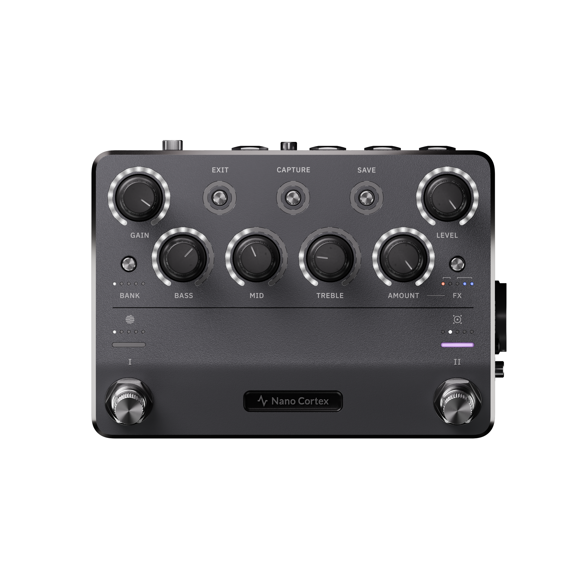
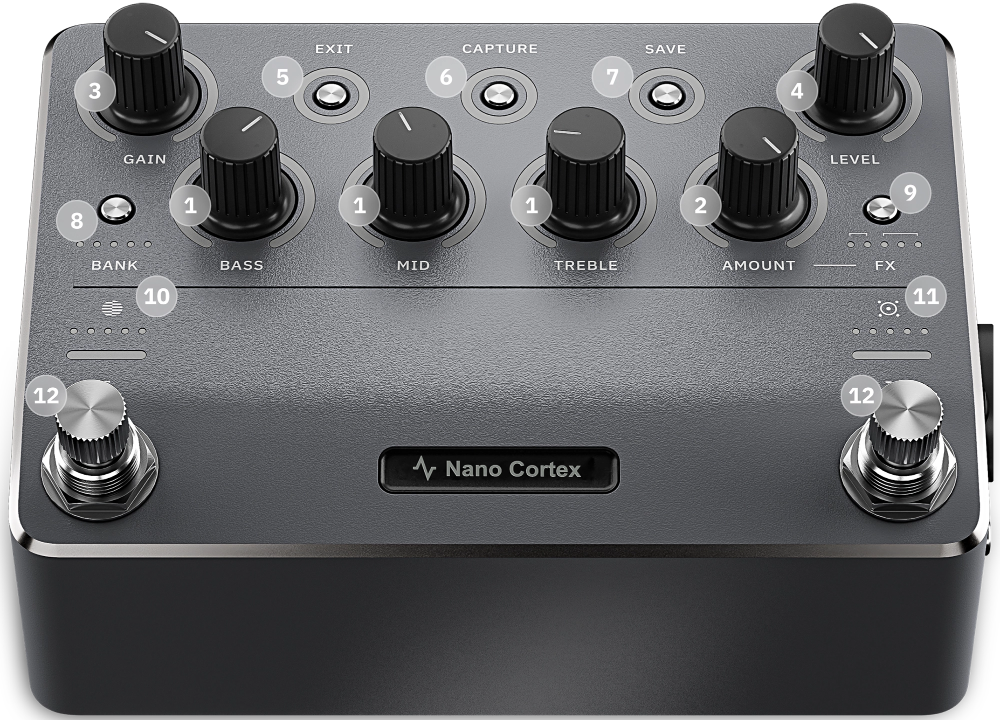
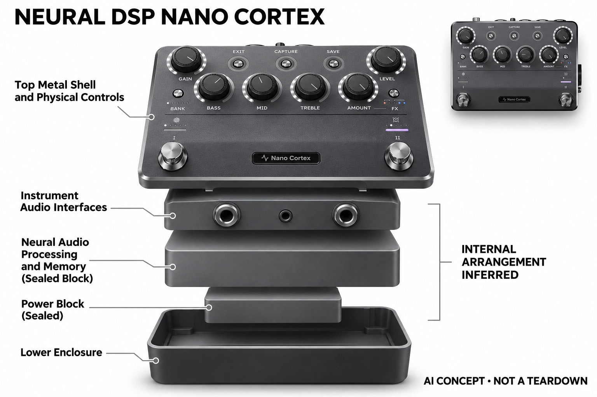

# Neural DSP Nano Cortex

**Neural DSP** · 音乐与乐器 · 核查 2026-11-04

把设备内神经采样放进可随身带走的小踏板

消费渠道：个人零售。

## 产品图片与结构参考

### 产品图

Neural DSP Nano Cortex · 官方产品图 · 来源：[Neural DSP · 官方图片](<https://neuraldsp.jp/products/nano-cortex>) · [原始图片](<https://cdn.shopify.com/s/files/1/0747/8109/8202/files/NanoCortexretailphotos-Transparentbackground_1_3.png?v=1781229660>)

### 参考图

Neural DSP Nano Cortex · 官方参考图 · 来源：[Neural DSP · 官方图片](<https://neuraldsp.com/nano-cortex>) · [原始图片](<https://neuraldsp.com/_next/static/media/nc-controls.81433233.webp>)

### AI 生成爆炸示意

**AI 生成 · 非实物拆机。** 内部为概念推断，不能作为元件布局、BOM 或维修依据。[生成提示词](../../content/hardware/prompts/neural-dsp-nano-cortex.txt)

> 已目视核对外形、标签与非拆机声明；不代表内部结构经实测验证。

> 参考图是官方控制位置说明，不是内部拆机。

> 分析为基于公开资料的案头研究与 AI 辅助判断，未经用户访谈、销量审计或实物拆机。需求、画像、竞争冷门度、审美及商业机会均为研究假设，不是投资结论。

## 销售与购买

- 状态：在售。日本官方在线商店显示¥89,800、购买和加入购物车入口，未显示售罄。本次按官方零售页面确认，未下单验证配送。

- 地区：日本官方商店

- 价格：日本官网 ¥89,800。日元含税页面快照，实际地区售价、税费和配送另核。

- 中国大陆：本轮核实所列区域官方商店；未确认中国大陆官方现货、账户及完整服务，不把境外可购等同大陆可用。

- [官方产品 / 商店](<https://neuraldsp.jp/products/nano-cortex>)

## AI 的实际作用

可在设备内创建Neural Capture，学习物理音箱、过载或箱体响应；已捕获模型可用于吉他和贝斯演奏。

服务与联网依赖：官方说明创建捕获无需电脑、互联网或应用；云端模型发现和管理功能仍涉及Cortex Cloud，不能把插件兼容性与Quad Cortex等同。

## 是否冷门

细分专业（研究判断）：便携且本机可捕获形成细分，仍需比较其他小型模型踏板。

## 需求与市场

需求假设：需要轻装排练或在不同场所演奏的人，可能希望保留一组熟悉音色而减少大踏板携带。验证应记录装包、接线和找预设的实际时间，并确认紧凑控制是否增加临场操作困难。

### 需求假设：小型踏板也能现场准备熟悉响应 · 研究判断

Nano Cortex将本机捕获放入紧凑踏板，针对希望轻装排练、备用或补充现有系统，却不想依赖电脑完成每次捕获的人。需求应验证小型与本机学习是否同时被需要，不能仅凭体积小推断方便，也不把它当作Quad Cortex的全部能力缩小版。

依据：[Nano Cortex日本官方商店](<https://neuraldsp.jp/products/nano-cortex>) · [Nano Cortex全球技术说明](<https://neuraldsp.com/nano-cortex>)

### 价值判断：便携收益可能换来更多管理步骤 · 研究判断

更少机身控制有利于占用空间，但复杂内容管理可能转向应用，用户需要接受这种分工。研究应比较装包和现场调整的总负担，不只看裸机重量，也不能把创建捕获无需网络理解为所有模型发现、编辑和服务都完全脱离手机。

依据：[Nano Cortex全球技术说明](<https://neuraldsp.com/nano-cortex>)

### 验证方案：分别测试主用与备用任务 · 待验证

让乐手把Nano用于一次真实排练主系统和一次备用配置，记录捕获、接线、找预设及恢复，再与原方案比较。保持目标声音和监听一致，不只演示本机捕获成功，也不以一次试听证明紧凑控制适合所有演出流程。

依据：[Nano Cortex日本官方商店](<https://neuraldsp.jp/products/nano-cortex>) · [Nano Cortex全球技术说明](<https://neuraldsp.com/nano-cortex>)

## 用户画像

画像推断：已有乐器与监听设备、希望便携备用系统或小型踏板链的个人乐手较匹配。它与大型触屏设备的需求不同，用户需要接受更少的机身控制，并愿意使用应用管理较复杂的内容。

### 画像假设：重视携带与现有系统补充的乐手 · 研究判断

较匹配者已有乐器、监听和基本信号知识，希望减少大设备携带或建立便携备用链路，而不是只因低于旗舰价格购买。画像应明确主用、备用或踏板板补充任务，不把三种动机混成一类，也不将紧凑定位自动等同新手入门。

依据：[Nano Cortex日本官方商店](<https://neuraldsp.jp/products/nano-cortex>) · [Nano Cortex全球技术说明](<https://neuraldsp.com/nano-cortex>)

### 使用约束：更少实体控制需要准备习惯 · 研究判断

用户需要接受机身操作取舍，并在合适时间使用应用管理复杂内容，现场不一定能像大型触屏设备那样快速编辑。研究应观察常用预设是否足够和临时修改频率，不能因为本机能捕获就推断所有准备都无需外部设备。

依据：[Nano Cortex全球技术说明](<https://neuraldsp.com/nano-cortex>)

### 访谈重点：哪些东西真的可以不再携带 · 待验证

请用户列出原有排练包中的电脑、接口或大型踏板，说明Nano是否能移除它们，还是只增加一个备用盒子。这个问题能区分真实减负与兴趣购买，不能把设备小自动换算为整体行李更少，也不由备用使用少推断没有价值。

依据：[Nano Cortex日本官方商店](<https://neuraldsp.jp/products/nano-cortex>) · [Nano Cortex全球技术说明](<https://neuraldsp.com/nano-cortex>)

## 竞争与替代

竞争判断：小型音色踏板同时面对其他神经模型播放器、传统耳放和手机音效接口。便携并不等于新市场，关键差异是能否在小设备内完成捕获以及保存的声音是否稳定满足演奏习惯。

### 替代方案：模型播放器、小耳放与手机链路 · 研究判断

Nano面对其他神经踏板、传统小型耳放、手机音效接口和大型系统，便携本身不是新的市场。其本机捕获是可以具体比较的流程差异，但需要结合控制与内容管理，不能仅按体积、价格或是否有AI评判哪种适合所有乐手。

依据：[Nano Cortex日本官方商店](<https://neuraldsp.jp/products/nano-cortex>) · [Nano Cortex全球技术说明](<https://neuraldsp.com/nano-cortex>)

### 差异判断：不依赖电脑捕获与简化控制并存 · 研究判断

官方明确创建捕获无需电脑、网络或应用，这与仅播放外部模型的设备不同，但云端发现和管理仍有依赖。研究应检验用户是否真的经常现场捕获，不能把偶尔用一次的能力当作日常价值，也不复制旗舰的插件兼容表述。

依据：[Nano Cortex全球技术说明](<https://neuraldsp.com/nano-cortex>)

### 比较方法：按目标预设和现场修改对照 · 待验证

用相同目标声音比较Nano、播放器与电脑路线的捕获、传输、保存和切换，再记录临时调整是否增加操作。不要只计创建模型所用步骤，也不把不同监听或文件质量差异归给硬件，完整演奏任务才能显示便携方案的取舍。

依据：[Nano Cortex全球技术说明](<https://neuraldsp.com/nano-cortex>)

## 供应链

供应链推断：紧凑金属壳体中的脚控、接口、处理与供电需要兼顾空间和耐用性。官方未披露制造工厂或完整物料清单；频繁搬运、供电适配和接口寿命比静态参数更影响日常体验。

### 功能拆分：本机学习与外部管理有明确边界 · 研究判断

公开流程包含目标设备采样、本机Neural Capture、本地模型及效果播放和Cortex Cloud管理，机身控制服务现场操作。不能把Nano写成只有播放器，也不能赋予旗舰全部功能，具体处理器、音频转换、电源和工厂本轮未披露。

依据：[Nano Cortex全球技术说明](<https://neuraldsp.com/nano-cortex>)

### 制造判断：小型外壳加剧连接与控制约束 · 研究判断

脚开关、插座和处理供电需要在有限空间中协作，反复搬运与踩踏会影响真实体验，尺寸小不代表工程简单。供应评估应关注接口受力、底噪与可维修性，本轮没有原机装配、电路或耐久数据，不能从外壳推算成本和制造来源。

依据：[Nano Cortex日本官方商店](<https://neuraldsp.jp/products/nano-cortex>) · [Nano Cortex全球技术说明](<https://neuraldsp.com/nano-cortex>)

### 候选选型：板级装配与外壳按任务定义 · 研究判断

JLCPCB可作为按合法设计文件进行音频板样机装配的候选，Fictiv可讨论紧凑外壳与固定结构，二者不提供Neural Capture算法。音频与脚控需要专项验证，也没有点名供货证据，不能把制造服务目录当作原机内部方案或兼容零件。

依据：[Nano Cortex日本官方商店](<https://neuraldsp.jp/products/nano-cortex>) · [Nano Cortex全球技术说明](<https://neuraldsp.com/nano-cortex>)

## 技术路径

官方明确设备内捕获无需电脑或网络，并通过云端管理扩展声音。技术判断应检查捕获、模型格式和本地效果的版本边界，不能把大型同品牌产品的全部插件能力直接复制到此型号。

### 已披露能力：不依赖电脑创建捕获 · 官方资料

全球官方页明确Nano能在设备内创建Neural Capture，无需电脑、网络或应用，已保存模型可供演奏，云端管理则另有路径。需要区分捕获与播放、模型与普通效果，不把本机学习理解为重建原设备全部控制，也不补写未知芯片与算力。

依据：[Nano Cortex全球技术说明](<https://neuraldsp.com/nano-cortex>)

### 技术判断：独立捕获仍依赖正确连接与目标状态 · 研究判断

即使无需电脑，原设备设置、输入电平和采样链路仍影响结果，用户需要知道模型对应的条件。研究应观察捕获失败或不合意时如何判断原因，不能因为流程短就说无需学习，也不以厂商相似度描述代替对实际动态的测试。

依据：[Nano Cortex全球技术说明](<https://neuraldsp.com/nano-cortex>)

### 验证方案：把捕获与管理分别测试 · 待验证

记录具体目标、连接、固件和捕获结果，再检查保存、云端管理与本地切换的行为，保持输入监听一致。不要将应用功能误判为本体能力，也不假定未来模型或旗舰插件必然兼容，本轮没有完整格式测试和延迟实测数据。

依据：[Nano Cortex日本官方商店](<https://neuraldsp.jp/products/nano-cortex>) · [Nano Cortex全球技术说明](<https://neuraldsp.com/nano-cortex>)

## 产品审美

审美判断：低矮金属小踏板与少量实体控制适合融入已有踏板板，减少额外屏幕占用。控制密度和标签可读性需要结合实际脚位与光照检查，外观极简也可能意味着更多应用内操作。

### 外形判断：低矮小踏板融入已有设备板 · 研究判断

紧凑金属形态和少量实体控制有利于放入既有踏板布局，却可能让接口与脚位更紧张。设计评价应结合实际线缆和站立操作，不只看桌面占地，外观极简也可能意味着更依赖应用，不能把少按钮自动解释为更易用。

依据：[Nano Cortex日本官方商店](<https://neuraldsp.jp/products/nano-cortex>)

### 交互判断：当前状态需在有限界面中清楚 · 研究判断

没有大型触屏时，用户需要通过有限控制理解当前声音和操作结果，准备好的命名与配置可能更重要。研究应观察是否误切、忘记状态或临时掏手机，不能以机身控制少当作天然简洁，也不将更多应用操作隐藏在便携宣传之后。

依据：[Nano Cortex全球技术说明](<https://neuraldsp.com/nano-cortex>)

### 体验验证：真实装包与快速备用切换 · 待验证

让用户把Nano放入原排练包和踏板板，完成接线、调用与恢复，另模拟需要启用备用链路的非正式场景。记录多带的配件与减少的设备，比只称量裸机更能判断便携收益，也能发现主用和备用设计要求的差异。

依据：[Nano Cortex日本官方商店](<https://neuraldsp.jp/products/nano-cortex>) · [Nano Cortex全球技术说明](<https://neuraldsp.com/nano-cortex>)

## 关键风险

风险判断：小体积会带来控制和连接取舍，原设备捕获条件与模型版本仍影响结果。云端库、移动应用和固件变化需分别记录；演出前应验证稳定预设，不以厂商相似度措辞代替听音判断。

### 兼容风险：同品牌不能默认功能相同 · 研究判断

Nano与Quad Cortex在控制和兼容上有边界，不能将旗舰插件、效果或未来更新默认赋给小设备。捕获条件也会影响声音，用户应验证具体文件与稳定预设，本轮没有全部内容或现场可靠性测试，不把独立捕获写成效果保证。

依据：[Nano Cortex全球技术说明](<https://neuraldsp.com/nano-cortex>)

### 拥有风险：外部管理与电源仍需支持 · 研究判断

云端库、手机应用和固件变化可能影响复杂管理，供电、线缆与地区维修也属于便携系统成本。不能把无需网络捕获理解为永久不需要服务，也不由日本官方可购推断所有地区都有相同支持，实际购买组合需另行确认。

依据：[Nano Cortex日本官方商店](<https://neuraldsp.jp/products/nano-cortex>) · [Nano Cortex全球技术说明](<https://neuraldsp.com/nano-cortex>)

### 验证安排：保留回到大设备或电脑的原因 · 待验证

试用应记录因控制不足、声音不合意、连接或管理而回到原系统的场景，区分内容与硬件限制。不要只统计模型创建成功，也不将备用使用频率低直接判为失败，关键是用户需要时是否能清楚可靠地完成相应任务。

依据：[Nano Cortex全球技术说明](<https://neuraldsp.com/nano-cortex>)

## 机会与验证

市场观察：Nano的独立意义是便携且可本机捕获，与完整舞台触屏设备有不同使用路径。可以比较其作为主系统、备用系统和现有踏板补充时的使用次数，避免只按体积或价格推导需求。

### 研究方向：便携捕获与现场控制的平衡 · 研究判断

Nano可用于研究小设备本机捕获是否减少具体准备摩擦，机会可能在状态解释、应用衔接与快速恢复，而不是继续压缩体积。应先确认用户在哪里创建和使用模型，再决定硬件能力，避免把无需电脑当作所有乐手共同需求。

依据：[Nano Cortex全球技术说明](<https://neuraldsp.com/nano-cortex>)

### 执行计划：分别跟踪主用和备用链路 · 待验证

记录多次排练中Nano承担什么角色、实际捕获多少次、何时调用应用以及哪些设备被移除，访谈一次回退或保留的决定。将新奇探索与稳定演奏分开，不用销量传闻、社区热度或一次试听满意度推断长期价值。

依据：[Nano Cortex日本官方商店](<https://neuraldsp.jp/products/nano-cortex>) · [Nano Cortex全球技术说明](<https://neuraldsp.com/nano-cortex>)

### 决策边界：小型化是同任务中的路线差异 · 研究判断

Nano与其他响应设备共享便携音色任务，本机捕获和简化控制是具体取舍，不应仅凭型号大小制造独立市场。当前没有访谈、销量和供应报价，不以体积、价格或模型评分预测创业成功，仍需验证完整准备与演奏流程。

依据：[Nano Cortex日本官方商店](<https://neuraldsp.jp/products/nano-cortex>) · [Nano Cortex全球技术说明](<https://neuraldsp.com/nano-cortex>)

## 对应供应链公司

能力候选用于选型研究，不代表本产品实际采用；未公开的供货关系不作推断。

- [jlcpcb](../supply-chain/jlcpcb.md) — **能力候选 · 非已采用** / 紧凑音频与捕获控制板原型装配候选：JLCPCB公开PCB及PCBA流程，可用于Nano同类音频控制板的样机制造，但需开发者提供合法电路与BOM，实时音频、噪声和供电须专项验证，不提供现成Neural Capture方案。当前没有Nano原机板级资料或实际代工证据。

- [fictiv](../supply-chain/fictiv.md) — **能力候选 · 非已采用** / 小型脚踏音频外壳结构候选：Fictiv公开CNC及钣金等服务，可作为Nano类紧凑外壳与控制固定的制造候选，但接口间距、脚控载荷和接地公差需按设计验证。此关联不证明原机来源或兼容替换，也不涉及复制Neural DSP专有外形和内部布局。

[浏览供应链目录](../supply-chain.md)

## 功能分层示意

这是功能关系，不是实物拆机、真实空间结构或已核实 BOM。

1. **采样输入**：连接目标音箱或驱动设备获取响应。（官方披露）

2. **设备内学习**：本机生成Neural Capture。（官方披露）

3. **声音输出**：保存的模型与本地效果处理乐器信号。（官方披露）

4. **管理层**：实体脚控及Cortex Cloud应用。（官方披露）

## 来源

1. [Nano Cortex日本官方商店](<https://neuraldsp.jp/products/nano-cortex>) — 已打开，页面明确购买和加入购物车。

2. [Nano Cortex全球技术说明](<https://neuraldsp.com/nano-cortex>) — 已打开，官方说明设备内捕获不需要电脑与网络。

[返回目录](../hardware-market.md) · [网页分析](https://romanagent.github.io/Roman/#hardware/product/neural-dsp-nano-cortex)
