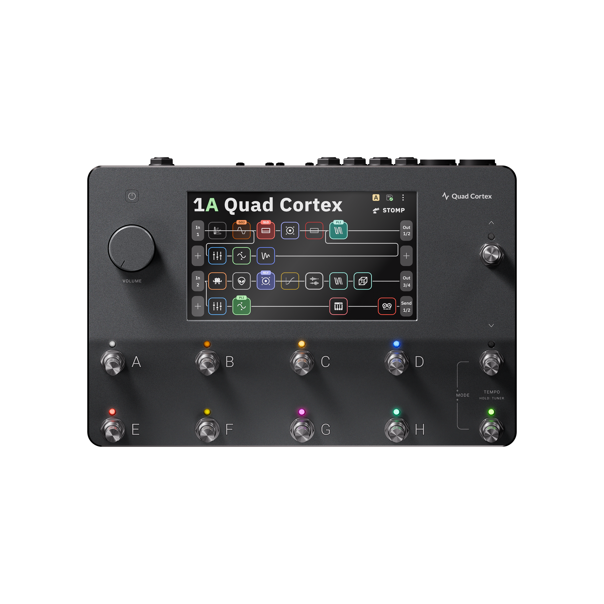
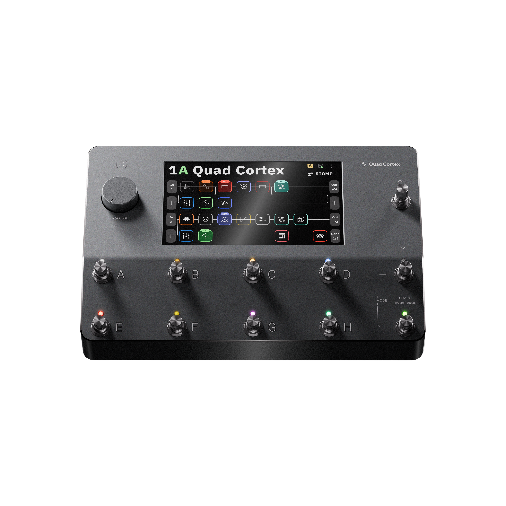
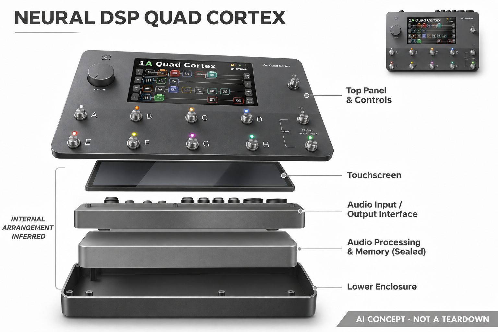

# Neural DSP Quad Cortex

**Neural DSP** · 音乐与乐器 · 核查 2026-11-04

将真实放大器响应学习为可演奏的神经音色模型

消费渠道：个人零售。

## 产品图片与结构参考

### 产品图

Neural DSP Quad Cortex · 官方产品图 · 来源：[Neural DSP · 官方图片](<https://neuraldsp.jp/products/quad-cortex>) · [原始图片](<https://cdn.shopify.com/s/files/1/0747/8109/8202/files/Quad_Cortex_retail_photos_-_Transparent_background_1_2.png?v=1781229375>)

### 参考图

Neural DSP Quad Cortex · 官方参考图 · 来源：[Neural DSP · 官方图片](<https://neuraldsp.jp/products/quad-cortex>) · [原始图片](<https://cdn.shopify.com/s/files/1/0747/8109/8202/files/QuadCortexretailphotos-Transparentbackground_2_1.png?v=1781229397>)

### AI 生成爆炸示意

**AI 生成 · 非实物拆机。** 内部为概念推断，不能作为元件布局、BOM 或维修依据。[生成提示词](../../content/hardware/prompts/neural-dsp-quad-cortex-repair.txt)

> 已目视核对外形、标签与非拆机声明；不代表内部结构经实测验证。

> 分析为基于公开资料的案头研究与 AI 辅助判断，未经用户访谈、销量审计或实物拆机。需求、画像、竞争冷门度、审美及商业机会均为研究假设，不是投资结论。

## 销售与购买

- 状态：在售。日本官方在线商店有购买和加购入口；其结构化Offer为InStock，官方产品数据available为true。未把插件、配色或组合套装另计。

- 地区：日本官方商店

- 价格：日本官网 ¥279,000。日元含税页面快照，不是中国到手价；服务地区和运输需按当地规则确认。

- 中国大陆：本轮核实所列区域官方商店；未确认中国大陆官方现货、账户及完整服务，不把境外可购等同大陆可用。

- [官方产品 / 商店](<https://neuraldsp.jp/products/quad-cortex>)

## AI 的实际作用

Neural Capture通过学习物理音箱、箱体或驱动设备的声音响应建立可播放模型，属于非生成式神经建模，不只是固定DSP效果。

服务与联网依赖：已保存模型在设备上演奏；分享与下载使用Cortex Cloud，捕获配置与兼容性按当前固件说明。

## 是否冷门

细分专业（研究判断）：神经音色采样服务个人乐手，使用知识和价格形成细分门槛。

## 需求与市场

需求假设：个人乐手希望把常用实体音箱的响应带到排练和演出，减少搬运并保持熟悉手感。应在相同输入和监听条件下比较动态反应、准备时间与可重复性，不能只凭音色数量判断价值。

## 用户画像

画像推断：已有吉他设备、理解信号链并愿意准备演出预设的乐手和个人录音创作者较匹配。只需要简单练习音色的初学者，可能更看重低成本与少设置，而非复杂触屏和捕获流程。

## 竞争与替代

竞争判断：舞台音色处理已有传统音箱、建模器、电脑插件及多种神经采样设备。高价专业细分也有密集竞争，用户会按接口、现场切换、兼容库和售后选择，不会只看是否使用神经网络。

## 供应链

供应链推断：脚踏开关、旋钮、触屏、低噪音频接口和处理模块需经反复踩踏与连接测试。官方本轮未公开完整代工厂及物料表；维护、备份和跨区域保修也是实际拥有成本。

## 技术路径

官方说明Neural Capture可学习设备声音特征。技术判断需区分捕获某个设置下的响应与重建所有旋钮行为，模型播放、普通效果和云端内容也应分别评估，不把数字模拟都视为同类AI。

## 产品审美

审美判断：金属踏板与大触屏呈现专业演出工具语言，脚控和旋转操作有清晰功能目的。舞台低光、脚位间距和可读性会影响操作，精致产品渲染不能替代演出环境中的快速识别。

## 关键风险

风险判断：捕获质量取决于输入输出连接、原设备状态及监听环境，下载模型也不保证适合每把琴。固件、模型库和演出备份需要管理，重要演出应保留稳定预设及故障后的替代链路。

## 机会与验证

市场观察：该条的AI价值来自对真实声音响应的学习和硬件实时播放。对比时应测试捕获流程、相同力度下的反应及舞台切换，而不是以专业外观或社区预设数量推算商业成功。

## 功能分层示意

这是功能关系，不是实物拆机、真实空间结构或已核实 BOM。

1. **音频采样**：真实乐器与目标设备提供音频响应。（官方披露）

2. **神经学习**：Neural Capture学习目标声音特征。（官方披露）

3. **模型演奏**：已保存捕获和效果构成本地信号链。（官方披露）

4. **操作与共享**：触屏脚控和Cortex Cloud管理。（官方披露）

## 来源

1. [Quad Cortex日本官方商店](<https://neuraldsp.jp/products/quad-cortex>) — 已打开，官方商品结构化库存和产品数据均可购。

2. [Quad Cortex全球官方能力](<https://neuraldsp.com/quad-cortex>) — 已打开，说明Neural Capture与信号处理。

[返回目录](../hardware-market.md) · [网页分析](https://romanagent.github.io/Roman/#hardware/product/neural-dsp-quad-cortex)
