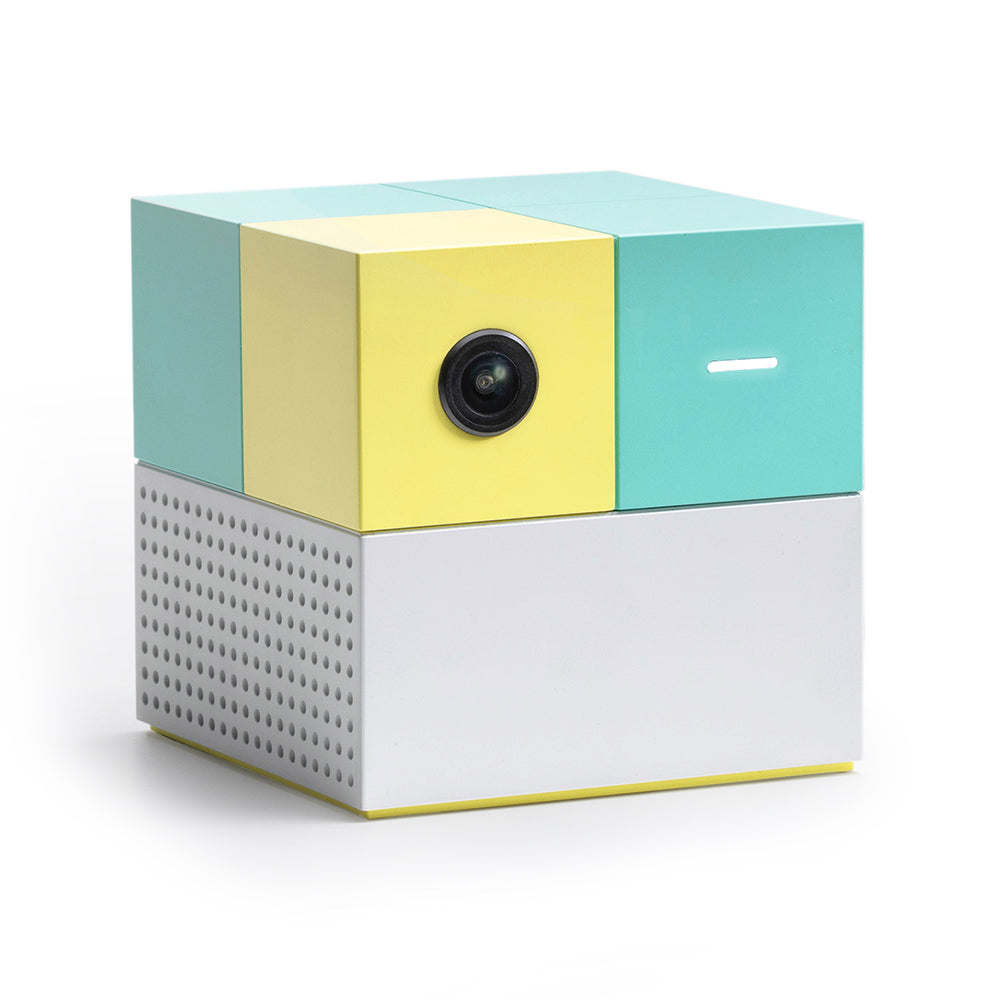
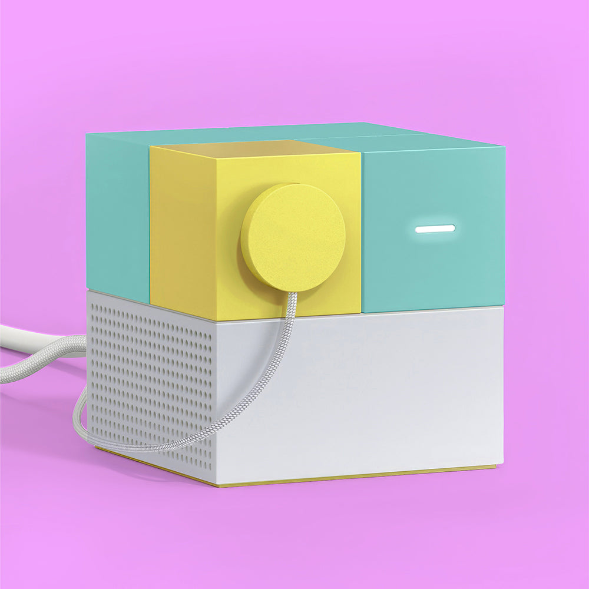
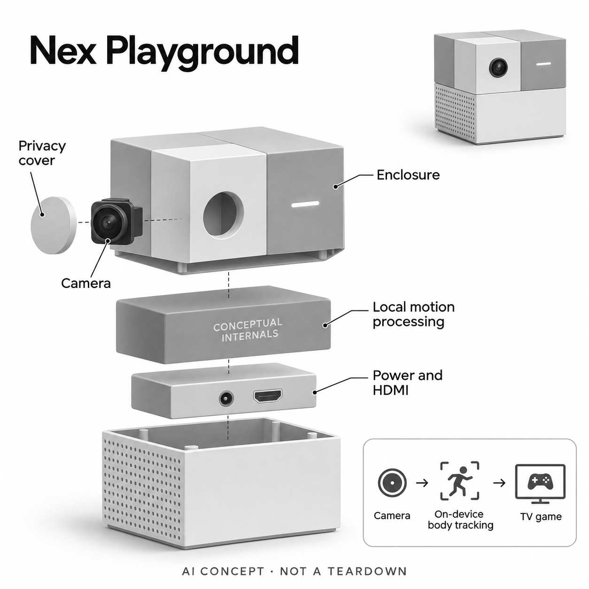

# Nex Playground

**Nex** · 游戏与桌游 · 核查 2026-11-04

用本机视觉识别身体动作的电视体感游戏主机

消费渠道：个人零售。

## 产品图片与结构参考

### 产品图

Nex Playground 官方产品图 · 来源：[Nex · 官方资料](<https://www.nexplayground.com/shop/nex-playground>) · [原始图片](<https://cdn.shopify.com/s/files/1/0737/8822/7896/files/1_Hero_Playground.jpg?v=1758295635&width=1600>)

### 参考图

Nex Playground 官方外观与使用参考图 · 来源：[Nex · 官方资料](<https://www.nexplayground.com/shop/nex-playground>) · [原始图片](<https://cdn.shopify.com/s/files/1/0737/8822/7896/files/11_Privacy_Cover.jpg?v=1759846844&width=1600>)

### AI 生成爆炸示意

**AI 生成 · 非实物拆机。** 内部为概念推断，不能作为元件布局、BOM 或维修依据。[生成提示词](../../content/hardware/prompts/nex-playground.txt)

> 以官方外观图为参照，已目视核对型号、外形、未提供参数与非拆机标记；内部位置仅为功能概念。

> 图片保留官方原貌；其中的宣传数字和效果不作为本站实测结论。

> 分析为基于公开资料的案头研究与 AI 辅助判断，未经用户访谈、销量审计或实物拆机。需求、画像、竞争冷门度、审美及商业机会均为研究假设，不是投资结论。

## 销售与购买

- 状态：在售。核查日官方商店显示US$299购买入口；官方购买地区页列美国官网及美国、加拿大、德国、英国和爱尔兰零售渠道。官网直送范围仅美国，不推断中国可直邮。

- 地区：美国、加拿大、德国、英国、爱尔兰

- 价格：官方硬件US$299。含5款入门游戏；可选Play Pass核查价US$89/12个月或US$49/3个月。内容、税费与地区价格以官网为准。

- 中国大陆：已核官方销售地区不含中国大陆，官网直送仅美国；未核大陆授权商及内容服务支持。跨境持有硬件不等于本地售后或订阅可用。

- [官方产品 / 商店](<https://www.nexplayground.com/shop/nex-playground>)

## AI 的实际作用

广角摄像头与本机计算机视觉AI追踪身体关键点，转换为多人游戏输入，无需手持动作控制器。

服务与联网依赖：需电视HDMI、摆放与活动空间；联网下载后游戏可离线运行。更多内容依赖可选Play Pass，遥控器用于菜单操作。

## 是否冷门

新兴竞争（研究判断）：客厅视觉游戏的输入方式明确，仍受普通游戏机、移动娱乐与家庭空间竞争，需求需通过持续使用验证。

## 需求与市场

案头需求是让家庭在电视前用身体动作一起玩，不必逐人学习手柄。它把运动变成游戏输入而非医疗或健身评估；价值取决于一家人是否愿意反复清出活动空间并共同参与。

### 事实：任务边界 · 官方资料

Nex Playground通过摄像头和本机动作识别把身体活动映射为电视游戏输入，遥控器主要用于选择菜单，参与玩法不需要每人持握控制器。它面向家庭共同娱乐，而不是通过身体追踪提供医学评估或保证训练效果；核心任务是让客厅参与者一起进入游戏。

依据：[Nex Playground官方商店](<https://www.nexplayground.com/shop/nex-playground>) · [Nex动作追踪官方说明](<https://support.nexplayground.com/en/articles/13139469-how-does-the-nex-playground-track-my-movements>)

### 判断：真实需求 · 研究判断

需求假设在于降低初次参与的操作门槛，让不熟悉按键的人也能看懂并用动作回应。可是免手柄并没有消除全部准备：家庭仍需开电视、留出视野和活动空间，并协调不同成员何时一起玩，持续使用取决于这些日常安排而非演示热闹程度。

依据：[Nex Playground官方商店](<https://www.nexplayground.com/shop/nex-playground>) · [Nex动作追踪官方说明](<https://support.nexplayground.com/en/articles/13139469-how-does-the-nex-playground-track-my-movements>)

### 验证：任务完成 · 待验证

可观察一组家庭在没有讲解者替他们操作时完成首次开机、选择游戏和轮流加入，记录等待、看不懂和识别失败的时刻。访谈问谁发起下一局、谁先退出，以及如果不追求运动目标，他们是否仍愿意把这类游戏放进家庭娱乐时间。

依据：[Nex Playground官方商店](<https://www.nexplayground.com/shop/nex-playground>) · [Nex动作追踪官方说明](<https://support.nexplayground.com/en/articles/13139469-how-does-the-nex-playground-track-my-movements>)

## 用户画像

主要假设是有电视、足够活动区域且愿意陪玩的家庭成员和聚会人群。身体高度差、视角遮挡和理解游戏规则的能力影响体验；年龄或儿童标签不足以代替实际任务测试。

### 事实：使用条件 · 官方资料

官方说明游戏通过本机视觉捕捉身体关键点，部分玩法支持多人同时参加；设备需要电视连接及摄像头能看见的活动区域。使用条件因玩法而异，不应把某款游戏支持的人数或身高要求无条件套给整个内容库，也不把家庭定位等同于所有人可无障碍使用。

依据：[Nex Playground官方商店](<https://www.nexplayground.com/shop/nex-playground>) · [Nex动作追踪官方说明](<https://support.nexplayground.com/en/articles/13139469-how-does-the-nex-playground-track-my-movements>)

### 判断：人群筛选 · 研究判断

画像应按实际家庭结构和空间划分，例如亲子陪玩、兄弟姐妹轮流参加或朋友聚会。参与者身高差、动作理解和愿意出镜的程度可能影响体验；购买者、安装者和经常玩的人也可能不是同一个人，调查时需要分别了解他们的动机。

依据：[Nex Playground官方商店](<https://www.nexplayground.com/shop/nex-playground>) · [Nex动作追踪官方说明](<https://support.nexplayground.com/en/articles/13139469-how-does-the-nex-playground-track-my-movements>)

### 验证：参与者差异 · 待验证

招募可覆盖不同客厅尺寸、电视位置和照明条件，让家庭用自己的摆设完成试用，记录家具移动及镜头调整的负担。询问不愿参加者是因为内容、动作、隐私还是空间，并观察有客人时是否更愿意开机，避免只采访最积极的家庭成员。

依据：[Nex Playground官方商店](<https://www.nexplayground.com/shop/nex-playground>) · [Nex动作追踪官方说明](<https://support.nexplayground.com/en/articles/13139469-how-does-the-nex-playground-track-my-movements>)

## 竞争与替代

替代方案包括传统游戏机动作游戏、手机投屏运动内容和非电子亲子游戏。视觉追踪减少手持配件，但也把可靠性转移到空间、光线和遮挡，不能只凭免控制器判断全面领先。

### 事实：方案范围 · 官方资料

本轮把它作为本机视觉体感游戏代表，区别于已有健身力量器械、运动追踪手环和普通摄像机。五款入门游戏随硬件提供，更多内容通过可选Play Pass获取，因此硬件购买和持续游戏库访问是两种不同的消费承诺，比较时必须同时列出。

依据：[Nex Playground官方商店](<https://www.nexplayground.com/shop/nex-playground>) · [Nex Play Pass](<https://www.nexplayground.com/play-pass>)

### 判断：替代关系 · 研究判断

其替代方案包括游戏机上的动作游戏、手机投屏互动内容和不需要电子设备的家庭游戏。视觉输入减少配件管理，却更依赖照明与遮挡；传统控制器可能操作更精确，普通桌游可能更容易随时开始，不能把输入形式新颖直接当成整体体验优势。

依据：[Nex Playground官方商店](<https://www.nexplayground.com/shop/nex-playground>) · [Nex Play Pass](<https://www.nexplayground.com/play-pass>)

### 验证：比较方法 · 待验证

比较可选同等时长的家庭互动任务，让参与者体验不同方案，并记录准备时间、轮流等待、参与比例和下一次主动选择。订阅价值应单独询问：若只保留入门游戏还会不会用，哪些内容确实带来重复游玩，而不是以游戏总数量代替质量判断。

依据：[Nex Playground官方商店](<https://www.nexplayground.com/shop/nex-playground>) · [Nex Play Pass](<https://www.nexplayground.com/play-pass>)

## 供应链

硬件主要是相机、本地处理、连接与供电和散热外壳；更持续的交付在游戏适配和维护。具体代工厂未披露，摄像头模组候选与PCBA厂匹配只是工程路线，不代表真实BOM。

### 事实：功能组成 · 官方资料

公开硬件包括广角摄像头、本机计算、电视连接、网络连接和电源，以及可遮挡镜头的磁吸盖。品牌公开动作识别机制，但本轮未发现该型号完整BOM或代工厂点名资料；从机身大小和散热孔形态不能推断所用处理器型号或摄像头供应商。

依据：[Nex Playground官方商店](<https://www.nexplayground.com/shop/nex-playground>) · [Nex动作追踪官方说明](<https://support.nexplayground.com/en/articles/13139469-how-does-the-nex-playground-track-my-movements>)

### 判断：交付约束 · 研究判断

供应判断应把连续视觉运行的热量、取景稳定性和客厅摆放一起考虑。游戏软件还要在不同身高、遮挡和动作范围下适配输入，单独采购相机与主板不能形成可玩的体验；更新、内容制作和客服解释也属于持续交付的一部分。

依据：[Nex Playground官方商店](<https://www.nexplayground.com/shop/nex-playground>) · [Nex动作追踪官方说明](<https://support.nexplayground.com/en/articles/13139469-how-does-the-nex-playground-track-my-movements>)

### 验证：选型缺口 · 待验证

Arducam可作为相机模组与视觉集成能力候选，JLCPCB可作为原型装配与板级制造候选，但需要品牌的成像接口、计算平台及测试规范才能进入选型。没有这些资料时不提供替代BOM或估计量产报价，更不能把候选公司当作Nex现有供应链。

依据：[Nex Playground官方商店](<https://www.nexplayground.com/shop/nex-playground>) · [Nex动作追踪官方说明](<https://support.nexplayground.com/en/articles/13139469-how-does-the-nex-playground-track-my-movements>)

## 技术路径

官方说明动作识别在设备本地完成，下载的游戏可离线运行。无需把家庭视频送云端做实时识别，但部分游戏有短暂本地回放功能，应准确区分处理、临时回放与保存上传。

### 事实：AI机制 · 官方资料

官方支持说明其专有计算机视觉AI在设备上追踪身体动作，游戏下载完成后可离线运行。实时动作输入不必把家庭视频上传到云端识别，这是本条具体AI机制的依据；但商品说明也提到部分游戏可能有短暂本地回放，不能泛化成从不处理影像。

依据：[Nex Playground官方商店](<https://www.nexplayground.com/shop/nex-playground>) · [Nex动作追踪官方说明](<https://support.nexplayground.com/en/articles/13139469-how-does-the-nex-playground-track-my-movements>)

### 判断：系统边界 · 研究判断

本地识别有利于缩短网络依赖，但多人重叠、强逆光和人物走出画面仍可能改变输入质量。算法输出的关键点只是游戏交互的中间表示，不应被当成精密动作测量或姿态诊断；厂商没有在本轮资料中给出全部家庭条件下的误识别分布。

依据：[Nex Playground官方商店](<https://www.nexplayground.com/shop/nex-playground>) · [Nex动作追踪官方说明](<https://support.nexplayground.com/en/articles/13139469-how-does-the-nex-playground-track-my-movements>)

### 验证：算法与体验 · 待验证

验证应让同一玩法在不同光线和身高组合下重复，逐次标记指令未响应、误触发和人物丢失，区分识别问题与规则理解问题。断网测试要先确认内容已经下载，再检查哪些游戏仍可启动，避免把下载需要网络误写成本地推理也要联网。

依据：[Nex Playground官方商店](<https://www.nexplayground.com/shop/nex-playground>) · [Nex动作追踪官方说明](<https://support.nexplayground.com/en/articles/13139469-how-does-the-nex-playground-track-my-movements>)

## 产品审美

彩色立方体和显眼镜头把玩具属性与摄像用途同时表达，磁吸盖提供可见的遮挡方式。分析上，把镜头放在电视附近仍需明确开关状态；产品材质配色保留真实图片而不统一改灰。

### 事实：外观与交互 · 官方资料

官方主图是带前置镜头的彩色立方体，下部有通风孔，镜头位置和状态灯都较显眼；磁吸隐私盖可直接覆盖镜头。这种外观同时传达家用游戏设备和摄像头用途，本站保留官方原图的配色，不为了页面黑白风格改动真实产品材质。

依据：[Nex Playground官方商店](<https://www.nexplayground.com/shop/nex-playground>) · [Nex动作追踪官方说明](<https://support.nexplayground.com/en/articles/13139469-how-does-the-nex-playground-track-my-movements>)

### 判断：使用中的形态 · 研究判断

小体积有利于放在电视附近，但它必须看见身体，不能像普通电视盒子一样随意藏进柜子。镜头盖提供可见控制，仍需用户理解什么时候盖住会影响游戏；隐私感受和摆放美观可能相互牵制，不能只看单机白底图的设计完成度。

依据：[Nex Playground官方商店](<https://www.nexplayground.com/shop/nex-playground>) · [Nex动作追踪官方说明](<https://support.nexplayground.com/en/articles/13139469-how-does-the-nex-playground-track-my-movements>)

### 验证：日常接受度 · 待验证

在真实客厅让用户自行选择放置位置，记录是否被电视边框、装饰物或家具遮挡，以及收拾房间时是否会挪走。访谈可问不玩时愿不愿让镜头保持朝向房间、隐私盖是否容易找到，以及家人能否从外观判断设备正在做什么。

依据：[Nex Playground官方商店](<https://www.nexplayground.com/shop/nex-playground>) · [Nex动作追踪官方说明](<https://support.nexplayground.com/en/articles/13139469-how-does-the-nex-playground-track-my-movements>)

## 关键风险

风险包括活动时碰撞家具、多人遮挡误识别、订阅续费与内容生命周期。大陆没有本轮核实的官方渠道，跨境买到机器后仍可能碰到服务与售后条件，不能由可连接HDMI推断全可用。

### 事实：已知限制 · 官方资料

已核官方购买地区包括美国、加拿大、德国、英国和爱尔兰，品牌官网直接配送仅美国，本轮没有中国大陆官方渠道证据。内容存在入门与可选订阅之分；本机追踪和离线游戏说明不能替代地区账号、下载、付款及售后支持的具体条件。

依据：[Nex Playground官方商店](<https://www.nexplayground.com/shop/nex-playground>) · [Nex官方购买地区](<https://support.nexplayground.com/en/articles/13146847-where-can-i-buy-nex-playground>) · [Nex Play Pass](<https://www.nexplayground.com/play-pass>)

### 判断：失效影响 · 研究判断

实际使用风险包括活动时碰到家具、多人互相遮挡和内容更新后玩法变化。隐私方面，应准确说明本地处理和临时回放，不把营销概括扩写成未经核实的全部数据政策；商业上，家庭兴趣转移也可能使持续订阅比硬件本身更早失去价值。

依据：[Nex Playground官方商店](<https://www.nexplayground.com/shop/nex-playground>) · [Nex官方购买地区](<https://support.nexplayground.com/en/articles/13146847-where-can-i-buy-nex-playground>) · [Nex Play Pass](<https://www.nexplayground.com/play-pass>)

### 验证：风险处理 · 待验证

测试前应留出合理活动区域并按游戏指引行动，观察用户是否能及时发现边界问题；采购调研则核对地区服务、退货和停订后的可玩内容。对跨境用户先确认这些条件，再谈硬件价格优势，不能假设有电视接口就能获得完整本地体验。

依据：[Nex Playground官方商店](<https://www.nexplayground.com/shop/nex-playground>) · [Nex官方购买地区](<https://support.nexplayground.com/en/articles/13146847-where-can-i-buy-nex-playground>) · [Nex Play Pass](<https://www.nexplayground.com/play-pass>)

## 机会与验证

可验证机会在短时家庭共同游戏，而不只是增加游戏库数字。建议观察真实客厅首次启动、轮流参与、错误识别和三周后再开机频次，并询问有无不续订也愿意留下的玩法。

### 判断：可尝试切口 · 研究判断

可研究的切口是时间短、多人容易轮换、开机后迅速进入状态的家庭玩法。若障碍主要在准备空间或寻找合适内容，优化引导和推荐可能比增加视觉硬件更有效；但这只是从任务流程提出的假设，本轮尚未观察真实家庭的留存行为。

依据：[Nex Playground官方商店](<https://www.nexplayground.com/shop/nex-playground>) · [Nex Play Pass](<https://www.nexplayground.com/play-pass>)

### 判断：商业边界 · 研究判断

商业边界在于家庭共同时段有限，订阅需要持续提供被实际选择的游戏，而非只增加目录数量。硬件能够本地离线运行有助于保留基础体验，但用户是否愿意为新增内容付费仍要通过行为研究，不能根据儿童或亲子标签推断高续费率。

依据：[Nex Playground官方商店](<https://www.nexplayground.com/shop/nex-playground>) · [Nex Play Pass](<https://www.nexplayground.com/play-pass>)

### 验证：下一步调研 · 待验证

建议借用三周并记录每次谁发起、玩了多久、是否调整家具和为何结束，再在停用几天后询问是否想重新打开。把未使用家庭也纳入访谈，结合实际启动与自愿续费选择判断后续研究方向，不以模型对创新程度的评分预测商业成功。

依据：[Nex Playground官方商店](<https://www.nexplayground.com/shop/nex-playground>) · [Nex Play Pass](<https://www.nexplayground.com/play-pass>)

## 对应供应链公司

能力候选用于选型研究，不代表本产品实际采用；未公开的供货关系不作推断。

- [arducam](../supply-chain/arducam.md) — **能力候选 · 非已采用** / 广角视觉采集模组候选：Nex需要稳定摄像采集支持本机身体识别，Arducam公开提供相机模组及定制集成服务，功能上可作为视觉硬件候选。取景、低光、接口和算法标定仍须整机测试，未找到该公司为Nex Playground供货的点名证据。

- [jlcpcb](../supply-chain/jlcpcb.md) — **能力候选 · 非已采用** / 本机视觉处理板原型装配候选：JLCPCB公开板级装配与制造流程，可作为消费视觉主机原型PCBA能力候选。能做装配并不代表具备Nex软件、相机标定或完整整机设计，须由项目方提供BOM、板图和测试要求，本轮也没有双方实际供货关系证据。

[浏览供应链目录](../supply-chain.md)

## 功能分层示意

这是功能关系，不是实物拆机、真实空间结构或已核实 BOM。

1. **视觉采集**：前置广角相机获取身体动作，配磁吸隐私盖。（官方披露）

2. **本机识别**：计算机视觉AI在设备内追踪身体动作，转换游戏输入。（官方披露）

3. **游戏输出**：通过HDMI输出至电视，遥控器主要用于菜单选择。（官方披露）

4. **内容分发**：联网获取游戏及更新；已下载游戏支持离线运行，扩展库有订阅。（官方披露）

5. **内部概念**：电源、散热、处理与连接的具体电路布局未披露，仅作功能拆分。（分析推断）

## 来源

1. [Nex Playground官方商店](<https://www.nexplayground.com/shop/nex-playground>) — 实际打开；硬件价格与购买、含入门游戏、接口和隐私盖。

2. [Nex动作追踪官方说明](<https://support.nexplayground.com/en/articles/13139469-how-does-the-nex-playground-track-my-movements>) — 实际打开；本机CV/AI、身体关键点、多人和离线运行。

3. [Nex官方购买地区](<https://support.nexplayground.com/en/articles/13146847-where-can-i-buy-nex-playground>) — 实际打开；官网美国直送与各国零售渠道，未列中国大陆。

4. [Nex Play Pass](<https://www.nexplayground.com/play-pass>) — 实际打开；可选订阅、当前期间价格及5款入门游戏。

[返回目录](../hardware-market.md) · [网页分析](https://romanagent.github.io/Roman/#hardware/product/nex-playground)
