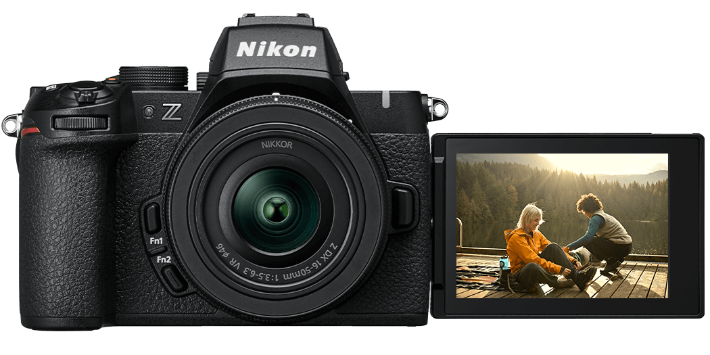
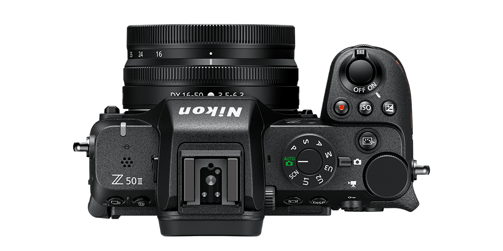
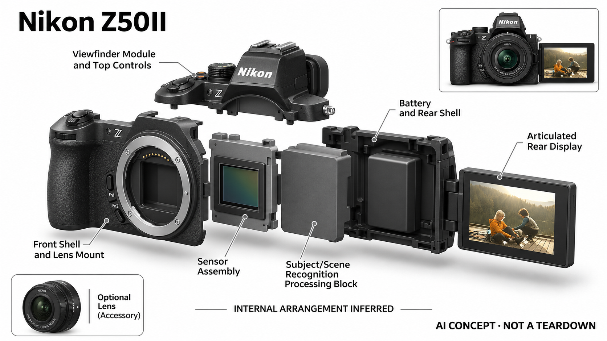

# Nikon Z50II

**Nikon** · 影像与创作 · 核查 2026-11-04

面向入门摄影的深度学习场景识别

消费渠道：个人零售。

## 产品图片与结构参考

### 产品图

Nikon Z50II · 官方产品图 · 来源：[Nikon · 官方图片](<https://www.nikonusa.com/p/z50ii/1784/overview>) · [原始图片](<https://images.contentstack.io/v3/assets/blt0e5ec1de4817c440/blta6cee6b49edcf6d0/67211ed15fe9d401b360cc56/hero-slider-front.png>)

### 参考图

Nikon Z50II · 官方参考图 · 来源：[Nikon · 官方图片](<https://www.nikonusa.com/p/z50ii/1784/overview>) · [原始图片](<https://images.contentstack.io/v3/assets/blt0e5ec1de4817c440/blt050a94cd44b92229/67223b704469ca70e07b85de/hero-slider-top.png>)

### AI 生成爆炸示意

**AI 生成 · 非实物拆机。** 内部为概念推断，不能作为元件布局、BOM 或维修依据。[生成提示词](../../content/hardware/prompts/nikon-z50ii.txt)

> 官方照片装有镜头；所列价格是机身价，镜头须按套装另行核对。

> 分析为基于公开资料的案头研究与 AI 辅助判断，未经用户访谈、销量审计或实物拆机。需求、画像、竞争冷门度、审美及商业机会均为研究假设，不是投资结论。

## 销售与购买

- 状态：在售。Nikon英国官方店标In Stock与三至五工作日配送，结构化Offer同为InStock；不同镜头套装只计同一机身型号。

- 地区：英国官方商店

- 价格：英国官方机身 £839。核查日页面快照；运费、税费、会员和配送区域按官方结算确认，不视为中国到手价。

- 中国大陆：本轮核实所列区域官方商店；未确认中国大陆官方现货、账户及完整服务，不把境外可购等同大陆可用。

- [官方产品 / 商店](<https://www.nikon.co.uk/en_GB/product/cameras/mirrorless/z50ii-VOA150AE>)

## AI 的实际作用

官方说明深度学习在自动模式中识别主体和场景，辅助对焦、曝光与闪光设置；主体识别跟踪是收录依据，普通滤镜和无线传图不单独算AI。

服务与联网依赖：核心自动模式和识别在相机中使用；需要兼容镜头与存储，云端配方和传图另需网络及账户，不把所有智能模式说成通用视觉模型。

## 是否冷门

新兴竞争（研究判断）：可换镜头的个人摄影学习工具形成具体使用场景；本轮没有销量与市场份额证据。

## 需求与市场

需求假设：从手机转向相机的用户可能希望得到更稳定的自动设置，同时逐渐学习手动控制。应观察识别与参数建议能否减少明显失败，而不是让用户始终不知道为何某个场景得到这样的结果。

### 需求假设：从手机进入可换镜头系统 · 研究判断

Z50II面向的具体问题是用户希望得到比手机更可控的拍摄方式，却暂时不能熟练决定曝光和对焦。深度学习自动模式可以减少部分操作负担，但购买动机仍应追问到真实失败照片，例如孩子移动或室内活动，而不是泛称需要更专业的相机。

依据：[Nikon官方深度学习能力公告](<https://www.nikonusa.com/press-room/nikon-z50ii>)

### 价值判断：自动成功与学习进步分开 · 研究判断

如果自动模式让用户获得满意照片，却始终不理解镜头、光线和参数之间的关系，其价值主要是便利而非教学。研究应分别记录拍摄成功和主动学习行为，不能把识别场景较多直接当作摄影能力提升，也不假设每个购买者都希望转向手动控制。

依据：[Nikon官方深度学习能力公告](<https://www.nikonusa.com/press-room/nikon-z50ii>)

### 验证方案：沿真实家庭活动观察 · 待验证

让新用户在家庭活动和一次短途旅行中使用Z50II，保留手机作为日常替代，记录什么时候主动拿出相机。结束后查看满意与失败照片，追问当时为何选择自动或手动，并把携带成本和选片时间纳入评价，而不只比较展示样片。

依据：[Z50II英国官方购买页](<https://www.nikon.co.uk/en_GB/product/cameras/mirrorless/z50ii-VOA150AE>) · [Nikon官方深度学习能力公告](<https://www.nikonusa.com/press-room/nikon-z50ii>)

## 用户画像

画像推断：希望拍摄家庭、旅行和日常照片，愿意逐步了解镜头与曝光的个人爱好者较匹配。需要一台长期随身相机的人还要考虑镜头体积，不能只比较机身与手机的尺寸。

### 画像假设：愿意学习也愿意携带的人 · 研究判断

较匹配者可能已经遇到手机无法满足的任务，并愿意管理镜头、电池和存储卡。希望拍家庭和旅行并不足以定义画像，还需了解是否愿意提前准备、带出门和整理照片；如果这些环节没有发生，再好的自动识别也无法产生稳定收益。

依据：[Z50II英国官方购买页](<https://www.nikon.co.uk/en_GB/product/cameras/mirrorless/z50ii-VOA150AE>) · [Nikon官方深度学习能力公告](<https://www.nikonusa.com/press-room/nikon-z50ii>)

### 使用约束：镜头选择改变实际门槛 · 研究判断

官网机身报价与镜头套装不是同一购买内容，用户需要把所选镜头的视角、体积和用途一起考虑。已有兼容镜头的人与首次购买者面对不同学习和投入条件，不能只用同一机身价格比较负担，更不能从裸机外观判断整套随身便利。

依据：[Z50II英国官方购买页](<https://www.nikon.co.uk/en_GB/product/cameras/mirrorless/z50ii-VOA150AE>) · [Nikon Z50II官方型号与画廊](<https://www.nikonusa.com/p/z50ii/1784/overview>)

### 访谈重点：最近一次放弃带相机 · 待验证

可以让使用者回忆何时只带手机，以及放弃相机是因为重量、准备、怕错过瞬间还是分享太慢。再询问哪些照片让他们愿意再次携带，按真实行为区分记录优先与摄影学习人群，避免依据年龄、收入或品牌偏好推定使用价值。

依据：[Z50II英国官方购买页](<https://www.nikon.co.uk/en_GB/product/cameras/mirrorless/z50ii-VOA150AE>) · [Nikon Z50II官方型号与画廊](<https://www.nikonusa.com/p/z50ii/1784/overview>)

## 竞争与替代

竞争判断：入门无反相机已有广泛选择，手机自动摄影也非常成熟，深度学习识别不是独占卖点。Z50II的差异在自动模式和可换镜头系统衔接，价值需结合用户是否愿意持续携带。

### 替代方案：手机自动摄影与入门无反 · 研究判断

Z50II既与其他可换镜头相机竞争，也要面对手机随手拍摄和即时分享。相机的镜头选择带来表达空间，同时增加准备和携带要求；比较应围绕同一个拍摄任务展开，不能仅用传感器、主体类别或模式数量把不同工作流排成单一名次。

依据：[Nikon官方深度学习能力公告](<https://www.nikonusa.com/press-room/nikon-z50ii>) · [Nikon Z50II官方型号与画廊](<https://www.nikonusa.com/p/z50ii/1784/overview>)

### 差异判断：自动模式与系统成长衔接 · 研究判断

其可讨论的差异是自动判断与可换镜头系统共同存在，用户能够在熟悉操作后逐步改变拍摄方法。但这种成长路线只是一种可能，不代表每个人都会追加镜头或进入手动创作；需要检查初期便利是否真的通向长期使用，而非购买时的想象。

依据：[Nikon官方深度学习能力公告](<https://www.nikonusa.com/press-room/nikon-z50ii>)

### 比较方法：保留相同事件的完整流程 · 待验证

选择家庭聚会或旅行记录，让用户分别用手机和Z50II完成拍摄、选片与分享，记录哪一步更顺畅。对照片的评价应考虑内容是否被记录、是否合意和使用耗时，避免只放大画面细节，却忽略相机根本没有被带到现场的情况。

依据：[Z50II英国官方购买页](<https://www.nikon.co.uk/en_GB/product/cameras/mirrorless/z50ii-VOA150AE>) · [Nikon官方深度学习能力公告](<https://www.nikonusa.com/press-room/nikon-z50ii>)

## 供应链

供应链推断：卡口、传感器、机械操作与取景显示需要一致性，镜头和电池配件扩大了产品系统。官方未披露该型号具体工厂及完整物料清单，维修网络与配件成本比猜测制造价格更有意义。

### 功能拆分：镜头系统与机内判断协同 · 研究判断

原目录确认可换镜头、图像采集、深度学习场景判断以及取景显示和实体控制共同组成系统。对焦、曝光与闪光联动不意味着全部环节来自同一供应商，也不能由处理能力推断芯片或工厂；整机能力还依赖镜头与机身之间的协调。

依据：[Nikon官方深度学习能力公告](<https://www.nikonusa.com/press-room/nikon-z50ii>) · [Nikon Z50II官方型号与画廊](<https://www.nikonusa.com/p/z50ii/1784/overview>)

### 制造判断：精密结构影响长期操作 · 研究判断

镜头卡口、握柄、取景器和翻转屏需要在频繁使用中保持稳定，结构装配与连接可靠性应和图像性能一起审查。电池及配件可获得性也会影响长期使用，本轮未取得该机完整物料表、装配公差或原厂维修协议，不能估算真实制造成本。

依据：[Nikon Z50II官方型号与画廊](<https://www.nikonusa.com/p/z50ii/1784/overview>)

### 候选选型：结构与电源先建立要求 · 研究判断

瑞声的精密结构能力和欣旺达的消费电池业务可作为相关工程候选，但需要依据实际卡口载荷、屏幕机构、功耗与空间重新评估。这里是功能匹配，既不表示两家公司已为Z50II供货，也不意味着可用通用部件替换原厂结构或电池。

依据：[Z50II英国官方购买页](<https://www.nikon.co.uk/en_GB/product/cameras/mirrorless/z50ii-VOA150AE>) · [Nikon Z50II官方型号与画廊](<https://www.nikonusa.com/p/z50ii/1784/overview>)

## 技术路径

官方说明自动模式利用深度学习分析主体与场景，再优化相关设置。技术判断应测试复杂背景和非典型场景，区分识别正确与拍摄结果合意，不能把自动化判断当作唯一审美标准。

### 已披露能力：深度学习影响自动设置 · 官方资料

Nikon说明自动模式通过深度学习分析主体与场景，并辅助对焦、曝光和闪光设置。这里的智能不只是给照片贴标签，而是参与拍摄控制；仍需区分识别判断与用户希望表达的画面，算法选择正确主体并不保证最终照片符合个人偏好。

依据：[Nikon官方深度学习能力公告](<https://www.nikonusa.com/press-room/nikon-z50ii>)

### 技术判断：场景判断需要可纠正 · 研究判断

家庭活动中可能同时出现多个重要人物，或用户故意保留逆光、暗部和背景。自动设置如果优先追求另一种效果，用户就需要容易理解的调整入口；评价应检查能否迅速纠正判断，而不是把所有偏离自动建议的照片看作技术失败。

依据：[Nikon官方深度学习能力公告](<https://www.nikonusa.com/press-room/nikon-z50ii>)

### 验证方案：记录判断与结果的联系 · 待验证

在多人、背光和移动场景中同时记录用户原本想拍谁、自动模式实际选择以及最后保留哪张照片。再观察用户是否能通过简单操作改变结果，将识别、曝光和学习负担分开分析；这是测试方案，不提供未经实测的成功率或优于手机的结论。

依据：[Nikon官方深度学习能力公告](<https://www.nikonusa.com/press-room/nikon-z50ii>)

## 产品审美

审美判断：传统握柄和取景器让产品保留熟悉相机形态，翻转屏支持更多拍摄姿势。实体按键、眼镜取景与镜头重心会影响体验，照片中的紧凑外观不能代替实际长时间持握。

### 外形判断：熟悉相机语义降低理解成本 · 研究判断

握柄、取景器和可换镜头让Z50II保持传统相机的操作线索，翻转屏又适应不同角度。这样的外观能帮助用户理解拿取和拍摄方式，但镜头重心、手部大小和眼镜使用会改变感受，产品照片中的紧凑不能替代实际持握判断。

依据：[Nikon Z50II官方型号与画廊](<https://www.nikonusa.com/p/z50ii/1784/overview>)

### 交互判断：自动模式应保留控制感 · 研究判断

初学者可能依靠自动拍摄获得信心，也可能因为不知道设备改变了什么而感到失控。应观察屏幕、取景器和按键能否让用户了解当前选择，以及切换模式时是否需要打断拍摄；操作反馈比界面看起来专业更能解释学习成本。

依据：[Nikon官方深度学习能力公告](<https://www.nikonusa.com/press-room/nikon-z50ii>) · [Nikon Z50II官方型号与画廊](<https://www.nikonusa.com/p/z50ii/1784/overview>)

### 体验验证：把镜头与背带一并测试 · 待验证

用真实镜头、背带和旅行包完成半天携带、取出、眼平取景和低角度拍摄，记录手腕负担与屏幕调整。随后询问哪些动作愿意重复、哪些导致改用手机，避免只在柜台短时握持裸机，就判断适合所有家庭和旅行场景。

依据：[Z50II英国官方购买页](<https://www.nikon.co.uk/en_GB/product/cameras/mirrorless/z50ii-VOA150AE>) · [Nikon Z50II官方型号与画廊](<https://www.nikonusa.com/p/z50ii/1784/overview>)

## 关键风险

风险判断：自动识别仍会出现误选主体，某些场景需要手动干预，镜头与存储也带来额外费用。云服务和地区保修须按实际购买版本核对，不把入门定位视为无需学习或不会拍摄失败。

### 拍摄风险：自动判断不能覆盖个人意图 · 研究判断

自动模式可能选中错误人物，或提供与用户期待不同的曝光和闪光结果，重要活动仍需要熟悉基本接管方式。不能把入门定位理解为不会失败，也不宜把深度学习能力当作对所有光线、动作和审美偏好的保证，失败样本必须被保留分析。

依据：[Nikon官方深度学习能力公告](<https://www.nikonusa.com/press-room/nikon-z50ii>)

### 购买风险：机身之外还有完整系统 · 研究判断

镜头、存储、备用电源及地区维修条件会影响总成本，英国机身报价不能直接作为其他地区的到手预算。原目录未确认中国大陆同版本现货与保修，研究应明确这一边界，而不是因为品牌在全球经营就默认所有渠道服务完全相同。

依据：[Z50II英国官方购买页](<https://www.nikon.co.uk/en_GB/product/cameras/mirrorless/z50ii-VOA150AE>)

### 验证安排：区分设备限制与准备不足 · 待验证

试用时记录失焦、遗漏、存储不足或临时未携带的具体原因，再判断需要改进算法、交互还是准备流程。不要将所有失败归因给初学者，也不要将每次失败都归因给设备；只有明确原因，才可能评估自动模式是否解决了主要问题。

依据：[Z50II英国官方购买页](<https://www.nikon.co.uk/en_GB/product/cameras/mirrorless/z50ii-VOA150AE>) · [Nikon官方深度学习能力公告](<https://www.nikonusa.com/press-room/nikon-z50ii>)

## 机会与验证

市场观察：适合记录新用户从手机迁移的真实过程，包括携带频率、自动模式失败和主动学习设置。将成片满意度与设备复杂度一起比较，避免单靠识别主体数量或品牌忠诚判断商业潜力。

### 研究方向：帮助新用户理解一次成功拍摄 · 研究判断

Z50II可以作为观察相机入门过程的样本，重点是用户何时理解场景、镜头和自动设置之间的关系。潜在改进可能是更清楚的反馈与学习路径，也可能只是降低分享成本；应先发现真实阻碍，再讨论是否需要增加新的AI硬件功能。

依据：[Nikon官方深度学习能力公告](<https://www.nikonusa.com/press-room/nikon-z50ii>)

### 执行计划：连续记录携带和模式选择 · 待验证

让新用户按自己的节奏使用数周，记录带出门次数、自动模式使用、手动干预和最终分享照片。访谈围绕具体照片追问为什么满意或放弃，以及下次是否改变拍法，以实际行为观察长期价值，不用一次演示后的兴趣代替使用习惯。

依据：[Z50II英国官方购买页](<https://www.nikon.co.uk/en_GB/product/cameras/mirrorless/z50ii-VOA150AE>) · [Nikon官方深度学习能力公告](<https://www.nikonusa.com/press-room/nikon-z50ii>)

### 决策边界：不把摄影兴趣换成销量预测 · 研究判断

如果用户只在开始几天尝试相机，之后仍全部依靠手机，自动模式的技术存在不能证明持续需求。需要同时看携带、选片与学习行为，本轮没有开展用户访谈或取得销量资料，不把品牌历史、功能数量或模型评分当作商业成功依据。

依据：[Z50II英国官方购买页](<https://www.nikon.co.uk/en_GB/product/cameras/mirrorless/z50ii-VOA150AE>) · [Nikon官方深度学习能力公告](<https://www.nikonusa.com/press-room/nikon-z50ii>)

## 对应供应链公司

能力候选用于选型研究，不代表本产品实际采用；未公开的供货关系不作推断。

- [aac-technologies](../supply-chain/aac-technologies.md) — **能力候选 · 非已采用** / 镜头系统周边与翻转显示精密结构候选：瑞声公开精密结构和转轴协同能力，可作为Z50II这类可换镜头机身的结构工程候选；卡口精度、镜头载荷和翻转屏耐久仍需按相机需求专项验证，不能据消费电子结构经验推断兼容或实际供货，也不涉及替换Nikon镜头协议。

- [sunwoda](../supply-chain/sunwoda.md) — **能力候选 · 非已采用** / 便携相机电池与保护系统候选：欣旺达消费电池业务与Z50II便携机身的供电任务存在能力对应，但正式选型需要确认拍摄峰值负载、充电通信、保护和空间条件。此处没有原厂电池供应商证据，也不建议直接替换原机电池，仅用于说明电源模块可如何开展供应能力询证。

[浏览供应链目录](../supply-chain.md)

## 功能分层示意

这是功能关系，不是实物拆机、真实空间结构或已核实 BOM。

1. **镜头采集**：可换镜头与图像传感器采集场景。（官方披露）

2. **场景识别**：深度学习辅助主体和场景判断。（官方披露）

3. **拍摄控制**：对焦、曝光和闪光设置联动。（官方披露）

4. **使用反馈**：取景器、翻转屏与实体操作。（官方披露）

## 来源

1. [Z50II英国官方购买页](<https://www.nikon.co.uk/en_GB/product/cameras/mirrorless/z50ii-VOA150AE>) — 已实际打开官方页面；功能说明不等于独立性能测量。

2. [Nikon官方深度学习能力公告](<https://www.nikonusa.com/press-room/nikon-z50ii>) — 已实际打开官方页面；功能说明不等于独立性能测量。

3. [Nikon Z50II官方型号与画廊](<https://www.nikonusa.com/p/z50ii/1784/overview>) — 已实际打开官方页面；功能说明不等于独立性能测量。

[返回目录](../hardware-market.md) · [网页分析](https://romanagent.github.io/Roman/#hardware/product/nikon-z50ii)
