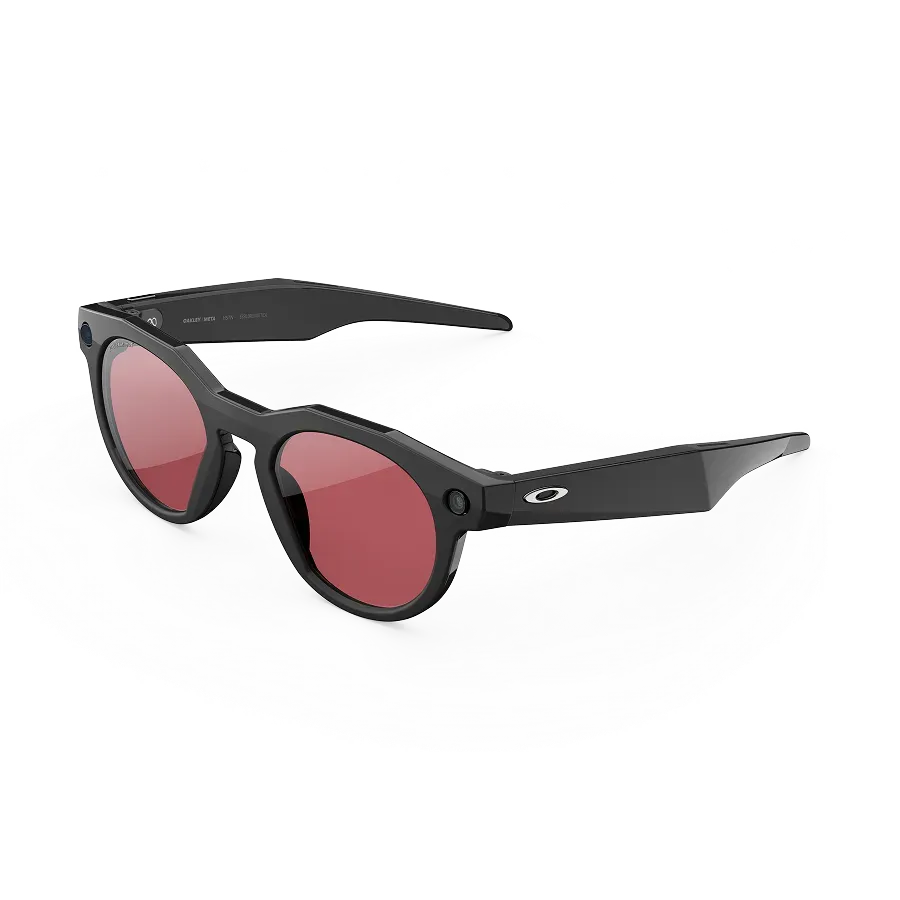
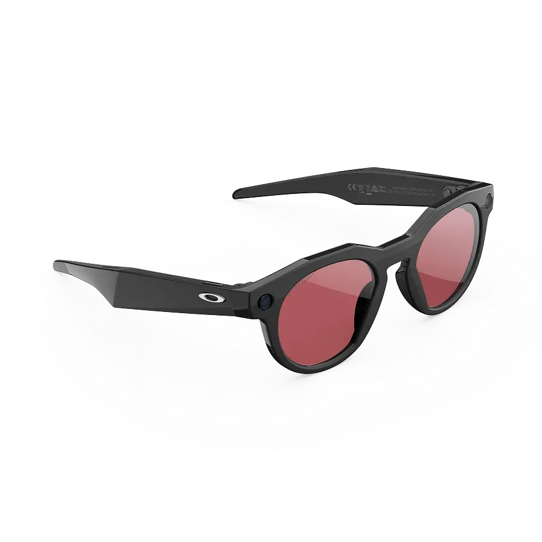
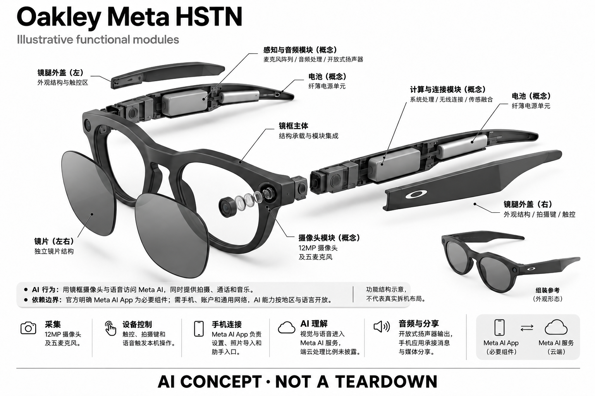

# Oakley Meta HSTN

**Oakley × Meta** · AI 眼镜 · 核查 2026-11-04

从运动生活方式切入的相机 AI 眼镜

消费渠道：个人零售。

## 产品图片与结构参考

### 产品图

官方 HSTN 黑框 Prizm Dark Golf 镜片斜视图 · 来源：[Oakley × Meta · 官方产品图片](<https://www.meta.com/ai-glasses/oakley-meta-hstn-glasses/>) · [原始图片](<https://lookaside.fbsbx.com/elementpath/media/?media_id=1668617304335399&resize_height=1600&resize_width=1600&transcode_extension=webp&version=1773756725>)

### 参考图

官方 HSTN 同款另一侧视图 · 来源：[Oakley × Meta · 官方产品图片](<https://www.meta.com/ai-glasses/oakley-meta-hstn-glasses/>) · [原始图片](<https://lookaside.fbsbx.com/elementpath/media/?media_id=1921746139228297&resize_height=1600&resize_width=1600&transcode_extension=webp&version=1773756725>)

### AI 生成爆炸示意

**AI 生成 · 非实物拆机。** 内部为概念推断，不能作为元件布局、BOM 或维修依据。[生成提示词](../../content/hardware/prompts/oakley-meta-hstn.txt)

> 外形依据核验参考图；内部位置、模块形状与装配关系仅作AI概念展示。

> 图片按源站提供格式保存，未裁切或改色；厂商渲染/场景示意不代表实机测试。

> 分析为基于公开资料的案头研究与 AI 辅助判断，未经用户访谈、销量审计或实物拆机。需求、画像、竞争冷门度、审美及商业机会均为研究假设，不是投资结论。

## 销售与购买

- 状态：在售。美国 Meta 官方页显示 US$399 起和 Shop now，并提供具体镜框与镜片选择的商品页；该结论不代表全部颜色或处方库存。

- 地区：美国、加拿大、英国、澳大利亚、欧洲部分国家

- 价格：US$399 起。美国官方系列起价，Prizm、偏光、变色与处方配置可能不同；以实际地区 SKU 为准。

- 中国大陆：未找到本次可验证的大陆官方在售入口；Meta AI 及保修按销售地区判断，不因 Oakley 在中国有门店就推定智能款已销售。

- [官方产品 / 商店](<https://www.meta.com/ai-glasses/oakley-meta-hstn/>)

## AI 的实际作用

用镜框摄像头与语音访问 Meta AI，同时提供拍摄、通话和音乐。

服务与联网依赖：官方明确 Meta AI App 为必要组件；需手机、账户和适用网络，AI 能力按地区与语言开放。

## 是否冷门

竞争密集（研究判断）：运动休闲定位有差异，但与相机眼镜、运动相机及开放式耳机高度重叠。

## 需求与市场

需求假设：高尔夫、散步和轻户外活动中，用户希望同时遮阳、听音频与记录片段。产品把多件随身物品合成一副眼镜，但并不自动替代专业运动记录、导航或训练设备。

### 官方｜轻户外的多功能眼镜 · 官方资料

本型号把太阳镜、第一视角拍摄、开放式音频和语音助手结合，官方页面提供不同镜片配置与手机应用说明。它没有镜内显示，需求应理解为减少取手机和额外佩戴音频设备的动作，而不是获得眼前导航画面，也不能自动替代专业运动相机或训练设备。

依据：[Meta Store · Oakley Meta HSTN](<https://www.meta.com/ai-glasses/oakley-meta-hstn/>)

### 判断｜记录瞬间与日常佩戴 · 研究判断

散步、旅行或轻户外活动中的记录往往发生得很快，眼镜位置可以减少从口袋取手机的步骤。但用户只有本来愿意戴这种框型时，才可能持续获得这一便利；若为了偶尔拍摄而长期佩戴更重的眼镜，功能收益可能不足以抵消日常负担。

依据：[Meta Store · Oakley Meta HSTN](<https://www.meta.com/ai-glasses/oakley-meta-hstn/>)

### 验证｜完整出行比较 · 待验证

可安排一段包含步行、聊天和拍摄的出行，让用户分别使用本型号与普通太阳镜加手机耳机，记录漏拍、操作次数和主动摘下设备的时刻。还应检查最终保留的内容是否有用，避免把拍摄次数增加当作价值；当前目录没有实机观察支持这些假设。

依据：[Meta Store · Oakley Meta HSTN](<https://www.meta.com/ai-glasses/oakley-meta-hstn/>)

## 用户画像

画像推断：偏好 Oakley 风格、已有太阳镜习惯且需要轻量记录的人，比追求镜内显示的用户更匹配。高强度运动者则需要另测贴合、汗水、风噪与安全，不能只按品牌来推断。

### 判断｜已有太阳镜习惯 · 研究判断

偏好运动休闲框型、经常在户外戴镜并需要短片记录的人更值得访谈，因为产品可以进入已有佩戴习惯。只想使用人工智能助手、却很少戴太阳镜的人可能面临额外适应成本；画像应基于实际任务和佩戴频率，而不是根据品牌爱好推断所有用户相同。

依据：[Meta Store · Oakley Meta HSTN](<https://www.meta.com/ai-glasses/oakley-meta-hstn/>) · [Meta Store · HSTN 配置购买页](<https://www.meta.com/ai-glasses/oakley-meta-hstn-glasses/>)

### 判断｜镜片与脸型差异 · 研究判断

镜片选择、处方需求和鼻梁贴合会改变用户的使用场景，有些人需要全天透明镜片，有些人只在强光环境使用。购买前除了确认智能功能，还要考虑现有眼镜能否被替代；同一电子功能装入不同镜片配置后，持续佩戴的理由可能完全不同。

依据：[Meta Store · HSTN 配置购买页](<https://www.meta.com/ai-glasses/oakley-meta-hstn-glasses/>)

### 验证｜运动强度分层 · 待验证

用户研究应把散步、挥杆、慢跑和高强度活动分开，观察镜框移动、汗水、风噪和按键可达性。不能因为品牌具有运动形象就假设每类运动都适合，也不能把一次静止试戴代替动态贴合；需要让用户在自己的典型活动中判断是否愿意继续佩戴。

依据：[Meta Store · Oakley Meta HSTN](<https://www.meta.com/ai-glasses/oakley-meta-hstn/>)

## 竞争与替代

案头判断：与 Ray-Ban Meta、Vanguard、运动相机和开放式耳机重叠，差异主要来自场景与设计。细分并非无人竞争；没有销售数据或访谈证据支持其比日常眼镜更容易获客。

### 判断｜同生态中的选择 · 研究判断

与同样使用 Meta 服务的其他相机眼镜相比，本型号的差异更集中在框型、镜片和场景适配。助手能力相近时，用户可能根据佩戴舒适、风格和售后选择，而非追求全新人工智能功能；竞争分析应把共享服务和硬件差异分开，避免重复计算功能优势。

依据：[Meta Store · Oakley Meta HSTN](<https://www.meta.com/ai-glasses/oakley-meta-hstn/>)

### 判断｜运动相机与耳机替代 · 研究判断

运动相机适合强调固定机位和特定拍摄任务，开放式耳机主要解决听音频，手机则提供可检查的取景画面。本型号用一副眼镜覆盖部分功能，但这种合并也会带来取景确认和续航取舍；应比较真实任务完成度，不能默认少带设备就一定更好。

依据：[Meta Store · Oakley Meta HSTN](<https://www.meta.com/ai-glasses/oakley-meta-hstn/>)

### 验证｜按最终成果比较 · 待验证

可以让用户完成同样的短片记录、通话和语音查询任务，比较保存内容、听清程度和操作中断，而不是只对照摄像头像素。还应把镜片配置和服务地区保持一致，避免价格口径不同；当前没有销量、份额或用户留存证据，无法证明该细分竞争更轻。

依据：[Meta Store · Oakley Meta HSTN](<https://www.meta.com/ai-glasses/oakley-meta-hstn/>)

## 供应链

公开资料能确认 Oakley 镜架镜片与 Meta 技术合作；具体代工厂和音频、相机供应商本次不明。推断生产难点是把防汗、铰链和电子集成控制在可售后维修的眼镜结构中。

### 官方｜品牌与电子合作 · 官方资料

公开资料能确认 Oakley 的镜架镜片选择与 Meta 的电子和服务合作，并列出摄像头、多麦克风、开放式音频及应用依赖。具体主控、图像传感器、声学器件和整机工厂本次未公开确认，品牌合作关系不能进一步推断为完整物料来源或代工关系。

依据：[Meta Store · Oakley Meta HSTN](<https://www.meta.com/ai-glasses/oakley-meta-hstn/>) · [Meta Store · HSTN 配置购买页](<https://www.meta.com/ai-glasses/oakley-meta-hstn-glasses/>)

### 判断｜镜腿与防护约束 · 研究判断

镜腿需要容纳电池、连接和声学结构，铰链还要承受反复折叠，轻户外使用则增加汗水和清洁需求。由形态推断，密封与维修便利可能存在取舍；这些问题应通过结构和服务资料核实，不能根据防泼溅等级编造内部胶封方式、工厂或装配良率。

依据：[Meta Store · Oakley Meta HSTN](<https://www.meta.com/ai-glasses/oakley-meta-hstn/>)

### 判断｜主控候选比较 · 研究判断

高通的相机眼镜平台与君正的穿戴视觉方案可作为重设计候选，分别评估影像、音频、无线和功耗协作。它们不是本目录已确认的供货方，且更换主控会涉及应用与服务兼容，不能视为直接替代；现有产品的真实芯片关系仍需明确点名来源。

依据：[Meta Store · Oakley Meta HSTN](<https://www.meta.com/ai-glasses/oakley-meta-hstn/>)

## 技术路径

官方披露五麦克风、12MP 摄像头和 Meta AI App；没有镜内显示。IPX4 仅应按防泼溅理解，不能延伸成游泳能力；音频处理、视觉理解和生成回答的详细计算拓扑未公开。

### 官方｜采集与手机协同 · 官方资料

官方披露摄像头、五麦克风、开放式音频和必要的手机应用，用户可以拍摄、通话、听音乐并访问语音助手。硬件负责现场采集不代表全部理解在本地完成，详细端云处理比例未公开；目录因此分别记录设备能力、手机协同和地区开放的人工智能功能。

依据：[Meta Store · Oakley Meta HSTN](<https://www.meta.com/ai-glasses/oakley-meta-hstn/>)

### 判断｜音频决定交互成功 · 研究判断

户外语音请求首先要被正确收音，风和旁人谈话可能比模型本身更早限制体验。多麦克风提供处理基础，但不能直接推导所有环境都能听清；应区分用户指令、通话声音和视频环境声的目标，因为三类任务可能需要不同的处理和保留策略。

依据：[Meta Store · Oakley Meta HSTN](<https://www.meta.com/ai-glasses/oakley-meta-hstn/>)

### 验证｜从触发到结果 · 待验证

测试应记录按键或语音触发后，设备是否及时反馈、媒体是否完整保存以及手机是否成功导入，并在断连和弱网时重复。人工智能查询还需检查失败提示与重试成本；只有全链路结果可复现，才能判断它是否确实减少了操作，而不是把步骤转移到事后整理。

依据：[Meta Store · Oakley Meta HSTN](<https://www.meta.com/ai-glasses/oakley-meta-hstn/>)

## 产品审美

图示观察：圆角镜框与较粗镜腿强调运动休闲，适合有明确风格偏好的人。审美是一种用户筛选，不是性能证据；不同脸型、头盔或帽子搭配的舒适度仍需要真实试戴确认。

### 判断｜运动休闲的识别感 · 研究判断

较鲜明的镜框和镜腿形态会吸引有运动休闲偏好的人，也可能让希望低调办公佩戴的用户犹豫。审美在这里是一种使用场景筛选，不能简单评价为更专业或更先进；应观察用户是否愿意在不同社交环境继续戴着，而不只记录对产品照片的喜好。

依据：[Meta Store · HSTN 配置购买页](<https://www.meta.com/ai-glasses/oakley-meta-hstn-glasses/>)

### 判断｜外观与功能状态 · 研究判断

镜框上的摄像与指示部件让产品与普通太阳镜有所区别，但旁人未必知道何时正在拍摄。外观研究应同时检查记录状态是否容易理解，以及用户是否需要额外解释；风格可以帮助产品被接受，却不能代替明确的采集反馈和对他人边界的尊重。

依据：[Meta Store · Oakley Meta HSTN](<https://www.meta.com/ai-glasses/oakley-meta-hstn/>) · [Meta Store · HSTN 配置购买页](<https://www.meta.com/ai-glasses/oakley-meta-hstn-glasses/>)

### 验证｜附件与动态贴合 · 待验证

试戴应包括帽子、头盔或日常背包等真实搭配，观察镜腿受压、鼻梁滑动和摘戴过程。还需在不同光线下检查镜片是否符合用户原本需求；官方图片能说明颜色和轮廓，但无法证明每种脸型的稳定性，也不能保证长时间听音频时没有局部不适。

依据：[Meta Store · HSTN 配置购买页](<https://www.meta.com/ai-glasses/oakley-meta-hstn-glasses/>)

## 关键风险

风险集中在把轻户外宣传误读成全运动适用，以及对环境音、风噪和防水的过高预期。拍摄他人、运动中分心和地区 AI 差异也需考虑；AI 回答不能替代安全判断或训练指导。

### 判断｜防护等级误读 · 研究判断

官方防泼溅信息不应被扩展成游泳、持续浸水或所有清洁方式都安全。轻户外定位也不能自动覆盖高冲击活动，用户需要按具体使用和护理说明判断；目录不把运动品牌形象当作安全或耐久证明，结构可靠性仍需针对实际活动条件验证。

依据：[Meta Store · Oakley Meta HSTN](<https://www.meta.com/ai-glasses/oakley-meta-hstn/>)

### 判断｜拍摄与分心 · 研究判断

第一视角记录容易把旁人带入画面，语音助手和音频也可能改变用户对环境的注意。风险研究应区分静止查询与移动中操作，观察用户是否为确认结果而分心；人工智能回答不能替代路况、安全或训练判断，拍摄便利也不意味着所有场景都适合记录。

依据：[Meta Store · Oakley Meta HSTN](<https://www.meta.com/ai-glasses/oakley-meta-hstn/>)

### 验证｜地区与失效行为 · 待验证

购买前应核对销售地区、应用账户和语言开放范围，并测试关键功能在当地网络下是否可用。服务断开时要明确哪些拍摄和音频任务仍可继续、哪些需要手机恢复；不能因为 Oakley 有本地门店就推定智能型号已正式销售或具有相同保修支持。

依据：[Meta Store · Oakley Meta HSTN](<https://www.meta.com/ai-glasses/oakley-meta-hstn/>)

## 机会与验证

市场差异在于运动休闲品牌、镜片和框型，而非完全不同的AI服务。尚待验证的购买理由是用户是否更愿意在轻户外持续佩戴，以及这种场景匹配是否足以抵消手机与普通耳机的替代。

### 判断｜品牌场景的实际价值 · 研究判断

本型号值得研究的是运动休闲框型与镜片是否让用户更愿意持续佩戴，从而提高记录和音频功能的可获得性。这个价值来自佩戴习惯与场景匹配，而不一定来自独占的人工智能能力；如果用户经常摘下或换回普通眼镜，功能合并的优势就会被削弱。

依据：[Meta Store · Oakley Meta HSTN](<https://www.meta.com/ai-glasses/oakley-meta-hstn/>) · [Meta Store · HSTN 配置购买页](<https://www.meta.com/ai-glasses/oakley-meta-hstn-glasses/>)

### 判断｜减少携带的边界 · 研究判断

一副眼镜同时承担遮阳、音频和记录，可能减少随身物品，但也让电量不足或损坏影响多个任务。评价应同时观察减少的设备和新增的依赖，例如手机应用、充电与镜片适配；不能只把功能数量当作便利度，需要看用户整次出行是否更省心。

依据：[Meta Store · Oakley Meta HSTN](<https://www.meta.com/ai-glasses/oakley-meta-hstn/>)

### 验证｜长期佩戴记录 · 待验证

后续研究可记录不同活动中的佩戴时长、保留媒体、语音失败和充电频率，并询问何时仍选择手机或普通耳机。结合镜片、服务和维修成本，才能判断持续购买理由；当前目录只给出可检验的需求与竞争分析，不声称已掌握销量或用户效果。

依据：[Meta Store · Oakley Meta HSTN](<https://www.meta.com/ai-glasses/oakley-meta-hstn/>) · [Meta Store · HSTN 配置购买页](<https://www.meta.com/ai-glasses/oakley-meta-hstn-glasses/>)

## 对应供应链公司

能力候选用于选型研究，不代表本产品实际采用；未公开的供货关系不作推断。

- [qualcomm](../supply-chain/qualcomm.md) — **能力候选 · 非已采用** / 相机、音频与无线协同的眼镜主平台：本型号包含摄像、多麦克风和手机协同，高通 AR1 的公开定位与这一任务组合相关，可作为新设计平台候选。现有来源未点名本型号使用该平台，仍需验证镜腿热预算、相机调校和服务接口；候选能力不能替代实际供货或兼容授权证据。

- [ingenic](../supply-chain/ingenic.md) — **能力候选 · 非已采用** / 低功耗第一视角视觉与音频处理：君正 CW080 明确面向穿戴视觉并披露音视频及功耗控制，适合比较本型号所需的拍摄和记录链路。它不是已确认供应商，且 Meta 应用与服务并不会因换芯片自动兼容；需独立验证模型、无线配套、结构温升和长期软件维护。

[浏览供应链目录](../supply-chain.md)

## 功能分层示意

这是功能关系，不是实物拆机、真实空间结构或已核实 BOM。

1. **采集**：12MP 摄像头及五麦克风；功能结构示意，不代表真实拆机布局。（官方披露）

2. **设备控制**：触控、拍摄键和语音触发本机操作。（官方披露）

3. **手机连接**：Meta AI App 负责设置、照片导入和助手入口。（官方披露）

4. **AI 理解**：视觉与语音进入 Meta AI 服务，端云处理比例未披露。（分析推断）

5. **音频与分享**：开放式扬声器输出，手机应用承接消息与媒体分享。（官方披露）

## 来源

1. [Meta Store · Oakley Meta HSTN](<https://www.meta.com/ai-glasses/oakley-meta-hstn/>) — 已打开，US$399 起、Shop now；含五麦克风、IPX4 和 App 必需说明。

2. [Meta Store · HSTN 配置购买页](<https://www.meta.com/ai-glasses/oakley-meta-hstn-glasses/>) — 已打开具体镜片/框型配置页，未提交订单。

[返回目录](../hardware-market.md) · [网页分析](https://romanagent.github.io/Roman/#hardware/product/oakley-meta-hstn)
