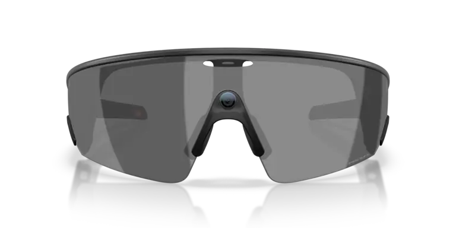
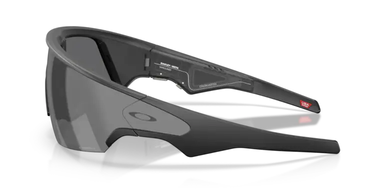
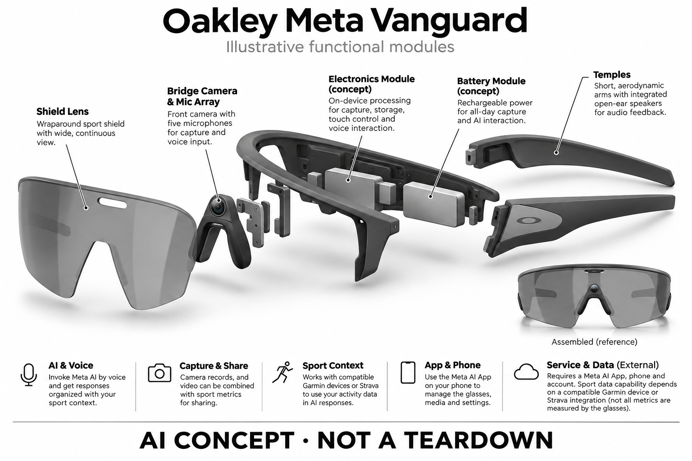

# Oakley Meta Vanguard

**Oakley × Meta** · AI 眼镜 · 核查 2026-11-04

让第一视角影像与运动数据汇合

消费渠道：个人零售。

## 产品图片与结构参考

### 产品图

官方 Vanguard 黑框 Prizm Black 正面图 · 来源：[Oakley × Meta · 官方产品图片](<https://www.oakley.com/en-us/product/W0OW8001>) · [原始图片](<https://assets2.oakley.com/prod-onecp-record-files/pieyewear/dfbf31c3-b65d-4ec4-990d-b410014fc06d/0OW8001__800107__P21__shad__fr.png?impolicy=OO_ratio&width=768>)

### 参考图

官方 Vanguard 黑框侧面与镜腿参考 · 来源：[Oakley × Meta · 官方产品图片](<https://www.oakley.com/en-us/product/W0OW8001>) · [原始图片](<https://assets2.oakley.com/prod-onecp-record-files/pieyewear/762cc332-a20c-4917-b9a9-b410014fc070/0OW8001__800107__P21__shad__lt.png?impolicy=OO_ratio&width=768>)

### AI 生成爆炸示意

**AI 生成 · 非实物拆机。** 内部为概念推断，不能作为元件布局、BOM 或维修依据。[生成提示词](../../content/hardware/prompts/oakley-meta-vanguard.txt)

> 外形依据核验参考图；内部位置、模块形状与装配关系仅作AI概念展示。

> 图片按源站提供格式保存，未裁切或改色；厂商渲染/场景示意不代表实机测试。

> 分析为基于公开资料的案头研究与 AI 辅助判断，未经用户访谈、销量审计或实物拆机。需求、画像、竞争冷门度、审美及商业机会均为研究假设，不是投资结论。

## 销售与购买

- 状态：在售。已打开 Oakley 美国官方黑框 Prizm Black SKU，显示 US$499 和 ADD TO BAG。另有 Meta 官方产品说明；未按其他地区自动重定向价格替代美元报价。

- 地区：美国、加拿大、英国、澳大利亚、欧洲部分国家

- 价格：US$499。美国黑框 Prizm Black 配置所见价；其他镜片、税费、配件和地区价格可能不同。Garmin 兼容设备需另购。

- 中国大陆：美国官网列出的支持市场未包含中国大陆；不能据此确认国内正式销售。手机、Meta 服务和 Garmin 集成功能还需按地区核验。

- [官方产品 / 商店](<https://www.oakley.com/en-us/product/W0OW8001>)

## AI 的实际作用

以语音调用 Meta AI，并结合兼容 Garmin 设备提供运动信息；相机记录与运动数据可协同呈现。

服务与联网依赖：需 Meta AI App、手机与账户；运动数据能力依赖兼容 Garmin 设备或 Strava 集成，不是眼镜独立测得所有指标。

## 是否冷门

细分专业（研究判断）：围绕高强度运动、第一视角与运动数据的专业场景；细分用途不意味着低竞争或已证明需求。

## 需求与市场

需求假设：骑行和跑步时，用户希望少看手机又能获得训练信息、留下运动影像。关键价值可能是数据与瞬间的关联，而非拍摄画质本身；是否降低操作负担需要在运动中验证。

### 官方｜影像与运动数据结合 · 官方资料

本型号以中置摄像头、开放式音频和运动平台集成构成使用流程，用户可记录第一视角内容并获得兼容设备提供的运动信息。需求不只是拍下画面，还包括在活动中减少查看其他屏幕的动作；运动指标并非都由眼镜独立测量，不能把集成能力误写成内置传感功能。

依据：[Oakley US · Meta Vanguard OW8001](<https://www.oakley.com/en-us/product/W0OW8001>) · [Meta Store · Vanguard 产品说明](<https://www.meta.com/kr/en/ai-glasses/oakley-meta-vanguard/>)

### 判断｜训练中的时间窗口 · 研究判断

跑步或骑行时，查看手机和操作相机都有机会打断节奏，声音反馈与随身取景可能减少部分动作。但用户是否愿意在训练中接收语音、何时需要拍摄，并不完全相同；价值应围绕特定时刻的信息和记录需求，而不是让整个运动过程持续充满提示。

依据：[Oakley US · Meta Vanguard OW8001](<https://www.oakley.com/en-us/product/W0OW8001>)

### 验证｜运动流程对照 · 待验证

可让已有运动记录习惯的人完成相同路线，分别使用本型号和原有手表、耳机及相机组合，记录操作次数、错过的片段和需要停下处理的问题。测试应由用户选择安全环境并保留原有安全习惯，当前资料没有实测证据证明眼镜会降低分心或提升训练效果。

依据：[Oakley US · Meta Vanguard OW8001](<https://www.oakley.com/en-us/product/W0OW8001>) · [Meta Store · Vanguard 产品说明](<https://www.meta.com/kr/en/ai-glasses/oakley-meta-vanguard/>)

## 用户画像

画像推断：已有 Garmin 或 Strava 使用习惯、规律训练并愿意分享影像的人更匹配。偶尔运动、需要处方镜片或对头盔兼容敏感的人，应先确认配置与佩戴，不宜直接套用同一画像。

### 判断｜已有生态用户 · 研究判断

已经使用兼容 Garmin 设备或 Strava 的规律运动者，更可能理解数据整合的价值，因为他们已有训练记录和复盘习惯。若用户没有这些设备或服务，眼镜的部分能力需要额外投入；应把已有生态与新建生态两类用户分开，不用相同成本与使用预期描述。

依据：[Meta Store · Vanguard 产品说明](<https://www.meta.com/kr/en/ai-glasses/oakley-meta-vanguard/>)

### 判断｜配戴与运动习惯 · 研究判断

包覆式镜片和运动外形适合特定活动，但处方需求、头盔、鼻梁形态和出汗情况会影响是否能长时间佩戴。偶尔运动的人可能更看重日常适用性，规律训练者则关注稳定与恢复；画像需要结合真实装备组合，而不能只以运动频率或品牌偏好推断。

依据：[Oakley US · Meta Vanguard OW8001](<https://www.oakley.com/en-us/product/W0OW8001>)

### 验证｜多角色使用需求 · 待验证

可分别访谈独自训练者、结伴活动者和内容记录者，观察他们需要的提示频率与拍摄目标是否不同。有人希望不漏掉训练信息，有人只想留下路线片段，两者可能对音频和电量分配有相反要求；应保留这些差异，避免把所有运动用户归为统一需求。

依据：[Oakley US · Meta Vanguard OW8001](<https://www.oakley.com/en-us/product/W0OW8001>) · [Meta Store · Vanguard 产品说明](<https://www.meta.com/kr/en/ai-glasses/oakley-meta-vanguard/>)

## 竞争与替代

案头判断：高强度运动与数据结合比通用拍照更窄，但仍受到运动相机、运动耳机和手表替代。归为专业细分仅描述用途，不代表竞争少；没有销量、渠道毛利或访谈证据。

### 判断｜与生活方式眼镜区分 · 研究判断

相比偏日常或轻户外的相机眼镜，本型号更强调运动结构和数据协同，外观也更接近运动装备。其竞争优势若存在，应来自具体活动中的稳定、交互和兼容，而不是仅因采用同一人工智能服务就被认定更智能；专业定位同时可能缩小日常佩戴范围。

依据：[Oakley US · Meta Vanguard OW8001](<https://www.oakley.com/en-us/product/W0OW8001>)

### 判断｜既有装备替代 · 研究判断

运动相机、手表和耳机分别具有成熟任务位置，眼镜将其中部分功能合并，却未必能全部替代。用户仍可能需要手表提供传感和训练记录，也可能保留独立相机用于特定机位；比较应以整套装备的操作与维护负担为单位，而不是只计算少了多少件设备。

依据：[Oakley US · Meta Vanguard OW8001](<https://www.oakley.com/en-us/product/W0OW8001>) · [Meta Store · Vanguard 产品说明](<https://www.meta.com/kr/en/ai-glasses/oakley-meta-vanguard/>)

### 验证｜用同一任务比较 · 待验证

评估可选择一次训练中的数据查询、一次关键片段记录和一次活动后复盘，比较内容完整性、连接失败与整理时间。需要保持兼容设备和服务账户一致，避免把额外设备的能力归给眼镜；专业细分只描述用途，当前没有销量或市场份额证明其竞争较少。

依据：[Oakley US · Meta Vanguard OW8001](<https://www.oakley.com/en-us/product/W0OW8001>)

## 供应链

官方公开 O Matter 镜架、Prizm 镜片和电子功能，但未披露本次所需的整机工厂、镜头供应商或良率。推断难点包含运动冲击、密封、重心与头盔适配，无法凭品牌估计物料成本。

### 官方｜功能供应链边界 · 官方资料

公开资料列出镜架材料、镜片、摄像、多麦克风、无线和运动服务集成，但没有完整披露主控、相机模组或整机工厂。眼镜硬件、手机应用和外部运动设备属于不同供给层，目录不会把平台兼容关系写成器件供货，也不从品牌合作推导内部物料清单。

依据：[Oakley US · Meta Vanguard OW8001](<https://www.oakley.com/en-us/product/W0OW8001>) · [Meta Store · Vanguard 产品说明](<https://www.meta.com/kr/en/ai-glasses/oakley-meta-vanguard/>)

### 判断｜动态结构与密封 · 研究判断

由运动形态推断，镜框固定、重心、汗水清洁和电子密封需要共同考虑，中置摄像头还会影响结构空间分配。防护等级不能说明内部采用哪种密封工艺，也不能证明长期运动磨损后的表现；这些问题需要可靠性和维修资料，而非根据宣传图猜测工厂能力。

依据：[Oakley US · Meta Vanguard OW8001](<https://www.oakley.com/en-us/product/W0OW8001>)

### 判断｜候选选型与限制 · 研究判断

高通眼镜平台和君正穿戴视觉方案可进入摄像与音频主控候选比较，但现有资料没有点名二者供货。候选必须验证运动场景的图像处理、低功耗和手机接口，且无法自动获得运动平台或 Meta 服务兼容；芯片功能匹配只是重设计评估的起点。

依据：[Oakley US · Meta Vanguard OW8001](<https://www.oakley.com/en-us/product/W0OW8001>)

## 技术路径

官方披露五麦克风、摄像头、无线连接和运动平台集成。应把眼镜采集、外部设备测量与 AI 解释分开：运动指标并不都来自镜架传感器，生成回答也不等同独立训练评估。

### 官方｜多设备数据链路 · 官方资料

本型号依赖手机应用和账户，运动信息还涉及兼容的 Garmin 设备或 Strava 集成。应把眼镜直接采集的影像、外部设备提供的指标和人工智能生成的解释分别标识；这种区分决定数据可信度与故障定位，不能把所有输出都归为镜架自身的测量。

依据：[Oakley US · Meta Vanguard OW8001](<https://www.oakley.com/en-us/product/W0OW8001>) · [Meta Store · Vanguard 产品说明](<https://www.meta.com/kr/en/ai-glasses/oakley-meta-vanguard/>)

### 判断｜同步比单点性能重要 · 研究判断

影像与运动指标只有在时间和上下文对应时才有复盘价值，若连接延迟或时间线错位，漂亮的叠加内容也可能误导。系统需要明确数据来源和更新状态，尤其在设备暂时断连后恢复时；性能分析应关注整条链路，而不只比较摄像分辨率或语音回答速度。

依据：[Oakley US · Meta Vanguard OW8001](<https://www.oakley.com/en-us/product/W0OW8001>) · [Meta Store · Vanguard 产品说明](<https://www.meta.com/kr/en/ai-glasses/oakley-meta-vanguard/>)

### 验证｜连接与时间线实验 · 待验证

测试可在固定路线中记录可识别事件，并与手表和手机时间线对照，观察断连、暂停活动和重新开始后的同步情况。还应检查语音查询使用的是实时还是较早的数据，错误时是否提示来源不可用；当前资料只支持集成功能，不能保证所有组合都同样可靠。

依据：[Meta Store · Vanguard 产品说明](<https://www.meta.com/kr/en/ai-glasses/oakley-meta-vanguard/>)

## 产品审美

图示观察：包覆式大镜片与中置摄像头呈现鲜明运动器材感，对专业场景是识别优势，对办公室则未必合适。外观与头盔兼容的宣传需通过不同头围、鼻梁和运动强度的试戴检验。

### 判断｜装备感的双面性 · 研究判断

包覆式大镜片和中置摄像头形成明显运动装备外观，在训练场景可能容易理解，在办公室或日常谈话中则未必自然。审美分析应把场景识别与个人喜好分开，不能将专业感等同舒适或性能；外观选择同时决定用户愿意在哪些地方持续佩戴。

依据：[Oakley US · Meta Vanguard OW8001](<https://www.oakley.com/en-us/product/W0OW8001>)

### 判断｜重心与视线体验 · 研究判断

镜片面积、摄像头位置和镜腿结构共同影响用户对遮挡与重量的感受，静态图片无法呈现奔跑或骑行时的细微晃动。还需考虑头盔和鼻托的共同接触，避免只评价单独戴镜时的舒适；这些体验取决于个人装备组合，应作为试戴研究而非确定结论。

依据：[Oakley US · Meta Vanguard OW8001](<https://www.oakley.com/en-us/product/W0OW8001>)

### 验证｜真实装备试戴 · 待验证

可让用户带上常用头盔、帽子和处方解决方案进行动态试戴，观察抬头、低头、出汗及摘戴时的稳定性。不同光照下还要判断镜片是否符合原有需求；官方外观和防护说明只能支持初筛，不能替代长时间活动后的压力、滑动和清洁反馈。

依据：[Oakley US · Meta Vanguard OW8001](<https://www.oakley.com/en-us/product/W0OW8001>)

## 关键风险

主要风险是运动中分心、摄像头录制范围、风噪和对防护等级的误读。兼容手表、第三方账号和手机连接增加故障环节；标称典型续航不能用于推算持续录像或长距离赛事的保障。

### 判断｜提示与运动注意 · 研究判断

语音查询和录制反馈可能占用运动中的注意力，用户不应把助手回答当作安全导航或训练决策的唯一依据。风险研究需要观察何时用户为了确认状态而额外操作，并区分静止查询与移动交互；硬件免手持并不意味着认知负担已经消失。

依据：[Oakley US · Meta Vanguard OW8001](<https://www.oakley.com/en-us/product/W0OW8001>) · [Meta Store · Vanguard 产品说明](<https://www.meta.com/kr/en/ai-glasses/oakley-meta-vanguard/>)

### 判断｜防护与续航边界 · 研究判断

官方防护等级和典型续航属于特定测试条件，不能直接延伸为持续录像、长距离赛事或所有涉水活动的保障。实际耗电还受拍摄、无线和语音使用影响，用户需要按自己的活动组合验证；目录不以标称最长时间推算关键活动中的可靠工作时长。

依据：[Oakley US · Meta Vanguard OW8001](<https://www.oakley.com/en-us/product/W0OW8001>)

### 验证｜账户和地区失效 · 待验证

应检查手机断连、运动账户授权失效及服务地区受限时，眼镜如何提示并保留哪些基础功能。兼容设备另购和多账户协同增加了维护步骤，购买前应确认自己的具体组合；不能因为平台名称相同就假设所有手表、手机和地区都提供完全一致的功能。

依据：[Meta Store · Vanguard 产品说明](<https://www.meta.com/kr/en/ai-glasses/oakley-meta-vanguard/>)

## 机会与验证

市场差异在于运动影像与已有训练数据的结合，并强化包覆式运动形态。尚待验证的购买理由是多设备连接是否稳定、记录是否有助复盘，以及相较运动相机和耳机能否减少携带与操作负担。

### 判断｜运动记录的关联价值 · 研究判断

本型号的研究重点是影像能否与已有训练记录形成有用关联，例如让用户更容易回忆一次活动中的具体时刻。若用户只想获得漂亮短片，数据集成可能不是主要购买理由；若用户主要关注训练指标，眼镜也需证明影像和语音带来了额外收益。

依据：[Oakley US · Meta Vanguard OW8001](<https://www.oakley.com/en-us/product/W0OW8001>) · [Meta Store · Vanguard 产品说明](<https://www.meta.com/kr/en/ai-glasses/oakley-meta-vanguard/>)

### 判断｜整套装备的负担 · 研究判断

评价应同时记录减少的操作和新增的配对、充电、授权及素材整理工作。将多个任务集中到眼镜可能简化活动中操作，却让准备和维护更复杂；只有整次活动前后都考虑，才能判断功能合并是否真正省事，不能只用佩戴时免手持概括全部体验。

依据：[Oakley US · Meta Vanguard OW8001](<https://www.oakley.com/en-us/product/W0OW8001>) · [Meta Store · Vanguard 产品说明](<https://www.meta.com/kr/en/ai-glasses/oakley-meta-vanguard/>)

### 验证｜持续使用的证据 · 待验证

后续可跟踪多次训练中实际开启的功能、可用影像比例、连接故障和活动后复盘次数，并核算兼容设备与服务成本。若用户持续保留原有全部装备，需进一步理解眼镜增加了什么；当前目录提出可验证的判断，不把专业外观或平台合作当成需求已被证明。

依据：[Oakley US · Meta Vanguard OW8001](<https://www.oakley.com/en-us/product/W0OW8001>) · [Meta Store · Vanguard 产品说明](<https://www.meta.com/kr/en/ai-glasses/oakley-meta-vanguard/>)

## 对应供应链公司

能力候选用于选型研究，不代表本产品实际采用；未公开的供货关系不作推断。

- [qualcomm](../supply-chain/qualcomm.md) — **能力候选 · 非已采用** / 运动相机眼镜的影像与音频主平台：本型号需要摄像、多麦克风和手机协同，高通的眼镜平台能力与这一功能组合相关，可作为重设计候选。仍需验证运动画面处理、结构热预算及外部运动服务接口；现有来源没有明确点名采用，平台本身也不能提供已授权的 Garmin 或 Meta 集成。

- [ingenic](../supply-chain/ingenic.md) — **能力候选 · 非已采用** / 第一视角低功耗摄像与事件处理：君正的穿戴视觉方案披露摄像、音频及多级功耗控制，可用于比较运动记录链路的计算分工。它并非已确认供货方，运动可靠性、图像效果、手机软件与服务兼容都需重新验证；候选匹配不意味着能够直接替换现有产品主控或获得相同用户体验。

[浏览供应链目录](../supply-chain.md)

## 功能分层示意

这是功能关系，不是实物拆机、真实空间结构或已核实 BOM。

1. **现场输入**：摄像头与五麦克风采集；这是概念功能架构，非拆机物料清单。（官方披露）

2. **本机与控制**：镜架处理拍摄、存储、触控和语音交互。（官方披露）

3. **连接层**：Meta AI App 与手机管理眼镜，Garmin/Strava 提供兼容运动数据。（官方披露）

4. **解释与关联**：将语音请求和运动上下文组织为回复；具体模型与数据路由未公开。（分析推断）

5. **反馈**：开放式扬声器回应，影像可结合运动指标分享。（官方披露）

## 来源

1. [Oakley US · Meta Vanguard OW8001](<https://www.oakley.com/en-us/product/W0OW8001>) — 已打开并定位 ADD TO BAG、US$499、IP67、连接和支持市场；标称参数未实测。

2. [Meta Store · Vanguard 产品说明](<https://www.meta.com/kr/en/ai-glasses/oakley-meta-vanguard/>) — 访问时重定向韩国英文页，确认 Garmin 设备另购；不将韩元价格混入美国报价。

[返回目录](../hardware-market.md) · [网页分析](https://romanagent.github.io/Roman/#hardware/product/oakley-meta-vanguard)
