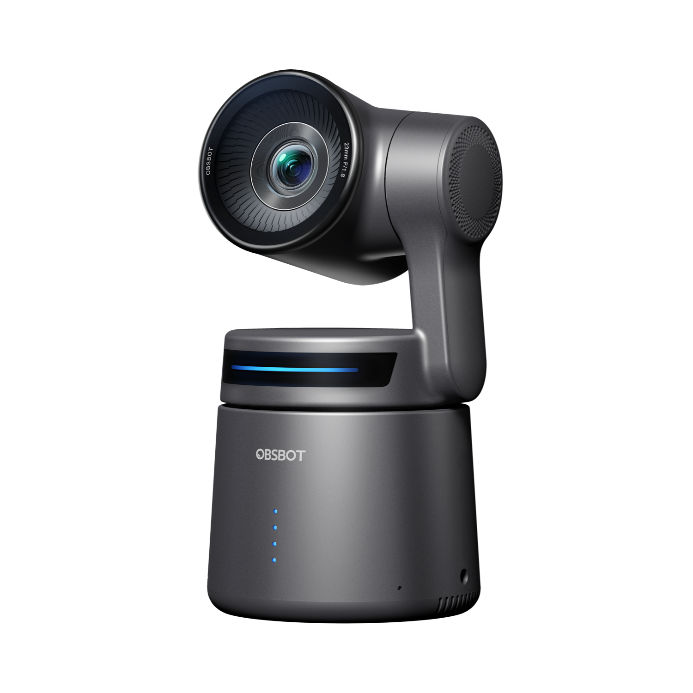
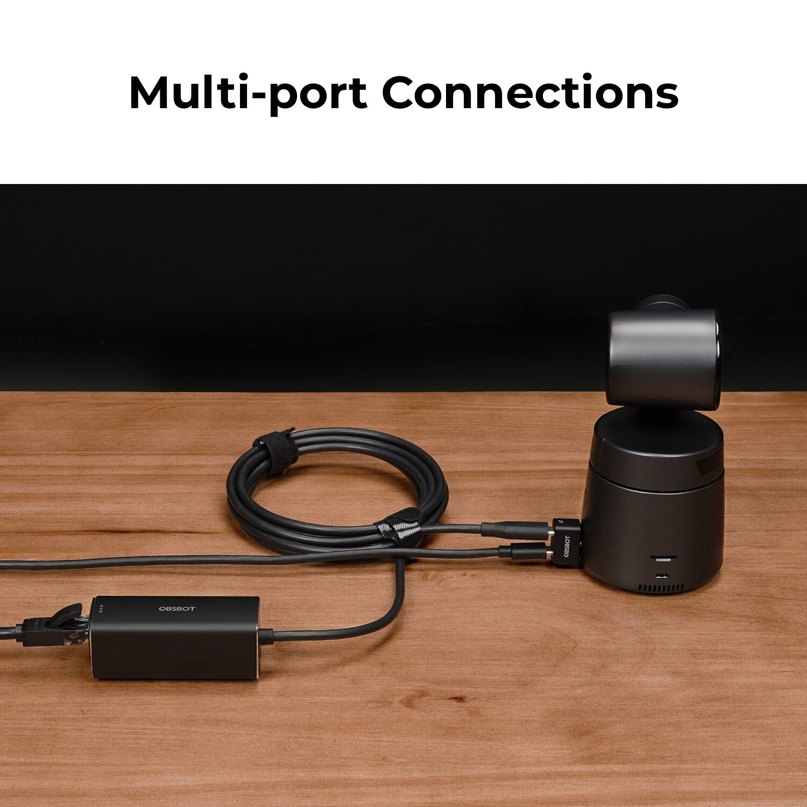
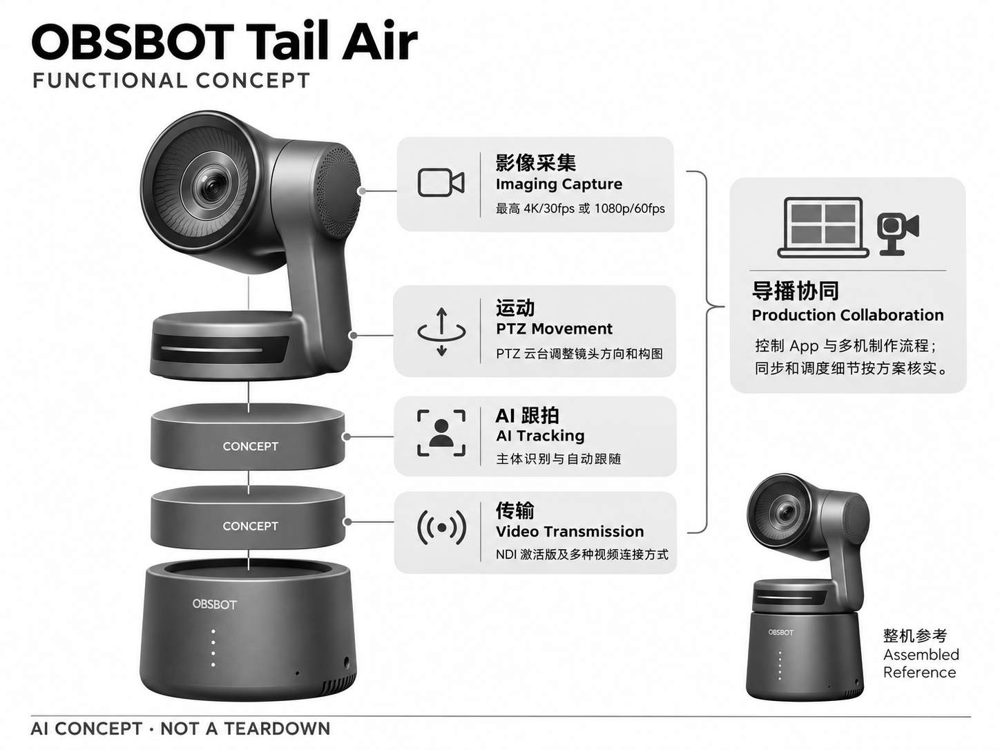

# OBSBOT Tail Air

**OBSBOT** · 影像与创作 · 核查 2026-11-04

面向小型直播制作的 AI 自动跟拍 PTZ 摄像机

消费渠道：个人零售。

## 产品图片与结构参考

### 产品图

官方商品图：Tail Air 直播云台相机 · 来源：[OBSBOT · 官方图片](<https://www.obsbot.com/store/products/obsbot-tail-air>) · [原始图片](<https://resource-cdn.obsbothk.com/product_system_back/product_img/7b10e5d218274c61b743.png>)

### 参考图

官方接线场景：Tail Air 背部、连接线与外部设备 · 来源：[OBSBOT · 官方图片](<https://www.obsbot.com/store/products/obsbot-tail-air>) · [原始图片](<https://resource-cdn.obsbothk.com/product_system_back/product_img/04_3x_d038e22de205.jpg>)

### AI 生成爆炸示意

**AI 生成 · 非实物拆机。** 内部为概念推断，不能作为元件布局、BOM 或维修依据。[生成提示词](../../content/hardware/prompts/obsbot-tail-air.txt)

> 依据官方外观参考与公开功能生成；未披露的内部布局只作概念模块，不构成BOM或真实结构证据。

> 图片版权归原权利人；用于产品研究并保留出处。未改变图片色彩或内容。

> 分析为基于公开资料的案头研究与 AI 辅助判断，未经用户访谈、销量审计或实物拆机。需求、画像、竞争冷门度、审美及商业机会均为研究假设，不是投资结论。

## 销售与购买

- 状态：在售。官方商店显示 NDI Activated 版 US$598、Add to Cart 及 3—5 个工作日配送；标准版与 NDI 版必须分别核对。

- 地区：官方国际商店覆盖地区

- 价格：US$598（NDI Activated 版）。官网价格快照，税费未含；不把 NDI 激活版、标准版、遥控套装和多机套装混用。

- 中国大陆：本轮核实国际商店页面，未核实中国大陆直接发货、定价和同版本售后条件。

- [官方产品 / 商店](<https://www.obsbot.com/store/products/obsbot-tail-air>)

## AI 的实际作用

自动识别并追踪主体，结合 PTZ 与直播连接降低人工摄像操作；不等于自动完成节目编导。

服务与联网依赖：拍摄、追踪与输出依赖设备及控制软件；多机制作还需要网络、导播端和对应协议授权。

## 是否冷门

细分专业（研究判断）：小型直播制作是专业细分场景；存在传统 PTZ 和制作方案竞争，并非冷门等于无竞品。

## 需求与市场

需求假设：小型讲座、音乐表演、培训和直播团队希望一人管理多个机位。应在完整活动中测量可用镜头比例、掉线与人工干预，而不是只测试单人在空场走动的追踪效果。

### 需求假设：小团队需要多个可用机位 · 研究判断

Tail Air针对讲座、表演和培训中摄影人员不足的情况，希望自动跟拍让一个操作者获得更多镜头选择。需求重点是活动全程有足够可用画面，而不是摄像机能够转动；应询问团队最近错过哪些内容，以及这些遗漏是否值得投入新的制作流程。

依据：[OBSBOT Tail Air 官方商店](<https://www.obsbot.com/store/products/obsbot-tail-air>)

### 价值判断：减少摄像操作不等于取消导播 · 研究判断

自动追踪可以承担部分取景工作，但何时切换机位、关注演讲者还是观众，仍是节目表达的决定。Tail Air的价值应分开测量摄像操作与导播判断，不能把一个人能连接多台设备描述为完全无人制作，更不能以节省理论岗位推算收益。

依据：[OBSBOT Tail Air 官方商店](<https://www.obsbot.com/store/products/obsbot-tail-air>)

### 验证方案：跟随一场真实活动 · 待验证

选择原本就要举办的课程或演出，保留固定安全机位，让团队用Tail Air完成实际输出。记录可用镜头比例、需要接管的时刻及部署撤场时间，结束后回放关键段落讨论取舍，不只用单人在空台上走动的演示评价需求。

依据：[OBSBOT Tail Air 官方商店](<https://www.obsbot.com/store/products/obsbot-tail-air>) · [OBSBOT 官方全产品商店](<https://www.obsbot.com/store>)

## 用户画像

画像假设：预算有限但需要稳定多机位输出的活动制作团队、讲师、机构直播负责人。其购买决策涉及操作者培训和现场网络；偶尔开视频会议的人通常不需要这套连接复杂度。

### 画像假设：有制作任务的个人与小团队 · 研究判断

较匹配者可能是独立讲师、自由直播制作人或负责小型活动内容的团队，已有明确输出要求且愿意学习设备连接。偶发视频通话用户通常不需要网络化多机复杂度，画像应按制作频率与现场责任划分，而不是笼统覆盖所有内容创作者。

依据：[OBSBOT Tail Air 官方商店](<https://www.obsbot.com/store/products/obsbot-tail-air>)

### 使用约束：购买者与现场操作者不同 · 研究判断

小团队可能由负责人购买设备，却由临时协作者搭建和操作，网络、支架与控制软件知识未必集中在一人。研究应了解谁能处理失跟或连接中断，以及替班是否容易，不能只根据购买者看懂宣传演示就判断现场工作流已经成立。

依据：[OBSBOT Tail Air 官方商店](<https://www.obsbot.com/store/products/obsbot-tail-air>)

### 访谈重点：最不能丢失的片段是什么 · 待验证

请操作者列出活动中不可重来的瞬间，并描述当前如何保证这些片段被记录，再询问愿意把哪些机位交给自动追踪。按容错程度划分任务比按活动规模更有意义，也能发现某些镜头适合自动化，而关键主机位仍需要人工判断。

依据：[OBSBOT Tail Air 官方商店](<https://www.obsbot.com/store/products/obsbot-tail-air>)

## 竞争与替代

竞争判断：与传统 PTZ、相机加采集卡和人工摄影都存在替代关系。AI 降低人力门槛，但不能替代镜头语言与现场判断；真正差异在多机可控性和部署速度，不只是能自动跟随。

### 替代方案：传统PTZ与固定相机组合 · 研究判断

Tail Air可以与传统云台摄像机、相机加采集设备以及多个固定机位比较，人工摄像也仍是替代。不同方案在人力、控制和画面表达上各有取舍，不能只按是否具有AI追踪筛选；对小团队而言，搭建难度可能比最高输出规格更影响选择。

依据：[OBSBOT Tail Air 官方商店](<https://www.obsbot.com/store/products/obsbot-tail-air>)

### 差异判断：网络化协同需要被用起来 · 研究判断

当前购买页默认NDI激活版本，其网络化价值在多机制作任务中更容易显现，单机录制者未必需要同样能力。比较必须说明版本与授权，避免把不同套餐的价格和功能混用，也不能将连接协议存在当成网络环境已经足以支撑实际活动。

依据：[OBSBOT Tail Air 官方商店](<https://www.obsbot.com/store/products/obsbot-tail-air>)

### 比较方法：从装箱到交付全部计时 · 待验证

让同一团队用现有方案和Tail Air方案分别完成搭建、彩排、直播、收录与撤场，记录需要额外人员的环节。把连接失败、误切镜头和后期修补时间纳入比较，避免只计算拍摄期间少了多少手动转向，就宣称整体制作成本已经下降。

依据：[OBSBOT Tail Air 官方商店](<https://www.obsbot.com/store/products/obsbot-tail-air>) · [OBSBOT 官方全产品商店](<https://www.obsbot.com/store>)

## 供应链

供应链推断：摄像模组、运动云台、编码处理、无线与多接口形成核心模块。供应商和代工厂未公开；散热、持续供电、同步以及连接可靠性比消费短视频设备更受重视。

### 功能拆分：成像、运动、编码与连接 · 研究判断

公开产品将摄像采集、AI跟拍、PTZ运动和直播输出结合，网络版本还涉及协议授权及控制软件。多接口与编码链路使它不同于只连接电脑的桌面摄像头，内部处理器、无线模块和生产工厂仍未披露，功能图不能当作真实电路结构。

依据：[OBSBOT Tail Air 官方商店](<https://www.obsbot.com/store/products/obsbot-tail-air>)

### 制造判断：持续活动强调热与同步 · 研究判断

活动制作通常要求持续工作，摄像、运动和传输需要在相同时间内保持稳定，接口受力与安装也影响可靠性。供应评估应关注完整链路和维修可替换性，而不是只挑选高规格图像模组；本轮没有原机热设计、同步方案或量产测试记录。

依据：[OBSBOT Tail Air 官方商店](<https://www.obsbot.com/store/products/obsbot-tail-air>)

### 候选选型：相机工程与执行机构分开 · 研究判断

Leopard Imaging的相机集成和图像调试能力可作为视觉链路候选，maxon可讨论运动反馈与控制。两者不能独自代表整台网络摄像机，需要另行确认编码、协议及软件协同，公开能力与Tail Air模块相近不等于已有实际供货关系。

依据：[OBSBOT Tail Air 官方商店](<https://www.obsbot.com/store/products/obsbot-tail-air>)

## 技术路径

官方列出 AI 追踪、NDI 与多接口。技术判断：多人交错、舞台逆光和遮挡会影响主体保持；网络延迟与编码链路还会影响导播。应明确目标锁定、人工接管和失跟后的稳定姿态。

### 已披露能力：追踪与网络输出组合 · 官方资料

官方页面列出自动追踪及直播连接，当前所列版本带NDI激活；算法负责感知与取景，不等于能理解整场活动的叙事。制作链路还包含编码、网络和导播端，因此最终画面延迟或缺失需要定位来源，不能统一归类为AI表现。

依据：[OBSBOT Tail Air 官方商店](<https://www.obsbot.com/store/products/obsbot-tail-air>)

### 技术判断：目标保持与镜头节奏有区别 · 研究判断

舞台上多人交错或短暂遮挡时，维持同一人物可能是正确追踪，却未必是当前最有意义的镜头。应区分识别、云台动作和节目用途，测试目标丢失后的停留与接管方式，不能因为画面一直有一个人就判断活动记录完整。

依据：[OBSBOT Tail Air 官方商店](<https://www.obsbot.com/store/products/obsbot-tail-air>)

### 验证方案：把网络和识别分别观察 · 待验证

先在本地可控条件下测试目标移动、逆光与遮挡，再加入实际网络和多机输出，记录新增的延迟或不稳定。保留每路画面与操作记录，检查问题是否出在识别、运动或传输；这是一套验证计划，本轮没有提供实测同步或失跟数据。

依据：[OBSBOT Tail Air 官方商店](<https://www.obsbot.com/store/products/obsbot-tail-air>)

## 产品审美

审美判断：紧凑摄像机保留专业设备语义，适合放在活动现场而不遮挡观众。接口线缆、支架安全和移动收纳比单机造型更重要；拍摄中的运动和指示灯也会影响现场观感。

### 外形判断：现场存在感与布置空间 · 研究判断

Tail Air保持紧凑专业摄像机形态，适合放入活动现场，但支架、线缆和安全固定才构成完整外观。观众视线、讲师行动路线与机位高度都会改变布置体验，不能只看单机小巧就认为不会干扰活动，也不应忽略撤场收纳的复杂度。

依据：[OBSBOT Tail Air 官方商店](<https://www.obsbot.com/store/products/obsbot-tail-air>)

### 交互判断：操作者需要看懂每个机位 · 研究判断

多机制作中设备外观相同可能增加识别难度，操作者必须清楚当前控制的是哪一台、追踪何人以及是否已接管。交互评价应覆盖控制软件与机位标识，而不只评价云台动作是否流畅，现场可理解性直接影响错误恢复。

依据：[OBSBOT Tail Air 官方商店](<https://www.obsbot.com/store/products/obsbot-tail-air>)

### 体验验证：按真实场地做一次彩排 · 待验证

在实际讲台、座椅和照明条件下完成机位布置，让演讲者按原路线走动并与观众互动。观察镜头运动是否分散注意、线缆是否妨碍通行以及操作者能否及时发现异常，避免用空旷展示空间的整洁效果替代现场可用性判断。

依据：[OBSBOT Tail Air 官方商店](<https://www.obsbot.com/store/products/obsbot-tail-air>)

## 关键风险

风险判断：NDI 授权、网络容量、不同视频格式和控制软件可能增加集成成本；自动镜头仍可能错过关键内容。正式活动不能仅依赖未演练的自动跟拍，应有固定安全机位和人工接管。

### 制作风险：重要时刻无法重新拍摄 · 研究判断

正式活动中的目标丢失、机位误选或网络中断可能导致无法补录的内容缺失，因此自动机位应通过彩排并保留接管路径。这里不是断言产品容易故障，而是承认现场任务的损失特性；不能把短时演示成功视作整场活动的可靠性保证。

依据：[OBSBOT Tail Air 官方商店](<https://www.obsbot.com/store/products/obsbot-tail-air>)

### 采购风险：版本与授权可能混用 · 研究判断

原目录所列价格对应NDI激活版本，标准版、遥控组合和多机套装需要分别确认，税费与地区支持也不同。若直接按单台标价估算完整系统，会遗漏支架、网络和控制端投入，本轮未确认中国大陆同版本的发货与售后条件。

依据：[OBSBOT Tail Air 官方商店](<https://www.obsbot.com/store/products/obsbot-tail-air>) · [OBSBOT 官方全产品商店](<https://www.obsbot.com/store>)

### 验证安排：演练失跟与连接恢复 · 待验证

在非正式活动中模拟人物离场、控制端切换和网络异常，记录能否迅速转到固定画面或另一机位。将恢复步骤交给不同操作者尝试，确认知识能否传递，避免依赖唯一熟练人员；测试记录应同时保留成功和失败，不事先假设结果。

依据：[OBSBOT Tail Air 官方商店](<https://www.obsbot.com/store/products/obsbot-tail-air>)

## 机会与验证

可验证机会：聚焦培训、宗教活动或小型演出提供完整场景方案，降低非专业用户的设置和救场成本。先以现成设备验证付费工作流，再评估是否存在值得自研的专用硬件缺口。

### 研究方向：特定活动的可重复制作流程 · 研究判断

Tail Air对应的机会可能是为讲座或小演出建立明确机位、预设和救场流程，而不是再造一台类似摄像机。先找出团队最耗时的准备与恢复步骤，判断现成设备能否解决，再考虑软件配置或服务，避免把自动追踪本身当作商业模式。

依据：[OBSBOT Tail Air 官方商店](<https://www.obsbot.com/store/products/obsbot-tail-air>)

### 执行计划：连续观察重复举办的活动 · 待验证

选择定期发生的课程或演出，记录每次准备时间、人工接管和最终采用的镜头，访谈操作者为何放弃某些自动画面。观察熟练后是否仍有收益，以及换人操作时是否明显退步，用重复任务检验流程价值，不只收集第一次使用的新鲜感。

依据：[OBSBOT Tail Air 官方商店](<https://www.obsbot.com/store/products/obsbot-tail-air>) · [OBSBOT 官方全产品商店](<https://www.obsbot.com/store>)

### 决策边界：可少人操作不等于需求规模 · 研究判断

团队能完成更多机位，只说明一种潜在工作方式，还需要确认是否提升内容质量或降低可接受的总成本。公开功能和供应候选不能证明客户愿意持续付费，本轮没有访谈、订单或销量资料，不将少人化的理论收益直接换算成市场空间。

依据：[OBSBOT Tail Air 官方商店](<https://www.obsbot.com/store/products/obsbot-tail-air>)

## 对应供应链公司

能力候选用于选型研究，不代表本产品实际采用；未公开的供货关系不作推断。

- [leopard-imaging](../supply-chain/leopard-imaging.md) — **能力候选 · 非已采用** / 连续直播相机与图像链路工程候选：Leopard Imaging公开相机模组、图像调试及平台集成能力，可作为Tail Air视觉采集链路的工程候选；仍需确认持续编码、网络输出与云台控制的整体配合，不能把相机模组能力视为完整NDI产品能力，也无公开证据证明其为Tail Air供货。

- [maxon](../supply-chain/maxon.md) — **能力候选 · 非已采用** / PTZ执行机构与控制反馈候选：maxon公开电机、反馈、控制电子与机械联合设计能力，与Tail Air云台执行问题存在对应，但现场设备的噪声、速度、尺寸和价格需要专项评估。此关联不涵盖摄像识别与网络授权，也不表示原机使用maxon零件或已确认可直接替换。

[浏览供应链目录](../supply-chain.md)

## 功能分层示意

这是功能关系，不是实物拆机、真实空间结构或已核实 BOM。

1. **影像采集**：最高 4K/30fps 或 1080p/60fps。（官方披露）

2. **AI 跟拍**：主体识别与自动跟随。（官方披露）

3. **运动**：PTZ 云台调整镜头方向和构图。（官方披露）

4. **传输**：NDI 激活版及多种视频连接方式。（官方披露）

5. **导播协同**：控制 App 与多机制作流程；同步和调度细节按方案核实。（分析推断）

## 来源

1. [OBSBOT Tail Air 官方商店](<https://www.obsbot.com/store/products/obsbot-tail-air>) — 已打开；当前默认 NDI Activated 版，避免与标准版价格混淆。

2. [OBSBOT 官方全产品商店](<https://www.obsbot.com/store>) — 已查阅；Tail Air 列价并提供 Buy Now。

[返回目录](../hardware-market.md) · [网页分析](https://romanagent.github.io/Roman/#hardware/product/obsbot-tail-air)
