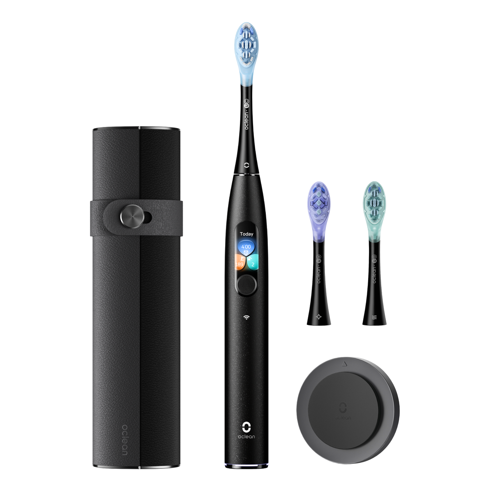
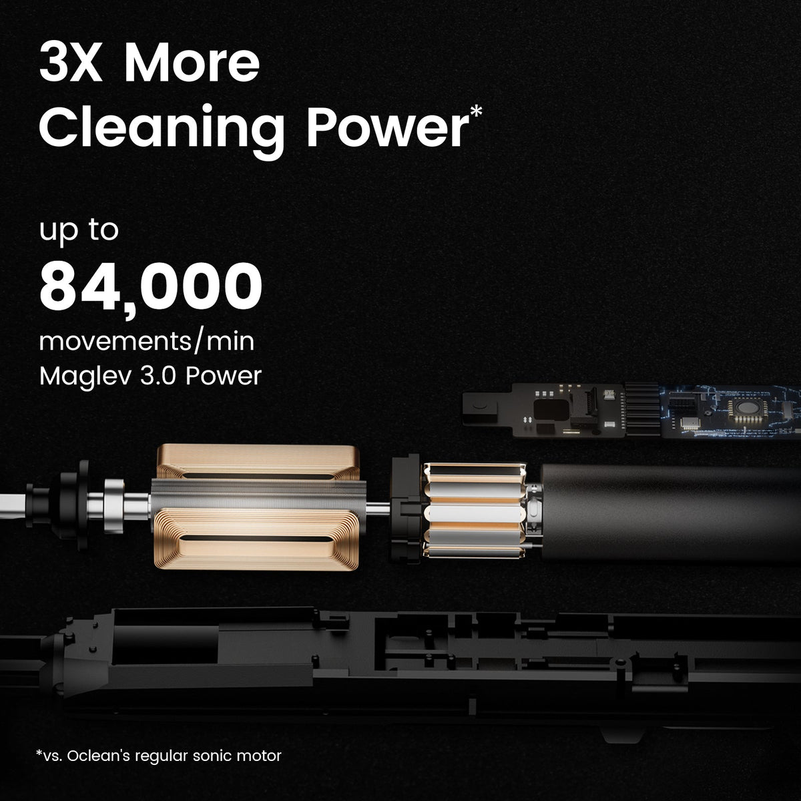
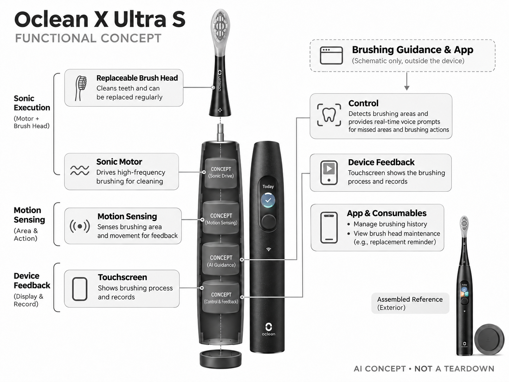

# Oclean X Ultra S

**Oclean** · 护理与美容 · 核查 2026-11-04

用区域识别与即时语音指导刷牙动作

消费渠道：个人零售。

## 产品图片与结构参考

### 产品图

Oclean X Ultra S 官方产品图 · 来源：[Oclean · 官方图片](<https://oclean.com.au/products/sonic-electric-toothbrush-x-ultra-s>) · [原始图片](<https://cdn.shopify.com/s/files/1/0876/4227/6132/files/xultra_a409ab52-6a96-40a1-9f9a-b6ca46c51bf8.png?v=1715135774&width=1200>)

### 参考图

Oclean X Ultra S 官方外观、结构或使用参考 · 来源：[Oclean · 官方图片](<https://oclean.com.au/products/sonic-electric-toothbrush-x-ultra-s>) · [原始图片](<https://cdn.shopify.com/s/files/1/0876/4227/6132/files/3_495f827e-a677-4d70-a708-34a5a5e84652.jpg?v=1722251048&width=1200>)

### AI 生成爆炸示意

**AI 生成 · 非实物拆机。** 内部为概念推断，不能作为元件布局、BOM 或维修依据。[生成提示词](../../content/hardware/prompts/oclean-x-ultra-s.txt)

> 保留官方图片原始内容和出处；画面宣传参数不是本轮独立实测。

> 分析为基于公开资料的案头研究与 AI 辅助判断，未经用户访谈、销量审计或实物拆机。需求、画像、竞争冷门度、审美及商业机会均为研究假设，不是投资结论。

## 销售与购买

- 状态：在售。澳大利亚官方商店显示型号、价格与Add To Cart；页面另列部分刷头Sold Out，不将刷头缺货误判为主机停售。

- 地区：澳大利亚官方商店

- 价格：A$449.95。核查时官方地区参考价，保留原币种；订阅、税运、附件及优惠以结账为准，预订定金不等于整机价格。

- 中国大陆：本轮核实所列海外官方渠道；中国大陆同型号现货、保修及服务可用性未确认。进口前需核对供电、网络、配件和地区条款。

- [官方产品 / 商店](<https://oclean.com.au/products/sonic-electric-toothbrush-x-ultra-s>)

## AI 的实际作用

AI区域检测结合实时语音和屏幕反馈提示刷牙遗漏与动作，声波电机完成清洁；蓝牙、计时和多个模式本身不是AI。

服务与联网依赖：基础模式和屏幕反馈可独立使用，历史记录与个性化通过App；刷头作为耗材需单独确认供应。

## 是否冷门

竞争密集（研究判断）：AI牙刷是成熟个护市场的高价细分，头部品牌竞争充分；无屏或基础电动牙刷是低成本替代。

## 需求与市场

需求假设：用户不容易知道自己是否遗漏某些区域，又不愿每次刷牙都看手机。即时语音与手柄反馈能否改变习惯，需要连续使用验证，单次评分提高不等于实际口腔健康改善。

### 需求假设：刷牙时知道遗漏而不用盯手机 · 研究判断

X Ultra S用区域检测、语音和手柄屏幕提示过程，针对用户不易发现自己遗漏区域、又不愿边刷边看手机的情况。需求应验证提示是否容易理解并持续开启，不能把牙刷会说话当作独立价值，也不以一次刷牙分数提高证明实际健康改善。

依据：[Oclean X Ultra S 官方购买页](<https://oclean.com.au/products/sonic-electric-toothbrush-x-ultra-s>) · [Oclean 官方型号与AI区域检测说明](<https://www.oclean.com/blogs/electric-toothbrush/oclean-sonic-toothbrush-guide-2025>)

### 价值判断：即时反馈与习惯改变不同 · 研究判断

语音可能在当次动作中提醒用户，也可能因为重复或打扰被关闭，长期行为是否变化需要连续观察。研究应把识别、提示理解和实际回应分开，不将功能开启等同有效使用，也不能由区域记录直接推断每颗牙已被充分清洁。

依据：[Oclean 官方型号与AI区域检测说明](<https://www.oclean.com/blogs/electric-toothbrush/oclean-sonic-toothbrush-guide-2025>)

### 验证方案：观察日常浴室里的刷牙流程 · 待验证

让原本使用电动牙刷的人在自己的浴室试用，记录是否看手机、听到什么提示、怎样回应以及何时关闭功能。与简单计时或原牙刷比较时保持日常习惯，重点看操作与理解，不以自评分或短期主观感受作为口腔健康效果证据。

依据：[Oclean X Ultra S 官方购买页](<https://oclean.com.au/products/sonic-electric-toothbrush-x-ultra-s>) · [Oclean 官方型号与AI区域检测说明](<https://www.oclean.com/blogs/electric-toothbrush/oclean-sonic-toothbrush-guide-2025>)

## 用户画像

画像推断：愿意接受反馈的日常电动牙刷用户，以及关注刷牙动作的家庭；噪声敏感或不喜欢提示的人可能关闭语音。购买者常被功能吸引，但长期坚持和刷头成本会影响留存。

### 画像假设：愿意接受过程提示的电动牙刷用户 · 研究判断

较匹配者已经习惯电动清洁，希望理解覆盖情况并愿意尝试提示，不一定是所有关注口腔健康的人。对声音敏感或只想快速完成的人可能选择基础模式，画像应包含日常操作与反馈偏好，不能按高端价格推断需求强度。

依据：[Oclean X Ultra S 官方购买页](<https://oclean.com.au/products/sonic-electric-toothbrush-x-ultra-s>) · [Oclean 官方型号与AI区域检测说明](<https://www.oclean.com/blogs/electric-toothbrush/oclean-sonic-toothbrush-guide-2025>)

### 家庭场景：语音会被其他人听见 · 研究判断

浴室共用、不同作息和家庭成员对音量的偏好，会影响实时语音是否合适，即使本人觉得有用也可能担心打扰。研究应了解实际使用时段和空间，不将无需看手机自动等同更私密或更方便，也不能只访谈购买者忽略长期使用者。

依据：[Oclean X Ultra S 官方购买页](<https://oclean.com.au/products/sonic-electric-toothbrush-x-ultra-s>)

### 访谈重点：哪些提示能在刷牙中被理解 · 待验证

请用户复述一次真实提示，说明知道应该调整哪里还是只看到分数变化，再询问哪些提示重复或令人困惑。按可执行性而非喜欢科技来划分反馈需求，能够区分即时指导与事后报告，也避免把听到语音当作已经改变习惯。

依据：[Oclean X Ultra S 官方购买页](<https://oclean.com.au/products/sonic-electric-toothbrush-x-ultra-s>) · [Oclean 官方型号与AI区域检测说明](<https://www.oclean.com/blogs/electric-toothbrush/oclean-sonic-toothbrush-guide-2025>)

## 竞争与替代

竞争判断：与Oral-B位置跟踪、Philips SenseIQ及普通压力提醒牙刷竞争。语音与区域识别提供交互差异，但若建议重复或误判，用户可能退回最简单模式，不能只凭AI配置推定溢价成立。

### 替代方案：压力提醒、计时与位置跟踪 · 研究判断

X Ultra S与普通电动牙刷、压力提示及其他位置跟踪系统竞争，语音只是反馈的一种输出方式。比较应围绕用户是否知道该调整什么，而不是把模式与传感器数量排序，也不将有AI区域检测的牙刷自动视为实际清洁效果更好。

依据：[Oclean X Ultra S 官方购买页](<https://oclean.com.au/products/sonic-electric-toothbrush-x-ultra-s>) · [Oclean 官方型号与AI区域检测说明](<https://www.oclean.com/blogs/electric-toothbrush/oclean-sonic-toothbrush-guide-2025>)

### 差异判断：语音与手柄反馈降低某些查看动作 · 研究判断

相较持续打开手机，机身与语音可以在使用现场呈现信息，但也会占用听觉和视线，是否更低干扰需要验证。用户可能只保留屏幕或基础模式，研究不能把关闭语音视为整机无价值，也不以宣传交互新颖推断溢价成立。

依据：[Oclean X Ultra S 官方购买页](<https://oclean.com.au/products/sonic-electric-toothbrush-x-ultra-s>)

### 比较方法：按同一遗漏任务对照 · 待验证

让用户比较简单计时、底座反馈与语音提示是否帮助理解遗漏，记录每次需要看屏或重新确认的动作。不要直接用不同品牌自产分数排名，也不把一周提示使用更多当作健康更好，真正比较的是长期易用和可理解程度。

依据：[Oclean X Ultra S 官方购买页](<https://oclean.com.au/products/sonic-electric-toothbrush-x-ultra-s>) · [Oclean 官方型号与AI区域检测说明](<https://www.oclean.com/blogs/electric-toothbrush/oclean-sonic-toothbrush-guide-2025>)

## 供应链

供应链分析：声波电机、动作与压力感知、语音反馈、触屏、电池和密封壳体需要长期稳定。具体芯片及BOM未公开；防水、充电安全和替换刷头供应是高频个护硬件的持续交付重点。

### 功能拆分：声波执行与区域感知各有任务 · 研究判断

公开结构包括可替换刷头、声波驱动、动作感知、区域指导、屏幕和应用，电池与密封支撑日常使用。清洁执行与AI估计不是同一模块，具体芯片、驱动和工厂未披露，不能由手柄外观或产品名称推断真实内部布局与成本。

依据：[Oclean X Ultra S 官方购买页](<https://oclean.com.au/products/sonic-electric-toothbrush-x-ultra-s>) · [Oclean 官方型号与AI区域检测说明](<https://www.oclean.com/blogs/electric-toothbrush/oclean-sonic-toothbrush-guide-2025>)

### 制造判断：湿用与耗材供应决定长期体验 · 研究判断

手柄长期接触水和牙膏，屏幕、充电与刷头连接都需保持可维护，密封老化和耗材可获得性也影响持续使用。供应评估不能只看算法与续航，本轮没有防护寿命、装配公差或刷头供货合同，不推算良率和采购成本。

依据：[Oclean X Ultra S 官方购买页](<https://oclean.com.au/products/sonic-electric-toothbrush-x-ultra-s>)

### 候选选型：小显示与电源分层匹配 · 研究判断

Raystar的小型显示与交互工程可作为手柄反馈候选，EVE消费电池可讨论紧凑供电，Merry可询问语音输出协同。湿用密封、可读性和结构仍需专项验证，候选不提供区域算法，也没有任何一家被公开点名为X Ultra S供应商。

依据：[Oclean X Ultra S 官方购买页](<https://oclean.com.au/products/sonic-electric-toothbrush-x-ultra-s>) · [Oclean 官方型号与AI区域检测说明](<https://www.oclean.com/blogs/electric-toothbrush/oclean-sonic-toothbrush-guide-2025>)

## 技术路径

官方明确AI区域检测和实时反馈。技术判断：手握方式、左右手和口腔差异可能影响位置估计，报告应允许不确定性；刷牙动作识别不是牙病诊断，也不能替代专业口腔检查。

### 已披露能力：AI区域检测与实时提示 · 官方资料

官方说明区域检测结合语音和屏幕反馈，基础模式可独立使用，历史与个性化通过应用组织。蓝牙、计时和声波电机本身不等同全部AI能力，也不能将位置估计描述成直接检查牙齿健康，具体模型与误差本轮未完整公开。

依据：[Oclean X Ultra S 官方购买页](<https://oclean.com.au/products/sonic-electric-toothbrush-x-ultra-s>) · [Oclean 官方型号与AI区域检测说明](<https://www.oclean.com/blogs/electric-toothbrush/oclean-sonic-toothbrush-guide-2025>)

### 技术判断：握持与动作会影响区域解释 · 研究判断

用户左右手、握法和口腔动作不同，系统需要从有限输入估计位置，报告可能与用户理解不一致。研究应检查提示是否允许修正和表达不确定，而不是只追求高分，不能把估计覆盖当作清洁质量或牙病风险的直接测量。

依据：[Oclean 官方型号与AI区域检测说明](<https://www.oclean.com/blogs/electric-toothbrush/oclean-sonic-toothbrush-guide-2025>)

### 验证方案：记录估计、提示和回应 · 待验证

在日常使用中保存设备提示和用户理解，观察是否知道该调整哪个区域、是否出现重复确认，再与实际操作记录对照。不同品牌分数不作为独立标准，本轮没有进行牙面清洁或医学效果测试，也不提供区域算法准确率结论。

依据：[Oclean X Ultra S 官方购买页](<https://oclean.com.au/products/sonic-electric-toothbrush-x-ultra-s>) · [Oclean 官方型号与AI区域检测说明](<https://www.oclean.com/blogs/electric-toothbrush/oclean-sonic-toothbrush-guide-2025>)

## 产品审美

审美判断：细长手柄和屏幕需要在湿手、牙膏泡沫环境中保持易读易握。充电座占地、刷头卫生收纳与清洁死角比界面动画更重要，语音音量也影响浴室多人使用时的感受。

### 外形判断：细长屏幕手柄要适应湿手环境 · 研究判断

屏幕与细长握柄形成明确智能个护形态，但湿手、牙膏泡沫和镜面反光会改变可读与握持体验。设计评价应包含充电座、刷头卫生收纳和清洗，不只看界面动画，商品照片无法说明不同手型或日常擦洗是否方便。

依据：[Oclean X Ultra S 官方购买页](<https://oclean.com.au/products/sonic-electric-toothbrush-x-ultra-s>)

### 交互判断：提示应在动作中容易理解 · 研究判断

刷牙时用户可能看镜子而不是手柄，语音和屏幕信息需要在正确时机出现，不能要求反复暂停查看。研究应观察哪种反馈真正被使用，避免把声音、屏幕和应用同时存在当作交互完整，更多通道也可能带来重复与打扰。

依据：[Oclean X Ultra S 官方购买页](<https://oclean.com.au/products/sonic-electric-toothbrush-x-ultra-s>) · [Oclean 官方型号与AI区域检测说明](<https://www.oclean.com/blogs/electric-toothbrush/oclean-sonic-toothbrush-guide-2025>)

### 体验验证：连续使用后检查清洁与收纳 · 待验证

让用户用自己的台面、充电位置和刷头收纳方式完成日常使用，记录污渍、滑手和查看提示的困难。再询问一段时间后仍保留哪些功能，比开箱时看屏幕是否漂亮更有意义，也能区分礼品吸引力与长期操作价值。

依据：[Oclean X Ultra S 官方购买页](<https://oclean.com.au/products/sonic-electric-toothbrush-x-ultra-s>)

## 关键风险

风险判断：官网同页续航表述存在不同数值，本目录不采用这些冲突参数。用户可能过度相信评分而忽略不适，刷头缺货也会影响持续使用；AI指导不应被宣传为疾病预防或治疗保证。

### 解释风险：评分不能代替专业口腔判断 · 研究判断

用户可能过度相信覆盖分数而忽略不适或其他问题，但动作估计无法说明每颗牙的健康状态。AI指导只按公开功能理解，不替代专业口腔检查，本轮没有清洁效果或医学测试，也不把厂商提示描述为疾病预防和治疗保证。

依据：[Oclean 官方型号与AI区域检测说明](<https://www.oclean.com/blogs/electric-toothbrush/oclean-sonic-toothbrush-guide-2025>)

### 资料与拥有风险：冲突参数和刷头维护 · 研究判断

原目录发现同页续航表述不同，因此不采用冲突数字，实际条件需按当前型号说明核对。刷头供应、地区售后和应用支持也影响长期使用，不能只看一次机身报价，也不将某地区可购推断为所有地区都有相同配件与保修。

依据：[Oclean X Ultra S 官方购买页](<https://oclean.com.au/products/sonic-electric-toothbrush-x-ultra-s>)

### 验证安排：记录关闭提示和回到基础模式 · 待验证

试用应纳入用户关闭语音、不看报告或因耗材与维护而减少使用的原因，区分干扰、误解和服务问题。不要只收集分数提高的记录，也不把不接受反馈解释为用户不重视健康，这些选择能揭示交互是否真正低负担。

依据：[Oclean X Ultra S 官方购买页](<https://oclean.com.au/products/sonic-electric-toothbrush-x-ultra-s>) · [Oclean 官方型号与AI区域检测说明](<https://www.oclean.com/blogs/electric-toothbrush/oclean-sonic-toothbrush-guide-2025>)

## 机会与验证

机会假设：围绕不用看手机的低干扰指导测试产品，比较用户是否愿意保持提示开启。若缺少长期行为改善证据，先优化易懂反馈和刷头供应，比增加更多评分指标更稳妥。

### 研究方向：不用手机也能理解下一步动作 · 研究判断

X Ultra S代表的机会是把覆盖反馈留在刷牙现场，并让用户容易采取动作，可能需要更简洁提示而非更多指标。应先观察用户听懂了什么、愿意保留什么，再决定新增声音或屏幕能力，不能由AI标签推断长期溢价。

依据：[Oclean X Ultra S 官方购买页](<https://oclean.com.au/products/sonic-electric-toothbrush-x-ultra-s>) · [Oclean 官方型号与AI区域检测说明](<https://www.oclean.com/blogs/electric-toothbrush/oclean-sonic-toothbrush-guide-2025>)

### 执行计划：跟踪提示持续开启与维护 · 待验证

连续记录语音、屏幕和应用的使用选择，访谈一次被采纳和一次被关闭的提示，核对刷头更换与充电习惯。将行为与主观体验分开，不以设备自产分数证明口腔改善，也不把首次使用兴趣当作长期留存或实际购买证据。

依据：[Oclean X Ultra S 官方购买页](<https://oclean.com.au/products/sonic-electric-toothbrush-x-ultra-s>) · [Oclean 官方型号与AI区域检测说明](<https://www.oclean.com/blogs/electric-toothbrush/oclean-sonic-toothbrush-guide-2025>)

### 决策边界：反馈方式应围绕同一核心需求比较 · 研究判断

语音、底座和手机指导都服务刷牙覆盖与操作理解，不能仅因输出方式不同就统计为完全新市场。当前只有公开资料与案头假设，没有访谈、销量或效果研究，不以功能数量、评分或品牌宣传预测商业成功。

依据：[Oclean X Ultra S 官方购买页](<https://oclean.com.au/products/sonic-electric-toothbrush-x-ultra-s>) · [Oclean 官方型号与AI区域检测说明](<https://www.oclean.com/blogs/electric-toothbrush/oclean-sonic-toothbrush-guide-2025>)

## 对应供应链公司

能力候选用于选型研究，不代表本产品实际采用；未公开的供货关系不作推断。

- [raystar](../supply-chain/raystar.md) — **能力候选 · 非已采用** / 湿用手柄小型反馈显示候选：Raystar公开中小尺寸OLED、TFT及交互集成，可作为X Ultra S手柄屏的候选，但具体尺寸、触控、湿手可读与密封需要专项确认，不能把标准模组直接替换原机。当前无点名供货证据，也不包含区域检测算法或刷头清洁能力。

- [eve-energy](../supply-chain/eve-energy.md) — **能力候选 · 非已采用** / 高频个护手柄紧凑电池候选：EVE消费小型电芯与便携设备方案可用于讨论X Ultra S供电，但声波驱动、语音、显示负载与充电保护需共同验证，不能由电芯指标推断整机续航。该关联没有原机电池采用证据，也不构成通用电芯兼容替换建议。

- [merry-electronics](../supply-chain/merry-electronics.md) — **能力候选 · 非已采用** / 手柄实时语音输出工程候选：Merry公开声学系统与结构协同，可作为X Ultra S语音反馈的工程候选，但小手柄空间、湿用密封和浴室可理解性需另行确认，普通扬声器经验不等于现成牙刷方案。当前没有品牌采用证据，也不证明语音能改善口腔健康。

[浏览供应链目录](../supply-chain.md)

## 功能分层示意

这是功能关系，不是实物拆机、真实空间结构或已核实 BOM。

1. **声波执行**：电机与可替换刷头。（官方披露）

2. **动作感知**：区域与动作反馈所需感知功能。（官方披露）

3. **AI指导**：区域检测及实时语音提示。（官方披露）

4. **机身反馈**：触屏展示过程与记录。（官方披露）

5. **App与耗材**：历史管理和刷头维护。（官方披露）

## 来源

1. [Oclean X Ultra S 官方购买页](<https://oclean.com.au/products/sonic-electric-toothbrush-x-ultra-s>) — 实际打开核查当前购买或预订入口，未实际下单；价格与交付按具体地区。

2. [Oclean 官方型号与AI区域检测说明](<https://www.oclean.com/blogs/electric-toothbrush/oclean-sonic-toothbrush-guide-2025>) — 实际打开的官方技术与使用资料，宣传效果并非本轮独立实测。

[返回目录](../hardware-market.md) · [网页分析](https://romanagent.github.io/Roman/#hardware/product/oclean-x-ultra-s)
