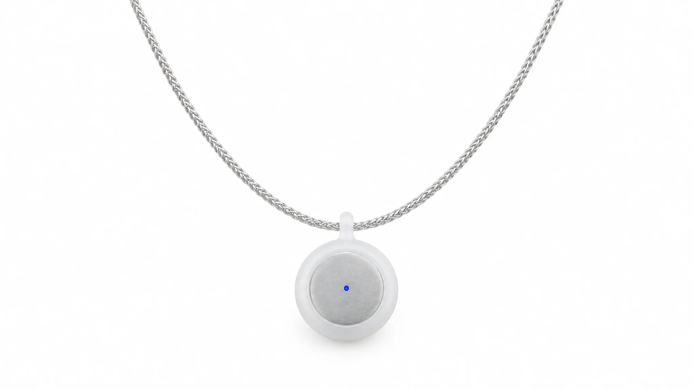
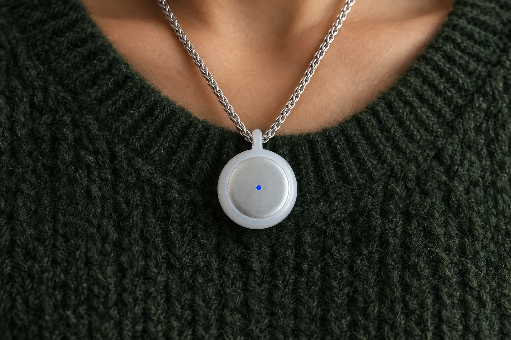
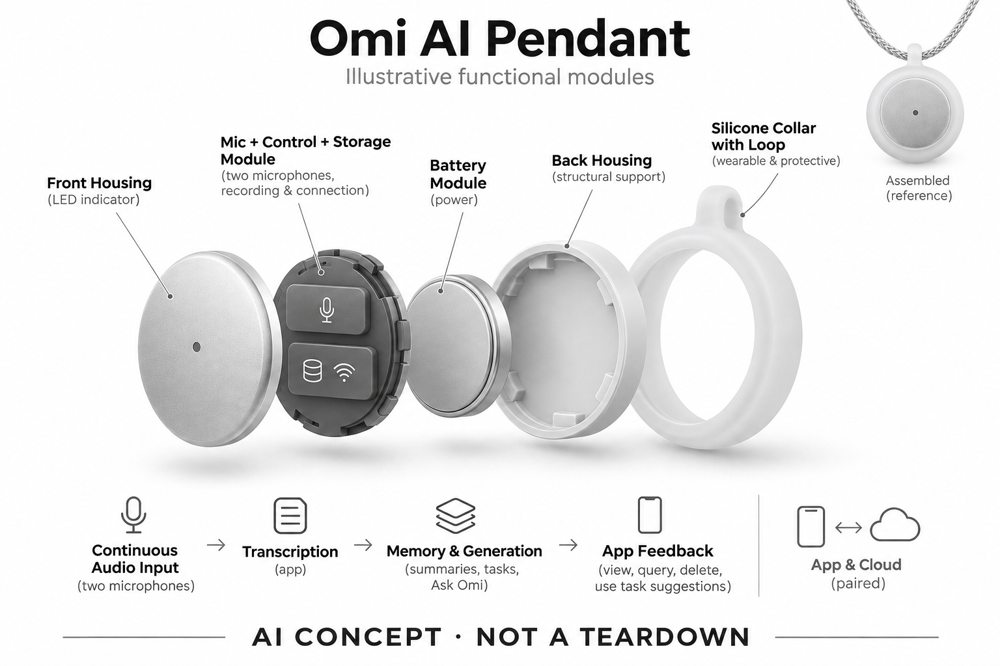

# Omi AI Pendant

**Omi** · 录音与记忆 · 核查 2026-11-04

以持续采集与可查询记忆为核心的吊坠

消费渠道：个人零售。

## 产品图片与结构参考

### 产品图

Omi 官方圆形 Pendant 与项链产品图 · 来源：[Omi · 官方产品图片](<https://www.omi.me/pages/product>) · [原始图片](<https://www.omi.me/cdn/shop/t/87/assets/omi-lf-hero-white.webp?v=36404367431359975201793402396>)

### 参考图

Omi 官方项链佩戴场景参考 · 来源：[Omi · 官方产品图片](<https://www.omi.me/pages/product>) · [原始图片](<https://www.omi.me/cdn/shop/t/87/assets/omi-lf-knit.webp?v=55039599753399124671793402397>)

### AI 生成爆炸示意

**AI 生成 · 非实物拆机。** 内部为概念推断，不能作为元件布局、BOM 或维修依据。[生成提示词](../../content/hardware/prompts/omi-ai-pendant.txt)

> 外形依据核验参考图；内部位置、模块形状与装配关系仅作AI概念展示。

> 图片按源站提供格式保存，未裁切或改色；厂商渲染/场景示意不代表实机测试。

> 分析为基于公开资料的案头研究与 AI 辅助判断，未经用户访谈、销量审计或实物拆机。需求、画像、竞争冷门度、审美及商业机会均为研究假设，不是投资结论。

## 销售与购买

- 状态：在售。官方产品页明确In stock、US$169及1–4个工作日发货，并提供购买链接；本次对应当前Omi Pendant，不沿用旧开发版US$89报价。

- 地区：国际官网购买；实际配送国家以结算为准

- 价格：US$169（官网促销）。核查时划线价US$229；免费计划含手机端转写及有限云额度，Pro另计。仅记录当前官网，不沿用历史开发版价格。

- 中国大陆：未核实大陆官方渠道、应用商店分发、云服务可用性与跨境保修。官网可访问不代表完整购买和使用链路已确认。

- [官方产品 / 商店](<https://www.omi.me/pages/product>)

## AI 的实际作用

持续语音采集、转写、总结与任务提取，并通过问答检索自己的过往记录。

服务与联网依赖：需配对应用；免费与Pro的云额度、提问量和保存功能不同。官网披露手机端转写不代表所有功能都在吊坠本机完成。

## 是否冷门

新兴竞争（研究判断）：持续个人记忆仍在验证习惯和社交接受度，已有直接竞争者；不等于冷门无竞争。

## 需求与市场

需求假设：用户想在日后查回谈话细节，而不是预先判断哪些值得记。持续采集降低启动负担，也增加无用内容，关键是检索能否正确找回事实，并让用户快速确认答案来源。

### 官方｜持续声音与记忆查询 · 官方资料

当前 Pendant 通过声音采集、转写、总结和任务提取提供个人记录，并允许用户向过往内容提问。需求是事后找回未预先判断值得记下的细节，不能只按录音时长评价；本条对应当前在售版本，旧开发版的价格和规格不应沿用，也不能把手机端处理写成吊坠本地完成全部智能。

依据：[Omi · 当前Pendant官方商品页](<https://www.omi.me/pages/product>) · [Omi · 官方首页与计划说明](<https://www.omi.me/>)

### 判断｜少启动与多整理的取舍 · 研究判断

持续采集可以减少忘记按下录音的情况，也会带来更多无用、敏感或含糊内容。真正价值取决于检索能否找回正确事实并提供来源，而不是保存越多越好；如果用户需要经常清理、纠错和排除不相关记录，减少的启动步骤可能被后续管理负担抵消。

依据：[Omi · 当前Pendant官方商品页](<https://www.omi.me/pages/product>)

### 验证｜回查真实细节 · 待验证

可在明确允许记录的日常任务中安排时间、人物和后续更正，之后比较吊坠记忆、主动手机备忘与原始记录。统计找回时间、错误归因和回听成本，并检查系统是否承认缺失信息；当前目录没有长期使用或独立准确率证据，不能把记忆问答当作事实总能被正确恢复。

依据：[Omi · 当前Pendant官方商品页](<https://www.omi.me/pages/product>) · [Omi · 官方首页与计划说明](<https://www.omi.me/>)

## 用户画像

画像推断：会议多、经常边走边聊并愿意佩戴吊坠的人可能匹配。对敏感工作、共享空间或低频记录用户，持续采集未必是优势；不应把记忆辅助描述成健康问题的治疗方案。

### 判断｜愿意持续佩戴的人 · 研究判断

会议较多、经常边走边聊并愿意佩戴吊坠的人可能更容易形成使用场景，但佩戴意愿和记录意愿是两件事。用户可能喜欢外形却不接受持续声音处理，也可能需要记录却讨厌充电和附件；画像应依据真实任务与边界偏好，不把忙碌或健忘直接当作购买理由。

依据：[Omi · 当前Pendant官方商品页](<https://www.omi.me/pages/product>)

### 判断｜敏感环境与低频用户 · 研究判断

对共享空间、敏感工作或低频记录者，持续采集未必有优势，主动记录可能更容易控制范围。研究应让用户描述哪些场合希望暂停以及如何避免误收集，而不是只问是否想提高记忆；本产品的辅助记录定位不能被扩展为治疗记忆或其他健康问题的承诺。

依据：[Omi · 官方首页与计划说明](<https://www.omi.me/>)

### 验证｜手机与计划理解 · 待验证

首次使用测试应检查配对、手机转写、云端额度和 Pro 权益是否能被用户正确理解，并观察他们如何查看、导出和删除。还要覆盖不同手机与网络习惯，避免只测试熟悉技术的人；长期使用需要用户能管理设备和服务，而不是只会佩戴并开始采集声音。

依据：[Omi · 当前Pendant官方商品页](<https://www.omi.me/pages/product>) · [Omi · 官方首页与计划说明](<https://www.omi.me/>)

## 竞争与替代

案头判断：与Bee、NotePin、手机备忘和会议软件竞争，差异在持续记录与查询体验。没有访谈、销量或留存资料，官网用户数与评价不能直接用来证明全天佩戴的广泛接受度。

### 判断｜与主动录音器比较 · 研究判断

主动录音器让用户明确选择一次任务，持续吊坠则尽量保留未知的未来回查需求，两者适合不同信息习惯。不能用摘要数量或录音时间直接排名，应该比较漏记、无用内容和纠错负担；如果用户主要处理正式会议，持续采集的额外范围可能没有明显价值。

依据：[Omi · 当前Pendant官方商品页](<https://www.omi.me/pages/product>)

### 判断｜与手机记忆软件比较 · 研究判断

手机也可以转写和保存内容，本型号需要证明佩戴位置与连续入口减少了真实遗漏，而不只是新增硬件。手机端转写并不意味着吊坠取消了手机依赖，用户仍可能在屏幕中整理与查询；竞争分析应包括这一完整组合，以及云服务和长期保存的实际成本。

依据：[Omi · 官方首页与计划说明](<https://www.omi.me/>)

### 验证｜当前版本与计划同口径 · 待验证

比较时应使用当前 Pendant 的价格、配置和服务计划，不能沿用旧开发版低价或其他硬件演示。免费与 Pro 的提问、保存和云额度需按用户实际需求核对，海外在售也不代表大陆完整服务开放；当前没有销量和访谈数据，不能由价格变化推断市场接受度。

依据：[Omi · 当前Pendant官方商品页](<https://www.omi.me/pages/product>) · [Omi · 官方首页与计划说明](<https://www.omi.me/>)

## 供应链

官方披露两麦克风、无线连接与外形尺寸，但整机代工厂、电池和音频芯片供应商本次不明。推断吊坠佩戴的摩擦噪声、充电触点和小电池寿命会影响可用性，不能据尺寸推算成本。

### 官方｜声音与双无线模块 · 官方资料

官网披露两麦克风、蓝牙和无线局域网连接及当前外形，后续记录依赖配套应用与服务。具体主控、麦克风、电池和整机工厂未完整确认，不能根据开放生态印象或外观补出物料；目录的架构只说明采集、传输和处理关系，不是实际电路或装配图。

依据：[Omi · 当前Pendant官方商品页](<https://www.omi.me/pages/product>)

### 判断｜佩戴摩擦与充电可靠性 · 研究判断

吊坠在走动中可能接触衣物或转动，声音质量、固定方式和充电接触需要共同验证。小型电池的日常维护也会影响是否能在关键时刻记录，但不能据外形推算寿命或制造成本；这些是工程研究问题，尚不能写成已知材料、工厂工艺或量产良率。

依据：[Omi · 当前Pendant官方商品页](<https://www.omi.me/pages/product>)

### 判断｜无线与声音候选 · 研究判断

乐鑫可作为蓝牙与无线局域网协同的控制候选，英飞凌可作为双麦声音输入候选，当前没有点名采用。实际需要验证持续音频、缓存、峰值电流与声孔结构，并确认手机接口；候选能力不等于能够复制 Omi 记忆服务，也不能说明吊坠本机运行全部模型。

依据：[Omi · 当前Pendant官方商品页](<https://www.omi.me/pages/product>)

## 技术路径

官网区分手机端转写与云端额度，并提供摘要、任务和记忆问答。设备、手机与服务端各承担多少推理未完全公开；问答能引用记录不意味着不会错误归因、漏掉上下文或生成错误结论。

### 官方｜手机与云端处理区别 · 官方资料

官方计划说明区分手机端转写与云端权益，设备、手机和后台各自承担的完整任务仍未全部公开。手机上完成某项识别不代表同一任务在吊坠内执行，也不代表摘要、问答和长期保存都离线；目录保留这一区别，避免用端侧一词概括所有数据处理。

依据：[Omi · 当前Pendant官方商品页](<https://www.omi.me/pages/product>) · [Omi · 官方首页与计划说明](<https://www.omi.me/>)

### 判断｜记忆答案需回到证据 · 研究判断

长期记录中的相似人物、时间和话题可能被错误关联，问答即使引用内容也不保证解释正确。系统应区分原话、摘要和模型推断，并允许用户查看缺失或矛盾信息；记忆服务的价值应建立在可复核基础上，不能用自然流畅的回答代替事实来源与不确定性。

依据：[Omi · 官方首页与计划说明](<https://www.omi.me/>)

### 验证｜同步和额度退化 · 待验证

应在手机离线、蓝牙断开、无线网络变化和云额度不足时测试采集与查询，检查哪些内容已保存、哪些尚未处理。再验证恢复后是否重复或遗漏，并比较更正后的问答结果；当前资料不足以保证每种手机和计划都相同，完整任务需要在实际组合中确认。

依据：[Omi · 当前Pendant官方商品页](<https://www.omi.me/pages/product>) · [Omi · 官方首页与计划说明](<https://www.omi.me/>)

## 产品审美

图示观察：小型吊坠可使用链条或腕带，试图接近日常饰品。饰品感与可见录音状态之间存在张力；不同衣物、走动姿态和收音距离的表现仍需测试，不能由产品照片得出舒适结论。

### 判断｜吊坠配饰的双重角色 · 研究判断

吊坠形态可能让录音入口更容易随身携带，也可能与衣物、工作环境和个人风格冲突。审美研究应观察用户是否愿意每天戴着，以及他人是否能理解用途，不能只看产品照片；小尺寸与配饰感并不自动意味着舒适、低摩擦或社会接受度更高。

依据：[Omi · 当前Pendant官方商品页](<https://www.omi.me/pages/product>)

### 判断｜状态与暂停需要易理解 · 研究判断

持续采集设备的外观不仅要好看，还要帮助用户知道是否正在工作和如何暂停。若状态藏在手机应用中，用户可能在不想记录时忘记停止；设计评价应检查佩戴方向与实际反馈，而不是把简单外形当成简单操作，也不能用不显眼代替对旁人的明确说明。

依据：[Omi · 当前Pendant官方商品页](<https://www.omi.me/pages/product>)

### 验证｜一天内的真实携带 · 待验证

试用应覆盖走动、坐姿、外套变化和充电收纳，记录摩擦噪声、设备偏转与用户摘下的时刻。官方电池时长应在真实无线与处理负载下核对，不能直接代表每个人一天都够用；连续体验才能发现配饰化外形在实际任务中带来的便利和维护负担。

依据：[Omi · 当前Pendant官方商品页](<https://www.omi.me/pages/product>)

## 关键风险

持续采集会扩大旁人知情、个人信息积累与删除管理的负担；忘记暂停可能比忘记录音更敏感。还需区分免费与付费可用范围，验证数据导出与长期服务承诺，避免把检索答案直接当事实。

### 判断｜持续采集扩大管理范围 · 研究判断

忘记暂停可能让本不需要保存的谈话进入记录，长期累积又增加删除、授权和误归因的处理负担。用户需要理解原音、转写和生成内容是否分别保存，以及删除覆盖哪里；厂商说明只是资料依据，当前目录没有独立审计，不把本地转写当作全部数据绝不外传的保证。

依据：[Omi · 官方首页与计划说明](<https://www.omi.me/>)

### 判断｜计划与运营依赖 · 研究判断

免费和付费计划影响提问、云处理与保存，硬件在手并不意味着服务长期维持相同权益。购买前应确认导出与退出后的基础用途，尤其不能由当前促销价推算永久总成本；海外官网有货也不证明大陆应用、云服务和保修已经正式可用，这些条件需要分别核对。

依据：[Omi · 当前Pendant官方商品页](<https://www.omi.me/pages/product>) · [Omi · 官方首页与计划说明](<https://www.omi.me/>)

### 验证｜错误记忆与删除 · 待验证

测试应检查错误人物或安排被修正后，后续回答是否仍重复旧结论，并确认删除一段记录对检索和导出的影响。重要信息应回听原话后使用，不应自动执行生成待办；验证目标是让用户控制记录与纠错，而不是假设系统能替代个人理解或保证不会遗漏。

依据：[Omi · 官方首页与计划说明](<https://www.omi.me/>)

## 机会与验证

市场差异是以长期可查询记忆组织记录，而非单次会议文件。尚待验证的购买理由包括回查成功率、引用可复核性、持续佩戴习惯和订阅接受度；本目录不据此推断市场规模或提出新产品。

### 判断｜未知回查需求的价值 · 研究判断

本型号值得研究的是用户是否经常在事后才发现某段谈话有用，从而需要持续入口。若大部分查询都围绕可预先安排的会议，主动记录可能已经足够；购买理由应基于这种时间上的差异，而不是把全天采集本身当成更先进或必然更有价值的体验。

依据：[Omi · 当前Pendant官方商品页](<https://www.omi.me/pages/product>)

### 判断｜减少回听而非增加输出 · 研究判断

摘要和问答应帮助用户更快找到证据，若回答需要大量重听才能确认，管理成本可能仍高。研究可以记录真正被使用的记忆、被忽略的建议与更正量，判断服务是否减负；更多记录和更长总结不等于更好，关键是用户能否在需要时获得可靠且可核查的信息。

依据：[Omi · 官方首页与计划说明](<https://www.omi.me/>)

### 验证｜长期任务和成本记录 · 待验证

后续可跟踪数周内成功回查、错误关联、主动暂停和数据清理，并计算硬件、计划和维护时间。还需观察用户何时恢复使用手机备忘或其他录音方式，以识别替代边界；当前目录保持需求假设，不以在售、配饰形态或记忆功能宣称市场与使用效果已经验证。

依据：[Omi · 当前Pendant官方商品页](<https://www.omi.me/pages/product>) · [Omi · 官方首页与计划说明](<https://www.omi.me/>)

## 对应供应链公司

能力候选用于选型研究，不代表本产品实际采用；未公开的供货关系不作推断。

- [espressif](../supply-chain/espressif.md) — **能力候选 · 非已采用** / 录音设备双无线传输与状态控制候选：当前 Omi 披露蓝牙与无线局域网，乐鑫具备相关无线微控制器路线，可作为新设计中传输与控制候选。需要验证持续音频缓存、峰值电流、手机兼容和最终封装，现有来源未点名采用；无线能力不等于吊坠本地转写或完整记忆服务，不能直接替换现有主控。

- [infineon](../supply-chain/infineon.md) — **能力候选 · 非已采用** / 吊坠双麦克风输入候选：Omi 披露两麦克风，英飞凌声音器件可用于比较输入自噪与匹配，但必须针对衣物摩擦、佩戴方向、声孔和主控接口验证。当前没有实际供货点名，不能从双麦外形推断器件来源；前端质量也不能直接保证手机转写、云端摘要和记忆问答正确。

[浏览供应链目录](../supply-chain.md)

## 功能分层示意

这是功能关系，不是实物拆机、真实空间结构或已核实 BOM。

1. **持续声音输入**：两麦克风采集；官网描述配对佩戴时持续记录，功能图非拆机。（官方披露）

2. **保存与连接**：支持离线记录后同步，蓝牙/Wi-Fi连接配套应用。（官方披露）

3. **转写层**：手机端转写与云额度并存；具体分配依计划与版本。（官方披露）

4. **记忆与生成**：摘要、任务提取和Ask Omi检索过往记录。（官方披露）

5. **应用反馈**：用户查看、查询、删除内容并决定如何采用任务建议。（官方披露）

## 来源

1. [Omi · 当前Pendant官方商品页](<https://www.omi.me/pages/product>) — 已打开，In stock、US$169、1–4工作日发货；不采用旧开发版规格。

2. [Omi · 官方首页与计划说明](<https://www.omi.me/>) — 已打开，免费与Pro区别可见；市场用户规模宣传未用于需求或销量结论。

[返回目录](../hardware-market.md) · [网页分析](https://romanagent.github.io/Roman/#hardware/product/omi-ai-pendant)
