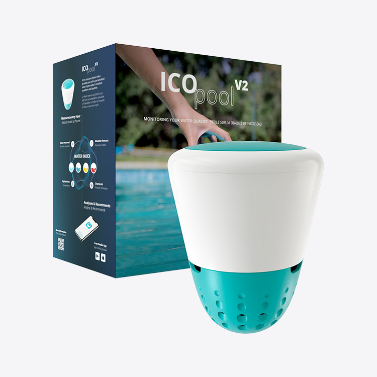
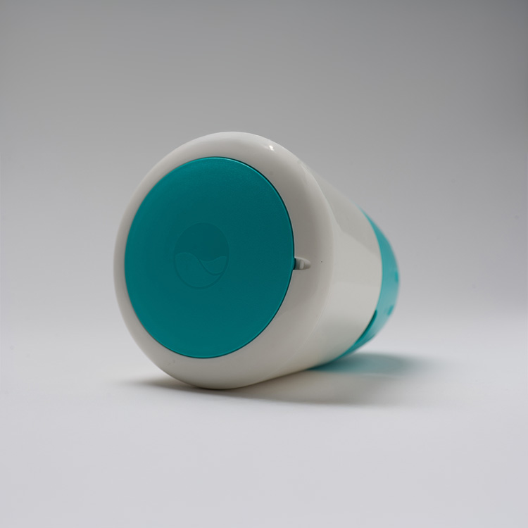
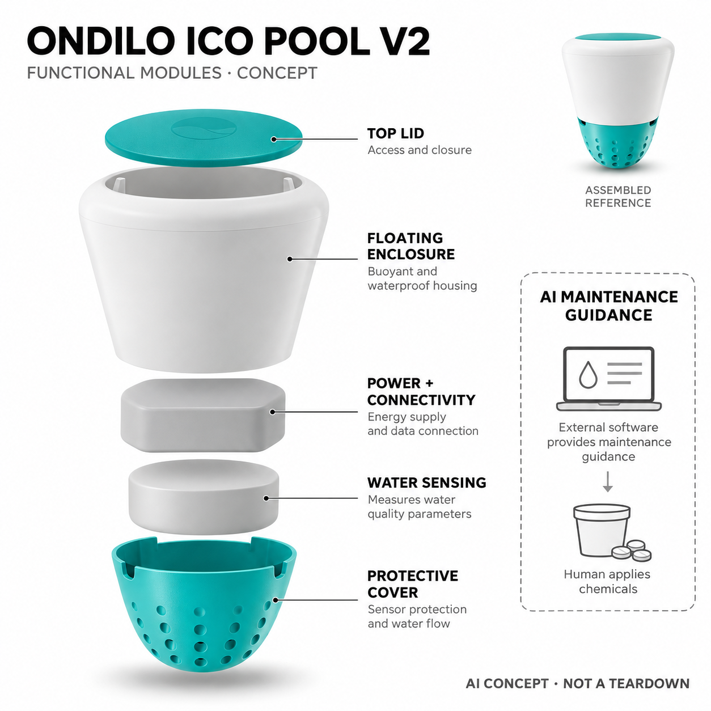

# Ondilo ICO Pool v2 Chlorine/Bromine

**Ondilo** · 庭院与自然 · 核查 2026-11-05

让家庭泳池的水质读数转成可执行维护建议，而不是自动投药

消费渠道：个人零售。

## 产品图片与结构参考

### 产品图

官方氯溴版设备与v2包装 · 来源：[Ondilo · 官方图片](<https://us.ondilo.com/product/ico-pool/>) · [原始图片](<https://us.ondilo.com/assets/img/ico-pool/ico-pool-chlorine-bromine-product.jpg>)

### 参考图

官方同型号顶侧视角 · 来源：[Ondilo · 官方图片](<https://us.ondilo.com/product/ico-pool/>) · [原始图片](<https://us.ondilo.com/assets/img/ico-pool/ico-shot-product.jpg>)

### AI 生成爆炸示意

**AI 生成 · 非实物拆机。** 内部为概念推断，不能作为元件布局、BOM 或维修依据。[生成提示词](../../content/hardware/prompts/ondilo-ico-pool.txt)

> 依据已核验官方外形与公开功能生成；未知内部仅为概念功能块，不代表原机电路板、芯片或实际布局。

> 已目视核对官方当前商品的准确型号与外观；原图保持未编辑，商品图不替代独立性能测试。

> 分析为基于公开资料的案头研究与 AI 辅助判断，未经用户访谈、销量审计或实物拆机。需求、画像、竞争冷门度、审美及商业机会均为研究假设，不是投资结论。

## 销售与购买

- 状态：在售。美国官方当前商品页Chlorine/Bromine版本为US$449、In Stock且Add to cart可用；图片包装标ICO pool v2，规格ICOPOOL02。本条不混入Salt版本或SPA设备。

- 地区：美国

- 价格：美国官网 US$449。当前氯/溴池版本，页面声明无需订阅；替换探头、维护耗材及地区税费需另核，不把盐池版本的测量项目套用。

- 中国大陆：已验证美国官网在售，未找到中国大陆官方型号库存或明确直邮证据；欧版、盐池版和水疗池版的销售不能代替本条型号的国内可达性。

- [官方产品 / 商店](<https://us.ondilo.com/product/ico-pool/>)

## AI 的实际作用

官方技术页明确以AI对水质历史、泳池资料和环境信息生成维护洞察与建议；具体模型未公开，硬件测量pH、ORP与温度，不声称自动加药。

服务与联网依赖：设备通过Wi-Fi与应用连接，用户输入泳池信息并执行建议；电池充电、探头校准和替换仍需人工，离线情况下不能保证应用建议更新。

## 是否冷门

细分专业（研究判断）：私人泳池化学维护是高约束小众任务，浮式传感加建议不同于泳池清洁机器人；探头维护与人工投药限制完全自动化。

## 需求与市场

需求假设：家庭泳池主人希望在明显浑浊前掌握变化，并减少只凭偶尔试纸判断的遗漏。持续读数与维护建议可能降低理解成本，但价值取决于探头状态、泳池参数和人工执行，不能把联网曲线直接等同安全水质。

### 产品任务与边界 · 研究判断

需求假设：家庭泳池主人希望在明显浑浊前掌握变化，并减少只凭偶尔试纸判断的遗漏。持续读数与维护建议可能降低理解成本，但价值取决于探头状态、泳池参数和人工执行，不能把联网曲线直接等同安全水质。

依据：[Ondilo美国官方ICO Pool商品页](<https://us.ondilo.com/product/ico-pool/>) · [Ondilo官方AI技术说明](<https://us.ondilo.com/technology/>)

### 需求判断 · 研究判断

判断：泳池维护的难点不仅是得到一个数值，还包括判断变化是否持续、应该采取什么操作以及操作后是否恢复。ICO把持续采样接到建议，但并不替用户完成投药，若主人本来就有稳定服务人员，额外数据未必减少沟通成本。

依据：[Ondilo美国官方ICO Pool商品页](<https://us.ondilo.com/product/ico-pool/>) · [Ondilo官方AI技术说明](<https://us.ondilo.com/technology/>)

### 需求验证 · 待验证

验证：在自管泳池中把连续记录与按规范进行的人工测量并行比较，观察用户是否更早发现趋势并正确理解建议。记录校准、充电和误提醒消耗的时间，不将短期水质稳定归功于AI，也不使用无人复核的投药实验检验产品。

依据：[Ondilo美国官方ICO Pool商品页](<https://us.ondilo.com/product/ico-pool/>) · [Ondilo官方AI技术说明](<https://us.ondilo.com/technology/>)

## 用户画像

画像推断：自管泳池、愿意补充药剂并维护探头的家庭更接近目标，完全外包管理者可能更需要与服务人员共享记录。泳池体积、消毒体系和网络覆盖影响适配，不能从有泳池直接推定需要持续监控或能承担维护。

### 适用行为与条件 · 研究判断

画像推断：自管泳池、愿意补充药剂并维护探头的家庭更接近目标，完全外包管理者可能更需要与服务人员共享记录。泳池体积、消毒体系和网络覆盖影响适配，不能从有泳池直接推定需要持续监控或能承担维护。

依据：[Ondilo美国官方ICO Pool商品页](<https://us.ondilo.com/product/ico-pool/>) · [Ondilo官方AI技术说明](<https://us.ondilo.com/technology/>)

### 人群取舍 · 研究判断

判断：能识别自己泳池消毒体系并愿意定期维护探头的用户更容易形成闭环。只在假日使用泳池的家庭可能需要远程掌握趋势，但仍须有人执行操作；把设备留在无人维护的泳池内，并不会自动获得持续可靠的管理。

依据：[Ondilo美国官方ICO Pool商品页](<https://us.ondilo.com/product/ico-pool/>) · [Ondilo官方AI技术说明](<https://us.ondilo.com/technology/>)

### 画像验证 · 待验证

验证：访谈自主维护与外包维护两类家庭，让其解释氯溴版、盐池版及不同测量项目的差异。观察初次配置池体参数、理解异常趋势和安排探头更换是否困难，画像应以实际维护责任与行为建立，而非以泳池价值或收入判断。

依据：[Ondilo美国官方ICO Pool商品页](<https://us.ondilo.com/product/ico-pool/>) · [Ondilo官方AI技术说明](<https://us.ondilo.com/technology/>)

## 竞争与替代

竞争判断：与试纸、手持测量仪、泳池服务和自动加药系统竞争，差异在于浮式持续采样与厂商AI建议。盐池版和SPA版不重复增加本批数量；应比较减少漏检与误投的实际效果，而不是只比较应用图表丰富程度。

### 比较对象与差异 · 研究判断

竞争判断：与试纸、手持测量仪、泳池服务和自动加药系统竞争，差异在于浮式持续采样与厂商AI建议。盐池版和SPA版不重复增加本批数量；应比较减少漏检与误投的实际效果，而不是只比较应用图表丰富程度。

依据：[Ondilo美国官方ICO Pool商品页](<https://us.ondilo.com/product/ico-pool/>) · [Ondilo官方AI技术说明](<https://us.ondilo.com/technology/>)

### 竞争判断 · 研究判断

判断：试纸成本低且便于即时复核，固定加药系统能直接执行控制，而ICO位于两者之间，提供更多时间覆盖和建议。浮式安装降低了固定管路改造要求，但增加了取出、充电和保护探头的动作，必须比较整套维护流程。

依据：[Ondilo美国官方ICO Pool商品页](<https://us.ondilo.com/product/ico-pool/>) · [Ondilo官方AI技术说明](<https://us.ondilo.com/technology/>)

### 竞争验证 · 待验证

验证：围绕一次真实维护决策，比较试纸加经验、服务人员定检与ICO建议的步骤和结果解释。记录需要人工复核的次数及能否追溯建议来源，不把盐池版多一项测量、组合套装或换色当成新场景，也不只比较购买价格。

依据：[Ondilo美国官方ICO Pool商品页](<https://us.ondilo.com/product/ico-pool/>) · [Ondilo官方AI技术说明](<https://us.ondilo.com/technology/>)

## 供应链

供应链分析：耐水浮体、可更换电化学探头、温度测量、电池连接和应用共同组成系统，整机代工及BOM未知。探头批次一致性、保护结构和售后校准直接影响数据，不宜用普通环境传感器的成本和寿命替代评估。

### 功能模块拆分 · 研究判断

模块拆分：浮体和保护罩把测量区域放在水中，电化学与温度输入经采集控制传向应用，电池和无线连接维持运行。软件结合池体资料形成建议，药剂投放属于外部人工任务，不能在示意图中虚构储药箱、加药泵或清洁驱动机构。

依据：[Ondilo美国官方ICO Pool商品页](<https://us.ondilo.com/product/ico-pool/>) · [Ondilo官方AI技术说明](<https://us.ondilo.com/technology/>)

### 制造与供应约束 · 研究判断

供应链分析：耐水浮体、可更换电化学探头、温度测量、电池连接和应用共同组成系统，整机代工及BOM未知。探头批次一致性、保护结构和售后校准直接影响数据，不宜用普通环境传感器的成本和寿命替代评估。

依据：[Ondilo美国官方ICO Pool商品页](<https://us.ondilo.com/product/ico-pool/>) · [Ondilo官方AI技术说明](<https://us.ondilo.com/technology/>)

### 候选与证据缺口 · 研究判断

候选判断：捷普可作为电子系统制造和测试流程的询证候选，Protolabs可用于浮体、顶盖和保护结构的试制评估。两者均未被证实参与ICO制造；尤其电化学探头的校准、寿命及耗材渠道需要专门验证，普通壳体加工不能替代。

依据：[Ondilo美国官方ICO Pool商品页](<https://us.ondilo.com/product/ico-pool/>) · [Ondilo官方AI技术说明](<https://us.ondilo.com/technology/>)

## 技术路径

技术判断：官方把历史和池体环境信息的分析称为AI，公开资料不足以确认具体学习模型及独立效果。ORP反映氧化还原状态，不能直接当成所有污染物检测；建议生成与实际药剂投放是不同环节，本机没有已证实自动投药执行。

### 已披露技术边界 · 研究判断

技术判断：官方把历史和池体环境信息的分析称为AI，公开资料不足以确认具体学习模型及独立效果。ORP反映氧化还原状态，不能直接当成所有污染物检测；建议生成与实际药剂投放是不同环节，本机没有已证实自动投药执行。

依据：[Ondilo美国官方ICO Pool商品页](<https://us.ondilo.com/product/ico-pool/>) · [Ondilo官方AI技术说明](<https://us.ondilo.com/technology/>)

### 系统难点判断 · 研究判断

判断：水质数字首先取决于探头状态，算法再精细也无法消除未校准输入的偏移。官方虽明确宣传AI洞察，但未公开模型结构与训练资料，本研究只能确认其应用路径，不能声称某种学习架构或对不同泳池具有统一准确性。

依据：[Ondilo美国官方ICO Pool商品页](<https://us.ondilo.com/product/ico-pool/>) · [Ondilo官方AI技术说明](<https://us.ondilo.com/technology/>)

### 技术验证 · 待验证

验证：检查校准前后、不同温度和长期浸泡后的读数稳定性，并用合适的独立方法对照。再模拟参数填错、数据缺失和网络断开，观察建议是否明确表达数据条件；特别确认系统不会把ORP自动解释成所有污染物的直接检测。

依据：[Ondilo美国官方ICO Pool商品页](<https://us.ondilo.com/product/ico-pool/>) · [Ondilo官方AI技术说明](<https://us.ondilo.com/technology/>)

## 产品审美

审美判断：白色浮体与青色顶底便于在水中识别，比固定控制柜更容易融入家庭泳池。外形评估仍需考虑漂浮碰撞、撇渣器空间和取出充电，清楚区分维护开口与密封部位，比装饰性科技灯光更重要。

### 外观与交互语言 · 研究判断

审美判断：白色浮体与青色顶底便于在水中识别，比固定控制柜更容易融入家庭泳池。外形评估仍需考虑漂浮碰撞、撇渣器空间和取出充电，清楚区分维护开口与密封部位，比装饰性科技灯光更重要。

依据：[Ondilo美国官方ICO Pool商品页](<https://us.ondilo.com/product/ico-pool/>) · [Ondilo官方AI技术说明](<https://us.ondilo.com/technology/>)

### 使用中审美判断 · 研究判断

判断：青白配色使设备在水中较易寻找，圆润外形减少明显工业仪器感，但可能被儿童误当成玩具。界面也应把当前值、变化趋势与建议分别呈现，让用户区分实测、估计和下一步操作，而不是只展示一个令人安心的总体分数。

依据：[Ondilo美国官方ICO Pool商品页](<https://us.ondilo.com/product/ico-pool/>) · [Ondilo官方AI技术说明](<https://us.ondilo.com/technology/>)

### 设计验证 · 待验证

验证：在常见池色、日照和夜间照明条件下测试寻找与取回动作，再检查放入撇渣器时是否影响原有操作。让首次使用者解释通知中的测量与建议，确认开盖、充电和探头保护的步骤清楚，不能仅凭洁净商品图评价易用性。

依据：[Ondilo美国官方ICO Pool商品页](<https://us.ondilo.com/product/ico-pool/>) · [Ondilo官方AI技术说明](<https://us.ondilo.com/technology/>)

## 关键风险

风险判断：探头漂移、清洁不足、Wi-Fi覆盖和池体参数填错可能让建议失真，应用通知不能替代必要的人工复核。家中有儿童或宠物时还需按官方要求管理漂浮设备和药剂，不能因为有AI就降低水质与用药判断要求。

### 主要失效与依赖 · 研究判断

风险判断：探头漂移、清洁不足、Wi-Fi覆盖和池体参数填错可能让建议失真，应用通知不能替代必要的人工复核。家中有儿童或宠物时还需按官方要求管理漂浮设备和药剂，不能因为有AI就降低水质与用药判断要求。

依据：[Ondilo美国官方ICO Pool商品页](<https://us.ondilo.com/product/ico-pool/>) · [Ondilo官方AI技术说明](<https://us.ondilo.com/technology/>)

### 风险传播判断 · 研究判断

判断：传感偏移可能沿着自动建议放大为不必要维护，错误池体容量也可能改变用户对操作量的理解。由于设备不执行加药，最终操作仍需要人的判断，远程查看不能成为无人管理药剂、忽略人工测量或推迟异常处理的理由。

依据：[Ondilo美国官方ICO Pool商品页](<https://us.ondilo.com/product/ico-pool/>) · [Ondilo官方AI技术说明](<https://us.ondilo.com/technology/>)

### 风险验证 · 待验证

验证：审查低电量、校准到期和传感异常是否有可理解提示，并观察用户是否把无新数据误读为水质稳定。对建议执行建立操作前复核和操作后记录，跨境用户还应核实替换探头与售后渠道，避免主机可买而耗材维护无法持续。

依据：[Ondilo美国官方ICO Pool商品页](<https://us.ondilo.com/product/ico-pool/>) · [Ondilo官方AI技术说明](<https://us.ondilo.com/technology/>)

## 机会与验证

机会假设：可先验证泳池主人是否更早发现持续偏离，并能准确理解下一步操作。若维护探头的劳动超过原有测量负担，自动化价值会减弱；机会应围绕可追溯建议与低维护展开，而不是许诺彻底免管理的家庭泳池。

### 可能的机会入口 · 研究判断

机会假设：可先验证泳池主人是否更早发现持续偏离，并能准确理解下一步操作。若维护探头的劳动超过原有测量负担，自动化价值会减弱；机会应围绕可追溯建议与低维护展开，而不是许诺彻底免管理的家庭泳池。

依据：[Ondilo美国官方ICO Pool商品页](<https://us.ondilo.com/product/ico-pool/>) · [Ondilo官方AI技术说明](<https://us.ondilo.com/technology/>)

### 机会成立条件 · 研究判断

判断：持续水质管理的机会来自减少不确定和让维护记录可以交接，并不必然依赖更复杂的自动化。若应用能清楚解释数据条件与建议边界，可能帮助家庭和服务人员沟通；若只输出笼统提醒，则很难超越已有人工习惯。

依据：[Ondilo美国官方ICO Pool商品页](<https://us.ondilo.com/product/ico-pool/>) · [Ondilo官方AI技术说明](<https://us.ondilo.com/technology/>)

### 下一步验证 · 待验证

验证：通过一个维护季节记录设备在线率、人工复核频率、探头维护耗时及用户继续使用情况。单独询问建议是否被理解和执行，不将泳池清澈照片当成有效性证据；只有确认维护净负担下降后，才讨论更广地区的增长机会。

依据：[Ondilo美国官方ICO Pool商品页](<https://us.ondilo.com/product/ico-pool/>) · [Ondilo官方AI技术说明](<https://us.ondilo.com/technology/>)

## 对应供应链公司

能力候选用于选型研究，不代表本产品实际采用；未公开的供货关系不作推断。

- [jabil](../supply-chain/jabil.md) — **能力候选 · 非已采用** / 采集连接模块与制造测试：捷普公开电子制造和系统能力可用于泳池监测器采集、连接与产品测试流程的候选评估。没有ICO型号合作证据，不认定实际制造关系；水下探头校准和长期化学环境验证也需额外专门能力。

- [protolabs](../supply-chain/protolabs.md) — **能力候选 · 非已采用** / 浮体顶盖与传感保护结构：Protolabs公开数字制造与原型服务可匹配浮体、顶盖、保护罩等结构迭代需求。该链接是候选方案而非现有供货披露，材料耐水耐化学与密封设计须针对泳池环境重新评估，不能由加工能力直接保证。

[浏览供应链目录](../supply-chain.md)

## 功能分层示意

这是功能关系，不是实物拆机、真实空间结构或已核实 BOM。

1. **漂浮外壳**：白色浮体、青色顶盖与保护开孔结构。（官方披露）

2. **水质探测**：pH、ORP及温度相关测量功能，探头可维护。（官方披露）

3. **供电与连接**：可充电电源、Wi-Fi与蓝牙配置。（官方披露）

4. **控制与记录**：测量采集与向应用传输，不假造PCB布局。（分析推断）

5. **外部分析与建议**：结合水质数据、历史及池体资料的AI建议层。（官方披露）

## 来源

1. [Ondilo美国官方ICO Pool商品页](<https://us.ondilo.com/product/ico-pool/>) — 2026-11-05实际打开并浏览器核对US$449 In Stock及可用加购；选择氯/溴ICOPOOL02，不混盐池版TDS。

2. [Ondilo官方AI技术说明](<https://us.ondilo.com/technology/>) — 实际打开AI insights、历史与环境分析；技术模型未披露，文案中adjusts不解释为设备自带自动加药。

[返回目录](../hardware-market.md) · [网页分析](https://romanagent.github.io/Roman/#hardware/product/ondilo-ico-pool)
