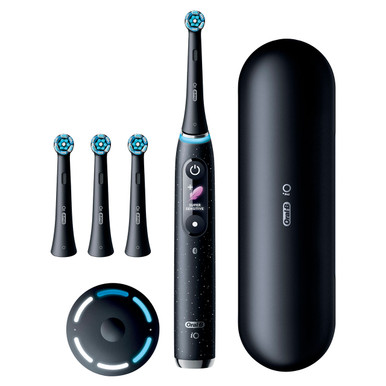
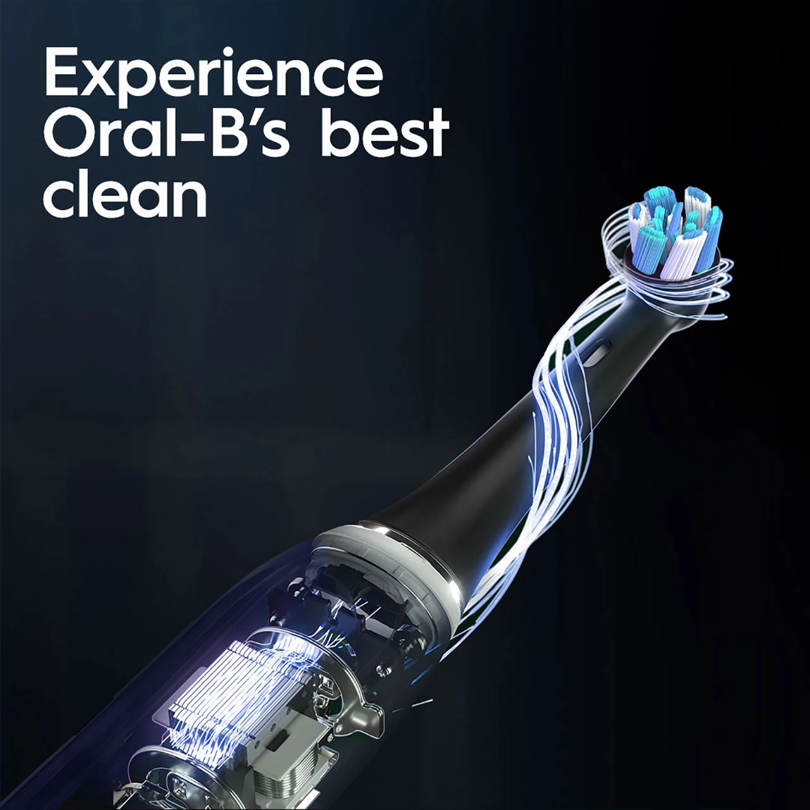
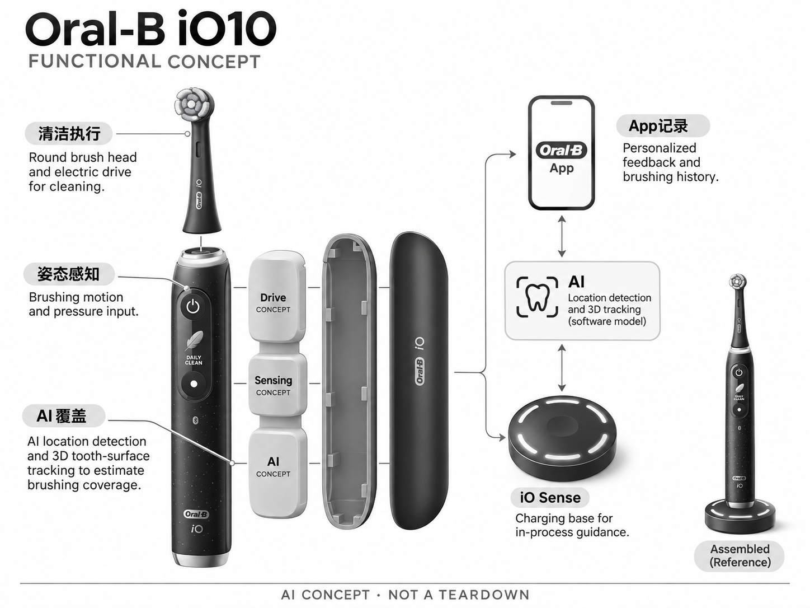

# Oral-B iO10

**Oral-B** · 护理与美容 · 核查 2026-11-04

以牙面覆盖识别指导日常刷牙动作

消费渠道：个人零售。

## 产品图片与结构参考

### 产品图

Oral-B iO10 官方产品图 · 来源：[Oral-B · 官方图片](<https://oralb.com/en-us/products/electric-toothbrushes/io-series-10-rechargeable-electric-toothbrush-cosmic-black/>) · [原始图片](<https://cdn11.bigcommerce.com/s-2idmiil7bp/products/1030/images/6266/00069055135075_C1N0_COM__78040.1780606706.386.513.jpg?c=1>)

### 参考图

Oral-B iO10 官方外观、结构或使用参考 · 来源：[Oral-B · 官方图片](<https://oralb.com/en-us/products/electric-toothbrushes/io-series-10-rechargeable-electric-toothbrush-cosmic-black/>) · [原始图片](<https://cdn11.bigcommerce.com/s-2idmiil7bp/images/stencil/1280x1280/products/1030/9381/IMG_1_experience_iO10__52750.1780606706.jpg?c=1>)

### AI 生成爆炸示意

**AI 生成 · 非实物拆机。** 内部为概念推断，不能作为元件布局、BOM 或维修依据。[生成提示词](../../content/hardware/prompts/oral-b-io10.txt)

> 依据官方外观参考与公开功能生成；未披露的内部布局只作概念模块，不构成BOM或真实结构证据。

> 保留官方图片原始内容和出处；画面宣传参数不是本轮独立实测。

> 分析为基于公开资料的案头研究与 AI 辅助判断，未经用户访谈、销量审计或实物拆机。需求、画像、竞争冷门度、审美及商业机会均为研究假设，不是投资结论。

## 销售与购买

- 状态：在售。品牌官方页保留iO10和零售导购；实际打开John Lewis黑色iO10商品页显示Add to basket与配送。部分法国特别版缺货，不据此宣称全球官网直售均有货。

- 地区：英国零售渠道

- 价格：£800（所查John Lewis英国渠道）。核查时官方地区参考价，保留原币种；订阅、税运、附件及优惠以结账为准，预订定金不等于整机价格。

- 中国大陆：本轮核实所列海外官方渠道；中国大陆同型号现货、保修及服务可用性未确认。进口前需核对供电、网络、配件和地区条款。

- [官方产品 / 商店](<https://oralb.com/en-us/products/electric-toothbrushes/io-series-10-rechargeable-electric-toothbrush-cosmic-black/>)

## AI 的实际作用

AI位置检测与三维牙面跟踪估计刷牙覆盖，iO Sense充电座及App提供过程反馈；压力感应和计时不是全部AI功能。

服务与联网依赖：需要与App及iO Sense按功能配合；基本电动刷牙可独立使用，替换刷头与充电配件的地区供应需确认。

## 是否冷门

竞争密集（研究判断）：高端AI牙刷竞争充分，设备和耗材生态成熟；可验证机会在反馈可用性而不是AI命名。

## 需求与市场

需求假设：用户常难发现刷牙遗漏区域，希望在不持续看手机时得到明确反馈。应观察长期覆盖习惯是否改变，刷牙分数提高不等于疾病风险下降，也不能把设备提示当成专业口腔检查。

## 用户画像

画像推断：已经接受电动牙刷、愿意为可视指导和高端充电配件付费的人群，可能关注刷牙动作规范。礼品购买者与长期使用者的意愿可能不同，刷头成本和手机连接习惯也会影响留存。

## 竞争与替代

竞争判断：与Oclean语音指导、Philips感知适配和普通压力提醒牙刷竞争。iO Sense底座减少看手机的需求，但高价需要由日常易用性证明，颜色和旅行套装不能被当作独立技术产品重复统计。

## 供应链

供应链分析：磁驱动刷头、运动与压力感知、显示、蓝牙及充电座需要协同，具体代工及BOM未披露。防水、密封老化、充电可靠性与专用刷头供应是高频个护设备长期体验的基础。

## 技术路径

官方明确AI三维牙面跟踪与位置检测。技术判断：刷头姿态和握持习惯会影响区域估计，应区分估计覆盖和实际清洁效果；它不能测量每颗牙的健康状态或替代牙医判断。

## 产品审美

审美判断：手柄、显示和充电座组成完整浴室物件，湿手操作和反馈可读性比动画更重要。充电底座占地、旅行盒体积和刷头收纳会影响真实便利，漂亮材质也需要容易擦洗。

## 关键风险

风险判断：部分特别版官网缺货，渠道价格差异较大，当前零售状态不代表所有地区都有官方保修。用户不应过度依赖评分，刷头耗材费用、蓝牙连接和长期软件支持也需纳入总成本。

## 机会与验证

机会假设：针对经常遗漏区域的用户比较底座反馈、语音反馈与简单计时，记录提示是否持续开启。若用户不愿连接App，简洁且可靠的本机引导可能比增加数据报告更能形成长期价值。

## 功能分层示意

这是功能关系，不是实物拆机、真实空间结构或已核实 BOM。

1. **清洁执行**：圆形刷头与电动驱动。（官方披露）

2. **姿态感知**：刷牙动作及压力输入。（官方披露）

3. **AI覆盖**：位置与三维牙面跟踪。（官方披露）

4. **iO Sense**：充电底座提供过程引导。（官方披露）

5. **App记录**：个性化反馈与历史。（官方披露）

## 来源

1. [Oral-B iO10 官方购买页](<https://oralb.com/en-us/products/electric-toothbrushes/io-series-10-rechargeable-electric-toothbrush-cosmic-black/>) — 实际打开核查当前购买或预订入口，未实际下单；价格与交付按具体地区。

2. [Oral-B 官方App指导](<https://oralb.com/en-us/oral-b-app/>) — 实际打开的官方技术与使用资料，宣传效果并非本轮独立实测。

3. [John Lewis iO10实时购买页](<https://www.johnlewis.com/oral-b-io10-electric-toothbrush/black/p111132636>) — 实际打开零售商一手页面，显示Add to basket及配送；本轮购买证据来自英国渠道，不声称品牌美国官网有现货。

[返回目录](../hardware-market.md) · [网页分析](https://romanagent.github.io/Roman/#hardware/product/oral-b-io10)
