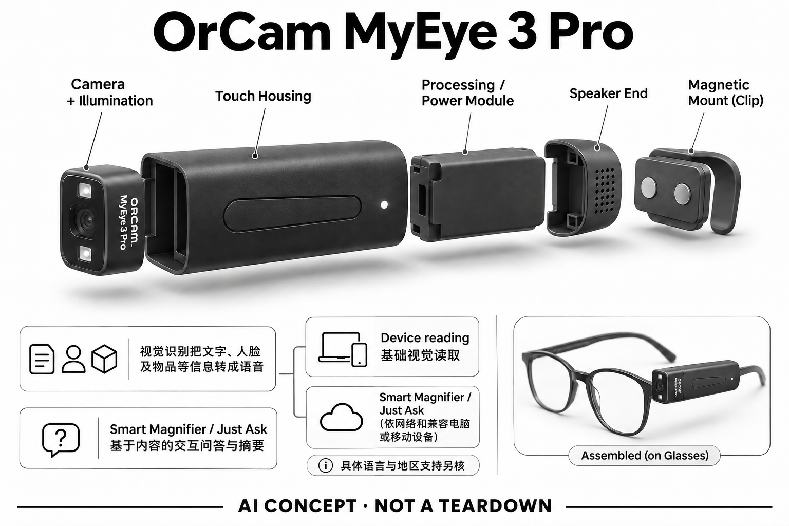

# OrCam MyEye 3 Pro

**OrCam** · 无障碍与辅助沟通 · 核查 2026-11-04

眼镜夹式视觉读取与连屏AI问答

消费渠道：个人零售。

## 产品图片与结构参考

### 产品图

OrCam MyEye 3 Pro授权经销商型号页产品外形图 · 来源：[OrCam / Amit Systems授权经销商页面](<https://www.getorcam.com/product-page/myeye-3-pro>) · [原始图片](<https://static.wixstatic.com/media/cda305_efd5749d4f574d238f7f7e3ea7e8cda6~mv2.png>)

### 参考图

OrCam MyEye 3 Pro授权经销商型号页另一角度或使用场景参考 · 来源：[OrCam / Amit Systems授权经销商页面](<https://www.getorcam.com/product-page/myeye-3-pro>) · [原始图片](<https://static.wixstatic.com/media/cda305_0b91c5790893405ea21d84a90db413ae~mv2.jpg>)

### AI 生成爆炸示意

**AI 生成 · 非实物拆机。** 内部为概念推断，不能作为元件布局、BOM 或维修依据。[生成提示词](../../content/hardware/prompts/orcam-myeye-3-pro.txt)

> 外形依据核验参考图；内部位置、模块形状与装配关系仅作AI概念展示。

> 已逐张查看并核对型号。源图未改色/裁切；场景、界面、附件、优惠及效果文案仅为厂商示意，不作为本目录性能或现价依据。

> 厂家MyEye 3 Pro直链跳转为区域NoorCam，故图片取自明确标注MyEye 3 Pro的授权经销商页面；未使用区域重命名型号冒充。

> 分析为基于公开资料的案头研究与 AI 辅助判断，未经用户访谈、销量审计或实物拆机。需求、画像、竞争冷门度、审美及商业机会均为研究假设，不是投资结论。

## 销售与购买

- 状态：在售。Get OrCam（Amit Systems自述授权经销商）具体MyEye 3 Pro页显示US$4,250及Add to Cart；OrCam当前目录及官方用户手册确认型号。

- 地区：所列官方区域或授权零售渠道；配送地址与服务支持需结算确认

- 价格：授权销售页 US$4,250。核查日所见单机或基本配置价；币种、促销、税费、镜片、附件及服务依地区结算，不把颜色或套装重复计数。

- 中国大陆：本次未核实该具体型号在中国大陆的官方销售和完整服务支持；海外在售不等于国内可直接启用全部功能。

- [官方产品 / 商店](<https://www.orcam.com/en-us/orcam-myeye>)

## AI 的实际作用

视觉识别把文字、人脸及物品等信息转成语音；Smart Magnifier的Just Ask提供基于内容的交互问答与摘要

服务与联网依赖：基础视觉读取与连接智能屏的AI功能需要分开；Smart Magnifier/Just Ask依网络和兼容电脑或移动设备，具体语言与地区支持另核

## 是否冷门

细分专业（研究判断）：按任务与形态作案头分类，无访谈、销量或市场份额证据。

## 需求与市场

需求假设：有视觉读取困难的人希望不持手机也能听取眼前文字，并可对长文本追问。价值应由实际使用频率、任务完成与操作负担验证，不能把AI功能存在或演示流畅当作需求已得到满足。

## 用户画像

画像推断：愿意学习指向、头部定位和语音操作，能使用音频反馈的个人及其家庭更匹配。个人的语言、操作习惯、环境和预算会改变适配结果，本次只有案头研究，没有用户访谈或长期使用观察。

## 竞争与替代

案头判断：与手机读屏、普通放大器和其他辅助相机竞争，夹式专机的优势要与价格和学习成本一起比较。这只是用途与替代品比较，不是市场份额或销量结论；专业细分和较少曝光也不代表没有成熟竞争者。

## 供应链

公开资料可核对磁吸在镜腿的小型相机模组、触控条和声音输出，具体整机工厂、关键模块供应商与BOM本次未确认。制造重点可从形态推断，但不能把品牌所在地、外观相似或营销合作等同代工关系。

## 技术路径

视觉识别把文字、人脸及物品等信息转成语音；Smart Magnifier的Just Ask提供基于内容的交互问答与摘要。这是厂商披露的功能机制；模型版本、准确率及内部结构未完整公开。架构只表示输入、处理和输出关系，不作为真实拆机或性能实测。

## 产品审美

图示观察：小型镜腿附件与原有眼镜分离，桌面支架扩展了固定读取场景。宣传图片只能帮助理解外观和摆放方式，不能证明每个人的舒适度、长时使用体验或实际材料触感。

## 关键风险

它提供信息辅助而不恢复视力；识别失误、联网问答幻觉与环境声音都可能影响关键内容理解。还需核对地区功能、软件更新与售后边界；本目录未进行实机、医学或可靠性测试，不把厂商演示当作结果保证。

## 机会与验证

市场差异主要在于眼镜夹式视觉读取与连屏AI问答。值得进一步验证的购买理由是它能否减少既有任务中的具体步骤，以及硬件、服务与维护的总成本是否符合个人使用频率。

## 功能分层示意

这是功能关系，不是实物拆机、真实空间结构或已核实 BOM。

1. **实体输入**：磁吸在镜腿的小型相机模组、触控条和声音输出；仅功能层示意，非拆机。（官方披露）

2. **采集与控制**：设备把输入转为可处理的信息并接收用户操作；具体内部布局未知。（分析推断）

3. **AI功能**：视觉识别把文字、人脸及物品等信息转成语音；Smart Magnifier的Just Ask提供基于内容的交互问答与摘要（官方披露）

4. **服务依赖**：基础视觉读取与连接智能屏的AI功能需要分开；Smart Magnifier/Just Ask依网络和兼容电脑或移动设备，具体语言与地区支持另核（官方披露）

5. **用户反馈**：用户通过声音、屏幕或配套应用接收结果，并对重要信息复核。（分析推断）

## 来源

1. [OrCam当前型号和销售联系目录](<https://www.orcam.com/en-us/distributor>) — 已打开，官网当前列MyEye 3 Pro及销售渠道；具体可购证据另引授权经销商。

2. [OrCam MyEye 3官方用户指南入口](<https://orcam.helpjuice.com/myeye-resources/orcam-myeye-3-user-guide>) — 已打开官方支持的该代用户指南入口。

3. [Amit Systems MyEye 3 Pro购买与功能](<https://www.getorcam.com/product-page/myeye-3-pro>) — 已打开Add to Cart；页面自述Authorized Worldwide Distributor，为经销商而非制造商官网。

[返回目录](../hardware-market.md) · [网页分析](https://romanagent.github.io/Roman/#hardware/product/orcam-myeye-3-pro)
