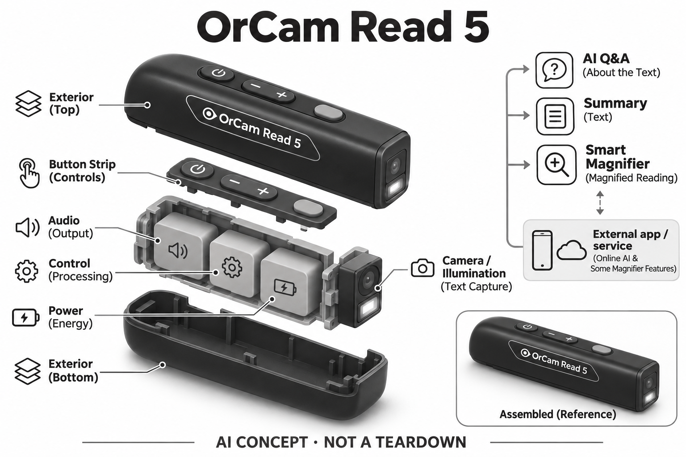

# OrCam Read 5

**OrCam** · 无障碍与辅助沟通 · 核查 2026-11-04

手持整页读取与可追问的阅读辅助

消费渠道：个人零售。

## 产品图片与结构参考

### 产品图

OrCam Read 5官方产品外形图 · 来源：[OrCam · 官方产品图片](<https://www.orcam.com/en-us/orcam-read-5>) · [原始图片](<https://www.orcam.com/media/Read%205%203%20(9)%20(1)-1.png>)

### 参考图

OrCam Read 5官方另一角度或使用场景参考 · 来源：[OrCam · 官方产品图片](<https://www.orcam.com/en-us/orcam-read-5>) · [原始图片](<https://www.orcam.com/media/3A1A5592%20(1).webp>)

### AI 生成爆炸示意

**AI 生成 · 非实物拆机。** 内部为概念推断，不能作为元件布局、BOM 或维修依据。[生成提示词](../../content/hardware/prompts/orcam-read-5.txt)

> 外形依据核验参考图；内部位置、模块形状与装配关系仅作AI概念展示。

> 已逐张查看并核对型号。源图未改色/裁切；场景、界面、附件、优惠及效果文案仅为厂商示意，不作为本目录性能或现价依据。

> 分析为基于公开资料的案头研究与 AI 辅助判断，未经用户访谈、销量审计或实物拆机。需求、画像、竞争冷门度、审美及商业机会均为研究假设，不是投资结论。

## 销售与购买

- 状态：在售。厂家当前Read 5页面提供Find Us Near You；Amit Systems具体Read 5购买页显示US$2,790、数量和Add to Cart。

- 地区：所列官方区域或授权零售渠道；配送地址与服务支持需结算确认

- 价格：授权销售页 US$2,790。核查日所见单机或基本配置价；币种、促销、税费、镜片、附件及服务依地区结算，不把颜色或套装重复计数。

- 中国大陆：本次未核实该具体型号在中国大陆的官方销售和完整服务支持；海外在售不等于国内可直接启用全部功能。

- [官方产品 / 商店](<https://www.orcam.com/en-us/orcam-read-5>)

## AI 的实际作用

相机读取纸面或屏幕文字，配套AI助手回答与文本相关的问题、生成摘要，并通过Smart Magnifier提供放大阅读

服务与联网依赖：在线问答和部分放大功能依兼容手机或智能屏及网络；不要把所有语言、手写或云端功能说成全部在手持设备离线运行

## 是否冷门

细分专业（研究判断）：按任务与形态作案头分类，无访谈、销量或市场份额证据。

## 需求与市场

需求假设：长段文字或包装说明难以逐行读取，希望直接拍摄整页并通过听觉获得内容。价值应由实际使用频率、任务完成与操作负担验证，不能把AI功能存在或演示流畅当作需求已得到满足。

## 用户画像

画像推断：有阅读疲劳、低视力或阅读差异，且能稳定对准材料的个人更可能受益。个人的语言、操作习惯、环境和预算会改变适配结果，本次只有案头研究，没有用户访谈或长期使用观察。

## 竞争与替代

案头判断：与手机OCR、扫描笔和桌面放大器竞争，整页拍摄与追问有别于逐字划扫。这只是用途与替代品比较，不是市场份额或销量结论；专业细分和较少曝光也不代表没有成熟竞争者。

## 供应链

公开资料可核对手持条形相机、实体按钮、声音输出和可选桌面支架，具体整机工厂、关键模块供应商与BOM本次未确认。制造重点可从形态推断，但不能把品牌所在地、外观相似或营销合作等同代工关系。

## 技术路径

相机读取纸面或屏幕文字，配套AI助手回答与文本相关的问题、生成摘要，并通过Smart Magnifier提供放大阅读。这是厂商披露的功能机制；模型版本、准确率及内部结构未完整公开。架构只表示输入、处理和输出关系，不作为真实拆机或性能实测。

## 产品审美

图示观察：条形设备像一支较粗的遥控器，独立按钮和支架利于在手持与桌面模式切换。宣传图片只能帮助理解外观和摆放方式，不能证明每个人的舒适度、长时使用体验或实际材料触感。

## 关键风险

问答可能误解文意；支付、用药等重要内容不能仅凭AI摘要，手持指向与网络状况也影响体验。还需核对地区功能、软件更新与售后边界；本目录未进行实机、医学或可靠性测试，不把厂商演示当作结果保证。

## 机会与验证

市场差异主要在于手持整页读取与可追问的阅读辅助。值得进一步验证的购买理由是它能否减少既有任务中的具体步骤，以及硬件、服务与维护的总成本是否符合个人使用频率。

## 功能分层示意

这是功能关系，不是实物拆机、真实空间结构或已核实 BOM。

1. **实体输入**：手持条形相机、实体按钮、声音输出和可选桌面支架；仅功能层示意，非拆机。（官方披露）

2. **采集与控制**：设备把输入转为可处理的信息并接收用户操作；具体内部布局未知。（分析推断）

3. **AI功能**：相机读取纸面或屏幕文字，配套AI助手回答与文本相关的问题、生成摘要，并通过Smart Magnifier提供放大阅读（官方披露）

4. **服务依赖**：在线问答和部分放大功能依兼容手机或智能屏及网络；不要把所有语言、手写或云端功能说成全部在手持设备离线运行（官方披露）

5. **用户反馈**：用户通过声音、屏幕或配套应用接收结果，并对重要信息复核。（分析推断）

## 来源

1. [OrCam Read 5官方产品说明](<https://www.orcam.com/en-us/orcam-read-5>) — 已打开一手页面；产品能力为厂商披露，未进行实机或效果验证。

2. [OrCam官方销售目录](<https://www.orcam.com/en-us/distributor>) — 已打开一手页面；产品能力为厂商披露，未进行实机或效果验证。

3. [Amit Systems Read 5实际购买页](<https://www.getorcam.com/product-page/orcam-read-5>) — 已打开并确认Add to Cart，销售方自述授权经销商；非厂家直营。

[返回目录](../hardware-market.md) · [网页分析](https://romanagent.github.io/Roman/#hardware/product/orcam-read-5)
