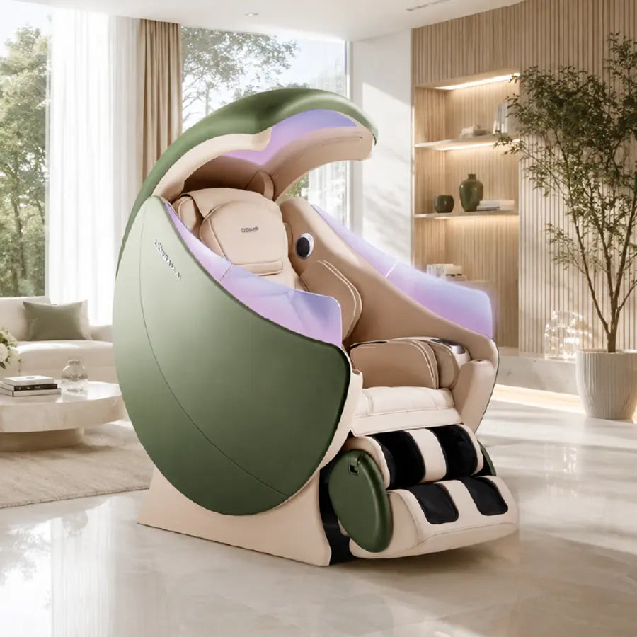
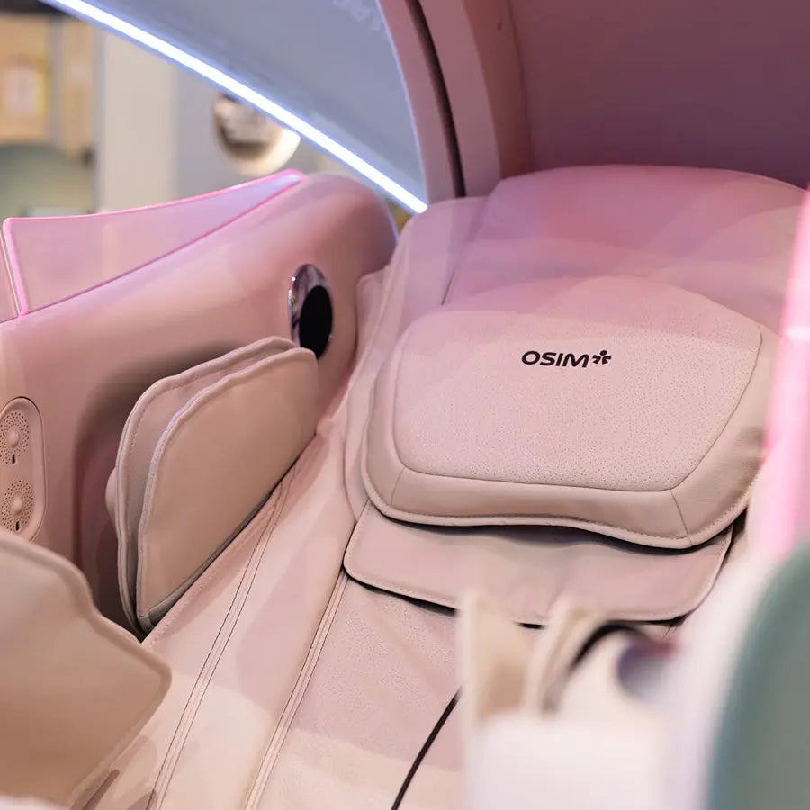
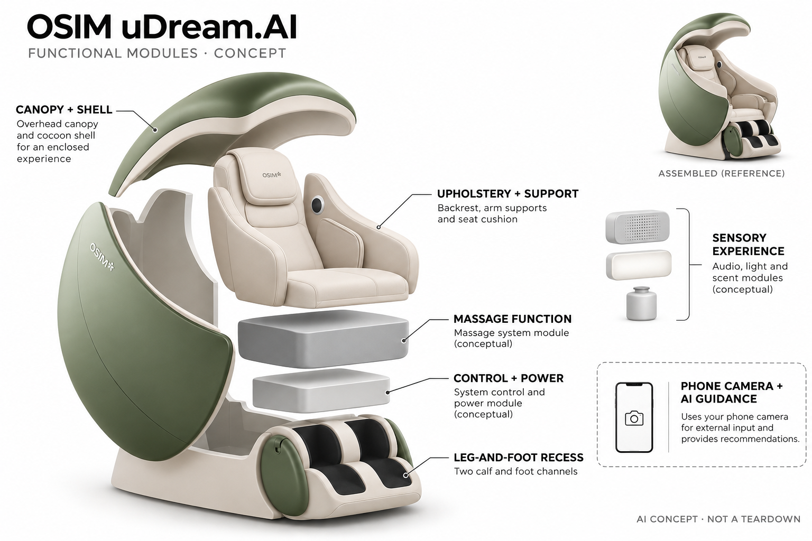

# OSIM uDream.AI Well-Being Chair

**OSIM** · 护理与美容 · 核查 2026-11-05

将手机相机推断的压力指标连接到家用按摩程序推荐

消费渠道：个人零售。

## 产品图片与结构参考

### 产品图

官方uDream.AI家居场景 · 来源：[OSIM · 官方图片](<https://us.osim.com/products/udream-ai-well-being-massage-chair>) · [原始图片](<https://cdn.shopify.com/s/files/1/0259/8912/0060/files/uDream_AI_Green_Home_900x900_5a7632ac-9a0f-49f8-b911-0cd17b30e51a.png?v=1786510622&width=1200>)

### 参考图

官方当前AI型号内部座面参考 · 来源：[OSIM · 官方图片](<https://us.osim.com/products/udream-ai-well-being-massage-chair>) · [原始图片](<https://cdn.shopify.com/s/files/1/0259/8912/0060/files/675479525_1405134274993541_1492174403545862413_n_0f165a9f-1e87-4fa6-aee4-e19d28bf012b.jpg?v=1790727297&width=1200>)

### AI 生成爆炸示意

**AI 生成 · 非实物拆机。** 内部为概念推断，不能作为元件布局、BOM 或维修依据。[生成提示词](../../content/hardware/prompts/osim-udream-ai.txt)

> 依据已核验官方外形与公开功能生成；未知内部仅为概念功能块，不代表原机电路板、芯片或实际布局。

> 已目视核对准确型号，保持官方图片未编辑；营销场景与界面示意不构成性能或医疗效果验证。

> 分析为基于公开资料的案头研究与 AI 辅助判断，未经用户访谈、销量审计或实物拆机。需求、画像、竞争冷门度、审美及商业机会均为研究假设，不是投资结论。

## 销售与购买

- 状态：在售。官方美国商品页US$12999，Shopify公开商品数据两种颜色均available:true；本条为uDream.AI，官方手册型号OS-8258，不沿用早期uDream或uDream Pro。

- 地区：美国、澳大利亚

- 价格：美国官方 US$12,999。当前标价，官网对比价US$17999；澳洲官方另有当地销售价格。颜色不另算产品，配送安装、上楼与退换条件需按地区确认，不把分期金额当整机价。

- 中国大陆：2026进博会OSIM展商官方资料确认uDream AI在中国展示及中文命名，但本次未核实大陆可立即下单的具体价格和库存；展会预约不等于零售订单。海外规格电源与本地售后另核。

- [官方产品 / 商店](<https://us.osim.com/products/udream-ai-well-being-massage-chair>)

## AI 的实际作用

OSIM明确采用Binah.ai的rPPG，通过兼容手机等设备相机分析面部颜色变化，给出日常压力等指标并辅助按摩推荐；不是椅内摄像头自动诊断。

服务与联网依赖：AI分析依赖兼容设备、OSIM Well-Being App及相应服务；基本按摩与手动设置是另一层功能。结果用于一般舒适与放松，不替代医疗评估。

## 是否冷门

细分专业（研究判断）：按摩椅大类成熟，但相机压力推断到家用多感官按摩推荐是较明确的交互机制；高价格、空间和身体适配限制人群。

## 需求与市场

需求假设：希望在家获得可重复放松流程的人，可能需要降低挑选复杂按摩程序的负担。相机分析与推荐能提供选择起点，但其价值应由舒适度和长期使用验证，不能从压力分数下降直接推导治疗、改善疾病或替代休息。

### 产品任务与边界 · 研究判断

需求假设：希望在家获得可重复放松流程的人，可能需要降低挑选复杂按摩程序的负担。相机分析与推荐能提供选择起点，但其价值应由舒适度和长期使用验证，不能从压力分数下降直接推导治疗、改善疾病或替代休息。

依据：[OSIM美国当前uDream.AI官方商店](<https://us.osim.com/products/udream-ai-well-being-massage-chair>) · [OSIM uDream.AI官方使用手册](<https://www.osim.com/Sites/user_manual/udream-ai.pdf>)

### 需求判断 · 研究判断

判断：按摩椅的核心任务仍是身体接触产生的舒适体验，压力指标只是帮助用户选择程序的额外输入。若扫描步骤增加操作负担，或建议和个人偏好长期冲突，AI反而可能成为开始放松前的一道门槛，而不是自然融入日常习惯。

依据：[OSIM美国当前uDream.AI官方商店](<https://us.osim.com/products/udream-ai-well-being-massage-chair>) · [OSIM uDream.AI官方使用手册](<https://www.osim.com/Sites/user_manual/udream-ai.pdf>)

### 需求验证 · 待验证

验证：让愿意试用的家庭交替采用手动常用程序与AI推荐，记录开始所需步骤、舒适反馈和再次使用意愿。比较应控制时间与强度，并允许随时停止；没有独立评估前，不把单次分数变化或用户好评写成疾病、睡眠改善结论。

依据：[OSIM美国当前uDream.AI官方商店](<https://us.osim.com/products/udream-ai-well-being-massage-chair>) · [OSIM uDream.AI官方使用手册](<https://www.osim.com/Sites/user_manual/udream-ai.pdf>)

## 用户画像

画像推断：具备摆放空间、配送条件并愿意使用应用的家庭较匹配，实际坐感、身形适配与个人偏好比年龄或收入标签更重要。有特殊健康状况者需先了解官方适用限制，不把所有老人、久坐者或压力大的人都当成适用用户。

### 适用行为与条件 · 研究判断

画像推断：具备摆放空间、配送条件并愿意使用应用的家庭较匹配，实际坐感、身形适配与个人偏好比年龄或收入标签更重要。有特殊健康状况者需先了解官方适用限制，不把所有老人、久坐者或压力大的人都当成适用用户。

依据：[OSIM美国当前uDream.AI官方商店](<https://us.osim.com/products/udream-ai-well-being-massage-chair>) · [OSIM uDream.AI官方使用手册](<https://www.osim.com/Sites/user_manual/udream-ai.pdf>)

### 人群取舍 · 研究判断

判断：不同家庭成员可能共享椅子，却对力度、包裹感、声音与香氛有完全不同的偏好。能否快速找到自己的设置、理解相机扫描和退出推荐，比简单划分年轻人或老年人更有用；实际采购还受电梯、门宽和摆放位置约束。

依据：[OSIM美国当前uDream.AI官方商店](<https://us.osim.com/products/udream-ai-well-being-massage-chair>) · [OSIM uDream.AI官方使用手册](<https://www.osim.com/Sites/user_manual/udream-ai.pdf>)

### 画像验证 · 待验证

验证：在购买前的展示体验中分别记录进入、调整、退出和保存偏好是否顺畅，再验证家中展开及通行空间。访谈需包含实际使用者而非只问出资人，确认是否愿意长期使用相机功能，并了解官方对特殊身体状况的使用限制。

依据：[OSIM美国当前uDream.AI官方商店](<https://us.osim.com/products/udream-ai-well-being-massage-chair>) · [OSIM uDream.AI官方使用手册](<https://www.osim.com/Sites/user_manual/udream-ai.pdf>)

## 竞争与替代

竞争判断：与普通按摩椅、人工选择程序和家庭放松用品竞争，差异是外部视觉指标与推荐接入整机体验。旧uDream、Pro与当前AI型号不并列凑数；需要比较推荐是否减少选择负担，而非用合作品牌数量证明按摩效果。

### 比较对象与差异 · 研究判断

竞争判断：与普通按摩椅、人工选择程序和家庭放松用品竞争，差异是外部视觉指标与推荐接入整机体验。旧uDream、Pro与当前AI型号不并列凑数；需要比较推荐是否减少选择负担，而非用合作品牌数量证明按摩效果。

依据：[OSIM美国当前uDream.AI官方商店](<https://us.osim.com/products/udream-ai-well-being-massage-chair>) · [OSIM uDream.AI官方使用手册](<https://www.osim.com/Sites/user_manual/udream-ai.pdf>)

### 竞争判断 · 研究判断

判断：普通按摩椅可通过预设和记忆功能满足稳定偏好，当前AI型号的增量需要来自更少试错或更清晰的选择。多感官组件和高端合作品牌可以改变体验，但无法替代这项比较，也不能用更高价格本身证明技术或舒适优势。

依据：[OSIM美国当前uDream.AI官方商店](<https://us.osim.com/products/udream-ai-well-being-massage-chair>) · [OSIM uDream.AI官方使用手册](<https://www.osim.com/Sites/user_manual/udream-ai.pdf>)

### 竞争验证 · 待验证

验证：将同价位手动预设方案、已有家庭按摩习惯和当前AI推荐并列体验，记录真正被使用的功能而非功能表长度。分别询问推荐、声音、灯光和香氛的贡献，避免把整机新鲜感全部归因AI，并计入配送安装与后续维护。

依据：[OSIM美国当前uDream.AI官方商店](<https://us.osim.com/products/udream-ai-well-being-massage-chair>) · [OSIM uDream.AI官方使用手册](<https://www.osim.com/Sites/user_manual/udream-ai.pdf>)

## 供应链

供应链分析：大型壳体软包、承重运动机构、气囊滚轮、电控和感官组件需要整机协同。官方点名部分体验及AI合作方，但完整制造工厂、BOM和装配测试未披露，不能把外部技术合作等同整机代工或全部供应商清单。

### 功能模块拆分 · 研究判断

模块拆分：承重结构、软包与可调支撑负责人体接触，滚轮气囊及电控负责按摩动作，声音灯光香氛形成附加体验。AI相机输入来自兼容外部设备，不能在椅内虚构面部摄像头或脑波模块，概念图也不指定未披露的内部执行布局。

依据：[OSIM美国当前uDream.AI官方商店](<https://us.osim.com/products/udream-ai-well-being-massage-chair>) · [OSIM uDream.AI官方使用手册](<https://www.osim.com/Sites/user_manual/udream-ai.pdf>)

### 制造与供应约束 · 研究判断

供应链分析：大型壳体软包、承重运动机构、气囊滚轮、电控和感官组件需要整机协同。官方点名部分体验及AI合作方，但完整制造工厂、BOM和装配测试未披露，不能把外部技术合作等同整机代工或全部供应商清单。

依据：[OSIM美国当前uDream.AI官方商店](<https://us.osim.com/products/udream-ai-well-being-massage-chair>) · [OSIM uDream.AI官方使用手册](<https://www.osim.com/Sites/user_manual/udream-ai.pdf>)

### 候选与证据缺口 · 研究判断

候选判断：Protolabs可用于外壳及结构样件的迭代验证，捷普可作为电控与电子测试体系的询证候选。二者未被证实参与OSIM该型号生产；软包工艺、承重寿命和机构协调仍需专门能力，不能以电子代工资质覆盖全部整机要求。

依据：[OSIM美国当前uDream.AI官方商店](<https://us.osim.com/products/udream-ai-well-being-massage-chair>) · [OSIM uDream.AI官方使用手册](<https://www.osim.com/Sites/user_manual/udream-ai.pdf>)

## 技术路径

技术判断：当前官方说明以兼容设备相机进行rPPG分析并生成一般健康与压力指标，模型细节和独立适用性未完整公开。应区分相机推断、推荐规则与按摩机械控制，不把身体位置检测或预设程序全部归为生成式AI。

### 已披露技术边界 · 研究判断

技术判断：当前官方说明以兼容设备相机进行rPPG分析并生成一般健康与压力指标，模型细节和独立适用性未完整公开。应区分相机推断、推荐规则与按摩机械控制，不把身体位置检测或预设程序全部归为生成式AI。

依据：[OSIM美国当前uDream.AI官方商店](<https://us.osim.com/products/udream-ai-well-being-massage-chair>) · [OSIM uDream.AI官方使用手册](<https://www.osim.com/Sites/user_manual/udream-ai.pdf>)

### 系统难点判断 · 研究判断

判断：rPPG从图像中的微小变化推断指标，应用再连接推荐流程，机械按摩则由另一套控制系统执行。三个环节的数据质量与边界需要分别理解，厂商未公开的模型误差、设备兼容范围和个体适用性不能用宣传中的智能一词替代。

依据：[OSIM美国当前uDream.AI官方商店](<https://us.osim.com/products/udream-ai-well-being-massage-chair>) · [OSIM uDream.AI官方使用手册](<https://www.osim.com/Sites/user_manual/udream-ai.pdf>)

### 技术验证 · 待验证

验证：在官方要求的光照、姿态与兼容设备条件下检查扫描是否稳定，再比较重复扫描的推荐变化是否可解释。对信号不足和网络问题观察是否有明确提示，确认用户能直接选择或停止程序；不自行将其与临床设备等同或开展疗效结论。

依据：[OSIM美国当前uDream.AI官方商店](<https://us.osim.com/products/udream-ai-well-being-massage-chair>) · [OSIM uDream.AI官方使用手册](<https://www.osim.com/Sites/user_manual/udream-ai.pdf>)

## 产品审美

审美判断：包裹式弧形顶罩和大面积软包形成私密座舱，家居存在感也明显高于普通单椅。设计判断需看展开空间、进出和清洁，灯光与香氛可增强仪式感，但不能因豪华视觉就推定每个家庭愿意长期摆放。

### 外观与交互语言 · 研究判断

审美判断：包裹式弧形顶罩和大面积软包形成私密座舱，家居存在感也明显高于普通单椅。设计判断需看展开空间、进出和清洁，灯光与香氛可增强仪式感，但不能因豪华视觉就推定每个家庭愿意长期摆放。

依据：[OSIM美国当前uDream.AI官方商店](<https://us.osim.com/products/udream-ai-well-being-massage-chair>) · [OSIM uDream.AI官方使用手册](<https://www.osim.com/Sites/user_manual/udream-ai.pdf>)

### 使用中审美判断 · 研究判断

判断：包裹式座舱让用户有专门放松空间，也占据较强的视觉体量。顶罩、侧壳和腿足部分在展开时改变房间动线，软包缝隙与香氛耗材又带来维护任务，因此照片中的豪华感不能直接推出在真实小空间中同样舒适。

依据：[OSIM美国当前uDream.AI官方商店](<https://us.osim.com/products/udream-ai-well-being-massage-chair>) · [OSIM uDream.AI官方使用手册](<https://www.osim.com/Sites/user_manual/udream-ai.pdf>)

### 设计验证 · 待验证

验证：用真实户型测量坐入和躺回后的活动范围，观察多人共享时调整与清洁是否方便。分别关闭灯光、声音和香氛体验基本按摩，确认这些可选元素不会遮盖设备状态或停止入口，审美评价应包含长期摆放而非只看初次展示。

依据：[OSIM美国当前uDream.AI官方商店](<https://us.osim.com/products/udream-ai-well-being-massage-chair>) · [OSIM uDream.AI官方使用手册](<https://www.osim.com/Sites/user_manual/udream-ai.pdf>)

## 关键风险

风险判断：相机测量会受环境和使用条件影响，建议强度仍须个人确认，异常不适不能被AI分数解释掉。手册强调家用且并非睡床；大型配送、售后维修及地区电源差异也会改变跨境购买成本，不承诺通用适配。

### 主要失效与依赖 · 研究判断

风险判断：相机测量会受环境和使用条件影响，建议强度仍须个人确认，异常不适不能被AI分数解释掉。手册强调家用且并非睡床；大型配送、售后维修及地区电源差异也会改变跨境购买成本，不承诺通用适配。

依据：[OSIM美国当前uDream.AI官方商店](<https://us.osim.com/products/udream-ai-well-being-massage-chair>) · [OSIM uDream.AI官方使用手册](<https://www.osim.com/Sites/user_manual/udream-ai.pdf>)

### 风险传播判断 · 研究判断

判断：当系统给出看似精确的压力数值时，用户可能过度相信推荐，忽略身体当下反馈。机械运动、热感和气囊压力仍有实际使用边界，官方手册明确非睡床，也不将椅子用于自我诊断或治疗，这些限制不能被AI叙事弱化。

依据：[OSIM美国当前uDream.AI官方商店](<https://us.osim.com/products/udream-ai-well-being-massage-chair>) · [OSIM uDream.AI官方使用手册](<https://www.osim.com/Sites/user_manual/udream-ai.pdf>)

### 风险验证 · 待验证

验证：检查异常不适时的停止、恢复和求助说明是否容易找到，并审阅当前地区的安装及维修流程。了解应用失效后可用的基本控制，核实大件退换成本和本地电源配置；不把海外线上可购推定为大陆可直接通电且有同等售后。

依据：[OSIM美国当前uDream.AI官方商店](<https://us.osim.com/products/udream-ai-well-being-massage-chair>) · [OSIM uDream.AI官方使用手册](<https://www.osim.com/Sites/user_manual/udream-ai.pdf>)

## 机会与验证

机会假设：可以从减少程序选择与建立可持续放松习惯验证，而非承诺家庭医疗管理。若用户仍长期只用同一手动模式，AI附加价值就有限；可解释推荐和容易停止调整的交互可能比继续增加感官功能更重要。

### 可能的机会入口 · 研究判断

机会假设：可以从减少程序选择与建立可持续放松习惯验证，而非承诺家庭医疗管理。若用户仍长期只用同一手动模式，AI附加价值就有限；可解释推荐和容易停止调整的交互可能比继续增加感官功能更重要。

依据：[OSIM美国当前uDream.AI官方商店](<https://us.osim.com/products/udream-ai-well-being-massage-chair>) · [OSIM uDream.AI官方使用手册](<https://www.osim.com/Sites/user_manual/udream-ai.pdf>)

### 机会成立条件 · 研究判断

判断：可能的创新入口是把用户主观偏好与系统建议结合得更清楚，让人知道为何推荐并方便修改。若实际使用长期集中在少数熟悉程序，则应改善基本按摩和交互，不必继续堆叠更多未经验证的生理指标或感官刺激。

依据：[OSIM美国当前uDream.AI官方商店](<https://us.osim.com/products/udream-ai-well-being-massage-chair>) · [OSIM uDream.AI官方使用手册](<https://www.osim.com/Sites/user_manual/udream-ai.pdf>)

### 下一步验证 · 待验证

验证：在较长使用周期记录AI推荐被采纳、被覆盖和完全跳过的情况，分别追问原因。只有当推荐降低选择负担且没有制造额外不安，才有理由讨论扩展；商业规模还需考虑家庭空间、线下体验、维修服务和产品使用寿命。

依据：[OSIM美国当前uDream.AI官方商店](<https://us.osim.com/products/udream-ai-well-being-massage-chair>) · [OSIM uDream.AI官方使用手册](<https://www.osim.com/Sites/user_manual/udream-ai.pdf>)

## 对应供应链公司

能力候选用于选型研究，不代表本产品实际采用；未公开的供货关系不作推断。

- [protolabs](../supply-chain/protolabs.md) — **能力候选 · 非已采用** / 大型外壳与接触结构样件：Protolabs公开原型与数字制造能力可用于弧形外壳、支撑部件和装配样件的设计迭代。没有该OSIM型号供货证据；人体接触、承重、软包及长期运动寿命需另行验证，不由一般原型制造能力直接保证。

- [jabil](../supply-chain/jabil.md) — **能力候选 · 非已采用** / 按摩电控与电子测试流程：捷普公开电子系统制造和测试服务可作为电控、连接及生产验证的候选询证对象。未发现其与uDream.AI的型号合作披露，不能认定实际ODM；按摩机械与软包和本地售后仍需完整整机体系。

[浏览供应链目录](../supply-chain.md)

## 功能分层示意

这是功能关系，不是实物拆机、真实空间结构或已核实 BOM。

1. **座舱与支撑**：弧形顶罩、侧壳、坐垫和腿足支撑。（官方披露）

2. **按摩执行**：滚轮与气囊等按摩功能，隐藏机构只作功能概念。（官方披露）

3. **控制与电源**：本机控制及应用连接，按地区规格供电。（官方披露）

4. **感官体验**：音响、灯光与香氛等可配置体验。（官方披露）

5. **外部AI分析**：兼容设备相机及Binah.ai相关分析服务，不虚构椅内面部相机。（官方披露）

## 来源

1. [OSIM美国当前uDream.AI官方商店](<https://us.osim.com/products/udream-ai-well-being-massage-chair>) — 2026-11-05实际打开并核对公开商品数据两色可售；FAQ明确Binah.ai rPPG使用兼容设备相机，不作医学准确性背书。

2. [OSIM uDream.AI官方使用手册](<https://www.osim.com/Sites/user_manual/udream-ai.pdf>) — 实际打开76页手册，型号OS-8258，家用、非睡床及操作维护条件；不同市场电压不可混用。

3. [OSIM澳洲官方AI按摩椅说明](<https://osim.com.au/collections/ai-massage-chair>) — 实际打开AI分析、推荐、应用与身形定位描述；不将普通机械扫描本身全部称AI。

4. [OSIM进博会官方展商资料](<https://www.ciie.org/hall/f/exhibition-hall/exhibits/145eda421977412cb62213d999e55ba9/view>) — 实际打开品牌展品页，中国展示不等于已验证当前本地零售库存；奖项和效果宣传不作为独立验证。

[返回目录](../hardware-market.md) · [网页分析](https://romanagent.github.io/Roman/#hardware/product/osim-udream-ai)
