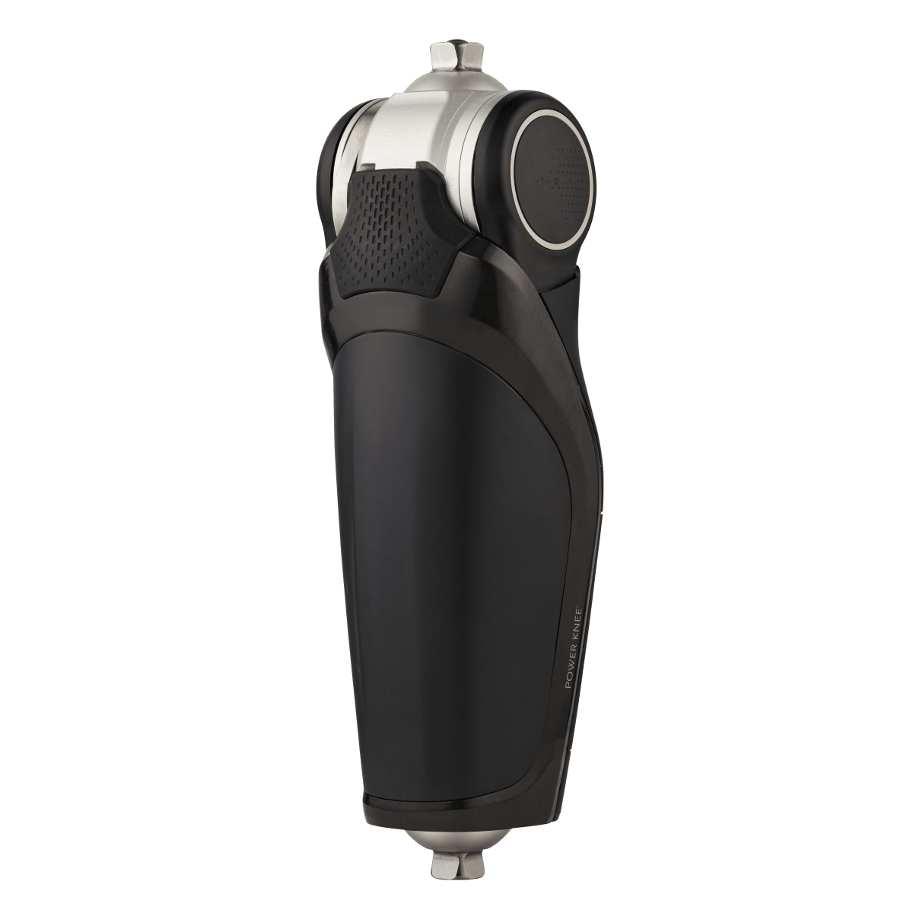
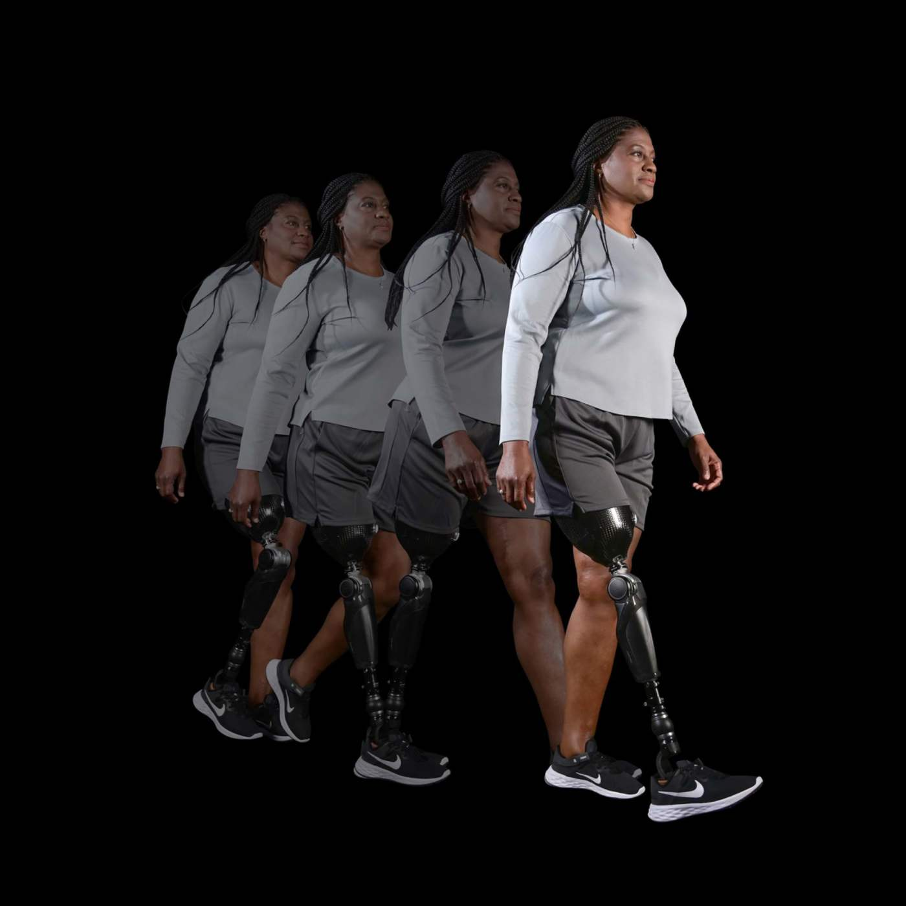
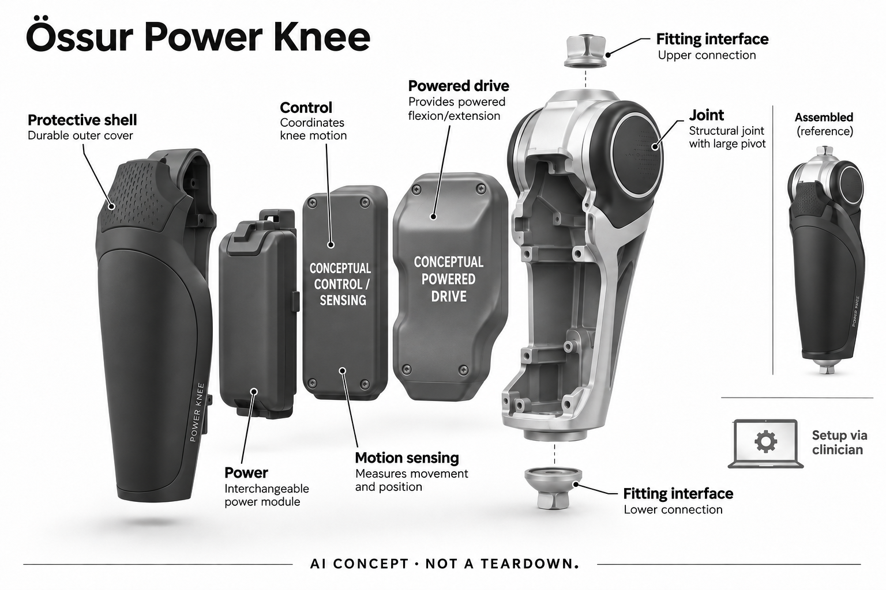

# Össur Power Knee 盘古主动力膝关节

**Össur** · 无障碍与辅助沟通 · 核查 2026-11-05

经个人适配，把运动感知接入动力假肢膝关节

消费渠道：个人适配 / 验配。

## 产品图片与结构参考

### 产品图

当前Power Knee官方膝单元外形，不含接受腔和脚部 · 来源：[Össur · 官方产品图片](<https://www.ossur.com/pt-br/proteses/joelhos/power-knee>) · [原始图片](<https://media.ossur.com/ossur-dam/image/upload/f_auto,c_limit,w_1200,q_auto/v1761850199/Shared/Power-Knee_Product-Image-05.png>)

### 参考图

Power Knee官方完整适配使用参考，其他假肢组件不代表本单元包含 · 来源：[Össur · 官方产品图片](<https://www.ossur.com/zh-cn/prosthetics/explore-power-knee/what-does-power-knee-do>) · [原始图片](<https://media.ossur.com/image/upload/t_square,f_auto,c_limit,w_1200,q_auto/f_auto,q_auto,w_1400,h_1400,c_fill,g_custom/images/prosthetics/prosthetic-knees/power-knee-draft-images/DM7_8447-8454>)

### AI 生成爆炸示意

**AI 生成 · 非实物拆机。** 内部为概念推断，不能作为元件布局、BOM 或维修依据。[生成提示词](../../content/hardware/prompts/ossur-power-knee.txt)

> 已视觉检查外形、灰阶、文本和数据路径；未知内部为概念模块，不代表实际拆机、完整BOM或医疗效果。

> 独立复查后使用ImageGen修订，局部标明概念内部；初稿与完整两阶段提示词保留。

> 驱动与感知控制改为抽象封装概念块，不虚构皮带、齿轮和PCB布局；只展示膝单元。

> 实际逐张查看并核对具体型号，保留厂家原图；参考场景和人物不能证明效果，历史图像与当前购买条件分别核查。

> 分析为基于公开资料的案头研究与 AI 辅助判断，未经用户访谈、销量审计或实物拆机。需求、画像、竞争冷门度、审美及商业机会均为研究假设，不是投资结论。

## 销售与购买

- 状态：在售。奥索中国具体盘古页面明确现已全面上市并提供官方咨询，2026年装配商名单覆盖个人体验、适配和售后；属于个人假肢适配购买，非医院操作设备。

- 地区：中国大陆：官方装配渠道、澳大利亚等地区：专业个人适配渠道

- 价格：按个人假肢方案报价。膝关节不等于完整假肢，接受腔、脚部、连接件、训练及维护需一并确认；不承诺保险或补贴资格。

- 中国大陆：已核中国官网具体上市说明及2026有效装配商名单；个人是否适合、配置、报价和交期须由当地专业服务确认。

- [官方产品 / 商店](<https://www.ossur.com/zh-cn/prosthetics/explore-power-knee/getting-started-with-power-knee>)

## AI 的实际作用

官方专业资料明确传感器获取个人运动并由AI辅助控制膝关节响应，结合电机提供主动屈伸和相应阻力；完整模型未公开。

服务与联网依赖：需要假肢师评估、对线、配置与训练，配套供电及Össur Logic设置；不能自行替换或把算法理解为无需适配的全自动行走。

## 是否冷门

细分专业（研究判断）：为特定肢体条件提供个人长期使用的动力关节，核心取决于整套适配和服务；案头研究无个人功能、跌倒或耐力改善实测。

## 需求与市场

需求假设是使用者希望在本人的行走、坐立及环境变化中获得合适的动力支持，而不是追求机械关节展示更多动作。动力输出、连接适配、身体条件和训练相互影响，某一项先进并不保证整体任务改善；产品价值应由具体生活目标和专业评估共同判断。

### 官方｜动力关节属于个人假肢系统 · 官方资料

Power Knee是一款通过专业适配进入个人假肢的动力膝关节，电机提供主动屈伸及相应控制，传感信息用于响应使用者运动。它不是套在完整腿外的普通运动外骨骼，也不是医院由工作人员操作的训练平台；单个膝单元照片没有包含接受腔、脚部和全部适配组件。

依据：[Power Knee中国上市与个人适配入口](<https://www.ossur.com/zh-cn/prosthetics/explore-power-knee/getting-started-with-power-knee>) · [Power Knee中国功能与配置说明](<https://www.ossur.com/zh-cn/prosthetics/explore-power-knee/what-does-power-knee-do>) · [Power Knee个人适配条件说明](<https://www.ossur.com/en-au/prosthetics/power-knee-more-information>)

### 判断｜日常动作需要整套系统共同完成 · 研究判断

需求假设是使用者希望在本人的行走、坐立及环境变化中获得合适的动力支持，而不是追求机械关节展示更多动作。动力输出、连接适配、身体条件和训练相互影响，某一项先进并不保证整体任务改善；产品价值应由具体生活目标和专业评估共同判断。

依据：[Power Knee中国功能与配置说明](<https://www.ossur.com/zh-cn/prosthetics/explore-power-knee/what-does-power-knee-do>) · [Power Knee个人适配条件说明](<https://www.ossur.com/en-au/prosthetics/power-knee-more-information>)

### 验证｜先由专业人员明确个人任务 · 待验证

可在假肢师指导下确定本人最在意的低风险任务，并记录穿戴、动作切换、疲劳和恢复原状态的过程。比较需要考虑完整接受腔及脚部组合，不能只看膝关节单机演示；本目录没有个人功能测试，不承诺更少跌倒、更长行走时间或适合所有相关肢体条件。

依据：[Power Knee中国上市与个人适配入口](<https://www.ossur.com/zh-cn/prosthetics/explore-power-knee/getting-started-with-power-knee>) · [Power Knee个人适配条件说明](<https://www.ossur.com/en-au/prosthetics/power-knee-more-information>)

## 用户画像

使用者需要持续获得接受腔调整、参数配置和机械维护，距离与支持安排可能影响实际采用。即使硬件可以买到，缺少适配或维修路径也会增加负担；用户画像因此不能只按预算和活动水平概括，更不能由他人对技术的兴趣代替本人对使用和外观的选择。

### 官方｜中国具体型号与年度服务网络均可核 · 官方资料

中国官网明确盘古主动力膝关节已全面上市，并提供个人了解和试配入口，另有二零二六年度装配商名单说明体验、适配及售后服务。目录据此记录官方个人渠道，不把一般公司在华存在当证据；具体地区库存、报价和是否适合某位用户，仍需要当地专业流程确认。

依据：[Power Knee中国上市与个人适配入口](<https://www.ossur.com/zh-cn/prosthetics/explore-power-knee/getting-started-with-power-knee>) · [奥索2026中国假肢经销及装配商名单](<https://www.ossur.com/zh-cn/about-ossur/newsroom/2026-pcustomers-list-china>)

### 判断｜服务可达性与设备功能同样重要 · 研究判断

使用者需要持续获得接受腔调整、参数配置和机械维护，距离与支持安排可能影响实际采用。即使硬件可以买到，缺少适配或维修路径也会增加负担；用户画像因此不能只按预算和活动水平概括，更不能由他人对技术的兴趣代替本人对使用和外观的选择。

依据：[Power Knee中国上市与个人适配入口](<https://www.ossur.com/zh-cn/prosthetics/explore-power-knee/getting-started-with-power-knee>) · [奥索2026中国假肢经销及装配商名单](<https://www.ossur.com/zh-cn/about-ossur/newsroom/2026-pcustomers-list-china>) · [Power Knee个人适配条件说明](<https://www.ossur.com/en-au/prosthetics/power-knee-more-information>)

### 验证｜核对完整费用与后续责任 · 待验证

报价时应明确膝单元、接受腔、脚部、连接件、训练、备用供电与维护分别包含什么，并确认故障或调整期间如何安排。资助和保险需按个人条件核实，不能引用其他型号或地区的报销情况；本研究未取得私人方案，也没有代表用户联系装配商。

依据：[Power Knee中国上市与个人适配入口](<https://www.ossur.com/zh-cn/prosthetics/explore-power-knee/getting-started-with-power-knee>) · [奥索2026中国假肢经销及装配商名单](<https://www.ossur.com/zh-cn/about-ossur/newsroom/2026-pcustomers-list-china>) · [Power Knee个人适配条件说明](<https://www.ossur.com/en-au/prosthetics/power-knee-more-information>)

## 竞争与替代

机械外骨骼通常向已有肢体施加辅助，动力假肢膝则承担缺失关节相关的机械功能，适配接口和失效处理都不同。两者可以在主动步行辅助的上层任务比较，却不能交换适用人群或效果证据；比较应解释实际动力路径，而不是只用电机功率或产品价格排序。

### 官方｜主动动力不能与其他膝关节机制混写 · 官方资料

Power Knee的公开重点是电机驱动与传感控制，不能套用Rheo等产品的磁流变或其他被动阻尼机制来解释内部。当前型号照片与早期动力假肢的外形也不同，目录只保留所核现行单元；代次、备用电池或配套脚部不被拆成多个相同核心行走需求。

依据：[Power Knee中国功能与配置说明](<https://www.ossur.com/zh-cn/prosthetics/explore-power-knee/what-does-power-knee-do>) · [奥索专业课程：Power Knee感知与AI控制](<https://www.ossur.com/en-au/professionals/prosthetic-academy-courses>) · [奥索当前Power Knee产品外形](<https://www.ossur.com/pt-br/proteses/joelhos/power-knee>)

### 判断｜与外骨骼共享目标但身体接口不同 · 研究判断

机械外骨骼通常向已有肢体施加辅助，动力假肢膝则承担缺失关节相关的机械功能，适配接口和失效处理都不同。两者可以在主动步行辅助的上层任务比较，却不能交换适用人群或效果证据；比较应解释实际动力路径，而不是只用电机功率或产品价格排序。

依据：[Power Knee中国功能与配置说明](<https://www.ossur.com/zh-cn/prosthetics/explore-power-knee/what-does-power-knee-do>) · [Power Knee个人适配条件说明](<https://www.ossur.com/en-au/prosthetics/power-knee-more-information>)

### 验证｜以同一个人的既有方案作参照 · 待验证

专业试配可以围绕本人原有假肢和实际动作比较控制、穿脱、维护和学习负担，记录不适合或未改善的情境。不能把品牌视频中的步速和楼梯演示移作个人预期；本目录没有临床、长期访谈或销量数据，不能为不同方案作普遍疗效和性价比排名。

依据：[Power Knee中国上市与个人适配入口](<https://www.ossur.com/zh-cn/prosthetics/explore-power-knee/getting-started-with-power-knee>) · [Power Knee中国功能与配置说明](<https://www.ossur.com/zh-cn/prosthetics/explore-power-knee/what-does-power-knee-do>) · [Power Knee个人适配条件说明](<https://www.ossur.com/en-au/prosthetics/power-knee-more-information>)

## 供应链

相近新设计需要同时考虑承载、关节动力、姿态信息、能源和异常状态，普通小电机与惯性传感器并不能直接组成合适假肢。身体接口和专业对线会改变实际作用，软件也必须与机械约束匹配；供应研究应保留这些系统条件，避免把元件清单误当完整个人方案。

### 官方｜感知、驱动和接口未公开完整BOM · 官方资料

厂家说明传感器、微处理控制、动力执行和可更换电池等功能，但没有完整点名所有芯片、电机、传动及工厂供应关系。中国装配商名单是服务渠道，不等于原厂零件制造名单；概念图只画膝单元的功能分离，不添加未经披露的液压缸或将配套脚部当成膝本体。

依据：[Power Knee中国功能与配置说明](<https://www.ossur.com/zh-cn/prosthetics/explore-power-knee/what-does-power-knee-do>) · [奥索专业课程：Power Knee感知与AI控制](<https://www.ossur.com/en-au/professionals/prosthetic-academy-courses>) · [奥索当前Power Knee产品外形](<https://www.ossur.com/pt-br/proteses/joelhos/power-knee>)

### 判断｜动力传递与个人对线必须协同 · 研究判断

相近新设计需要同时考虑承载、关节动力、姿态信息、能源和异常状态，普通小电机与惯性传感器并不能直接组成合适假肢。身体接口和专业对线会改变实际作用，软件也必须与机械约束匹配；供应研究应保留这些系统条件，避免把元件清单误当完整个人方案。

依据：[Power Knee中国功能与配置说明](<https://www.ossur.com/zh-cn/prosthetics/explore-power-knee/what-does-power-knee-do>) · [奥索专业课程：Power Knee感知与AI控制](<https://www.ossur.com/en-au/professionals/prosthetic-academy-courses>) · [Power Knee个人适配条件说明](<https://www.ossur.com/en-au/prosthetics/power-knee-more-information>)

### 验证｜候选只代表局部工程能力 · 待验证

驱动候选可研究机电集成与反馈控制，惯性候选则需核对动作范围、安装与时间同步，但均没有本款实际采用证据。承载、疲劳、供电和控制异常需要整机及专业适配验证；不能从机器人演示或芯片参数推定可直接用于个人假肢，更不提供消费者替换或调参指引。

依据：[Power Knee中国功能与配置说明](<https://www.ossur.com/zh-cn/prosthetics/explore-power-knee/what-does-power-knee-do>) · [奥索专业课程：Power Knee感知与AI控制](<https://www.ossur.com/en-au/professionals/prosthetic-academy-courses>)

## 技术路径

使用者从静止转为行走、改变速度或坐立时，系统需要处理连续变化，单个稳定动作成功不能代表整个日常流程。控制应与本人训练和机械适配一起评价；算法能够识别某种模式，也不等于任何复杂地面都可自动处理，不能把“智能响应”描述成无需主动参与的行走。

### 官方｜AI机制在运动感知与响应控制 · 官方资料

奥索专业课程明确传感器获取使用者运动，人工智能帮助微处理系统响应个人需要，并结合Össur Logic完成配置和训练。完整模型结构、训练集和当前固件的每项算法未公开，目录不擅自写成特定神经网络，也不把一般App参数设置单独作为AI依据。

依据：[奥索专业课程：Power Knee感知与AI控制](<https://www.ossur.com/en-au/professionals/prosthetic-academy-courses>)

### 判断｜动作变化时的控制连续性更重要 · 研究判断

使用者从静止转为行走、改变速度或坐立时，系统需要处理连续变化，单个稳定动作成功不能代表整个日常流程。控制应与本人训练和机械适配一起评价；算法能够识别某种模式，也不等于任何复杂地面都可自动处理，不能把“智能响应”描述成无需主动参与的行走。

依据：[Power Knee中国功能与配置说明](<https://www.ossur.com/zh-cn/prosthetics/explore-power-knee/what-does-power-knee-do>) · [奥索专业课程：Power Knee感知与AI控制](<https://www.ossur.com/en-au/professionals/prosthetic-academy-courses>)

### 验证｜由专业流程检查配置与异常反馈 · 待验证

适配应明确用户可调整哪些设置、哪些必须由专业人员完成，并核对电量、模式和异常提示如何被理解。记录训练后仍需支持的动作和环境，比单次功能演示更有价值；本研究没有真机控制测试，不提供未经适配的动作练习、参数或故障处置建议。

依据：[Power Knee中国上市与个人适配入口](<https://www.ossur.com/zh-cn/prosthetics/explore-power-knee/getting-started-with-power-knee>) · [奥索专业课程：Power Knee感知与AI控制](<https://www.ossur.com/en-au/professionals/prosthetic-academy-courses>) · [Power Knee个人适配条件说明](<https://www.ossur.com/en-au/prosthetics/power-knee-more-information>)

## 产品审美

有些使用者愿意展示机械结构，有些更在意衣物覆盖、整体比例或社会环境中的感受。单独膝单元的渲染图不能代表完整装配后的外形，也不能体现重量分布和声音；审美研究应听取本人选择，并与接受腔、连接和服饰共同观察，不把仿生程度作为唯一标准。

### 官方｜当前膝单元具有明显动力关节外形 · 官方资料

当前官方主图显示上部金属关节与圆形侧面枢轴、深色渐收保护外壳，以及上下适配连接端。它没有用户显示屏或摄像头，步行参考图中的接受腔和脚部属于完整装配场景；生成图仅保留膝单元，内部驱动与控制使用明确概念块，不伪装成真实传动拆解。

依据：[Power Knee中国功能与配置说明](<https://www.ossur.com/zh-cn/prosthetics/explore-power-knee/what-does-power-knee-do>) · [奥索当前Power Knee产品外形](<https://www.ossur.com/pt-br/proteses/joelhos/power-knee>)

### 判断｜外观偏好与完整假肢组合有关 · 研究判断

有些使用者愿意展示机械结构，有些更在意衣物覆盖、整体比例或社会环境中的感受。单独膝单元的渲染图不能代表完整装配后的外形，也不能体现重量分布和声音；审美研究应听取本人选择，并与接受腔、连接和服饰共同观察，不把仿生程度作为唯一标准。

依据：[Power Knee中国上市与个人适配入口](<https://www.ossur.com/zh-cn/prosthetics/explore-power-knee/getting-started-with-power-knee>) · [奥索当前Power Knee产品外形](<https://www.ossur.com/pt-br/proteses/joelhos/power-knee>)

### 验证｜以本人完整佩戴方案观察 · 待验证

试配时可由专业人员协助检查衣物、坐姿、收纳、充电和维护路径，并分别记录外观、接触和控制体验。外壳或附件变化是否影响服务和使用限制也需确认；本轮仅查看官方产品与使用照片，没有触摸、噪声或长期佩戴测试，不能据图承诺舒适。

依据：[Power Knee中国上市与个人适配入口](<https://www.ossur.com/zh-cn/prosthetics/explore-power-knee/getting-started-with-power-knee>) · [Power Knee中国功能与配置说明](<https://www.ossur.com/zh-cn/prosthetics/explore-power-knee/what-does-power-knee-do>) · [Power Knee个人适配条件说明](<https://www.ossur.com/en-au/prosthetics/power-knee-more-information>)

## 关键风险

对长期使用者，电量、备件、维修和接受腔变化可能与算法表现同样重要。跨区域购买若没有稳定服务路径，远程App不能替代机械检查和身体适配；研究应把停用、备用方式和支持负担纳入，而不是只展示主动动力带来的理想动作片段。

### 官方｜防护、供电与训练均有范围 · 官方资料

厂家对可更换供电和防溅使用给出说明，但不能将防溅表述扩展为可任意浸水，完整假肢其他组件也可能有不同限制。个人适配与训练是系统组成部分，上市不等于任何人即买即用；目录不将用户故事、合规措辞或专业课程介绍转述为功能恢复和安全保证。

依据：[Power Knee中国上市与个人适配入口](<https://www.ossur.com/zh-cn/prosthetics/explore-power-knee/getting-started-with-power-knee>) · [Power Knee中国功能与配置说明](<https://www.ossur.com/zh-cn/prosthetics/explore-power-knee/what-does-power-knee-do>) · [Power Knee个人适配条件说明](<https://www.ossur.com/en-au/prosthetics/power-knee-more-information>)

### 判断｜维护中断也会影响日常自主性 · 研究判断

对长期使用者，电量、备件、维修和接受腔变化可能与算法表现同样重要。跨区域购买若没有稳定服务路径，远程App不能替代机械检查和身体适配；研究应把停用、备用方式和支持负担纳入，而不是只展示主动动力带来的理想动作片段。

依据：[Power Knee中国上市与个人适配入口](<https://www.ossur.com/zh-cn/prosthetics/explore-power-knee/getting-started-with-power-knee>) · [奥索2026中国假肢经销及装配商名单](<https://www.ossur.com/zh-cn/about-ossur/newsroom/2026-pcustomers-list-china>) · [Power Knee中国功能与配置说明](<https://www.ossur.com/zh-cn/prosthetics/explore-power-knee/what-does-power-knee-do>)

### 验证｜购买前确认服务与个人边界 · 待验证

应由专业服务说明适用条件、训练、维修和保修责任，确认本人理解哪些情况需要联系支持，哪些使用不在方案范围。不要借其他假肢或国家的付款规则推定费用覆盖；本目录不提供个体医疗建议，不以产品参数替代假肢师评估，也不鼓励自行改装。

依据：[Power Knee中国上市与个人适配入口](<https://www.ossur.com/zh-cn/prosthetics/explore-power-knee/getting-started-with-power-knee>) · [奥索2026中国假肢经销及装配商名单](<https://www.ossur.com/zh-cn/about-ossur/newsroom/2026-pcustomers-list-china>) · [Power Knee个人适配条件说明](<https://www.ossur.com/en-au/prosthetics/power-knee-more-information>)

## 机会与验证

后续研究可围绕本人最在意的任务，观察动力方案减少或增加了哪些操作、学习和维护需求，并允许部分环境仍采用原有方式。重要的是能否在个人条件下持续使用，而不是机械结构看起来多先进；真实价值需要本人反馈和专业支持，无法从供应商目录直接推导。

### 官方｜动力假肢保留在主动步行辅助核心任务 · 官方资料

本条在上层使用主动步行辅助的共同场景键，具体差异说明为动力假肢膝关节及其专业装配流程。不会按不同脚部、电池、国家页面或同类品牌增加独立需求数量；这种组织方式保留技术实现差异，也避免将辅助方式的型号数量误当成完全不同的使用场景。

依据：[Power Knee中国上市与个人适配入口](<https://www.ossur.com/zh-cn/prosthetics/explore-power-knee/getting-started-with-power-knee>) · [Power Knee中国功能与配置说明](<https://www.ossur.com/zh-cn/prosthetics/explore-power-knee/what-does-power-knee-do>) · [奥索专业课程：Power Knee感知与AI控制](<https://www.ossur.com/en-au/professionals/prosthetic-academy-courses>)

### 判断｜关注本人仍需哪些支持 · 研究判断

后续研究可围绕本人最在意的任务，观察动力方案减少或增加了哪些操作、学习和维护需求，并允许部分环境仍采用原有方式。重要的是能否在个人条件下持续使用，而不是机械结构看起来多先进；真实价值需要本人反馈和专业支持，无法从供应商目录直接推导。

依据：[Power Knee中国上市与个人适配入口](<https://www.ossur.com/zh-cn/prosthetics/explore-power-knee/getting-started-with-power-knee>) · [Power Knee中国功能与配置说明](<https://www.ossur.com/zh-cn/prosthetics/explore-power-knee/what-does-power-knee-do>) · [Power Knee个人适配条件说明](<https://www.ossur.com/en-au/prosthetics/power-knee-more-information>)

### 验证｜跟踪完整方案而非膝单元性能 · 待验证

可以在合适同意与专业流程中记录适配调整、使用场景、服务响应和停止使用原因，同时明确接受腔及脚部配置。当前没有本研究长期用户、临床或销量证据，不推断普遍运动收益和市场规模；目录仅提供公开机制、个人购买路径及需要验证的系统约束。

依据：[Power Knee中国上市与个人适配入口](<https://www.ossur.com/zh-cn/prosthetics/explore-power-knee/getting-started-with-power-knee>) · [奥索2026中国假肢经销及装配商名单](<https://www.ossur.com/zh-cn/about-ossur/newsroom/2026-pcustomers-list-china>) · [奥索专业课程：Power Knee感知与AI控制](<https://www.ossur.com/en-au/professionals/prosthetic-academy-courses>) · [Power Knee个人适配条件说明](<https://www.ossur.com/en-au/prosthetics/power-knee-more-information>)

## 对应供应链公司

能力候选用于选型研究，不代表本产品实际采用；未公开的供货关系不作推断。

- [maxon](../supply-chain/maxon.md) — **能力候选 · 非已采用** / 同类动力假肢关节的机电驱动集成研究：maxon公开定制机电驱动和反馈集成能力，可研究相近动力关节的传动、控制和能源约束，但承载、故障响应及个人适配要求必须专项确认。未发现本款点名采用来源，机器人驱动经验不能直接证明可用于假肢；候选不代表现有Power Knee电机或完整传动BOM。

- [bosch-sensortec](../supply-chain/bosch-sensortec.md) — **能力候选 · 非已采用** / 同类个人动力关节的惯性输入候选：Bosch Sensortec公开智能惯性平台，可研究相近关节控制中的运动和姿态输入，但实际动态范围、安装、时序与系统验证不能省略。没有Power Knee采用证据，也不包含其个人控制模型和专业配置；一般运动感知能力不能推定可直接替换假肢传感器或保证行走安全。

[浏览供应链目录](../supply-chain.md)

## 功能分层示意

这是功能关系，不是实物拆机、真实空间结构或已核实 BOM。

1. **个人适配接口**：接受腔、连接及脚部需专业组合，膝单元不是整条假肢。（官方披露）

2. **运动感知**：传感器为控制提供动作信息，具体器件和完整模型未披露。（官方披露）

3. **自适应控制**：官方称AI辅助响应个人运动，实际参数由专业适配流程确定。（官方披露）

4. **动力执行**：电机与关节机构提供主动屈伸及受控阻力，内部传动图仅概念。（官方披露）

5. **供电与维护**：可更换电池、App及定期支持共同维持使用。（官方披露）

## 来源

1. [Power Knee中国上市与个人适配入口](<https://www.ossur.com/zh-cn/prosthetics/explore-power-knee/getting-started-with-power-knee>) — 已打开具体盘古页面，明确全面上市与官方咨询、个人装配准备；未获取报价或代表用户联系。

2. [奥索2026中国假肢经销及装配商名单](<https://www.ossur.com/zh-cn/about-ossur/newsroom/2026-pcustomers-list-china>) — 已打开2026年度有效名单，明确用户可经推荐装配商体验、适配与售后；不推定每家每时都有本款库存。

3. [Power Knee中国功能与配置说明](<https://www.ossur.com/zh-cn/prosthetics/explore-power-knee/what-does-power-knee-do>) — 已打开电机主动动作、Össur Logic、可替换电池与防溅范围；不将宣传体验或续航数字当本研究实测。

4. [奥索专业课程：Power Knee感知与AI控制](<https://www.ossur.com/en-au/professionals/prosthetic-academy-courses>) — 已打开明确人工智能、运动传感、专业对线配置和训练；课程作为机制证据，不把培训报名算作个人购买。

5. [奥索当前Power Knee产品外形](<https://www.ossur.com/pt-br/proteses/joelhos/power-knee>) — 已打开并读取厂家公开HTML取得当前Power-Knee_Product-Image-05；不混用旧代产品或Rheo等其他膝关节传动机制。

6. [Power Knee个人适配条件说明](<https://www.ossur.com/en-au/prosthetics/power-knee-more-information>) — 已打开个人试配与假肢师流程，适用条件需专业评估；不从厂家功能描述给具体个人作适配结论。

[返回目录](../hardware-market.md) · [网页分析](https://romanagent.github.io/Roman/#hardware/product/ossur-power-knee)
