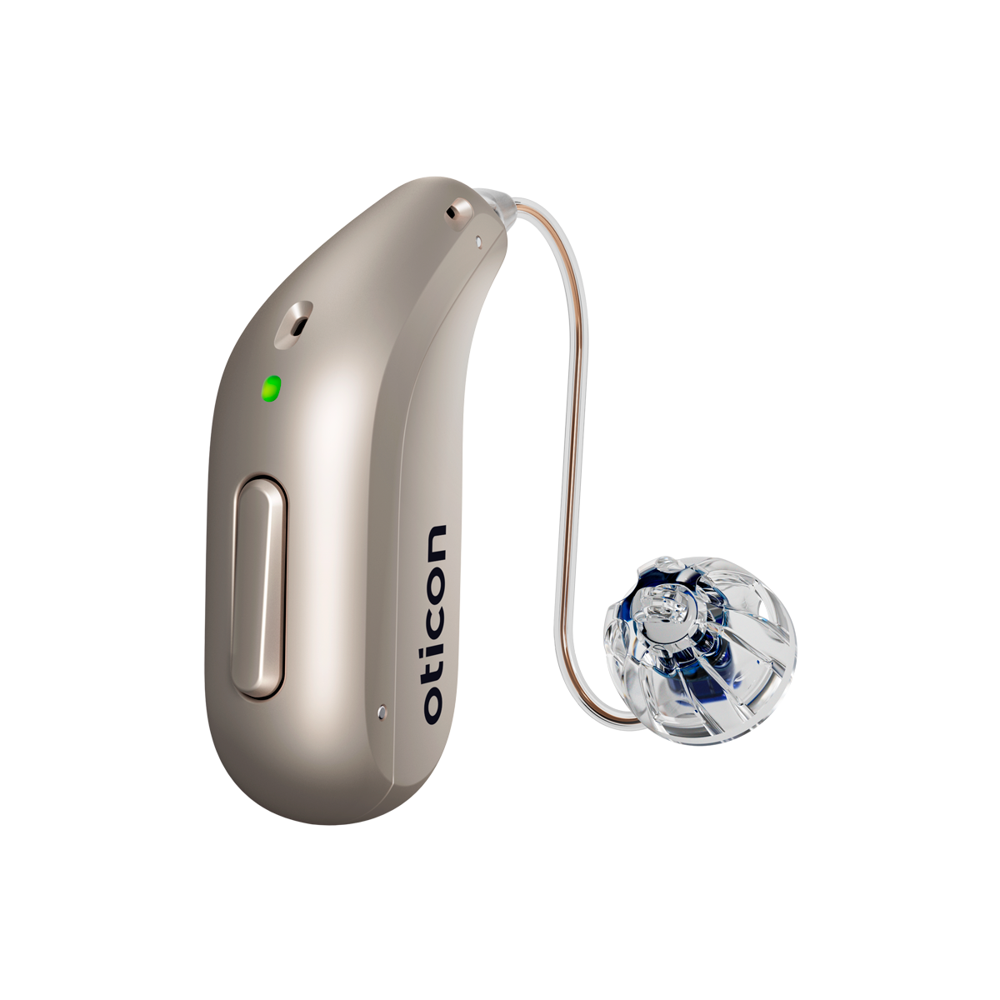
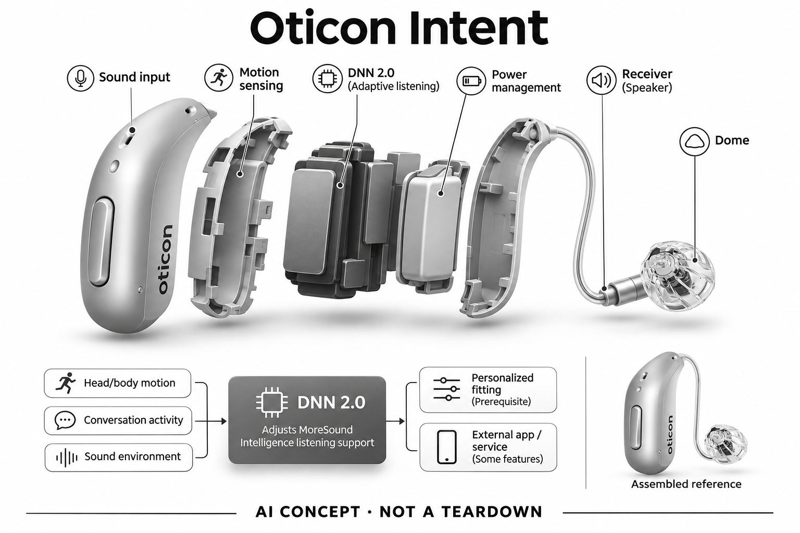

# Oticon Intent

**Oticon** · 助听与听力 · 核查 2026-11-04

把运动与谈话上下文纳入声音处理，不仅判断环境有多吵

消费渠道：个人验配渠道。

## 产品图片与结构参考

### 产品图

Oticon Intent官方产品外形图 · 来源：[Oticon · 官方产品图片](<https://www.oticon.com/products/hearing-aids/family/intent>) · [原始图片](<https://damcdn.demant.com/016332a3-6aa5-4305-ad9c-b0b3009324e6/Oticon_Intent_miniRITE_H1-2024_Left_C090ChromaBeige_LEDgreen_Speaker60_OpenBassDome_1200x1200px_Original%20file.png>)

### 参考图

Oticon Intent官方另一角度或使用场景参考 · 来源：[Oticon · 官方产品图片](<https://www.oticon.com/products/hearing-aids/family/intent>) · [原始图片](<https://assets.ha.demant.com/-/media/project/hearing-aid/oticon/shared/images/global/campaigns/intent/hero-2560x1097/ot_hero_01_family_intent_minirite_minibte_2560x1097.jpg?h=1097&iar=0&w=2560&rev=b3baada24e314d07bfe90b751ed87d1c&hash=2A76A57CBE09990B32EE3D6C45DADE28>)

### AI 生成爆炸示意

**AI 生成 · 非实物拆机。** 内部为概念推断，不能作为元件布局、BOM 或维修依据。[生成提示词](../../content/hardware/prompts/oticon-intent.txt)

> 外形依据核验参考图；内部位置、模块形状与装配关系仅作AI概念展示。

> 已逐张查看并核对型号。源图未改色/裁切；场景、界面、附件、优惠及效果文案仅为厂商示意，不作为本目录性能或现价依据。

> 分析为基于公开资料的案头研究与 AI 辅助判断，未经用户访谈、销量审计或实物拆机。需求、画像、竞争冷门度、审美及商业机会均为研究假设，不是投资结论。

## 销售与购买

- 状态：在售。官方当前消费者产品页持续展示该型号，并提供试用/验配或官方门店渠道。属于个人经专业验配获得的消费设备，saleMode为consumer-fitting；不声明具体门店库存。

- 地区：美国及所列官方区域验配网络（具体型号当地确认）

- 价格：未公布统一零售价；按个人验配方案报价。报价通常受单/双耳、技术档位、定制、服务和地区影响；不以历史媒体价格或其他型号拼凑。

- 中国大陆：品牌可能具有中国渠道，但本次未核实该具体型号、技术档位与AI软件在大陆的上市和支持范围；需由国内授权验配渠道确认。

- [官方产品 / 商店](<https://www.oticon.com/products/hearing-aids/family/intent>)

## AI 的实际作用

官方DNN 2.0结合头部/身体运动、谈话活动和环境信息，调整MoreSound Intelligence的听音支持。

服务与联网依赖：个人专业验配与合适参数是前提；部分连接和管理功能依赖兼容手机，核心声音处理不等于云端聊天。

## 是否冷门

细分专业（研究判断）：听觉辅助属于专业消费用途，已有成熟供应商；此分类不表示蓝海或疗效优越。

## 需求与市场

需求假设：相同噪声环境中，用户转头、靠近或参与谈话时所需支持会改变。真正的使用价值需要在个人真实交流场景中验证，不能从AI名称或厂商演示推定每个人都获得同样改善。

### 官方｜把动作与谈话活动纳入支持 · 官方资料

Oticon Intent的官方路径结合头部和身体运动、谈话活动及环境信息，通过DNN 2.0与相关听音处理调整支持。它关注的是在相同噪声中，用户因转头、移动或参与交流而改变的需要；这些输入仍只能提供线索，不能理解为读取思想或保证知道每次关注对象，真实收益需要个人专业验配后检验。

依据：[Oticon Oticon Intent官方产品页](<https://www.oticon.com/products/hearing-aids/family/intent>) · [Oticon官方技术或应用说明](<https://www.oticon.com/professionals/campaigns-b2b/intent/intent-technology>)

### 判断｜从环境判断走向参与判断 · 研究判断

同一餐桌的声音环境可能没有明显变化，但用户从旁听转为加入谈话，或者转向另一位说话人时，希望获得的支持会改变。动作和交流活动有机会补充仅依声音分类的不足，核心仍是复杂声场听清；是否有价值应看参与更自然与否，不应仅把传感器增加视为新的需求或更聪明的证明。

依据：[Oticon Oticon Intent官方产品页](<https://www.oticon.com/products/hearing-aids/family/intent>) · [Oticon官方技术或应用说明](<https://www.oticon.com/professionals/campaigns-b2b/intent/intent-technology>)

### 验证｜同一声场中的不同活动 · 待验证

适配之后可让用户在熟悉的多人活动中记录静坐、转头、加入和离开谈话时的体验，特别观察背景相似而关注目标变化的时刻。与原方案比较追问和手动调整，不只比较某段噪声下的安静感；目录没有独立实机研究，不能将动作输入和厂商演示直接当作个人意图理解的效果证据。

依据：[Oticon Oticon Intent官方产品页](<https://www.oticon.com/products/hearing-aids/family/intent>) · [Oticon官方消费者验配渠道](<https://www.oticon.com/find-hearing-center>) · [Oticon官方技术或应用说明](<https://www.oticon.com/professionals/campaigns-b2b/intent/intent-technology>)

## 用户画像

画像推断：经专业评估适合该设备、希望减少活动过程中手动切换程序的个人更值得评估。具体是否适配应由听力需求、耳形和操作能力共同决定，本目录不根据年龄、职业或自述症状替人选择医疗产品。

### 判断｜经常在对话中改变参与方式 · 研究判断

需要在旁听、发言和转向不同对象之间切换的人，可能更关注本款上下文感知的差异，而非单纯背景更轻。画像应从具体活动中哪些时刻最容易漏听建立，不以年龄、社交热情或职业概括；如果用户主要在固定位置与单人交流，额外感知对其任务是否有明显贡献仍需验证。

依据：[Oticon Oticon Intent官方产品页](<https://www.oticon.com/products/hearing-aids/family/intent>) · [Oticon官方技术或应用说明](<https://www.oticon.com/professionals/campaigns-b2b/intent/intent-technology>)

### 判断｜能够反馈变化时刻的用户 · 研究判断

用户若能回忆什么时候转头、走动或加入对话后声音不合适，就更容易与专业人员讨论输入线索和实际体验。首次使用者可能难以区分新声音与自动调整，需要更多支持；这种差异不应变成对能力的评价，也不能要求用户理解传感器，服务应帮助其用日常语言描述具体困难。

依据：[Oticon官方消费者验配渠道](<https://www.oticon.com/find-hearing-center>) · [Oticon官方技术或应用说明](<https://www.oticon.com/professionals/campaigns-b2b/intent/intent-technology>)

### 验证｜个人活动而非抽象人群 · 待验证

试用前可选出几项本人常做的交流活动，并记录原方案下最困难的参与变化；试用后再用同类活动核对。还应观察佩戴操作、手机兼容及当地随访支持，但不把手机熟练度当作全部适用条件；官方渠道只说明可寻求专业服务，不代表各地交付同一技术级别或现货配置。

依据：[Oticon Oticon Intent官方产品页](<https://www.oticon.com/products/hearing-aids/family/intent>) · [Oticon官方消费者验配渠道](<https://www.oticon.com/find-hearing-center>)

## 竞争与替代

案头判断：把运动与谈话上下文纳入声音处理，不仅判断环境有多吵形成可比较特征，但消费助听已有多个成熟品牌和验配渠道。没有销量审计、用户访谈或疗效对照，专业细分不意味着竞争稀少。

### 判断｜与仅按声场分类的路线比较 · 研究判断

其他自动助听器可能主要围绕声音环境调整，本款公开的差异是把动作与谈话活动一起纳入支持判断。比较应保留同样声场中不同参与方式的任务，才能检验额外线索是否有用；不能由传感器种类推断普遍更好，也不应把意图感知名称当作与其他助听器完全独立的需求。

依据：[Oticon Oticon Intent官方产品页](<https://www.oticon.com/products/hearing-aids/family/intent>) · [Oticon官方技术或应用说明](<https://www.oticon.com/professionals/campaigns-b2b/intent/intent-technology>)

### 判断｜与主动手调比较控制负担 · 研究判断

用户主动调节可以直接表达某些偏好，却可能打断交流；自动上下文判断可能减少动作，但也可能误判关注对象。两种路线的取舍在于结果和控制感，而非自动化越多越好；研究应记录什么时候用户宁愿自己改，以及是否能理解并处理不合适的输出，不只用无需操作的演示评价。

依据：[Oticon Oticon Intent官方产品页](<https://www.oticon.com/products/hearing-aids/family/intent>) · [Oticon官方技术或应用说明](<https://www.oticon.com/professionals/campaigns-b2b/intent/intent-technology>)

### 验证｜技术条件与服务同口径 · 待验证

比较时应确认个人验配、技术级别、连接功能和地区服务，并保持相同活动与任务。报价需包括耳数和后续支持，不能用另一个品牌的最低配置对照本款系列全部宣传；目前目录没有市场份额、销售或独立采用数据，不能因上下文感知差异判断竞争空白或稳定溢价能力。

依据：[Oticon Oticon Intent官方产品页](<https://www.oticon.com/products/hearing-aids/family/intent>) · [Oticon官方消费者验配渠道](<https://www.oticon.com/find-hearing-center>)

## 供应链

官方可核对耳背微型主机与耳道受话器连接形态及相应声音功能；具体麦克风、受话器、电池供应商与整机工厂本次未确认。品牌或法定制造商名称不等于实际装配工厂，也不据此估计BOM与良率。

### 官方｜声音与运动信息共同输入 · 官方资料

已确认本款采用耳背微型主机与耳道受话器连接形态，处理支持不仅依据声音，还结合头部身体运动及谈话活动。具体运动传感器、麦克风、核心芯片和工厂未被本次资料点名，不能从动作感知推断某一惯性器件已采用；模块示意只是信息路径，不能替代拆机或真实物料证据。

依据：[Oticon Oticon Intent官方产品页](<https://www.oticon.com/products/hearing-aids/family/intent>) · [Oticon官方技术或应用说明](<https://www.oticon.com/professionals/campaigns-b2b/intent/intent-technology>)

### 判断｜多输入同步与佩戴条件 · 研究判断

运动线索只有与声音及活动信息在合理时序中结合，才可能帮助处理，佩戴位置变化也会影响所观察到的动作。供应研究需关注声学、运动采样、功耗与算法协同，不能只比较各器件单独参数；本次没有同步接口、校准、公差和可靠性资料，不推断现有方案的生产良率或制造地点。

依据：[Oticon Oticon Intent官方产品页](<https://www.oticon.com/products/hearing-aids/family/intent>) · [Oticon官方技术或应用说明](<https://www.oticon.com/professionals/campaigns-b2b/intent/intent-technology>)

### 判断｜声学与惯性感知候选分开 · 研究判断

onsemi听觉DSP、英飞凌麦克风和Bosch惯性感知可分别对应相近新设计的处理、声音及运动输入。三者均未被证实供应本型号，品牌现有算法和验配系统也不能直接迁移；尤其通用姿态数据不等于用户意图，候选需经过佩戴、同步与个人任务验证，不能拼接器件列表就声称复现Intent。

依据：[Oticon Oticon Intent官方产品页](<https://www.oticon.com/products/hearing-aids/family/intent>) · [Oticon官方技术或应用说明](<https://www.oticon.com/professionals/campaigns-b2b/intent/intent-technology>)

## 技术路径

官方DNN 2.0结合头部/身体运动、谈话活动和环境信息，调整MoreSound Intelligence的听音支持。这是已披露机制；精确模型、内部电路与个体表现未完全公开。普通放大、蓝牙和自动模式本身不单独作为AI收录理由。

### 官方｜DNN与上下文共同参与 · 官方资料

官方说明DNN 2.0结合动作、谈话活动和环境信息调整MoreSound Intelligence听音支持，本目录据此确认感知算法及多来源线索参与。核心声音处理不等于云端聊天，部分管理与连接才受手机条件影响；公开名称没有完整披露模型内部结构和个人准确率，不从技术版本推导所有场景中都能正确理解关注目标。

依据：[Oticon Oticon Intent官方产品页](<https://www.oticon.com/products/hearing-aids/family/intent>) · [Oticon官方技术或应用说明](<https://www.oticon.com/professionals/campaigns-b2b/intent/intent-technology>)

### 判断｜动作只是意图的间接线索 · 研究判断

转头可能是在寻找说话人，也可能是在看其他物体；静止也不代表用户没有改变关注。技术研究应把这些模糊情况纳入，而不假设传感器读数有唯一含义；本款的创新判断应看多线索结合是否减少实际误配，不能把动作识别成功等同听音支持正确，更不能以意图命名暗示读取思想。

依据：[Oticon官方技术或应用说明](<https://www.oticon.com/professionals/campaigns-b2b/intent/intent-technology>)

### 验证｜线索一致与冲突情境 · 待验证

可在专业适配后观察声音目标改变但身体静止、身体移动但仍听同一人等常见情况，记录理解和用户干预。比较应以真实活动为基础，不需要把生活简化成固定头部动作指令；当前没有独立验证数据，因此线索融合的价值和错误边界均需保留，不把一次顺畅演示扩展为长期稳定效果。

依据：[Oticon Oticon Intent官方产品页](<https://www.oticon.com/products/hearing-aids/family/intent>) · [Oticon官方消费者验配渠道](<https://www.oticon.com/find-hearing-center>) · [Oticon官方技术或应用说明](<https://www.oticon.com/professionals/campaigns-b2b/intent/intent-technology>)

## 产品审美

图示观察：小型耳背主体保持传统助听器轮廓，按键、细线与耳塞兼顾维护和日常佩戴。实际耳内尺寸、舒适感和维护便利仍需验配或试戴确认；宣传图不能证明隐形、无负担或适合所有耳形。

### 判断｜微型耳背仍有个人穿戴限制 · 研究判断

微型耳背主机和耳道连接方式形成日常外观，可能让用户愿意持续佩戴，但眼镜、头发与动作会改变实际接触。动作感知也不意味着外形本身懂得适配；审美评价应观察真实穿戴组合，不能由体积印象推断舒适或内部布置，更不能把隐藏程度当作每位用户的共同目标。

依据：[Oticon Oticon Intent官方产品页](<https://www.oticon.com/products/hearing-aids/family/intent>)

### 判断｜自动判断需要可理解的控制 · 研究判断

由于支持会随上下文调整，用户需要在不合适时有清楚的求助或调节路径，不能因为外部控制简洁就让变化难以理解。设计研究应关注用户是否知道如何描述问题，而不要求其解释传感器；如果感到声音变化却不知从何反馈，自动化带来的便利可能被失控感抵消。

依据：[Oticon Oticon Intent官方产品页](<https://www.oticon.com/products/hearing-aids/family/intent>) · [Oticon官方技术或应用说明](<https://www.oticon.com/professionals/campaigns-b2b/intent/intent-technology>)

### 验证｜活动中的佩戴与状态感受 · 待验证

试用可覆盖静坐、转身、走动和与不同对象交流，记录佩戴是否稳定、是否碰触以及用户如何描述声音变化。动作和审美反馈应分别留存，避免把喜欢外形误认为算法适配；本型号图像和演示不能替代个人长时佩戴观察，专业适配也需要结合日常而非仅验配地点的感受。

依据：[Oticon Oticon Intent官方产品页](<https://www.oticon.com/products/hearing-aids/family/intent>) · [Oticon官方消费者验配渠道](<https://www.oticon.com/find-hearing-center>) · [Oticon官方技术或应用说明](<https://www.oticon.com/professionals/campaigns-b2b/intent/intent-technology>)

## 关键风险

用户意图是算法依据传感信息作出的估计，不是读取思想或保证理解每次关注目标。AI设置辅助与噪声处理不能替代专业适配、随访或对异常听力变化的评估，本研究没有诊断、独立实测或疗效结论。

### 判断｜意图名称被理解得过度 · 研究判断

本款利用动作和环境作出估计，不能知道每次真正想听谁，也不能保证任何转头都触发合适支持。若把意图理解成读取思想，用户可能忽略可预期的错误和必要反馈；产品分析需要明确传感线索与任务结果之间的区别，不把官方机制或模型版本当成个人交流效果的充分证据。

依据：[Oticon官方技术或应用说明](<https://www.oticon.com/professionals/campaigns-b2b/intent/intent-technology>)

### 判断｜复杂度增加归因困难 · 研究判断

当声音处理同时参考多类信息时，用户可能更难判断不合适的结果来自佩戴、声场还是设置。问题需要通过具体活动和专业随访澄清，而非不断增加AI承诺；本目录没有诊断或个体疗效依据，辅助处理不能替代适配，地区连接与软件支持也应逐项确认，不能从海外页面推定全部本地能力。

依据：[Oticon Oticon Intent官方产品页](<https://www.oticon.com/products/hearing-aids/family/intent>) · [Oticon官方消费者验配渠道](<https://www.oticon.com/find-hearing-center>) · [Oticon官方技术或应用说明](<https://www.oticon.com/professionals/campaigns-b2b/intent/intent-technology>)

### 验证｜错误反馈和服务边界 · 待验证

试用应记录关注改变时的漏听、调整和不接受自动输出的情况，并确认用户能获得当地专业支持。具体技术级别、手机及服务范围需要在交付方案中明确，不由系列宣传推定；验证既要记录成功，也要记录算法似乎理解错情境的时刻，当前目录不以品牌在售替代这些证据。

依据：[Oticon Oticon Intent官方产品页](<https://www.oticon.com/products/hearing-aids/family/intent>) · [Oticon官方消费者验配渠道](<https://www.oticon.com/find-hearing-center>)

## 机会与验证

市场差异在于把运动与谈话上下文纳入声音处理，不仅判断环境有多吵。尚待验证的购买理由是其在个人场景中的可感知帮助、操作便利和售后支持，而不是追求更多AI术语或用统一分数替代实际试戴。

### 判断｜在相同噪声中支持不同参与 · 研究判断

Intent值得研究的差异，是背景相近时用户改变参与方式，额外动作和活动线索能否提供更合适的支持。这个增量仍属于复杂声场听清，不能为每种感知信号新增需求数量；如果实际交流没有减少追问或手调，传感融合本身就不足以构成购买理由，真实任务应成为评价依据。

依据：[Oticon Oticon Intent官方产品页](<https://www.oticon.com/products/hearing-aids/family/intent>) · [Oticon官方技术或应用说明](<https://www.oticon.com/professionals/campaigns-b2b/intent/intent-technology>)

### 判断｜更具体的反馈可以缩短沟通 · 研究判断

用户若能描述是在转头、加入谈话还是移动时出现问题，可能帮助专业人员更快理解场景，而不是只说环境吵。研究可以观察产品与服务是否促进这种表达，但不能假设设备自动生成完整解释；机会来自现有能力和个人生活的匹配，仍需保留用户偏好更简单或更可控方案的选择。

依据：[Oticon官方消费者验配渠道](<https://www.oticon.com/find-hearing-center>) · [Oticon官方技术或应用说明](<https://www.oticon.com/professionals/campaigns-b2b/intent/intent-technology>)

### 验证｜长期参与质量和操作成本 · 待验证

后续可跟踪常见活动中的交谈参与、漏听、手动干预、佩戴和随访原因，并比较个人原有方案。需要同时核算维护与服务投入，区分新奇感和持续帮助；当前缺少独立用户与销售研究，不能由多来源感知、DNN版本或官方功能展示认定需求、效果及商业结果已经验证。

依据：[Oticon Oticon Intent官方产品页](<https://www.oticon.com/products/hearing-aids/family/intent>) · [Oticon官方消费者验配渠道](<https://www.oticon.com/find-hearing-center>) · [Oticon官方技术或应用说明](<https://www.oticon.com/professionals/campaigns-b2b/intent/intent-technology>)

## 对应供应链公司

能力候选用于选型研究，不代表本产品实际采用；未公开的供货关系不作推断。

- [onsemi](../supply-chain/onsemi.md) — **能力候选 · 非已采用** / 声音处理与上下文输入协同的重设计候选：Intent需结合声音与活动线索，onsemi听觉DSP可用于相近处理架构评估，但不能直接替换Oticon现有平台或获得DNN与MoreSound软件。需验证外部感知输入、时序、模型迁移及验配工具，当前未有点名采用证据；神经网络能力也不能证明能推断个人关注意图。

- [infineon](../supply-chain/infineon.md) — **能力候选 · 非已采用** / 耳背声音与上下文分析的采集前端候选：英飞凌MEMS麦克风可对照本款声音输入模块，但需要在耳背结构中验证自噪声、相位、声孔及运动时的稳定性。它只提供输入能力，不包含谈话活动或意图判断算法；本次没有Oticon Intent实际采用依据，选型须与处理平台和个人声学适配重新验证，不能视作直接换件。

- [bosch-sensortec](../supply-chain/bosch-sensortec.md) — **能力候选 · 非已采用** / 头部与身体动作线索的惯性感知候选：本款公开采用动作线索，Bosch六轴惯性与融合能力可作为相近佩戴设备的运动输入研究方向。通用姿态数据并不等于用户意图，必须确认封装功耗、佩戴位置、声音同步及模型接口；未确认Intent采用BHI器件，也不能将BHI380自学习能力套给所有候选配置。

[浏览供应链目录](../supply-chain.md)

## 功能分层示意

这是功能关系，不是实物拆机、真实空间结构或已核实 BOM。

1. **声音输入**：麦克风采集外界声音；为功能架构，非实际拆机。（分析推断）

2. **个体配置**：专业验配确定与个人听音需求相适应的参数。（官方披露）

3. **AI声音处理**：官方DNN 2.0结合头部/身体运动、谈话活动和环境信息，调整MoreSound Intelligence的听音支持。（官方披露）

4. **声音输出**：受话器向耳道输出经处理声音；具体物理布局不公开。（分析推断）

5. **管理与随访**：按具体型号使用兼容应用或专业渠道调整和维护。（官方披露）

## 来源

1. [Oticon Oticon Intent官方产品页](<https://www.oticon.com/products/hearing-aids/family/intent>) — 已打开当前面向消费者的产品介绍及验配/试用入口；没有把医院诊断仪器或B2B订货设备计入。

2. [Oticon官方消费者验配渠道](<https://www.oticon.com/find-hearing-center>) — 已打开官方验配/门店定位渠道，消费者经专业验配购买；不代表每家门店现货或统一价格。

3. [Oticon官方技术或应用说明](<https://www.oticon.com/professionals/campaigns-b2b/intent/intent-technology>) — 已打开，用于确认AI机制和兼容边界；厂商性能宣传不作为独立疗效证据。

[返回目录](../hardware-market.md) · [网页分析](https://romanagent.github.io/Roman/#hardware/product/oticon-intent)
