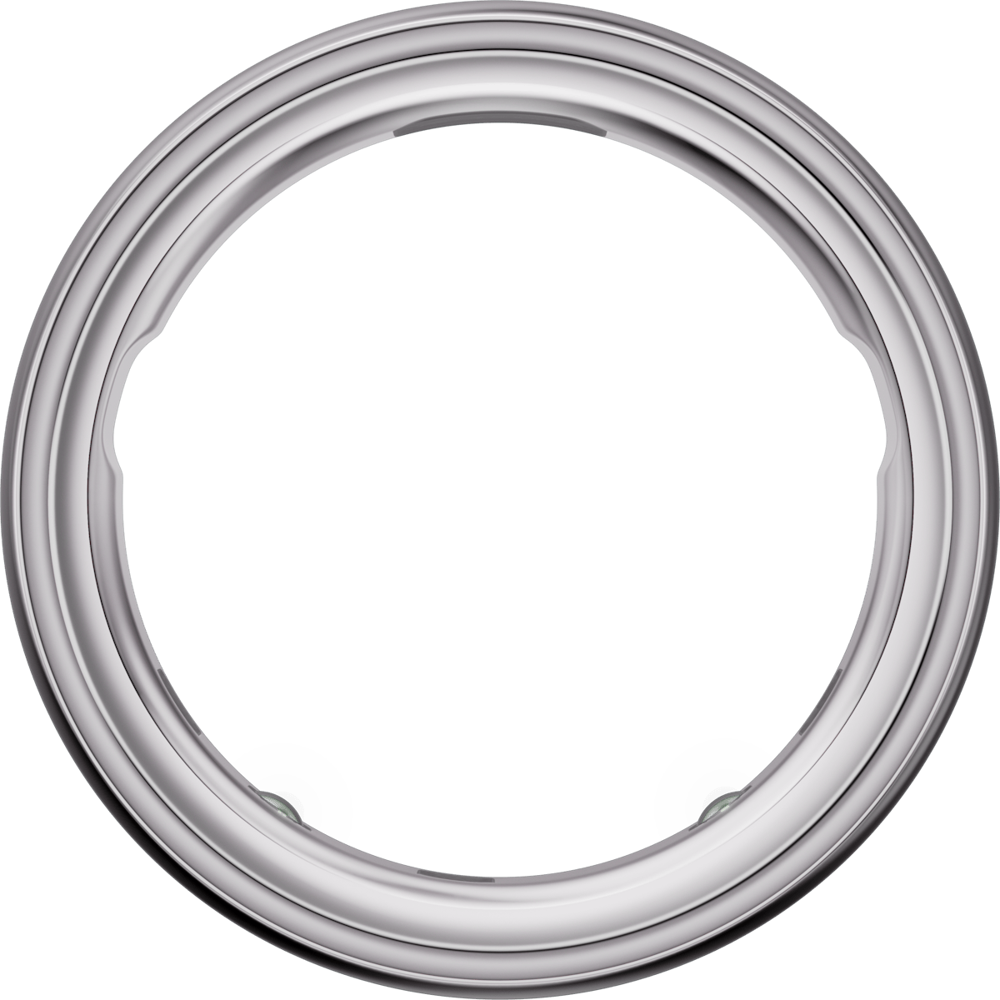
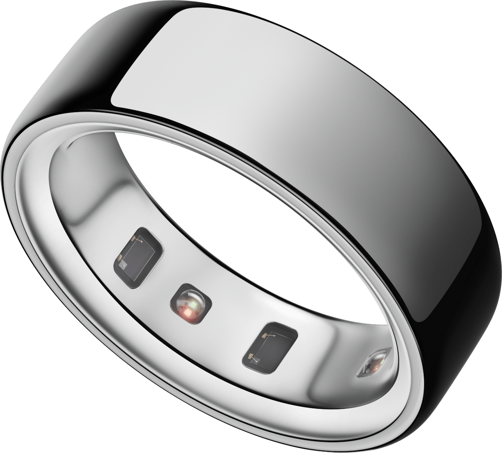
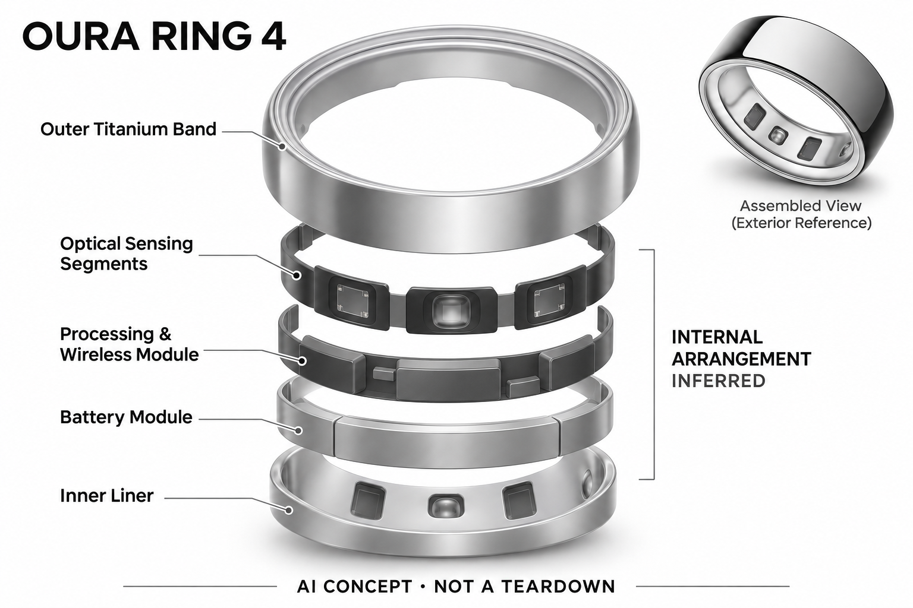

# Oura Ring 4

**Oura** · 健康与穿戴 · 核查 2026-11-04

指环采集与应用中的AI解释结合

消费渠道：个人零售。

## 产品图片与结构参考

### 产品图

Oura Ring 4 银色官方正面图 · 来源：[Oura · 官方图片](<https://ouraring.com/store/rings/oura-ring-4/silver>) · [原始图片](<https://ourahealth.imgix.net/hardware-pdp/hero-carousel/or4-silver-front-view.png?ixlib=js-3.8.0&auto=format&fit=max&fm=png&q=70&w=1200&s=a9f2a840d8abdf221c81e9272c0c11aa>)

### 参考图

Oura Ring 4 银色官方角度与内侧参考 · 来源：[Oura · 官方图片](<https://ouraring.com/store/rings/oura-ring-4/silver>) · [原始图片](<https://ourahealth.imgix.net/hardware-pdp/hero-carousel/or4-silver-angle-view.png?ixlib=js-3.8.0&auto=format&fit=max&fm=png&q=70&w=1200&s=76421b0734824e2f13c4b71f449a648a>)

### AI 生成爆炸示意

**AI 生成 · 非实物拆机。** 内部为概念推断，不能作为元件布局、BOM 或维修依据。[生成提示词](../../content/hardware/prompts/oura-ring-4.txt)

> 已目视核对产品外形与AI标识；verified不代表内部布局经实物拆机验证。

> 分析为基于公开资料的案头研究与 AI 辅助判断，未经用户访谈、销量审计或实物拆机。需求、画像、竞争冷门度、审美及商业机会均为研究假设，不是投资结论。

## 销售与购买

- 状态：在售。官方Ring 4银色商店页显示US$349、尺码选择和Add to Cart。Oura Advisor官方支持页确认Gen3及以后且有效会员可使用。

- 地区：美国官网

- 价格：银色 US$349；会员另计。材质颜色、延长保障及地区会员价格不同；Advisor需要有效会员，不能把一次性戒指售价当作全部使用成本。

- 中国大陆：本次未核实中国大陆官方配送和地区订阅。境外购买、App可下载与完整会员功能可用需要分别确认。

- [官方产品 / 商店](<https://ouraring.com/store/rings/oura-ring-4/silver>)

## AI 的实际作用

生理感知算法整理睡眠、活动等指标，Oura Advisor结合大语言模型解释个人记录并回答问题；指环本身不是聊天终端。

服务与联网依赖：需要配套Oura App；Advisor要求Gen3或更新硬件及有效会员，使用个人资料、标签和历史数据形成建议。

## 是否冷门

竞争密集（研究判断）：首饰形态健康追踪已有多个品牌，订阅和算法解释形成差异。

## 需求与市场

需求假设：用户想了解睡眠和日常状态，又不愿夜间佩戴手表，可能接受更低存在感的指环。应观察长期佩戴、充电中断和记录后是否改变习惯，不能把更多指标当作健康收益。

### 官方｜指环记录与应用中的 Advisor · 官方资料

本型号以无屏指环持续获取生理与活动相关数据，应用中的 Advisor 再结合感知算法和大语言模型解释记录。需求是减少屏幕与腕部佩戴干扰，同时理解自己的长期趋势；戒指本身不是聊天终端，Advisor 需要适用硬件和有效会员，不能把一次硬件购买视为全部服务永久包含。

依据：[Oura Ring 4官方商店](<https://ouraring.com/store/rings/oura-ring-4/silver>) · [Oura Advisor官方支持](<https://ouraringhelp.zendesk.com/hc/en-us/articles/39512345699219-Oura-Advisor>)

### 判断｜少打扰与更好理解的关系 · 研究判断

用户可能愿意记录睡眠和日常状态，却不希望夜间戴表或不断看通知，指环有机会适配这种偏好。但少一个屏幕并不代表少管理数据，应用解释也可能增加对分数的关注；价值应以用户是否更容易理解记录判断，不能把指标数量或语言回答长度当作健康收益。

依据：[Oura Advisor官方支持](<https://ouraringhelp.zendesk.com/hc/en-us/articles/39512345699219-Oura-Advisor>)

### 验证｜解释前后的理解 · 待验证

可让用户在积累一段记录后分别查看图表和 Advisor 回答，比较能否指出数据依据、缺失与不确定性。还应记录哪些解释需要回查、哪些被误当成确定结论，当前目录没有用户实验；不能因模型使用个人历史就推断它一定正确理解生活原因或改善身体状态。

依据：[Oura Advisor官方支持](<https://ouraringhelp.zendesk.com/hc/en-us/articles/39512345699219-Oura-Advisor>)

## 用户画像

用户画像推断：习惯查看个人数据、愿意正确选尺码并支付订阅的人较匹配。需要精准运动实时显示、经常手工劳动或指部佩戴不适的人，可能更适合其他穿戴形态而非指环。

### 判断｜愿意长期佩戴与付费的人 · 研究判断

接受戒指形态、愿意选尺码并持续使用会员的人更可能匹配，尤其主要通过手机查看趋势的用户。需要即时运动屏幕、消息操作或经常不便戴戒的人可能有不同需求；画像应结合佩戴和数据习惯，不能只用重视健康或喜欢科技概括所有购买者。

依据：[Oura Ring 4官方商店](<https://ouraring.com/store/rings/oura-ring-4/silver>) · [Oura Advisor官方支持](<https://ouraringhelp.zendesk.com/hc/en-us/articles/39512345699219-Oura-Advisor>)

### 判断｜已有穿戴设备的用户 · 研究判断

已有手表的人可能把指环用于不同时间，也可能觉得数据重复，需要研究它实际补足了什么。若用户只是换一种外观，未必形成新的独立需求；如果夜间佩戴和持续性明显改善，才值得进一步比较，不能从设备体积较小就推断所有人更愿意长期使用。

依据：[Oura Ring 4官方商店](<https://ouraring.com/store/rings/oura-ring-4/silver>)

### 验证｜尺码与会员认知 · 待验证

首次使用应包含试戴、充电、配对和查看会员条件，观察用户是否理解没有会员时功能范围会变化。不同手指与日常活动要分别记录舒适和接触，不能只在静止时确定适配；还需核对手机、语言和地区服务，海外加购入口并不代表大陆完整体验已确认。

依据：[Oura Ring 4官方商店](<https://ouraring.com/store/rings/oura-ring-4/silver>) · [Oura Advisor官方支持](<https://ouraringhelp.zendesk.com/hc/en-us/articles/39512345699219-Oura-Advisor>)

## 竞争与替代

竞争判断：智能指环已有Oura、Ultrahuman、Samsung和RingConn等品牌，属于拥挤市场。算法解释、佩戴舒适、服务生态和总体费用比外形类似更能区分产品，不能单用传感器数排名。

### 判断｜同类指环的共同核心 · 研究判断

其他智能戒指也提供被动记录和解释，Oura 的差异应落到传感策略、应用理解与会员流程，不能以品牌或金属颜色增加独立场景。竞争比较需要看用户是否真的回查并理解数据，而不是只列分数和算法名称；当前没有销量或访谈证据可判断个人需求强弱。

依据：[Oura Ring 4官方商店](<https://ouraring.com/store/rings/oura-ring-4/silver>) · [Oura Advisor官方支持](<https://ouraringhelp.zendesk.com/hc/en-us/articles/39512345699219-Oura-Advisor>)

### 判断｜手表与无屏腕带替代 · 研究判断

手表提供即时界面，无屏腕带也能持续记录，指环则改变佩戴位置与日常接触，三者的取舍需要具体任务。若用户希望运动中直接看信息，指环可能仍需手机或其他设备；不能只比较存在感低，就忽略额外应用与订阅，整个组合的负担应一起计算。

依据：[Oura Ring 4官方商店](<https://ouraring.com/store/rings/oura-ring-4/silver>)

### 验证｜同地区的完整成本 · 待验证

比较应包括硬件配置、尺码相关交付和会员，不能把不同地区自动显示的币种或促销价混算。本轮商店页面返回澳元报价，不能据此替换原目录已核查的美元配置；当前没有价格弹性或留存研究，目录不以高低标价或会员功能数量推断商业优势。

依据：[Oura Ring 4官方商店](<https://ouraring.com/store/rings/oura-ring-4/silver>) · [Oura Advisor官方支持](<https://ouraringhelp.zendesk.com/hc/en-us/articles/39512345699219-Oura-Advisor>)

## 供应链

供应链推断：不同尺码造成电池、壳体和库存组合管理难度，微型封装和长期皮肤接触需稳定质量。官方未披露本型号具体代工工厂；试戴套件与尺寸相关退换也是交付成本。

### 官方｜光学、温度与运动输入 · 官方资料

本轮重新打开官方商店，能够确认光学、温度、加速度和低功耗无线等功能层，但具体器件厂商与工厂未完整披露。Smart Sensing 是品牌技术说明，不能直接当作芯片供应商名称；目录不从同类戒指或概念示意补出主板、电池和装配关系，也不猜测物料成本。

依据：[Oura Ring 4官方商店](<https://ouraring.com/store/rings/oura-ring-4/silver>)

### 判断｜尺寸系列与交付复杂度 · 研究判断

不同戒围需要保持佩戴、传感接触和充电适配，试戴与换码也是交付过程的一部分。不能把所有尺寸视为完全相同的结构或续航，官方说明也提示使用条件会影响电池表现；供应链研究应核对校准与售后，而不是由小型金属外壳推算制造简单或统一良率。

依据：[Oura Ring 4官方商店](<https://ouraring.com/store/rings/oura-ring-4/silver>)

### 判断｜光学与连接候选 · 研究判断

亚德诺可作为光学采集前端候选，Nordic 可作为低功耗连接候选，二者没有本型号供货点名。选择需验证光路、手指接触、封装与电源，不能直接替换；候选器件的额外测量功能不能被添加到戒指，Advisor 和会员服务也不是由这些硬件公司自动提供。

依据：[Oura Ring 4官方商店](<https://ouraring.com/store/rings/oura-ring-4/silver>)

## 技术路径

官方说明Smart Sensing与Advisor的算法加大语言模型组合。推断应把信号质量、指标估计和语言解释分层评估，模型回答流畅不能证明底层测量准确，也不能代替医学诊断。

### 官方｜感知估算与语言层 · 官方资料

官方支持明确 Advisor 将健康感知算法与大语言模型结合，并在应用中使用，适用 Gen3 或更新硬件且需有效会员。它会使用相关个人记录和上下文，不能由兼容多代硬件推断各代内部结构相同；目录区分采集、指标估算和解释，不把对话流畅作为测量准确的证据。

依据：[Oura Advisor官方支持](<https://ouraringhelp.zendesk.com/hc/en-us/articles/39512345699219-Oura-Advisor>)

### 判断｜上下文可能帮助也可能误导 · 研究判断

标签、个人资料和历史记录可以让回答更贴近用户，也可能因填写错误或过时而产生错误关联。系统需要让用户看到依据并控制上下文，尤其不能把相关变化解释为确定原因；技术评价应检查输入质量和解释一致性，而不是只问回答是否显得关心用户或专业可信。

依据：[Oura Advisor官方支持](<https://ouraringhelp.zendesk.com/hc/en-us/articles/39512345699219-Oura-Advisor>)

### 验证｜缺失与更正后的回答 · 待验证

可观察摘戴、充电缺口和标签修改后，指标与 Advisor 如何变化，并比较相似问题在相同数据下的回答。需要保留原始趋势与版本，确认模型是否承认信息不足；当前目录没有独立医学或语言模型评估，不保证每种生活情境都得到可靠解释或适合的行动建议。

依据：[Oura Ring 4官方商店](<https://ouraring.com/store/rings/oura-ring-4/silver>) · [Oura Advisor官方支持](<https://ouraringhelp.zendesk.com/hc/en-us/articles/39512345699219-Oura-Advisor>)

## 产品审美

审美判断：钛材和接近首饰的外形有助于与日常穿搭共存，无屏幕也减少打断。颜色、厚度和表面磨损影响长期佩戴意愿；不同手型的舒适感应通过试戴而非渲染图判断。

### 判断｜戒饰化外观的接受 · 研究判断

无屏金属外形可能容易融入日常戒饰，也可能与手部工作、现有首饰或个人习惯冲突。审美研究应观察用户实际愿意戴在哪些时段，而不只看颜色偏好；官方照片能够说明轮廓，不能证明所有手指的舒适、耐磨或接触稳定，长期体验仍需试戴。

依据：[Oura Ring 4官方商店](<https://ouraring.com/store/rings/oura-ring-4/silver>)

### 判断｜无屏与应用信息密度 · 研究判断

指环不直接展示复杂结果，手机应用承担解释与管理，这可以减少腕上打扰，也可能把信息集中成较多分数和提示。设计评价应看用户能否快速找到真正需要的趋势，并理解不确定性；没有屏幕不自动等于更少认知负担，语言助手也可能增加阅读与信任管理。

依据：[Oura Advisor官方支持](<https://ouraringhelp.zendesk.com/hc/en-us/articles/39512345699219-Oura-Advisor>)

### 验证｜夜间与日间连续佩戴 · 待验证

试用应覆盖睡前、工作、手部活动和充电，记录压力、旋转、摘下及重新佩戴后的数据情况。尺码选择要与真实使用结合，不能仅看短时松紧；连续性和舒适共同决定记录价值，官方标称续航与渲染图都不能代替个人长时间体验。

依据：[Oura Ring 4官方商店](<https://ouraring.com/store/rings/oura-ring-4/silver>)

## 关键风险

风险判断：睡眠等数据属于敏感个人信息，AI解释可能让用户过度关注单日分数。官方明确非医疗设备；本目录只分析消费级记录能力，不据此提供诊断、用药或治疗结论。

### 判断｜健康解释与过度关注 · 研究判断

官方明确戒指不是医疗设备，Advisor 的信息不能替代诊断或治疗判断。自然语言可能让用户更相信单日分数，需要观察是否导致过度解释或忽略数据限制；目录只分析消费级记录和解释，不据此建议调整药物或处理疾病，也不把个人化回答当作专业结论。

依据：[Oura Advisor官方支持](<https://ouraringhelp.zendesk.com/hc/en-us/articles/39512345699219-Oura-Advisor>)

### 判断｜会员与敏感数据依赖 · 研究判断

详细体验与 Advisor 依赖会员、应用和账户，用户需要理解续订、退出和历史数据范围。睡眠、生理和对话内容也属于需要慎重管理的信息，厂商政策不是本研究独立审计；海外商店可购不能证明大陆订阅与全部功能正式可用，购买和使用条件应分别核对。

依据：[Oura Ring 4官方商店](<https://ouraring.com/store/rings/oura-ring-4/silver>) · [Oura Advisor官方支持](<https://ouraringhelp.zendesk.com/hc/en-us/articles/39512345699219-Oura-Advisor>)

### 验证｜退出与信息控制 · 待验证

应检查关闭助手、修改上下文、删除或导出时用户能控制哪些内容，并确认会员变化后可访问的范围。重要解释需要回到数据和适当的人类判断，不能只因为回答引用个人记录就直接采用；验证目标是提高理解与可控性，而不是让语言层隐藏测量和推断的不确定性。

依据：[Oura Advisor官方支持](<https://ouraringhelp.zendesk.com/hc/en-us/articles/39512345699219-Oura-Advisor>)

## 机会与验证

市场观察：比较时应把戒指价格、会员要求、地区App和AI功能权限列在一起。指环的主要区分在于长期数据质量与解释方式，不能把一段Advisor演示等同完整产品优势。

### 判断｜低干扰趋势理解的价值 · 研究判断

本型号的购买理由应来自用户愿意持续佩戴并实际利用长期趋势，而不是拥有更多指标。若主要需要即时运动显示，指环可能仍需其他设备；场景分组应与同类无屏记录和解释复用核心需求，把会员、佩戴和算法路径放在差异中，而不按品牌或颜色制造新场景。

依据：[Oura Ring 4官方商店](<https://ouraring.com/store/rings/oura-ring-4/silver>) · [Oura Advisor官方支持](<https://ouraringhelp.zendesk.com/hc/en-us/articles/39512345699219-Oura-Advisor>)

### 判断｜Advisor 是否减少困惑 · 研究判断

研究应记录用户在解释后是否更清楚哪些是数据、哪些是推断，以及还需要查找什么。流畅回答可能提升信任，却未必改善理解，因此不能只统计聊天次数或满意度；只有可核查的回顾收益超过充电、选码和订阅管理负担，才可能形成长期购买理由。

依据：[Oura Advisor官方支持](<https://ouraringhelp.zendesk.com/hc/en-us/articles/39512345699219-Oura-Advisor>)

### 验证｜长期使用与总拥有成本 · 待验证

后续可跟踪佩戴完整、缺失、更正、Advisor 回查和会员费用，并比较手表或更简单应用何时已经足够。不同地区与配置应分开记录，不用促销或短期尝鲜代表长期价值；当前目录是案头研究，不以在售、品牌或大语言模型解释宣称需求和健康效果已验证。

依据：[Oura Ring 4官方商店](<https://ouraring.com/store/rings/oura-ring-4/silver>) · [Oura Advisor官方支持](<https://ouraringhelp.zendesk.com/hc/en-us/articles/39512345699219-Oura-Advisor>)

## 对应供应链公司

能力候选用于选型研究，不代表本产品实际采用；未公开的供货关系不作推断。

- [analog-devices](../supply-chain/analog-devices.md) — **能力候选 · 非已采用** / 指端光学信号采集前端候选：Oura Ring 4 披露光学输入，亚德诺的 PPG 前端可作为新设计候选，需验证手指光路、接触、封装与功耗。当前没有点名采用，仅比较光学采集部分，不因候选器件的其他通道为戒指添加心电等功能；前端能力也不能证明 Smart Sensing 或 Advisor 的实际效果。

- [nordic-semiconductor](../supply-chain/nordic-semiconductor.md) — **能力候选 · 非已采用** / 指环与手机的低功耗连接候选：官方商店披露低功耗无线连接，Nordic 可作为相应控制与同步路线候选。需核对封装、天线、数据缓存和真实电池周期，当前未确认供货；无线平台不提供 Oura 的指标算法、会员或 Advisor，也不能从常见行业使用推断本型号采用具体芯片。

[浏览供应链目录](../supply-chain.md)

## 功能分层示意

这是功能关系，不是实物拆机、真实空间结构或已核实 BOM。

1. **指环采集**：Smart Sensing支持持续生理与活动记录。（官方披露）

2. **指标估计**：健康感知算法整理分数与相关贡献因素。（官方披露）

3. **应用上下文**：App中的活动、标签、资料及互动历史。（官方披露）

4. **语言解释**：Advisor将算法结果与大语言模型结合回答问题。（官方披露）

5. **权限与展示**：有效会员通过手机应用访问Advisor。（官方披露）

## 来源

1. [Oura Ring 4官方商店](<https://ouraring.com/store/rings/oura-ring-4/silver>) — 列尺码、银色价格和加购入口。

2. [Oura Advisor官方支持](<https://ouraringhelp.zendesk.com/hc/en-us/articles/39512345699219-Oura-Advisor>) — 说明LLM、会员、数据来源及非医疗设备边界。

[返回目录](../hardware-market.md) · [网页分析](https://romanagent.github.io/Roman/#hardware/product/oura-ring-4)
