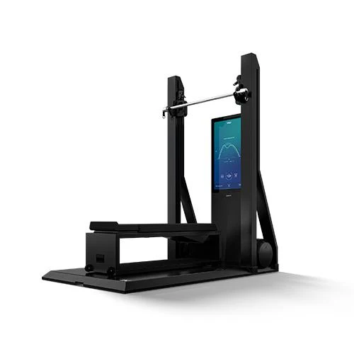
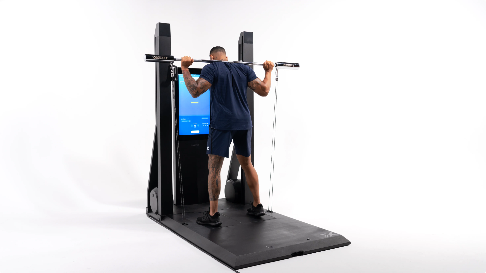
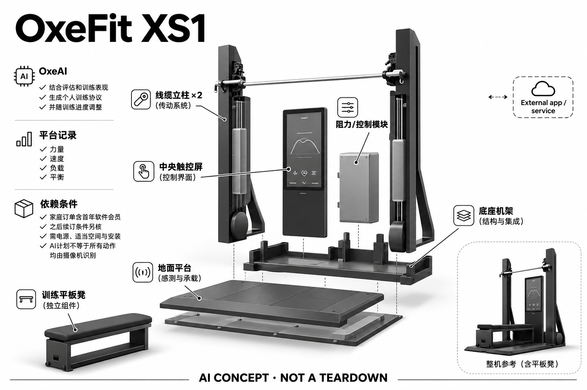

# OxeFit XS1

**OxeFit** · 运动与训练 · 核查 2026-11-04

多种数字力量训练与OxeAI自适应计划

消费渠道：个人零售。

## 产品图片与结构参考

### 产品图

OxeFit XS1官方产品外形图 · 来源：[OxeFit · 官方产品图片](<https://store.oxefit.com/products/xs1-black>) · [原始图片](<https://store.oxefit.com/cdn/shop/files/xs1-black-thumb_dc8ab999-41b8-4a50-ba56-cf3033185044.jpg?v=1762532318&width=1946>)

### 参考图

OxeFit XS1官方另一角度或使用场景参考 · 来源：[OxeFit · 官方产品图片](<https://www.oxefit.com/corev/configure/xs1-flow>) · [原始图片](<https://www.oxefit.com/static/images/gallery-modes/gallery-2-home.webp>)

### AI 生成爆炸示意

**AI 生成 · 非实物拆机。** 内部为概念推断，不能作为元件布局、BOM 或维修依据。[生成提示词](../../content/hardware/prompts/oxefit-xs1.txt)

> 外形依据核验参考图；内部位置、模块形状与装配关系仅作AI概念展示。

> 已逐张查看并核对型号。源图未改色/裁切；场景、界面、附件、优惠及效果文案仅为厂商示意，不作为本目录性能或现价依据。

> 主图取自厂家原销售页的同一XS1机型图，当前在售与价格以阿联酋配置页为准。

> 分析为基于公开资料的案头研究与 AI 辅助判断，未经用户访谈、销量审计或实物拆机。需求、画像、竞争冷门度、审美及商业机会均为研究假设，不是投资结论。

## 销售与购买

- 状态：在售。旧美元商店在实际浏览器跳转至当前区域站；已打开XS1 FLOW配置页，显示明确阿联酋价格、Consumer use only与CONTINUE TO CHECKOUT。当前页面只承诺UAE配送，未沿用旧美元价格。

- 地区：阿联酋官方区域渠道

- 价格：阿联酋官方FLOW配置 AED34,138.44。此为当前阿联酋FLOW配置含附件及首年软件的所见价格，不将PEAK附件包另计型号；实际送装与税费按合同。

- 中国大陆：本次未核实该具体型号在中国大陆的官方销售和完整服务支持；海外在售不等于国内可直接启用全部功能。

- [官方产品 / 商店](<https://www.oxefit.com/corev/configure/xs1-flow>)

## AI 的实际作用

OxeAI结合评估和训练表现生成个人训练协议并随训练进度调整，平台记录力量、速度、负载与平衡相关数据

服务与联网依赖：家庭订单含首年软件会员，之后续订条件另核；需要电源、适当空间与安装。AI计划不等于所有动作均由摄像机识别

## 是否冷门

新兴竞争（研究判断）：按任务与形态作案头分类，无访谈、销量或市场份额证据。

## 需求与市场

需求假设：希望在家用一套数字负载系统完成力量与部分心肺训练，并自动组织计划。价值应由实际使用频率、任务完成与操作负担验证，不能把AI功能存在或演示流畅当作需求已得到满足。

### 需求假设：一处固定区域完成多种训练 · 研究判断

XS1把双侧拉索、平台反馈和多种附件放入家庭训练系统，针对不想在不同器材之间搬移和重新安排计划的用户。真正需要验证的是多用途是否被持续使用，而不是展示了多少动作；家庭拥有更丰富设备也不等于每天都有明确训练任务。

依据：[OxeFit XS1 FLOW当前官方家庭订单](<https://www.oxefit.com/corev/configure/xs1-flow>)

### 价值判断：计划组织与身体反馈各有作用 · 研究判断

OxeAI依据评估和训练表现调整协议，平台记录力量与平衡相关信息，两者可能帮助用户理解训练，也可能增加需要解释的数据。应分开观察计划是否减少决策、反馈是否改变操作，不能把记录指标多当作训练更有效或身体状态被完整理解。

依据：[OxeFit XS1 FLOW当前官方家庭订单](<https://www.oxefit.com/corev/configure/xs1-flow>)

### 验证方案：从原有训练安排切入 · 待验证

让有固定训练计划的人用XS1完成原本的课程，记录附件转换、计划选择、数据查看和结束清理，再与原有器材比较。访谈围绕实际改动展开，避免为了展示多功能临时加入不需要的动作，然后误认为系统满足了更多真实需求。

依据：[OxeFit XS1 FLOW当前官方家庭订单](<https://www.oxefit.com/corev/configure/xs1-flow>) · [OxeFit官方购买与会员要求](<https://support.oxefit.com/hc/en-us/articles/18864328136983-Purchase-Device>)

## 用户画像

画像推断：有较大固定训练空间、稳定预算和长期使用意愿的个人家庭。个人的语言、操作习惯、环境和预算会改变适配结果，本次只有案头研究，没有用户访谈或长期使用观察。

### 画像假设：愿意长期设置家庭训练区 · 研究判断

较匹配者需要足够固定空间和稳定使用意愿，并愿意管理附件与软件会员，不只是预算能够购买设备。多人家庭还要协调不同训练水平和偏好，画像应说明谁使用、多久使用及谁维护，不能用高端家庭用户的笼统标签替代任务分析。

依据：[OxeFit XS1 FLOW当前官方家庭订单](<https://www.oxefit.com/corev/configure/xs1-flow>) · [OxeFit官方购买与会员要求](<https://support.oxefit.com/hc/en-us/articles/18864328136983-Purchase-Device>)

### 使用约束：多附件带来学习与切换 · 研究判断

系统多用途意味着用户需要理解附件对应的动作、安装和记录方式，有人会珍视集中训练，有人可能只反复使用少数功能。研究应观察实际学习和切换成本，不将购买完整套装等同全部用途都会被采用，也不能从屏幕课程推断无需其他指导。

依据：[OxeFit XS1 FLOW当前官方家庭订单](<https://www.oxefit.com/corev/configure/xs1-flow>)

### 访谈重点：平台数据被谁解释 · 待验证

请用户展示一段训练记录，说明力量、速度或平衡相关信息中哪些真正影响下一次安排，哪些只是看过。若需要教练解释，应把这项外部支持记录下来，不能将系统给出评估描述为用户已经理解，也不以数据判断个人医学状态。

依据：[OxeFit XS1 FLOW当前官方家庭订单](<https://www.oxefit.com/corev/configure/xs1-flow>)

## 竞争与替代

案头判断：与Tonal、Speediance和传统综合力量机竞争，平台平衡反馈和多运动附件增加用途但也增加交付复杂度。这只是用途与替代品比较，不是市场份额或销量结论；专业细分和较少曝光也不代表没有成熟竞争者。

### 替代方案：综合力量机与分开配置 · 研究判断

XS1既面对其他数字力量设备，也与传统综合器材、自由重量和单独课程服务竞争，方案之间的主要区别是任务组织方式。多附件系统可能减少器材分散，也可能提高安装与维护复杂度，比较不能只按可支持动作数量或AI名称排序。

依据：[OxeFit XS1 FLOW当前官方家庭订单](<https://www.oxefit.com/corev/configure/xs1-flow>)

### 差异判断：平台反馈值得单独检验 · 研究判断

带传感反馈的平台是可进一步研究的差异，它可能为动作理解提供拉索之外的线索，但用户是否需要这些线索尚未证实。应比较有无反馈时的操作与理解，不把平台测量存在直接解释为更安全、更均衡或更有效的训练。

依据：[OxeFit XS1 FLOW当前官方家庭订单](<https://www.oxefit.com/corev/configure/xs1-flow>)

### 比较方法：按真实课程计算转换负担 · 待验证

将同一训练安排分别放入XS1与原有方案，记录器材调整、附件更换、休息和数据查看时间，观察哪些用途真正增加价值。把会员与安装成本纳入拥有体验，避免只测试一次完整演示，就认为用户会长期采用全部运动模式。

依据：[OxeFit XS1 FLOW当前官方家庭订单](<https://www.oxefit.com/corev/configure/xs1-flow>) · [OxeFit官方购买与会员要求](<https://support.oxefit.com/hc/en-us/articles/18864328136983-Purchase-Device>)

## 供应链

公开资料可核对竖屏、双侧拉索、带传感反馈的训练平台与多运动附件，具体整机工厂、关键模块供应商与BOM本次未确认。制造重点可从形态推断，但不能把品牌所在地、外观相似或营销合作等同代工关系。

### 功能拆分：负载、平台与软件共同工作 · 研究判断

公开形态包含双侧拉索、训练平台、显示及附件，OxeAI与账户服务另承担计划分析，不能把全部系统归为视觉摄像机。原目录未披露完整内部布局与供应商，因此此处按功能拆分，不能由力量和速度记录推断具体传感器型号或制造工厂。

依据：[OxeFit XS1 FLOW当前官方家庭订单](<https://www.oxefit.com/corev/configure/xs1-flow>)

### 制造判断：多用途放大连接与校准问题 · 研究判断

不同附件和训练动作会改变拉索路径、平台受力及用户站位，系统需要在这些组合中保持可理解的反馈。供应评估应关注连接、负载校准和维修，而不只看屏幕与算法，本轮没有取得装配公差、寿命记录或正式安装工程资料。

依据：[OxeFit XS1 FLOW当前官方家庭订单](<https://www.oxefit.com/corev/configure/xs1-flow>)

### 候选选型：屏幕与运动工程需限定范围 · 研究判断

BOE可作为训练显示候选，Nidec可讨论数字负载系统所需的运动工程方向，但具体执行结构、力矩与控制方式仍需正式资料确认。不能将通用小型电机直接替换原机，也没有公开点名证明这些企业已供货，候选只用于能力询证。

依据：[OxeFit XS1 FLOW当前官方家庭订单](<https://www.oxefit.com/corev/configure/xs1-flow>)

## 技术路径

OxeAI结合评估和训练表现生成个人训练协议并随训练进度调整，平台记录力量、速度、负载与平衡相关数据。这是厂商披露的功能机制；模型版本、准确率及内部结构未完整公开。架构只表示输入、处理和输出关系，不作为真实拆机或性能实测。

### 已披露能力：OxeAI根据训练表现调整 · 官方资料

官方家庭订单说明AI结合评估与训练表现组织个人训练协议，并记录力量、速度、负载和平衡相关数据。这里是计划与反馈机制，不能默认每个动作由摄像机识别，也不把系统评估当成医疗测量，模型实现与误差未在本轮完整公开。

依据：[OxeFit XS1 FLOW当前官方家庭订单](<https://www.oxefit.com/corev/configure/xs1-flow>)

### 技术判断：建议需要与可执行条件相符 · 研究判断

训练计划如果没有考虑用户实际时间、附件熟练度或个人限制，生成得再完整也可能无法执行。研究应观察用户何时修改、忽略或询问建议，并区分数据不完整与计划偏好问题，不能把遵循算法安排作为正确训练的唯一标准。

依据：[OxeFit XS1 FLOW当前官方家庭订单](<https://www.oxefit.com/corev/configure/xs1-flow>)

### 验证方案：追踪计划改变的理由 · 待验证

保存每次评估、训练记录和后续计划变化，询问用户是否理解为什么调整以及是否愿意执行，再与实际完成情况对照。对不一致结果应保留条件，不用一次建议或评分变化证明训练效果，本轮也没有提供AI准确率和身体改善的实测结论。

依据：[OxeFit XS1 FLOW当前官方家庭订单](<https://www.oxefit.com/corev/configure/xs1-flow>)

## 产品审美

图示观察：宽底板与高位屏幕更接近固定家庭健身区，收纳和安装体验需结合真实房间。宣传图片只能帮助理解外观和摆放方式，不能证明每个人的舒适度、长时使用体验或实际材料触感。

### 外形判断：固定训练区的空间存在感 · 研究判断

XS1宽平台和高位屏幕形成明显器械区域，多附件又增加周边收纳需求，不能只从正面照片判断房间适配。用户需要考虑进入、站位、拉索路径和训练后整理，视觉上的完整一体并不意味着日常所有步骤都简单，也不证明可随意移动。

依据：[OxeFit XS1 FLOW当前官方家庭订单](<https://www.oxefit.com/corev/configure/xs1-flow>)

### 交互判断：反馈需要对应正在做的动作 · 研究判断

多用途系统可能同时展示计划、课程和多个数据，用户在用力时最需要的是当前应做什么与是否理解了提示。应检查信息层级是否清楚，而不是把专业图表数量当作指导质量，也不能让用户为了读屏频繁打断原本的训练节奏。

依据：[OxeFit XS1 FLOW当前官方家庭订单](<https://www.oxefit.com/corev/configure/xs1-flow>)

### 体验验证：把附件与家庭动线一起观察 · 待验证

让用户在自己的房间完成整节课程，包含取附件、切换、放回与清洁，记录需要绕行或移动物品的地方。训练后再询问是否愿意维持这一空间安排，比只在展示厅尝试几个动作更能解释长期接受度与实际外观负担。

依据：[OxeFit XS1 FLOW当前官方家庭订单](<https://www.oxefit.com/corev/configure/xs1-flow>)

## 关键风险

当前地区站交付文案同时出现24–48小时和通常2–4周，须以订单确认；负载控制、安装与会员依赖是实际限制。还需核对地区功能、软件更新与售后边界；本目录未进行实机、医学或可靠性测试，不把厂商演示当作结果保证。

### 训练风险：评估和数字负载仍有边界 · 研究判断

系统提供的训练协议不能代替对个人状态的判断，数字负载和附件使用仍需遵守说明，出现不适不应只依据评分继续。这里不提供医学或康复建议，也不将平台反馈描述为预防伤害保证，本轮没有实机或训练结果验证。

依据：[OxeFit XS1 FLOW当前官方家庭订单](<https://www.oxefit.com/corev/configure/xs1-flow>) · [OxeFit官方购买与会员要求](<https://support.oxefit.com/hc/en-us/articles/18864328136983-Purchase-Device>)

### 交付风险：不同时间文案需要确认 · 研究判断

原目录记录的地区页面同时出现不同交付时间表述，因此实际配送与安装应以订单确认，不能选择更短文案当作承诺。首年软件会员也不代表后续永久免费，家庭订单、地区服务和附件范围应一起核对，不直接推广到其他市场。

依据：[OxeFit XS1 FLOW当前官方家庭订单](<https://www.oxefit.com/corev/configure/xs1-flow>) · [OxeFit官方购买与会员要求](<https://support.oxefit.com/hc/en-us/articles/18864328136983-Purchase-Device>)

### 验证安排：记录无法完成的任务 · 待验证

试用应保留因附件、空间、提示不清或计划不适合而中止的动作，明确用户如何选择替代安排。不要只观察顺利完成的课程，也不把未完成全部功能都归因于意愿不足，设备和服务的复杂度本身也是需要研究的限制。

依据：[OxeFit XS1 FLOW当前官方家庭订单](<https://www.oxefit.com/corev/configure/xs1-flow>)

## 机会与验证

市场差异主要在于多种数字力量训练与OxeAI自适应计划。值得进一步验证的购买理由是它能否减少既有任务中的具体步骤，以及硬件、服务与维护的总成本是否符合个人使用频率。

### 研究方向：少做选择而不是展示更多选项 · 研究判断

XS1对应的可研究问题是多用途器材能否帮助用户形成可执行的训练流程，机会可能在附件管理、计划解释或数据复盘。应先确认用户反复卡住的步骤，避免为了增加用途而扩大硬件复杂度，也不把自适应计划当作所有家庭的共同需求。

依据：[OxeFit XS1 FLOW当前官方家庭订单](<https://www.oxefit.com/corev/configure/xs1-flow>)

### 执行计划：跟踪实际使用的功能子集 · 待验证

观察数周内哪些附件和模式被反复采用、哪些被放弃，记录计划调整是否影响实际训练选择。访谈追问一次具体改变的原因，并区分平台数据、课程内容与设备便利的作用，避免把一次综合满意度评分当作整个系统的需求证据。

依据：[OxeFit XS1 FLOW当前官方家庭订单](<https://www.oxefit.com/corev/configure/xs1-flow>) · [OxeFit官方购买与会员要求](<https://support.oxefit.com/hc/en-us/articles/18864328136983-Purchase-Device>)

### 决策边界：高价集成不能证明商业空间 · 研究判断

多用途硬件与会员软件说明一种交付方式，但不能由设备投入推断用户留存或市场规模。需要看到重复任务中的收益与可接受的维护成本，本轮没有开展访谈、取得销量或供应报价，不以功能总数和模型评分预测创业成功。

依据：[OxeFit XS1 FLOW当前官方家庭订单](<https://www.oxefit.com/corev/configure/xs1-flow>) · [OxeFit官方购买与会员要求](<https://support.oxefit.com/hc/en-us/articles/18864328136983-Purchase-Device>)

## 对应供应链公司

能力候选用于选型研究，不代表本产品实际采用；未公开的供货关系不作推断。

- [boe](../supply-chain/boe.md) — **能力候选 · 非已采用** / 固定训练终端显示系统候选：BOE公开多尺寸显示与界面相关业务，可作为XS1课程和数据屏的候选，仍需核对实际尺寸、触控、观看角度及长时间运行要求。已核平板等标准系列不能直接当作XS1替换屏，也没有公开点名资料证明其为该型号供货。

- [nidec](../supply-chain/nidec.md) — **能力候选 · 非已采用** / 数字负载执行机构工程候选：Nidec公开电机与控制相关业务，可作为XS1数字负载执行系统的工程候选，但原机具体结构、反馈与力矩要求未披露，必须由正式资料验证，不能以相机小型电机目录套用训练器。当前不构成实际采用或原机电机品牌判断。

[浏览供应链目录](../supply-chain.md)

## 功能分层示意

这是功能关系，不是实物拆机、真实空间结构或已核实 BOM。

1. **实体输入**：竖屏、双侧拉索、带传感反馈的训练平台与多运动附件；仅功能层示意，非拆机。（官方披露）

2. **采集与控制**：设备把输入转为可处理的信息并接收用户操作；具体内部布局未知。（分析推断）

3. **AI功能**：OxeAI结合评估和训练表现生成个人训练协议并随训练进度调整，平台记录力量、速度、负载与平衡相关数据（官方披露）

4. **服务依赖**：家庭订单含首年软件会员，之后续订条件另核；需要电源、适当空间与安装。AI计划不等于所有动作均由摄像机识别（官方披露）

5. **用户反馈**：用户通过声音、屏幕或配套应用接收结果，并对重要信息复核。（分析推断）

## 来源

1. [OxeFit XS1 FLOW当前官方家庭订单](<https://www.oxefit.com/corev/configure/xs1-flow>) — 已用浏览器打开，具体价格、家庭用途、UAE配送及继续结算可见；没有下单。

2. [OxeFit官方购买与会员要求](<https://support.oxefit.com/hc/en-us/articles/18864328136983-Purchase-Device>) — 已打开，XS1零售与XP1联系销售渠道区分明确。

[返回目录](../hardware-market.md) · [网页分析](https://romanagent.github.io/Roman/#hardware/product/oxefit-xs1)
