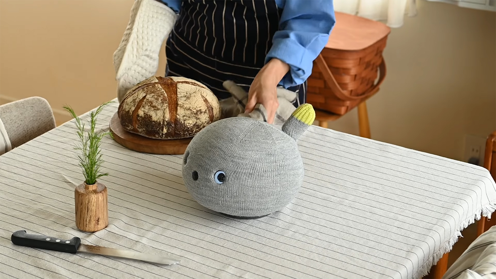
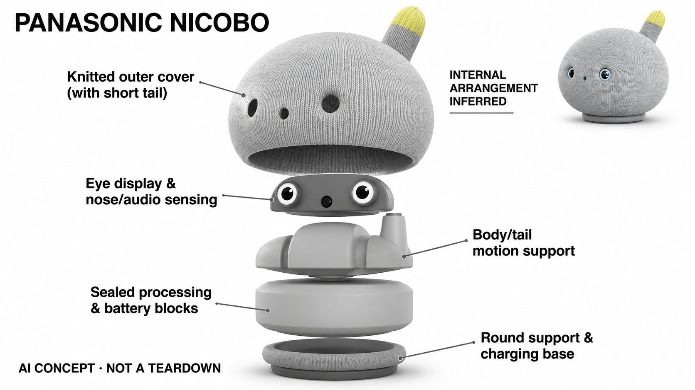

# Panasonic NICOBO

**Panasonic** · AI玩具 · 核查 2026-11-04

通过表情、触碰与有限语言形成轻量陪伴

消费渠道：个人零售。

## 产品图片与结构参考

### 产品图

Panasonic NICOBO · 官方产品图 · 来源：[Panasonic · 官方图片](<https://news.panasonic.com/jp/press/jn260304-3>) · [原始图片](<https://news.panasonic.com/uploads/tmg_block_page_image/file/38071/l-jn260304-3-1.jpg>)

### 参考图

Panasonic NICOBO · 官方参考图 · 来源：[Panasonic · 官方图片](<https://news.panasonic.com/jp/stories/14261>) · [原始图片](<https://news.panasonic.com/uploads/tmg_block_page_image/file/16506/image-2.jpg>)

### AI 生成爆炸示意

**AI 生成 · 非实物拆机。** 内部为概念推断，不能作为元件布局、BOM 或维修依据。[生成提示词](../../content/hardware/prompts/panasonic-nicobo.txt)

> 已目视核对外形、标签与非拆机声明；不代表内部结构经实测验证。

> 采用2026官方新闻图与2023官方同型号外观资料；没有使用企业专用版本或相近机器人替代。

> 分析为基于公开资料的案头研究与 AI 辅助判断，未经用户访谈、销量审计或实物拆机。需求、画像、竞争冷门度、审美及商业机会均为研究假设，不是投资结论。

## 销售与购买

- 状态：在售。Panasonic官方商店RW-NC1-H页面明确显示在库、60,500日元及加入购物车。本条不重复计颜色，不使用已失效的旧分期SKU。

- 地区：日本

- 价格：本体 ¥60,500；基本服务 ¥1,100/月起。日元含税日本官方方案；部分套餐有最低期限及提前终止条件，需按当前官方页面确认。

- 中国大陆：日本官方页面要求配套服务及账户，且说明不接受海外发行信用卡；未确认中国大陆官方销售与完整服务。

- [官方产品 / 商店](<https://ec-plus.panasonic.jp/store/ap/storeaez/a2A/ProductDetail?HB=RW-NC1-H>)

## AI 的实际作用

官方披露人脸与表情识别、声源和语音识别，以及影响行为的情感引擎；不是自由生成长篇回答的通用聊天机器人。

服务与联网依赖：基本服务要求网络、智能手机应用和月费；可理解的词语与行为范围有限，不能把简单复述等同通用语言理解。

## 是否冷门

细分专业（研究判断）：非移动、有限语言的软体陪伴定位较窄，长期照护与留存是关键。

## 需求与市场

需求假设：部分家庭希望有一个偶尔回应、可以触摸且不承担任务的同住物件，有限语言可能比持续聊天更容易接受。应观察日常互动与照护负担，不能把厂商用户感受当作医疗效果证据。

### 产品任务与边界 · 研究判断

NICOBO 以有限语言、触碰和摇动回应构成家庭陪伴，刻意不承担复杂任务。它适合研究人是否愿意与一个不擅长做事的物件相处，需求不应被解释为效率提升，也不能由用户感受直接推断健康改善。

依据：[NICOBO日本官方零售SKU](<https://ec-plus.panasonic.jp/store/ap/storeaez/a2A/ProductDetail?HB=RW-NC1-H>) · [NICOBO官方技术与使用](<https://ec-plus.panasonic.jp/store/page/NICOBO/>)

### 需求判断 · 研究判断

有限而可预测的回应可能比持续聊天更轻松，固定摆放也减少了移动照护。但用户是否愿意为这种低功能密度体验支付持续费用，需要长期观察；可爱和新奇能够引发购买，却不必然支持每天互动。

依据：[NICOBO日本官方零售SKU](<https://ec-plus.panasonic.jp/store/ap/storeaez/a2A/ProductDetail?HB=RW-NC1-H>) · [NICOBO官方技术与使用](<https://ec-plus.panasonic.jp/store/page/NICOBO/>)

### 需求验证 · 待验证

可记录触碰、抱起、主动说话和长期静置的比例，并询问用户最喜欢与最厌烦的具体行为。比较开放式聊天角色与 NICOBO 类有限回应，观察安静共处是否形成独立价值，而不是按回答丰富程度评价陪伴。

依据：[NICOBO日本官方零售SKU](<https://ec-plus.panasonic.jp/store/ap/storeaez/a2A/ProductDetail?HB=RW-NC1-H>) · [NICOBO官方技术与使用](<https://ec-plus.panasonic.jp/store/page/NICOBO/>)

## 用户画像

画像推断：偏好柔软针织外观、能够在室内固定摆放并接受月费的个人或家庭较匹配。它不能自主移动，也不面向户外使用，送礼前应确认使用者对有限语言和依赖照护的角色有兴趣。

### 适用行为与条件 · 研究判断

较匹配偏好针织触感、愿意在家中固定摆放并接受月费的个人或家庭。它不会自主移动，因此用户需要主动接近或拿起；送礼前应确认接收者喜欢这种需要照护的角色，而不是期待会跟随或解决问题的机器人。

依据：[NICOBO日本官方零售SKU](<https://ec-plus.panasonic.jp/store/ap/storeaez/a2A/ProductDetail?HB=RW-NC1-H>) · [NICOBO官方技术与使用](<https://ec-plus.panasonic.jp/store/page/NICOBO/>)

### 人群取舍 · 研究判断

对喜欢柔软物件的用户，触感可能比语言能力重要；对追求互动内容的人，有限词语可能很快显得重复。画像应围绕触碰、共处和语言期待划分，不能把所有不便养宠的人都当作同一种潜在用户。

依据：[NICOBO日本官方零售SKU](<https://ec-plus.panasonic.jp/store/ap/storeaez/a2A/ProductDetail?HB=RW-NC1-H>) · [NICOBO官方技术与使用](<https://ec-plus.panasonic.jp/store/page/NICOBO/>)

### 画像验证 · 待验证

画像验证可让用户选择摆放位置并自由使用数周，记录谁负责维护、何时主动抱持及何时嫌声音打扰。还需询问月费是否改变使用意愿，把体验偏好与长期支付承诺分开理解，避免只看免费试用时的喜爱。

依据：[NICOBO日本官方零售SKU](<https://ec-plus.panasonic.jp/store/ap/storeaez/a2A/ProductDetail?HB=RW-NC1-H>) · [NICOBO官方技术与使用](<https://ec-plus.panasonic.jp/store/page/NICOBO/>)

## 竞争与替代

竞争判断：非移动轻陪伴处于较窄市场，但普通毛绒、Moflin和其他电子宠物仍是替代。产品的“不擅长做事”可以形成角色定位，却不代表需求自动成立或没有长期闲置风险。

### 比较对象与差异 · 研究判断

NICOBO 与普通毛绒、Moflin 和其他电子宠物竞争，差异是针织外观、有限语言及行为状态。它不是通用聊天机器人的缩小版，比较应围绕触碰回应和日常共处，而不是把回答不够丰富直接认定为功能落后。

依据：[NICOBO日本官方零售SKU](<https://ec-plus.panasonic.jp/store/ap/storeaez/a2A/ProductDetail?HB=RW-NC1-H>) · [NICOBO官方技术与使用](<https://ec-plus.panasonic.jp/store/page/NICOBO/>)

### 竞争判断 · 研究判断

非移动轻陪伴属于较窄市场，但窄并不意味着缺少替代。普通玩偶没有联网和会费负担，智能音箱则提供更多工具功能；NICOBO 需要证明有限能力本身符合角色定位，而不是依赖用户容忍产品不足。

依据：[NICOBO日本官方零售SKU](<https://ec-plus.panasonic.jp/store/ap/storeaez/a2A/ProductDetail?HB=RW-NC1-H>) · [NICOBO官方技术与使用](<https://ec-plus.panasonic.jp/store/page/NICOBO/>)

### 竞争验证 · 待验证

可在相同家庭环境比较无电子毛绒、有限回应和开放对话三种方案，记录用户主动靠近及维护意愿。给出真实服务条件后再询问选择，确认消费者是否愿意为行为反馈承担持续成本，而非只喜欢短暂演示。

依据：[NICOBO日本官方零售SKU](<https://ec-plus.panasonic.jp/store/ap/storeaez/a2A/ProductDetail?HB=RW-NC1-H>) · [NICOBO官方技术与使用](<https://ec-plus.panasonic.jp/store/page/NICOBO/>)

## 供应链

供应链推断：针织外套、内部弹性结构、显示和音频感知需一起支持反复触碰。官方提供维护与织物更换服务，但未披露完整制造工厂及物料表；清洁、磨损和维修安排是持续成本。

### 功能模块拆分 · 研究判断

功能可拆为摄像、麦克风与惯性感知、人物和声音识别、行为状态、眼部显示以及摇动和声音反馈。针织外套与内部结构共同形成触感，公开资料未披露完整内部物料与制造工厂，不能据此还原具体机械布局。

依据：[NICOBO日本官方零售SKU](<https://ec-plus.panasonic.jp/store/ap/storeaez/a2A/ProductDetail?HB=RW-NC1-H>) · [NICOBO官方技术与使用](<https://ec-plus.panasonic.jp/store/page/NICOBO/>)

### 制造与供应约束 · 研究判断

制造约束是织物磨损、重复触碰、内部动作噪声和感知开孔之间的协调。官方维护与织物更换服务说明外表老化会影响持续体验，因此外套可维护性与备件供应应纳入设计，而不能只关注新品外观。

依据：[NICOBO日本官方零售SKU](<https://ec-plus.panasonic.jp/store/ap/storeaez/a2A/ProductDetail?HB=RW-NC1-H>) · [NICOBO官方技术与使用](<https://ec-plus.panasonic.jp/store/page/NICOBO/>)

### 候选与证据缺口 · 研究判断

歌尔可作为音频与感知交互工程候选，PCH 可协调织物、结构和消费产品导入。双方并无 NICOBO 点名供货证据；针织材料、摇动机构及长期维护需要具体样件验证，不能从综合服务范围推定已具备此产品制造经验。

依据：[NICOBO日本官方零售SKU](<https://ec-plus.panasonic.jp/store/ap/storeaez/a2A/ProductDetail?HB=RW-NC1-H>) · [NICOBO官方技术与使用](<https://ec-plus.panasonic.jp/store/page/NICOBO/>)

## 技术路径

官方说明人脸表情与语音识别，并用情感引擎形成行为变化。技术判断需要区分对熟悉词语的回应与开放生成对话，有限能力是否合适取决于角色预期，不能仅按模型规模评价。

### 已披露技术边界 · 研究判断

官方披露人脸表情、声源及语音识别，并通过情感引擎影响行为。这里的情感引擎是行为生成机制，不代表设备具有真实情感；有限词语回应也不应被扩展为开放式语言理解或自由生成长篇对话。

依据：[NICOBO日本官方零售SKU](<https://ec-plus.panasonic.jp/store/ap/storeaez/a2A/ProductDetail?HB=RW-NC1-H>) · [NICOBO官方技术与使用](<https://ec-plus.panasonic.jp/store/page/NICOBO/>)

### 系统难点判断 · 研究判断

系统难点在于让有限反馈仍然显得有变化且可理解。若状态过于随机，用户可能不知道为何不回应；若完全重复，又容易失去角色感，因此识别、行为选择和动作节奏需要共同支持一致而不过度承诺的性格。

依据：[NICOBO日本官方零售SKU](<https://ec-plus.panasonic.jp/store/ap/storeaez/a2A/ProductDetail?HB=RW-NC1-H>) · [NICOBO官方技术与使用](<https://ec-plus.panasonic.jp/store/page/NICOBO/>)

### 技术验证 · 待验证

技术验证应比较不同声音方向、触碰方式及表情条件下的回应，并记录重复行为与无响应原因。网络与应用依赖应单独测试，不能因为部分动作仍出现就认定全部功能离线可用，也不以拟人表现推断情绪识别可靠。

依据：[NICOBO日本官方零售SKU](<https://ec-plus.panasonic.jp/store/ap/storeaez/a2A/ProductDetail?HB=RW-NC1-H>) · [NICOBO官方技术与使用](<https://ec-plus.panasonic.jp/store/page/NICOBO/>)

## 产品审美

审美判断：圆形针织身体、短尾巴和双眼削弱了机械设备感，更接近可以抱起的居家物件。织物起球、触感和摇动节奏会直接影响长期观感，官网场景照不能代替实际触摸与声音体验。

### 外观与交互语言 · 研究判断

圆形针织身体、短尾巴和双眼削弱了机械感，使 NICOBO 更接近可以抱起的居家物件。其审美重点在柔软、温和和略显笨拙的角色表达，动作与声音需要符合这种形象，而不是追求复杂机器人的技术展示。

依据：[NICOBO日本官方零售SKU](<https://ec-plus.panasonic.jp/store/ap/storeaez/a2A/ProductDetail?HB=RW-NC1-H>) · [NICOBO官方技术与使用](<https://ec-plus.panasonic.jp/store/page/NICOBO/>)

### 使用中审美判断 · 研究判断

织物起球、污渍和维修后的触感会影响长期关系，产品设计不能停留在新品拍摄状态。固定摆放时的声音和摇动也可能放大或减弱亲近感，应把桌面材质和房间安静程度纳入审美与体验判断。

依据：[NICOBO日本官方零售SKU](<https://ec-plus.panasonic.jp/store/ap/storeaez/a2A/ProductDetail?HB=RW-NC1-H>) · [NICOBO官方技术与使用](<https://ec-plus.panasonic.jp/store/page/NICOBO/>)

### 设计验证 · 待验证

设计验证可让用户实际抱持、清洁并观察不同使用阶段的外套，记录是否因为磨损而减少互动。还应比较放在硬桌、软垫和床边的声音与稳定性，避免只依据官方温馨场景照判断所有家庭环境中的舒适程度。

依据：[NICOBO日本官方零售SKU](<https://ec-plus.panasonic.jp/store/ap/storeaez/a2A/ProductDetail?HB=RW-NC1-H>) · [NICOBO官方技术与使用](<https://ec-plus.panasonic.jp/store/page/NICOBO/>)

## 关键风险

风险判断：基本月费、维修和区域支付条件会改变拥有成本，摄像与语音用途也需按官方隐私说明理解。不能将陪伴或用户评价转述为心理治疗承诺，长期使用仍应保留真实人际互动。

### 主要失效与依赖 · 研究判断

风险来自基本服务费用、维修和区域支付条件，以及摄像与语音用途的理解差异。有限语言角色容易被赋予更深的理解能力，产品资料应保持边界，不能将陪伴评价或个人故事转化为心理治疗承诺。

依据：[NICOBO官方技术与使用](<https://ec-plus.panasonic.jp/store/page/NICOBO/>) · [NICOBO官方费用](<https://ec-plus.panasonic.jp/store/page/NICOBO/price/>)

### 风险传播判断 · 研究判断

如果用户把偶尔不回应理解为情绪而不是系统限制，拟人叙事可能暂时缓解故障感，也可能掩盖真实问题。长期服务应帮助用户区分角色行为、网络故障和维修需求，确保可爱表达不会妨碍正确照护设备。

依据：[NICOBO日本官方零售SKU](<https://ec-plus.panasonic.jp/store/ap/storeaez/a2A/ProductDetail?HB=RW-NC1-H>) · [NICOBO官方技术与使用](<https://ec-plus.panasonic.jp/store/page/NICOBO/>)

### 风险验证 · 待验证

风险验证应检查用户能否说明月费、织物维护和停服后的功能边界，并演练网络或设备异常处理。还需观察是否出现把设备当作唯一交流对象的误解，产品定位应支持日常陪伴而不是替代真实社会支持。

依据：[NICOBO日本官方零售SKU](<https://ec-plus.panasonic.jp/store/ap/storeaez/a2A/ProductDetail?HB=RW-NC1-H>) · [NICOBO官方技术与使用](<https://ec-plus.panasonic.jp/store/page/NICOBO/>)

## 机会与验证

市场观察：该产品有助于比较“有限而可预测的回应”和开放式对话两种陪伴路径。后续可记录用户喜欢与厌烦的具体行为、维护频次和静置时长，而不把可爱程度评分当作商业预测。

### 可能的机会入口 · 研究判断

机会可能在于有限而可信的非移动陪伴，以较低机械复杂度保留触碰和回应价值。新项目可以研究可解释状态和易清洁外观，避免把低功能密度等同低研发要求，因为长期角色体验仍需要细致调校。

依据：[NICOBO日本官方零售SKU](<https://ec-plus.panasonic.jp/store/ap/storeaez/a2A/ProductDetail?HB=RW-NC1-H>) · [NICOBO官方技术与使用](<https://ec-plus.panasonic.jp/store/page/NICOBO/>)

### 机会成立条件 · 研究判断

机会成立需要证明用户主动互动的持续性，并能接受产品不提供通用问答。若市场主要因为新奇或礼物属性购买，商业模式应与之匹配，而不能预设稳定订阅；长期维护成本也必须与用户愿付费用相协调。

依据：[NICOBO日本官方零售SKU](<https://ec-plus.panasonic.jp/store/ap/storeaez/a2A/ProductDetail?HB=RW-NC1-H>) · [NICOBO官方技术与使用](<https://ec-plus.panasonic.jp/store/page/NICOBO/>)

### 下一步验证 · 待验证

下一步可用有限行为原型比较不同触感、声音和回应节奏，记录数周后保留的互动。先确定哪些简单反馈真正被喜欢，再考虑联网或更复杂内容，避免用功能扩张替代对共处体验和维护负担的验证。

依据：[NICOBO日本官方零售SKU](<https://ec-plus.panasonic.jp/store/ap/storeaez/a2A/ProductDetail?HB=RW-NC1-H>) · [NICOBO官方技术与使用](<https://ec-plus.panasonic.jp/store/page/NICOBO/>)

## 对应供应链公司

能力候选用于选型研究，不代表本产品实际采用；未公开的供货关系不作推断。

- [goertek](../supply-chain/goertek.md) — **能力候选 · 非已采用** / 柔软陪伴设备的声音与感知整合：歌尔声学与交互硬件能力可用于研究针织外观对收音、发声和小型传感系统的影响，但柔软结构和角色行为需要专门设计；没有 NICOBO 点名合作证据，候选不代表真实供货。

- [pch-international](../supply-chain/pch-international.md) — **能力候选 · 非已采用** / 织物与机电消费产品导入：PCH 的产品开发、采购和制造管理适合协调织物外套、内部结构及长期维护流程，但需要确认具体团队与材料验证能力；公开资料未披露其参与 NICOBO，因此仅作为供应协同候选。

[浏览供应链目录](../supply-chain.md)

## 功能分层示意

这是功能关系，不是实物拆机、真实空间结构或已核实 BOM。

1. **感知输入**：摄像、麦克风与惯性传感器。（官方披露）

2. **识别判断**：人脸表情、语言和声源识别。（官方披露）

3. **行为引擎**：官方情感引擎影响回应状态。（官方披露）

4. **柔性反馈**：眼部显示、声音和摇动结构。（官方披露）

## 来源

1. [NICOBO日本官方零售SKU](<https://ec-plus.panasonic.jp/store/ap/storeaez/a2A/ProductDetail?HB=RW-NC1-H>) — 已打开，明确在库和购物车入口。

2. [NICOBO官方技术与使用](<https://ec-plus.panasonic.jp/store/page/NICOBO/>) — 已打开；对用户评价不作效果推断。

3. [NICOBO官方费用](<https://ec-plus.panasonic.jp/store/page/NICOBO/price/>) — 已打开，硬件与服务费用明确区分。

[返回目录](../hardware-market.md) · [网页分析](https://romanagent.github.io/Roman/#hardware/product/panasonic-nicobo)
