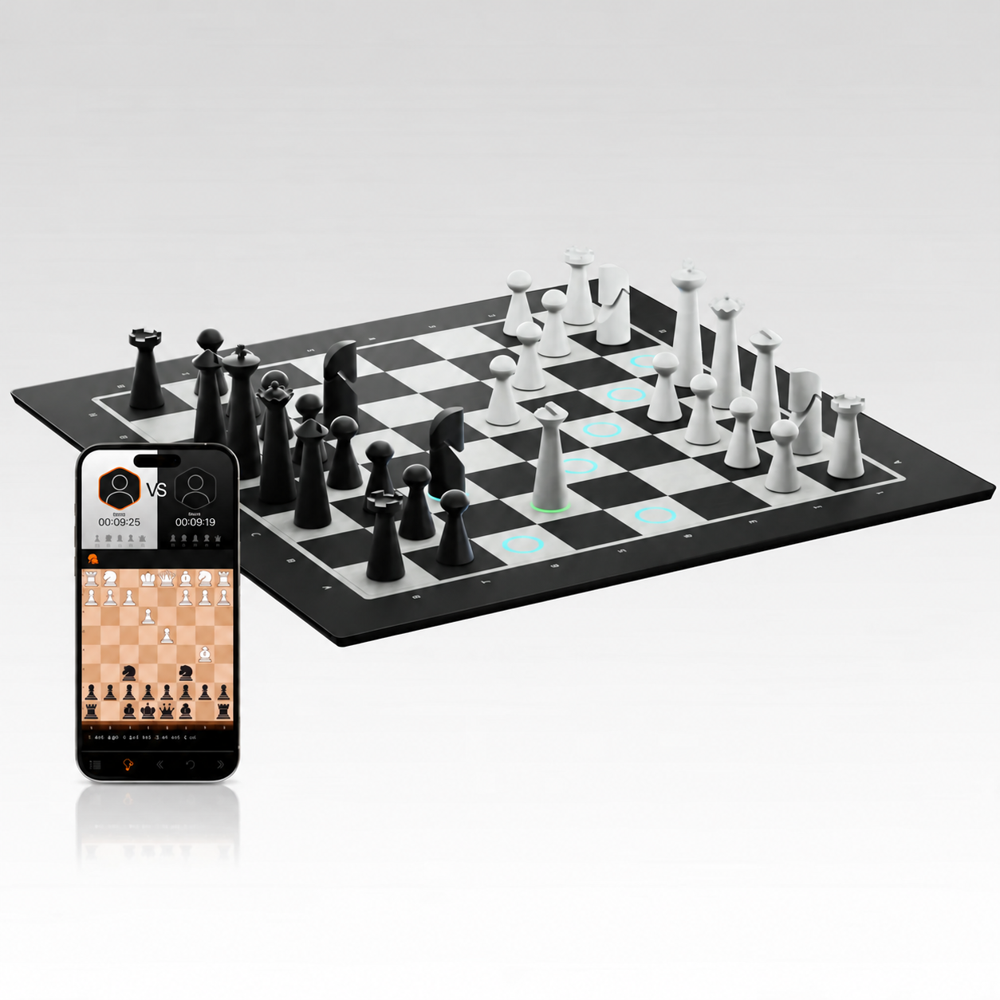
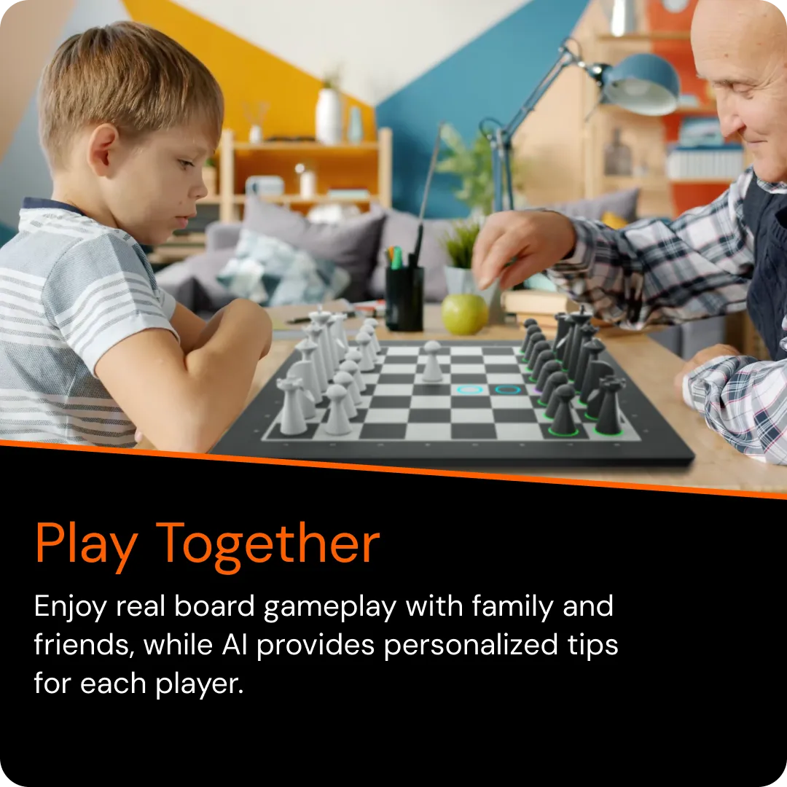
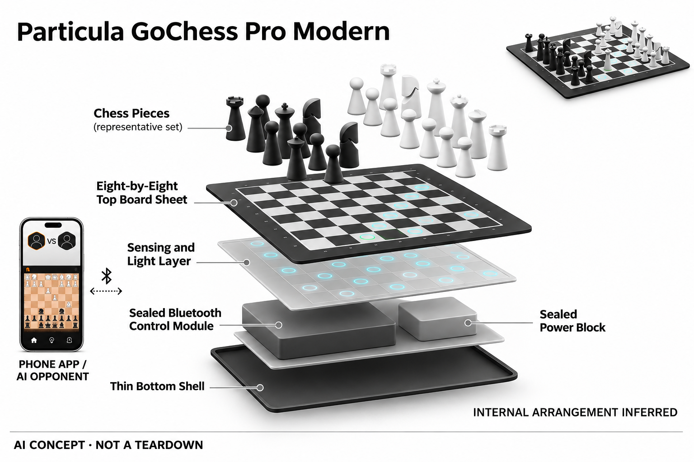

# Particula GoChess Pro Modern

**Particula** · 游戏与桌游 · 核查 2026-11-04

将应用棋力提示投射到实体棋盘

消费渠道：个人零售。

## 产品图片与结构参考

### 产品图

Particula GoChess Pro Modern · 官方产品图 · 来源：[Particula · 官方图片](<https://particula-tech.com/products/gochess-lite-modern>) · [原始图片](<https://particula-tech.com/cdn/shop/files/lite_modern.png?v=1791453741&width=1946>)

### 参考图

Particula GoChess Pro Modern · 官方参考图 · 来源：[Particula · 官方图片](<https://particula-tech.com/products/gochess-lite-modern>) · [原始图片](<https://particula-tech.com/cdn/shop/files/5.1version_58051c84-36d3-4c56-9179-bf7164132336.webp?v=1776162929&width=1946>)

### AI 生成爆炸示意

**AI 生成 · 非实物拆机。** 内部为概念推断，不能作为元件布局、BOM 或维修依据。[生成提示词](../../content/hardware/prompts/particula-gochess-pro.txt)

> 分析为基于公开资料的案头研究与 AI 辅助判断，未经用户访谈、销量审计或实物拆机。需求、画像、竞争冷门度、审美及商业机会均为研究假设，不是投资结论。

## 销售与购买

- 状态：在售。官方商品页提供Add to cart；当前名称Pro Modern，官网明确旧包装Lite Modern是同一GCHSN1-LITEM棋盘，因此只计一次。

- 地区：所列官方国际商店

- 价格：官网 US$299.95；Pro续费另计。核查日页面快照；运费、税费、会员和配送区域按官方结算确认，不视为中国到手价。

- 中国大陆：本轮核实所列区域官方商店；未确认中国大陆官方现货、账户及完整服务，不把境外可购等同大陆可用。

- [官方产品 / 商店](<https://particula-tech.com/products/gochess-lite-modern>)

## AI 的实际作用

配套应用提供AI对手、走法提示和失误提醒，并通过实体格位灯光显示；不是只有远程联机功能的蓝牙棋盘。

服务与联网依赖：棋盘通过蓝牙连接手机，手机承担应用和联网；首年Pro权益与后续按年付费续订需区分，部分基础功能免费。

## 是否冷门

细分专业（研究判断）：同一棋盘新旧名称不重复计数形成具体使用场景；本轮没有销量与市场份额证据。

## 需求与市场

需求假设：已有手机的棋手希望保留实体对弈触感，又能随时查看好走法和失误提醒。应验证灯光是否减少切屏，而不是让连接手机、支架和账户步骤增加了开始下棋的阻力。

### 需求假设：使用手机AI仍保留实体棋子触感 · 研究判断

GoChess Pro Modern把手机应用对手和建议映射到实体格位灯光，针对想在棋盘上下棋又希望随时获得帮助的人。需求应验证是否减少查屏和录入，不是棋盘连上蓝牙就有价值，也不能把应用AI强度当作实体硬件溢价已经成立。

依据：[GoChess Pro Modern官方商店](<https://particula-tech.com/products/gochess-lite-modern>) · [GoChess官方系列能力](<https://particula-tech.com/pages/gochess>)

### 价值判断：灯光减少切屏也增加连接准备 · 研究判断

手机承担应用与联网，棋盘把操作和提示放回桌面，用户既获得实体反馈，也需要配对与账户管理。研究应比较一局前后总步骤，不能只看亮灯即时，也不将提示帮助赢棋解释为策略理解或长期学习效果。

依据：[GoChess Pro Modern官方商店](<https://particula-tech.com/products/gochess-lite-modern>) · [GoChess官方系列能力](<https://particula-tech.com/pages/gochess>)

### 验证方案：与普通棋盘加手机完成相同任务 · 待验证

让家庭棋迷完成一局人机和一组训练，记录配对、查屏、落子、提示与断连恢复，再比较原有方案。保持学习或娱乐目标一致，不以设备分数和胜负判断价值，也不把一次互动演示的流畅度当作长期使用证据。

依据：[GoChess Pro Modern官方商店](<https://particula-tech.com/products/gochess-lite-modern>) · [GoChess官方系列能力](<https://particula-tech.com/pages/gochess>)

## 用户画像

画像推断：愿意使用配套应用并接受会员管理的家庭棋迷较匹配，面对面练习与线上比赛可能交替发生。若希望完全脱离手机，则需要提前理解本款的蓝牙和应用依赖。

### 画像假设：接受应用与会员管理的实体棋迷 · 研究判断

较匹配者已有合适手机，愿意通过应用组织对局和分析，又不想完全放弃实体棋子。希望彻底脱离手机的人需要不同方案，画像应按连接习惯与辅助需求区分，不把所有家庭棋迷视为同一市场，也不以Pro名称推断适合强棋手。

依据：[GoChess Pro Modern官方商店](<https://particula-tech.com/products/gochess-lite-modern>) · [GoChess官方系列能力](<https://particula-tech.com/pages/gochess>)

### 使用约束：面对面与线上训练的规则不同 · 研究判断

用户可能在家庭练习与线上对局之间切换，辅助强度、账户和平台条件需要理解，不能把所有提示默认用于每种场合。研究应了解谁设置手机和会员，儿童使用时也要区分购买者与实际操作者，不从套件照片推断手机与全部权益包含。

依据：[GoChess Pro Modern官方商店](<https://particula-tech.com/products/gochess-lite-modern>)

### 访谈重点：真正愿意为哪项提示持续付费 · 待验证

请用户展示一条实际采用的建议或失误提醒，说明为何比免费应用更方便，再询问哪些高级功能从未使用。这样能区分灯光映射、棋力与服务价值，不能把首年赠送权益被试用当作续费意愿，也不只问是否喜欢智能棋盘。

依据：[GoChess Pro Modern官方商店](<https://particula-tech.com/products/gochess-lite-modern>) · [GoChess官方系列能力](<https://particula-tech.com/pages/gochess>)

## 竞争与替代

竞争判断：电子棋盘与免费棋类应用的组合十分常见，AI对手本身不构成稀缺能力。GoChess的区别是提示灯映射与整合体验，会员价值应按实际使用功能评估，而非按品牌命名推断升级。

### 替代方案：发光棋盘与免费棋类应用 · 研究判断

GoChess与其他电子棋盘、普通棋盘加手机和独立棋机竞争，AI对手和合法走法并非稀缺能力。差异在格位提示与应用整合，比较应围绕开局、录入和查看，不因低曝光就推断无竞争，也不把现代外观当作训练结果。

依据：[GoChess Pro Modern官方商店](<https://particula-tech.com/products/gochess-lite-modern>) · [GoChess官方系列能力](<https://particula-tech.com/pages/gochess>)

### 差异判断：应用依赖换来可扩展服务 · 研究判断

手机承担分析与连接，可能让软件更新更灵活，也使系统、蓝牙和账户成为持续依赖，不能只看棋盘本体。研究应比较基础与Pro功能实际使用，不能将首年权益与后续收费混为一谈，也不把旧Lite包装另算一款创新硬件。

依据：[GoChess Pro Modern官方商店](<https://particula-tech.com/products/gochess-lite-modern>)

### 比较方法：从连接到复盘全部计入 · 待验证

让用户用相同手机和棋谱任务比较GoChess与原方案，记录配对、局面纠正、建议查看及后续复盘，保持辅助规则一致。不要只统计灯光正确亮起，也不把应用分析速度当作全部体验，实际是否少切屏和少中断才是关键。

依据：[GoChess Pro Modern官方商店](<https://particula-tech.com/products/gochess-lite-modern>) · [GoChess官方系列能力](<https://particula-tech.com/pages/gochess>)

## 供应链

供应链推断：薄型格位传感与灯光需要兼顾平整、续航和棋子识别，手机兼容维护同样影响交付。官方未披露完整工厂和物料表；新旧包装名称统一和配件补购也关系售后清晰度。

### 功能拆分：传感棋盘与手机推理分离 · 研究判断

公开结构由棋盘记录实体移动，经蓝牙传到应用，再把对手走法和建议映射为灯光，手机承担应用与联网。不能把应用侧推理全部写成棋盘离线能力，也不能将自动亮灯画成棋子自行移动，具体芯片、感知和工厂未披露。

依据：[GoChess Pro Modern官方商店](<https://particula-tech.com/products/gochess-lite-modern>) · [GoChess官方系列能力](<https://particula-tech.com/pages/gochess>)

### 制造判断：薄型格位与灯光需要一致 · 研究判断

棋盘平整、传感和提示映射要与实际局面对应，电源与手机兼容维护也影响长期交付，配件丢失和包装命名会影响售后。供应评估不能只看轻薄外观，本轮没有装配、校准或寿命测试，不推算原机BOM与制造良率。

依据：[GoChess Pro Modern官方商店](<https://particula-tech.com/products/gochess-lite-modern>)

### 候选选型：感知灯光板与便携供电分开 · 研究判断

JLCPCB可作为按设计文件制造棋盘控制板的候选，Sunwoda可讨论紧凑电源，具体传感、蓝牙和软件同步需项目验证。两家没有Particula点名采用证据，也不提供现成GoChess应用或棋力服务，不能把候选组件当作兼容替换方案。

依据：[GoChess Pro Modern官方商店](<https://particula-tech.com/products/gochess-lite-modern>) · [GoChess官方系列能力](<https://particula-tech.com/pages/gochess>)

## 技术路径

官方说明应用提供AI难度与提示，蓝牙棋盘借助手机联网。技术判断应分别测试传感、蓝牙断连和建议展示，不把应用侧推理全部写成棋盘端侧能力，也不把自动亮灯误作自动移动棋子。

### 已披露能力：应用对手与失误提示映射到格位 · 官方资料

官方说明应用提供AI难度、建议和失误提醒，实体棋盘负责输入与灯光，蓝牙连接手机完成完整流程。它不是只有远程联机，但也不是所有推理都在棋盘端，更不具备本条未披露的自动走子机构，能力必须按当前应用权益理解。

依据：[GoChess Pro Modern官方商店](<https://particula-tech.com/products/gochess-lite-modern>) · [GoChess官方系列能力](<https://particula-tech.com/pages/gochess>)

### 技术判断：传感、连接与建议需要分别检查 · 研究判断

如果落子没有同步或蓝牙中断，应用可能面对不一致局面，即使引擎正确也无法给出合适桌面反馈。研究应先确认输入与状态，再评价建议，不能只看正常演示，也不将提示颜色直观等同用户理解了走法原因。

依据：[GoChess官方系列能力](<https://particula-tech.com/pages/gochess>)

### 验证方案：检查局面修正和连接恢复 · 待验证

在支持模式下记录配对、落子、悔棋、正常断连与重新同步，观察用户能否理解当前局面和权限变化。不要把高级提示用于不允许辅助的对局，也不以一局胜负验证教学，本轮没有独立识别、连接可靠性或学习效果测试。

依据：[GoChess Pro Modern官方商店](<https://particula-tech.com/products/gochess-lite-modern>) · [GoChess官方系列能力](<https://particula-tech.com/pages/gochess>)

## 产品审美

审美判断：现代黑白棋盘和轻薄轮廓便于融入家庭桌面，彩色提示增加训练工具感。手机支架与线缆会改变最终布局，真实摆放是否整洁需要把辅助设备一同纳入观察。

### 外形判断：现代棋盘仍需包括手机布局 · 研究判断

黑白棋盘与轻薄轮廓容易融入桌面，彩色格位又增加训练工具感，但手机支架和充电会改变实际摆放。设计评价应包含双人视角、灯光和收纳，不只看裸棋盘照片，也不能将现代外观当作所有家庭都愿意长期使用的证据。

依据：[GoChess Pro Modern官方商店](<https://particula-tech.com/products/gochess-lite-modern>)

### 交互判断：灯光与手机界面应说明同一状态 · 研究判断

用户需要知道灯光代表对手走法、合法选择还是失误，手机也应与实体局面一致，否则减少切屏的目标可能落空。研究应观察误解和反复确认，不把更多提示颜色当作更好，也不以应用功能丰富掩盖连接准备。

依据：[GoChess Pro Modern官方商店](<https://particula-tech.com/products/gochess-lite-modern>) · [GoChess官方系列能力](<https://particula-tech.com/pages/gochess>)

### 体验验证：从取出手机到完整家庭对局 · 待验证

让用户按日常方式布置棋盘、手机和配件，完成配对、下棋、复盘与收纳，记录需要查说明和恢复的步骤。不要只演示几步亮灯，真实中断和家庭共享更能说明组合是否方便，也能比较独立棋机与手机路径的取舍。

依据：[GoChess Pro Modern官方商店](<https://particula-tech.com/products/gochess-lite-modern>) · [GoChess官方系列能力](<https://particula-tech.com/pages/gochess>)

## 关键风险

风险判断：Pro方案首年后自动续订，部分高级提示和平台集成受会员影响，购买硬件不代表全部功能永久免费。旧包装标Lite并非另一款产品，二手购买还应核对账户与权益转移。

### 学习与公平风险：提示需要场景边界 · 研究判断

建议与失误提醒可能让用户依赖推荐，不能把更少错误视为独立理解，线上或正式对局也需遵守相应辅助规则。目录不提供学习效果保证，本轮没有教学测试，AI对手能力与用户棋力、长期兴趣之间不能直接画等号。

依据：[GoChess Pro Modern官方商店](<https://particula-tech.com/products/gochess-lite-modern>) · [GoChess官方系列能力](<https://particula-tech.com/pages/gochess>)

### 服务风险：首年与续订权益不能混用 · 研究判断

原目录注明Pro首年后存在按年续订，部分高级提示和集成受会员影响，硬件购买不代表全部功能永久免费。旧包装标Lite不另计型号，二手或地区购买还需核对账户权益，不能由当前名称推断旧设备自动获得相同服务。

依据：[GoChess Pro Modern官方商店](<https://particula-tech.com/products/gochess-lite-modern>)

### 验证安排：记录基础功能与停订选择 · 待验证

试用应观察用户只用免费功能、不看提示、断连后放弃或不愿续费的原因，区分连接和服务价值。不要只统计首年权益消耗，也不将不续订解释为没有棋类需求，真实愿意持续付费的具体功能才是产品需要证明的部分。

依据：[GoChess Pro Modern官方商店](<https://particula-tech.com/products/gochess-lite-modern>) · [GoChess官方系列能力](<https://particula-tech.com/pages/gochess>)

## 机会与验证

市场观察：值得测量的是用户愿意持续为哪一种具体训练辅助付费，而非把所有AI提示混在一起。可记录免费与会员功能使用比例、断连次数和续费理由，避免由订阅价格反推市场规模。

### 研究方向：实体灯光是否比手机提示少一步 · 研究判断

GoChess可帮助研究用户是否愿意为格位映射和实体触感购买连接棋盘，机会可能在配对、恢复与解释，而不是更强引擎。应先确认普通应用路径的具体摩擦，避免把蓝牙与AI叠加当作独立市场，也不以会员名称代替价值说明。

依据：[GoChess官方系列能力](<https://particula-tech.com/pages/gochess>)

### 执行计划：分别观察免费和Pro功能使用 · 待验证

连续记录开局、配对、提示采用、断连与续费理由，访谈一次选择不用高级功能的对局，比较原手机方案。将实体交互和服务器服务分开，不用首年试用、品牌评价或灯光演示代表留存，也不将验证计划冒充用户访谈结果。

依据：[GoChess Pro Modern官方商店](<https://particula-tech.com/products/gochess-lite-modern>) · [GoChess官方系列能力](<https://particula-tech.com/pages/gochess>)

### 决策边界：辅助棋盘共享任务下比较依赖路径 · 研究判断

本款与ChessUp等共享实体对弈提示需求，手机依赖、灯光和会员是具体差异，不能按每个包装名称制造新市场。当前没有访谈、销量和供应报价，不以功能数量、订阅价格或模型评分预测创业成功，应看重复开局与理解成本。

依据：[GoChess Pro Modern官方商店](<https://particula-tech.com/products/gochess-lite-modern>) · [GoChess官方系列能力](<https://particula-tech.com/pages/gochess>)

## 对应供应链公司

能力候选用于选型研究，不代表本产品实际采用；未公开的供货关系不作推断。

- [jlcpcb](../supply-chain/jlcpcb.md) — **能力候选 · 非已采用** / 薄型棋盘感知与灯光板原型候选：JLCPCB公开PCB与PCBA流程，可作为GoChess同类感知灯光板按设计制造的候选，但原机传感机制、蓝牙同步和校准未披露，需要开发者专项设计，不提供现成智能棋盘。当前没有Particula真实BOM或实际代工证据。

- [sunwoda](../supply-chain/sunwoda.md) — **能力候选 · 非已采用** / 连接棋盘便携电源候选：Sunwoda消费电池业务可用于讨论GoChess薄型棋盘供电，但灯光、连接、空间与充电保护需按实际设计验证，不能从电芯指标推算整机对局时长。当前没有原机电池采用证据，也不保证通用电芯兼容，手机和会员依赖仍单独存在。

[浏览供应链目录](../supply-chain.md)

## 功能分层示意

这是功能关系，不是实物拆机、真实空间结构或已核实 BOM。

1. **棋盘输入**：传感棋盘记录实体棋子移动。（官方披露）

2. **手机连接**：蓝牙将操作传入GoChess应用。（官方披露）

3. **AI训练**：应用提供棋力、提示与失误判断。（官方披露）

4. **灯光反馈**：格位灯显示建议和对手走法。（官方披露）

## 来源

1. [GoChess Pro Modern官方商店](<https://particula-tech.com/products/gochess-lite-modern>) — 已实际打开官方页面；功能说明不等于独立性能测量。

2. [GoChess官方系列能力](<https://particula-tech.com/pages/gochess>) — 已实际打开官方页面；功能说明不等于独立性能测量。

[返回目录](../hardware-market.md) · [网页分析](https://romanagent.github.io/Roman/#hardware/product/particula-gochess-pro)
