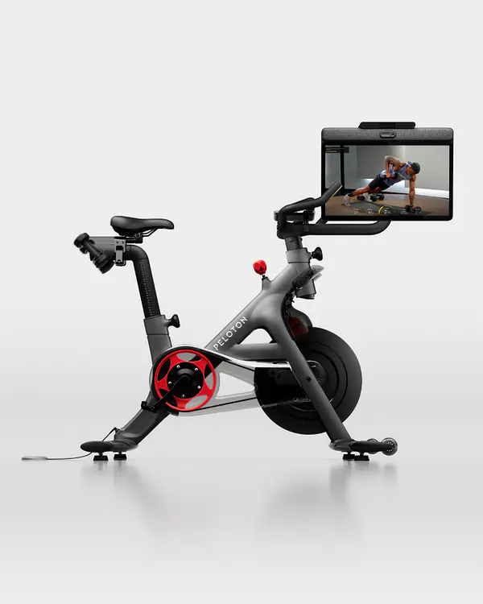
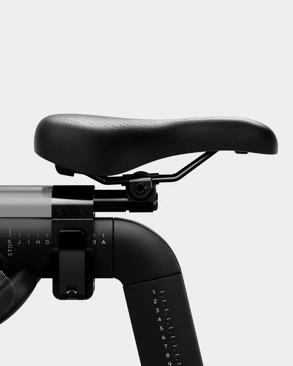
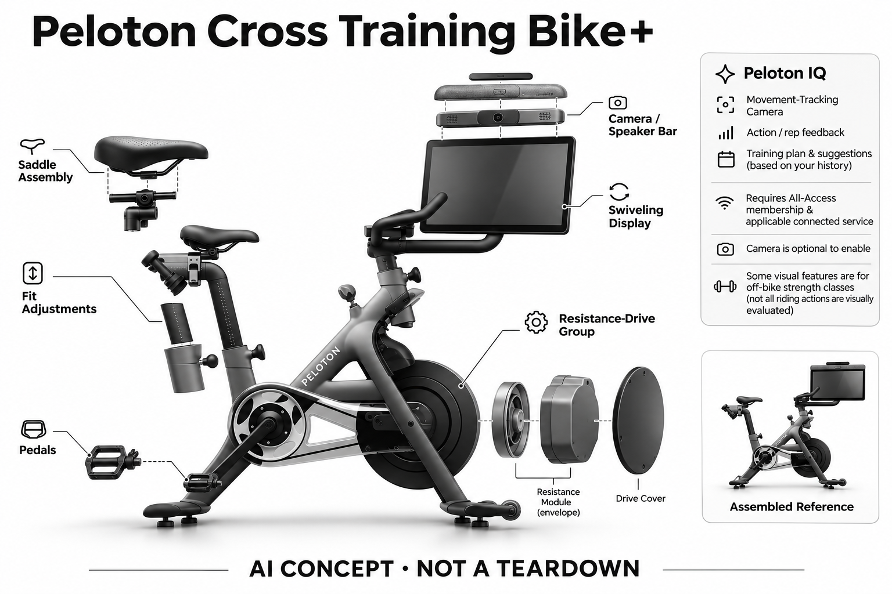

# Peloton Cross Training Bike+

**Peloton** · 运动与训练 · 核查 2026-11-04

专用骑行器械与Peloton IQ视觉训练反馈

消费渠道：个人零售。

## 产品图片与结构参考

### 产品图

Peloton Cross Training Bike+官方产品外形图 · 来源：[Peloton · 官方产品图片](<https://www.onepeloton.com/shop/bike-plus>) · [原始图片](<https://images.onepeloton.com/peloton-cycle/image/fetch/dpr_1.0,f_auto,q_auto:good,w_600/https://images.ctfassets.net/7vk8puwnesgc/3i8Dcj5Gj667VfYi2B41KV/ce1565850af3ae2da891a95983f428c0/Bike__Render1.png>)

### 参考图

Peloton Cross Training Bike+官方另一角度或使用场景参考 · 来源：[Peloton · 官方产品图片](<https://www.onepeloton.com/shop/bike-plus>) · [原始图片](<https://images.onepeloton.com/peloton-cycle/image/fetch/dpr_1.0,f_auto,q_auto:good,w_600/https://images.ctfassets.net/7vk8puwnesgc/43xDJMCazwVlxQ2ihS8UZ7/827f563512d423a4a1775da9291cce0a/Bike__Render3.png>)

### AI 生成爆炸示意

**AI 生成 · 非实物拆机。** 内部为概念推断，不能作为元件布局、BOM 或维修依据。[生成提示词](../../content/hardware/prompts/peloton-cross-training-bike-plus.txt)

> 外形依据核验参考图；内部位置、模块形状与装配关系仅作AI概念展示。

> 已逐张查看并核对型号。源图未改色/裁切；场景、界面、附件、优惠及效果文案仅为厂商示意，不作为本目录性能或现价依据。

> 分析为基于公开资料的案头研究与 AI 辅助判断，未经用户访谈、销量审计或实物拆机。需求、画像、竞争冷门度、审美及商业机会均为研究假设，不是投资结论。

## 销售与购买

- 状态：在售。已打开该具体型号官方购买页，显示型号、美元价与Add to cart；未将翻新Original系列、商业Pro设备或其他机械类型混为同一产品。

- 地区：美国官方销售地区（具体配送地址结算确认）

- 价格：US$2,695。美国官方硬件价；All-Access会员另计。Tread+ Vision另列必需安装费，其他送装与税费按订单确认。

- 中国大陆：本次核实海外官方渠道，未确认同型号中国大陆官方销售、安装和完整软件服务。支持中文或品牌来自中国均不等同大陆可购买。

- [官方产品 / 商店](<https://www.onepeloton.com/shop/bike-plus>)

## AI 的实际作用

Peloton IQ利用Movement-Tracking Camera进行动作/次数反馈，并结合个人历史生成训练计划与建议。

服务与联网依赖：需要All-Access会员及适用联网服务；摄像头是可选启用功能。部分视觉功能用于离机力量课，不等于所有骑行动作都有视觉评估。

## 是否冷门

竞争密集（研究判断）：依据用途与替代品的案头分类；不是销量、市场份额或用户访谈结论。

## 需求与市场

需求假设：在骑行和离车力量课之间切换时，希望训练记录和动作反馈保持连续。真正应验证的是反馈是否准确、是否能帮助完成当次训练，而不是把更丰富的数据界面自动视为更好的体能结果。

### 需求假设：骑行与离车训练之间少做切换 · 研究判断

Cross Training Bike+的具体任务是让室内骑行和地面力量课在同一账户与区域中连续进行，用户不想每次重新找课程和记录。视觉反馈的价值需要落到离车动作，不能把摄像头存在说成所有踩踏都被分析，也不默认所有骑行者都想交叉训练。

依据：[Peloton Cross Training Bike+官方购买页](<https://www.onepeloton.com/shop/bike-plus>) · [Peloton Cross Training Bike+官方说明](<https://www.onepeloton.com/bike-plus>) · [Peloton IQ官方功能边界](<https://www.onepeloton.com/peloton-iq>)

### 价值判断：课程连续与动作反馈分开 · 研究判断

统一平台可以让用户知道下一项训练，而摄像反馈处理的是支持动作中的次数与表现，两者可能各有收益。应分别记录课程衔接和提示使用，不把更多数据等同体能提升，也不能因为设备叫跨训练就认为用户会改变原有运动偏好。

依据：[Peloton IQ官方功能边界](<https://www.onepeloton.com/peloton-iq>)

### 验证方案：观察一次完整跨训练安排 · 待验证

让已有骑行习惯的人完成骑行加离车课程，记录下车、转屏、布置地面与开启反馈的步骤，再与普通单车加手机课程比较。保持原有任务和强度安排，访谈哪些步骤减少或增加负担，不以短期成绩证明视觉系统效果。

依据：[Peloton Cross Training Bike+官方购买页](<https://www.onepeloton.com/shop/bike-plus>) · [Peloton Cross Training Bike+官方说明](<https://www.onepeloton.com/bike-plus>)

## 用户画像

画像推断：已有室内骑行习惯、愿意持续订阅课程并安排离车训练空间的人更匹配。偶发锻炼者未必需要专用联网器械；家庭成员的身高、动作习惯和课程偏好不同，不能用单一宣传场景覆盖所有消费者。

### 画像假设：同时需要骑行与地面课程 · 研究判断

较匹配者不仅愿意订阅骑行内容，还已经有或希望建立离车训练安排，并能留出相应活动区域。只想稳定骑车的人可能很少使用摄像反馈，画像应区分两种任务频率，不把所有Peloton用户或所有家庭运动者视作同一需求。

依据：[Peloton Cross Training Bike+官方购买页](<https://www.onepeloton.com/shop/bike-plus>) · [Peloton IQ官方功能边界](<https://www.onepeloton.com/peloton-iq>)

### 使用约束：家庭共享涉及不同偏好 · 研究判断

家庭成员可能身高、课程兴趣和数据接受程度不同，统一设备并不意味着每个人愿意启用摄像头。研究应了解账户切换、机械调整和摄像权限由谁管理，不能只看主购买者的偏好，也不把可选启用理解为所有人默认愿意被观察。

依据：[Peloton Cross Training Bike+官方说明](<https://www.onepeloton.com/bike-plus>) · [Peloton IQ官方功能边界](<https://www.onepeloton.com/peloton-iq>)

### 访谈重点：为何会跳过离车部分 · 待验证

请用户回忆原计划中哪些地面训练被跳过，原因是没有空间、时间不足、不理解动作还是不喜欢切换。再观察Bike+是否改变这些具体阻碍，避免把交叉训练意愿当作已存在行为，也能识别摄像反馈实际上对哪些人有用。

依据：[Peloton Cross Training Bike+官方说明](<https://www.onepeloton.com/bike-plus>) · [Peloton IQ官方功能边界](<https://www.onepeloton.com/peloton-iq>)

## 竞争与替代

案头判断：与传统骑行器械、普通课程屏和同类联网健身平台竞争，属于已有强替代的家庭健身方向。没有用户访谈、销量或留存证据，因此不将平台知名度当作该型号需求已验证。

### 替代方案：单车与独立课程屏组合 · 研究判断

Cross Training Bike+与普通室内单车、平板课程及其他联网训练平台竞争，用户可以通过多个设备完成类似任务。其差异在一体化记录与可转屏交互，但也有会员和平台依赖，比较不能只看AI功能，而应覆盖课程衔接和家庭空间。

依据：[Peloton Cross Training Bike+官方购买页](<https://www.onepeloton.com/shop/bike-plus>) · [Peloton Cross Training Bike+官方说明](<https://www.onepeloton.com/bike-plus>)

### 差异判断：旋转屏与视觉功能需同时被用 · 研究判断

可转动显示让离车观看更方便，支持的视觉反馈又为部分动作增加信息，如果用户始终只骑行，二者增益可能有限。应观察真实功能组合而非购买时的预期，不以平台知名度或历史用户数证明这个具体型号的新增需求。

依据：[Peloton Cross Training Bike+官方说明](<https://www.onepeloton.com/bike-plus>) · [Peloton IQ官方功能边界](<https://www.onepeloton.com/peloton-iq>)

### 比较方法：计算换场景的全部步骤 · 待验证

用相同训练安排对比一体机与分开设备，记录调整屏幕、切换账户、寻找课程和整理地面空间的时间。将反馈误判和用户主动关闭的情况一并评价，不用一次新功能演示的顺畅程度替代日常跨训练的实际流程。

依据：[Peloton Cross Training Bike+官方说明](<https://www.onepeloton.com/bike-plus>) · [Peloton IQ官方功能边界](<https://www.onepeloton.com/peloton-iq>)

## 供应链

官方可以核对车架、飞轮/阻力机构与旋转显示屏，具体电机、相机、屏幕供应商与整机工厂未公开。推断交付质量还涉及装配、维护与会员软件，不能只凭硬件售价推算制造成本。

### 功能拆分：骑行机械与离车视觉并行 · 研究判断

公开结构包含车架、飞轮和阻力机构、旋转显示、运动数据以及可选摄像反馈，账户课程处于服务层。视觉AI不是飞轮或普通阻力调节本身，不能将两者混称；具体相机、屏幕、运动部件与整机工厂未披露，功能图不构成真实物料表。

依据：[Peloton Cross Training Bike+官方说明](<https://www.onepeloton.com/bike-plus>) · [Peloton IQ官方功能边界](<https://www.onepeloton.com/peloton-iq>)

### 制造判断：旋转显示改变多姿态使用 · 研究判断

同一屏幕既服务骑行又服务地面课程，转轴、线缆、观看角度和摄像覆盖需要协同，车架稳定与安装又是另一组要求。供应评估应包含多姿态和家庭共享，不只看屏幕像素，本轮没有装配、疲劳或长期可靠性数据可证明效果。

依据：[Peloton Cross Training Bike+官方说明](<https://www.onepeloton.com/bike-plus>)

### 候选选型：显示与视觉输入明确分层 · 研究判断

BOE可作为显示能力候选，Arducam可讨论摄像输入与接口，瑞声可询问屏幕旋转周边结构，均需按设备尺寸与使用姿态确认。它们没有被点名为Bike+供应商，显示或摄像模组经验也不能替代骑行机械与训练功能验证。

依据：[Peloton Cross Training Bike+官方说明](<https://www.onepeloton.com/bike-plus>) · [Peloton IQ官方功能边界](<https://www.onepeloton.com/peloton-iq>)

## 技术路径

可确认AI是Peloton IQ的视觉动作反馈与个性化建议，普通自动阻力或自动坡度本身不单独算AI。具体模型与识别误差未完整披露，视觉指导适用范围应以该型号和课程说明为准。

### 已披露能力：Peloton IQ及可选摄像头 · 官方资料

官方说明IQ结合个人历史形成计划建议，并通过指定硬件摄像头提供支持动作的反馈，摄像头可选启用。部分视觉功能用于离车力量课，不能据此断言每次踩踏都有视觉评估，也不能把普通自动阻力视为本条AI收录的唯一依据。

依据：[Peloton IQ官方功能边界](<https://www.onepeloton.com/peloton-iq>)

### 技术判断：数据连续不代表动作理解完整 · 研究判断

骑行数据、离车动作与历史课程描述不同活动，系统组织建议时仍受输入和功能范围限制。研究应检查用户是否知道哪些反馈来自机械记录、哪些来自视觉或推断，避免流畅的界面让人以为所有训练都被同一种方式准确测量。

依据：[Peloton Cross Training Bike+官方说明](<https://www.onepeloton.com/bike-plus>) · [Peloton IQ官方功能边界](<https://www.onepeloton.com/peloton-iq>)

### 验证方案：按课程核对支持与反馈 · 待验证

选择官方支持的离车动作，记录摄像启用状态、站位、遮挡和次数反馈，再观察用户是否理解并采用。骑行部分单独记录机械数据和课程体验，不把两个模式混在一起评准确率，也不根据系统建议判断个人身体状况或康复需求。

依据：[Peloton Cross Training Bike+官方说明](<https://www.onepeloton.com/bike-plus>) · [Peloton IQ官方功能边界](<https://www.onepeloton.com/peloton-iq>)

## 产品审美

图示观察：紧凑车架与可旋转屏幕适合在同一区域切换骑行和地面动作。家居效果图无法证明实际噪声、屏幕反光或动线体验，需要结合使用房间和展开训练空间评估。

### 外形判断：单车旁还需要一块活动地面 · 研究判断

紧凑车架和旋转屏使产品看似集中，但跨训练的完整布局还包括地面动作与配件，不能只按单车占地评价。显示器反光、视线高度和房间通行会影响切换体验，家居宣传图无法说明任何真实家庭都能轻松安排。

依据：[Peloton Cross Training Bike+官方说明](<https://www.onepeloton.com/bike-plus>)

### 交互判断：转屏过程应让状态一致 · 研究判断

用户下车转向地面课程时，需要理解当前账户、课程和摄像状态是否同步变化，设备物理姿态与软件状态最好相互对应。评价应看是否减少犹豫和重复确认，而不是仅看转轴流畅或屏幕大，摄像可选也需要清楚可理解的反馈。

依据：[Peloton Cross Training Bike+官方说明](<https://www.onepeloton.com/bike-plus>) · [Peloton IQ官方功能边界](<https://www.onepeloton.com/peloton-iq>)

### 体验验证：让家庭成员独立切换使用 · 待验证

让不同成员从自己的常用骑行设置开始完成转屏和地面课程，再恢复下一位使用者需要的状态，记录调整与遗漏。这个过程能揭示共享设备的真实成本，比在专人准备好的样机上尝试一次课程，更能判断长期交互是否顺畅。

依据：[Peloton Cross Training Bike+官方说明](<https://www.onepeloton.com/bike-plus>) · [Peloton IQ官方功能边界](<https://www.onepeloton.com/peloton-iq>)

## 关键风险

风险包括会员依赖、姿态误识别与数据权限；踩踏动作、扣踏鞋和离车空间都有实际使用要求。AI反馈不能保证无伤害或作为康复处方，本研究没有医学或实机验证。

### 训练风险：视觉反馈不保证适合个体 · 研究判断

动作和次数提示只能作为辅助，用户仍需依据自身状态与厂商说明选择训练，不能据IQ评分推断没有伤害风险。骑行与地面动作也有各自使用要求，本轮未进行实机或医学验证，不把个性化建议写成康复处方或训练效果保证。

依据：[Peloton Cross Training Bike+官方说明](<https://www.onepeloton.com/bike-plus>) · [Peloton IQ官方功能边界](<https://www.onepeloton.com/peloton-iq>)

### 服务风险：会员与摄像数据需要明确 · 研究判断

All-Access会员和适用联网服务属于完整体验条件，摄像头虽可选，用户仍需要理解开启后涉及的数据与功能。购买地区、账户权益和后续服务应按当前条款确认，不能把硬件一次付费理解为所有内容与视觉功能永久无条件可用。

依据：[Peloton Cross Training Bike+官方购买页](<https://www.onepeloton.com/shop/bike-plus>) · [Peloton IQ官方功能边界](<https://www.onepeloton.com/peloton-iq>)

### 验证安排：记录关闭功能与课程中断 · 待验证

试用应保存摄像未开启、反馈未出现、用户主动跳过离车课或切换失败的原因，区分服务、空间与偏好。不要只看完成课程的积极反馈，也不将不使用新增功能都归为用户懒惰，这些行为正是判断具体型号增益的证据。

依据：[Peloton Cross Training Bike+官方说明](<https://www.onepeloton.com/bike-plus>) · [Peloton IQ官方功能边界](<https://www.onepeloton.com/peloton-iq>)

## 机会与验证

市场差异是专用骑行机械系统与跨训练视觉反馈的结合。尚待验证的购买理由是用户是否同时需要课程、动作识别和长期计划，以及相较普通器械加软件能否减少实际使用摩擦。

### 研究方向：降低跨训练切换成本 · 研究判断

Bike+可以作为研究骑行者是否需要连续地面训练的样本，机会可能在课程组织、物理布局与状态解释，未必是更多传感器。应先找出用户为何跳过某些步骤，再判断视觉反馈能否解决，不把跨训练概念当作所有家庭的共同目标。

依据：[Peloton Cross Training Bike+官方说明](<https://www.onepeloton.com/bike-plus>) · [Peloton IQ官方功能边界](<https://www.onepeloton.com/peloton-iq>)

### 执行计划：跟踪骑行与离车的真实比例 · 待验证

连续记录几周内骑行和离车课程的使用、转屏次数及摄像启用选择，访谈时回放一次被跳过的安排。将会员内容吸引力、机械体验和视觉反馈价值分开，不用平台总活跃度或一次测试满意度代替这个具体组合的需求证据。

依据：[Peloton Cross Training Bike+官方购买页](<https://www.onepeloton.com/shop/bike-plus>) · [Peloton IQ官方功能边界](<https://www.onepeloton.com/peloton-iq>)

### 决策边界：平台优势不能证明硬件创新成功 · 研究判断

课程生态和智能反馈可以形成一套体验，但用户是否愿意持续承担会员、空间和维护成本仍需实际验证。候选供应商只说明模块可如何实现，本轮没有访谈、销量或留存资料，不由知名度、功能数量或模型评分推断商业结果。

依据：[Peloton Cross Training Bike+官方购买页](<https://www.onepeloton.com/shop/bike-plus>) · [Peloton IQ官方功能边界](<https://www.onepeloton.com/peloton-iq>)

## 对应供应链公司

能力候选用于选型研究，不代表本产品实际采用；未公开的供货关系不作推断。

- [boe](../supply-chain/boe.md) — **能力候选 · 非已采用** / 旋转训练屏显示能力候选：BOE公开多尺寸显示方案，可用于讨论Bike+骑行与离车课程共用屏幕，但实际尺寸、触控、横向观看和长时运行需求需逐项确认，已查标准系列不构成替换屏。当前没有该型号点名供货证据，仅为显示模块的能力比较入口。

- [arducam](../supply-chain/arducam.md) — **能力候选 · 非已采用** / 离车训练动作摄像输入候选：Arducam公开相机模组与接口工程，与Bike+离车视觉反馈的输入层具有对应；但目标全身视场、光线、站位和IQ软件配合须专项验证，通用相机不提供完整训练模型，也不能由候选关联推定原机实际采用。

- [aac-technologies](../supply-chain/aac-technologies.md) — **能力候选 · 非已采用** / 旋转显示周边结构工程候选：瑞声公开转轴与精密结构协同能力，可作为Bike+显示旋转机构周边的候选，必须核对屏幕载荷、线缆路径和长期重复转动。该能力不覆盖整车架与骑行安全验证，也没有证据证明其为本型号供应结构部件。

[浏览供应链目录](../supply-chain.md)

## 功能分层示意

这是功能关系，不是实物拆机、真实空间结构或已核实 BOM。

1. **训练输入**：骑行器械记录运动数据，摄像头观察支持的动作；非实物拆机。（官方披露）

2. **机械执行**：车架、飞轮/阻力机构与旋转显示屏提供训练交互。（官方披露）

3. **AI分析**：Peloton IQ提供动作、次数与个性化训练相关反馈。（官方披露）

4. **会员与账户**：All-Access会员和个人账户组织课程与历史。（官方披露）

5. **屏幕与用户**：显示指导和记录，用户控制实际动作与负载。（官方披露）

## 来源

1. [Peloton Cross Training Bike+官方购买页](<https://www.onepeloton.com/shop/bike-plus>) — 已打开，具体型号Add to cart可见；未实际支付。

2. [Peloton Cross Training Bike+官方说明](<https://www.onepeloton.com/bike-plus>) — 已打开，用于核对具体硬件形态及视觉功能范围。

3. [Peloton IQ官方功能边界](<https://www.onepeloton.com/peloton-iq>) — 已打开，区分通用计划与指定硬件视觉功能，会员另需。

[返回目录](../hardware-market.md) · [网页分析](https://romanagent.github.io/Roman/#hardware/product/peloton-cross-training-bike-plus)
