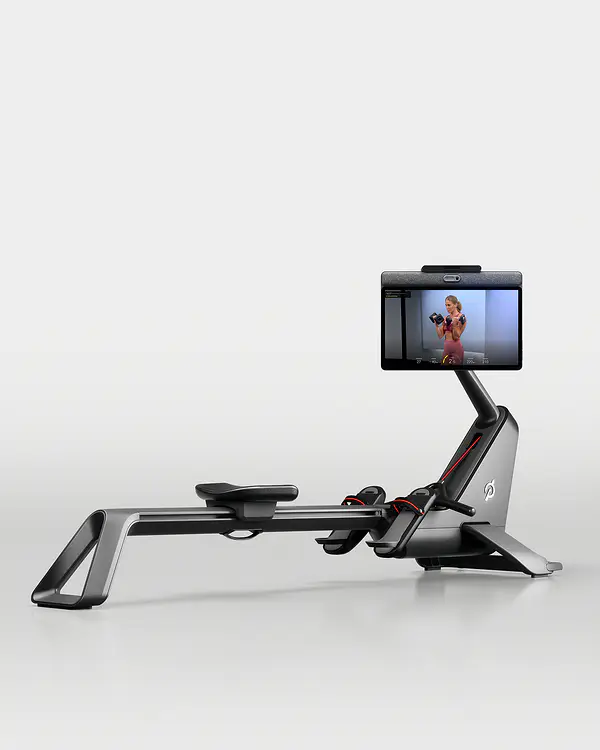
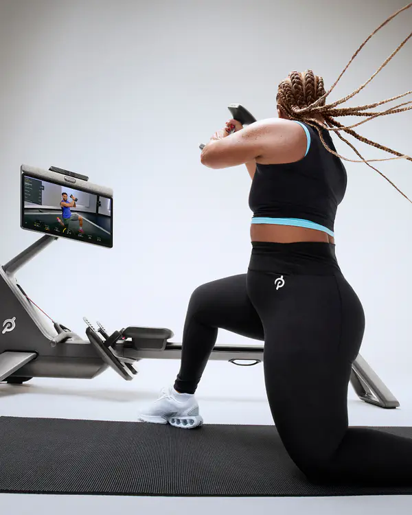
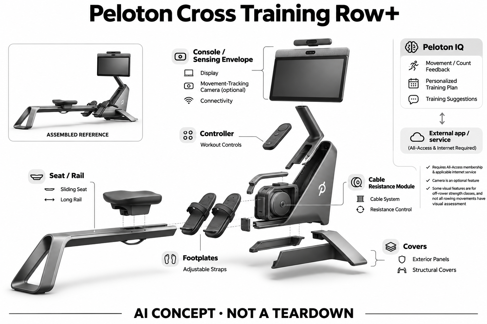

# Peloton Cross Training Row+

**Peloton** · 运动与训练 · 核查 2026-11-04

专用划船器械与Peloton IQ视觉训练反馈

消费渠道：个人零售。

## 产品图片与结构参考

### 产品图

Peloton Cross Training Row+官方产品外形图 · 来源：[Peloton · 官方产品图片](<https://www.onepeloton.com/shop/row-plus>) · [原始图片](<https://images.onepeloton.com/peloton-cycle/image/fetch/dpr_1.0,f_auto,q_auto:good,w_600/https://images.ctfassets.net/7vk8puwnesgc/21AzTx4xEUidCZfc8yDOjn/b2d88806637738583cb8fb18447be29f/Row__Render1_3x.jpg>)

### 参考图

Peloton Cross Training Row+官方另一角度或使用场景参考 · 来源：[Peloton · 官方产品图片](<https://www.onepeloton.com/shop/row-plus>) · [原始图片](<https://images.onepeloton.com/peloton-cycle/image/fetch/dpr_1.0,f_auto,q_auto:good,w_600/https://images.ctfassets.net/7vk8puwnesgc/3h1fwUpEE4OjYohlmwT13x/ea46685b2ebb3eb7d9b8e53ccd9d7696/Row__Lifestyle1.png>)

### AI 生成爆炸示意

**AI 生成 · 非实物拆机。** 内部为概念推断，不能作为元件布局、BOM 或维修依据。[生成提示词](../../content/hardware/prompts/peloton-cross-training-row-plus.txt)

> 外形依据核验参考图；内部位置、模块形状与装配关系仅作AI概念展示。

> 已逐张查看并核对型号。源图未改色/裁切；场景、界面、附件、优惠及效果文案仅为厂商示意，不作为本目录性能或现价依据。

> 分析为基于公开资料的案头研究与 AI 辅助判断，未经用户访谈、销量审计或实物拆机。需求、画像、竞争冷门度、审美及商业机会均为研究假设，不是投资结论。

## 销售与购买

- 状态：在售。已打开该具体型号官方购买页，显示型号、美元价与Add to cart；未将翻新Original系列、商业Pro设备或其他机械类型混为同一产品。

- 地区：美国官方销售地区（具体配送地址结算确认）

- 价格：US$3,495。美国官方硬件价；All-Access会员另计。Tread+ Vision另列必需安装费，其他送装与税费按订单确认。

- 中国大陆：本次核实海外官方渠道，未确认同型号中国大陆官方销售、安装和完整软件服务。支持中文或品牌来自中国均不等同大陆可购买。

- [官方产品 / 商店](<https://www.onepeloton.com/shop/row-plus>)

## AI 的实际作用

Peloton IQ利用Movement-Tracking Camera进行动作/次数反馈，并结合个人历史生成训练计划与建议。

服务与联网依赖：需要All-Access会员及适用联网服务；摄像头是可选启用功能。部分视觉功能用于离机力量课，不等于所有划船动作都有视觉评估。

## 是否冷门

竞争密集（研究判断）：依据用途与替代品的案头分类；不是销量、市场份额或用户访谈结论。

## 需求与市场

需求假设：划船练习者希望把节奏、动作顺序和离机力量训练放入同一训练记录。真正应验证的是反馈是否准确、是否能帮助完成当次训练，而不是把更丰富的数据界面自动视为更好的体能结果。

### 需求假设：划船节奏与离机训练连贯安排 · 研究判断

Cross Training Row+把划船课程与离机力量训练放入同一系统，针对希望减少切换设备和重新整理记录的用户。划船本身涉及动作顺序，离机反馈又服务另一任务，需求研究应区分两者，不能把摄像头存在说成所有划船动作都由视觉分析。

依据：[Peloton Cross Training Row+官方购买页](<https://www.onepeloton.com/shop/row-plus>) · [Peloton Cross Training Row+官方说明](<https://www.onepeloton.com/row-plus>) · [Peloton IQ官方功能边界](<https://www.onepeloton.com/peloton-iq>)

### 价值判断：理解动作与增加训练量不同 · 研究判断

用户可能需要弄清拉动、滑座和身体配合，也可能只是希望完成既定课程，更多数据未必适合两种目标。应观察反馈是否帮助理解，以及跨训练是否被采用，不能用课程完成次数推断技术进步，更不把平台建议当作身体状态的完整评估。

依据：[Peloton Cross Training Row+官方说明](<https://www.onepeloton.com/row-plus>) · [Peloton IQ官方功能边界](<https://www.onepeloton.com/peloton-iq>)

### 验证方案：观察完整划船加离机课程 · 待验证

让有划船练习任务的用户用Row+完成原有安排，记录脚部固定、座椅移动、结束下机、转屏和地面训练步骤。与普通划船机加独立课程比较时保持目标一致，重点看切换与理解负担，不以短期划船成绩证明AI功能效果。

依据：[Peloton Cross Training Row+官方购买页](<https://www.onepeloton.com/shop/row-plus>) · [Peloton Cross Training Row+官方说明](<https://www.onepeloton.com/row-plus>)

## 用户画像

画像推断：愿意练习划船技术并能安排长条动作区的家庭用户更匹配。偶发锻炼者未必需要专用联网器械；家庭成员的身高、动作习惯和课程偏好不同，不能用单一宣传场景覆盖所有消费者。

### 画像假设：愿意学习划船技术的人 · 研究判断

较匹配者愿意练习划船动作并持续使用课程，而不只是寻找一件看起来全身运动的器械。用户需要接受长导轨空间与重复动作，画像应包含具体练习目标、学习方式和家庭布局，不能从一次体验有趣推断会长期训练或订阅。

依据：[Peloton Cross Training Row+官方购买页](<https://www.onepeloton.com/shop/row-plus>) · [Peloton Cross Training Row+官方说明](<https://www.onepeloton.com/row-plus>)

### 使用约束：收纳与再次展开也算成本 · 研究判断

竖立收纳可能减少闲置时占地，但仍需依说明固定和留出安全空间，重新展开也会影响使用频率。研究应了解谁负责移动与整理，以及其他家庭成员如何经过，不能从收纳照片推断轻松适合小户型，更不假设每天会愿意重复操作。

依据：[Peloton Cross Training Row+官方说明](<https://www.onepeloton.com/row-plus>)

### 访谈重点：哪些反馈帮助理解动作顺序 · 待验证

请用户解释最近一次划船中哪里最不确定，是否需要看课程、数据或外部指导，再观察这些信息如何影响下一轮动作。对于离机训练，另问为什么选择或跳过，避免把两种需求合并为喜欢AI，也不以评分代替个人理解。

依据：[Peloton Cross Training Row+官方说明](<https://www.onepeloton.com/row-plus>) · [Peloton IQ官方功能边界](<https://www.onepeloton.com/peloton-iq>)

## 竞争与替代

案头判断：与传统划船器械、普通课程屏和同类联网健身平台竞争，属于已有强替代的家庭健身方向。没有用户访谈、销量或留存证据，因此不将平台知名度当作该型号需求已验证。

### 替代方案：传统划船机与独立指导 · 研究判断

Row+与普通划船器、课程应用、教练和其他联网平台竞争，用户可以通过分开设备完成训练。其差异是记录与屏幕流程集中，但同时需要会员和空间，比较不应只看视觉功能，更要看划船机械体验与动作学习是否符合个人需求。

依据：[Peloton Cross Training Row+官方购买页](<https://www.onepeloton.com/shop/row-plus>) · [Peloton Cross Training Row+官方说明](<https://www.onepeloton.com/row-plus>)

### 差异判断：离机视觉不能借划船用途放大 · 研究判断

部分摄像反馈用于离机力量课，与划船器械记录属于不同输入路径，如果用户只划船，新增摄像能力可能作用有限。研究应按实际课程和模式比较，不能把系列IQ宣传全部算在划船动作上，也不由平台规模推断这一组合已经形成需求。

依据：[Peloton IQ官方功能边界](<https://www.onepeloton.com/peloton-iq>)

### 比较方法：按同一训练流程评估 · 待验证

让用户用一体系统和普通划船机加课程完成相同安排，记录看屏、调整、下机与收纳的步骤，以及何时需要额外解释。不要把更多指标自动视为更专业，也不使用算法自身评分给不同设备排名，应结合用户能否完成任务和理解反馈。

依据：[Peloton Cross Training Row+官方说明](<https://www.onepeloton.com/row-plus>) · [Peloton IQ官方功能边界](<https://www.onepeloton.com/peloton-iq>)

## 供应链

官方可以核对长导轨、滑座、拉柄阻力机构和显示屏，具体电机、相机、屏幕供应商与整机工厂未公开。推断交付质量还涉及装配、维护与会员软件，不能只凭硬件售价推算制造成本。

### 功能拆分：滑座拉柄与视觉输入分层 · 研究判断

公开机械部分包含长导轨、滑座和拉柄阻力机构，显示、摄像及账户课程形成另一链路。划船数据与离机视觉需要分别理解，不能将普通阻力调节称为AI，实际传感器、电机或工厂也未披露，功能示意不能当作真实拆机图。

依据：[Peloton Cross Training Row+官方说明](<https://www.onepeloton.com/row-plus>) · [Peloton IQ官方功能边界](<https://www.onepeloton.com/peloton-iq>)

### 制造判断：导轨与交互长期使用协同 · 研究判断

滑座重复移动、脚部固定、拉柄路径和显示转动都影响使用，长期维护不能只关注屏幕或算法。供应评估应检查机械一致性、可维修性和收纳固定，本轮没有取得实际材料、公差与寿命数据，不能从造型整洁推断制造质量。

依据：[Peloton Cross Training Row+官方说明](<https://www.onepeloton.com/row-plus>)

### 候选选型：显示、视觉与屏幕结构 · 研究判断

BOE可作为显示候选，Arducam可讨论离机视觉输入，瑞声可询问显示转动周边结构。它们的能力不覆盖整条导轨和训练机械验收，也没有点名的Row+供货证据；选型必须确认屏幕载荷、摄像范围与软件接口，不能直接替换原件。

依据：[Peloton Cross Training Row+官方说明](<https://www.onepeloton.com/row-plus>) · [Peloton IQ官方功能边界](<https://www.onepeloton.com/peloton-iq>)

## 技术路径

可确认AI是Peloton IQ的视觉动作反馈与个性化建议，普通自动阻力或自动坡度本身不单独算AI。具体模型与识别误差未完整披露，视觉指导适用范围应以该型号和课程说明为准。

### 已披露能力：IQ计划与指定视觉反馈 · 官方资料

官方IQ说明基于历史形成训练建议，并通过指定设备的摄像头提供支持动作的反馈，摄像为可选功能。Row+的部分视觉用途在离机力量课，不能扩展成全部划船动作的摄像评估，也不将机械记录或普通自动控制全部称为AI。

依据：[Peloton IQ官方功能边界](<https://www.onepeloton.com/peloton-iq>)

### 技术判断：动作理解需要知道数据来源 · 研究判断

划船者可能同时看到器械记录、课程提示和个人计划，如果界面没有清楚区分，容易误以为每项反馈都来自同一准确测量。研究应检查用户能否理解哪些是记录、哪些是推断，以及何时需要其他指导，不能让丰富数据替代解释。

依据：[Peloton Cross Training Row+官方说明](<https://www.onepeloton.com/row-plus>) · [Peloton IQ官方功能边界](<https://www.onepeloton.com/peloton-iq>)

### 验证方案：按划船与离机分别记录 · 待验证

在官方支持的模式中分别记录机械训练数据和摄像反馈，保存站位、动作与权限条件，再询问用户如何回应。对不一致结果不急于给整体AI评分，而是区分采集、课程和建议层，本轮没有模型准确率或训练改善的实测证据。

依据：[Peloton Cross Training Row+官方说明](<https://www.onepeloton.com/row-plus>) · [Peloton IQ官方功能边界](<https://www.onepeloton.com/peloton-iq>)

## 产品审美

图示观察：长导轨与可转动屏幕形成鲜明器械感，竖立收纳仍需固定与空间。家居效果图无法证明实际噪声、屏幕反光或动线体验，需要结合使用房间和展开训练空间评估。

### 外形判断：长条机构决定房间布局 · 研究判断

Row+的长导轨和滑座形成鲜明器械形态，与可转动显示共同组织训练区域，实际空间需求随动作和离机课程扩大。竖立收纳只是另一种状态，仍需固定与通行安排，不能从效果图中的空房间判断所有家庭都能接受。

依据：[Peloton Cross Training Row+官方说明](<https://www.onepeloton.com/row-plus>)

### 交互判断：拉动过程中阅读方式不同 · 研究判断

划船动作中用户身体位置和节奏持续变化，提示必须在可理解的时机出现，不能按静坐阅读设计全部信息。应观察用户是否为了看屏打乱原动作，以及结束后是否需要回看，界面丰富和高位显示不自动等于即时反馈更有效。

依据：[Peloton Cross Training Row+官方说明](<https://www.onepeloton.com/row-plus>) · [Peloton IQ官方功能边界](<https://www.onepeloton.com/peloton-iq>)

### 体验验证：完整测试上下机与收纳 · 待验证

让用户在实际房间调整脚部固定、完成课程、下机、转向地面活动并按说明收纳，记录需要帮助和反复确认的步骤。将清洁导轨与配件整理也纳入评价，比只体验几分钟划船更能判断长期使用是否适合家庭动线。

依据：[Peloton Cross Training Row+官方购买页](<https://www.onepeloton.com/shop/row-plus>) · [Peloton Cross Training Row+官方说明](<https://www.onepeloton.com/row-plus>)

## 关键风险

风险包括会员依赖、姿态误识别与数据权限；导轨行程、座椅移动及竖立收纳需要按设备说明操作。AI反馈不能保证无伤害或作为康复处方，本研究没有医学或实机验证。

### 机械风险：滑动与收纳要求不由AI替代 · 研究判断

滑座、拉柄与竖立收纳都需要遵守设备说明，摄像或训练建议不能保证家庭成员接近时安全。用户仍应依据自身状态选择动作，反馈不是康复处方，本轮没有实机和医学测试，不将技术分析写成预防伤害或确保训练结果。

依据：[Peloton Cross Training Row+官方说明](<https://www.onepeloton.com/row-plus>) · [Peloton IQ官方功能边界](<https://www.onepeloton.com/peloton-iq>)

### 服务风险：会员与摄像选择影响功能 · 研究判断

All-Access会员和联网服务属于完整体验条件，关闭摄像可能改变部分反馈，用户需要了解具体边界。账户历史和地区权益也应核对，不能把一次硬件购买视为所有课程与视觉服务永久包含，也不推断不同家庭成员自动共享相同设置。

依据：[Peloton Cross Training Row+官方购买页](<https://www.onepeloton.com/shop/row-plus>) · [Peloton IQ官方功能边界](<https://www.onepeloton.com/peloton-iq>)

### 验证安排：保留未完成与不用的场景 · 待验证

观察用户何时跳过离机训练、关闭反馈或因收纳麻烦而不使用，区分机械、空间和课程偏好。不要只统计已经完成的课程，也不以没有开启摄像就断定整机无价值，这些差异正能说明Row+哪些功能组合真正服务用户。

依据：[Peloton Cross Training Row+官方说明](<https://www.onepeloton.com/row-plus>) · [Peloton IQ官方功能边界](<https://www.onepeloton.com/peloton-iq>)

## 机会与验证

市场差异是专用划船机械系统与跨训练视觉反馈的结合。尚待验证的购买理由是用户是否同时需要课程、动作识别和长期计划，以及相较普通器械加软件能否减少实际使用摩擦。

### 研究方向：把学习与切换步骤讲清楚 · 研究判断

Row+可用于研究划船动作学习和跨训练安排之间的关系，机会可能在更清楚的数据解释、课程衔接或收纳流程。应先发现用户理解与使用的障碍，再决定是否增加新的视觉功能，避免把所有划船训练问题都交给摄像头解决。

依据：[Peloton Cross Training Row+官方说明](<https://www.onepeloton.com/row-plus>) · [Peloton IQ官方功能边界](<https://www.onepeloton.com/peloton-iq>)

### 执行计划：跟踪实际课程组合 · 待验证

持续记录划船、离机课程和收纳使用，访谈围绕一次真实跳过或改变训练的事件展开，确认原因与提示是否相关。将机械体验、平台课程和视觉反馈的作用分开，不用平台总使用时间或短期成绩代替新增硬件能力的价值证据。

依据：[Peloton Cross Training Row+官方购买页](<https://www.onepeloton.com/shop/row-plus>) · [Peloton IQ官方功能边界](<https://www.onepeloton.com/peloton-iq>)

### 决策边界：稀少形态不等于低竞争 · 研究判断

联网划船器虽然比通用健身应用专门，但仍面对成熟机械和内容替代，家庭空间与维护也限制适配。供应商能力只说明实现路线，本轮没有访谈、销量与留存资料，不由品类曝光度、算法评分或高端定位预测创业成功。

依据：[Peloton Cross Training Row+官方购买页](<https://www.onepeloton.com/shop/row-plus>) · [Peloton Cross Training Row+官方说明](<https://www.onepeloton.com/row-plus>)

## 对应供应链公司

能力候选用于选型研究，不代表本产品实际采用；未公开的供货关系不作推断。

- [boe](../supply-chain/boe.md) — **能力候选 · 非已采用** / 划船及离机课程共用显示候选：BOE显示方案可用于讨论Row+课程与数据屏，但实际尺寸、观看距离、转动安装和长时使用条件需核对，不能将已核平板系列直接当作训练屏替换件。该关联无本型号点名供货证据，只提供显示模块的工程比较入口。

- [arducam](../supply-chain/arducam.md) — **能力候选 · 非已采用** / 离机力量反馈摄像输入候选：Arducam的相机模组与接口工程可用于研究Row+离机视觉输入，必须验证全身视场、站位、光线和IQ软件协同；不能据此扩展为所有划船动作都被摄像评估，也没有公开资料说明原机采用该公司的器件或算法。

- [aac-technologies](../supply-chain/aac-technologies.md) — **能力候选 · 非已采用** / 转动显示周边精密机构候选：瑞声公开转轴与精密结构协同能力，可作为Row+显示周边的候选，但需按屏幕载荷、线缆和重复转动验证。此匹配不涵盖滑座、长导轨或训练承载，也没有实际采用证据，不能把一般消费结构经验视为完整划船器制造能力。

[浏览供应链目录](../supply-chain.md)

## 功能分层示意

这是功能关系，不是实物拆机、真实空间结构或已核实 BOM。

1. **训练输入**：划船器械记录运动数据，摄像头观察支持的动作；非实物拆机。（官方披露）

2. **机械执行**：长导轨、滑座、拉柄阻力机构和显示屏提供训练交互。（官方披露）

3. **AI分析**：Peloton IQ提供动作、次数与个性化训练相关反馈。（官方披露）

4. **会员与账户**：All-Access会员和个人账户组织课程与历史。（官方披露）

5. **屏幕与用户**：显示指导和记录，用户控制实际动作与负载。（官方披露）

## 来源

1. [Peloton Cross Training Row+官方购买页](<https://www.onepeloton.com/shop/row-plus>) — 已打开，具体型号Add to cart可见；未实际支付。

2. [Peloton Cross Training Row+官方说明](<https://www.onepeloton.com/row-plus>) — 已打开，用于核对具体硬件形态及视觉功能范围。

3. [Peloton IQ官方功能边界](<https://www.onepeloton.com/peloton-iq>) — 已打开，区分通用计划与指定硬件视觉功能，会员另需。

[返回目录](../hardware-market.md) · [网页分析](https://romanagent.github.io/Roman/#hardware/product/peloton-cross-training-row-plus)
