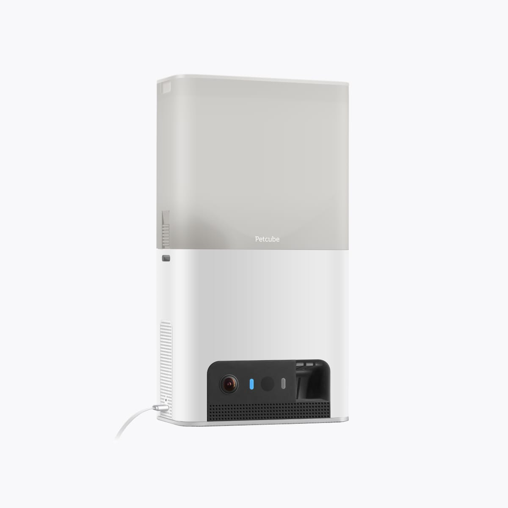
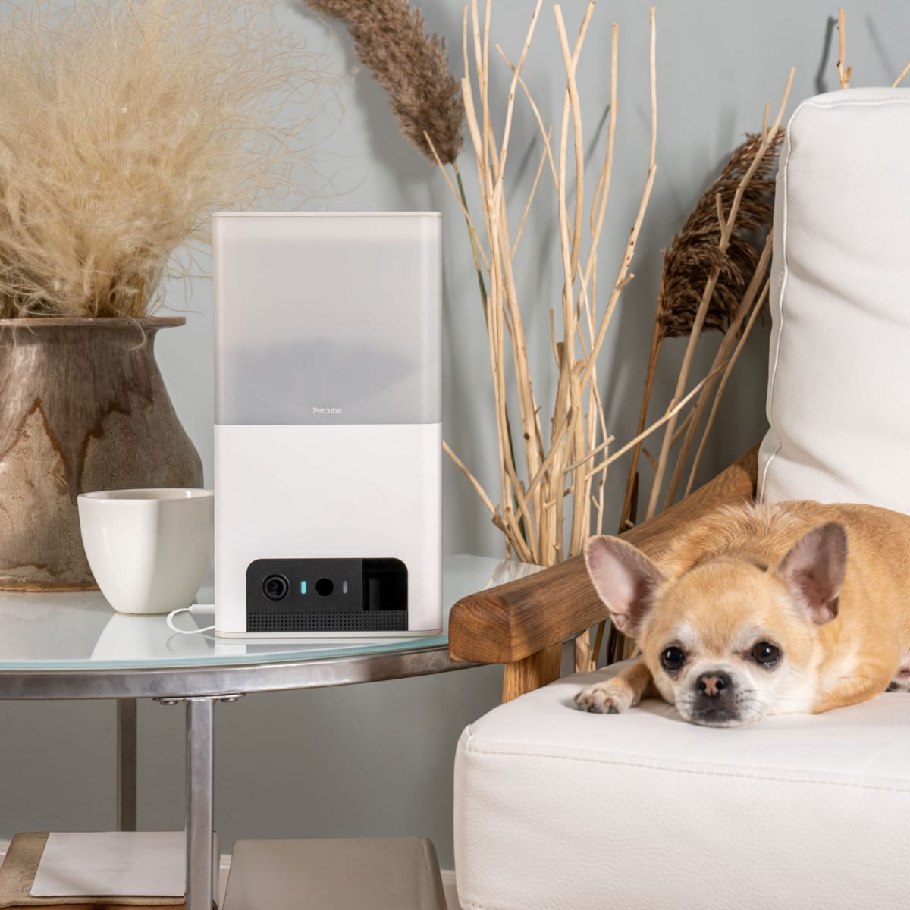
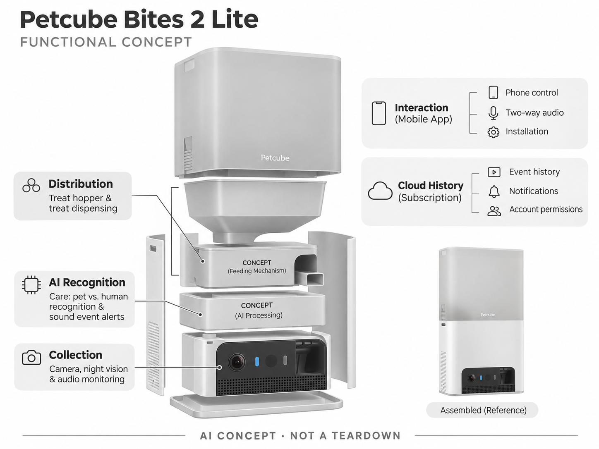

# Petcube Bites 2 Lite

**Petcube** · 宠物照护 · 核查 2026-11-04

把AI宠物提醒与可控零食分发组合的家用相机

消费渠道：个人零售。

## 产品图片与结构参考

### 产品图

Petcube Bites 2 Lite 官方产品外观图 · 来源：[Petcube · 官方图片](<https://petcube.com/store/product/bites-2-lite/>) · [原始图片](<https://petcube.com/images/store/gallery/bites-2-lite/side-face@2x.jpg>)

### 参考图

Petcube Bites 2 Lite 官方场景或功能参考图 · 来源：[Petcube · 官方图片](<https://petcube.com/store/product/bites-2-lite/>) · [原始图片](<https://petcube.com/images/store/gallery/bites-2-lite/interior-dog@2x.jpg>)

### AI 生成爆炸示意

**AI 生成 · 非实物拆机。** 内部为概念推断，不能作为元件布局、BOM 或维修依据。[生成提示词](../../content/hardware/prompts/petcube-bites-2-lite.txt)

> 依据官方外观参考与公开功能生成；未披露的内部布局只作概念模块，不构成BOM或真实结构证据。

> 保留官方图原始内容与出处；画面中的营销声明不视为独立验证。

> 分析为基于公开资料的案头研究与 AI 辅助判断，未经用户访谈、销量审计或实物拆机。需求、画像、竞争冷门度、审美及商业机会均为研究假设，不是投资结论。

## 销售与购买

- 状态：在售。官方商店提供Bites 2 Lite单机US$99.99选项及Add to cart，也有绑定Care的优惠套餐；本条不以订阅补贴价作为单机售价。

- 地区：美国官方零售；其他地区须分别确认

- 价格：US$99.99。核查日官方页面参考；税运、订阅及优惠条件另计。会员价、服务套餐与硬件买断价不可直接混用。

- 中国大陆：本轮核实国际官方渠道；未核实中国大陆该型号的官方现货、地区服务与保修，不把跨境硬件可送达等同于全部AI功能可用。

- [官方产品 / 商店](<https://petcube.com/store/product/bites-2-lite/>)

## AI 的实际作用

结合Care进行人宠区分与声音事件提醒；相机观察和投零食机构提供实体交互，定时投食本身不算AI。

服务与联网依赖：智能告警和云视频历史依赖Care；直播、手机投食、网络与服务费用应按当前方案分别确认。

## 是否冷门

竞争密集（研究判断）：宠物摄像头已有多个品牌及普通家庭摄像头替代，竞争集中在识别、通知、互动与订阅体验，不属于空白市场。

## 需求与市场

需求假设：用户在查看宠物后希望发出声音或少量零食反馈，而不只接收警报。应测试投食成功率、宠物是否围守设备以及告警是否可操作，不能把互动次数简单解释为陪伴效果。

## 用户画像

画像推断：白天外出且已用零食训练的猫狗家庭，主人愿意清理料仓和管理饮食。对湿粮、特殊颗粒或严格控制热量的宠物，需要单独验证适用性，不能假设所有养宠者都需要投食相机。

## 竞争与替代

竞争判断：Furbo是直接替代，普通摄像头搭配独立喂食器也可完成部分任务。Bites 2 Lite的竞争点在分发可靠性、装配便利和服务费用；应关注整体任务成本，而不只看促销硬件价。

## 供应链

供应链分析：料仓、出粮通道、电机、相机与网络模组决定基本可靠性，食物碎屑和油脂是长期挑战。芯片、制造工厂和采购价未知；需要建立颗粒尺寸、清洗与卡粮恢复的测试矩阵。

## 技术路径

官方描述Care智能提醒和人宠识别。技术判断：需要将机械投食、普通运动检测和AI事件分类分开验证，误识别不能直接驱动无限投食；画面应提供上下文，避免用户误解宠物行为。

## 产品审美

审美判断：圆角竖向机身强调家庭用品感，料仓和摄像头位置让功能容易识别。墙装可减少占地，但补粮高度、线缆和宠物撞击需要考虑；真实家居中的摆放比单独白底图更有参考意义。

## 关键风险

风险判断：过量零食、卡料和设备倾倒会影响照护，云端通知也有延迟与误报。应遵守适配零食和清洁要求，长时间外出仍需人工照看；AI告警不能成为判断宠物安全或健康的唯一依据。

## 机会与验证

机会假设：从远程确认进食、定量训练或照护协作中选择一个明确任务，测试投食和录像是否形成闭环。若价值主要是安心感，应量化持续使用和误报，避免用花哨互动替代可靠基本功能。

## 功能分层示意

这是功能关系，不是实物拆机、真实空间结构或已核实 BOM。

1. **采集**：相机、夜视和音频观察。（官方披露）

2. **AI识别**：Care人宠与声音事件理解。（官方披露）

3. **分发**：料仓与投零食机构。（官方披露）

4. **交互**：手机控制、双向音频及安装。（官方披露）

5. **云历史**：订阅历史、通知与账号权限。（官方披露）

## 来源

1. [Petcube Bites 2 Lite 官方商店](<https://petcube.com/store/product/bites-2-lite/>) — 已实际打开；核查购物入口、产品形态与AI声明，未完成支付或收货。

2. [Petcube Care 官方AI提醒与视频历史](<https://petcube.com/care/>) — 已实际打开的官方技术或服务说明；厂商声明不视为独立性能或疗效验证。

[返回目录](../hardware-market.md) · [网页分析](https://romanagent.github.io/Roman/#hardware/product/petcube-bites-2-lite)
