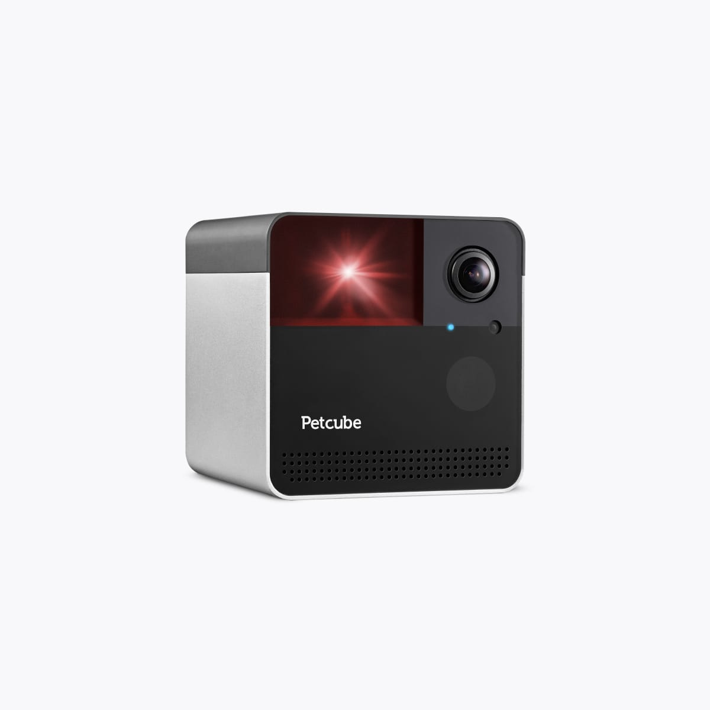
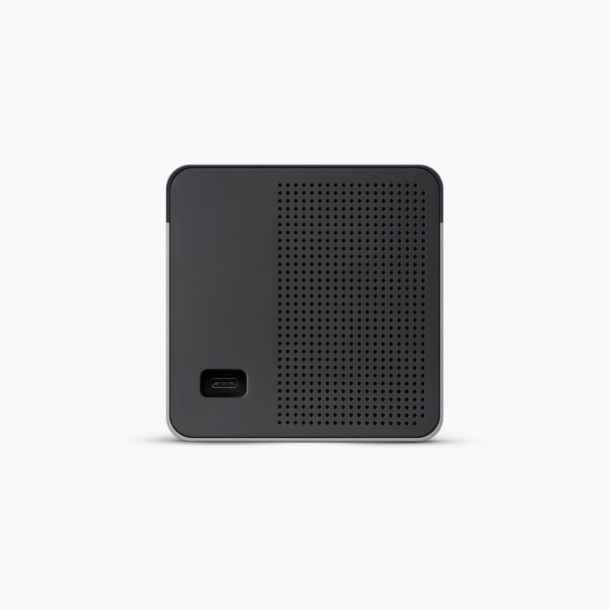
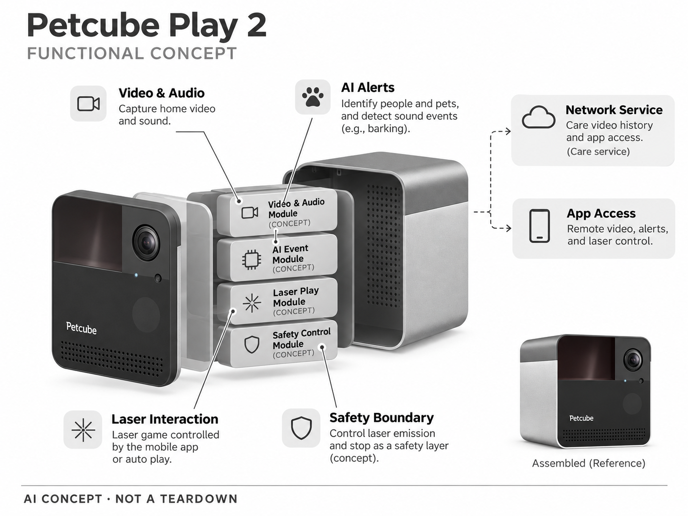

# Petcube Play 2

**Petcube** · 宠物照护 · 核查 2026-11-04

带激光互动的家用宠物摄像头

消费渠道：个人零售。

## 产品图片与结构参考

### 产品图

Petcube Play 2 官方产品外观图 · 来源：[Petcube · 官方图片](<https://petcube.com/store/product/play-2/>) · [原始图片](<https://petcube.com/images/store/gallery/play-2/side-face@2x.jpg>)

### 参考图

Petcube Play 2 官方场景或功能参考图 · 来源：[Petcube · 官方图片](<https://petcube.com/store/product/play-2/>) · [原始图片](<https://petcube.com/images/store/gallery/play-2/back@2x.jpg>)

### AI 生成爆炸示意

**AI 生成 · 非实物拆机。** 内部为概念推断，不能作为元件布局、BOM 或维修依据。[生成提示词](../../content/hardware/prompts/petcube-play-2.txt)

> 依据官方外观参考与公开功能生成；未披露的内部布局只作概念模块，不构成BOM或真实结构证据。

> 保留官方图原始内容与出处；画面中的营销声明不视为独立验证。

> 分析为基于公开资料的案头研究与 AI 辅助判断，未经用户访谈、销量审计或实物拆机。需求、画像、竞争冷门度、审美及商业机会均为研究假设，不是投资结论。

## 销售与购买

- 状态：在售。官方商店显示Play 2、当前价格与Back in stock，并提供Add to cart；页面也渲染其它状态按钮模板，商品反馈以当前SKU为准。

- 地区：美国官方零售；其他地区须分别确认

- 价格：US$79.99。核查日官方页面参考；税运、订阅及优惠条件另计。会员价、服务套餐与硬件买断价不可直接混用。

- 中国大陆：本轮核实国际官方渠道；未核实中国大陆该型号的官方现货、地区服务与保修，不把跨境硬件可送达等同于全部AI功能可用。

- [官方产品 / 商店](<https://petcube.com/store/product/play-2/>)

## AI 的实际作用

AI识别人和宠物及声音事件，依赖Care服务发送智能提醒；手机操控激光和自动播放并不等同于AI自主照护。

服务与联网依赖：直播与基础提醒可用范围应与Care付费视频历史、AI告警区分；Wi-Fi、手机和云服务共同决定体验。

## 是否冷门

竞争密集（研究判断）：宠物摄像头已有多个品牌及普通家庭摄像头替代，竞争集中在识别、通知、互动与订阅体验，不属于空白市场。

## 需求与市场

需求假设：猫主人希望在外也能观察并提供短时活动，激光互动减少了额外玩具设备。应测试宠物是否愿意参与、互动时延和游戏结束后的状态，不能将自动播放时长当成运动质量。

### 产品任务与边界 · 研究判断

需求假设：猫主人希望在外也能观察并提供短时活动，激光互动减少了额外玩具设备。应测试宠物是否愿意参与、互动时延和游戏结束后的状态，不能将自动播放时长当成运动质量。

依据：[Petcube Play 2 官方商店](<https://petcube.com/store/product/play-2/>) · [Petcube Care 官方AI提醒与视频历史](<https://petcube.com/care/>)

### 需求判断 · 研究判断

激光互动把远程观察延伸为动作，但宠物对光点的反应、退出和结束状态需要被重视，不能只看追逐时长。相较固定视频，它增加了控制与安全要求，需求应验证主人和宠物是否都获得价值，而不是只满足主人远程操作的乐趣。

依据：[Petcube Play 2 官方商店](<https://petcube.com/store/product/play-2/>) · [Petcube Care 官方AI提醒与视频历史](<https://petcube.com/care/>)

### 需求验证 · 待验证

可比较普通相机、远程光点和真实玩具互动的主动参与与主人操作，记录时延、停止和后续行为。观察数周后是否仍选择设备，不强迫动物追逐，也不把自动播放时间或跑动距离直接视为良好运动或陪伴效果。

依据：[Petcube Play 2 官方商店](<https://petcube.com/store/product/play-2/>) · [Petcube Care 官方AI提醒与视频历史](<https://petcube.com/care/>)

## 用户画像

画像推断：主要在室内养猫、熟悉手机视频且愿意远程互动的家庭。宠物对光点的反应差异大，幼猫或高兴奋个体尤其需要监督；用户也要愿意提供真实可捕获玩具作为互动补充。

### 适用行为与条件 · 研究判断

画像推断：主要在室内养猫、熟悉手机视频且愿意远程互动的家庭。宠物对光点的反应差异大，幼猫或高兴奋个体尤其需要监督；用户也要愿意提供真实可捕获玩具作为互动补充。

依据：[Petcube Play 2 官方商店](<https://petcube.com/store/product/play-2/>) · [Petcube Care 官方AI提醒与视频历史](<https://petcube.com/care/>)

### 人群取舍 · 研究判断

室内布局、摆放高度和宠物性格会改变游戏范围，用户还需愿意观察反应并及时结束。多宠或狭窄房间可能增加目标竞争和遮挡，画像应按互动习惯与实际空间划分，不能仅因养猫就推定适合激光设备。

依据：[Petcube Play 2 官方商店](<https://petcube.com/store/product/play-2/>) · [Petcube Care 官方AI提醒与视频历史](<https://petcube.com/care/>)

### 画像验证 · 待验证

画像验证应让主人在熟悉环境选择互动方式并记录何时停止，关注宠物自主离开而非只统计追逐。再比较远程与在场操作，确认用户能够理解画面盲区和时延，识别真正需要这一补充方式而不是完全替代陪玩的家庭。

依据：[Petcube Play 2 官方商店](<https://petcube.com/store/product/play-2/>) · [Petcube Care 官方AI提醒与视频历史](<https://petcube.com/care/>)

## 竞争与替代

竞争判断：它与普通宠物相机、独立玩具和主人主动游戏竞争，AI告警并非激光机构独有。差异在观察与互动是否顺畅连接；单靠旧硬件低售价可能无法抵消订阅与长期服务压力。

### 比较对象与差异 · 研究判断

竞争判断：它与普通宠物相机、独立玩具和主人主动游戏竞争，AI告警并非激光机构独有。差异在观察与互动是否顺畅连接；单靠旧硬件低售价可能无法抵消订阅与长期服务压力。

依据：[Petcube Play 2 官方商店](<https://petcube.com/store/product/play-2/>) · [Petcube Care 官方AI提醒与视频历史](<https://petcube.com/care/>)

### 竞争判断 · 研究判断

AI 告警与激光是两套价值，普通相机也可提供部分分类，独立玩具则不需要云服务。Play 2 需要证明观察与互动连接更顺畅，旧硬件价格降低也不能自动抵消订阅、服务寿命和安全操作的持续要求。

依据：[Petcube Play 2 官方商店](<https://petcube.com/store/product/play-2/>) · [Petcube Care 官方AI提醒与视频历史](<https://petcube.com/care/>)

### 竞争验证 · 待验证

可在同一家庭比较一体设备与相机加普通玩具的有效互动、准备和结束步骤，明确 Care 权益。分别评估告警与激光，不以其中一项表现好推断另一项有价值，也不以促销价判断整个长期成本。控制中断后的恢复步骤也应比较。

依据：[Petcube Play 2 官方商店](<https://petcube.com/store/product/play-2/>) · [Petcube Care 官方AI提醒与视频历史](<https://petcube.com/care/>)

## 供应链

供应链分析：激光发射及转向机构、相机、声学模组和无线连接集成在小型外壳。具体供应商与BOM未披露；应核查光学安全、机械转动寿命和跌落后方向控制，而不是只比较摄像头像素。

### 功能模块拆分 · 研究判断

功能层包括视频声音采集、Care 人宠与声音分类、激光发射和转向、网络历史及应用控制。出射和停止是需要评估的功能安全层，不代表已取得内部保护设计，公开资料没有具体供方、芯片和实际光学布局。

依据：[Petcube Play 2 官方商店](<https://petcube.com/store/product/play-2/>) · [Petcube Care 官方AI提醒与视频历史](<https://petcube.com/care/>)

### 制造与供应约束 · 研究判断

供应链分析：激光发射及转向机构、相机、声学模组和无线连接集成在小型外壳。具体供应商与BOM未披露；应核查光学安全、机械转动寿命和跌落后方向控制，而不是只比较摄像头像素。

依据：[Petcube Play 2 官方商店](<https://petcube.com/store/product/play-2/>) · [Petcube Care 官方AI提醒与视频历史](<https://petcube.com/care/>)

### 候选与证据缺口 · 研究判断

歌尔可作为音视频交互电子候选，SGS 可提供光学、电气及机械相关测试范围咨询。没有 Play 2 点名合作证据，实际光学安全需核对对应实验室与方法，普通检测也不能证明激光互动对每只宠物都适合或有益。

依据：[Petcube Play 2 官方商店](<https://petcube.com/store/product/play-2/>) · [Petcube Care 官方AI提醒与视频历史](<https://petcube.com/care/>)

## 技术路径

官网明确AI人宠识别和声音提醒。技术判断：需要分清远程操控、定时游戏和机器学习识别三层能力；识别到宠物并不意味着自动安排的互动一定合适，用户应能快速停止游戏。

### 已披露技术边界 · 研究判断

官网明确AI人宠识别和声音提醒。技术判断：需要分清远程操控、定时游戏和机器学习识别三层能力；识别到宠物并不意味着自动安排的互动一定合适，用户应能快速停止游戏。

依据：[Petcube Play 2 官方商店](<https://petcube.com/store/product/play-2/>) · [Petcube Care 官方AI提醒与视频历史](<https://petcube.com/care/>)

### 系统难点判断 · 研究判断

远程操控、自动游戏和机器学习提醒应分开理解，识别到宠物不意味着系统知道合适互动强度。网络时延与画面盲区会影响主人判断，设备需要清楚停止与状态反馈，而不是让自动动作被误解为懂得动物需要的自主照护。

依据：[Petcube Play 2 官方商店](<https://petcube.com/store/product/play-2/>) · [Petcube Care 官方AI提醒与视频历史](<https://petcube.com/care/>)

### 技术验证 · 待验证

验证应分别测试人宠分类、声音来源、控制时延和停止恢复，并在受控环境检查方向，不照射人或动物眼部。不能从一次顺畅游戏推断自动模式始终适宜，也不把 Care 分类或文字提示当作健康与情绪诊断。

依据：[Petcube Play 2 官方商店](<https://petcube.com/store/product/play-2/>) · [Petcube Care 官方AI提醒与视频历史](<https://petcube.com/care/>)

## 产品审美

审美判断：紧凑方体适合书架和边柜，功能相对隐蔽；镜头和激光出射位置应易理解。实际摆放高度会决定游戏范围和盲区，线缆固定与宠物接触比产品照片中的材料质感更重要。

### 外观与交互语言 · 研究判断

审美判断：紧凑方体适合书架和边柜，功能相对隐蔽；镜头和激光出射位置应易理解。实际摆放高度会决定游戏范围和盲区，线缆固定与宠物接触比产品照片中的材料质感更重要。

依据：[Petcube Play 2 官方商店](<https://petcube.com/store/product/play-2/>) · [Petcube Care 官方AI提醒与视频历史](<https://petcube.com/care/>)

### 使用中审美判断 · 研究判断

紧凑方体容易放入书架，但隐蔽外观也可能让用户忽略激光方向和范围。摆放位置决定视野与游戏区域，线材和稳固同样重要，设计应让出射与停止清楚可理解，而不是只突出材料质感或桌面占地小。

依据：[Petcube Play 2 官方商店](<https://petcube.com/store/product/play-2/>) · [Petcube Care 官方AI提醒与视频历史](<https://petcube.com/care/>)

### 设计验证 · 待验证

设计验证应观察用户摆放、调整、发起和结束游戏，记录是否需要频繁看说明或移动设备。还需检查宠物接触后方向是否变化，不能只凭静态外观推断任何高度和房间都能形成清楚、低负担的互动。

依据：[Petcube Play 2 官方商店](<https://petcube.com/store/product/play-2/>) · [Petcube Care 官方AI提醒与视频历史](<https://petcube.com/care/>)

## 关键风险

风险判断：激光游戏需要遵守厂商安全指引并观察宠物反应，设备不能替代主人互动。云服务停用会减少历史与智能提醒，声音和视觉误报也可能制造焦虑，应避免将通知解释为健康结论。

### 主要失效与依赖 · 研究判断

风险判断：激光游戏需要遵守厂商安全指引并观察宠物反应，设备不能替代主人互动。云服务停用会减少历史与智能提醒，声音和视觉误报也可能制造焦虑，应避免将通知解释为健康结论。

依据：[Petcube Play 2 官方商店](<https://petcube.com/store/product/play-2/>) · [Petcube Care 官方AI提醒与视频历史](<https://petcube.com/care/>)

### 风险传播判断 · 研究判断

设备可能让主人以为可以长时间自动替代互动，但动物反应和退出意愿需要持续观察。云端历史与告警停用也会改变体验，产品应说明基础和付费边界，避免把控制器、定时游戏与 AI 提醒混成一个可靠照护承诺。

依据：[Petcube Play 2 官方商店](<https://petcube.com/store/product/play-2/>) · [Petcube Care 官方AI提醒与视频历史](<https://petcube.com/care/>)

### 风险验证 · 待验证

风险验证应演练断网、应用退出、自动游戏结束及设备被移动后的状态，检查用户能否及时停止。核对厂商使用指引与订阅条件，不能通过延长游戏来追求活跃，也不以通知或短期追逐当作动物健康保障。

依据：[Petcube Play 2 官方商店](<https://petcube.com/store/product/play-2/>) · [Petcube Care 官方AI提醒与视频历史](<https://petcube.com/care/>)

## 机会与验证

机会假设：比较远程互动前后宠物行为和主人操作负担，验证是否真的优于普通玩具加摄像头。可研究低时延控制与更明确的结束反馈，而不是继续堆叠缺少场景价值的AI标签。

### 可能的机会入口 · 研究判断

机会假设：比较远程互动前后宠物行为和主人操作负担，验证是否真的优于普通玩具加摄像头。可研究低时延控制与更明确的结束反馈，而不是继续堆叠缺少场景价值的AI标签。

依据：[Petcube Play 2 官方商店](<https://petcube.com/store/product/play-2/>) · [Petcube Care 官方AI提醒与视频历史](<https://petcube.com/care/>)

### 机会成立条件 · 研究判断

机会可能在低时延、清楚结束和可理解观察，而不一定增加更多 AI 标签。新项目应先验证远程互动是否优于普通玩具加相机，若核心价值只是查看宠物，较简单设备可能更合理，不必引入额外出射机构。

依据：[Petcube Play 2 官方商店](<https://petcube.com/store/product/play-2/>) · [Petcube Care 官方AI提醒与视频历史](<https://petcube.com/care/>)

### 下一步验证 · 待验证

下一步可记录远程互动的发起、退出、停止与复用，比较真实玩具和一体设备的主人负担与宠物自愿参与。根据控制与反馈的实际问题改进，不用游戏时长、跑动或看起来热闹的视频推断长期价值。

依据：[Petcube Play 2 官方商店](<https://petcube.com/store/product/play-2/>) · [Petcube Care 官方AI提醒与视频历史](<https://petcube.com/care/>)

## 对应供应链公司

能力候选用于选型研究，不代表本产品实际采用；未公开的供货关系不作推断。

- [goertek](../supply-chain/goertek.md) — **能力候选 · 非已采用** / 紧凑宠物音视频交互硬件：歌尔的声学与智能硬件工程可对应相机、音频及控制电子评估，但激光出射、安全与宠物反应需专项确认；没有 Play 2 点名合作证据，当前仅为电子工程候选。

- [sgs](../supply-chain/sgs.md) — **能力候选 · 非已采用** / 互动相机光学与电气测试范围评审：SGS 公开测试能力可作为光学、电气和机械验证咨询入口，但必须确认具体实验室与适用方法；未见 Play 2 测试披露，且检测不能证明激光游戏对所有宠物都有益。

[浏览供应链目录](../supply-chain.md)

## 功能分层示意

这是功能关系，不是实物拆机、真实空间结构或已核实 BOM。

1. **视频声音**：家庭画面和声音采集。（官方披露）

2. **AI提醒**：人宠区分及叫声等事件识别。（官方披露）

3. **激光互动**：手机控制和自动播放的激光游戏。（官方披露）

4. **网络服务**：Care视频历史与App访问。（官方披露）

5. **安全边界**：出射与停止控制作为概念功能层。（分析推断）

## 来源

1. [Petcube Play 2 官方商店](<https://petcube.com/store/product/play-2/>) — 已实际打开；核查购物入口、产品形态与AI声明，未完成支付或收货。

2. [Petcube Care 官方AI提醒与视频历史](<https://petcube.com/care/>) — 已实际打开的官方技术或服务说明；厂商声明不视为独立性能或疗效验证。

[返回目录](../hardware-market.md) · [网页分析](https://romanagent.github.io/Roman/#hardware/product/petcube-play-2)
