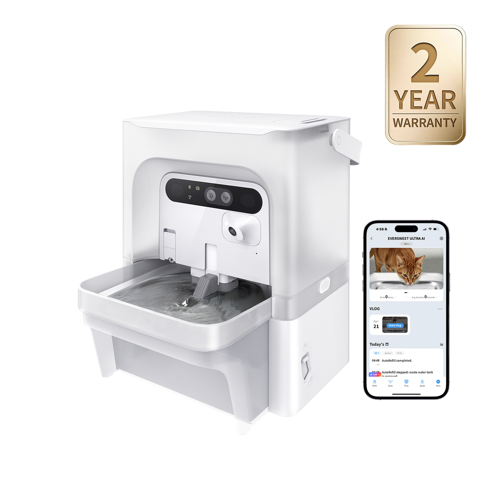
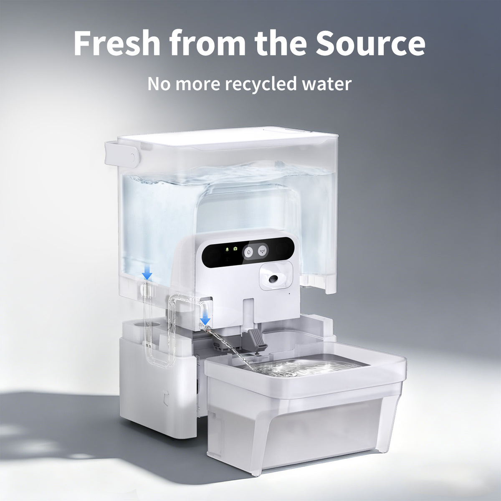
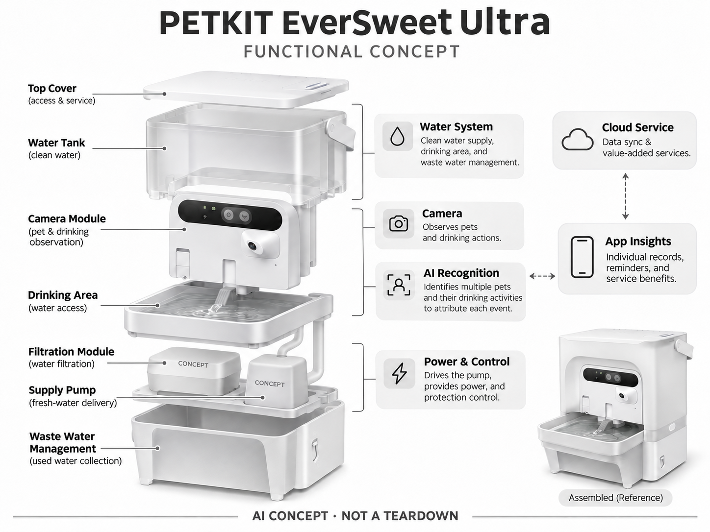

# PETKIT EverSweet Ultra

**PETKIT** · 宠物照护 · 核查 2026-11-04

通过相机识别把家庭饮水观察细化到每只宠物

消费渠道：个人零售。

## 产品图片与结构参考

### 产品图

PETKIT EverSweet Ultra 官方产品外观图 · 来源：[PETKIT · 官方图片](<https://www.petkit.com/products/eversweet-ultra-with-camera-pet-water-fountain>) · [原始图片](<https://cdn.shopify.com/s/files/1/0569/0526/9388/files/eversweet-ultra-main-2yr-warranty.png?v=1787813520&width=1200>)

### 参考图

PETKIT EverSweet Ultra 官方场景或功能参考图 · 来源：[PETKIT · 官方图片](<https://www.petkit.com/products/eversweet-ultra-with-camera-pet-water-fountain>) · [原始图片](<https://cdn.shopify.com/s/files/1/0569/0526/9388/files/eversweet-ultra-oneway-mechanism.jpg?v=1778315923&width=1200>)

### AI 生成爆炸示意

**AI 生成 · 非实物拆机。** 内部为概念推断，不能作为元件布局、BOM 或维修依据。[生成提示词](../../content/hardware/prompts/petkit-eversweet-ultra.txt)

> 依据官方外观参考与公开功能生成；未披露的内部布局只作概念模块，不构成BOM或真实结构证据。

> 本图已局部校正：供水泵术语。修订提示词：content/hardware/prompts/petkit-eversweet-ultra-revision.txt。

> 保留官方图原始内容与出处；画面中的营销声明不视为独立验证。

> 分析为基于公开资料的案头研究与 AI 辅助判断，未经用户访谈、销量审计或实物拆机。需求、画像、竞争冷门度、审美及商业机会均为研究假设，不是投资结论。

## 销售与购买

- 状态：在售。官方商店显示白色EverSweet Ultra单机价格及Add to cart，摄像头版本与普通无摄像饮水机区分。

- 地区：美国官方零售；其他地区须分别确认

- 价格：US$249.99。核查日官方页面参考；税运、订阅及优惠条件另计。会员价、服务套餐与硬件买断价不可直接混用。

- 中国大陆：本轮核实国际官方渠道；未核实中国大陆该型号的官方现货、地区服务与保修，不把跨境硬件可送达等同于全部AI功能可用。

- [官方产品 / 商店](<https://www.petkit.com/products/eversweet-ultra-with-camera-pet-water-fountain>)

## AI 的实际作用

AI相机识别不同宠物及饮水行为，帮助把饮水事件归属到个体；供水泵和水路本身不属于AI。

服务与联网依赖：需要App配对获取个体和饮水洞察；录像、摘要及其它增值功能可能受Care+方案约束，需确认服务地区。

## 是否冷门

细分专业（研究判断）：家庭宠物照护是细分消费任务，需求取决于宠物习惯、主人投入与长期服务；已有替代产品，冷门不等于低竞争或高利润。

## 需求与市场

需求假设：多猫家庭难以知道究竟哪只猫更少喝水，普通水位变化也无法区分蒸发与饮用。应比较视频归属、漏记和日常清洗劳动，确认个体观察是否比简单换水提醒更有价值。

### 产品任务与边界 · 研究判断

需求假设：多猫家庭难以知道究竟哪只猫更少喝水，普通水位变化也无法区分蒸发与饮用。应比较视频归属、漏记和日常清洗劳动，确认个体观察是否比简单换水提醒更有价值。

依据：[PETKIT EverSweet Ultra 官方商店](<https://www.petkit.com/products/eversweet-ultra-with-camera-pet-water-fountain>) · [PETKIT Health 官方AI能力说明](<https://www.petkit.com/pages/petkit-health>)

### 需求判断 · 研究判断

清水与废水分离是供水结构价值，相机归属则是观察价值，两者需要分别证明。若用户主要担心忘记换水，简单提醒可能足够；若真正需要知道哪只宠物喝了多少，只有访问和动作识别仍可能留下关键测量缺口。

依据：[PETKIT EverSweet Ultra 官方商店](<https://www.petkit.com/products/eversweet-ultra-with-camera-pet-water-fountain>) · [PETKIT Health 官方AI能力说明](<https://www.petkit.com/pages/petkit-health>)

### 需求验证 · 待验证

可人工标注宠物接近、舔水和离开，再与设备记录及实际水量变化比较，统计错归、漏记和清洗。保留家中其他水源的使用情况，不能把饮水次数直接换算为摄入，也不由观察曲线推断健康改善或治疗效果。

依据：[PETKIT EverSweet Ultra 官方商店](<https://www.petkit.com/products/eversweet-ultra-with-camera-pet-water-fountain>) · [PETKIT Health 官方AI能力说明](<https://www.petkit.com/pages/petkit-health>)

## 用户画像

画像推断：已愿意使用宠物饮水机、关注多宠饮水习惯的主人，尤其希望把记录提供给兽医的人。需要理解次数与饮水量并非一回事，设备数据不能被当成完整的健康诊断或治疗目标。

### 适用行为与条件 · 研究判断

画像推断：已愿意使用宠物饮水机、关注多宠饮水习惯的主人，尤其希望把记录提供给兽医的人。需要理解次数与饮水量并非一回事，设备数据不能被当成完整的健康诊断或治疗目标。

依据：[PETKIT EverSweet Ultra 官方商店](<https://www.petkit.com/products/eversweet-ultra-with-camera-pet-water-fountain>) · [PETKIT Health 官方AI能力说明](<https://www.petkit.com/pages/petkit-health>)

### 人群取舍 · 研究判断

已有饮水机习惯的主人更容易理解泵和水箱维护，但未必愿意为个体记录增加订阅。多宠外貌、站位及其他水碗会影响数据完整，画像应包含记录用途与维护分工，而不是仅以关心宠物健康或多猫家庭概括。

依据：[PETKIT EverSweet Ultra 官方商店](<https://www.petkit.com/products/eversweet-ultra-with-camera-pet-water-fountain>) · [PETKIT Health 官方AI能力说明](<https://www.petkit.com/pages/petkit-health>)

### 画像验证 · 待验证

画像验证应让主人说明希望从数据做什么，再完成换清水、处理废水和相机设置，记录是否持续复核。区分需要换水提醒、个体访问或可信摄入的人，避免把希望安心的情绪直接解释为需要更复杂的视觉饮水系统。

依据：[PETKIT EverSweet Ultra 官方商店](<https://www.petkit.com/products/eversweet-ultra-with-camera-pet-water-fountain>) · [PETKIT Health 官方AI能力说明](<https://www.petkit.com/pages/petkit-health>)

## 竞争与替代

竞争判断：饮水机本身竞争密集，AI个体识别是较窄的新功能。它同时与分区放置普通水碗、称重方案和宠物摄像头竞争；高价能否被接受取决于有用信息与维护负担的平衡。

### 比较对象与差异 · 研究判断

竞争判断：饮水机本身竞争密集，AI个体识别是较窄的新功能。它同时与分区放置普通水碗、称重方案和宠物摄像头竞争；高价能否被接受取决于有用信息与维护负担的平衡。

依据：[PETKIT EverSweet Ultra 官方商店](<https://www.petkit.com/products/eversweet-ultra-with-camera-pet-water-fountain>) · [PETKIT Health 官方AI能力说明](<https://www.petkit.com/pages/petkit-health>)

### 竞争判断 · 研究判断

清废分离与传统循环饮水不同，比较时不能套用普通循环泵的维护叙事。视觉身份是细分差异，但普通分区水碗、称重和相机组合也可提供部分信息，产品需要证明新增数据值得相应清洗、耗材和服务成本。

依据：[PETKIT EverSweet Ultra 官方商店](<https://www.petkit.com/products/eversweet-ultra-with-camera-pet-water-fountain>) · [PETKIT Health 官方AI能力说明](<https://www.petkit.com/pages/petkit-health>)

### 竞争验证 · 待验证

可比较清废分离相机方案与普通饮水机、独立水碗的维护和有用记录，明确实际会员条件。先固定用户要解决的任务，再评价传感组合，不能仅因拍到饮水或有多宠档案就认定优于简单方案。

依据：[PETKIT EverSweet Ultra 官方商店](<https://www.petkit.com/products/eversweet-ultra-with-camera-pet-water-fountain>) · [PETKIT Health 官方AI能力说明](<https://www.petkit.com/pages/petkit-health>)

## 供应链

供应链分析：食品接触水路、泵、滤芯、密封、电源隔离与相机标定需同时设计。芯片厂商和制造工厂未披露；水垢、生物膜、清洗残留与耗材供应比单次算法演示更影响长期体验。

### 功能模块拆分 · 研究判断

功能层包括清水供给、饮用区域和废水管理、相机、个体及饮水动作识别、泵与电源控制、应用洞察。公开信息没有完整厂商与物料表，也不能把供水结构误写成传统循环或把事件识别推定为内置精确流量测量。

依据：[PETKIT EverSweet Ultra 官方商店](<https://www.petkit.com/products/eversweet-ultra-with-camera-pet-water-fountain>) · [PETKIT Health 官方AI能力说明](<https://www.petkit.com/pages/petkit-health>)

### 制造与供应约束 · 研究判断

供应链分析：食品接触水路、泵、滤芯、密封、电源隔离与相机标定需同时设计。芯片厂商和制造工厂未披露；水垢、生物膜、清洗残留与耗材供应比单次算法演示更影响长期体验。

依据：[PETKIT EverSweet Ultra 官方商店](<https://www.petkit.com/products/eversweet-ultra-with-camera-pet-water-fountain>) · [PETKIT Health 官方AI能力说明](<https://www.petkit.com/pages/petkit-health>)

### 候选与证据缺口 · 研究判断

金宝可作为水路家电电子与模塑制造候选，SGS 可支持材料、电气和环境测试评审。没有 EverSweet Ultra 点名合作证据，清废分离、食品接触与相机识别需专项验证，检测能力不能证明饮水量估计或健康洞察有效。

依据：[PETKIT EverSweet Ultra 官方商店](<https://www.petkit.com/products/eversweet-ultra-with-camera-pet-water-fountain>) · [PETKIT Health 官方AI能力说明](<https://www.petkit.com/pages/petkit-health>)

## 技术路径

官方确认AI多宠识别和饮水习惯追踪。技术判断：动物头部遮挡、反光水面和夜间条件影响判断，应区分接近、舔水与喝水。未经称重或流量验证，不应把识别事件直接换算为精确摄入量。

### 已披露技术边界 · 研究判断

官方确认AI多宠识别和饮水习惯追踪。技术判断：动物头部遮挡、反光水面和夜间条件影响判断，应区分接近、舔水与喝水。未经称重或流量验证，不应把识别事件直接换算为精确摄入量。

依据：[PETKIT EverSweet Ultra 官方商店](<https://www.petkit.com/products/eversweet-ultra-with-camera-pet-water-fountain>) · [PETKIT Health 官方AI能力说明](<https://www.petkit.com/pages/petkit-health>)

### 系统难点判断 · 研究判断

相机看到头部靠近不一定确认持续喝水，水面反光、夜间和遮挡也会改变判断。系统需要明确接近、饮水事件与摄入量的差别，并给出缺失和纠错路径，不能把图表的精确外观当作真实测量精度。

依据：[PETKIT EverSweet Ultra 官方商店](<https://www.petkit.com/products/eversweet-ultra-with-camera-pet-water-fountain>) · [PETKIT Health 官方AI能力说明](<https://www.petkit.com/pages/petkit-health>)

### 技术验证 · 待验证

验证应把身份、动作与水量分别标注，覆盖多宠、遮挡和其他水源，检查误归和遗漏。对网络与会员变化单独核对，不能用一次正确识别或某段稳定曲线推断全天摄入完整，也不据算法趋势直接作健康处置。

依据：[PETKIT EverSweet Ultra 官方商店](<https://www.petkit.com/products/eversweet-ultra-with-camera-pet-water-fountain>) · [PETKIT Health 官方AI能力说明](<https://www.petkit.com/pages/petkit-health>)

## 产品审美

审美判断：透明水箱让余量可见，家电化外壳方便融入生活区。相机角度、宠物站位及泵的声音影响接受度；拆洗时是否能避开电子部件，也应纳入设计评价而不只是比较外壳轮廓。

### 外观与交互语言 · 研究判断

审美判断：透明水箱让余量可见，家电化外壳方便融入生活区。相机角度、宠物站位及泵的声音影响接受度；拆洗时是否能避开电子部件，也应纳入设计评价而不只是比较外壳轮廓。

依据：[PETKIT EverSweet Ultra 官方商店](<https://www.petkit.com/products/eversweet-ultra-with-camera-pet-water-fountain>) · [PETKIT Health 官方AI能力说明](<https://www.petkit.com/pages/petkit-health>)

### 使用中审美判断 · 研究判断

透明水箱帮助看到余量，实际使用还包含废水、电子部件和宠物站位。相机位置不应妨碍饮水，泵声与清洁拆卸也影响接受，设计应让清水和废水路径容易分辨，不能只强调家电化外壳而隐藏需要经常处理的部分。

依据：[PETKIT EverSweet Ultra 官方商店](<https://www.petkit.com/products/eversweet-ultra-with-camera-pet-water-fountain>) · [PETKIT Health 官方AI能力说明](<https://www.petkit.com/pages/petkit-health>)

### 设计验证 · 待验证

设计验证应观察宠物自愿接近、主人补水倒废水和拆洗，记录滴漏、误装及是否容易碰湿电子部分。还需检查维护后相机角度和水路状态，不以新品透明水箱的整洁推断长期使用同样容易保持卫生。

依据：[PETKIT EverSweet Ultra 官方商店](<https://www.petkit.com/products/eversweet-ultra-with-camera-pet-water-fountain>) · [PETKIT Health 官方AI能力说明](<https://www.petkit.com/pages/petkit-health>)

## 关键风险

风险判断：漏水、电源、滤芯更换和污水清理仍是基础风险，AI并不减少必要清洁。饮水数据可能受到其它水源影响，健康异常应结合真实观察与兽医意见，不能仅依据设备曲线行动。

### 主要失效与依赖 · 研究判断

风险判断：漏水、电源、滤芯更换和污水清理仍是基础风险，AI并不减少必要清洁。饮水数据可能受到其它水源影响，健康异常应结合真实观察与兽医意见，不能仅依据设备曲线行动。

依据：[PETKIT EverSweet Ultra 官方商店](<https://www.petkit.com/products/eversweet-ultra-with-camera-pet-water-fountain>) · [PETKIT Health 官方AI能力说明](<https://www.petkit.com/pages/petkit-health>)

### 风险传播判断 · 研究判断

其他水源、蒸发和漏记会让曲线不完整，主人可能却因为数据连续而过度相信。产品应清楚表达观察范围，AI 不减少基础清洁，漏水或供电问题也需要人工处理，健康相关疑问不能只依赖设备标签和趋势。

依据：[PETKIT EverSweet Ultra 官方商店](<https://www.petkit.com/products/eversweet-ultra-with-camera-pet-water-fountain>) · [PETKIT Health 官方AI能力说明](<https://www.petkit.com/pages/petkit-health>)

### 风险验证 · 待验证

风险验证应演练缺水、废水处理、网络中断与相机遮挡，检查用户是否能理解实际运行状态。记录清洗和耗材条件，不把事件识别当作摄入测量，也不以无告警推定宠物健康正常或长期供水一定可靠。

依据：[PETKIT EverSweet Ultra 官方商店](<https://www.petkit.com/products/eversweet-ultra-with-camera-pet-water-fountain>) · [PETKIT Health 官方AI能力说明](<https://www.petkit.com/pages/petkit-health>)

## 机会与验证

机会假设：研究主人真正需要的是缺水提醒、个体访问还是可信饮用量，选择最简单的传感方案。可以先用小样本人工标注视频验证漏记和误归属，再评估专用硬件及订阅是否合理。

### 可能的机会入口 · 研究判断

机会假设：研究主人真正需要的是缺水提醒、个体访问还是可信饮用量，选择最简单的传感方案。可以先用小样本人工标注视频验证漏记和误归属，再评估专用硬件及订阅是否合理。

依据：[PETKIT EverSweet Ultra 官方商店](<https://www.petkit.com/products/eversweet-ultra-with-camera-pet-water-fountain>) · [PETKIT Health 官方AI能力说明](<https://www.petkit.com/pages/petkit-health>)

### 机会成立条件 · 研究判断

机会在于先确认主人要解决的是维护、个体归属还是摄入，再选择最简单且可信的传感。若信息只停留在谁来过，相机足以帮助部分家庭；若需要精确数量，则必须建立独立测量证据，不能靠更丰富文字摘要补足。

依据：[PETKIT EverSweet Ultra 官方商店](<https://www.petkit.com/products/eversweet-ultra-with-camera-pet-water-fountain>) · [PETKIT Health 官方AI能力说明](<https://www.petkit.com/pages/petkit-health>)

### 下一步验证 · 待验证

下一步可用小规模人工标注与实际维护日志比较不同方案，记录身份、漏记和用户采取的行动，再评估专用硬件与服务。用有用信息和劳动平衡决定投入，避免把健康关切、喝水次数或漂亮曲线直接当作商业需求。

依据：[PETKIT EverSweet Ultra 官方商店](<https://www.petkit.com/products/eversweet-ultra-with-camera-pet-water-fountain>) · [PETKIT Health 官方AI能力说明](<https://www.petkit.com/pages/petkit-health>)

## 对应供应链公司

能力候选用于选型研究，不代表本产品实际采用；未公开的供货关系不作推断。

- [new-kinpo-group](../supply-chain/new-kinpo-group.md) — **能力候选 · 非已采用** / 清废分离饮水结构与电子制造：金宝的家电、PCBA及模塑能力可对应水箱、泵控制和电子整合评估，但清废分离、密封与接触材料需专项确认；没有 EverSweet Ultra 点名供货证据，仅列制造候选。

- [sgs](../supply-chain/sgs.md) — **能力候选 · 非已采用** / 宠物饮水材料电气与可靠性测试：SGS 的材料、电气和环境测试可支持饮水设备的具体要求评审，但须确认方法与实验室；未见 EverSweet Ultra 合作披露，检测不能证明 AI 饮水量或健康趋势有效。

[浏览供应链目录](../supply-chain.md)

## 功能分层示意

这是功能关系，不是实物拆机、真实空间结构或已核实 BOM。

1. **水路**：清水、饮用区域及废水管理。（官方披露）

2. **相机**：观察宠物与饮水动作。（官方披露）

3. **AI区分**：多宠身份和饮水活动识别。（官方披露）

4. **能源控制**：泵、电源与保护控制为功能模块。（分析推断）

5. **App洞察**：个体记录、提醒及服务权益。（官方披露）

## 来源

1. [PETKIT EverSweet Ultra 官方商店](<https://www.petkit.com/products/eversweet-ultra-with-camera-pet-water-fountain>) — 已实际打开；核查购物入口、产品形态与AI声明，未完成支付或收货。

2. [PETKIT Health 官方AI能力说明](<https://www.petkit.com/pages/petkit-health>) — 已实际打开的官方技术或服务说明；厂商声明不视为独立性能或疗效验证。

[返回目录](../hardware-market.md) · [网页分析](https://romanagent.github.io/Roman/#hardware/product/petkit-eversweet-ultra)
